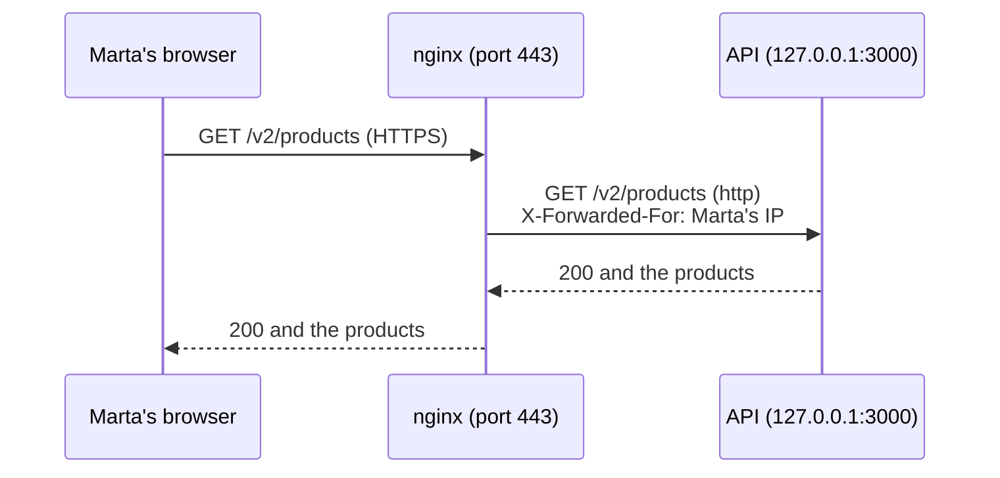

import Term from '~/components/Term.astro';
import TryIt from '~/components/TryIt.astro';
import Analogy from '~/components/Analogy.astro';
import ProjectCode from '~/components/ProjectCode.astro';
import Quiz from '~/components/Quiz.astro';
import QuizQuestion from '~/components/QuizQuestion.astro';
import QuizOption from '~/components/QuizOption.astro';

## The problem

The shop already works on your server, but nobody can get in. Marta opens `http://192.168.5.15:3000` and nothing comes back: in [lesson 3](/en/phase-8/docker-compose-production/), the API was published only on `127.0.0.1`, on purpose.

You could publish it for everyone, but Node would have to take care of HTTPS, and the API would bypass the firewall, as you saw in [lesson 2](/en/phase-8/secure-linux-server/#docker-bypasses-ufw). And the day it hangs, Marta will see a tab that loads forever.

**Almost every website solves it the same way:** in front of the program they put another server that faces the world for it. In this lesson, that server is nginx.

## The analogy

<Analogy>

Think of a company's switchboard. You call a single number, the company's, and the operator puts you through to the extension you're looking for.

As she puts you through, she tells her colleague which number you're calling from. If nobody picks up the extension, she's the one who answers you: "I can't put you through." And if two colleagues handle the same thing, she shares the calls between them.

<div slot="limits">

- The operator understands the conversation; nginx doesn't. It doesn't know what an order is or check passwords: the API does that.
- An operator can see whether her colleague is at their desk. nginx doesn't ask: it finds out when a real request fails.

</div>

</Analogy>

## How it really works

### A server that faces the world for another

A *proxy* is a go-between. An office's proxy works for whoever is browsing: it goes out to the internet on their behalf. A <Term id="reverse-proxy">reverse proxy</Term> works for the server: it receives what arrives from the internet and passes it on to the program behind it.



What having it in front gives you:

- **A single door.** Only nginx listens outside, on the 80 and 443 you opened in the [firewall](/en/phase-8/secure-linux-server/#the-firewall-ufw): the web server we promised you in [Phase 7](/en/phase-7/docker-networking/#with-no-ip-in-front-the-port-opens-to-your-whole-network). With several names, it passes each one on to its program.
- **HTTPS, in one place.** nginx decrypts, and the API speaks plain HTTP inside.
- **A cushion for slow clients.** nginx collects the API's response and hands it to the visitor at their own pace, and the API is free again.
- **Clear errors and several copies.** If the API doesn't answer, nginx says so with a code; and it can share the work between two copies.

In [Phase 1](/en/phase-1/linux-users-and-permissions/#why-each-server-has-its-own-user) we told you your program would listen on 3000 as its own user, and nginx, on 80, would pass the requests on to it. Here it is.

### The shop's site: nginx/shop.conf

The `35-production` folder brings the shop's nginx site, `nginx/shop.conf`. First, who it passes the requests on to:

<ProjectCode file="shop-api/35-production/nginx/shop.conf" region="upstream" />

An **`upstream`** is a group of servers with a name, `shop`. It has two because the API is published on the range `127.0.0.1:3000-3001`: **a single copy can land on either port**, and in our tests it went from 3000 to 3001 when we started it again.

With a single copy, the empty port leaves a `connect() failed` line in the `error.log` now and then, even though the shop answers fine: nginx tries it, fails, moves on to the other one and sets it aside for 10 seconds.

Port 80 only redirects:

<ProjectCode file="shop-api/35-production/nginx/shop.conf" region="port-80" />

- **`server_name`**: the name it answers to. With a single site enabled, it answers to any; in [lesson 5](/en/phase-8/lets-encrypt-nginx/) you'll put yours.
- **`return 301 https://$host$request_uri`**: a <Term id="redirect">redirect</Term> to the same address, with `https`.
- **`/.well-known/acme-challenge/`**: the exception Let's Encrypt will need.

Port 443 decrypts the HTTPS:

<ProjectCode file="shop-api/35-production/nginx/shop.conf" region="https" />

`listen 443 ssl` needs the certificate and its key, in `/etc/ssl/shop/`: without them, `nginx -t` fails. Today you'll create a provisional one, and the real one comes in [lesson 5](/en/phase-8/lets-encrypt-nginx/). `http2 on` turns on <Term id="http2">HTTP/2</Term>.

And what happens with each request:

<ProjectCode file="shop-api/35-production/nginx/shop.conf" region="pass" />

- **`proxy_pass http://shop`**: pass it on to the `shop` group, over `http`: inside the server there's no need to encrypt.
- **`proxy_http_version 1.1`**, `Upgrade` and `Connection`: what a WebSocket needs, with this `map` from the top of the file:

<ProjectCode file="shop-api/35-production/nginx/shop.conf" region="websocket" />

`Upgrade` and `Connection` only count for one hop: a *proxy* doesn't forward them, so nginx sets them by hand. The `map` gives `$connection_header` the value `upgrade` when the browser asks to switch to WebSocket, and leaves it empty (nginx doesn't send it) when it doesn't.

### The visitor's IP: X-Forwarded-For

Behind nginx, the API sees every request arrive from **`172.18.0.1`**, the <Term id="gateway">gateway</Term> of Compose's network: Docker forwards what comes in through a published port, and the API sees it coming from there. That's why lesson 3 pinned the subnet.

With that address alone, [Phase 6](/en/phase-6/rate-limiting-secrets/#by-email-and-by-ip-the-shops-limits)'s attempt limit counts the whole internet as one IP. We checked it with no `TRUSTED_PROXY` in `.env`:

```sh
$ docker compose -f compose.production.yaml exec redis redis-cli --scan
"limits:accounts-ip:172.18.0.1"
…
```

Five accounts an hour for the whole shop: a single attacker would leave everyone else out. We warned you in Phase 6: behind a *proxy*, everything comes from it. The fix is a few headers nginx adds:

<ProjectCode file="shop-api/35-production/nginx/shop.conf" region="headers" />

- **`Host`**: the name the visitor typed.
- **`X-Real-IP`**: their IP, alone. The API doesn't use it.
- **<Term id="x-forwarded-for">`X-Forwarded-For`</Term>**: with `$proxy_add_x_forwarded_for`, whatever the request already carried and, **at the end, the visitor's IP**. If Marta sends `X-Forwarded-For: 203.0.113.7`, the API gets `203.0.113.7, 192.168.5.100`. Marta wrote the first one; nginx, the last.
- **`X-Forwarded-Proto`**: `https`, the protocol the visitor used. The shop doesn't use it; a program that builds links does.

### The API only trusts nginx

Anyone can write the header. That's why the API only reads it if the request comes from the address in `TRUSTED_PROXY`, `172.18.0.1`, and then keeps the last entry:

<ProjectCode file="shop-api/35-production/src/rate-limits.ts" region="ip" />

- **`getConnInfo(c).remote.address`**: the address on the other side of the connection. If it isn't a trusted proxy's, the header is ignored.
- **`.split(',').at(-1)`**: splits the list at the commas and takes the last entry, nginx's.

It's this step's code change. **It has a gap:** whatever connects to `127.0.0.1:3000` from the server itself also arrives from `172.18.0.1`, and can write any header it wants:

```sh
$ curl -sS -i -H 'X-Forwarded-For: 203.0.113.7' --json '{"email":"fake@shop.example","password":"long-password-of-the-fake-account"}' http://127.0.0.1:3000/v2/accounts | grep -iE '^HTTP|^ratelimit:'
HTTP/1.1 201 Created
ratelimit: "accounts-ip";r=4;t=3600
$ docker compose -f compose.production.yaml exec redis redis-cli --scan
"limits:accounts-ip:203.0.113.7"
"limits:accounts-ip:192.168.5.100"
```

Only you log in to your server, so it isn't serious. On a shared one, anyone with an account could get around the limit.

### When the API fails: 502 and 504

In [Phase 2](/en/phase-2/http-status-codes/#the-codes-that-matter) you saw that `502` and `504` say "the one behind me failed." Now the one in front is yours:

| Code | What happened to nginx | In nginx's `error.log` |
|---|---|---|
| `502 Bad Gateway` | It couldn't talk to the API: nobody is listening on the port | `connect() failed (111: Connection refused)` |
| `504 Gateway Time-out` | The API accepted the request, but didn't answer within 60 seconds | `upstream timed out (110: Connection timed out)` |

The 60 seconds are `proxy_read_timeout`. **The `error.log` always says what happened:** it's the first place to look.

When a server in the `upstream` fails, nginx **tries the next one**, and gives you the code of the last attempt. It's `proxy_next_upstream`: by default it moves on if it couldn't connect or the time ran out; a `500` from the API is passed through as it is. A `POST` already sent isn't retried (since nginx 1.9.13, no method that isn't <Term id="idempotent">idempotent</Term>, as you saw in [Phase 2](/en/phase-2/http-methods/#idempotent-repeating-it-doesnt-change-the-result)): it could happen twice. In "Try it", a sign-in waited 60 seconds and got `504`, without trying the other port.

### Two copies, and nginx finds out on its own

With two copies of the API, like [Phase 7](/en/phase-7/docker-compose/#two-copies-of-the-api-a-single-count-in-redis)'s `--scale api=2`, nginx shares out the requests: it's a <Term id="load-balancer">load balancer</Term>.

nginx doesn't ask Docker's <Term id="healthcheck">healthcheck</Term> from [Phase 7](/en/phase-7/docker-multi-stage-build/#healthcheck-is-the-shop-fine). **It watches the real requests:** with `max_fails=1`, one failure sets that copy aside for `fail_timeout=10s`. It's a passive check; the active ones belong to NGINX Plus, the paid version. The healthcheck is used by Compose and, in [lesson 6](/en/phase-8/ci-cd-github-actions/#if-the-new-version-doesnt-get-healthy-it-goes-back-on-its-own), by the deployment.

Something we saw while testing: if every copy failed within those 10 seconds, nginx answers `502` straight away, even if the API is already back:

```
2026/10/18 02:05:47 [error] 11339#11339: *25 no live upstreams while connecting to upstream, client: 192.168.5.100, server: shop.example, request: "GET /health HTTP/2.0", upstream: "http://shop/health", host: "192.168.5.15"
```

### Events that don't wait: SSE and WebSocket

An order's events, from [Phase 4](/en/phase-4/websockets-vs-sse/#server-sent-events-a-response-that-doesnt-end), are a response that doesn't end. There we promised you `proxy_buffering off`:

<ProjectCode file="shop-api/35-production/nginx/shop.conf" region="events" />

We measured it by removing this `location`, following an order and cancelling it after 3 seconds:

- **Over HTTP/1.1, almost nothing arrived:** nginx held on to the events. Only the first request after reloading it got them. Over HTTP/2, they did arrive.
- **After 60 seconds without events, nginx cut the connection.**
- **With the `location`, the events always arrived right away**, and nginx waits up to an hour between one and the next.

The cut, following an order with Marta's session: `-N` makes curl write each event as soon as it arrives, without holding on to it, and `marta.txt` is the cookie file where curl saved her session when she signed in (`-c`), which `-b` sends.

```sh
$ time curl -k -N -b marta.txt https://192.168.5.15/v2/orders/34/events
event: status
data: {"id":34,"productId":2,"quantity":1,"status":"pending","createdAt":"2026-10-18T00:09:08.935Z","customerId":2}

curl: (92) HTTP/2 stream 1 was not closed cleanly: INTERNAL_ERROR (err 2)

real	0m59.828s
…
```

**`proxy_read_timeout 1h` only applies to this route:** raising it for all of them would hide a slow API.

The WebSocket echo, `/echo`, also goes quiet for long stretches:

<ProjectCode file="shop-api/35-production/nginx/shop.conf" region="echo" />

With Phase 4's request to switch protocols, nginx answers `HTTP/1.1 101 Switching Protocols`.

### Caddy, the alternative

**Caddy** is another reverse proxy, more modern, that gets and renews HTTPS certificates on its own. We use nginx because you already installed it in Phase 2, and it's the one you'll find most on servers and in job offers.

## Try it

The goal: get from your computer to the shop through nginx, make the API know your IP even if you try to fool it, and see a `502` and a `504` with your own eyes.

The outputs are from lesson 3's VM, `192.168.5.15`: **use your server's IP**. "Your computer" was another machine, `192.168.5.100`; your IP, your times, IDs and ports will be different. On the server, work in `/opt/shop`.

### Install the site

On a freshly rented VPS, first install nginx with `sudo apt install -y nginx`. On the server, look at what nginx has now:

<TryIt
  title="1. The enabled sites"
  cmd="ls -l /etc/nginx/sites-enabled/"
  output={`total 0
lrwxrwxrwx 1 root root 34 Oct 18 02:02 default -> /etc/nginx/sites-available/default
lrwxrwxrwx 1 root root 31 Oct 18 02:02 shop -> /etc/nginx/sites-available/shop`}
>

- **`default`**: nginx's welcome page, on 80, since [Phase 1](/en/phase-1/systemd-services-and-apt/).
- **`shop`**: the shop from [Phase 2](/en/phase-2/#before-you-start-the-shops-server), on 8080, if you didn't remove it.

**The new site replaces both.**

</TryIt>

Now a provisional certificate, **self-signed**: it's signed by its own key, with no authority vouching for it. nginx starts with it, but neither curl nor the browser trusts it; [lesson 5](/en/phase-8/lets-encrypt-nginx/) replaces it.

<TryIt
  title="2. A provisional certificate"
  cmd={`sudo mkdir -p /etc/ssl/shop
sudo openssl req -x509 -newkey ec -pkeyopt ec_paramgen_curve:prime256v1 -nodes -days 30 \\
  -subj "/CN=shop.example" -keyout /etc/ssl/shop/shop.key -out /etc/ssl/shop/shop.crt
sudo ls -l /etc/ssl/shop`}
  output={`-----
total 8
-rw-r--r-- 1 root root 583 Oct 18 02:04 shop.crt
-rw------- 1 root root 241 Oct 18 02:04 shop.key`}
>

`openssl req -x509` creates a key and a certificate signed with it, for `shop.example`, valid for 30 days. `-nodes` leaves the key without a password, so nginx can read it when it starts. Look at `-rw-------`: the key, for `root` only.

</TryIt>

<TryIt
  title="3. Copy it, enable it and reload"
  cmd={`sudo cp nginx/shop.conf /etc/nginx/sites-available/shop
sudo ln -sf /etc/nginx/sites-available/shop /etc/nginx/sites-enabled/shop
sudo rm /etc/nginx/sites-enabled/default
sudo nginx -t && sudo systemctl reload nginx`}
  output={`nginx: the configuration file /etc/nginx/nginx.conf syntax is ok
nginx: configuration file /etc/nginx/nginx.conf test is successful`}
>

- **`cp`** overwrites Phase 2's shop, and **`ln -sf`** creates the link or replaces it.
- **`rm …/default`** turns off the welcome page, the default site on 80: if it stays, whoever types the IP will see "Welcome to nginx."
- **`nginx -t && … reload`**, as in Phase 2.

If `nginx -t` says `cannot load certificate`, repeat step 2. Now `curl localhost:8080/` gives `Failed to connect`: Phase 2's shop is gone.

</TryIt>

### The shop, from your computer

On **your computer**, ask for the shop over http:

<TryIt
  title="4. Over http, a redirect"
  cmd="curl -i http://192.168.5.15/health"
  windows="curl.exe -i http://192.168.5.15/health"
  output={`HTTP/1.1 301 Moved Permanently
Server: nginx/1.28.3 (Ubuntu)
…
Location: https://192.168.5.15/health
…`}
>

nginx answers on its own: `301` to the same address with `https`. On Windows, `curl.exe`: in PowerShell, `curl` is a different command.

</TryIt>

<TryIt
  title="5. Over https"
  cmd={`curl https://192.168.5.15/health
curl -k -i https://192.168.5.15/health`}
  windows={`curl.exe https://192.168.5.15/health
curl.exe -k -i https://192.168.5.15/health`}
  output={`curl: (60) SSL: certificate subject name 'shop.example' does not match target hostname '192.168.5.15'
…
HTTP/2 200 
server: nginx/1.28.3 (Ubuntu)
…
strict-transport-security: max-age=15552000; includeSubDomains
…
x-request-id: 04aeb734-a084-4e99-92fd-735fc84d148e
x-xss-protection: 0

{"status":"ok"}`}
>

On its own, curl refuses. `(60)`: the certificate is for `shop.example`, not for the IP, and no authority curl knows signed it (the text changes depending on your system). **`-k` skips that check:** the connection is encrypted, but without knowing who you're talking to. Use it only to test your own server; [lesson 5](/en/phase-8/lets-encrypt-nginx/) shows you how to drop it.

With `-k`, `HTTP/2 200` and `{"status":"ok"}`: **the API answers you through nginx**, with `server: nginx` next to its headers. If you get `502`, the API is stopped.

</TryIt>

### Who are you to the API?

On the server, check that `TRUSTED_PROXY`, in `.env` since lesson 3, is the network's gateway:

<TryIt
  title="6. The trusted address"
  cmd={`docker network inspect shop_default --format "{{(index .IPAM.Config 0).Gateway}}"
grep ^TRUSTED_PROXY .env`}
  output={`172.18.0.1
TRUSTED_PROXY=172.18.0.1`}
>

They must match. If they don't, change `TRUSTED_PROXY` and recreate the API: `docker compose -f compose.production.yaml up -d api`.

</TryIt>

From **your computer**, create Marta's account, and another one with a made-up `X-Forwarded-For`:

<TryIt
  title="7. Two new accounts"
  cmd={`curl -k -sS -i --json '{"email":"marta@shop.example","password":"a-long-password-for-marta-27"}' https://192.168.5.15/v2/accounts | grep -iE '^HTTP|^ratelimit|^\\{'
curl -k -sS -i -H 'X-Forwarded-For: 203.0.113.7' --json '{"email":"pablo@shop.example","password":"another-long-password-for-pablo-38"}' https://192.168.5.15/v2/accounts | grep -iE '^HTTP|^ratelimit|^\\{'`}
  windows={`'{"email":"marta@shop.example","password":"a-long-password-for-marta-27"}' | Set-Content marta.json
'{"email":"pablo@shop.example","password":"another-long-password-for-pablo-38"}' | Set-Content pablo.json
curl.exe -k -sS -i -H "Content-Type: application/json" --data "@marta.json" https://192.168.5.15/v2/accounts
curl.exe -k -sS -i -H "X-Forwarded-For: 203.0.113.7" -H "Content-Type: application/json" --data "@pablo.json" https://192.168.5.15/v2/accounts`}
  output={`HTTP/2 201 
ratelimit: "accounts-ip";r=4;t=3600
ratelimit-policy: "accounts-ip";q=5;w=3600
{"id":2,"email":"marta@shop.example","role":"customer"}
HTTP/2 201 
ratelimit: "accounts-ip";r=3;t=3600
ratelimit-policy: "accounts-ip";q=5;w=3600
{"id":3,"email":"pablo@shop.example","role":"customer"}`}
>

Look at **`r`**, the accounts you have left this hour: `4` and then `3`. **The made-up header didn't work:** both come out of your IP's count. On Windows, the JSON goes in a file, because PowerShell handles quotes differently.

If you get `r=4` twice, go back over step 6.

</TryIt>

<TryIt
  title="8. What Redis wrote down"
  cmd="docker compose -f compose.production.yaml exec redis redis-cli --scan"
  output={`"limits:accounts-ip:192.168.5.100"`}
>

On the server, `--scan` lists Redis's keys. Just one, with **your computer's IP**: neither `172.18.0.1` nor `203.0.113.7`.

</TryIt>

### A 502: the API stopped

On the server, stop the API:

<TryIt
  title="9. Stop the API"
  cmd="docker compose -f compose.production.yaml stop api"
  output={`[+] stop 1/1
 ✔ Container shop-api-1 Stopped                                             0.1s`}
>

nginx keeps running; behind it, nobody.

</TryIt>

<TryIt
  title="10. From your computer"
  cmd="curl -k -i https://192.168.5.15/health"
  windows="curl.exe -k -i https://192.168.5.15/health"
  output={`HTTP/2 502 
server: nginx/1.28.3 (Ubuntu)
date: Sun, 18 Oct 2026 00:04:36 GMT
content-type: text/html
content-length: 166

<html>
<head><title>502 Bad Gateway</title></head>
<body>
<center><h1>502 Bad Gateway</h1></center>
<hr><center>nginx/1.28.3 (Ubuntu)</center>
</body>
</html>`}
>

The page is nginx's, and it arrives straight away.

</TryIt>

<TryIt
  title="11. What nginx says, and the way back"
  cmd={`sudo tail -2 /var/log/nginx/error.log
docker compose -f compose.production.yaml start api`}
  output={`2026/10/18 02:04:36 [error] 11339#11339: *16 connect() failed (111: Connection refused) while connecting to upstream, client: 192.168.5.100, server: shop.example, request: "GET /health HTTP/2.0", upstream: "http://127.0.0.1:3001/health", host: "192.168.5.15"
2026/10/18 02:04:36 [error] 11339#11339: *16 connect() failed (111: Connection refused) while connecting to upstream, client: 192.168.5.100, server: shop.example, request: "GET /health HTTP/2.0", upstream: "http://127.0.0.1:3000/health", host: "192.168.5.15"
…`}
>

One line per port in the `upstream`: **`Connection refused`** on both. `client` is your computer. `start` starts the API again.

</TryIt>

### A 504: the API hung

`docker compose pause` freezes the container: it accepts connections, but doesn't answer. On the server:

<TryIt
  title="12. Freeze the API"
  cmd="docker compose -f compose.production.yaml pause api"
  output={`[+] pause 1/1
 ✔ Container shop-api-1 Paused                                              0.0s`}
>

`Paused`: the API's process, stopped dead.

</TryIt>

From your computer, Marta signs in, a `POST` nginx doesn't retry. **It takes a minute.**

<TryIt
  title="13. A minute of waiting"
  cmd={`time curl -k -i --json '{"email":"marta@shop.example","password":"a-long-password-for-marta-27"}' https://192.168.5.15/v2/session`}
  windows={`curl.exe -k -i -H "Content-Type: application/json" --data "@marta.json" https://192.168.5.15/v2/session`}
  output={`HTTP/2 504 
server: nginx/1.28.3 (Ubuntu)
date: Sun, 18 Oct 2026 00:07:07 GMT
content-type: text/html
content-length: 176

<html>
<head><title>504 Gateway Time-out</title></head>
<body>
<center><h1>504 Gateway Time-out</h1></center>
<hr><center>nginx/1.28.3 (Ubuntu)</center>
</body>
</html>

real	0m59.783s
user	0m0.010s
sys	0m0.007s`}
>

`time` measures **almost 60 seconds**, the `proxy_read_timeout` (PowerShell has no `time`). With a `GET` you could see a `502` after that minute: nginx retries it on the empty port.

</TryIt>

<TryIt
  title="14. The API wakes up… and handles it"
  cmd={`sudo tail -1 /var/log/nginx/error.log
docker compose -f compose.production.yaml unpause api
docker compose -f compose.production.yaml logs api --since 90s | grep -v /health`}
  output={`2026/10/18 02:07:07 [error] 11339#11339: *30 upstream timed out (110: Connection timed out) while reading response header from upstream, client: 192.168.5.100, server: shop.example, request: "POST /v2/session HTTP/2.0", upstream: "http://127.0.0.1:3001/v2/session", host: "192.168.5.15"
[+] unpause 1/1
 ✔ Container shop-api-1 Unpaused                                            0.0s
api-1  | {"level":30,"time":1792282028062,"pid":1,"hostname":"d7cad8257879","requestId":"d2cfcce7-e1bd-4856-b26e-375e138e5ef8","method":"POST","path":"/v2/session","status":200,"ms":80,"msg":"request"}`}
>

`upstream timed out`: the `504`. And the surprising part: **when it woke up, the API handled the sign-in**, with `"status":200`, even though nginx had already answered Marta. **A `504` doesn't undo anything:** the request may have gone through, or not.

</TryIt>

### Two copies behind nginx

<TryIt
  title="15. Two copies"
  cmd={`docker compose -f compose.production.yaml up -d --scale api=2
docker compose -f compose.production.yaml ps api --format "table {{.Name}}\\t{{.Status}}\\t{{.Ports}}"`}
  output={`…
NAME         STATUS                    PORTS
shop-api-1   Up 6 minutes (healthy)    127.0.0.1:3001->3000/tcp
shop-api-2   Up 12 seconds (healthy)   127.0.0.1:3000->3000/tcp`}
>

One copy on each port of the `upstream`.

</TryIt>

From your computer, four requests; then, on the server, who handled them:

<TryIt
  title="16. Who answers?"
  cmd={`for i in 1 2 3 4; do curl -k -s -o /dev/null -w "%{http_code} " https://192.168.5.15/v2/products; done; echo
# on the server:
docker compose -f compose.production.yaml logs api --since 20s | grep /v2/products | cut -c1-90`}
  windows={`1..4 | ForEach-Object { curl.exe -k -s -o NUL -w "%{http_code} " https://192.168.5.15/v2/products }
# on the server:
docker compose -f compose.production.yaml logs api --since 20s | grep /v2/products | cut -c1-90`}
  output={`200 200 200 200 
api-2  | {"level":30,"time":1792282244175,"pid":1,"hostname":"2b20e29acf11","requestId":"b
api-2  | {"level":30,"time":1792282244214,"pid":1,"hostname":"2b20e29acf11","requestId":"4
api-1  | {"level":30,"time":1792282244201,"pid":1,"hostname":"d7cad8257879","requestId":"a
api-1  | {"level":30,"time":1792282244226,"pid":1,"hostname":"d7cad8257879","requestId":"5`}
>

The `for` loop repeats the `curl` four times, and `-w` writes only the code. Two for each copy: **nginx shares them out**.

</TryIt>

Now bring one copy down and ask again:

<TryIt
  title="17. One copy down"
  cmd={`docker stop shop-api-2
# on your computer, the four requests again; then, on the server:
sudo tail -2 /var/log/nginx/error.log
docker start shop-api-2`}
  output={`shop-api-2
200 200 200 200 
…
2026/10/18 02:10:44 [error] 21465#21465: *195 connect() failed (111: Connection refused) while connecting to upstream, client: 192.168.5.100, server: shop.example, request: "GET /v2/products HTTP/2.0", upstream: "http://127.0.0.1:3000/v2/products", host: "192.168.5.15"
shop-api-2`}
>

**All four, `200`.** One ran into the copy that was down, the one on 3000: nginx passed it on to the other one and set that copy aside for 10 seconds. It's the passive check. `docker start` starts it again.

</TryIt>

`docker compose -f compose.production.yaml up -d`, without `--scale`, goes back to one copy. The shop is left with nginx in front: [lesson 5](/en/phase-8/lets-encrypt-nginx/) gives it a name and a real certificate.

**On a VPS, everything is the same with its public IP**, but from now on anyone on the internet can get in. The provider's firewall must also let 80 and 443 through (lesson 2).

## You have already seen it

- **This website.** `curl -I https://backenddesdecero.com` answers with `server: cloudflare`: there's a reverse proxy in front, Cloudflare's.
- **Other websites' error pages.** A "502 Bad Gateway" with `nginx` or `cloudflare` at the bottom isn't from the website: it's from the proxy, saying the website behind it isn't answering.

## Common mistakes

- **Leaving the `default` site.** Over http, the server's IP shows "Welcome to nginx" instead of redirecting to the shop.
- **Reading the first entry of `X-Forwarded-For`, or trusting it wherever it comes from.** Only the last one, and only if the connection comes from your proxy.
- **A `TRUSTED_PROXY` that isn't your network's gateway.** All your visitors share one limit.
- **A `location` with its own `proxy_set_header`.** It stops inheriting the outer ones and loses `X-Forwarded-For`. If you add one, repeat them all.
- **Raising `proxy_read_timeout` for everything.** It hides hangs: raise it only where it's needed.

## Summary

- A reverse proxy receives the requests and passes them on to your program, which stays behind: one door, HTTPS in one place and clear errors.
- `proxy_pass http://shop` passes each request on to the `upstream`, with the API's two possible ports.
- The API reads the last entry of `X-Forwarded-For`, nginx's, and only if the request comes from `TRUSTED_PROXY`.
- `502`: nobody answers. `504`: the API didn't respond within 60 seconds. The `error.log` says which.
- SSE events need `proxy_buffering off` and a long `proxy_read_timeout`, only on their route.

## Did you get it?

<Quiz>

<QuizQuestion
  question="It’s three in the morning and the shop answers 504 to everything. What does that tell you before you look at anything?"
  review="When the API fails: 502 and 504"
>

<QuizOption text="That nginx is down and needs restarting.">

If nginx were down, there'd be no `504` at all: nginx is the one that writes it.

</QuizOption>

<QuizOption text="That the API accepts the connections but doesn’t answer in time." correct>

`504` is "the one behind me didn't respond within the waiting time." The API is running but hung, and the `error.log` will say `upstream timed out`.

</QuizOption>

<QuizOption text="That the API is stopped and nobody listens on the port where nginx looks for it.">

That gives `502`, and straight away: `Connection refused`. With a `504`, the connection opened and nginx waited 60 seconds.

</QuizOption>

</QuizQuestion>

<QuizQuestion
  question="A request reaches the API with X-Forwarded-For: 10.0.0.5, 198.51.100.20, over a connection from 172.18.0.1. Which IP should the attempt limit record?"
  review="The API only trusts nginx"
>

<QuizOption text="198.51.100.20, the last one, the one nginx added." correct>

The connection comes from the trusted address: the header is read, and only its last entry, your nginx's.

</QuizOption>

<QuizOption text="10.0.0.5, the first one: it’s the original visitor’s.">

Anyone can write the first one; only the last one comes from your proxy.

</QuizOption>

<QuizOption text="172.18.0.1: anyone can write the header, so it’s never read.">

nginx arrives from `172.18.0.1`, and it's trusted. Ignoring the header would make every visitor share one limit.

</QuizOption>

</QuizQuestion>

<QuizQuestion
  question="You add the line proxy_set_header Cache-Control no-cache; to the events location. Since then, the API thinks everyone following an order is 172.18.0.1. Why?"
  review="Common mistakes"
>

<QuizOption text="Because Cache-Control replaces X-Forwarded-For: only one header fits per location.">

A `location` can set as many headers as it wants; the problem is that it stops inheriting the outer ones.

</QuizOption>

<QuizOption text="Because proxy_buffering off deletes the visitor’s headers.">

`proxy_buffering` only decides whether nginx holds on to the response before passing it on. It doesn't touch the request's headers.

</QuizOption>

<QuizOption text="Because a location with its own proxy_set_header stops inheriting the server’s." correct>

nginx inherits the outer `proxy_set_header` lines only if the `location` defines none. With one of its own, you have to repeat `Host`, `X-Forwarded-For` and the rest.

</QuizOption>

</QuizQuestion>

<QuizQuestion
  question="Your VM answers “Welcome to nginx!” when you open http://192.168.5.15, even though nginx -t approved the shop’s site. What’s missing?"
  review="Install the site"
>

<QuizOption text="Removing the default site, which handles port 80 by default." correct>

`default` has `default_server` on 80 and answers any name no other site claims, like the IP. Without it, the shop handles everything.

</QuizOption>

<QuizOption text="Rebooting the server: nginx doesn’t read new sites until it starts.">

`systemctl reload nginx` already makes it read the configuration. Rebooting doesn't change who handles port 80.

</QuizOption>

<QuizOption text="Opening port 443 in ufw: without it, nginx shows the welcome page.">

`ufw` doesn't choose which page you see: it lets traffic through or not. If 443 were closed, the connection wouldn't reach nginx.

</QuizOption>

</QuizQuestion>

<QuizQuestion
  question="Without the events location, someone follows an order from the browser and, after exactly a minute, the connection is cut even though the order is still open. What cuts it?"
  review="Events that don't wait: SSE and WebSocket"
>

<QuizOption text="The browser, which closes on its own any response that goes over a minute.">

The browser waits as long as it takes for an SSE response: that's what it's for. The cut comes from the server.

</QuizOption>

<QuizOption text="nginx, which waits at most 60 seconds between one chunk and the next." correct>

It's `proxy_read_timeout`, 60 seconds by default: if the API sends nothing in that time, nginx cuts. The events `location` raises it to an hour.

</QuizOption>

<QuizOption text="The API, which closes an order’s events after 60 seconds.">

The API keeps the response open as long as the order can change. The cut is nginx's: its `error.log` says `upstream timed out`.

</QuizOption>

</QuizQuestion>

<QuizQuestion
  question="You have two copies of the API and one copy’s container stops. Nobody complains: requests keep going through fine. How did nginx know?"
  review="Two copies, and nginx finds out on its own"
>

<QuizOption text="It asks each copy’s /health every few seconds, and sets aside the one that doesn’t answer.">

That's an active check, and in nginx it belongs to the paid version. Free nginx doesn't ask anyone.

</QuizOption>

<QuizOption text="Docker tells it when the healthcheck marks the copy as unhealthy.">

Docker doesn't tell nginx anything. The healthcheck is used by Compose and your scripts.

</QuizOption>

<QuizOption text="A real request failed on that copy, and it sets it aside for fail_timeout." correct>

It's the passive check: with `max_fails=1`, one failure is enough to leave it aside for 10 seconds. The request that failed is passed on to the other copy: with `Connection refused` it was never sent, so the method doesn't matter.

</QuizOption>

</QuizQuestion>

</Quiz>

## Further reading

- [Module ngx_http_proxy_module](https://nginx.org/en/docs/http/ngx_http_proxy_module.html), from nginx's documentation: `proxy_pass`, `proxy_set_header`, `proxy_buffering`, `proxy_read_timeout` and `proxy_next_upstream`.
- [Module ngx_http_upstream_module](https://nginx.org/en/docs/http/ngx_http_upstream_module.html): `upstream`, `max_fails` and `fail_timeout`.
- [WebSocket proxying](https://nginx.org/en/docs/http/websocket.html): the `map` and the `Upgrade` and `Connection` headers.
- [X-Forwarded-For](https://developer.mozilla.org/en-US/docs/Web/HTTP/Reference/Headers/X-Forwarded-For), on MDN: what it contains and why you shouldn't trust it.
- [Automatic HTTPS](https://caddyserver.com/docs/automatic-https), from Caddy's documentation: how it gets the certificates on its own.
