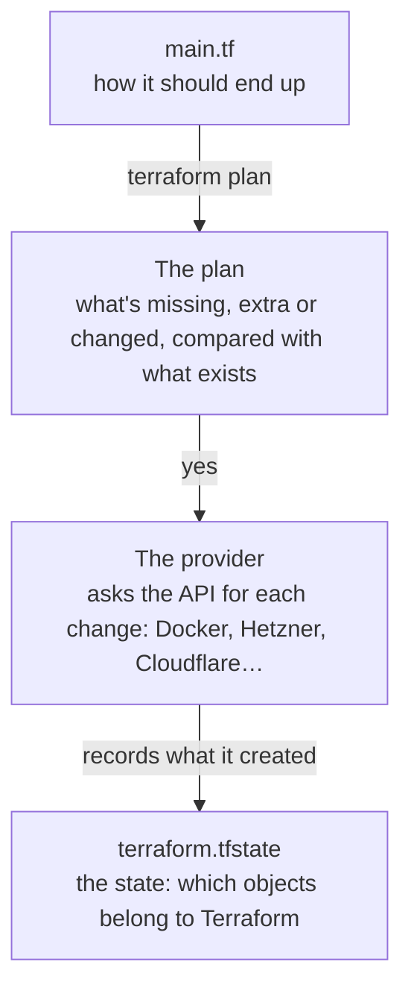

import { Aside, Tabs, TabItem } from '@astrojs/starlight/components';
import Term from '~/components/Term.astro';
import TryIt from '~/components/TryIt.astro';
import Analogy from '~/components/Analogy.astro';
import SelfCheck from '~/components/SelfCheck.astro';
import Quiz from '~/components/Quiz.astro';
import QuizQuestion from '~/components/QuizQuestion.astro';
import QuizOption from '~/components/QuizOption.astro';

## The problem

Picture Ana setting up her VPS with clicks: the server and its SSH key ([lesson 1](/en/phase-8/what-is-a-vps/#paid-path-create-your-server)), the provider's firewall ([lesson 2](/en/phase-8/secure-linux-server/#the-providers-firewall-paid-path)) and the DNS record ([lesson 5](/en/phase-8/lets-encrypt-nginx/#a-name-the-domain-and-its-records)). It works. Six months later:

- **Repeating it.** She wants a second server just like it, for testing. She rebuilds it from memory, and forgets a rule.
- **Reviewing it.** Luis asks what changed in the firewall last week. The dashboard shows how it is, not who changed it.
- **Undoing it.** When she's done, she deletes the test server, but not its firewall. It sits forgotten in the account.

**Terraform turns those clicks into a file** that goes to Git and gets reviewed like code. Terraform creates what the file says, changes it when the file changes and deletes all of it in one go.

## The analogy

<Analogy>

Think of a note stuck on the fridge in a shared apartment: “There should be 6 eggs, 2 cartons of milk and a loaf of bread.” It doesn't say “buy 4 eggs”: it says how the fridge should end up.

Ana compares the fridge with the note, writes down what's missing (4 eggs and the bread) and buys it. The next day nothing is missing, and she buys nothing. In her notebook she writes down what she put there, so she doesn't touch the others' food.

The note is your `.tf` file; writing down what's missing, `terraform plan`; buying it, `terraform apply`. The notebook is the state.

<div slot="limits">

- In the fridge you see everything. Terraform only looks after what's in its state: the server you created by hand in the dashboard, it doesn't see.
- If the note changes “whole milk” to “skim,” Ana buys the other one and throws the old one out. Terraform does the same with what it can't change in place. With a server, throwing the old one out means losing its disk.

</div>

</Analogy>

## How it really works

### Describing how it should end up, not what to do

You've already worked this way. In Phase 7, three `docker run` in a row started the shop: each command **does** something, and if you repeat it, it fails or creates another one. That's **imperative**.

A [`compose.yaml`](/en/phase-7/docker-compose/), on the other hand, **describes** how the shop should end up, and `docker compose up` creates what's missing: a second `up` creates nothing. That's **declarative**.

Terraform does the same with anything that has an API: a server at Hetzner or on AWS, a DNS record at Cloudflare, a container in your Docker. Describing infrastructure this way, in files that go to Git, is <Term id="infrastructure-as-code">infrastructure as code</Term> (IaC). Ana's three problems, before and after:

| Problem | With clicks in a dashboard | With Terraform |
|---|---|---|
| Repeating it | From memory, step by step | `terraform apply` with the same file |
| Reviewing it | No trace is left | Git's history and its pull request, like the code in [lesson 6](/en/phase-8/ci-cd-github-actions/) |
| Undoing it | Hunting it down piece by piece | `terraform destroy` deletes everything it created |

### A Terraform file, piece by piece

<Term id="terraform">Terraform</Term> is a HashiCorp program. Its files end in `.tf` and are written in **HCL** (*HashiCorp Configuration Language*): blocks with a type, some names in quotes and, between braces, `name = value`. `#` starts a comment.

This lesson's practice is one file, `main.tf`, that describes an nginx container with a page of your own. It starts like this:

```hcl title="main.tf"
terraform {
  required_providers {
    # A provider is the plugin that knows how to talk to a service. This one talks to Docker.
    # We pin the exact version, like the course pins everything else.
    docker = {
      source  = "kreuzwerker/docker"
      version = "4.6.0"
    }
  }
}

# With no other data, the provider uses your computer's Docker (the /var/run/docker.sock socket).
provider "docker" {}
```

- **A provider** translates what you describe into calls to a service's API. Terraform knows nothing about Docker or Hetzner: its providers do, and they live in the [Terraform Registry](https://registry.terraform.io/).
- **`source`** says which one: `kreuzwerker/docker`, the Docker one, maintained by the community. **`version`** pins it to an exact version.
- **`provider "docker" {}`** configures it. Empty, it talks to your computer's Docker.

Next, a value you can change without touching the rest, and the image:

```hcl title="main.tf"
# A variable is a value you change without touching the rest of the code.
variable "page_text" {
  description = "The text of the page nginx serves"
  type        = string
  default     = "Hello from Terraform"
}

# The nginx image, pinned by its version and its digest: always the very same image.
resource "docker_image" "nginx" {
  name         = "nginx:1.29.8@sha256:1881968aff6f7cdcc4b888c00a11f4ce241ad7ec957e0cb4a9e19e93a3ff87ea"
  keep_locally = true # on destroy, leave the image downloaded on your computer
}
```

- **`variable`** declares a value with its type and its default. You use it as `var.page_text`, and you can change it when you run Terraform.
- **`resource`** is a piece Terraform creates and looks after. It carries the type, which comes from the provider (`docker_image`), and your name for it (`nginx`): together, `docker_image.nginx`.
- The image is pinned by its <Term id="image-digest">digest</Term>, as in [Phase 7](/en/phase-7/docker-registry/).

The container:

```hcl title="main.tf"
# The container. We publish it on 127.0.0.1 only: just your computer can reach it.
resource "docker_container" "web" {
  name  = "terraform-practice"
  image = docker_image.nginx.image_id # this is how Terraform knows the image comes first

  ports {
    internal = 80
    external = 8081
    ip       = "127.0.0.1"
  }

  # Creates the home page inside the container with the variable's text.
  upload {
    file    = "/usr/share/nginx/html/index.html"
    content = "<h1>${var.page_text}</h1>\n"
  }
}
```

- **`image = docker_image.nginx.image_id`** uses a value from another resource. That's how Terraform works out the order: **first the image, then the container**.
- **`ports`** is the `-p 127.0.0.1:8081:80` of `docker run`.
- **`upload`** writes nginx's home page inside the container, with the variable's value in the middle of the text.

And what it shows you when it finishes:

```hcl title="main.tf"
# An output is a value Terraform shows you when it finishes.
output "url" {
  description = "Where to see the page"
  value       = "http://127.0.0.1:8081"
}
```

An **output** shows data about what was created: with a server, its public IP.

### Four commands: init, plan, apply and destroy

| Command | What it does |
|---|---|
| `terraform init` | Prepares the folder: downloads the providers |
| `terraform plan` | Compares the file with what exists and shows what it would do. **It changes nothing** |
| `terraform apply` | Shows the same plan, asks you for `yes` and does it |
| `terraform destroy` | Asks you for `yes` and deletes everything it created |

This is how an `apply` goes:



The plan marks each resource with a symbol, and **it's what you have to read before typing `yes`**:

| Symbol | Means |
|---|---|
| `+` | It creates it |
| `-` | It deletes it |
| `~` | It changes it in place, without deleting it |
| `-/+` | It **replaces** it: deletes the old one and creates a new one |

`-/+` shows up when the provider can't change something while it's running. With a server, it's a new machine: **another disk, empty, and maybe another IP**.

### The state: Terraform's memory

Every `apply` writes `terraform.tfstate`, the <Term id="terraform-state">state</Term>: a JSON file that ties each resource in the file to the real object it created. Without it, Terraform wouldn't know what's its own, or what to delete.

On every `plan`, Terraform reads the state, **asks the provider how each object really is** and compares it with the file. Whatever someone changed by hand, the plan puts back the way the file says.

**The state stores all of each resource's data, in plain text**, passwords and tokens included. `sensitive = true` on a variable only keeps it off the screen. That's why:

- **The state never goes to Git,** like the `.env` from [Phase 6](/en/phase-6/rate-limiting-secrets/#secrets-out-of-the-code-and-out-of-git). In `.gitignore`: `*.tfstate`, `*.tfstate.*` and `.terraform/`.
- **A team keeps it in a remote state** (*remote backend*), like an S3 *bucket* from [lesson 7](/en/phase-8/iaas-paas-saas-serverless/#the-aws-names-translated), encrypted, or HashiCorp's HCP Terraform. It's **locked** while someone applies, so two `apply` runs don't step on each other.

### The lock file: .terraform.lock.hcl

`init` creates another file, `.terraform.lock.hcl`, with each provider's exact version and its <Term id="hash">hashes</Term>: the next `init`, yours or Luis's, downloads the same thing and checks that nobody has changed it. It's [Phase 3](/en/phase-3/what-is-node-js/)'s `package-lock.json`, for providers.

Unlike the state, **this one does go to Git**: it has no secrets. The practice doesn't come with one, because `version = "4.6.0"` already pins the version; your `init` will create yours.

### Terraform, OpenTofu and the license

On August 10, 2023, HashiCorp [changed the license](https://www.hashicorp.com/en/blog/hashicorp-adopts-business-source-license) of its programs, Terraform included, from the MPL 2.0, which is open source, to the **BUSL 1.1** (*Business Source License*). You can use it for free for your own infrastructure. What you can't do is offer a product built with it that competes with HashiCorp's.

In response, several companies started from the earlier code and created [**OpenTofu**](https://opentofu.org/), under the MPL 2.0, at the Linux Foundation. It reads the same files and providers, with the `tofu` command: `tofu init` and `tofu validate` work with this practice.

In October 2026, Terraform's latest version was 1.16.6, from October 14, and OpenTofu's was 1.13.1, from October 1. What this lesson covers applies to both.

### Reading the paid path's server, without applying it

Next to the practice is `server.tf.example`: your clicks from lessons 1, 2 and 5, written for Terraform. It doesn't end in `.tf` on purpose: Terraform doesn't load it, and it creates nothing and charges nothing. The firewall:

```hcl title="server.tf.example"
# The provider's firewall: SSH, HTTP and HTTPS from anywhere, and nothing else.
resource "hcloud_firewall" "web" {
  name = "shop-web"

  dynamic "rule" {
    for_each = ["22", "80", "443"]
    content {
      direction  = "in"
      protocol   = "tcp"
      port       = rule.value
      source_ips = ["0.0.0.0/0", "::/0"]
    }
  }
}
```

**`dynamic "rule"`** writes one rule for each port in `for_each`, and **`source_ips`** says where traffic can come from: `0.0.0.0/0` is any IPv4 address, and `::/0`, any IPv6 address.

**Port 22 doesn't need to be open to the whole internet:** if your IP is fixed, leave only yours (`["203.0.113.25/32"]`) and the bots from [lesson 2](/en/phase-8/secure-linux-server/) won't even reach SSH.

The server and its name:

```hcl title="server.tf.example"
# The server: Ubuntu 26.04, the smallest plan, with the key and the firewall above.
resource "hcloud_server" "web" {
  name         = "shop"
  server_type  = "cx23"
  image        = "ubuntu-26.04"
  location     = "nbg1"
  ssh_keys     = [hcloud_ssh_key.shop.id]
  firewall_ids = [hcloud_firewall.web.id]
}

# The DNS record of type A (Phase 0): the name points at the server's IPv4 address.
resource "cloudflare_dns_record" "web" {
  zone_id = var.zone_id
  name    = var.domain
  type    = "A"
  content = hcloud_server.web.ipv4_address
  ttl     = 300
  proxied = false # DNS only: traffic goes straight to your server
}
```

- **The server** is lesson 1's CX23, in Nuremberg (`nbg1`), with your key and the firewall above.
- **The DNS record** goes to Cloudflare, another provider in the same file, with the IP Hetzner gives the server: Terraform creates the server, reads its IP and creates the record. **You no longer copy the IP by hand.**
- **There's only an `A` record**, for IPv4: for IPv6 you'd need an `AAAA` ([lesson 5](/en/phase-8/lets-encrypt-nginx/#a-name-the-domain-and-its-records)).

The tokens arrive as variables, not written in the file; even so, **they end up in the state**. And applying it would create a **new** server, which you pay for: Terraform doesn't know the one you created by hand. To adopt it, there's `terraform import`.

## Try it

The goal: create a container with Terraform, change it by reading the plan, find out what happens if someone deletes it by hand, and leave nothing behind. All on **your computer**, with Docker: open Docker Desktop again if you quit it in the [introduction](/en/phase-8/#if-your-computer-has-8-gb-of-memory).

### Install Terraform

<Tabs syncKey="os">
<TabItem label="macOS">

With Homebrew, from HashiCorp's catalog (`hashicorp/tap`): Homebrew's main one doesn't have it.

```sh
brew tap hashicorp/tap
brew install hashicorp/tap/terraform
```

</TabItem>
<TabItem label="Linux">

From HashiCorp's `apt` repository, like Docker's in the [introduction](/en/phase-8/#install-docker-on-the-vm).

```sh
wget -O - https://apt.releases.hashicorp.com/gpg | sudo gpg --dearmor -o /usr/share/keyrings/hashicorp-archive-keyring.gpg
echo "deb [arch=$(dpkg --print-architecture) signed-by=/usr/share/keyrings/hashicorp-archive-keyring.gpg] https://apt.releases.hashicorp.com $(grep -oP '(?<=UBUNTU_CODENAME=).*' /etc/os-release || lsb_release -cs) main" | sudo tee /etc/apt/sources.list.d/hashicorp.list
sudo apt update && sudo apt install terraform
```

</TabItem>
<TabItem label="Windows">

In WSL, with the commands from the Linux tab: your Docker Desktop already works with WSL since Phase 7.

</TabItem>
</Tabs>

These are the commands from [Terraform's install page](https://developer.hashicorp.com/terraform/install). Check it:

<TryIt
  title="Which Terraform do you have?"
  cmd="terraform version"
  output={`Terraform v1.16.6
on linux_arm64`}
>

The outputs are from 1.16.6; with a newer one, some message may change. On a Mac with Apple Silicon it will say `darwin_arm64`.

</TryIt>

**Or without installing anything, with Docker**, the way we captured the outputs. This alias turns `terraform` into a container with the official image, pinned by its digest:

```sh
alias terraform='docker run --rm -it -v "$PWD":/tf -w /tf -v /var/run/docker.sock:/var/run/docker.sock hashicorp/terraform:1.16.6@sha256:bfffc1ded5fbf0a17beaaf22eb4793980abdb19d0761ff6a3a0efb2ab4d9b316'
```

- **`-v "$PWD":/tf -w /tf`** mounts your current folder and works in it.
- **`-v /var/run/docker.sock:/var/run/docker.sock`** mounts Docker's *socket*, the door through which you ask the engine for things, so the provider can create containers in your Docker. **Whoever has that door is in charge of all your Docker and, on Linux, it's as good as being `root`, like the [`docker` group](/en/phase-7/#without-sudo-the-docker-group)**: only give it to images you trust.

The alias lasts as long as the terminal. On Linux and WSL, what the container creates belongs to `root`: delete it at the end with `sudo rm -rf ~/backend-course/phase-8/terraform`.

### Download the practice

On your computer, a new folder for the practice, and the file:

```sh
mkdir -p ~/backend-course/phase-8/terraform
cd ~/backend-course/phase-8/terraform
curl -O https://backenddesdecero.com/practicas/terraform/en/main.tf
```

**Read it before running it**, with `less main.tf`: it's the one from “How it really works,” whole.

### Create the container

<TryIt
  title="1. init: prepare the folder"
  cmd="terraform init"
  output={`Initializing the backend...

Initializing provider plugins...
- Finding kreuzwerker/docker versions matching "4.6.0"...
- Installing kreuzwerker/docker v4.6.0...
- Installed kreuzwerker/docker v4.6.0 (self-signed, key ID 0DCE698927DAF8EC)
Partner and community providers are signed by their developers.
If you'd like to know more about provider signing, you can read about it here:
https://developer.hashicorp.com/terraform/cli/plugins/signing

Terraform has created a lock file .terraform.lock.hcl to record the provider
selections it made above. Include this file in your version control repository
so that Terraform can guarantee to make the same selections by default when
you run "terraform init" in the future.

Terraform has been successfully initialized!
…`}
>

- **`Installed kreuzwerker/docker v4.6.0`**: the provider, in the file's exact version, is now in `.terraform/`. **`self-signed`**: it's signed by whoever maintains it, not by HashiCorp, and Terraform checks the signature.
- **`created a lock file`**: the `.terraform.lock.hcl`, which it tells you to keep in Git.

If you get `Failed to query available provider packages`, it can't reach the internet. We've trimmed the end (`…`).

</TryIt>

<TryIt
  title="2. plan: what it would do, without doing it"
  cmd="terraform plan"
  output={`Terraform used the selected providers to generate the following execution
plan. Resource actions are indicated with the following symbols:
  + create

Terraform will perform the following actions:

  # docker_container.web will be created
  + resource "docker_container" "web" {
      + attach                                      = false
      + bridge                                      = (known after apply)
…
      + name                                        = "terraform-practice"
…
      + ports {
          + external = 8081
          + internal = 80
          + ip       = "127.0.0.1"
          + protocol = "tcp"
        }
…
    }

  # docker_image.nginx will be created
  + resource "docker_image" "nginx" {
…
    }

Plan: 2 to add, 0 to change, 0 to destroy.

Changes to Outputs:
  + url = "http://127.0.0.1:8081"
…`}
>

Two resources with `+` and the summary: **`Plan: 2 to add, 0 to change, 0 to destroy`**. `(known after apply)` is data that isn't known until the container exists, like its ID. We've trimmed it (`…`). **Nothing has been created yet.**

</TryIt>

<TryIt
  title="3. apply: do it"
  cmd="terraform apply"
  output={`…
Plan: 2 to add, 0 to change, 0 to destroy.

Changes to Outputs:
  + url = "http://127.0.0.1:8081"

Do you want to perform these actions?
  Terraform will perform the actions described above.
  Only 'yes' will be accepted to approve.

  Enter a value: yes

docker_image.nginx: Creating...
docker_image.nginx: Creation complete after 0s [id=sha256:1881968aff6f7cdcc4b888c00a11f4ce241ad7ec957e0cb4a9e19e93a3ff87eanginx:1.29.8@sha256:1881968aff6f7cdcc4b888c00a11f4ce241ad7ec957e0cb4a9e19e93a3ff87ea]
docker_container.web: Creating...
docker_container.web: Creation complete after 1s [id=b0accb2f379296b141d00eb7f860bef246ad1f2852d9b3b977973b2f304f7a6a]

Apply complete! Resources: 2 added, 0 changed, 0 destroyed.

Outputs:

url = "http://127.0.0.1:8081"`}
>

`apply` repeats the plan (trimmed here) and waits. **Type `yes`**, in full: with anything else, it does nothing. Notice the order, **first the image and then the container**, and the `url` output at the end.

If you get `Cannot connect to the Docker daemon`, Docker isn't running. If port 8081 is taken, change `external` in `main.tf` and apply again.

</TryIt>

<TryIt
  title="4. Ask your nginx, and plan again"
  cmd={`curl http://127.0.0.1:8081\ndocker ps --filter name=terraform-practice\nterraform plan`}
  output={`<h1>Hello from Terraform</h1>
CONTAINER ID   IMAGE          COMMAND                  CREATED        STATUS        PORTS                    NAMES
b0accb2f3792   1881968aff6f   "/docker-entrypoint.…"   1 second ago   Up 1 second   127.0.0.1:8081->80/tcp   terraform-practice
docker_image.nginx: Refreshing state... [id=sha256:1881968aff6f7cdcc4b888c00a11f4ce241ad7ec957e0cb4a9e19e93a3ff87eanginx:1.29.8@sha256:1881968aff6f7cdcc4b888c00a11f4ce241ad7ec957e0cb4a9e19e93a3ff87ea]
docker_container.web: Refreshing state... [id=b0accb2f379296b141d00eb7f860bef246ad1f2852d9b3b977973b2f304f7a6a]

No changes. Your infrastructure matches the configuration.

Terraform has compared your real infrastructure against your configuration
and found no differences, so no changes are needed.`}
>

The page has the variable's text, and `docker ps` sees an ordinary container, with the file's name and port. Your ID will be different.

In the second `plan`, **`Refreshing state`** is Terraform asking Docker how each object in its state is. Everything matches the file: **`No changes`**. That's declarative: repeating it doesn't create a second container.

</TryIt>

Look at what it saved in the state:

<TryIt
  title="5. Your text, in the state"
  cmd={`grep '"content"' terraform.tfstate`}
  output={`                "content": "\\u003ch1\\u003eHello from Terraform\\u003c/h1\\u003e\\n",`}
>

The `upload`'s content, in plain text (`\u003c` and `\u003e` are `<` and `>`, written the JSON way). If it were a token, it would be just as readable.

</TryIt>

### Change the variable and read the plan

`-var` gives the variable another value without touching the file:

<TryIt
  title="6. The change’s plan"
  cmd="terraform plan -var 'page_text=Hello, changed with Terraform'"
  output={`…
Terraform used the selected providers to generate the following execution
plan. Resource actions are indicated with the following symbols:
-/+ destroy and then create replacement

Terraform will perform the following actions:

  # docker_container.web must be replaced
-/+ resource "docker_container" "web" {
…
      - upload { # forces replacement
          - content        = <<-EOT
                <h1>Hello from Terraform</h1>
            EOT -> null
          - executable     = false -> null
          - file           = "/usr/share/nginx/html/index.html" -> null
            # (6 unchanged attributes hidden)
        }
      + upload { # forces replacement
          + content        = <<-EOT
                <h1>Hello, changed with Terraform</h1>
            EOT
          + executable     = false
          + file           = "/usr/share/nginx/html/index.html"
            # (6 unchanged attributes hidden)
        }
…
    }

Plan: 1 to add, 0 to change, 1 to destroy.
…`}
>

We've trimmed the data that changes because it will be another container. **Look for two things:**

- **`-/+` and `must be replaced`**: the container is deleted and another one is created. The image doesn't appear: it doesn't change.
- **`# forces replacement`**: what forces the replacement. The uploaded file can't be changed in a running container.

With a practice container it doesn't matter; with a server, **this is the moment to stop and think**.

</TryIt>

<TryIt
  title="7. Apply the change"
  cmd={`terraform apply -var 'page_text=Hello, changed with Terraform'\ncurl http://127.0.0.1:8081`}
  output={`…
docker_container.web: Destroying... [id=b0accb2f379296b141d00eb7f860bef246ad1f2852d9b3b977973b2f304f7a6a]
docker_container.web: Destruction complete after 0s
docker_container.web: Creating...
docker_container.web: Creation complete after 0s [id=1b59eea550ce33eed73edbacc4398fc67a450bcd547905cc7dcdc560b4e4a8b2]

Apply complete! Resources: 1 added, 0 changed, 1 destroyed.

Outputs:

url = "http://127.0.0.1:8081"
<h1>Hello, changed with Terraform</h1>`}
>

Type `yes`. **Destroying, then Creating**: the new ID is another container, and between those two lines there was no page.

`-var` isn't saved: **repeat it on every command**, or the next `plan` will want to go back to the default text. In a project, the values go in a `terraform.tfvars` file, which Terraform reads on its own.

</TryIt>

### Someone deletes it by hand

Picture Luis seeing a container he doesn't recognize and deleting it:

<TryIt
  title="8. Deleted outside Terraform"
  cmd={`docker rm -f terraform-practice\nterraform plan -var 'page_text=Hello, changed with Terraform'`}
  output={`terraform-practice
…
  # docker_container.web will be created
  + resource "docker_container" "web" {
…
Plan: 1 to add, 0 to change, 0 to destroy.
…`}
>

When refreshing the state, Docker told Terraform that the container no longer exists, and the file says it has to exist: the plan **creates it again**. Run `terraform apply` with the same `-var`, type `yes`, and `curl` answers again.

The same goes for any change made by hand to something Terraform manages: **the next `apply` undoes it**. The file is in charge.

</TryIt>

<SelfCheck question="Challenge: imagine you delete terraform.tfstate and run terraform plan. What will it say, and what would happen with apply?">

Without the state, Terraform remembers nothing: the plan says `Plan: 2 to add`, like the first time. But the container exists, so `apply` would fail when creating another one with the same name, which Docker doesn't allow twice; without a fixed name, you'd have two. **Losing the state is losing the memory.** Don't do it: go on to `destroy`.

</SelfCheck>

### Destroy it all

<TryIt
  title="9. destroy"
  cmd={`terraform destroy\ndocker ps -a --filter name=terraform-practice`}
  output={`…
Plan: 0 to add, 0 to change, 2 to destroy.

Changes to Outputs:
  - url = "http://127.0.0.1:8081" -> null

Do you really want to destroy all resources?
  Terraform will destroy all your managed infrastructure, as shown above.
  There is no undo. Only 'yes' will be accepted to confirm.

  Enter a value: yes

docker_container.web: Destroying... [id=22486f72d96fd465c5cc3ff5e4cbf6d4b3d54d8c12cb31a1b6733425908b11ca]
docker_container.web: Destruction complete after 0s
docker_image.nginx: Destroying... [id=sha256:1881968aff6f7cdcc4b888c00a11f4ce241ad7ec957e0cb4a9e19e93a3ff87eanginx:1.29.8@sha256:1881968aff6f7cdcc4b888c00a11f4ce241ad7ec957e0cb4a9e19e93a3ff87ea]
docker_image.nginx: Destruction complete after 0s

Destroy complete! Resources: 2 destroyed.
CONTAINER ID   IMAGE     COMMAND   CREATED   STATUS    PORTS     NAMES`}
>

`destroy` doesn't need the `-var`: it deletes what the state says, now in **reverse order**, first the container and then the image. `docker ps -a` no longer finds it. The image is still on your computer, because `keep_locally = true` asks Terraform to forget it without deleting it.

</TryIt>

You can delete the folder. The whole paid-path example downloads the same way, with `curl -O https://backenddesdecero.com/practicas/terraform/en/server.tf.example`: read it, without applying it.

## You have already seen it

- **Your `compose.yaml`** from Phase 7: it describes how everything should end up, and a second `up` doesn't duplicate anything.
- **`package-lock.json` and image digests:** exact, checked versions, like `.terraform.lock.hcl`.
- **This course's CI:** it checks this practice's files with `terraform fmt -check` (the format) and `terraform validate` (that they make sense).

## Common mistakes

- **Pushing `terraform.tfstate` to Git.** It carries the tokens in plain text: into `.gitignore` from the first commit.
- **Typing `yes` without reading the plan.** A `-/+` on a server is a new machine, with an empty disk.
- **Mixing clicks and Terraform.** The next `apply` undoes what you changed in the dashboard.
- **Forgetting `destroy` in a paid cloud.** You're billed until you delete it.

## Summary

- Infrastructure as code describes servers, firewalls or DNS records in files that can be repeated, reviewed in Git and deleted in one go.
- A Terraform file has providers, resources, variables and outputs; references between resources decide the order.
- `plan` shows what will change without touching anything, `apply` does it after your `yes` and `destroy` deletes it. Read the plan: `-/+` means replacing.
- The state holds the data in plain text: never in Git, and remote in a team. `.terraform.lock.hcl`, on the other hand, does go to Git.
- Terraform has been under the BUSL license since 2023; OpenTofu is its open source version.

### What you've built in this phase

You started the phase with the shop on your laptop, and you finish it on a server:

- locked down: your own user, SSH with a key only, a firewall and automatic updates;
- with the shop in production Compose, secrets that only live there and a backup every night;
- with nginx in front and a name with HTTPS;
- that takes every `git push` to `main`, checked and deployed, with a way back;
- and with the map of everything else: IaaS, PaaS, serverless and infrastructure in a file.

But the shop lives in a single copy, and every deployment leaves it [a few seconds without answering](/en/phase-8/ci-cd-github-actions/#a-few-seconds-without-a-shop). In [Phase 9, “Architecture and scaling,”](/en/phase-9/) you'll learn to deploy without downtime, to send slow work to a queue and to spread visits across several servers.

## Did you get it?

<Quiz>

<QuizQuestion
  question="You change the server’s location from nbg1 to fsn1, another data center, and the plan says: hcloud_server.web must be replaced. What do you do?"
  review="Four commands: init, plan, apply and destroy"
>

<QuizOption text="Apply: must be replaced only moves the server you already have, with its disk.">

Changing something in place would be `~`. `must be replaced`, with `-/+`, means deleting the server and creating another one.

</QuizOption>

<QuizOption text="Stop: it would be a new server, with an empty disk and maybe another IP." correct>

First, get the data off that disk, and think about the DNS if the IP changes.

</QuizOption>

<QuizOption text="Apply: Terraform copies the old one’s disk to the new one before deleting it.">

Terraform doesn't copy anything: it deletes one and creates another.

</QuizOption>

</QuizQuestion>

<QuizQuestion
  question="Luis suggests pushing terraform.tfstate to Git, so the whole team has the same one. The token variables have sensitive = true. Is it a good idea?"
  review="The state: Terraform's memory"
>

<QuizOption text="Yes: with sensitive = true, the tokens aren’t saved in the state.">

`sensitive` only hides them on the screen. In the state they're in plain text.

</QuizOption>

<QuizOption text="Yes: the state only stores the objects’ IDs, not their data.">

It stores all of each resource's data, like your page's text in “Try it.”

</QuizOption>

<QuizOption text="No: it holds the data in plain text; remote state is for sharing it." correct>

A remote state shares it without putting it in Git, and it's locked so two `apply` runs don't step on each other.

</QuizOption>

</QuizQuestion>

<QuizQuestion
  question="Ana opens port 8080 by hand in the provider’s firewall, which Terraform manages. Days later, Luis runs terraform apply for another change. What happens to 8080?"
  review="Someone deletes it by hand"
>

<QuizOption text="It gets closed: the plan removes it, because the file doesn’t have it." correct>

The file is in charge. If the port has to be open, it goes in the file.

</QuizOption>

<QuizOption text="It stays open: Terraform only looks at its state, not at what’s at the provider.">

On every `plan`, Terraform asks the provider how each object is (`Refreshing state`). It sees the new rule.

</QuizOption>

<QuizOption text="It stays open, and Terraform adds the rule to the main.tf file.">

Terraform never writes your `.tf` files: it changes the infrastructure so it looks like them.

</QuizOption>

</QuizQuestion>

<QuizQuestion
  question="You run terraform apply on the practice, and right after, terraform apply again without changing anything. What does it do the second time?"
  review="Describing how it should end up, not what to do"
>

<QuizOption text="It creates a second container, terraform-practice-2.">

That's what repeating a `docker run` would do. The file describes one container, and it already exists.

</QuizOption>

<QuizOption text="It deletes the container and creates it again, to make sure it’s right.">

Terraform only replaces what differs from the file. Here nothing differs.

</QuizOption>

<QuizOption text="Nothing: No changes, because what exists already matches the file." correct>

It only does what's missing, and nothing is missing.

</QuizOption>

</QuizQuestion>

<QuizQuestion
  question="You’re setting up a repository with your infrastructure. What do you do with .terraform.lock.hcl?"
  review="The lock file: .terraform.lock.hcl"
>

<QuizOption text="Keep it out of Git, like the state: it holds secrets too.">

It doesn't hold any: only the providers' versions and their hashes.

</QuizOption>

<QuizOption text="Into Git: it pins the providers’ versions and their hashes." correct>

Like `package-lock.json`: every `init`, the CI's too, downloads the same thing and checks it.

</QuizOption>

<QuizOption text="Keep it out of Git: it’s a cache, and Terraform always downloads the provider’s latest version.">

`init` follows the lock file: without it, each person could download a different version.

</QuizOption>

</QuizQuestion>

<QuizQuestion
  question="Your company wants to move from Terraform to OpenTofu because of the license. What changes in your .tf files?"
  review="Terraform, OpenTofu and the license"
>

<QuizOption text="They have to be rewritten: OpenTofu uses its own language.">

OpenTofu came out of Terraform's code: it reads the same HCL and uses the same providers.

</QuizOption>

<QuizOption text="Nothing, and the program doesn’t change either: OpenTofu is Terraform with another name.">

The files work, but they've been two different projects since 2023, with another license and another command.

</QuizOption>

<QuizOption text="In principle, nothing: OpenTofu reads the same files with its tofu command." correct>

The command and the license change. Try `tofu plan` first, in case you use something only Terraform has.

</QuizOption>

</QuizQuestion>

</Quiz>

## Further reading

- [What is Terraform?](https://developer.hashicorp.com/terraform/intro), from HashiCorp's documentation: what it is and how it works.
- [State](https://developer.hashicorp.com/terraform/language/state): what the state is for, remote states and locking.
- [Dependency lock file](https://developer.hashicorp.com/terraform/language/files/dependency-lock): what `.terraform.lock.hcl` records.
- [The Docker provider](https://registry.terraform.io/providers/kreuzwerker/docker/latest/docs), in the Terraform Registry: `docker_image`, `docker_container` and the rest.
- [OpenTofu](https://opentofu.org/docs/): its documentation and how it differs from Terraform.
