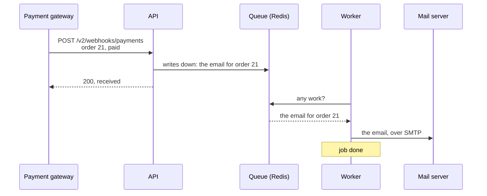
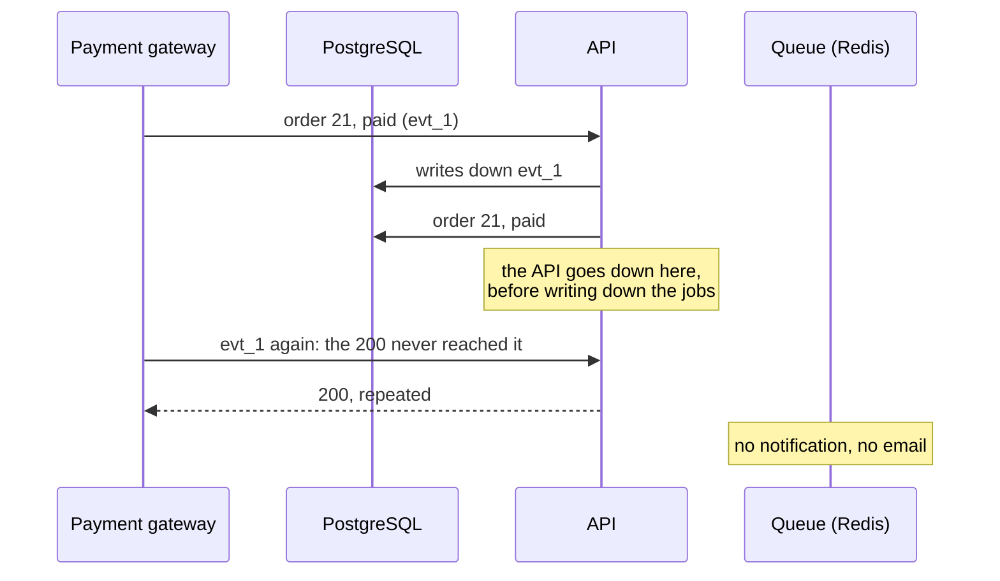

import Term from '~/components/Term.astro';
import TryIt from '~/components/TryIt.astro';
import Analogy from '~/components/Analogy.astro';
import ProjectCode from '~/components/ProjectCode.astro';
import Quiz from '~/components/Quiz.astro';
import QuizQuestion from '~/components/QuizQuestion.astro';
import QuizOption from '~/components/QuizOption.astro';

## The problem

Carmen pays for her order. The payment gateway tells the shop with the <Term id="webhook">webhook</Term> from [Phase 4](/en/phase-4/webhooks-idempotency/), and the shop has two things left to do: notify Fast Delivery, which carries the package, and send Carmen a confirmation email.

Until now, the notification went out with `void notifyOfPayment(paid)`: the shop started it and answered without waiting for it. If Fast Delivery didn’t answer, a `notification not delivered` was left in the log, as you saw in [Phase 6](/en/phase-6/csrf-ssrf/#a-real-notification-on-your-computer), and nobody tried again. If the API restarted halfway, the notification vanished.

Waiting for it inside the request isn’t an option either: a slow mail server would make the gateway wait. **The way out is to write the job down in a list and let another program do it, and retry it if it fails.** We promised it in [Phase 0](/en/phase-0/what-is-the-backend/) (leave for later what can wait) and in [Phase 4](/en/phase-4/webhooks-idempotency/#answer-quickly-and-leave-the-work-for-later): “An email or an invoice would go to a queue.”

## The analogy

<Analogy>

Think of a restaurant. The waiter writes your order on a ticket, hangs it on the kitchen rail and goes back to serving you: he doesn’t stand there watching the paella cook.

The cook takes the tickets in order. If he steps out for a moment, they pile up on the rail; when he comes back, they go out. Waiter, API; ticket, job; rail, queue; cook, worker.

<div slot="limits">

- A ticket is cooked once. A job in a queue can be done twice, and you have to be ready for it.
- The queue retries what fails by itself, waiting longer each time, and gives up after a few attempts.
- Paper tickets are still there if the power goes out. Redis’s are only if it saves them to disk.

</div>

</Analogy>

## How it really works

### A queue, who writes down and who does

This is how a payment works now:



- **The <Term id="message-queue">queue</Term>:** a list of pending tasks, outside the API. Here it lives in Redis.
- **Who writes down**, the API: leaves a <Term id="background-job">job</Term> with what’s needed to do it (the order, as JSON) and moves on.
- **Who does**, the <Term id="worker">worker</Term>: another process, which takes jobs from the queue and does them.

The gateway gets its `200` as soon as the job is written down, and the queue keeps it even if no worker is running. It’s the last row of the table in [Phase 3](/en/phase-3/node-event-loop/#how-not-to-block-the-server).

### BullMQ: the queue, in the Redis you already had

The shop has had Redis since [Phase 7](/en/phase-7/docker-compose/#two-copies-of-the-api-a-single-count-in-redis). **BullMQ** is a Node library that keeps a queue in Redis. The step installs it with exact versions (`bullmq@6.3.15`, and `nodemailer@10.1.1`, which sends the emails). In `src/queue.ts`:

<ProjectCode file="shop-api/37-queue/src/queue.ts" region="enqueue" />

- **`new Queue(QUEUE_NAME, …)`**: the `shop` queue, with its own connection to Redis.
- **`.add(job.type, job)`**: writes the job down with its type (`payment-notice` or `confirmation-email`) and its data. The `await` waits for Redis to save it, not for it to be done.
- **With no `REDIS_URL`** (no Docker), the job runs in the same process, with no retries, as before.

### The payment route writes down and answers

The webhook route, in `src/v2.ts`:

<ProjectCode file="shop-api/37-queue/src/v2.ts" region="receive-payment" />

Where step 36 had `void notifyOfPayment(paid)`, jobs are now written down:

- **One notification for each saved URL**: if one company fails and another doesn’t, only its own is retried.
- **`eventId`**: an id for this payment, the same in all the notifications and on every retry.
- **The email**, another job.

`notifyOfPayment` is now `notifyOne`, in `src/notifications.ts`, the job’s function. **If the notification doesn’t arrive, or the company doesn’t answer with a `2xx`, it throws an error**, and that’s how the queue knows it failed.

### The worker: the same code, another process

The worker is `scripts/worker.ts`, with the same code and the same image as the API. In `compose.yaml`:

<ProjectCode file="shop-api/37-queue/compose.yaml" region="worker" />

The API’s image with another command and the same configuration, because it uses PostgreSQL, Redis and the mail server. No ports and no healthcheck: it doesn’t serve requests.

Inside, a BullMQ `Worker` takes jobs from the queue, **up to five at a time**: a slow notification doesn’t hold up an email. It writes `job done` or `job failed` to the log. One codebase and two processes: [lesson 5](/en/phase-9/monolith-vs-microservices/#the-shop-two-processes-one-codebase) comes back to it.

### Retries with exponential backoff

What happens when a job fails, in `src/queue.ts`:

<ProjectCode file="shop-api/37-queue/src/queue.ts" region="retries" />

- **`attempts: 5`**: five attempts in total.
- **`backoff`**: between one and the next, an <Term id="exponential-backoff">exponential backoff</Term>, which starts at 1 second and doubles.
- **`removeOnComplete` and `removeOnFail`**: Redis keeps the last 1,000 jobs done and the last 1,000 failed, so you can look at what happened.

With a company that always answered `500`, in “Try it” (Docker’s times are in UTC, the universal time zone):

| Attempt | Time | Wait since the previous one |
|---|---|---|
| 1 | 13:33:41.17 | — |
| 2 | 13:33:42.26 | 1.08 s |
| 3 | 13:33:44.32 | 2.06 s |
| 4 | 13:33:48.36 | 4.05 s |
| 5 | 13:33:56.45 | 8.09 s |

Waiting longer each time gives a receiver time to come back, without drowning one that is down for good. **Five attempts in about 15 seconds are enough for practice;** a real shop waits hours, and payment services retry for days.

### At least once: a job can be done twice

Imagine Fast Delivery’s `200` gets lost: the shop thinks the notification failed, and retries. Or the worker shuts down suddenly after sending an email and before marking it as done: BullMQ puts it back in the queue.

That’s why queues promise <Term id="at-least-once-delivery">at-least-once delivery</Term>: no job the queue has saved is lost, but some are done twice. **What the worker does has to survive being repeated:** the idempotency from [Phase 4](/en/phase-4/webhooks-idempotency/#notifications-repeat-process-each-event-once), from the other side.

- **The notification carries `X-Event-Id`**, the same on every retry. Fast Delivery should ignore the ids it has already processed, as the shop does with the gateway.
- **The email carries no id:** if it’s repeated, Carmen gets two. A nuisance; what can’t happen twice, like a charge, needs an id.

### The email: Mailpit and short waits

The email job, in `src/email.ts`, looks up the customer’s address and sends it with Nodemailer, which speaks SMTP, the protocol emails travel over, with the server in `SMTP_URL`. On your computer that’s **Mailpit**: it receives the emails, sends them to nobody and shows them in a web inbox.

<ProjectCode file="shop-api/37-queue/compose.yaml" region="mailpit" />

**The waits are short on purpose.** By default, Nodemailer waits up to 2 minutes to connect and 10 without news from the server. With a stuck mail server, `docker stop` would kill the worker after 10 seconds with the email half sent, and the queue would repeat it. The shop waits **5 seconds at most** at each step, as it does for a notification: it fails early, and the queue retries.

On `SIGTERM`, the worker finishes what it has half done and exits, like the API since [Phase 7](/en/phase-7/dockerfile/#shutting-down-properly-pid-1-and-signals).

### Redis can no longer forget: disk and noeviction

Until Phase 8, Redis saved nothing to disk: losing the limiter’s attempts didn’t matter. **Losing the queue does:** those would be notifications and emails that never go out.

<ProjectCode file="shop-api/37-queue/compose.yaml" region="redis" />

- **`--appendonly yes`**: Redis writes down every change in a file, in the `redis` <Term id="volume">volume</Term>, and reads it back on startup. It flushes to disk every second: a power cut can cost the last second of changes.
- **`--maxmemory-policy noeviction`**: Redis never deletes keys to make room. If it reaches a memory limit, it returns an error: the job visibly fails instead of disappearing. It’s the default value, but it’s written out: BullMQ warns you if it isn’t.

A cache wants the opposite: it will have its own Redis in [lesson 2](/en/phase-9/redis-cache/#two-redis-with-opposite-jobs).

### The gap that remains: two writes

Paying writes in two places: the order, in PostgreSQL; the jobs, in Redis. If the API goes down between one write and the other:



The shop knows `evt_1` and repeats nothing: **the order is paid, but nobody notifies Fast Delivery or Carmen.** If Redis doesn’t answer, `await enqueue` keeps waiting and the gateway gives up: its retry gets `repeated`. The jobs go out when Redis comes back, if the API is still alive; if it restarts first, they’re lost.

Left open on purpose: [lesson 7](/en/phase-9/event-driven-architecture/#the-outbox-the-notice-in-the-same-transaction) closes it by writing the jobs down in the same <Term id="transaction">transaction</Term> as the order ([Phase 5](/en/phase-5/acid-transactions/)).

### Other queues: RabbitMQ, Kafka, SQS and PostgreSQL

BullMQ fits because the shop already has Redis. There are more:

| Tool | What it is | When it fits |
|---|---|---|
| **RabbitMQ** | A separate message server, with its own protocol (AMQP) | Programs in several languages passing messages to each other |
| **Kafka** | A log of events kept for days, in order: several readers read the same thing and can go back | A huge number of events, read by many |
| **Amazon SQS** | An AWS queue, with no server to maintain; you pay per message | If you already live on AWS |
| **PostgreSQL** (pg-boss, in Node) | The queue is a table in your database | Low volume, no Redis, and the job in the same transaction as the order |

With all of them, delivering at least once is the norm.

## Try it

The goal: watch the email of a paid order arrive, watch the queue retry a notification that fails, and check that, with no worker, jobs wait without getting lost.

The outputs are from October 22, 2026, on a Mac (Apple M1 Pro) with Docker 29 in Colima, a virtual machine with 4 processors and 2 GiB. Your ids, times and secrets will differ.

### Get the step ready

Put your project at step 37, as in the [introduction](/en/phase-9/#each-lesson-its-step):

```sh
cd ~/backend-course/phase-3
curl -O https://backenddesdecero.com/practicas/shop-api/37-queue.tar.gz
tar -xzf 37-queue.tar.gz
cp -R 37-queue/. shop-api/
cd shop-api
```

Your `.env` is still the one from [Phase 7](/en/phase-7/docker-compose/#start-the-shop), with your secrets. Add a line, or change it if you already have it, so the shop notifies the practice company: `NOTIFICATION_DEV_HOSTS=carrier`.

Then delete the practice data, so order 21 is pending again, and start the shop:

```sh
docker compose down -v
docker compose up --build --wait
```

`--wait` returns when everything is healthy, with two new services: `worker` and `mailpit`.

### A payment, an email

Order 21 is pending in the sample data. Pay it with the fake gateway from [Phase 4](/en/phase-4/webhooks-idempotency/), in a Node 26 container:

<TryIt
  title="1. The gateway pays order 21"
  cmd={`docker run --rm --network shop_default --env-file .env -e SHOP_URL=http://api:3000 -v "$PWD":/p -w /p node:26 node scripts/payment-gateway.ts 21`}
  output={`→ POST /v2/webhooks/payments {"id":"evt_525b03bc-fd35-42af-852d-5d341f49f9f9","type":"payment.completed","orderId":21}
← 200 {"received":"evt_525b03bc-fd35-42af-852d-5d341f49f9f9","repeated":false}`}
>

The container joins the shop’s network, signs with the `WEBHOOK_SECRET` from your `.env` and mounts your project ([Phase 7](/en/phase-7/docker-volumes/)). `200` and `"repeated":false`: the shop answered without waiting for the email. If you get `invalid-signature`, you changed `.env` after the `up`: `docker compose up -d` recreates the containers.

</TryIt>

Then ask Mailpit, with `jq` ([Phase 3](/en/phase-3/node-errors-and-logging/)):

<TryIt
  title="2. The email, in Mailpit"
  cmd={`curl -s http://127.0.0.1:8025/api/v1/messages | jq ".messages[0] | {Subject, To: .To[0].Address}"`}
  output={`{
  "Subject": "Your order 21 is paid",
  "To": "carmen@example.com"
}`}
>

The subject and recipient of the first email: Carmen, the customer of order 21. In the browser, `http://127.0.0.1:8025` is the same inbox. If you get `null`, look at the worker’s log.

</TryIt>

<TryIt
  title="3. What the worker did"
  cmd="docker compose logs worker --no-log-prefix"
  output={`{"level":30,"time":1792675944666,"pid":1,"hostname":"383a94026ef2","msg":"The worker is waiting for jobs from the queue"}
{"level":30,"time":1792675961157,"pid":1,"hostname":"383a94026ef2","id":"1","type":"confirmation-email","msg":"job done"}`}
>

The worker starts, and job `1`, a `confirmation-email`, is `done`. With `job failed`, look at its `reason`; with no such line, wait and repeat.

</TryIt>

Pay order 22 the same way, with `22` at the end of the command: a second email arrives.

### A notification that fails five times

Now, a delivery company that always answers `500`: a Node container, `carrier`, that writes down every request it receives.

```sh
docker run -d --rm --name carrier --network shop_default --network-alias carrier node:26 node --eval "require('node:http').createServer((req, res) => { console.log(req.method, req.url); res.writeHead(500).end(); }).listen(8080)"
```

The shop only notifies internet addresses over `https`, because of the <Term id="ssrf">SSRF</Term> from [Phase 6](/en/phase-6/csrf-ssrf/#ssrf-the-server-visits-the-url-someone-gives-it); `NOTIFICATION_DEV_HOSTS` is the practice exception. Fast Delivery needs its [API key](/en/phase-6/what-is-jwt/#api-keys-how-a-program-identifies-itself), and the script that creates it isn’t in the image: copy it in and run it.

```sh
docker compose cp scripts/create-key.ts api:/app/scripts/
docker compose exec api node scripts/create-key.ts "Fast Delivery"
```

It shows the key once, starting with `shop_`. Save it: `KEY=shop_…`, with yours in full.

<TryIt
  title="4. Fast Delivery’s URL"
  cmd={`curl -s -X PUT http://127.0.0.1:3000/v2/delivery/notification -H "Authorization: Bearer $KEY" -H "Content-Type: application/json" -d '{"url":"http://carrier:8080/notice"}'`}
  output={`{"url":"http://carrier:8080/notice","secret":"…"}`}
>

The shop saves the URL and returns the signing secret (hidden, `…`). If your API is on 3001 (`docker compose port api 3000`), change the port; ours was. With `401`, check `$KEY`.

</TryIt>

<TryIt
  title="5. Pay order 23"
  cmd={`docker run --rm --network shop_default --env-file .env -e SHOP_URL=http://api:3000 -v "$PWD":/p -w /p node:26 node scripts/payment-gateway.ts 23`}
  output={`→ POST /v2/webhooks/payments {"id":"evt_ede997e3-fe48-423a-a8cd-bf3c86f5434e","type":"payment.completed","orderId":23}
← 200 {"received":"evt_ede997e3-fe48-423a-a8cd-bf3c86f5434e","repeated":false}`}
>

`200` right away, even though the notification is going to fail.

</TryIt>

Wait about 20 seconds. `--timestamps` adds Docker’s time, in UTC:

<TryIt
  title="6. Five attempts"
  cmd="docker compose logs --timestamps --no-log-prefix worker"
  output={`…
2026-10-22T13:33:41.173441878Z {"level":30,"time":1792676021173,"pid":1,"hostname":"383a94026ef2","id":"4","type":"confirmation-email","msg":"job done"}
2026-10-22T13:33:41.174151731Z {"level":40,"time":1792676021173,"pid":1,"hostname":"383a94026ef2","id":"3","type":"payment-notice","attempt":1,"of":5,"reason":"notification not delivered: the company answers 500","msg":"job failed: it will be retried"}
2026-10-22T13:33:42.257892368Z {"level":40,"time":1792676022256,"pid":1,"hostname":"383a94026ef2","id":"3","type":"payment-notice","attempt":2,"of":5,"reason":"notification not delivered: the company answers 500","msg":"job failed: it will be retried"}
2026-10-22T13:33:44.315527786Z {"level":40,"time":1792676024315,"pid":1,"hostname":"383a94026ef2","id":"3","type":"payment-notice","attempt":3,"of":5,"reason":"notification not delivered: the company answers 500","msg":"job failed: it will be retried"}
2026-10-22T13:33:48.363756104Z {"level":40,"time":1792676028362,"pid":1,"hostname":"383a94026ef2","id":"3","type":"payment-notice","attempt":4,"of":5,"reason":"notification not delivered: the company answers 500","msg":"job failed: it will be retried"}
2026-10-22T13:33:56.452400044Z {"level":40,"time":1792676036452,"pid":1,"hostname":"383a94026ef2","id":"3","type":"payment-notice","attempt":5,"of":5,"reason":"notification not delivered: the company answers 500","msg":"job failed: no attempts left"}`}
>

We’ve removed the first three lines (`…`): the worker starting and the emails for orders 21 and 22. Look at:

- **Job `3`**, the notification: `attempt` 1 to 5, with 1, 2, 4 and 8 seconds between the times, and `no attempts left` on the last one.
- **Job `4`**, the email for the same payment: `done` in the same millisecond as the first failure, without waiting for the notification.

`docker logs carrier` shows five `POST /notice` lines: all five attempts arrived. If you see fewer, wait: the last one comes about 15 seconds after the first.

</TryIt>

Remove the carrier and its URL, so the next payment only writes down the email:

```sh
docker rm -f carrier
docker compose exec db psql -U shop -c "delete from notifications"
```

### With no worker, jobs wait

<TryIt
  title="7. With no worker, a payment"
  cmd={`docker compose stop worker
docker run --rm --network shop_default --env-file .env -e SHOP_URL=http://api:3000 -v "$PWD":/p -w /p node:26 node scripts/payment-gateway.ts 24`}
  output={` Container shop-worker-1 Stopping 
 Container shop-worker-1 Stopped 
→ POST /v2/webhooks/payments {"id":"evt_876d076d-494e-4bf8-a697-5336c78f58fa","type":"payment.completed","orderId":24}
← 200 {"received":"evt_876d076d-494e-4bf8-a697-5336c78f58fa","repeated":false}`}
>

**The gateway gets its `200` all the same:** to write a job down, the API doesn’t need the worker.

</TryIt>

<TryIt
  title="8. In Mailpit, nothing new"
  cmd={`curl -s http://127.0.0.1:8025/api/v1/messages | jq "{total, subjects: [.messages[].Subject]}"`}
  output={`{
  "total": 3,
  "subjects": [
    "Your order 23 is paid",
    "Your order 22 is paid",
    "Your order 21 is paid"
  ]
}`}
>

The emails for 21, 22 and 23. None for 24.

</TryIt>

<TryIt
  title="9. The job, waiting in Redis"
  cmd={`docker compose exec redis redis-cli LRANGE bull:shop:wait 0 -1
docker compose exec redis redis-cli HMGET bull:shop:5 name data`}
  output={`5
confirmation-email
{"type":"confirmation-email","order":{"id":24,"productId":1,"quantity":1,"status":"paid","createdAt":"2026-10-08T02:00:00.000Z","customerId":4}}`}
>

- **`bull:shop:wait`**, the waiting list of the `shop` queue: one job, the `5`.
- **`bull:shop:5`**, that job: its name and its data, order 24 as JSON. If yours has another number, change it in the `HMGET`.

</TryIt>

<TryIt
  title="10. The worker comes back"
  cmd={`docker compose start worker
docker compose exec redis redis-cli LLEN bull:shop:wait
curl -s http://127.0.0.1:8025/api/v1/messages | jq "{total, subjects: [.messages[].Subject]}"`}
  output={` Container shop-db-1 Waiting 
 Container shop-db-1 Healthy 
 Container shop-migrate-1 Starting 
 Container shop-migrate-1 Started 
 Container shop-redis-1 Waiting 
 Container shop-migrate-1 Waiting 
 Container shop-db-1 Waiting 
 Container shop-db-1 Healthy 
 Container shop-redis-1 Healthy 
 Container shop-migrate-1 Exited 
 Container shop-worker-1 Starting 
 Container shop-worker-1 Started 
0
{
  "total": 4,
  "subjects": [
    "Your order 24 is paid",
    "Your order 23 is paid",
    "Your order 22 is paid",
    "Your order 21 is paid"
  ]
}`}
>

Compose starts the worker. The waiting list, `LLEN`, ends up at `0`, and the email for 24 is in Mailpit.

</TryIt>

<TryIt
  title="11. When it went out"
  cmd="docker compose logs --timestamps --no-log-prefix worker | tail -n 3"
  output={`2026-10-22T13:34:16.613256721Z {"level":30,"time":1792676056612,"pid":1,"hostname":"383a94026ef2","msg":"SIGTERM: the worker finishes what it has half done and shuts down"}
2026-10-22T13:34:35.035519941Z {"level":30,"time":1792676075034,"pid":1,"hostname":"383a94026ef2","msg":"The worker is waiting for jobs from the queue"}
2026-10-22T13:34:35.095686512Z {"level":30,"time":1792676075095,"pid":1,"hostname":"383a94026ef2","id":"5","type":"confirmation-email","msg":"job done"}`}
>

The `SIGTERM` is your `stop`. When it comes back, the worker waits and, **60 milliseconds later**, job 5 is done. Nothing was lost. If it doesn’t show up, look at `docker compose ps worker`.

</TryIt>

When you’re done, `docker compose down` stops everything; with `-v`, it also deletes the data and the queue.

### On your server

With the shop on your server from [Phase 8](/en/phase-8/ci-cd-github-actions/), **first copy the files the server reads from its disk**, which aren’t in the image. From `~/backend-course/phase-3`, with your user and your IP. On Windows, from PowerShell as in Phase 8, with the step downloaded there (`curl.exe -O` and `tar -xzf`), and `scp` instead of `rsync -av`:

```sh
rsync -av 37-queue/compose.production.yaml ubuntu@192.168.5.15:/opt/shop/
rsync -av 37-queue/deployment/ ubuntu@192.168.5.15:/opt/shop/deployment/
```

On the server, `chmod +x /opt/shop/deployment/*.sh`, as in [Phase 8](/en/phase-8/ci-cd-github-actions/#the-server-follows-your-image). Then, **the code**: it’s already in your project, so commit and `git push` from `shop-api` (your `.env` isn’t uploaded: `.gitignore` leaves it out). With the new image, `deploy.sh` brings the other services up to date:

<ProjectCode file="shop-api/37-queue/deployment/deploy.sh" region="other-services" />

Redis is recreated with disk (it forgets the limiter’s attempts, nothing more), and the API and the worker start with the new image; the rollback covers both. **But the script only checks the API’s health:** a worker that crashes on startup, over and over, doesn’t make it roll back. Check it with `docker compose -f compose.production.yaml ps worker`.

**The email is optional.** Without `SMTP_URL`, the job leaves `no SMTP_URL: the confirmation email is not sent` in the log and finishes. To send them for real:

1. Sign up with an email provider: it gives you an SMTP server, a user and a password.
2. Add the TXT records it asks for to your domain’s DNS ([Phase 0](/en/phase-0/what-is-dns/#record-types)), almost always SPF, which says which servers send email for your domain, and DKIM, which signs each email. Without them, they end up in spam.
3. Put your details in the server’s `.env`:

<ProjectCode file="shop-api/37-queue/.env.production.example" region="email" />

4. Recreate the worker: `docker compose -f compose.production.yaml up -d --no-build --no-deps worker`.

## You have already seen it

- **The “order confirmed” email** that arrives a few seconds after you pay: a worker sends it.
- **A video that is “being processed”** after you upload it: it’s converted in the background.

## Common mistakes

- **Doing the slow work inside the request.** Whoever calls waits, and if they give up, they retry. A `void` with no queue, if it fails, is lost.
- **Jobs that don’t survive being repeated.** What can’t happen twice needs an id, like `X-Event-Id`.
- **The queue in a Redis that forgets.** With no disk, a restart takes the jobs away; if it deletes keys to make room, they vanish without an error.
- **Retrying without waiting, or without a limit.** It drowns the receiver that is down, and an impossible job repeats forever.
- **Long waits inside the job.** `docker stop` kills the worker halfway, and the job is repeated.

## Summary

- What a request doesn’t have to wait for goes to a queue: the API writes it down and answers, and the worker does it later.
- BullMQ keeps the queue in Redis; the worker is the API’s code with another command.
- A job that fails is retried with exponential backoff: five attempts, with 1, 2, 4 and 8 seconds between them.
- Queues deliver at least once: every job has to survive being repeated.
- The queue’s Redis saves to disk and never deletes keys. A gap remains: the order and its jobs are written in two steps.

## Did you get it?

<Quiz>

<QuizQuestion
  question="When an order is paid, the shop also has to generate the PDF invoice, which takes about 3 seconds. Where do you do it?"
  review="A queue, who writes down and who does"
>

<QuizOption text="In the webhook route, before answering, so the invoice is ready when the 200 arrives.">

The gateway would wait 3 seconds for something it doesn’t need, and if it gives up, it retries.

</QuizOption>

<QuizOption text="In the API itself, with void and without waiting for it, to answer right away.">

If the invoice fails or the API restarts halfway, it’s lost and nobody retries it.

</QuizOption>

<QuizOption text="As one more job in the queue, which the worker does." correct>

The API writes it down, answers right away and the worker generates it later. If it fails, the queue retries it.

</QuizOption>

</QuizQuestion>

<QuizQuestion
  question="Fast Delivery goes down just as Carmen pays, and comes back a minute later. With the shop’s options, does the notification reach it?"
  review="Retries with exponential backoff"
>

<QuizOption text="No: the attempts run out in about 15 seconds, and the job is left as failed." correct>

`attempts: 5`, with waits of 1, 2, 4 and 8 seconds: the last attempt comes well before the minute is up. The job is kept as failed, so you can look at it.

</QuizOption>

<QuizOption text="Yes: the queue retries until the receiver answers properly, however long it takes.">

With no limit, a job that will never succeed would repeat forever. BullMQ gives up after `attempts`.

</QuizOption>

<QuizOption text="Yes: the wait between attempts keeps growing, and soon passes a minute.">

The wait doubles, but there are only five attempts: between the fourth and the fifth, 8 seconds.

</QuizOption>

</QuizQuestion>

<QuizQuestion
  question="Fast Delivery receives the notification for order 22 twice, with the same X-Event-Id. What happened, and what should it do?"
  review="At least once: a job can be done twice"
>

<QuizOption text="The shop has a bug: a well-built queue delivers each job exactly once.">

If an answer gets lost, the shop doesn’t know whether the notification arrived: that’s why queues promise “at least once.”

</QuizOption>

<QuizOption text="The first one arrived, but the shop didn’t know and repeated it: it should ignore the second." correct>

`X-Event-Id` is the same on every retry for exactly this: the receiver recognizes the repeat and answers `200` without doing anything.

</QuizOption>

<QuizOption text="They are two different payments for the same order, and it should prepare a shipment for each.">

Each payment has a single `eventId`, the same on all its retries. Same id, same notification.

</QuizOption>

</QuizQuestion>

<QuizQuestion
  question="To save a container, a colleague suggests keeping the queue in a Redis with allkeys-lru and no disk, like a cache. What do you tell them?"
  review="Redis can no longer forget: disk and noeviction"
>

<QuizOption text="That’s fine: jobs only last seconds in Redis, so the configuration doesn’t matter.">

A job can wait a long time: with the worker stopped, all night.

</QuizOption>

<QuizOption text="That’s fine if you give it little memory, so it doesn’t take up room.">

With little memory it’s worse: it hits the limit sooner and starts deleting keys, jobs included.

</QuizOption>

<QuizOption text="No: when it filled up, it would delete jobs, and a restart would take them all." correct>

`allkeys-lru` deletes keys to make room, and with no disk Redis starts empty. A queue needs `noeviction` and `appendonly`.

</QuizOption>

</QuizQuestion>

<QuizQuestion
  question="You stop the worker for ten minutes to look at something and, meanwhile, three orders are paid. What happens to their emails?"
  review="With no worker, jobs wait"
>

<QuizOption text="They wait in Redis and go out as soon as the worker comes back." correct>

The API writes them down all the same. When it comes back, the worker takes what’s in the waiting list.

</QuizOption>

<QuizOption text="The gateway gets an error and notifies again when the worker is back.">

The payment route doesn’t need the worker: it only writes to Redis, and answers `200`.

</QuizOption>

<QuizOption text="They’re lost: with no worker, nobody picks them up from the API’s memory.">

The API doesn’t keep them in its memory: it leaves them in Redis, which holds them until someone takes them.

</QuizOption>

</QuizQuestion>

<QuizQuestion
  question="The API goes down right after turning an order to paid and before writing down its jobs. The gateway retries. Does Carmen get the email?"
  review="The gap that remains: two writes"
>

<QuizOption text="Yes: with the gateway’s retry, the shop then writes the jobs down.">

The shop had already recorded the event: the retry looks repeated, it answers `200` and does nothing else.

</QuizOption>

<QuizOption text="No: the retry looks repeated, and nobody writes the jobs down." correct>

PostgreSQL already says “paid” and Redis never received anything: the gap that lesson 7 closes.

</QuizOption>

<QuizOption text="Yes: Redis saves to disk and recovers the jobs the API was about to write down.">

Redis’s disk keeps what reached Redis. These jobs never arrived.

</QuizOption>

</QuizQuestion>

</Quiz>

## Further reading

- [BullMQ documentation](https://docs.bullmq.io/): queues, workers and job options.
- [Retrying failing jobs](https://docs.bullmq.io/guide/retrying-failing-jobs): `attempts` and the types of `backoff`.
- [Redis persistence](https://redis.io/docs/latest/operate/oss_and_stack/management/persistence/): how Redis saves to disk and what it can lose.
- [Mailpit](https://mailpit.axllent.org/): the practice mail server and its API.
- [RabbitMQ Tutorials](https://www.rabbitmq.com/tutorials): the same ideas, with a separate message server.
