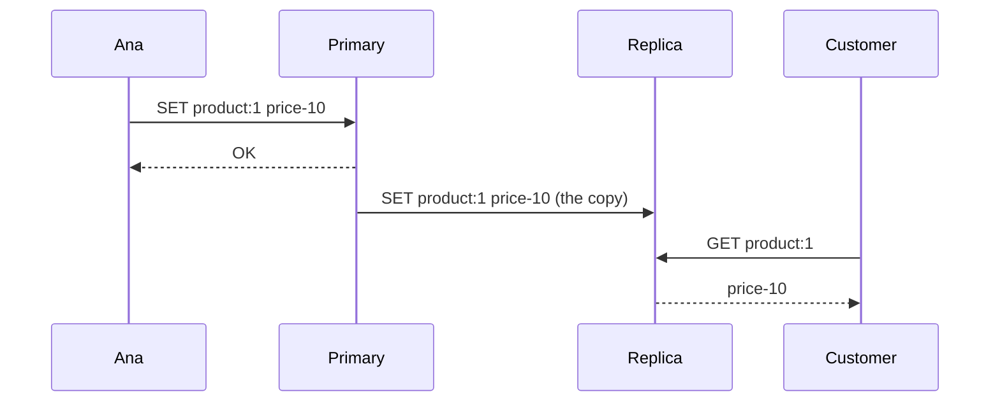
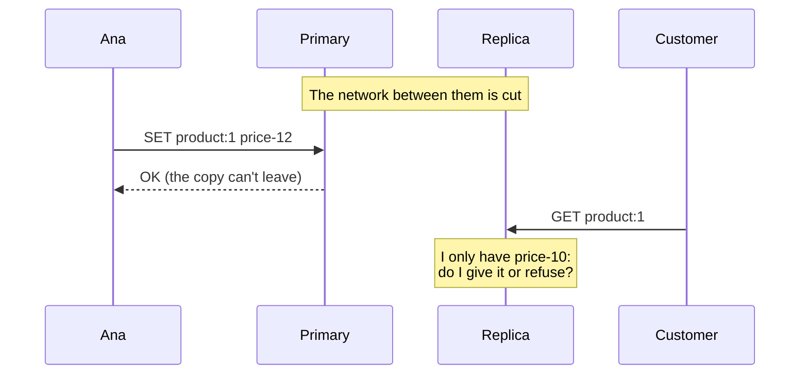

import Term from '~/components/Term.astro';
import TryIt from '~/components/TryIt.astro';
import Analogy from '~/components/Analogy.astro';
import Quiz from '~/components/Quiz.astro';
import QuizQuestion from '~/components/QuizQuestion.astro';
import QuizOption from '~/components/QuizOption.astro';

## The problem

Imagine the shop grows and you put a second copy of Redis on another machine, to spread the reads. Ana, the administrator, writes to the primary one; the other receives every change and serves the reads.

One day the network between the two machines is cut. Both are still on. Ana raises the price of a product from 10 to 12 euros, and the change stays on the primary one: it can’t reach the other.

A customer asks the read copy for the price, and it only has the 10. **What should it do: answer with what it has, or refuse?** There is no third option.

## The analogy

<Analogy>

Think of a store with one branch. Headquarters decides the prices and phones the branch every time one changes, so they change the label.

One day the phone line goes dead. Headquarters raises a price. At the branch, a customer asks how much something costs. The clerk can tell them the price on the label, which may no longer be right, or say: “I can’t help you until I talk to headquarters.” What the clerk can’t do is know the new price.

<div slot="limits">

- The clerk notices right away that there is no dial tone. A computer usually gets no warning of the cut: it only notices the silence. In practice, the replica took a minute.
- The clerk decides on the spot, customer by customer. A program decides beforehand, in its configuration: on the day of the cut there is nobody there to think about it.
- Between computers, machines fail too, and from the outside you can’t tell a dead machine from a cut network.

</div>

</Analogy>

## How it really works

### Several computers pretending to be one

From the [previous lesson](/en/phase-9/monolith-vs-microservices/) you know that, as soon as one part talks to another over the network, waiting and failures appear. A **<Term id="distributed-system">distributed system</Term>** is just that: several computers that cooperate over the network and present themselves as one.

The shop already is one: the API, PostgreSQL, the two Redis servers and the worker talk to each other over the network. Things get interesting when the same piece of data lives in two places.

### Replicas: the same data on two machines

A **<Term id="replication">replica</Term>** is a copy of a database that keeps itself up to date. It is useful for two things:

- **Spreading the reads.** If the home page reads thousands of times per second, a replica takes part of those reads.
- **Not losing everything if one machine fails.** The replica has the data, and it can take the primary’s place.

Only the **primary** accepts writes, and it sends every change to the replicas. This lesson’s practice works that way, with Redis:



Notice: **the primary answers `OK` to Ana without waiting for the copy to reach the replica.** This is **asynchronous** replication, the one Redis uses by default: Ana doesn’t wait for the replica, and the replica is always a little behind. Usually, by milliseconds.

### A partition: the network is cut and nothing shuts down

A **<Term id="network-partition">network partition</Term>** is a cut that leaves the machines in groups that can’t talk to each other, even though all of them are still on: a loose cable, a router that restarts, a firewall mistake.



The primary keeps accepting writes: whoever reaches it notices nothing. **The problem belongs to whoever only reaches the replica.**

### A cut gives no warning

**The replica doesn’t know the network has been cut.** No “cut” message arrives: it just stops receiving things, and a while without changes can also be a quiet while.

That’s why it waits before giving up. In Redis, that time is `repl-timeout`, 60 seconds by default. During that minute, the replica believes everything is fine.

### CAP: during the cut, answer or be right

The <Term id="cap-theorem">CAP theorem</Term> was formulated by Eric Brewer in 2000, and Seth Gilbert and Nancy Lynch proved it in 2002. Its three letters:

| Letter | What it means | In practice |
|---|---|---|
| C, consistency | Every read returns the latest write, whichever copy answers | The replica never gives `price-10` after Ana wrote `price-12` |
| A, availability | Every copy that is still on answers, with no error | The replica always answers, even when it is cut off |
| P, partition tolerance | The system keeps working even if the network loses messages between copies | Staying on when the cable comes loose |

It is usually told as “pick two out of three,” and that gets it wrong. In a system that uses a network, you don’t choose partitions: they happen. What the theorem says is this: **while a partition lasts, an isolated copy has to choose between answering (A) or guaranteeing the latest data (C).** It can’t do both, because the new data is on the other side of the cut.

- **If it chooses availability**, it answers with what it has, even if it is old.
- **If it chooses consistency**, it refuses to answer, with an error, until the network is back.

And with a healthy network, there is nothing to choose: both are possible at once.

### The choice is made piece of data by piece of data

You don’t have to choose the same for the whole shop. Each piece of data has its own answer:

- **A product’s description and photos** can be old for a while: nobody is harmed.
- **The stock at checkout** can’t: you would sell what you don’t have. That’s why `createOrder` checks it in PostgreSQL, inside its transaction, even though the [cache](/en/phase-9/redis-cache/) holds a copy.
- **A closed session** can’t either: it must not keep working on a copy.

The useful question is not “is my system CP or AP?” but **“if this data is old for a minute, what happens?”**

### With a healthy network you also choose: PACELC

CAP only talks about cuts. But with a healthy network, the asynchronous replica is also a few milliseconds behind. Avoiding that has a price: if the primary waited for the replica before answering `OK`, every write would take one more trip over the network.

Daniel Abadi named the complete choice, **PACELC**:

- **If there is a partition (P)**, choose between availability (A) and consistency (C): the CAP part.
- **Else (E)**, choose between <Term id="latency">latency</Term> (L), answering sooner, and consistency (C), waiting until the copies agree.

Redis, with its default configuration, chooses A during a cut and L with a healthy network.

### Eventual consistency: the copies end up agreeing

When a system chooses to answer, it promises something else in return: **<Term id="eventual-consistency">eventual consistency</Term>**. If changes stop arriving, all the copies will end up with the same value. It doesn’t say when; it says they will get there.

In “Try it,” when the network comes back, the replica recovers what it missed without you doing anything.

The shop was already eventually consistent, without replicas:

- **The cache** from [lesson 2](/en/phase-9/redis-cache/#invalidating-delete-right-after-the-change) is deleted every time a product changes. But if a read that started before the change saves the old copy right after the delete, the old price lasts until it expires: a minute, more or less.
- **The queue** from [lesson 1](/en/phase-9/background-jobs-queues/#with-no-worker-jobs-wait): the order becomes `paid` at once, but the email goes out when the worker picks it up. If it is stopped, minutes later.

In both cases, the shop answers right away and agrees later. It is a decision, not an oversight.

### PostgreSQL has replicas too

PostgreSQL copies its changes to other machines with **streaming replication**: it sends each replica its journal of changes, the *WAL* from the [transactions lesson](/en/phase-5/acid-transactions/#acid-letter-by-letter). **By default it is asynchronous**, like Redis’s, and its documentation says the replica is usually less than a second behind.

It can also be **synchronous**: with `synchronous_standby_names`, every `COMMIT` waits for the replica to confirm it has the change on its disk, so it is not lost if the primary fails. For a read on the replica to see it right away, you also need `synchronous_commit = remote_apply`, which waits until the replica applies it. It is PACELC in one line of configuration: every write takes longer, and if the replica goes down, the `COMMIT`s are left waiting.

If the primary fails, tools such as Patroni (PostgreSQL) or Redis Sentinel promote a replica. Before that, several machines vote, and a majority is needed: a single one can’t tell whether the primary has failed or it has just stopped seeing it. If the primary is still alive on the other side of a cut, there will be **two primaries accepting different writes**, and the writes of one of them will be lost.

## Try it

The goal: **cut the network between a Redis and its replica, and see CAP’s two answers**: first the replica answers with old data; then you force it to refuse. It all happens on your computer, with Docker, as in [Phase 7](/en/phase-7/docker-compose/), without touching your project.

### Download the practice

A new folder, and the Compose file:

```sh
mkdir -p ~/backend-course/phase-9/replicas
cd ~/backend-course/phase-9/replicas
curl -O https://backenddesdecero.com/practicas/replicas/en/compose.yaml
```

**Read it before starting it**, with `less compose.yaml`. Two services with the same Redis image, `primary` and `replica`, on a network of their own, `net`. One option turns the replica into a copy: `--replicaof primary 6379`, “copy everything `primary` writes.”

The outputs come from a Mac (Apple M1 Pro) with Docker 29.5.2 in Colima and Compose 5.5.1, from October 22, 2026, and they come from a script, not a terminal. **In your terminal they will look a little different:** `docker compose` draws its progress another way, and `redis-cli` puts the answers in quotation marks (`"price-10"`), shows `(nil)` when there is nothing and puts `(error)` in front of errors.

### Both copies, up to date

<TryIt
  title="1. Start both"
  cmd="docker compose up -d"
  output={` Network replicas_net Creating 
 Network replicas_net Creating 
 Network replicas_net Created 
 Network replicas_net Created 
 Container replicas-primary-1 Creating 
 Container replicas-primary-1 Created 
 Container replicas-replica-1 Creating 
 Container replicas-replica-1 Created 
 Container replicas-primary-1 Starting 
 Container replicas-primary-1 Started 
 Container replicas-replica-1 Starting 
 Container replicas-replica-1 Started `}
>

Look at the names: the network is **`replicas_net`** and the containers are **`replicas-primary-1`** and **`replicas-replica-1`**. You will need them to cut the network.

**Wait about ten seconds** before going on: at startup, the replica makes a first full copy of the primary. If you read earlier, it may have nothing.

</TryIt>

<TryIt
  title="2. Write to the primary, read from the replica"
  cmd={`docker compose exec primary redis-cli SET product:1 price-10
docker compose exec replica redis-cli GET product:1`}
  output={`OK
price-10`}
>

`docker compose exec primary redis-cli` opens Redis’s terminal inside the `primary` container, and hands it one command. You write on one machine and **read the data on the other**: the copy has arrived.

If the replica answers `(nil)`, wait a few more seconds and repeat the `GET`.

</TryIt>

<TryIt
  title="3. The replica doesn’t accept writes"
  cmd="docker compose exec replica redis-cli SET x 1"
  output={`READONLY You can't write against a read only replica.`}
>

**`READONLY`**: “you can’t write to a read-only replica.” Only the primary accepts changes. If you ask the primary for `GET x`, there is no `x`: the write didn’t go anywhere.

</TryIt>

<TryIt
  title="4. Are they in step?"
  cmd={`docker compose exec primary redis-cli INFO replication
docker compose exec replica redis-cli INFO replication`}
  output={`# Replication
role:master
connected_slaves:1
slave0:ip=172.20.0.3,port=6379,state=online,offset=0,lag=1,io-thread=0
…
master_repl_offset:65
…
# Replication
role:slave
master_host:primary
master_port:6379
master_link_status:up
…
slave_repl_offset:65
…
slave_read_only:1
…`}
>

`INFO replication` tells you how the copy is going; we removed lines with “…”. Redis still uses *master* and *slave*, the old names for primary and replica.

- **`master_link_status:up`**: the replica is connected to the primary.
- **`offset`**: the bytes of changes the primary has sent (`master_repl_offset`) and the replica has received (`slave_repl_offset`). **Both say `65`: they are in step.** Your number may be different. The `offset=0` on the `slave0` line is the replica’s last report, which had not arrived yet: ignore it.
- **`slave_read_only:1`**: the `READONLY` from the previous step.

</TryIt>

### Cut the network

<TryIt
  title="5. Take the replica out of the network, and change the price"
  cmd={`docker network disconnect replicas_net replicas-replica-1
docker compose exec primary redis-cli SET product:1 price-12
docker compose exec primary redis-cli GET product:1
docker compose exec replica redis-cli GET product:1`}
  output={`OK
price-12
price-10`}
>

`docker network disconnect` takes a container out of a <Term id="docker-network">Docker network</Term>, like unplugging its cable: it writes nothing. Both are still on, but they can no longer see each other: it is a partition.

The primary has `price-12`. **The replica keeps answering `price-10`**: the old data, with no error at all.

</TryIt>

<TryIt
  title="6. The replica hasn’t noticed"
  cmd="docker compose exec replica redis-cli INFO replication"
  output={`# Replication
role:slave
master_host:primary
master_port:6379
master_link_status:up
master_last_io_seconds_ago:1
…
slave_repl_offset:65
…`}
>

**`master_link_status:up`**: as far as the replica knows, everything is fine. Its `offset` stays at `65`, even though the primary has already received more changes. This is “A cut gives no warning.”

</TryIt>

**Now wait a little over a minute** (in our test, 70 seconds): it is the replica’s `repl-timeout`.

<TryIt
  title="7. A minute later"
  cmd={`docker compose exec replica redis-cli INFO replication
docker compose exec replica redis-cli GET product:1`}
  output={`# Replication
role:slave
master_host:primary
master_port:6379
master_link_status:down
master_last_io_seconds_ago:-1
…
master_link_down_since_seconds:9
…
price-10`}
>

**`master_link_status:down`**: at last it knows it has lost the primary (and `master_last_io_seconds_ago:-1`: there is no connection anymore). It has been like this for 9 seconds: of the 70 you waited, it took about 60 to notice, the `repl-timeout`.

And even so, **it keeps answering `price-10`**. It is Redis’s default option, `replica-serve-stale-data yes`: “serve old data.” The replica has chosen availability.

If you still see `up`, wait a few more seconds and repeat.

</TryIt>

### Now, make it choose consistency

<TryIt
  title="8. Make it refuse"
  cmd={`docker compose exec replica redis-cli CONFIG SET replica-serve-stale-data no
docker compose exec replica redis-cli GET product:1`}
  output={`OK
MASTERDOWN Link with MASTER is down and replica-serve-stale-data is set to 'no'.`}
>

`CONFIG SET` changes the option while Redis is running. Now the replica answers **`MASTERDOWN`**: “the connection to the primary is down, and I don’t serve old data.” In your terminal you will see `(error)` in front.

**The replica has chosen consistency:** it prefers an error to a price that may be false. But only because it has already noticed the cut: during the first minute, it would have answered `price-10` all the same.

</TryIt>

### The network comes back

Put the replica back on the network:

```sh
docker network connect replicas_net replicas-replica-1
```

It writes nothing. The replica retries the connection on its own: **wait about ten seconds** and see how it is doing.

<TryIt
  title="9. With the network back"
  cmd={`docker compose exec replica redis-cli INFO replication
docker compose exec replica redis-cli GET product:1`}
  output={`# Replication
role:slave
master_host:primary
master_port:6379
master_link_status:up
…
slave_repl_offset:205
…
master_link_up_since_seconds:8
…
price-12`}
>

**`master_link_status:up`** again, for 8 seconds now. If you see `down`, wait and repeat.

Its `offset` has jumped from `65` to `205`: it has received what it missed. And it answers **`price-12`**. **This is eventual consistency:** with the network back, the copies have come to agree without you doing anything.

</TryIt>

<TryIt
  title="10. Clean up"
  cmd="docker compose down"
  output={` Container replicas-replica-1 Stopping 
 Container replicas-replica-1 Stopped 
 Container replicas-replica-1 Removing 
 Container replicas-replica-1 Removed 
 Container replicas-primary-1 Stopping 
 Container replicas-primary-1 Stopped 
 Container replicas-primary-1 Removing 
 Container replicas-primary-1 Removed 
 Network replicas_net Removing 
 Network replicas_net Removed `}
>

It deletes the containers and the network; the practice saves nothing to disk. You can delete the folder.

</TryIt>

## You have already seen it

- **A DNS change that “propagates.”** In [Phase 0](/en/phase-0/what-is-dns/#the-ttl-and-propagation) you saw that some people see the new IP and others the old one for a while. DNS chooses to always answer, and each cache catches up when its copy expires.
- **A message sent with no signal.** The app lets you hit send and delivers it when the network returns: available now, in agreement later.

## Common mistakes

- **Confusing CAP’s C with ACID’s C.** [ACID](/en/phase-5/acid-transactions/#acid-letter-by-letter)’s says the tables’ rules are kept in one database; CAP’s says all the copies give the latest data. An ACID database with asynchronous replicas can give old data.
- **Believing you can give up on the P.** If there is a network between your machines, there will be cuts. “We choose C and A” only holds for a single machine.
- **Reading from the replica right after writing.** Ana changes a price, the page reloads reading from the replica and shows the old one. What someone has just written, read from the primary.
- **Taking the replica for a backup.** A mistaken delete is copied to the replica in milliseconds. [Each night’s copies](/en/phase-8/docker-compose-production/#a-copy-every-night) are still needed.
- **Expecting the cut to be noticed at once.** The Redis replica took a minute to realize. Until then, it answers as if nothing had happened.

## Summary

- A distributed system is several computers that talk over the network; a replica, a copy of the data that keeps itself up to date.
- CAP: during a network partition, an isolated copy chooses between answering with what it has (availability) or refusing until it has the latest data (consistency). You don’t choose partitions.
- PACELC adds what happens with a healthy network: answer sooner (latency) or wait until the copies agree (consistency).
- Eventual consistency promises that the copies end up agreeing. The shop already had it, in the cache and in the queue.
- It is decided piece of data by piece of data: a photo can be old for a minute; the stock at checkout can’t.

## Did you get it?

<Quiz>

<QuizQuestion
  question="You cut a Redis replica’s network and, twenty seconds later, its INFO replication says master_link_status:up. What is going on?"
  review="A cut gives no warning"
>

<QuizOption text="The network isn’t really cut: if it were, Redis would know at once and say so.">

A cut sends no warning: the replica just stops receiving things, and until `repl-timeout` passes it takes that for a quiet while.

</QuizOption>

<QuizOption text="It hasn’t noticed the cut yet: it waits a minute of silence before giving the link up." correct>

From the inside, a cut and a while without changes look alike. Redis waits `repl-timeout`, 60 seconds, before marking the link as `down`.

</QuizOption>

<QuizOption text="The replica connected to the primary by another route and is still up to date.">

If it were still up to date, its `offset` would rise with every change on the primary. It stays the same: nothing reaches it, it just doesn’t know yet.

</QuizOption>

</QuizQuestion>

<QuizQuestion
  question="The API writes to the primary and reads from a replica. Ana changes the hoodie’s price, reloads the page and sees the old one. There is no network cut. What happened?"
  review="Replicas: the same data on two machines"
>

<QuizOption text="The replica didn’t have the change yet: the asynchronous copy is a little behind." correct>

The primary answers `OK` without waiting for the replica. If the read reaches the replica in those milliseconds, it gives the old value.

</QuizOption>

<QuizOption text="There has to be a partition: with a healthy network, a replica always has the latest.">

With a healthy network it is also behind, by milliseconds: that is what PACELC adds.

</QuizOption>

<QuizOption text="The primary lost the write: if it had saved it, the replica would have it.">

The primary saved it and answered `OK`. The copy travels afterwards: it will arrive, but not at the same time.

</QuizOption>

</QuizQuestion>

<QuizQuestion
  question="A coworker says: “PostgreSQL is ACID, so in CAP it is consistent even if we read from replicas.” Are they right?"
  review="Common mistakes"
>

<QuizOption text="Yes: both C’s mean the same, that the data is correct.">

They share a word, not a meaning. ACID’s is about the tables’ rules; CAP’s, about all the copies giving the latest data.

</QuizOption>

<QuizOption text="Yes, as long as every write is inside a transaction.">

The transaction protects what happens on the primary. The replica receives the change afterwards, and meanwhile it gives the old value, transaction or not.

</QuizOption>

<QuizOption text="No: ACID doesn’t stop an asynchronous replica from giving old data." correct>

PostgreSQL’s replication is asynchronous by default. A read on the replica may not see a `COMMIT` the primary has already confirmed.

</QuizOption>

</QuizQuestion>

<QuizQuestion
  question="An article says: “Pick two out of three. We chose consistency and availability, and gave up partition tolerance.” Their servers are in two data centers. What is wrong?"
  review="CAP: during the cut, answer or be right"
>

<QuizOption text="That between two data centers there will be cuts anyway: what you choose is what to do then." correct>

You don’t choose partitions: they happen. While one lasts, each isolated copy answers with what it has or refuses.

</QuizOption>

<QuizOption text="Nothing: with a good connection between the two centers, the P can be dropped.">

A good connection fails less, but it fails, and on that day the system will choose anyway, even if nobody thought about it.

</QuizOption>

<QuizOption text="You always have to choose the P, and that forces you to give up C and A at once.">

With a healthy network, you can have both. Only during a cut do you have to choose one of the two, and for each piece of data it can be a different one.

</QuizOption>

</QuizQuestion>

<QuizQuestion
  question="The network is cut and one of the shop’s replicas ends up isolated. Which request can it answer with old data without doing harm?"
  review="The choice is made piece of data by piece of data"
>

<QuizOption text="Checking whether there is stock left before charging for an order.">

With old stock you would sell what is no longer there. That’s why the shop checks it in PostgreSQL when it creates the order, never on a copy.

</QuizOption>

<QuizOption text="Checking whether a session is still open after its owner closed it.">

Whoever logs out expects it to stop working. An old copy would accept it, and someone else could keep using it.

</QuizOption>

<QuizOption text="Showing a product’s description and photos." correct>

A description a minute behind harms nobody. This data can choose availability; stock and sessions, consistency.

</QuizOption>

</QuizQuestion>

<QuizQuestion
  question="You configure PostgreSQL so that every COMMIT waits for the replica to confirm it has the change. There is no network cut. What do you gain and what do you pay?"
  review="PostgreSQL has replicas too"
>

<QuizOption text="Nothing changes: without a partition, CAP says there is nothing to choose.">

With a healthy network you choose between latency and consistency: it is the other half of PACELC.

</QuizOption>

<QuizOption text="What is confirmed is already on both machines, in exchange for slower writes." correct>

Every `COMMIT` waits for a round trip to the replica, and if the replica goes down, it is left waiting. For a read on the replica to see it right away, you also need `remote_apply`.

</QuizOption>

<QuizOption text="You gain availability: if the replica goes down, the primary keeps accepting writes.">

It is the other way around: with the synchronous replica down, the primary can’t confirm anything, because every `COMMIT` waits for it.

</QuizOption>

</QuizQuestion>

</Quiz>

## Further reading

- [CAP Twelve Years Later: How the "Rules" Have Changed](https://www.infoq.com/articles/cap-twelve-years-later-how-the-rules-have-changed/), by Eric Brewer: the author of CAP explains why “two out of three” is confusing.
- [Please stop calling databases CP or AP](https://martin.kleppmann.com/2015/05/11/please-stop-calling-databases-cp-or-ap.html), by Martin Kleppmann: why the CP and AP labels fall short.
- [Consistency Tradeoffs in Modern Distributed Database System Design: CAP is Only Part of the Story](https://www.cs.umd.edu/~abadi/papers/abadi-pacelc.pdf), by Daniel Abadi (IEEE Computer, 2012) (PDF): the PACELC paper.
- [Redis replication](https://redis.io/docs/latest/operate/oss_and_stack/management/replication/), from the Redis documentation: asynchronous replication, read-only replicas and `replica-serve-stale-data`.
- [Log-Shipping Standby Servers](https://www.postgresql.org/docs/18/warm-standby.html), from the PostgreSQL 18 documentation: streaming and synchronous replication.
