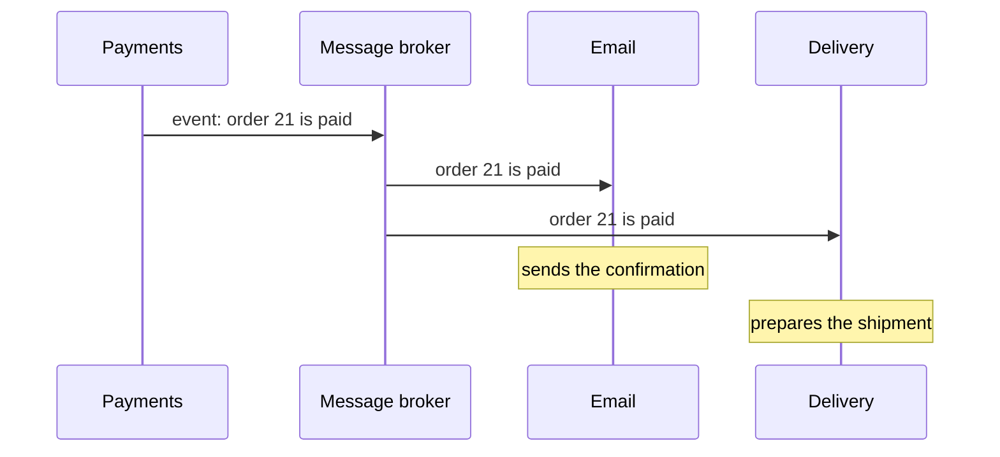
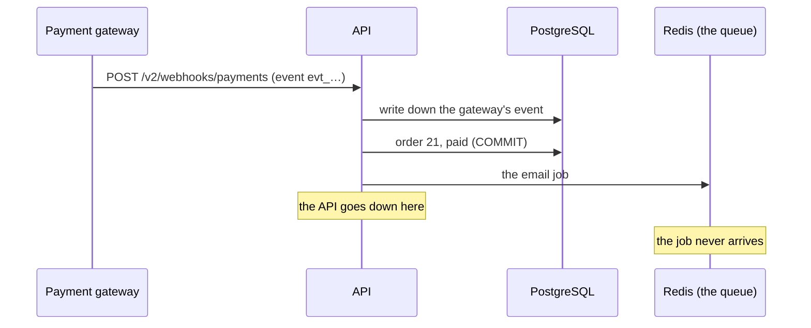
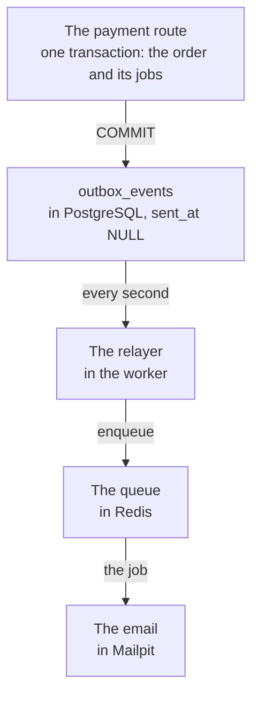

import Term from '~/components/Term.astro';
import TryIt from '~/components/TryIt.astro';
import Analogy from '~/components/Analogy.astro';
import ProjectCode from '~/components/ProjectCode.astro';
import Quiz from '~/components/Quiz.astro';
import QuizQuestion from '~/components/QuizQuestion.astro';
import QuizOption from '~/components/QuizOption.astro';

## The problem

Carmen pays order 21. The payment gateway notifies the shop, and the shop does two things: it turns the order into `paid` in PostgreSQL and it leaves the confirmation email in the Redis queue, as in [lesson 1](/en/phase-9/background-jobs-queues/).

We told you back then: those are **two writes in two places**. If the API goes down between one and the other, or Redis fails, the order is paid and the email exists nowhere. Nobody misses it, because nobody knows it should exist.

And the gateway can’t fix it by retrying: the shop has already written down its event, and answers “repeated.” **The email is lost for good.** This lesson fixes it, and shows you what lies behind the fix: events.

## The analogy

<Analogy>

Think of an office’s outbox tray. When you sign a contract, you don’t run to the post office in the middle of the meeting: you file the contract and, in the same motion, put the customer’s letter in the tray.

Every few minutes the messenger comes by, picks up the letters, takes them to the post office and ticks each one off a list. If one day the messenger doesn’t show up, the letters wait. **None gets lost**, because the letter and the contract were saved together, on the same desk.

<div slot="limits">

- The tray works because it sits on the same desk as the filing cabinet. In the shop, the outgoing table is in the same database as the order: if it were in Redis, the problem would come back.
- If the messenger delivers the letters and falls ill before ticking them off, tomorrow’s messenger delivers them again. A repeated letter is noticeable; a repeated job is not, unless it carries a number that identifies it.
- The email goes out a little after the payment, never at the same moment.

</div>

</Analogy>

## How it really works

### One command says what to do; an event says what happened

Compare these two messages:

- “Send the confirmation email for order 21.”
- “Order 21 is paid.”

The first is a **command**: it goes to someone in particular, who has to do it. The second is an **event**: it tells something that has already happened, and doesn’t say who cares about it or what to do with it.

| | Command | Event |
|---|---|---|
| How it’s written | In the imperative: “send,” “charge” | In the past: “paid,” “created” |
| Who it goes to | One party, who knows how to do it | Whoever wants it: zero, one or many |
| Who decides what happens | The sender | Each party that receives it |

The shop already uses both. The queue’s jobs are commands: “send this email.” The order changes from [lesson 3](/en/phase-9/horizontal-scaling/#redis-pubsub-one-channel-for-all-the-copies) are events: the API publishes “order 21 has changed” in Redis and doesn’t know who follows it, nobody or ten browsers.

### Publish and subscribe: whoever announces doesn’t know who listens

In an <Term id="event-driven-architecture">event-driven architecture</Term>, the parts of a system talk to each other mostly with events. Payments publishes “order paid,” and every part that has subscribed reacts on its own. It is lesson 3’s <Term id="pub-sub">pub/sub</Term>, used as a way of organizing the whole system.



- **Adding a reaction doesn’t touch whoever announces.** If billing subscribes tomorrow, the payments code doesn’t change.
- **A part that is down doesn’t stop the others.** With email stopped, the payment is saved anyway, and the notice waits.

The broker is a program that receives messages and hands them out. The best known are **Kafka**, which keeps events for days and lets you read them again; **RabbitMQ**, which routes each message to queues by rules; and **NATS**, light and very fast. What the shop needs, with Redis, is not to lose messages along the way.

### Two writes, two places: the gap from lesson 1

This is how the shop took payments up to step `40-zero-downtime`:



This is the **dual write problem**: two systems that don’t share a <Term id="transaction">transaction</Term>, so there is no way to save in both at once. Between one write and the other there is a gap, and sooner or later something falls into it: a deployment, an out-of-memory crash, a slow Redis.

**Swapping the order doesn’t fix it.** If you enqueue first and save the payment afterwards, a crash in between sends the email for an unpaid order. There are protocols for two systems to commit together (two-phase commit), but Redis doesn’t have them.

And there was another gap, inside PostgreSQL: the gateway’s event was saved on its own, outside the payment’s transaction, before paying. That is why the retry got “repeated.”

### The outbox: the notice, in the same transaction

The solution is to not write in two places. The job is saved **in PostgreSQL, in the same transaction as the payment**: either both are saved, or neither. Afterwards, another process carries it to the queue. This is the <Term id="transactional-outbox">transactional outbox</Term>.

The new table, in migration `011`:

<ProjectCode file="shop-api/41-events/db/migrations/011-outbox-events.sql" region="outbox-events" />

- **`data`**: the whole job, just as it will go to the queue, in a <Term id="jsonb">JSONB</Term> column.
- **`sent_at`**: when it reached the queue. While it is `NULL`, it is pending.
- **The partial <Term id="database-index">index</Term>** (`WHERE sent_at IS NULL`) keeps only the pending rows: the sent ones, almost all of them over time, don’t make it grow.

The table is named `outbox_events` after the pattern, although each row in the shop is a command: “send this email.”

The route that receives the payment, in `src/v2.ts`, with the key lines marked:

<ProjectCode file="shop-api/41-events/src/v2.ts" region="receive-payment" mark={[13, 15, 17, 24, 26, 31]} />

- **`db.transaction(async (tx) => …)`**: everything inside, in one transaction, as in [Phase 5](/en/phase-5/acid-transactions/#begin-and-commit-several-commands-as-one). `tx` is its connection.
- **`recordEvent(event.id, tx)`**: the gateway’s event, now inside. If something fails afterwards, it is undone, and the gateway’s retry tries everything again.
- **`changeStatusIn(…, 'paid', 'pending')`**: pays only if it is still pending, in the same `UPDATE`, like [fix 1 in Phase 5](/en/phase-5/acid-transactions/#fix-1-check-and-take-in-the-same-command).
- **`saveOutbox(tx, …)`**: one notice for each delivery URL, and the email.
- **`orderChanges.emit`**, after the `COMMIT`, when the change can already be read.

**The route no longer talks to the queue.** Saving a job is one more row:

<ProjectCode file="shop-api/41-events/src/outbox.ts" region="save-outbox" />

### The relayer: from the table to the queue

Somebody has to carry the rows to the queue: the **relayer**. It is not the `carrier` container from lesson 1, the pretend delivery company: this one lives in the <Term id="worker">worker</Term>, in `scripts/worker.ts`:

<ProjectCode file="shop-api/41-events/scripts/worker.ts" region="relayer" />



Each round, in `src/outbox.ts`, is a transaction in three steps: everything that follows goes inside its `db.transaction(async (tx) => …)`. First, it takes the pending rows:

<ProjectCode file="shop-api/41-events/src/outbox.ts" region="read-pending" />

**`FOR UPDATE`** locks the rows it read until the end of the transaction, as in [fix 2 in Phase 5](/en/phase-5/acid-transactions/#fix-2-select--for-update-read-and-hold-on-to-the-row). **`SKIP LOCKED`** skips the ones another worker has already locked, without waiting: with two workers, they never take the same ones.

Then it carries them to the queue, with a deadline:

<ProjectCode file="shop-api/41-events/src/outbox.ts" region="enqueue-in-time" />

- **`QUEUE_WAIT`, 2 seconds per round.** A hung Redis would never answer, and the Redis client’s limit doesn’t count once the command has been sent ([lesson 2](/en/phase-9/redis-cache/#if-the-cache-fails-the-shop-keeps-going)): the application sets it, with `Promise.race`, a race between each command and a single 2-second clock for the whole round.
- **It only writes down what Redis has confirmed.** If it is slow, it keeps what has arrived and leaves the rest. If nothing arrives, it throws an error: `ROLLBACK`, and everything stays pending.

Last, it writes down the ones that arrived, and `COMMIT`:

<ProjectCode file="shop-api/41-events/src/outbox.ts" region="mark-sent" />

- **It enqueues before the `COMMIT`.** The other way round (mark as sent and enqueue afterwards), a worker that goes down in between would lose them: the same gap as before.
- **`clock_timestamp()`**: the time after enqueuing; `now()` would give the time the transaction began.

There is one round when the worker starts, for whatever a crash left pending, and another every second. Without Redis, the API itself does the relaying.

### A worker that disappears with the rows locked

Before reading, the round starts with a line that covers a rare and serious case:

<ProjectCode file="shop-api/41-events/src/outbox.ts" region="no-owner" />

If the worker’s machine switches off abruptly, PostgreSQL can take hours to give the connection up for lost, and meanwhile its rows stay locked. With this setting, a transaction that goes 5 seconds without sending anything is cut off and releases its rows.

### At least once, again: ids that absorb the repeats

The outbox guarantees lesson 1’s <Term id="at-least-once-delivery">at-least-once delivery</Term>. Sometimes, twice:

- the relayer enqueues and goes down before the `COMMIT`, and the next round enqueues the same thing;
- Redis answers late, when the round had already left that job for the next one.

That is why every job carries an id taken from what it is, not a random one:

<ProjectCode file="shop-api/41-events/src/queue.ts" region="job-id" />

**One email per order: `email-21`.** BullMQ doesn’t write down a job with an id it already has, as long as it keeps it: waiting, half done or among the last 1,000 done or failed. A repeat arrives within seconds, so it almost always finds it. For what repeats later, the notices carry `X-Event-Id`: **whoever receives them has to be <Term id="idempotent">idempotent</Term>**, as in [Phase 4’s webhooks](/en/phase-4/webhooks-idempotency/#notifications-repeat-process-each-event-once).

A job that used up its five attempts also keeps its id, so enqueuing it again does nothing: you re-run it with BullMQ’s `job.retry()`. And the table doesn’t clean itself: a real shop would delete old sent rows every day.

### When events help and when they hide the flow

Events **help** when several parts react to the same thing; when whoever announces must not depend on whoever listens; and when different teams own different parts, as in [microservices](/en/phase-9/monolith-vs-microservices/).

They **hide the flow** if you use them for everything. With calls, you read the payment route and know what happens next. With events, that is spread among the subscribers, and to find out why an order didn’t ship you follow the event through each one’s logs. And things happen a little later: the <Term id="eventual-consistency">eventual consistency</Term> of [lesson 6](/en/phase-9/cap-theorem/#eventual-consistency-the-copies-end-up-agreeing).

A practical rule: **call when you need the answer now; publish an event when it is news other parts may care about.**

## Try it

The goal: lose an email on purpose with step 40, and watch step 41 deliver it, with the same commands.

The trick is to **freeze Redis** with `docker compose pause`, as you froze the API in [Phase 8](/en/phase-8/nginx-reverse-proxy/#a-504-the-api-hung): it accepts connections, but doesn’t answer. In step 40, the payment route saves the order and waits for the queue: you kill the API right there, in the gap.

The outputs come from an Apple M1 Pro with Docker in Colima (4 CPUs and 2 GiB), on October 22, 2026, with Node 26. Your ids, times and container names may vary.

### Step 40: the email is lost

You work in your project, `~/backend-course/phase-3/shop-api`, at step 40 from [lesson 4](/en/phase-9/zero-downtime-deployment/). If you didn’t do it, put it at step 40 as in the [introduction](/en/phase-9/#each-lesson-its-step). Delete the practice data, so that order 21 is pending again, and start everything:

```sh
cd ~/backend-course/phase-3/shop-api
docker compose down -v
```

<TryIt
  title="1. The shop, with its queue and Mailpit"
  cmd="docker compose up --build --wait 2>&1 | tail -n 9"
  output={` Container shop-redis-1 Waiting 
 Container shop-cache-1 Waiting 
 Container shop-migrate-1 Exited 
 Container shop-mailpit-1 Healthy 
 Container shop-cache-1 Healthy 
 Container shop-redis-1 Healthy 
 Container shop-db-1 Healthy 
 Container shop-worker-1 Healthy 
 Container shop-api-1 Healthy `}
>

`tail -n 9` keeps the last lines. Look at `shop-api-1` and `shop-worker-1`: both are running.

</TryIt>

<TryIt
  title="2. Freeze the queue"
  cmd="docker compose pause redis"
  output={` Container shop-redis-1 Paused `}
>

Redis no longer answers, but its connections stay open: the API gets no error, only silence.

</TryIt>

The gateway pays order 21, pending in the sample data:

<TryIt
  title="3. Pay, and kill the API"
  cmd={`docker run --rm --network shop_default --env-file .env -e SHOP_URL=http://api:3000 -v "$PWD":/p -w /p node:26 node scripts/payment-gateway.ts 21 > payment.txt 2>&1 &
sleep 3
docker compose kill api`}
  output={` Container shop-api-1 Killing 
 Container shop-api-1 Killed `}
>

- **`docker run … scripts/payment-gateway.ts 21`**: Phase 4’s gateway, in a Node 26 container inside Compose’s network, so it reaches the API by its name, `api`.
- **`--env-file .env`**: your webhooks’ secret, as in lesson 1.
- **`> payment.txt 2>&1 &`**: whatever it says goes to `payment.txt`, and it runs in the [background](/en/phase-1/linux-processes-and-signals/#foreground-and-background): it may never get an answer. Your terminal also prints `[1]` and a number.
- **`docker compose kill api`**: kills the API at once (`SIGKILL`), with no orderly shutdown. A real crash.

</TryIt>

<TryIt
  title="4. Unfreeze, and see what the gateway got"
  cmd={`sleep 5
docker compose unpause redis
sleep 1
cat payment.txt`}
  output={` Container shop-redis-1 Unpaused 
→ POST /v2/webhooks/payments {"id":"evt_9e3e0bc3-b249-4284-bb36-1ca7df5bd299","type":"payment.completed","orderId":21}
node:internal/modules/run_main:111
    triggerUncaughtException(
    ^

[TypeError: fetch failed] {
  [cause]: SocketError: other side closed
…`}
>

We cut the end of the error. **`other side closed`**: the API shut down without answering.

</TryIt>

Wait a few seconds, in case the worker has something to do, and look at what is left in each place:

<TryIt
  title="5. Where is the email?"
  cmd={`docker compose exec -T db psql -U shop -c 'SELECT id, status FROM orders WHERE id = 21'
docker compose exec -T redis redis-cli keys 'bull:shop:*' | sort
curl -s http://localhost:8025/api/v1/messages
docker compose logs --no-log-prefix worker`}
  output={` id | status 
----+--------
 21 | paid
(1 row)

bull:shop:meta
bull:shop:stalled-check
{"total":0,"unread":0,"count":0,"messages_count":0,"messages_unread":0,"start":0,"tags":[],"messages":[]}
{"level":30,"time":1792673082718,"pid":1,"hostname":"5dbd23453c3e","msg":"The worker is waiting for jobs from the queue"}`}
>

- **PostgreSQL**: order 21, `paid`. The first write happened.
- **Redis**: only the queue’s own keys, no job. The second one didn’t arrive.
- **Mailpit**: `"total":0`. **The worker**: its start line, and nothing else.

If the gateway retried, it would get “repeated.” **The email is lost for good.**

</TryIt>

### Step 41: the email arrives

Delete step 40’s data, so that order 21 is pending again, and put your project at step 41:

```sh
docker compose down -v
cd ~/backend-course/phase-3
curl -O https://backenddesdecero.com/practicas/shop-api/41-events.tar.gz
tar -xzf 41-events.tar.gz
cp -R 41-events/. shop-api/
cd shop-api
```

Repeat steps 1 to 4 here, the same commands. This time, the `cat payment.txt` of step 4 shows something else:

<TryIt
  title="6. What the gateway saw, now"
  cmd="cat payment.txt"
  output={`→ POST /v2/webhooks/payments {"id":"evt_52726c8a-9612-4fd5-9f9c-5e84503b6eb1","type":"payment.completed","orderId":21}
← 200 {"received":"evt_52726c8a-9612-4fd5-9f9c-5e84503b6eb1","repeated":false}`}
>

**`200`**, with Redis frozen: the payment route no longer talks to the queue, and it answered before you killed it.

</TryIt>

<TryIt
  title="7. The outbox"
  cmd={`docker compose exec -T db psql -U shop -c 'SELECT id, type, created_at, sent_at FROM outbox_events'`}
  output={` id |        type        |          created_at          |            sent_at            
----+--------------------+------------------------------+-------------------------------
  1 | confirmation-email | 2026-10-22 12:45:38.44975+00 | 2026-10-22 12:45:46.695113+00
(1 row)`}
>

One row, the email: the sample data has no delivery URLs, so there are no notices. **`sent_at` runs about 8 seconds behind `created_at`**: the time Redis stayed frozen, plus the time the relayer took to try again. The times are in UTC (`+00`). If `sent_at` comes out empty, wait a second and repeat.

</TryIt>

<TryIt
  title="8. The queue, the email and the worker"
  cmd={`docker compose exec -T redis redis-cli keys 'bull:shop:*' | sort
curl -s http://localhost:8025/api/v1/messages
docker compose logs --no-log-prefix worker`}
  output={`bull:shop:completed
bull:shop:email-21
bull:shop:events
bull:shop:id
bull:shop:meta
bull:shop:stalled-check
{"total":1,"unread":1,"count":1,…,"To":[{"Name":"","Address":"carmen@example.com"}],…,"Subject":"Your order 21 is paid",…}
{"level":30,"time":1792673128160,"pid":1,"hostname":"f3d849eee823","msg":"The worker is waiting for jobs from the queue"}
{"level":40,"time":1792673141294,"pid":1,"hostname":"f3d849eee823","reason":"the queue doesn't answer in 2000 ms","msg":"the outgoing events haven't reached the queue: it will be retried"}
{"level":40,"time":1792673144301,"pid":1,"hostname":"f3d849eee823","reason":"the queue doesn't answer in 2000 ms","msg":"the outgoing events haven't reached the queue: it will be retried"}
{"level":30,"time":1792673146698,"pid":1,"hostname":"f3d849eee823","events":1,"msg":"outgoing events relayed"}
{"level":30,"time":1792673146723,"pid":1,"hostname":"f3d849eee823","id":"email-21","type":"confirmation-email","msg":"job done"}`}
>

We cut Mailpit’s answer with “…”, because it is very long.

- **Redis**: one job, **`bull:shop:email-21`**, with the id taken from the order.
- **Mailpit**: “Your order 21 is paid,” for Carmen. Also at `http://localhost:8025`.
- **The worker**: two rounds that don’t arrive (`the queue doesn't answer in 2000 ms`), about 3 seconds apart (`time` is in milliseconds: 2 seconds of waiting and 1 of pause). Then the good one, and `job done`.

If Redis answers before the relayer tries, you won’t see retries, and the email arrives all the same. When you finish, `docker compose down -v` and `rm payment.txt`.

</TryIt>

### On your server

Your project is already at step 41: commit and `git push` from `shop-api`, and wait for Publish. Nothing new is needed in `.env`. `deploy.sh` applies migration `011` before the handover from [lesson 4](/en/phase-9/zero-downtime-deployment/#migrations-for-two-versions-at-once), during which an old copy, which enqueues as before, and a new one, which writes to the table, live side by side. The worker is switched last: until then, those rows wait in the table, without being lost.

## You have already seen it

- **GitHub Actions.** The `on: push` of [Phase 8’s workflow](/en/phase-8/ci-cd-github-actions/#when-it-runs-pull-request-and-push-to-main) is a subscription to an event: GitHub announces “a push has arrived,” and every subscribed workflow reacts on its own.

## Common mistakes

- **Saving and enqueuing separately “because it almost never fails.”** If one in a hundred thousand fails, with thousands of payments a day that is several a month.
- **Marking as sent before enqueuing.** If the process goes down in between, the job is lost.
- **Reading the outbox without `SKIP LOCKED`.** With two workers, the second waits for the first; without `FOR UPDATE`, both enqueue the same rows.
- **Assuming each message arrives exactly once.** It arrives at least once: whoever receives it recognizes the repeats by their id.
- **Using `db` instead of `tx` inside the transaction.** It asks for [another connection from the pool](/en/phase-5/acid-transactions/#in-node-a-transaction-needs-a-single-client-from-the-pool): with more simultaneous payments than connections (10), all of them wait for one more, and the shop hangs. That is why `savedNotifications(tx)` takes the transaction.

## Summary

- A command says what to do and goes to one party; an event tells what has happened, and whoever wants to reacts.
- Writing to the database and to the queue separately leaves a gap where jobs are lost, in either order: that is the dual write.
- The outbox saves the job in the same transaction as the change, and a relayer carries it to the queue with `FOR UPDATE SKIP LOCKED`, a time limit, and writing down only what Redis confirmed.
- Every job arrives at least once: ids taken from the content (`email-21`) and `X-Event-Id` absorb the repeats.
- Events help when several parts react to the same thing; used for everything, they hide the flow.

## Did you get it?

<Quiz>

<QuizQuestion
  question="When an account is created, the shop has to send a welcome email. Which of these messages is an event?"
  review="One command says what to do; an event says what happened"
>

<QuizOption text="“Send the welcome email to account 7.”">

It is a command: in the imperative, for someone who knows how to do it.

</QuizOption>

<QuizOption text="“Account 7 has been created.”" correct>

It tells something that has already happened, without saying who cares. The email, or whatever comes tomorrow, reacts without the announcer changing.

</QuizOption>

<QuizOption text="“Account 7 created: send it the welcome email.”">

It starts by telling something that happened, but ends up asking someone to do something: it is a command. An event doesn’t say what to do.

</QuizOption>

</QuizQuestion>

<QuizQuestion
  question="With step 40, Carmen complains: her order is paid in the database, but the email never arrived, and there is no job of hers in Redis. What most likely happened?"
  review="Two writes, two places: the gap from lesson 1"
>

<QuizOption text="The API went down, or Redis failed, between saving the payment and enqueuing the email." correct>

It is the dual write gap: the first write happened and the second didn’t.

</QuizOption>

<QuizOption text="The worker failed five times sending it and then deleted the job from Redis.">

Jobs that fail five times stay in Redis (the last 1,000), so you can look at them. You would see it.

</QuizOption>

<QuizOption text="The gateway didn’t retry the notice; with a retry, the email would have gone out.">

In step 40, the event was already written down: the retry would get “repeated” and do nothing.

</QuizOption>

</QuizQuestion>

<QuizQuestion
  question="A coworker proposes: “Let’s enqueue the email first and save the payment afterwards; that way the email is never lost.” What do you answer?"
  review="Two writes, two places: the gap from lesson 1"
>

<QuizOption text="That it works: if Redis accepts the job, the email is secured no matter what.">

The email is, the payment isn’t: if the API goes down before saving it, Carmen gets the confirmation of a pending order.

</QuizOption>

<QuizOption text="That it’s the same as the outbox, only faster.">

They are still two writes in two systems, with a gap in between. The outbox does a single one, in PostgreSQL.

</QuizOption>

<QuizOption text="That it swaps one problem for another: an email for a payment that may not be saved." correct>

No order closes the gap between two systems without a shared transaction.

</QuizOption>

</QuizQuestion>

<QuizQuestion
  question="The relayer has put 3 jobs in the queue and, before the COMMIT, its machine switches off abruptly. What happens to those 3 rows?"
  review="At least once, again: ids that absorb the repeats"
>

<QuizOption text="They are lost: a worker that no longer exists locked them, and nobody else can take them.">

PostgreSQL cuts the transaction after 5 seconds without activity (`idle_in_transaction_session_timeout`), and the rows are freed.

</QuizOption>

<QuizOption text="They stay pending: another round enqueues them, and their id prevents them from being done twice." correct>

Without a `COMMIT`, `sent_at` stays `NULL`. BullMQ ignores ids it already has, like `email-21`.

</QuizOption>

<QuizOption text="They are marked as sent, because Redis had already received them.">

Marking is an `UPDATE` in the transaction: without a `COMMIT`, it isn’t saved.

</QuizOption>

</QuizQuestion>

<QuizQuestion
  question="You add two workers to relay faster. What does SKIP LOCKED do when both look for pending rows at the same time?"
  review="The relayer: from the table to the queue"
>

<QuizOption text="Each one skips the rows the other has locked and takes others." correct>

Both work at once without stepping on each other: no row is relayed by both.

</QuizOption>

<QuizOption text="The second waits for the first to finish its transaction.">

That is what `FOR UPDATE` does without `SKIP LOCKED`: the two workers would behave as one.

</QuizOption>

<QuizOption text="Both take the same rows, and BullMQ discards the repeats.">

Ids absorb the occasional repeat, not a double relay of everything. `SKIP LOCKED` prevents it.

</QuizOption>

</QuizQuestion>

<QuizQuestion
  question="Your system publishes “order paid” and five parts react. One day order 88 isn’t marked as shipped, and nobody knows which part failed. What does that tell you?"
  review="When events help and when they hide the flow"
>

<QuizOption text="That the event was surely lost: with events, if something doesn’t happen, the notice didn’t arrive.">

It may have arrived and the receiver failed. A missing effect doesn’t tell you where the failure is.

</QuizOption>

<QuizOption text="That it wouldn’t happen with Kafka: it keeps events, so no part can fail.">

Kafka keeps events so they can be read again, but whoever receives them can fail all the same, and you still won’t know which one it was.

</QuizOption>

<QuizOption text="That it is the price of events: the flow isn’t in one place." correct>

What happens on payment is spread among the subscribers: you have to follow the order through each one’s logs.

</QuizOption>

</QuizQuestion>

</Quiz>

## Further reading

- [Pattern: Transactional outbox](https://microservices.io/patterns/data/transactional-outbox.html), by Chris Richardson: the pattern, its variants and its problems.
- [What do you mean by “Event-Driven”?](https://martinfowler.com/articles/201701-event-driven.html), by Martin Fowler: the different things that are called “event-driven,” and the flow that gets hidden.
- [The Locking Clause](https://www.postgresql.org/docs/18/sql-select.html#SQL-FOR-UPDATE-SHARE), from the PostgreSQL documentation: `FOR UPDATE` and `SKIP LOCKED`.
- [Client Connection Defaults](https://www.postgresql.org/docs/18/runtime-config-client.html), from the PostgreSQL documentation: `idle_in_transaction_session_timeout`.
- [Job Ids](https://docs.bullmq.io/guide/jobs/job-ids), from the BullMQ documentation: what happens when you add a job with an id that already exists.
