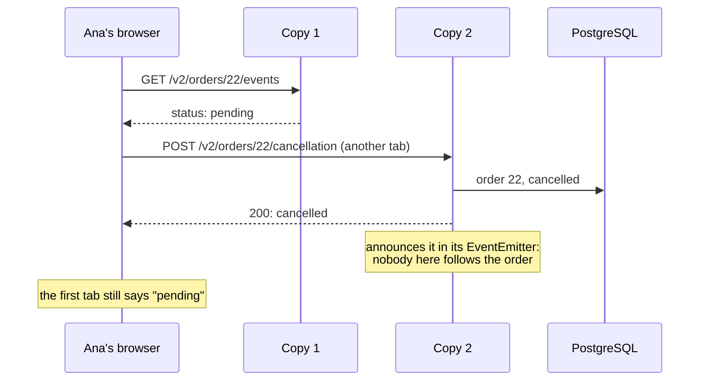
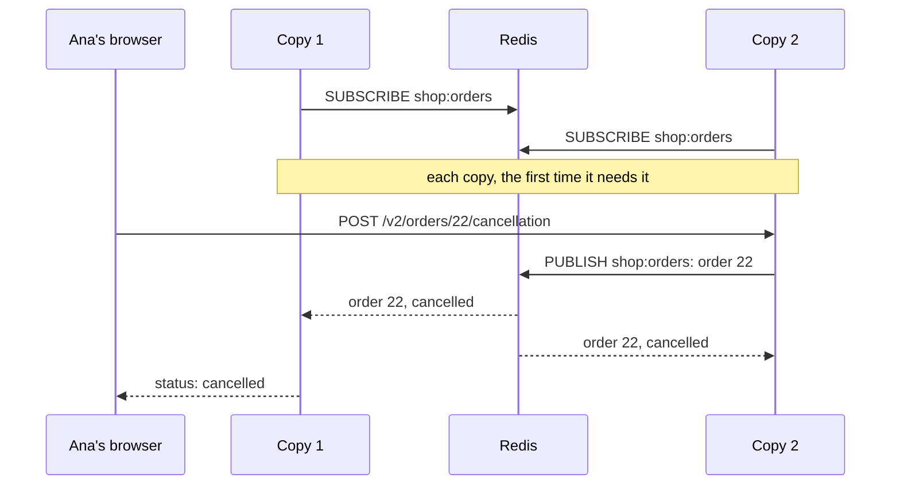

import Term from '~/components/Term.astro';
import TryIt from '~/components/TryIt.astro';
import Analogy from '~/components/Analogy.astro';
import ProjectCode from '~/components/ProjectCode.astro';
import Quiz from '~/components/Quiz.astro';
import QuizQuestion from '~/components/QuizQuestion.astro';
import QuizOption from '~/components/QuizOption.astro';

## The problem

Imagine the shop with two copies of the API behind nginx, like the ones you tried in [Phase 8](/en/phase-8/nginx-reverse-proxy/#two-copies-and-nginx-finds-out-on-its-own). Ana follows order 22 live in one tab and, in another, cancels it. nginx sends the cancellation to the other copy.

The order is cancelled in PostgreSQL, but **the first tab still says "pending"**: the notice stayed in the memory of the other copy.

And another surprise: two copies on the same computer **don’t serve twice as much**, and sometimes less. This lesson fixes the first problem and explains the second.

## The analogy

<Analogy>

Go back to the supermarket from the [introduction](/en/phase-9/). If a cashier kept your bag behind the counter, you have to go back to their register, even if another one is free.

And when everyone has to be told something, like "the price of milk has changed," nobody goes from register to register: the store uses the loudspeaker, and they all hear it at once.

<div slot="limits">

- Registers don’t take space from each other. Two copies on the same computer do: they share its cores.
- The loudspeaker keeps nothing: whoever wasn’t listening misses it. Redis pub/sub is the same, and it isn’t meant for a job that has to get done.

</div>

</Analogy>

## How it really works

### A bigger machine or more copies

There are two ways to make a program handle more:

- <Term id="vertical-scaling">Vertical scaling</Term>: the same machine, with more processor and more memory. It’s moving your [VPS](/en/phase-8/what-is-a-vps/) to a bigger plan.
- <Term id="horizontal-scaling">Horizontal scaling</Term>: more copies of the program, on the same server or on several, with a <Term id="load-balancer">load balancer</Term> in front.

| | Vertical | Horizontal |
|---|---|---|
| The code | Doesn’t change | What lives in the memory of one copy has to move out of it |
| The ceiling | The biggest machine you can rent | The shared pieces, like the database |
| If a copy goes down | Everything goes down | The others keep going; but if they are all on the same machine and the machine goes down, everything goes down |
| What it costs | Expensive machines; resizing usually needs a reboot | A load balancer, and more pieces to watch |

**You almost always start with vertical**, which doesn’t ask you to change the code. With Node, though, the extra cores are only used with more processes, as you’re about to see.

### Node uses one core for your code, and sometimes more

In [Phase 3](/en/phase-3/node-event-loop/#why-it-matters-with-many-users) you saw that your JavaScript runs on one <Term id="thread">thread</Term>, and a thread uses one core. With four cores, your code leaves three unused. **A second <Term id="process">process</Term> uses another one**: that’s how the work gets shared among several Node processes, as we promised.

Node ships a module for that, `node:cluster`: a main process starts several children that share the port. The shop uses containers (`--scale api=2`): the same idea, which also works when the copies run on different machines, where `node:cluster` doesn’t reach.

But your code isn’t the only thing that computes. What libuv does in its [four helper threads](/en/phase-3/node-event-loop/#waiting-doesnt-block), like the [argon2id of the login](/en/phase-6/how-to-store-passwords/#argon2id-in-node-without-installing-anything), already uses other cores.

### Two copies are not double: what we measured

We measured with autocannon, as in the [introduction](/en/phase-9/), on October 22, 2026: an Apple M1 Pro with Docker in Colima, a virtual machine with **4 CPUs and 2 GiB** where autocannon also ran, with 10 connections for 10 seconds. Requests per second, on average:

| Test | One copy | Two copies, each with its own autocannon | Two copies, behind nginx |
|---|---|---|---|
| Login (`POST /v2/session`, argon2id) | 179.7 | 83.9 + 82.7 ≈ 166.6 | 161.2 |
| Product list (`GET /v2/products`, from the cache) | 13,003 | 8,977 + 9,015 ≈ 17,992 | 7,355, and 19 errors |

**The login doesn’t get better.** With a single copy, `docker stats` saw it at 381% (100% is one core): argon2 computes in the helper threads, and one copy already used almost all four. With two behind nginx, each stayed at about 180%: they share the same cores.

**The list does get better, by 38%.** There the limit was your JavaScript thread (the copy, at 110%), and the second copy uses another core. It doesn’t reach double because autocannon computes on the same cores.

Behind nginx, the list falls below a single copy. With the Phase 8 configuration, nginx opens a new connection to a copy for every request, and it also computes on those four cores.

We also tried a pool of open connections to the copies (`keepalive 16`). In an earlier run of the same code, the list reached about 11,200 requests per second: still less than a single copy. The shop doesn’t use it: a new connection per request is what lets nginx move to the other copy when one stops, in [lesson 4](/en/phase-9/zero-downtime-deployment/#what-nginx-repeats-and-what-it-doesnt).

The 19 errors aren’t the shop’s. When we repeated the test in an earlier run, we got 17 errors, but nginx counted 84,297 responses, all `200`, and logged no error. The likely cause is that nginx closes each client connection after 1,000 requests (`keepalive_requests`), and autocannon counts the request that catches the close as an error. With `keepalive_requests 100000`, there were none.

On a single computer, the copies compete for the same cores. What they do give you already is that, if one goes down, the other answers. Horizontal scaling really pays off when each copy brings its own machine.

### Stateless: what cannot live in one copy

In [Phase 4](/en/phase-4/what-is-a-rest-api/#stateless-each-request-makes-sense-on-its-own) we told you that, if the API is <Term id="stateless">stateless</Term>, any copy can answer. Time to check. What the shop remembers between one request and the next:

| What | Where it lives | Can another copy see it? |
|---|---|---|
| <Term id="session">Sessions</Term> | In PostgreSQL, since [Phase 6](/en/phase-6/sessions-and-cookies/) | Yes |
| The rate limit’s attempts | In Redis, since [Phase 7](/en/phase-7/docker-compose/#two-copies-of-the-api-a-single-count-in-redis) | Yes |
| The job queue | In Redis, since [lesson 1](/en/phase-9/background-jobs-queues/) | Yes |
| The catalog cache | In the other Redis, since [lesson 2](/en/phase-9/redis-cache/) | Yes |
| Uploaded files | It has none; they would go to a store like [S3](/en/phase-8/iaas-paas-saas-serverless/#the-aws-names-translated), not to the disk of one copy | — |
| The order notices | In an `EventEmitter`, in the memory of each process | **No** |

Everything is outside except the notice board from [Phase 4](/en/phase-4/websockets-vs-sse/#notifying-each-change-with-an-eventemitter), the one for the route that follows an order with <Term id="sse">SSE</Term>.

### The notice that stays in one copy

Each copy has its own `EventEmitter`. When copy 2 cancels the order, it announces it in its own, and nobody is listening there:



We warned you in [Phase 4](/en/phase-4/websockets-vs-sse/#what-a-websocket-costs): **each connection lives on one server**, and the notice has to reach the one that holds the client’s connection.

### Redis pub/sub: one channel for all the copies

The fix is the loudspeaker: <Term id="pub-sub">pub/sub</Term> (publish and subscribe). Each copy **subscribes** to a Redis channel, `shop:orders`. Whatever anyone **publishes** on it reaches all of those listening:



It all lives in a new file, `src/order-events.ts`. Without `REDIS_URL`, with `npm start`, it’s still an `EventEmitter`: with one process, that’s enough. With Redis, it uses two connections:

<ProjectCode file="shop-api/39-scaling/src/order-events.ts" region="two-connections" />

- **Two**, because a connection subscribed to a channel can only listen. `duplicate()` creates another one with the same options except one: the connection that listens does keep its `SUBSCRIBE` queued until a connection is available.
- **`disableOfflineQueue: true`**: with no connection, publishing fails at once. A notice kept for later could arrive after a newer one, and show "paid" after "cancelled".
- And it subscribes again on its own after every disconnection.

Publishing is what `emit` does, which `changeStatus` and `cancelOrder` call just as before:

<ProjectCode file="shop-api/39-scaling/src/order-events.ts" region="emit" />

- **The copy that makes the change doesn’t notify its own listeners:** it publishes the change and receives it back, like all the others. If it notified its own and also received it from Redis, whoever follows the order on that copy would get it twice.
- **It doesn’t wait for Redis.** The cancellation answers without waiting for the notice: in [lesson 2](/en/phase-9/redis-cache/#if-the-cache-fails-the-shop-keeps-going) you saw that a hung Redis may never answer.
- **Only the first time, the notice** (not the response) waits, one second at most, for the connection to open. After that, if the connection is down, the notice is lost now instead of going out late and out of order.

And what arrives from the channel:

<ProjectCode file="shop-api/39-scaling/src/order-events.ts" region="listen-channel" />

Anyone with access to that Redis can publish on the channel. That’s why every message goes through a [zod](/en/phase-3/zod-validation/) schema: **whatever isn’t an order is ignored**.

And if Redis goes away and comes back, whatever was published in the meantime is lost. So, when it comes back, the API **closes the open SSE streams**, and `EventSource` reconnects on its own and receives the current status.

### Pub/sub is not a queue

Both go through Redis, with opposite jobs:

| | The queue (lesson 1) | Pub/sub |
|---|---|---|
| Who receives each message | One worker | Everyone listening |
| If nobody is listening | The job waits | The message is lost |
| What it’s for | Something that has to get done, like an email | A notice that only matters to whoever is there |

Redis calls this "at most once" delivery (*at-most-once*), as opposed to the queue’s [at-least-once delivery](/en/phase-9/background-jobs-queues/#at-least-once-a-job-can-be-done-twice). For a notice on a screen, it’s enough.

### How the load balancer shares requests out

The shop’s load balancer is nginx, with its `upstream` from [Phase 8](/en/phase-8/nginx-reverse-proxy/#the-shops-site-nginxshopconf). The two ways of sharing you’ll see most:

- **Round robin**: one request to each copy, in order. It’s what nginx does by default.
- **Least connections** (`least_conn` inside the `upstream`): to the copy with the fewest open connections. It helps when some requests last much longer than others, like an SSE stream that lasts minutes.

### Layer 4 or layer 7

In the [TCP/IP model](/en/phase-0/tcp-ip-model/#the-osi-model-as-a-reference) we told you about "layer 4" and "layer 7" load balancers:

| | Layer 4 (transport) | Layer 7 (application) |
|---|---|---|
| What it sees | IPs and ports | The whole HTTP request: URL, headers, cookies |
| What it shares out | <Term id="tcp">TCP</Term> connections, without looking at what’s inside | Requests, one by one |
| What else it can do | Little more: it shares out very fast | Choose a copy by the URL, add `X-Forwarded-For`, retry on another copy, HTTPS |
| Examples | nginx’s `stream` module; AWS’s *Network Load Balancer* | nginx with `proxy_pass`, like the shop; AWS’s *Application Load Balancer* |

**The shop’s is layer 7:** that’s why in Phase 8 it answered with a `502`, an HTTP response, when it couldn’t talk to any copy.

### Sticky sessions, and why the shop doesn’t need them

Another way to share out: each visitor **always to the same copy**, by their IP (`ip_hash` in nginx) or with a cookie. These are sticky sessions, for APIs that keep state in memory, like the cashier who kept your bag.

The price: the split ends up uneven and, if a copy goes down, its visitors lose what it was keeping. **The shop doesn’t need them:** the sessions are in PostgreSQL and the notices go through Redis.

### Several servers: the load balancer, on its own machine

With several machines, the idea is the same: each copy on its own server, and the load balancer on another, or as a service from your provider, which is the only one facing the internet.

PostgreSQL and Redis move to their own machine and become the next limit: that’s where the [replicas](/en/phase-9/cap-theorem/#replicas-the-same-data-on-two-machines) of lesson 6 begin.

## Try it

The goal: see how a notice gets lost with two copies, fix it with step 39, and measure how much the second copy gains you.

The outputs are from the Mac of the measurements, with Node 26 in the containers; your times, IDs and numbers will be different. You work in your project, `~/backend-course/phase-3/shop-api`, at step 38 from [lesson 2](/en/phase-9/redis-cache/).

### With step 38: the notice is lost

<TryIt
  title="1. Two copies of the API"
  cmd={`docker compose up --build --scale api=2 --wait
docker compose port --index 1 api 3000
docker compose port --index 2 api 3000`}
  output={`…
 Container shop-api-2 Healthy 
 Container shop-api-1 Healthy 
127.0.0.1:3000
127.0.0.1:3001`}
>

`--wait` waits for both copies to be healthy, and `docker compose port --index N api 3000` tells you which port each one got. **Always ask:** each copy takes whichever one is free in the range, and in another run copy 1 got 3001. If that happens to you, change the ports in the next steps.

</TryIt>

<TryIt
  title="2. Ana logs in through copy 1"
  cmd={`curl -s -c ana.txt -H 'Content-Type: application/json' -d '{"email":"ana@shop.example","password":"ana-practice-2026"}' http://localhost:3000/v2/session`}
  output={`{"id":1,"email":"ana@shop.example","role":"admin"}`}
>

`-c ana.txt` saves the session cookie. **The session lives in PostgreSQL**, so it’s valid on both copies.

</TryIt>

Now you need two terminals. In the first, Ana follows order 22 through copy 1 for 6 seconds (`-m 6`). Open the second, go into your project too (`cd ~/backend-course/phase-3/shop-api`, where `ana.txt` is) and cancel the order through copy 2 before the 6 seconds are up.

<TryIt
  title="3. Follow through one copy, cancel through the other"
  cmd={`# terminal 1
curl -sN -m 6 -b ana.txt http://localhost:3000/v2/orders/22/events
# terminal 2
curl -s -b ana.txt -H 'Origin: http://localhost:3000' -X POST http://localhost:3001/v2/orders/22/cancellation`}
  output={`# terminal 2
{"id":22,"productId":2,"quantity":3,"status":"cancelled","createdAt":"2026-10-07T12:00:00.000Z","customerId":4}
# terminal 1, what arrived in those 6 seconds
event: status
data: {"id":22,"productId":2,"quantity":3,"status":"pending","createdAt":"2026-10-07T12:00:00.000Z","customerId":4}`}
>

The cancellation answers `"status":"cancelled"`. `Origin` is the header the shop requires on a `POST` with a cookie, from the [CSRF lesson](/en/phase-6/csrf-ssrf/#second-wall-where-the-request-comes-from).

**Look at terminal 1:** a single event, `pending`. The cancellation never arrived.

If the cancellation gives a `401`, that terminal can’t find `ana.txt`; if it gives a `403`, the `Origin` is missing. If the 6 seconds run out, order 22 is already cancelled and won’t notify again: repeat with another pending order, 23 or 24, and `-m 30`: the output will show that order’s id.

</TryIt>

<TryIt
  title="4. Is it cancelled?"
  cmd={`curl -s -b ana.txt http://localhost:3000/v2/orders/22
curl -s -b ana.txt http://localhost:3001/v2/orders/22`}
  output={`{"id":22,"productId":2,"quantity":3,"status":"cancelled","createdAt":"2026-10-07T12:00:00.000Z","customerId":4}
{"id":22,"productId":2,"quantity":3,"status":"cancelled","createdAt":"2026-10-07T12:00:00.000Z","customerId":4}`}
>

Both copies read `cancelled` from PostgreSQL. **The data is fine; what got lost was the notice.**

</TryIt>

### Update your project

First, `docker compose down -v`: order 22 is already cancelled, and `-v` deletes the volumes so the shop loads its practice data again (and takes your session with it). Then put your project at step 39, as in the [introduction](/en/phase-9/#each-lesson-its-step):

```sh
docker compose down -v
cd ~/backend-course/phase-3
curl -O https://backenddesdecero.com/practicas/shop-api/39-scaling.tar.gz
tar -xzf 39-scaling.tar.gz
cp -R 39-scaling/. shop-api/
cd shop-api
```

`order-events.ts` is new; `data.ts` and `v2.ts` use it, and `config.ts` reads the channel’s name, `ORDERS_CHANNEL` (by default, `shop:orders`). There are no new packages.

### With step 39: the notice arrives

Repeat steps 1 to 3: `up` with `--build`, to build the new image, the ports, Ana’s session, and follow and cancel, with both terminals in your project.

<TryIt
  title="5. Follow through one copy, cancel through the other, again"
  cmd={`# terminal 1
curl -sN -m 6 -b ana.txt http://localhost:3000/v2/orders/22/events
# terminal 2
curl -s -b ana.txt -H 'Origin: http://localhost:3000' -X POST http://localhost:3001/v2/orders/22/cancellation`}
  output={`# terminal 2
{"id":22,"productId":2,"quantity":3,"status":"cancelled","createdAt":"2026-10-07T12:00:00.000Z","customerId":4}
# terminal 1, what arrived in those 6 seconds
event: status
data: {"id":22,"productId":2,"quantity":3,"status":"pending","createdAt":"2026-10-07T12:00:00.000Z","customerId":4}

event: status
data: {"id":22,"productId":2,"quantity":3,"status":"cancelled","createdAt":"2026-10-07T12:00:00.000Z","customerId":4}`}
>

**Now there are two events:** `pending` and, as soon as you cancel, `cancelled`. The notice went from copy 2 to Redis, and from Redis to copy 1. If you only see one, look at step 6: both copies must listen to the channel.

</TryIt>

<TryIt
  title="6. What the copies say"
  cmd={`docker compose logs api 2>&1 | grep -v '"path":"/health"' | cut -c1-300`}
  output={`api-1  | {"level":30,"time":1792657585690,"pid":1,"hostname":"9f33f1ede048","msg":"The shop is listening on http://localhost:3000"}
…
api-1  | {"level":30,"time":1792657594739,"pid":1,"hostname":"9f33f1ede048","requestId":"3fc92289-93e7-4d47-b495-313be7415c86","method":"GET","path":"/v2/orders/22/events","status":200,"ms":5,"msg":"request"}
api-1  | {"level":30,"time":1792657594741,"pid":1,"hostname":"9f33f1ede048","channel":"shop:orders","msg":"the API listens to the channel of the order notices"}
…
api-2  | {"level":30,"time":1792657585503,"pid":1,"hostname":"ded95f1becff","msg":"The shop is listening on http://localhost:3000"}
api-2  | {"level":30,"time":1792657596261,"pid":1,"hostname":"ded95f1becff","requestId":"af4c4c46-f362-4cf1-8e84-c58ce4333ac6","method":"POST","path":"/v2/orders/22/cancellation","status":200,"ms":11,"msg":"request"}
api-2  | {"level":30,"time":1792657596265,"pid":1,"hostname":"ded95f1becff","channel":"shop:orders","msg":"the API listens to the channel of the order notices"}
…`}
>

`grep -v` removes the health check lines; we removed others with "…". **Each copy subscribes to the channel the first time it needs it:** copy 1, with the request that follows the order; copy 2, with the cancellation.

If a copy doesn’t say `the API listens to the channel`, check that `compose.yaml` passes it `REDIS_URL`.

</TryIt>

### One copy against two, measured

With both copies running, launch one autocannon against each at the same time, with 5 connections each. It runs in a `node:26` container inside the shop’s network, `shop_default`, to reach each copy by name. First, as we did, a 3-second pass to warm up: the first read fills the cache, which both copies share.

```sh
docker run --rm --network shop_default node:26 npx -y autocannon@8.0.0 -d 3 http://api:3000/v2/products
```

<TryIt
  title="7. Two copies, each with its own autocannon"
  cmd={`docker run --rm --network shop_default node:26 npx -y autocannon@8.0.0 -c 5 -d 10 http://shop-api-1:3000/v2/products &
docker run --rm --network shop_default node:26 npx -y autocannon@8.0.0 -c 5 -d 10 http://shop-api-2:3000/v2/products &
wait`}
  output={`Running 10s test @ http://shop-api-1:3000/v2/products
5 connections
…
│ Stat      │ 1%      │ 2.5%    │ 50%     │ 97.5%   │ Avg      │ Stdev    │ Min     │
├───────────┼─────────┼─────────┼─────────┼─────────┼──────────┼──────────┼─────────┤
│ Req/Sec   │ 6,051   │ 6,051   │ 9,247   │ 10,287  │ 8,977.21 │ 1,393.81 │ 6,049   │
…
90k requests in 9.92s, 83.8 MB read
Running 10s test @ http://shop-api-2:3000/v2/products
5 connections
…
│ Stat      │ 1%      │ 2.5%    │ 50%     │ 97.5%   │ Avg      │ Stdev    │ Min     │
├───────────┼─────────┼─────────┼─────────┼─────────┼──────────┼──────────┼─────────┤
│ Req/Sec   │ 6,283   │ 6,283   │ 9,191   │ 10,551  │ 9,014.73 │ 1,314.34 │ 6,282   │
…
99k requests in 10.9s, 92.6 MB read`}
>

The `&` at the end launches each command without waiting for it to finish, and `wait` waits for both. Each container downloads autocannon with `npx` before starting, so the two 10 seconds overlap, but they aren’t exact. The tables come out mixed in with the headers; here, they’re sorted and show only the requests-per-second row. **Add the two averages, `Avg`:** 8,977 + 9,015, about 17,992 per second.

</TryIt>

Go back to a single copy with `docker compose up -d --scale api=1 --wait` and measure with 10 connections, the same total. autocannon finds it by the service’s name, `api`:

<TryIt
  title="8. One copy"
  cmd="docker run --rm --network shop_default node:26 npx -y autocannon@8.0.0 -d 10 http://api:3000/v2/products"
  output={`Running 10s test @ http://api:3000/v2/products
10 connections


┌─────────┬──────┬──────┬───────┬──────┬─────────┬─────────┬───────┐
│ Stat    │ 2.5% │ 50%  │ 97.5% │ 99%  │ Avg     │ Stdev   │ Max   │
├─────────┼──────┼──────┼───────┼──────┼─────────┼─────────┼───────┤
│ Latency │ 0 ms │ 0 ms │ 1 ms  │ 2 ms │ 0.13 ms │ 0.72 ms │ 54 ms │
└─────────┴──────┴──────┴───────┴──────┴─────────┴─────────┴───────┘
┌───────────┬─────────┬─────────┬─────────┬─────────┬───────────┬────────┬─────────┐
│ Stat      │ 1%      │ 2.5%    │ 50%     │ 97.5%   │ Avg       │ Stdev  │ Min     │
├───────────┼─────────┼─────────┼─────────┼─────────┼───────────┼────────┼─────────┤
│ Req/Sec   │ 10,919  │ 10,919  │ 13,463  │ 14,071  │ 13,002.55 │ 970.65 │ 10,915  │
├───────────┼─────────┼─────────┼─────────┼─────────┼───────────┼────────┼─────────┤
│ Bytes/Sec │ 10.2 MB │ 10.2 MB │ 12.6 MB │ 13.1 MB │ 12.1 MB   │ 906 kB │ 10.2 MB │
└───────────┴─────────┴─────────┴─────────┴─────────┴───────────┴────────┴─────────┘

Req/Bytes counts sampled once per second.
# of samples: 11

143k requests in 11.01s, 134 MB read`}
>

**About 13,003 per second:** two copies give 38% more, not double. The p99 of the latency is `2 ms`: the list comes out of the cache.

</TryIt>

When you’re done: `docker compose down` and `rm ana.txt`.

### On your server

This time there’s nothing to copy to the server: neither `compose.production.yaml` nor `deployment/` changes. Commit and `git push` from `shop-api`, and the timer deploys step 39. **There’s nothing to add to `.env`:** the notices use the same `REDIS_URL` as the queue. Production stays with **a single copy**, which publishes and hears itself, until [lesson 4](/en/phase-9/zero-downtime-deployment/#two-fixed-copies-api-a-and-api-b): there it gets two, `api-a` and `api-b`.

## You have already seen it

- **Your provider’s plans.** Moving your VPS from 2 to 4 GB of memory is scaling vertically; renting a second server, horizontally.
- **The shop from Phase 7.** With `--scale api=2` you already had two copies, and the limit worked because it was in Redis.

## Common mistakes

- **Expecting double with two copies on the same machine.** Measure first.
- **Keeping something in the process’s memory and scaling later.** A `Map` of sessions, a counter: each copy would have its own.
- **Notifying your own listeners and also publishing.** Whoever follows the order on that copy receives it twice.
- **Using pub/sub for a job that has to get done.** If nobody is listening, it’s lost: that’s what the queue is for.

## Summary

- Vertically, a bigger machine; horizontally, more copies with a load balancer in front.
- On a single machine, the copies share the cores: we measured +38% on the list and nothing on the login.
- To scale horizontally, nothing can live in just one copy: in the shop, what was left was the notices’ `EventEmitter`.
- With Redis pub/sub, each copy publishes the changes and all of them, itself included, receive them. With nobody listening, they’re lost.
- A load balancer shares out in turns or to the copy with the fewest connections; a layer 7 one reads the HTTP request.

## Did you get it?

<Quiz>

<QuizQuestion
  question="Your API is slow at peak hour. The server has 4 cores, and docker stats shows the API at 100% all the time. What helps most?"
  review="Node uses one core for your code, and sometimes more"
>

<QuizOption text="Moving to a server with double the memory.">

The 100% is one core kept busy by your JavaScript thread. More memory doesn’t give it another core.

</QuizOption>

<QuizOption text="A second copy of the API on the same server." correct>

Three cores are free, and a second process uses another one: the product list gained 38% that way.

</QuizOption>

<QuizOption text="Nothing: Node already spreads your code across the free cores.">

Your JavaScript runs on one thread, which uses one core. Only what libuv does in its helper threads uses others.

</QuizOption>

</QuizQuestion>

<QuizQuestion
  question="A route compresses files with the asynchronous version of zlib, which computes in the helper threads, and has the API at 390% on a 4-core server. Does a second copy on the same server help?"
  review="Two copies are not double: what we measured"
>

<QuizOption text="Almost nothing: the helper threads already fill the cores." correct>

It’s the shop’s argon2 case: one copy already filled the machine, and with two we measured 166.6 logins per second, against 179.7.

</QuizOption>

<QuizOption text="Yes, double: each copy brings its own main thread.">

The limit isn’t the main thread but the cores, and one more copy doesn’t add any.

</QuizOption>

<QuizOption text="Yes, if it’s behind a load balancer, which shares the work out and lightens it.">

Sharing out doesn’t create cores. With the login, behind nginx we measured 161.2 per second, a bit less than with a single copy.

</QuizOption>

</QuizQuestion>

<QuizQuestion
  question="An API keeps shopping carts in a Map, in its memory. You put it on three copies behind nginx, with its usual way of sharing out. What does a buyer see?"
  review="Stateless: what cannot live in one copy"
>

<QuizOption text="Nothing odd: nginx always sends each visitor to the same copy.">

nginx shares out in turns. Sending each visitor to the same copy is a sticky session, and you have to ask for it (`ip_hash`).

</QuizOption>

<QuizOption text="Nothing odd: the copies pass their carts to each other over the local network.">

Each process has its own memory. To share, you need a common store, like PostgreSQL or Redis.

</QuizOption>

<QuizOption text="A cart that appears and disappears depending on which copy answers." correct>

Each request can land on another copy, with its own `Map`. The cart has to go somewhere all of them can see.

</QuizOption>

</QuizQuestion>

<QuizQuestion
  question="With step 39, Ana follows an order on copy 2 and copy 2 itself cancels it. How does the notice reach her?"
  review="Redis pub/sub: one channel for all the copies"
>

<QuizOption text="Copy 2 notifies its own listeners right away, and also publishes it for the others.">

Ana would get it twice: once from the direct notice and once from Redis.

</QuizOption>

<QuizOption text="Copy 2 publishes it to Redis and receives it back, like the others." correct>

Redis delivers it to every subscribed connection, including the one of the copy that published: a single path.

</QuizOption>

<QuizOption text="It doesn’t: Redis doesn’t send a copy back what it published itself.">

Redis delivers the message to every connection subscribed to the channel, and copy 2 has its own.

</QuizOption>

</QuizQuestion>

<QuizQuestion
  question="A teammate suggests sending the confirmation emails through pub/sub instead of the queue, “because it’s more direct.” What do you answer?"
  review="Pub/sub is not a queue"
>

<QuizOption text="That’s fine: pub/sub keeps each message until someone reads it.">

Pub/sub keeps nothing: it delivers what’s published to whoever is listening at that moment.

</QuizOption>

<QuizOption text="That’s fine if there are two workers listening, so none is lost.">

With two listening, two emails would go out, and with both stopped it would be lost anyway.

</QuizOption>

<QuizOption text="No: if nobody is listening right then, the email never goes out." correct>

Pub/sub delivers to whoever is there, at most once. The queue keeps the job until a worker takes it, and retries it.

</QuizOption>

</QuizQuestion>

<QuizQuestion
  question="The shop grows, and you want requests to /v2/orders to go to some copies and the rest to others. Which load balancer works?"
  review="Layer 4 or layer 7"
>

<QuizOption text="A layer 7 one, which reads the URL of each request." correct>

To choose by route you have to read the HTTP request, and only a layer 7 balancer does that, like nginx with `proxy_pass`.

</QuizOption>

<QuizOption text="A layer 4 one, which is faster and also sees the URL.">

A layer 4 balancer shares out TCP connections by looking at IPs and ports. The URL is inside the request, which it doesn’t open.

</QuizOption>

<QuizOption text="Sticky sessions, so each route always goes to one copy.">

Sticky sessions tie a visitor to a copy, not a route: their `/v2/orders` and `/v2/products` would go together.

</QuizOption>

</QuizQuestion>

</Quiz>

## Further reading

- [Using nginx as HTTP load balancer](https://nginx.org/en/docs/http/load_balancing.html), from the nginx documentation: round robin, `least_conn` and `ip_hash`.
- [Redis Pub/sub](https://redis.io/docs/latest/develop/pubsub/), from the Redis documentation: channels and why delivery is "at most once."
- [Cluster](https://nodejs.org/api/cluster.html), from the Node documentation: several Node processes on the same port.
- [Processes](https://12factor.net/processes), from *The Twelve-Factor App*: why an application shouldn’t keep anything in a process’s memory, and what it says about sticky sessions.
