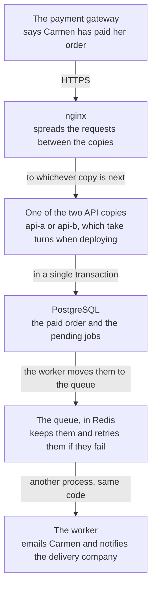

import Term from '~/components/Term.astro';
import TryIt from '~/components/TryIt.astro';
import Analogy from '~/components/Analogy.astro';
import SelfCheck from '~/components/SelfCheck.astro';

At the end of Phase 8, the shop lives on a server, behind nginx, with its own name and HTTPS, and every `git push` to `main` reaches it without you logging in. For a few customers, it works.

This phase is about **what breaks when many more arrive**, and about the shapes a backend takes to stand up to it.

## What scaling is, and what it isn’t

Imagine an account with lots of followers shows off the shop’s mug on a Friday night. In ten minutes, more people visit than in the whole month. The product list starts to slow down, the notice to the delivery company that failed is never retried and, if you happen to deploy a new version right then, the shop answers with errors for a few seconds.

**Scaling is handling more work without each person noticing:** more visits, more orders, more data, with everyone still getting their answer just as fast and without errors.

Scaling is not the same as being fast. A route that takes two seconds with a single visit is slow, and that gets fixed in the route: with an [index from Phase 5](/en/phase-5/database-indexes-explain/), or by not blocking the [event loop from Phase 3](/en/phase-3/node-event-loop/). Scaling is what happens when there are a thousand at once.

And almost no application needs almost any of this. In the "Try it" below, the product list answers about 715 requests per second on a laptop. That isn’t its exact limit (you’ll see why at the end), but it gives the order of magnitude: kept up for a whole day, it would be more than 60 million. Every piece in this phase adds things to run and things to watch, so **it’s only worth it when a measurement says it’s needed**.

## Bigger, or more copies

When a measurement says the shop can’t cope, there are two ways out: give it a bigger machine, or run more copies of it.

<Analogy>

Think of a supermarket with a single checkout and a line that reaches the back of the store. You can put the fastest cashier there, with the best scanner: she serves more people, but only up to a point, and if she goes to lunch, the whole line stops.

Or you can open more checkouts, and put someone at the front of the line who sends each customer to a free one. If one closes, the others keep going. Every customer carries their own cart, so it doesn’t matter which checkout they end up at.

<div slot="limits">

- The person at the front can see which checkout is free. The load balancer doesn’t always know: nginx’s round-robin sends one request to each copy, however things are going. Lesson 3 tells you how it decides.
- The customer carries their cart to any checkout. In an API, what one copy keeps in its memory isn’t visible to the others: lesson 3 looks for what the shop keeps that way and takes it out of there.
- More checkouts don’t help if they all wait on the same warehouse. If all the copies ask the same database, the jam moves there, and that’s why the cache in lesson 2 exists.

</div>

</Analogy>

The fastest cashier is <Term id="vertical-scaling">vertical scaling</Term>, and opening more checkouts is <Term id="horizontal-scaling">horizontal scaling</Term>. Side by side:

| | Vertical: a bigger machine | Horizontal: more copies |
|---|---|---|
| What you do | Swap the server for one with more cores and more memory | Start another copy of the API, and a <Term id="load-balancer">load balancer</Term> spreads the requests |
| The program | Doesn’t change | Can’t keep anything in its memory that the other copies need |
| If a copy goes down | The shop goes down | The others keep serving; but if they’re all on the same machine and the machine goes down, everything goes down |
| In the shop | It depends on the route: your JavaScript uses a single core per process ([Phase 3](/en/phase-3/node-event-loop/)); the other cores are used by Node’s [helper threads](/en/phase-3/node-event-loop/#waiting-doesnt-block), like the argon2 in the login, or by more processes | Two copies on your computer (lesson 3) and on your server (lesson 4), both on the same machine |

## The rule of the phase: measure first

What’s slow isn’t always what you think. In this phase you’ll see it twice with numbers: the cache multiplies the catalog’s requests per second by about 17, and a second copy of the API, on a laptop, doesn’t make the login any faster. Both things show up in a measurement; you can’t guess them.

The tool is a <Term id="load-test">load test</Term>: a program that plays the part of many visitors at once against your API and writes down how long each response takes. The one in this course is **autocannon**, which runs on Node, like the shop. There are other popular ones, such as k6, oha or Apache’s `ab`.

**The cache and scaling lessons repeat this measurement** before and after their change; the others teach theirs in their own way, like a deployment with and without `502`. That’s why the first measurement goes here, in the introduction: with the shop just as Phase 8 left it. First, the map of what you’re going to change.

## The map of the phase

This is the path that the payment of Carmen, one of the shop’s customers, takes at the end of the phase. It starts, as in [Phase 4](/en/phase-4/webhooks-idempotency/), with the payment gateway notifying the shop, and goes through the pieces of [Phase 8’s map](/en/phase-8/#where-the-shop-ends-up-at-the-end-of-the-phase) (nginx, the API, PostgreSQL), plus new ones:



One piece isn’t on the path of a payment: **the cache**, a second Redis in front of PostgreSQL where the API reads the catalog. Each lesson adds one piece, and starts with what doesn’t hold up:

| Lesson | What doesn’t hold up | What the shop gains | Folder |
|---|---|---|---|
| 1. Queues | The notice to the delivery company goes out once: if it fails, it’s lost. And there’s no confirmation email | A <Term id="message-queue">queue</Term> with retries and a separate <Term id="worker">worker</Term>; the email, which you watch arrive in a practice inbox | `37-queue` |
| 2. Cache | Every visit to the product list asks PostgreSQL | The catalog, kept for a minute in a <Term id="cache">cache</Term>: in our measurement, about 12,000 requests per second, around 17 times those of this introduction | `38-cache` |
| 3. Scaling | A single copy of the API, and the order changes that the browser follows live ([Phase 4](/en/phase-4/websockets-vs-sse/)) live in its memory | Several copies on your computer, and those changes going through Redis, so they reach all of them | `39-scaling` |
| 4. Zero downtime | Every deployment leaves the shop answering `502` for about 12 seconds, in our measurement | Two copies on your server that take turns, and an API that shuts down without cutting anyone off | `40-zero-downtime` |
| 5. Microservices | Nothing: the question is whether to split the shop into several programs | Nothing new: it’s still a <Term id="monolith">monolith</Term>, and you’ll see why | — |
| 6. CAP | Nothing: it’s the theory of what happens with several copies of the data | Nothing in the shop: a Redis with a replica that you break on purpose on your computer | A practice file |
| 7. Events | Since lesson 1, between saving the payment and putting the email on the queue, a crash loses it | The jobs are saved with the order, in the same transaction, and none is lost anymore | `41-events` |

## What you’ll learn

By the end of this phase you’ll know how to:

- Measure before changing anything: a load test, requests per second and the <Term id="percentile">percentiles</Term> of <Term id="latency">latency</Term>.
- Move slow work to a queue, put a cache in front of the database and start several copies of the API.
- Deploy without the seconds of errors that Phase 8 accepted: a <Term id="zero-downtime-deployment">zero-downtime deployment</Term>.
- Tell when splitting an application into <Term id="microservices">microservices</Term> pays off, what the <Term id="cap-theorem">CAP theorem</Term> and <Term id="eventual-consistency">eventual consistency</Term> are, and how <Term id="event-driven-architecture">event-driven architecture</Term> works with the <Term id="transactional-outbox">outbox</Term> pattern.

## The lessons

1. [Queues](/en/phase-9/background-jobs-queues/)
2. [Cache](/en/phase-9/redis-cache/)
3. [Scaling](/en/phase-9/horizontal-scaling/)
4. [Zero downtime](/en/phase-9/zero-downtime-deployment/)
5. [Microservices](/en/phase-9/monolith-vs-microservices/)
6. [CAP](/en/phase-9/cap-theorem/)
7. [Events](/en/phase-9/event-driven-architecture/)

## Where you will practice

Almost everything on your computer, with Docker Compose as in [Phase 7](/en/phase-7/docker-compose/). Only lesson 4 goes back to the server:

| Where | What for | Lessons |
|---|---|---|
| Your computer, with Docker Compose | Your project, in `~/backend-course/phase-3/shop-api`: the whole shop, with the services each lesson adds (the worker, a practice mailbox and the cache); lesson 6, in its own folder, `~/backend-course/phase-9/replicas` | 0 to 3 and 5 to 7 |
| Your Phase 8 server (the `course` VM or your VPS) | Deploying with zero downtime, with nginx, the timer and the published image | [Lesson 4](/en/phase-9/zero-downtime-deployment/) |

- **The measurements on your computer** were made on a laptop with an Apple M1 Pro, with Docker in Colima (another way of having Docker on a Mac, like Docker Desktop) limited to 4 cores and 2 GB of memory. The server’s, on a VM with Ubuntu 26.04, 2 processors and 2 GB, like Phase 8’s.
- **Your numbers will be different:** they depend on the machine. Compare your before and your after with each other, not with ours.
- **If your shop is already on your server,** every push keeps deploying. Lessons 1, 2, 3 and 7 end their "Try it" with "On your server": what to copy to the server before the push, if needed, and the new line in the `.env`, if there is one. Until lesson 4, the server keeps a single copy of the API. The 2 GB VM is enough even with two: with everything running, it had about 775 MB available (the `available` column of `free -m`).
- **On Windows,** what’s on your computer is done in WSL, with Docker as in [Phase 7’s introduction](/en/phase-7/), and the VM from PowerShell, as in [Phase 8](/en/phase-8/).

## Before you start

You need the same as at the end of Phase 8:

- **Docker running on your computer.** If you closed Docker Desktop to make room for the VM, open it again.
- **Your project, in `~/backend-course/phase-3/shop-api`,** as in Phases 7 and 8, up to date with step `36-deployment` and with your `.env`: the one you’ve used since [Phase 7](/en/phase-7/docker-compose/), with `POSTGRES_PASSWORD` and your secrets. If it’s still as Phase 7 left it, bring it up to date as described in ["Each lesson, its step"](#each-lesson-its-step).
- **If in [lesson 6 of Phase 8](/en/phase-8/ci-cd-github-actions/) you pushed the `36-deployment` folder to GitHub,** make it your project, so your pushes reach the server. From `~/backend-course/phase-3`: `mv shop-api shop-api-before`, move that folder in with the name `shop-api` (if you downloaded it to your home folder, `mv ~/36-deployment shop-api`) and copy your `.env` with `cp shop-api-before/.env shop-api/`.

autocannon doesn’t need installing: the test’s command downloads it.

### If you’d rather start fresh

If your project has been left half-done, start with the end of Phase 8, as in [Phase 6’s introduction](/en/phase-6/#if-youd-rather-start-fresh): from `~/backend-course/phase-3`, `curl -O https://backenddesdecero.com/practicas/shop-api/36-deployment.tar.gz`, `tar -xzf 36-deployment.tar.gz`, `mv shop-api shop-api-before` and `mv 36-deployment shop-api`. Then copy your `.env` with `cp shop-api-before/.env shop-api/`. If you didn’t have a `.env`, create it as in [Phase 7](/en/phase-7/docker-compose/#start-the-shop).

### Each lesson, its step

Lessons 1 to 4 and 7 come with their step, from `37-queue` to `41-events`, and all of them do it the same way: from `~/backend-course/phase-3`, they download it and copy it over your project. For lesson 1:

```sh
cd ~/backend-course/phase-3
curl -O https://backenddesdecero.com/practicas/shop-api/37-queue.tar.gz
tar -xzf 37-queue.tar.gz
cp -R 37-queue/. shop-api/
```

Each step is the whole project, as it stands at the end of its lesson: copying it over brings yours up to date, and overwrites anything you’d changed by hand. It doesn’t include `.env`, so yours stays. The step’s folder stays alongside, to compare when you get stuck.

**Do it once now, with `36-deployment`,** if your project is still as Phase 7 left it: Phase 8 copied its steps to the server, not to your project. It’s the same four commands, with `36-deployment` instead of `37-queue` (`https://backenddesdecero.com/practicas/shop-api/36-deployment.tar.gz`). No step deletes files from the previous one, so copying over is enough.

## Try it: your first load test

The goal: find out how many requests per second your shop’s product list answers, and how long the slowest one in every hundred waits.

### Start the shop

In your project, start the shop in the background:

```sh
cd ~/backend-course/phase-3/shop-api
docker compose up --build --wait
```

It’s the `up --build` from [Phase 7](/en/phase-7/docker-compose/), with a new option: `--wait` gives you the terminal back when the services are healthy, according to their <Term id="healthcheck">healthchecks</Term>. If one never gets there, it ends with an error and tells you which: look at its log with `docker compose logs`.

### Run the test

<TryIt
  title="Ten seconds of visits to the product list"
  cmd="docker run --rm --network shop_default node:26 npx -y autocannon@8.0.0 -d 10 http://api:3000/v2/products"
  output={`Running 10s test @ http://api:3000/v2/products
10 connections


┌─────────┬──────┬───────┬───────┬───────┬──────────┬─────────┬───────┐
│ Stat    │ 2.5% │ 50%   │ 97.5% │ 99%   │ Avg      │ Stdev   │ Max   │
├─────────┼──────┼───────┼───────┼───────┼──────────┼─────────┼───────┤
│ Latency │ 5 ms │ 12 ms │ 31 ms │ 42 ms │ 13.46 ms │ 7.14 ms │ 91 ms │
└─────────┴──────┴───────┴───────┴───────┴──────────┴─────────┴───────┘
┌───────────┬────────┬────────┬────────┬────────┬────────┬─────────┬────────┐
│ Stat      │ 1%     │ 2.5%   │ 50%    │ 97.5%  │ Avg    │ Stdev   │ Min    │
├───────────┼────────┼────────┼────────┼────────┼────────┼─────────┼────────┤
│ Req/Sec   │ 536    │ 536    │ 721    │ 796    │ 715.5  │ 73.66   │ 536    │
├───────────┼────────┼────────┼────────┼────────┼────────┼─────────┼────────┤
│ Bytes/Sec │ 501 kB │ 501 kB │ 674 kB │ 744 kB │ 668 kB │ 68.8 kB │ 501 kB │
└───────────┴────────┴────────┴────────┴────────┴────────┴─────────┴────────┘

Req/Bytes counts sampled once per second.
# of samples: 10

7k requests in 10.02s, 6.68 MB read`}
>

Word by word:

- **`docker run --rm`** starts a container that is deleted when it finishes, as in [Phase 7](/en/phase-7/docker-image-vs-container/).
- **`--network shop_default`** puts it on the network Compose creates for the shop, the one from the [networking lesson](/en/phase-7/docker-networking/). From inside, the API is called `api`, just as the database is called `db`.
- **`node:26`** is Node’s official image, which includes `npx`.
- **`npx -y autocannon@8.0.0`** downloads autocannon, in that exact version, and runs it. `-y` answers yes when `npx` asks whether it may install it.
- **`-d 10`** is ten seconds of testing (*duration*).
- **`http://api:3000/v2/products`** is the product list, version 2 from [Phase 4](/en/phase-4/api-versioning/).

autocannon opens **10 connections** at once, as the second line says. Each one asks for the list, waits for the response and asks again right away.

**Run it twice and keep the second one.** The first warms the shop up: it opens the connections to PostgreSQL, and Node optimizes the most-used code. We threw away the first one too.

Measured on October 22, 2026, on the laptop with an Apple M1 Pro and Docker in Colima with 4 cores and 2 GB. **Your numbers will be different.** Before and after the tables, npm prints a few `npm warn deprecated uuid@8.3.2…` and `npm notice` lines: they’re npm’s, not the test’s, you don’t have to do anything, and we’ve removed them. If you get `network shop_default not found`, the shop isn’t running: go back to `docker compose up`. If a line with `errors` or `non 2xx responses` shows up at the end, some requests failed: look at what `docker compose logs api` says.

</TryIt>

The test runs from a container, and not from your computer, so the requests reach the API over Docker’s network, without going through the published port, which on Mac and Windows crosses Docker’s virtual machine: you’d be measuring that path as much as the shop. The following lessons measure with this same command.

### Latency: how long each request waits

The first table is latency: **how long each request took** to get its response, from the moment autocannon sent it. About 7,000 requests, summarized in a few numbers (`Stdev`, the standard deviation, is how far they stray from the average):

| Column | Value | What it means |
|---|---|---|
| `2.5%` | 5 ms | The fastest ones: 2.5% took this or less |
| `50%` | 12 ms | Half took this or less: the typical request, the **median** |
| `97.5%` | 31 ms | Only 1 in 40 took longer |
| `99%` | 42 ms | Only 1 in 100 took longer |
| `Avg` | 13.46 ms | The mean (*average*) |
| `Max` | 91 ms | The slowest of all |

The columns with `%` are **percentiles**. The 99th percentile, written **p99**, is the time below which 99% of the requests fall. The median is the p50.

### Why the average misleads

Imagine 100 requests: 99 take 10 ms, and one takes 2 seconds. The average comes out at 29.9 ms. **Nobody waited 29.9 ms:** 99 people waited 10, and one waited two seconds. The average describes no one, and it hides exactly the person who had a bad time.

In your measurement, the average (13.46 ms) is close to the median (12 ms), but the p99 is more than three times the average, and the slowest one, almost seven times. The average doesn’t say that; the high percentiles do.

**One in a hundred sounds like little, and it isn’t.** At 715 requests per second, that’s seven slow requests every second. And a page that makes 10 requests has almost a 10% chance that at least one of them lands in that slow 1%. That’s why the teams that watch a backend look at the p99, not the average.

If you’ve looked at a website’s Core Web Vitals, you’ve already used a percentile: Google judges each metric by the 75th percentile of visits, not by their average.

### Requests per second: how much it handles

The second table counts how much work the shop did. autocannon looks **once per second** (`sampled once per second`), so there are 10 measurements (`# of samples: 10`):

- **`Req/Sec`**, the requests answered in each second. The average, `Avg`, is 715.5, and the median, 721. What worries us here is the low end: `Min`, the worst second, answered only 536.
- **The last line** adds it all up: about 7,000 requests (`7k requests`) in 10 seconds, and 6.68 MB read.

The two tables aren’t independent. With a fixed number of connections, **if each response takes less, more fit in each second**:

<SelfCheck question="Challenge: with 10 connections and an average latency of 13.46 ms, how many requests per second would you expect? And if the latency dropped by half?">

Each connection makes one request after another. If each takes about 13.5 ms, one connection makes about 74 per second (1,000 ms divided by 13.5), and ten connections, about 740. autocannon measured 715.5: close, because some time is lost between one request and the next.

With the latency cut in half, double: about 1,480. That’s why a cache, which makes every response faster, also lets you answer more per second. You’ll see it in [lesson 2](/en/phase-9/redis-cache/#with-a-cache-and-without-one).

</SelfCheck>

### What this test doesn’t tell you

These numbers are for **comparing a before and an after on the same machine**, not for saying “my shop handles 715 requests per second.” Three reasons:

- **autocannon and the shop share a computer,** and the same 4 cores: what one uses, the other doesn’t have. A serious test is run from another machine.
- **It’s a single route, and it only reads.** Real visits mix the list, products, the cart and the payment, which writes to the database.
- **Your 10 connections wait for each response** before asking for the next one. Real visitors don’t wait: if the shop is slow, they keep arriving.

Stop the shop when you’re done, with `docker compose down`. Your data stays in its volume.

Start with [lesson 1, “Queues”](/en/phase-9/background-jobs-queues/): the notice to the delivery company will move to a queue that retries it, and Carmen will finally get the email for her order.
