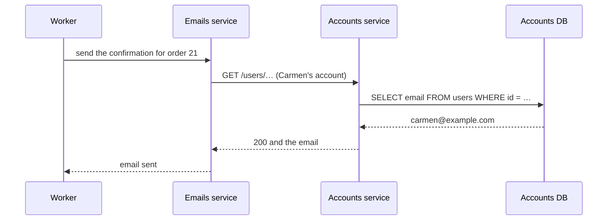

import Term from '~/components/Term.astro';
import TryIt from '~/components/TryIt.astro';
import Analogy from '~/components/Analogy.astro';
import SelfCheck from '~/components/SelfCheck.astro';
import ProjectCode from '~/components/ProjectCode.astro';
import Quiz from '~/components/Quiz.astro';
import QuizQuestion from '~/components/QuizQuestion.astro';
import QuizOption from '~/components/QuizOption.astro';

## The problem

Imagine the shop is doing well and there are now three of you programming. Someone reads that "serious companies use microservices" and proposes splitting it: a products service, an orders service, an accounts service and an emails service, each with its own database.

A month later, Carmen pays for an order and the confirmation email never arrives: the emails service asked the accounts service for her email address, and the accounts service was in the middle of a deployment. What used to be a query to a table is now a request over the network, and it can fail.

**Splitting has real advantages, and a price.** Here you’ll see both, measure the price and understand why the shop is still a single program.

## The analogy

<Analogy>

Think of a restaurant kitchen with everyone in the same room. The dessert cook asks the cook next to them for the cream and has it in a second. If a menu comes out wrong, it’s redone in full, everyone together.

Now spread the kitchen across four places in the neighborhood that send each other things by courier. Each place changes its menu whenever it wants and has its own team. But every bit of cream takes a trip, the courier sometimes doesn’t come back, and if the meat comes out wrong, the dessert has already been made in another place.

<div slot="limits">

- In the kitchen, a shout can get lost. In a program, a function call is never lost: either it finishes, or the whole program fails.
- When the courier doesn’t come back, at least you notice. On the network, you sometimes can’t tell whether the order arrived and was carried out, or never arrived.

</div>

</Analogy>

## How it really works

### A monolith: one codebase, one deployment

A <Term id="monolith">monolith</Term> is a whole application in a single codebase that is deployed all at once. **The shop is one:** products, orders, accounts, notifications and emails live in `src/`, ship in a single Docker image with a single `deploy.sh` and use a single database.

Monolith doesn’t mean messy or "a single copy". The shop already runs as two copies, since lessons [3](/en/phase-9/horizontal-scaling/) and [4](/en/phase-9/zero-downtime-deployment/), and with two kinds of processes.

### The shop: two processes, one codebase

In [lesson 1](/en/phase-9/background-jobs-queues/) the shop gained a <Term id="worker">worker</Term>: the process that takes jobs from the queue and sends the notifications and the emails. See how Compose starts it:

<ProjectCode file="shop-api/40-zero-downtime/compose.yaml" region="worker" />

- **`build: .`**: the same image as the API.
- **`command`**: only the start command changes, `scripts/worker.ts` instead of `src/server.ts` (outside Docker, `npm run worker` instead of `npm start`).
- **No `ports`, and no health check:** it doesn’t listen for requests.
- **The same configuration**: the same database, the same Redis, the same cache and the same mail server.

With that, the shop already has something of what you look for when splitting: **the worker fails and scales on its own**. In lesson 1 you stopped it and the API kept taking payments. But it’s the same code, the same version and the same deployment: it’s still a monolith.

### Microservices: several programs that talk over the network

<Term id="microservices">Microservices</Term> spread the application across several small programs, each with its own code, its own deployment and, almost always, **its own database**, which the others don’t touch. If the emails service needs Carmen’s email address, it doesn’t read the `users` table: it asks the accounts service, over HTTP or with <Term id="grpc">gRPC</Term>, the way to [call a function of another service](/en/phase-4/graphql-grpc-rest/#grpc-calling-a-function-of-another-service) that you saw in Phase 4.



In today’s shop, all of that is one query from `sendConfirmation`, in `src/email.ts`, to the `users` table. **Two arrows in the diagram are network calls that didn’t exist before.**

What you gain by splitting:

- **Each team deploys its own part** whenever it wants, without waiting for the others.
- **Each service scales on its own:** ten copies of the one that works the most, one of the one that hardly works.
- **Each one can use another tool:** Python for an AI model, Node for everything else.
- **A failure stays inside**, if it’s done well: if recommendations go down, people can still buy.

### What it costs: every call travels over the network

Calling a function costs **a fraction of a microsecond**. Calling another program over the network, even on the same computer, costs **on the order of a millisecond**: thousands of times more. You’ll measure it in "Try it".

And that’s the best case: between two machines the network’s <Term id="rtt">RTT</Term> is added, and between two cities, much more, as you saw in [Phase 0](/en/phase-0/what-happens-when-you-type-a-url/#what-it-costs-round-trips).

The network also brings things a function doesn’t have:

- **It can fail or take forever.** Every call needs a maximum wait time, and a plan for when it runs out.
- **Sometimes you don’t know what happened.** Like nginx’s `504` in [Phase 8](/en/phase-8/nginx-reverse-proxy/#when-the-api-fails-502-and-504), the other side may or may not have done it. Retrying is safe only if the operation is <Term id="idempotent">idempotent</Term>, or carries an id to [discard the repeats](/en/phase-4/webhooks-idempotency/#notifications-repeat-process-each-event-once).
- **Calls in a loop add up.** It’s Phase 5’s [N+1 problem](/en/phase-5/orm-drizzle-prisma/#the-n1-problem-counted-in-the-log), now between services: asking for the email of 100 orders one by one, at a millisecond each, is 100 ms just waiting.

### What it costs: a transaction doesn’t cross services

When an order is placed, `createOrder` takes the stock out and saves the order in a single <Term id="transaction">transaction</Term>, as you learned in [Phase 5](/en/phase-5/acid-transactions/#begin-and-commit-several-commands-as-one): either both things happen, or neither.

With a stock service and an orders service, each with its own database, **there’s no longer a single `BEGIN` that covers both**. If the stock is subtracted and saving the order fails, nobody gives it back on its own: you need a step that compensates on purpose ("give back 1 mug"). A chain of steps, each with its opposite step, is called a *saga*.

In the meantime, someone can see the stock subtracted with no order: that’s the <Term id="eventual-consistency">eventual consistency</Term> of [lesson 6](/en/phase-9/cap-theorem/#eventual-consistency-the-copies-end-up-agreeing). And making sure a step isn’t lost between two writes is the topic of [lesson 7](/en/phase-9/event-driven-architecture/#two-writes-two-places-the-gap-from-lesson-1).

### What it costs: many pieces to deploy and watch

Every service needs its tests, its image, its deployment, its health checks and its logs: the `deploy.sh` of [lesson 4](/en/phase-9/zero-downtime-deployment/), multiplied by ten.

Also, **every service is a client of others.** A change in the accounts service has to keep serving the old version of the emails service, because they aren’t deployed at the same time: it’s Phase 4’s <Term id="api-contract">contract</Term> and [versioning](/en/phase-4/api-versioning/), but between your own programs.

And finding a failure costs more: a purchase goes through several services, and you have to follow its [`requestId`](/en/phase-3/node-errors-and-logging/#an-id-for-every-request) through all of them. That’s what traces are for (the path of a request through all the services), part of Phase 10’s observability.

| | Monolith | Microservices |
|---|---|---|
| Talking to another part | A function call | A network request, which can fail |
| Changing the data of two parts at once | A transaction | A saga, with steps that compensate |
| Deploying | One image, one script | One per service, and versions that coexist |
| Finding a failure | One program’s logs | Following a request through several |
| Scaling | More copies of everything | More copies only of what needs it |
| Teams | Everyone in the same code | Each with their own part |

### Conway’s law: the system copies the teams

In 1968, Melvin Conway wrote that **an organization that designs a system ends up with a design that copies how the organization communicates**. If three teams that hardly talk to each other build something, three pieces will come out, joined exactly where the teams talk.

That’s why microservices are, above all, **a way of organizing people**: when a hundred people touch the same code, splitting it by teams lets each one deploy at its own pace.

With a small team the opposite happens. As Martin Fowler writes, one or two dozen people talk to each other effortlessly, so, according to Conway, they’ll build a monolith. And that’s fine.

### The modular monolith: boundaries inside a single program

There’s a middle ground that works very well: the **modular monolith**. One codebase and one deployment, divided into parts with clear boundaries: orders, accounts, email.

The rules of microservices, without the network:

- **Each part owns its tables.** The others neither read nor write them.
- **Things are requested through public functions**, like `findEmail(id)` from the accounts module, instead of with a query to its table.

The shop doesn’t fully follow this: `sendConfirmation` reads the `users` table directly. It’s exactly the shortcut that makes it harder to separate something the day it’s needed.

Shopify, one of the largest Ruby on Rails applications that exist (a framework, like Hono, for the Ruby language), with more than a thousand people programming on it, chose this path instead of microservices, and [wrote about it in 2019](https://shopify.engineering/deconstructing-monolith-designing-software-maximizes-developer-productivity).

### When splitting is worth it

Splitting pays off when staying together costs more than the network:

- **Many teams** getting in each other’s way in the same code and the same deployment.
- **Very different needs:** one part that needs a lot of CPU or a graphics card, and the rest, almost nothing.
- **Another tool:** one part that works better in another language.
- **Isolating the delicate:** payments, with tougher security rules than the rest.

### Start with a monolith

In 2015, Martin Fowler described in ["Monolith First"](https://martinfowler.com/bliki/MonolithFirst.html) a pattern he kept seeing: **almost all the successful microservice stories started as a monolith that got too big and was split**. And almost all the people he knew who started with microservices from scratch ended up in serious trouble.

He gives two reasons. **At the beginning you don’t know whether the application will be useful**, and what matters is moving fast. And **at the beginning you don’t know where the boundaries are**: moving something from one service to another costs far more than inside one program.

The shop has one team, a database that fits on one server and a load that two copies can handle. **It will stay a monolith.**

## Try it

The goal: measure on your computer how much more expensive a network call is than a function call.

In your project, `~/backend-course/phase-3/shop-api`, start the shop with `docker compose up --build --wait`, as in the previous lessons. Then save this program in that same folder, with the name `call-vs-network.js`:

```js title="call-vs-network.js"
const N = 1000;
const health = () => ({ status: 'ok' });

// The sum uses every answer, so the engine cannot skip the calls.
let sum = 0;
let t0 = performance.now();
for (let i = 0; i < N; i++) sum += health().status.length;
const call = performance.now() - t0;

t0 = performance.now();
for (let i = 0; i < N; i++) {
  const res = await fetch('http://api:3000/health');
  sum += (await res.text()).length;
}
const network = performance.now() - t0;

console.log(`${N} calls to a function: ${call.toFixed(3)} ms in total, ${((call / N) * 1000).toFixed(3)} µs per call`);
console.log(`${N} fetch to /health:    ${network.toFixed(1)} ms in total, ${(network / N).toFixed(3)} ms per call`);
console.log(`the network call is ${Math.round(network / call)} times slower (checksum ${sum})`);
```

- **`performance.now()`** gives the milliseconds the program has been running, with decimals: the difference between two readings is how long what’s in between took.
- **The first loop** calls `health` a thousand times, a function that returns the same thing as the `/health` route. **The second** asks the API for `/health` a thousand times with `fetch`.
- **Careful: the `/health` route isn’t free.** It asks PostgreSQL with a `SELECT 1` ([Phase 7](/en/phase-7/docker-multi-stage-build/#healthcheck-is-the-shop-fine)), so each `fetch` is two trips: to the API’s container, and from there to the database’s.
- **`sum`** uses every answer: without it, the JavaScript engine could skip calls whose result nobody uses.

<TryIt
  title="A function against the network, a thousand times each"
  cmd={`docker run --rm --network shop_default node:26 node --input-type=module --eval "$(cat call-vs-network.js)"`}
  output={`1000 calls to a function: 0.459 ms in total, 0.459 µs per call
1000 fetch to /health:    722.2 ms in total, 0.722 ms per call
the network call is 1575 times slower (checksum 17000)`}
>

- **`docker run --rm … node:26`** starts a Node 26 container and deletes it when it finishes (the first time, Docker downloads the image).
- **`--network shop_default`** puts it on the shop’s Compose network, where the API is called `api`, as in [Phase 7](/en/phase-7/docker-networking/). The `fetch` goes **from one container to another**.
- **`--eval "$(cat call-vs-network.js)"`** hands the program to Node, and **`--input-type=module`** lets you use `await` outside a function.

Look at "per call": **0.459 µs** against **0.722 ms**. The checksum, `17000`, says every call was made: a thousand times the 2 letters of `ok` and a thousand times the 15 characters of `{"status":"ok"}`.

If Docker says the network doesn’t exist, the shop isn’t running or your project has another `name:` in `compose.yaml`: find the network with `docker network ls`. If the `fetch` fails, wait for the API to be healthy.

</TryIt>

**Your numbers will be different, and they’ll change from one run to the next.** We ran it three times in a row, on October 22, 2026, on an Apple M1 Pro with Docker in Colima (4 CPUs and 2 GiB):

| Run | One function | One `fetch` to `/health` | Times slower |
|---|---|---|---|
| 1 | 0.459 µs | 0.722 ms | 1,575 |
| 2 | 0.187 µs | 0.631 ms | 3,368 |
| 3 | 0.229 µs | 0.616 ms | 2,682 |

**Keep the order of magnitude, not the ratio, which swings between 1,575 and 3,368:** a fraction of a microsecond against most of a millisecond. And it’s the most favorable case: the same computer, the shop with no load and `fetch` reusing the connection.

To be fair, the comparison exaggerates a little: `/health` queries PostgreSQL and `health()` doesn’t. But looking up an email is a query in both worlds: **what microservices add is the extra trip**, which costs less than these two, but still costs far more than a function, even though we haven’t measured it on its own.

<SelfCheck question="Challenge: imagine email becomes a separate service, with its own database. What has to change in sendConfirmation to get Carmen’s email address, and what happens if the accounts service doesn’t answer?">

It can no longer read the `users` table. It has two paths:

- **Ask the accounts service**, with a maximum wait time. If it doesn’t answer, the job fails and the queue retries it, as in lesson 1: five attempts in about 15 seconds. If the accounts service takes longer to come back, the job ends up among the failed ones and the email doesn’t go out, as happened to Carmen in "The problem".
- **Receive the email inside the job**, copied when the order was paid. There’s no need to ask, but if Carmen changes her email just before, the message goes to the old one: a copy can go stale.

</SelfCheck>

When you finish, run `docker compose down` to stop the shop and delete `call-vs-network.js` if you don’t want to keep it.

## You’ve already seen it

- **"Sign in with Google,"** in [Phase 6](/en/phase-6/oauth-openid-connect/): another company’s service, with its own users. The shop doesn’t read its tables: it asks over the network. Conway in its purest form: two organizations, two systems and a contract.
- **The payment gateway and the delivery company,** in [Phase 4](/en/phase-4/webhooks-idempotency/): outside services that talk to the shop through webhooks, which can fail and repeat.
- **A web page that loads halfway:** a box is missing, like the recommendations. Often it’s a separate service that didn’t answer in time, and the page carried on without it.

## Common mistakes

- **Splitting to make the application respond faster.** Every hop between services adds time. Measure first: more copies ([lesson 3](/en/phase-9/horizontal-scaling/)) or a [cache](/en/phase-9/redis-cache/) are almost always enough.
- **Services that share the database.** A change in a table breaks them all, and they have to be deployed together: a monolith, spread over the network.
- **Treating a network call like a function:** no maximum wait time, no retries and assuming it went fine.
- **Splitting by technical layers,** like a "database" service and a "logic" service: every change touches both. You split by what the business does: orders, accounts, payments.

## Summary

- A monolith is a single codebase deployed all at once, even with several copies and processes, like the shop.
- Microservices are programs with their own code, deployment and data, which talk over the network.
- Splitting costs: thousands of times more per call (a fraction of a microsecond against most of a millisecond in our measurement, with a query included), network failures, split transactions and more pieces.
- Conway’s law: the system copies the organization. Splitting pays off with many teams.
- Start with a monolith, organized into modules with boundaries.

## Did you get it?

<Quiz>

<QuizQuestion
  question="There are three of you and the shop is slow at peak hours. Someone proposes splitting it into five microservices to make it faster. What do you answer?"
  review="Common mistakes"
>

<QuizOption text="Yes: each service will have its own computer and respond sooner.">

Every hop between services adds network time: splitting makes each request slower, not faster.

</QuizOption>

<QuizOption text="That we should measure first: more copies or a cache are usually enough." correct>

What’s slow is found by measuring. More copies of the monolith (lesson 3) or a cache (lesson 2) fix the load without paying for the network or the extra pieces.

</QuizOption>

<QuizOption text="That it will only be faster if each service is written in a language faster than Node.">

Changing language doesn’t remove the network hops, and in a shop what’s slow is usually the database, not the language.

</QuizOption>

</QuizQuestion>

<QuizQuestion
  question="In the shop, the API and the worker run in different containers and don’t share a process. Are they two microservices?"
  review="The shop: two processes, one codebase"
>

<QuizOption text="No: they’re the same code and the same image, deployed together." correct>

Only the start command changes. A microservice has its own code, its own deployment and its own data: there’s none of that here.

</QuizOption>

<QuizOption text="Yes: anything that runs in its own container is a microservice.">

A container is a way of running a process, not of splitting code. PostgreSQL also runs in its own container.

</QuizOption>

<QuizOption text="Yes, because they communicate through a queue in Redis and not by calling functions.">

Talking through a queue doesn’t separate them: they share code, version and database. A monolith can use queues, like the shop.

</QuizOption>

</QuizQuestion>

<QuizQuestion
  question="You move the stock into a service with its own database. An order subtracts a mug in that service, and then fails to save in the orders service. What happens to the mug?"
  review="What it costs: a transaction doesn’t cross services"
>

<QuizOption text="PostgreSQL undoes the subtraction, because both commands are in the same transaction.">

They’re two databases, and each has its own transactions. No `BEGIN` covers both, so nobody undoes the subtraction for you.

</QuizOption>

<QuizOption text="The stock service finds out about the failure over the network and gives it back on its own.">

The network doesn’t tell anyone anything by itself. If nobody programs that notice and its answer, the stock service doesn’t know the order failed.

</QuizOption>

<QuizOption text="It stays subtracted until a compensating step gives it back on purpose." correct>

Without a shared transaction, undoing is your job: an opposite step ("give back 1 mug"), as in a saga.

</QuizOption>

</QuizQuestion>

<QuizQuestion
  question="A company has three teams that hardly talk to each other: web, mobile app and payments. According to Conway’s law, what shape will the system they build together have?"
  review="Conway’s law: the system copies the teams"
>

<QuizOption text="A single program, because starting with a monolith is the sensible thing.">

Starting with a monolith is advice; Conway describes what happens, and three teams that hardly talk end up with three pieces.

</QuizOption>

<QuizOption text="Three pieces: one per team, connected only where they coordinate." correct>

The design copies the organization’s communication: each team builds its part, and the joins appear where the teams talk.

</QuizOption>

<QuizOption text="Whatever the designer decides, because the organization doesn’t change the code.">

That’s exactly what Conway denies: the system ends up with the shape of how the people who build it talk.

</QuizOption>

</QuizQuestion>

<QuizQuestion
  question="You measured 0.2 µs per function call and 0.7 ms per fetch. A page asks the accounts service for the email of each of its 100 orders, one after another. How much time does that add?"
  review="What it costs: every call travels over the network"
>

<QuizOption text="About 70 ms of waiting for the network, at least." correct>

A hundred trips of 0.7 milliseconds, one after another, are 70 ms in the best case, and more between different machines. It’s Phase 5’s N+1: better to ask for the 100 emails at once.

</QuizOption>

<QuizOption text="Almost nothing: 100 calls are 0.02 ms, like with the function.">

That would be true if they were function calls. Each `fetch` is a trip over the network, thousands of times more expensive in our measurement.

</QuizOption>

<QuizOption text="Nothing, if they’re done with await: waiting doesn’t block Node.">

Waiting doesn’t block other requests, but this page still waits for each answer before asking for the next. The 70 ms add up.

</QuizOption>

</QuizQuestion>

<QuizQuestion
  question="In your monolith, the email code reads the users table directly. You want to be able to separate it someday. Which change best prepares for that day?"
  review="The modular monolith: boundaries inside a single program"
>

<QuizOption text="Copy the users table now into a database just for email.">

You’d have two copies to keep equal, before you need it. The boundary is marked in the code, not by duplicating data.

</QuizOption>

<QuizOption text="Move it out now to a microservice, so the boundary is clear.">

You’d pay for the network, the deployments and the partial failures before knowing whether it’s needed. You can mark the boundary without leaving the program.

</QuizOption>

<QuizOption text="Have it ask for the email through a function of the accounts module." correct>

It’s the modular monolith: each part owns its tables. If one day it’s separated, that function becomes a network request, and nothing else changes.

</QuizOption>

</QuizQuestion>

</Quiz>

## Further reading

- [Monolith First](https://martinfowler.com/bliki/MonolithFirst.html), by Martin Fowler: starting with a monolith, and why.
- [Microservices](https://martinfowler.com/articles/microservices.html), by James Lewis and Martin Fowler: the 2014 article that described their traits.
- [Conway’s Law](https://martinfowler.com/bliki/ConwaysLaw.html), by Martin Fowler, and [Melvin Conway’s original paper](https://www.melconway.com/Home/Committees_Paper.html), from 1968.
- [Deconstructing the Monolith](https://shopify.engineering/deconstructing-monolith-designing-software-maximizes-developer-productivity), by Shopify: their modular monolith.
