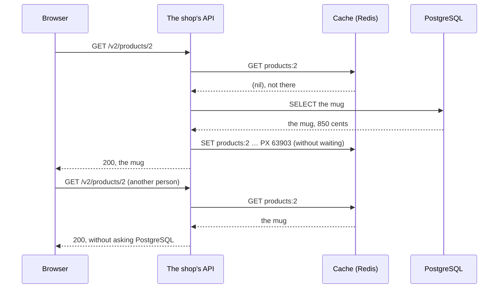

import Term from '~/components/Term.astro';
import TryIt from '~/components/TryIt.astro';
import Analogy from '~/components/Analogy.astro';
import ProjectCode from '~/components/ProjectCode.astro';
import SelfCheck from '~/components/SelfCheck.astro';
import Quiz from '~/components/Quiz.astro';
import QuizQuestion from '~/components/QuizQuestion.astro';
import QuizOption from '~/components/QuizOption.astro';

## The problem

In the [introduction](/en/phase-9/) you measured the product list: about 715 requests per second, with a median of 12 ms. Each one runs the same query against PostgreSQL, which gives the same answer every time: four products that change a few times a day.

Imagine the shop sends an email with a special offer and thousands of people open the catalog at once. PostgreSQL spends its time repeating the same answer, and the orders, which do need the database, wait their turn behind them.

**The fix is to keep the answer for a while and hand it to everyone: a cache.** The hard part is knowing when to throw it away: according to a famous line by Phil Karlton, in computer science there are only [two hard things](https://martinfowler.com/bliki/TwoHardThings.html), cache invalidation and naming things.

## The analogy

<Analogy>

In a bar, the waiter writes the day’s tapas on a blackboard in the morning. Whoever walks in looks at it, and nobody has to go to the kitchen to ask what there is.

When the omelet runs out, someone has to wipe it off the board; if not, people will keep ordering it. And even if it’s written up, when you order, the kitchen checks whether any is really left.

<div slot="limits">

- The blackboard doesn’t wipe itself. What the cache keeps does: it expires after a minute, even if nobody deletes it.
- In the bar, whoever changes the menu is standing next to the board. In the shop, changes come from several places in the code, and one of them can forget to delete.

</div>

</Analogy>

## How it really works

### Four places where copies are kept

A <Term id="cache">cache</Term> is a saved copy, so you don’t ask for the same thing again. You already know two of them from [Phase 2](/en/phase-2/http-caching/):

| Where | Who keeps the copy | Can you delete it when the data changes? |
|---|---|---|
| The browser | Each visitor, following your `Cache-Control` | No: it only expires, or asks with the `ETag` |
| A CDN | Servers spread around the world | With its dashboard or its API |
| **Your application** | **Your API, in a Redis** | **Yes: your code deletes what it wants, when it wants** |
| The database | PostgreSQL, in its memory | No need: it’s never stale, PostgreSQL keeps it up to date |

This lesson’s is the third one: your code deletes it at the very moment the data changes, which in Phase 2 was [the hard part](/en/phase-2/http-caching/#invalidating-is-the-hard-part).

### Cache-aside: the cache first, and if it isn’t there, PostgreSQL

This is how the shop answers two people who ask for the same mug, one after the other:



It’s the diagram from [Phase 5](/en/phase-5/sql-vs-nosql/#a-cache-in-front-of-postgresql), now in the shop. It’s called <Term id="cache-aside">cache-aside</Term> (“the cache on the side”): the database doesn’t know the cache exists, and the application looks, reads and stores. In `src/cache.ts`:

<ProjectCode file="shop-api/38-cache/src/cache.ts" region="cache-aside" />

- **`read`**: the function that asks PostgreSQL; it’s only called if the cache doesn’t have the key.
- **`ask(…)`**: asks Redis for the key, with the time limit you’ll see below.
- **`JSON.parse` and `JSON.stringify`**: Redis stores text, so the product goes in as <Term id="json">JSON</Term>.
- **`value === undefined`**: a product that doesn’t exist isn’t stored.
- **The `SET` has no `await`**: the response doesn’t wait for Redis to store it.
- **The `catch` returns `read()`**: if the cache fails, it reads from PostgreSQL. **Slower, never an error.**

### One key for each different question

What gets stored, and under what name? In `src/data.ts`:

<ProjectCode file="shop-api/38-cache/src/data.ts" region="from-cache" />

- **`products:<id>`**: each product, under its own key. The mug is `products:2`.
- **`products:list:` and the filter as JSON**: each list, under its own. The whole one is `products:list:{}`; sorted by price, `products:list:{"sort":"price"}`. The fields always go in the same order, so the same question gives the same key.
- **`SECONDS_IN_CACHE = 60`**: a minute at most without asking PostgreSQL.

Every different value of `?category=` is another key, including the ones that don’t exist: the cache’s memory limit keeps that from filling it up forever.

### One minute, plus a bit of randomness

Why does it expire, if the shop already deletes what changes? **Because expiry is the safety net:** if one day a change forgets to delete, the stale data lasts one minute at most. It’s the key’s TTL (*time to live*), the same `EXPIRE` from Phase 5. But it isn’t exactly one minute:

<ProjectCode file="shop-api/38-cache/src/cache.ts" region="ttl" />

`duration(60)` gives between 60,000 and 66,000 milliseconds, at random. When a key expires, the requests of that instant don’t find it and all go to PostgreSQL at once: that’s a <Term id="cache-stampede">cache stampede</Term>. If many keys were stored at the same time (at startup, or after deleting the lists) and last the same, they expire together, and the stampedes all arrive at once. **With the randomness, each one expires at a different moment.**

Randomness doesn’t help with **a single, very popular key**: there is nothing to spread out. There, the fix is to let only one request read: with a short lock in Redis (`SET products:2:lock 1 NX PX 2000`, which only succeeds if the key doesn’t exist and expires after 2 seconds in case whoever holds it crashes), or, inside each copy of the API, with a single read that all the requests wait for (*single flight*).

The shop doesn’t need it: four products and a short query. With a query that takes seconds, it would.

### What you don’t cache: what belongs to each person and what must be exact

Not everything deserves a cache. The shop leaves out two things:

- **What belongs to each person**, like your orders. Each person would need their own key, which almost nobody else would read; and with a key that doesn’t include the person’s id, Carmen would see Marta’s orders.
- **What has to be exact**, like the stock when buying. The cache may show “60 left” right after a purchase, but **buying never looks at the cache**:

<ProjectCode file="shop-api/38-cache/src/data.ts" region="order-forgets" />

The stock check is the `UPDATE … WHERE stock >= quantity` from [Phase 5](/en/phase-5/acid-transactions/#fix-1-check-and-take-in-the-same-command), inside a <Term id="transaction">transaction</Term>: PostgreSQL runs it with the real number. **A stale number in the cache can be seen for a moment, but it can’t be sold.** A test of the step checks it: with a stock of 1000 in the cache and 2 for real, buying 5 gives `409`.

### Invalidating: delete right after the change

In [Phase 5](/en/phase-5/sql-vs-nosql/#a-cache-in-front-of-postgresql) we promised you this: if Ana changes a price, the API deletes the key. That’s <Term id="cache-invalidation">cache invalidation</Term>, and in the shop it’s a function:

<ProjectCode file="shop-api/38-cache/src/data.ts" region="forget-products" />

It deletes the product and **every list**, since they carry it inside. It’s called by the six places that change a product: creating it, changing it, deleting it and, **the easy ones to forget, placing an order, changing its quantity and canceling one**, which change its stock. Changing it is a new route, `PATCH /v2/products/{id}`: admin only, for the name, the price or both.

<ProjectCode file="shop-api/38-cache/src/data.ts" region="update-product" />

**Notice the order: first the `UPDATE`, then `forgetProducts`.** If it deleted first, another request could slip in between, read the old price from PostgreSQL and store it again, for a minute.

Even so, a small <Term id="race-condition">race condition</Term> remains: a read that started before the change can store the old price right after the delete. That’s why everything expires: **stale data lasts, at most, its TTL.**

And this is how the cache deletes:

<ProjectCode file="shop-api/38-cache/src/cache.ts" region="forget" />

`products:list:*` is a pattern: all the lists. Redis can’t delete by pattern, so `SCAN` walks the keys a hundred at a time and `DEL` deletes the ones that match.

### Two Redis, with opposite jobs

The shop already had a Redis, the one for the login attempt limits and, since [lesson 1](/en/phase-9/background-jobs-queues/), the queue. **The cache goes in another one**, because it needs exactly the opposite:

| | `redis`: the limits and the queue | `cache`: the catalog |
|---|---|---|
| If it loses its data… | Notifications and emails are lost | It refills itself from PostgreSQL |
| On disk | Everything (`--appendonly yes`), in a volume | Nothing |
| Memory limit | None: it grows up to what the machine has | 64 MB |
| To make room | Never deletes anything (`noeviction`) | Deletes what nobody has read for the longest (`allkeys-lru`) |

Deleting data to make room is called <Term id="eviction">eviction</Term>: for the queue it would mean losing jobs without warning; for the cache it’s welcome. LRU comes from *least recently used*. In `compose.yaml`:

<ProjectCode file="shop-api/38-cache/compose.yaml" region="cache" />

The API finds it in `CACHE_URL` (`redis://cache:6379`), and the queue stays in `REDIS_URL`.

### If the cache fails, the shop keeps going

A cache can fail in two ways:

- **Down:** the Redis stops and the connection is cut. The client knows right away.
- **Stuck:** the connection stays open, but no answer arrives. A frozen Redis, or a network that loses packets. The client sends the command and waits.

The first is solved by the client’s configuration:

<ProjectCode file="shop-api/38-cache/src/cache.ts" region="client" />

- **`disableOfflineQueue: true`**: with no connection, the command fails at once. The limits’ client keeps commands until Redis comes back, and the request would wait along with them. Rate limits are worth waiting for; a cache isn’t.
- **`connectTimeout: 1000`**: one second to connect; then, another attempt.

The second has a story. node-redis, the Redis library, has a `timeout` per command, and the first version of this step relied on it. **When we reviewed it, we found that it only counts while the command waits to go out, not after it has been sent:** a test with a fake Redis that never answers kept waiting until its own 8-second limit cut it off.

The lesson: **a time limit has to measure what your request waits for**. The fix is in the `down` region of the same file:

- **`withinTime(command)`**: a race between the command and a 200 ms clock. Redis answers in under a millisecond; if it takes 200, something is wrong.
- **`ask(command)`**, the one `fromCache` and `forget` use: on the first failure it marks the cache as down, and **while it is, it doesn’t even ask**.
- **While it’s down, each request may send it a `PING`** (a command that only asks “are you there?”), one per second at most, to see whether it’s back. That way unanswered commands don’t pile up.

### When it comes back, it deletes the whole catalog

While it was down, the shop may have changed a price without being able to delete it from the cache, and a frozen Redis keeps what it had:

<ProjectCode file="shop-api/38-cache/src/cache.ts" region="on-return" />

**The cache doesn’t know what it missed, so it deletes everything about products** (`products:*`) before being used again. If it can’t do it within 200 ms, it stays down and tries again with the next `PING`. It also happens the first time the API connects. `FLUSHDB` would delete everything, including anything that isn’t catalog data.

## Try it

The goal: see what the cache stores, change the mug’s price and check that nobody sees the old one, and then knock the cache down without the shop ever stopping answering.

The outputs are from Docker in Colima (4 CPUs and 2 GiB) on an Apple M1 Pro, on October 21 and 22, 2026. We captured them with another Compose project name, changed here to the lesson’s, and with `curl` inside a container; the responses are the same. Your times, ids and dates will be different.

### Get the step ready

Bring down the step 37 shop (`-v` deletes its practice data) and bring your project up to step 38, as in the [introduction](/en/phase-9/#each-lesson-its-step):

```sh
cd ~/backend-course/phase-3/shop-api
docker compose down -v
cd ..
curl -O https://backenddesdecero.com/practicas/shop-api/38-cache.tar.gz
tar -xzf 38-cache.tar.gz
cp -R 38-cache/. shop-api/
cd shop-api
```

What’s new: `src/cache.ts`, its use in `src/data.ts`, the `PATCH` route, `CACHE_URL` in `config.ts` and the `cache` service in both Compose files. There are no new packages. Start it:

<TryIt
  title="1. Six containers"
  cmd={`docker compose up --build --wait
docker compose ps --format "table {{.Name}}\\t{{.Service}}\\t{{.Status}}"`}
  output={`…
NAME             SERVICE   STATUS
shop-api-1       api       Up 10 seconds (healthy)
shop-cache-1     cache     Up 14 seconds (healthy)
shop-db-1        db        Up 14 seconds (healthy)
shop-mailpit-1   mailpit   Up 14 seconds (healthy)
shop-redis-1     redis     Up 14 seconds (healthy)
shop-worker-1    worker    Up 10 seconds (healthy)`}
>

`shop-cache-1` is the new Redis. If your API is on `3001` (`docker compose port api 3000` tells you), use that port in the rest of the practice.

</TryIt>

### What does the cache store?

<TryIt
  title="2. The mug, twice"
  cmd={`curl -s -w '\\n' localhost:3000/v2/products/2
docker compose exec cache redis-cli keys '*'
curl -s -w '\\n' localhost:3000/v2/products/2
docker compose exec cache redis-cli keys '*'
docker compose exec cache redis-cli pttl products:2`}
  output={`{"id":2,"name":"Mug","priceCents":850,"stock":60,"categories":["Home","Gifts"]}
(empty array)
{"id":2,"name":"Mug","priceCents":850,"stock":60,"categories":["Home","Gifts"]}
1) "products:2"
(integer) 63903`}
>

After the first one, **the cache is empty**: the API opens the connection the first time it needs it, and that read goes to PostgreSQL. After the second, there’s `products:2`, and `pttl` tells you the milliseconds it has left: `63903`, because of the randomness. `keys '*'` lists all the keys: fine in a small cache, but with millions it would block Redis for a while.

</TryIt>

### Ana changes the mug’s price

Ana is one of the practice accounts, an admin, with her password in the project’s README. First ask for the mug and the whole list, so there are two keys:

<TryIt
  title="3. The change, and the empty cache"
  cmd={`curl -s -o /dev/null localhost:3000/v2/products/2
curl -s -o /dev/null localhost:3000/v2/products
docker compose exec cache redis-cli keys '*'
curl -s -w '\\n' -c ana.txt --json '{"email":"ana@shop.example","password":"ana-practice-2026"}' localhost:3000/v2/session
curl -s -w '\\n' -b ana.txt -X PATCH --json '{"priceCents":900}' localhost:3000/v2/products/2
docker compose exec cache redis-cli keys '*'`}
  output={`1) "products:2"
2) "products:list:{}"
{"id":1,"email":"ana@shop.example","role":"admin"}
{"id":2,"name":"Mug","priceCents":900,"stock":60,"categories":["Home","Gifts"]}
(empty array)`}
>

The `PATCH` answers with the mug at `900`, and then, **`(empty array)`**: it deleted both keys. If you get `401`, repeat the `ana.txt` line; with `403`, the account isn’t an admin.

</TryIt>

<TryIt
  title="4. The next read already gives the new price"
  cmd={`curl -s -w '\\n' localhost:3000/v2/products/2
docker compose exec cache redis-cli keys '*'`}
  output={`{"id":2,"name":"Mug","priceCents":900,"stock":60,"categories":["Home","Gifts"]}
1) "products:2"`}
>

**`900`, and the key is back** with the new price.

</TryIt>

<SelfCheck question="Challenge: Carmen (carmen@example.com, password carmen-practice-2026) buys a mug. Before she does, what do you expect to see in the cache after her order, and what stock will the mug show?">

The keys disappear (an order changes the stock) and the mug shows one less. Ours, with both keys already in the cache:

```sh
$ curl -s -w '\n' localhost:3000/v2/products/2
{"id":2,"name":"Mug","priceCents":900,"stock":60,"categories":["Home","Gifts"]}
$ curl -s -o /dev/null localhost:3000/v2/products
$ docker compose exec cache redis-cli keys '*'
1) "products:2"
2) "products:list:{}"
$ curl -s -w '\n' -c carmen.txt --json '{"email":"carmen@example.com","password":"carmen-practice-2026"}' localhost:3000/v2/session
{"id":3,"email":"carmen@example.com","role":"customer"}
$ curl -s -w '\n' -b carmen.txt --json '{"productId":2,"quantity":1}' localhost:3000/v2/orders
{"id":26,"productId":2,"quantity":1,"status":"pending","createdAt":"2026-10-22T14:43:31.278Z","customerId":3}
$ docker compose exec cache redis-cli keys '*'
(empty array)
$ curl -s -w '\n' localhost:3000/v2/products/2
{"id":2,"name":"Mug","priceCents":900,"stock":59,"categories":["Home","Gifts"]}
```

</SelfCheck>

### With a cache and without one

The <Term id="load-test">load test</Term> from the introduction, now with the cache. This output is from October 21, and we removed npm’s warning lines:

<TryIt
  title="5. The load test, with a cache"
  cmd="docker run --rm --network shop_default node:26 npx -y autocannon@8.0.0 -d 10 http://api:3000/v2/products"
  output={`Running 10s test @ http://api:3000/v2/products
10 connections


┌─────────┬──────┬──────┬───────┬──────┬─────────┬─────────┬───────┐
│ Stat    │ 2.5% │ 50%  │ 97.5% │ 99%  │ Avg     │ Stdev   │ Max   │
├─────────┼──────┼──────┼───────┼──────┼─────────┼─────────┼───────┤
│ Latency │ 0 ms │ 0 ms │ 1 ms  │ 2 ms │ 0.21 ms │ 0.69 ms │ 29 ms │
└─────────┴──────┴──────┴───────┴──────┴─────────┴─────────┴───────┘
┌───────────┬─────────┬─────────┬─────────┬─────────┬──────────┬────────┬─────────┐
│ Stat      │ 1%      │ 2.5%    │ 50%     │ 97.5%   │ Avg      │ Stdev  │ Min     │
├───────────┼─────────┼─────────┼─────────┼─────────┼──────────┼────────┼─────────┤
│ Req/Sec   │ 9,799   │ 9,799   │ 12,295  │ 13,207  │ 12,129.6 │ 890.34 │ 9,793   │
├───────────┼─────────┼─────────┼─────────┼─────────┼──────────┼────────┼─────────┤
│ Bytes/Sec │ 9.15 MB │ 9.15 MB │ 11.5 MB │ 12.3 MB │ 11.3 MB  │ 833 kB │ 9.15 MB │
└───────────┴─────────┴─────────┴─────────┴─────────┴──────────┴────────┴─────────┘

Req/Bytes counts sampled once per second.
# of samples: 10

121k requests in 10.01s, 113 MB read`}
>

Compare **`Req/Sec`, `Avg` column**, with yours from the introduction: we went from 715.5 to 12,129.6 requests per second, **about 17 times more**, and the 99th <Term id="percentile">percentile</Term> went from 42 ms to 2 (the `0 ms` is rounding of 0.21). The test only reads, so nothing deletes the cache while it runs. Keep in mind that `autocannon` and the API share the same 4 CPUs of the Docker virtual machine, so the numbers are honest, but they aren’t those of a server that only handles the API.

</TryIt>

Now stop the cache, as if it went down:

<TryIt
  title="6. Without a cache, the shop keeps going"
  cmd={`docker compose stop cache
for i in 1 2 3; do curl -s -o /dev/null -w '%{http_code} %{time_total}\\n' localhost:3000/v2/products; done
docker compose logs api --since 1m | grep cache`}
  output={`…
200 0.006907
200 0.006842
200 0.007086
api-1  | {"level":40,"time":1792680212052,"pid":1,"hostname":"3d4dae2b00c7","reason":"Socket closed unexpectedly","msg":"the cache is not answering: reading from the database"}`}
>

**Three `200`s** (`-w` writes the code and the time, in seconds), and **a single line in the log**, of level `40` (warning).

</TryIt>

<TryIt
  title="7. The load test, with the cache stopped"
  cmd="docker run --rm --network shop_default node:26 npx -y autocannon@8.0.0 -d 10 http://api:3000/v2/products"
  output={`…
┌─────────┬──────┬───────┬───────┬───────┬──────────┬──────────┬────────┐
│ Stat    │ 2.5% │ 50%   │ 97.5% │ 99%   │ Avg      │ Stdev    │ Max    │
├─────────┼──────┼───────┼───────┼───────┼──────────┼──────────┼────────┤
│ Latency │ 6 ms │ 14 ms │ 45 ms │ 70 ms │ 16.73 ms │ 15.71 ms │ 338 ms │
└─────────┴──────┴───────┴───────┴───────┴──────────┴──────────┴────────┘
┌───────────┬────────┬────────┬────────┬────────┬────────┬────────┬────────┐
│ Stat      │ 1%     │ 2.5%   │ 50%    │ 97.5%  │ Avg    │ Stdev  │ Min    │
├───────────┼────────┼────────┼────────┼────────┼────────┼────────┼────────┤
│ Req/Sec   │ 381    │ 381    │ 527    │ 735    │ 580.4  │ 112.88 │ 381    │
…
6k requests in 10.02s, 5.42 MB read`}
>

**580.4 per second: the speed of going to PostgreSQL every time**, a bit below the introduction’s 715.5 because the machine was busier that day, and with no errors: the API doesn’t even ask a cache that’s down. We trimmed the start and the bytes row.

</TryIt>

<TryIt
  title="8. The cache comes back"
  cmd={`docker compose start cache
docker compose logs api --since 2m | grep cache`}
  output={`…
api-1  | {"level":40,"time":1792680212052,"pid":1,"hostname":"3d4dae2b00c7","reason":"Socket closed unexpectedly","msg":"the cache is not answering: reading from the database"}
api-1  | {"level":30,"time":1792680240067,"pid":1,"hostname":"3d4dae2b00c7","msg":"the cache is answering again"}`}
>

The client reconnects by itself, deletes the catalog (it was already empty here: it keeps nothing on disk) and says so: **`the cache is answering again`**. If it doesn’t show up yet, wait a few seconds.

</TryIt>

### A stuck cache

`docker compose pause` freezes the container: the connection stays open, but Redis doesn’t answer. It’s the hard case:

<TryIt
  title="9. Freeze the cache"
  cmd={`docker compose pause cache
for i in 1 2 3; do curl -s -o /dev/null -w '%{http_code} %{time_total}\\n' localhost:3000/v2/products; done
docker compose logs api --since 1m | grep cache`}
  output={`…
200 0.265092
200 0.008280
200 0.011517
…
api-1  | {"level":40,"time":1792680245490,"pid":1,"hostname":"3d4dae2b00c7","reason":"no answer in 200 ms","msg":"the cache is not answering: reading from the database"}`}
>

**The first request takes 0.265 seconds**: the clock’s 200 ms, plus the PostgreSQL read. **The next ones, between 8 and 12 ms**: the cache is already marked as down. Without the clock, they would wait for Redis with no limit. The trimmed log lines are those from steps 6 and 8.

</TryIt>

<TryIt
  title="10. Unfreeze it"
  cmd={`docker compose unpause cache
for i in 1 2 3; do curl -s -o /dev/null -w '%{http_code} %{time_total}\\n' localhost:3000/v2/products; done
docker compose logs api --since 1m | grep cache`}
  output={`…
200 0.012116
200 0.006618
200 0.001175
…
api-1  | {"level":40,"time":1792680245490,"pid":1,"hostname":"3d4dae2b00c7","reason":"no answer in 200 ms","msg":"the cache is not answering: reading from the database"}
api-1  | {"level":30,"time":1792680249147,"pid":1,"hostname":"3d4dae2b00c7","msg":"the cache is answering again"}`}
>

Once unfrozen, nobody notices until a request arrives: the API doesn’t ask it yet, but it sends it a `PING` along the way. Redis answers, the API deletes `products:*`, in case it held something stale, and starts using it again: the third request already comes from the cache. With no requests, the last line doesn’t show up.

</TryIt>

When you’re done, delete the sessions, which don’t go to Git: `rm ana.txt carmen.txt` (`carmen.txt` only exists if you did the challenge).

### On your server

As in lesson 1, first the files the server reads from its disk, from `~/backend-course/phase-3`, with your user and your IP:

```sh
rsync -av 38-cache/compose.production.yaml ubuntu@192.168.5.15:/opt/shop/
rsync -av 38-cache/deployment/ ubuntu@192.168.5.15:/opt/shop/deployment/
```

Then, the code: it’s already in your project, so commit and `git push` from `shop-api`. **Nothing needs to be added to the server’s `.env`:** `compose.production.yaml` gives the API `CACHE_URL=redis://cache:6379`, and `deploy.sh` starts the `cache` service next to `db` and `redis`. It adds up to 64 MB of data to the server’s memory, plus Redis itself.

## You have already seen it

- **“Only 3 left,” and at checkout, sold out.** The product page came from a cache; the payment looked at the database, like the shop’s `409`.
- **A “like” counter that is slow to go up.** What you see can be a few seconds behind the truth. In [lesson 6](/en/phase-9/cap-theorem/#eventual-consistency-the-copies-end-up-agreeing) you’ll see it has a name: eventual consistency.
- **The Redis from [Phase 5](/en/phase-5/sql-vs-nosql/).** The `SET` and the `EXPIRE` you wrote by hand are what `fromCache` does now, in a single command (`SET … PX`).

## Common mistakes

- **Deleting before changing the database**, instead of after the `COMMIT`.
- **Forgetting a place that changes the data,** like orders, which change the stock.
- **Deciding based on what the cache says:** selling or granting permissions with data that may be stale.
- **Storing one person’s data under a key that has no user id.**
- **Waiting for the cache with no limit:** a stuck cache hangs the whole API.
- **The queue and the cache in the same Redis:** the queue can lose jobs to make room.

## Summary

- A cache keeps, for a while, what is asked for a lot and changes little. With cache-aside, the API looks in the cache first and, if it isn’t there, reads from PostgreSQL and stores it.
- In the shop, the catalog: in our test, about 17 times more requests per second, and a p99 of 2 ms.
- Every change to a product, its stock too, deletes the product and the lists, after the `COMMIT`. The TTL, 60 to 66 seconds, is the safety net.
- What must be exact doesn’t come from the cache: buying checks the stock in PostgreSQL.
- The cache is another Redis, which can lose everything. If it goes down or gets stuck, the API waits 200 ms at most, reads from PostgreSQL and, when the cache is back, deletes the catalog.

## Did you get it?

<Quiz>

<QuizQuestion
  question="Ana changes the hoodie’s name with an UPDATE that someone added to a shop script. The script finishes fine, but the catalog shows the old name for almost a minute. What’s missing?"
  review="Invalidating: delete right after the change"
>

<QuizOption text="Lowering the TTL to one second, so the old name is barely seen.">

It hides the flaw and leaves the cache almost unused. The problem is that this change deletes nothing.

</QuizOption>

<QuizOption text="Having the script delete that product and the lists from the cache, after its UPDATE." correct>

Every place that changes a product has to delete it from the cache. If not, the old name lasts until the key expires: 60 to 66 seconds.

</QuizOption>

<QuizOption text="Turning on disk persistence for the cache, so it saves the script’s change.">

Persistence only decides whether the cache survives a restart. What’s missing is deleting the old name.

</QuizOption>

</QuizQuestion>

<QuizQuestion
  question="A coworker suggests deleting the cache key before the UPDATE, “so nobody reads the old price while it changes.” What do you tell them?"
  review="Invalidating: delete right after the change"
>

<QuizOption text="That, in between, another request can store the old price again." correct>

Without the key, the next read goes to PostgreSQL, which still has the old price, and leaves it in the cache. After the `COMMIT`, it finds the new one.

</QuizOption>

<QuizOption text="That the order doesn’t matter: the TTL fixes everything in a minute, with nothing else to do.">

The TTL limits the damage, but a minute of old price is exactly what invalidation avoids.

</QuizOption>

<QuizOption text="That they’re right: deleting first is the safe way to invalidate.">

Deleting first opens a gap: a read between the delete and the change stores the old data again.

</QuizOption>

</QuizQuestion>

<QuizQuestion
  question="The cache’s Redis freezes: the connection stays open, but it doesn’t answer. What do the shop’s visitors notice?"
  review="If the cache fails, the shop keeps going"
>

<QuizOption text="That every catalog request sits waiting until Redis comes back.">

That’s what the step’s first version did. With its own clock, nobody waits more than 200 ms.

</QuizOption>

<QuizOption text="That the API answers 503 to every catalog request until the cache comes back.">

The cache isn’t essential: if it fails, the API reads from PostgreSQL and answers `200`.

</QuizOption>

<QuizOption text="Almost nothing: those requests wait 200 ms and the rest go to PostgreSQL." correct>

`withinTime` cuts the wait at 200 ms, and the cache is marked as down: the ones that arrive afterward don’t even ask it. In our test, 0.265 seconds for the first one and 8 to 12 ms for the next.

</QuizOption>

</QuizQuestion>

<QuizQuestion
  question="To save a container, someone suggests keeping the cache in the queue’s Redis, with a 64 MB limit and allkeys-lru. What can happen?"
  review="Two Redis, with opposite jobs"
>

<QuizOption text="Nothing: allkeys-lru only deletes keys that have an expiry, and jobs don’t have one.">

That’s another policy, `volatile-lru`. `allkeys-lru` can delete any key, including a job in the queue.

</QuizOption>

<QuizOption text="That, with memory full, Redis deletes jobs and emails are lost without warning." correct>

The eviction policy belongs to the whole Redis, not to each key. That’s why the queue asks for `noeviction`, and the cache goes in another one.

</QuizOption>

<QuizOption text="That the cache gets slower, and that’s all that’s lost.">

The problem isn’t speed: it’s that the queue could lose jobs to make room for the cache.

</QuizOption>

</QuizQuestion>

<QuizQuestion
  question="The cache says 3 mugs are left, but in PostgreSQL there are none. Marta orders one. What happens?"
  review="What you don’t cache: what belongs to each person and what must be exact"
>

<QuizOption text="It’s sold: the API checks the stock in the cache, which says 3.">

Buying never looks at the cache. PostgreSQL does the check, with the real number.

</QuizOption>

<QuizOption text="It’s sold, and the stock in PostgreSQL ends up at -1 until the cache key expires.">

The `UPDATE` only takes stock if there’s enough (`WHERE stock >= quantity`), so it never goes below zero.

</QuizOption>

<QuizOption text="The API answers 409: PostgreSQL checks the stock inside the transaction." correct>

The `UPDATE … WHERE stock >= quantity` finds no row with enough stock, so it changes nothing and the API answers `409`. What the cache says doesn’t count.

</QuizOption>

</QuizQuestion>

<QuizQuestion
  question="The page of a product on sale is the shop’s most requested key. Every minute, when it expires, hundreds of requests go to PostgreSQL at once. What fixes it?"
  review="One minute, plus a bit of randomness"
>

<QuizOption text="A short lock in Redis: only the first request goes to PostgreSQL, and the rest wait." correct>

With the lock, only one request goes to PostgreSQL, and the others find the key when they look again.

</QuizOption>

<QuizOption text="Randomness in the expiry, which already spreads out in time the requests that go to PostgreSQL.">

Randomness spreads out many keys stored at the same time. With a single one, there is nothing to spread.

</QuizOption>

<QuizOption text="Removing that key’s expiry, so it never expires.">

Every order still deletes it, and the stampede arrives anyway. And if a change forgets to delete it, the stale data stays forever.

</QuizOption>

</QuizQuestion>

</Quiz>

## Further reading

- [Key eviction](https://redis.io/docs/latest/develop/reference/eviction/), from the Redis documentation: `maxmemory` and each policy, from `noeviction` to `allkeys-lru`.
- [SCAN](https://redis.io/docs/latest/commands/scan/) and [SET](https://redis.io/docs/latest/commands/set/): walking keys without blocking Redis, and the `PX` and `NX` options of the lock.
- [Caching Best Practices](https://aws.amazon.com/caching/best-practices/), from AWS: cache-aside, TTL and stampedes.
- [Scaling Memcache at Facebook](https://www.usenix.org/conference/nsdi13/technical-sessions/presentation/nishtala): how Facebook avoids stampedes and stale data in one of the largest caches in the world.
- [TwoHardThings](https://martinfowler.com/bliki/TwoHardThings.html), by Martin Fowler: Phil Karlton’s line and its variants.
