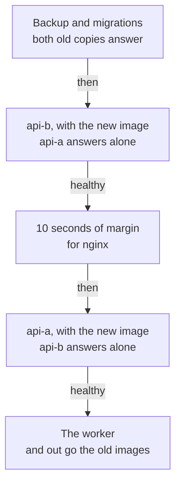
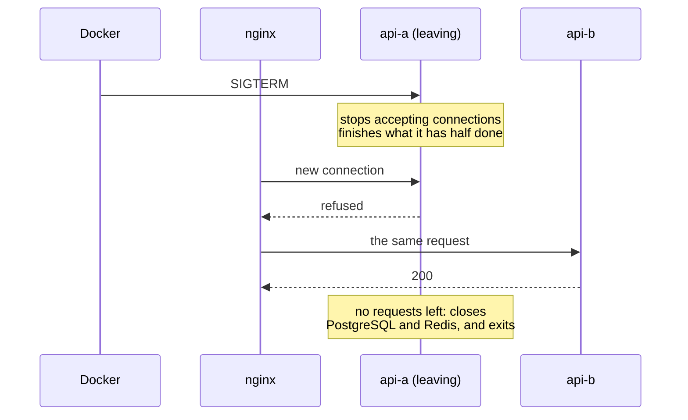

import Term from '~/components/Term.astro';
import TryIt from '~/components/TryIt.astro';
import Analogy from '~/components/Analogy.astro';
import ProjectCode from '~/components/ProjectCode.astro';
import Quiz from '~/components/Quiz.astro';
import QuizQuestion from '~/components/QuizQuestion.astro';
import QuizOption from '~/components/QuizOption.astro';

## The problem

Ana pushes a small change, the shop’s title, and [Phase 8](/en/phase-8/ci-cd-github-actions/)’s timer deploys it on its own. While the API changes, **everyone who visits gets a `502`**.

We measured it again, with Phase 8’s script, while a loop kept asking for products and logging in without pause: **about 12 seconds of `502`**, ten of them without a single good answer. Imagine Marta was paying right then: with a `502`, she doesn’t know whether she was charged.

In Phase 8 we promised to deploy without downtime, with two copies that take turns. This is that lesson.

## The analogy

<Analogy>

Think of a supermarket with two checkouts. The cashier at checkout 2 is due to be relieved: she puts up the “closed” sign, new customers go to checkout 1, and she serves everyone left in her line. Only then does she hand the seat to her colleague. Then checkout 1 does the same. The supermarket never runs out of open checkouts.

<div slot="limits">

- A customer can arrive just as the sign goes up, and on a server that connection gets cut: it’s the rare race at the end.
- nginx doesn’t look at any sign: it finds out when a copy refuses its connection.
- During the handover, the old version and the new one both answer, with a single database.

</div>

</Analogy>

## How it really works

### Twelve seconds of 502, measured again

A piece of that measurement, with step 39: how many requests came out every second with each code (trimmed, `…`).

```
13:24:31: GET_200x5 POST_200x33
13:24:32: GET_200x1 GET_502x4 POST_200x5 POST_502x38
13:24:33: GET_502x5 POST_502x88
…
13:24:43: GET_502x7 POST_200x1 POST_502x172
13:24:44: GET_200x6 GET_502x1 POST_200x49 POST_502x3
```

Those are the two windows from [Phase 8](/en/phase-8/ci-cd-github-actions/#a-few-seconds-without-a-shop): the container being replaced, and the 10 seconds in which nginx sets aside a copy that failed. With continuous traffic, some request always stumbles on the new copy before Node is listening.

With one copy, nginx has nobody to hand anything to. For a <Term id="zero-downtime-deployment">zero-downtime deployment</Term>, there always has to be one answering.

### Two fixed copies: api-a and api-b

Since step 40, production runs two copies of the API:

<ProjectCode file="shop-api/40-zero-downtime/compose.production.yaml" region="copies" />

- **`<<: *api`**: copy here what the two share, written once above under the name `&api` (a YAML anchor).
- **`3000` and `3001`**: the two ports nginx’s `upstream` has had since [Phase 8](/en/phase-8/nginx-reverse-proxy/#the-shops-site-nginxshopconf). **nginx doesn’t change.**

These are two named services, not the `--scale` from [lesson 3](/en/phase-9/horizontal-scaling/): with a fixed port each, the script knows which copy it’s changing.

### One copy at a time

`deploy.sh` does what Phase 8’s did, but changes the copies one by one:



It’s a **rolling deployment**:

<ProjectCode file="shop-api/40-zero-downtime/deployment/deploy.sh" region="copies" />

- **`change`**: `docker compose up -d` for a single service, with the new image. Docker sends the <Term id="signal">signal</Term> `SIGTERM` to the old container ([Phase 7](/en/phase-7/dockerfile/#shutting-down-properly-pid-1-and-signals)), waits for it to exit and starts the new one.
- **`|| roll_back`**: if it doesn’t get healthy, it goes back to the previous image.
- **`old_api`**: the single copy from steps 37 to 39, only the first time.

**`api-b` goes first because of that first time.** The single copy was on 3000 or on 3001: Compose gave it the first free port, and on every deployment it jumped from one to the other (we saw it go from 3000 to 3001 and back).

The first new copy takes the free port and, once it’s healthy, the old one leaves its own port to the second copy. If the old one is on 3001, the script starts with `api-a`.

The worker goes last: jobs that arrive in the meantime wait in the queue. A deployment takes about 40 seconds.

### Ten seconds of margin for nginx

Between one copy and the other, it waits:

<ProjectCode file="shop-api/40-zero-downtime/deployment/deploy.sh" region="pause" />

While `api-b` was being changed, its connections failed, and nginx set it aside for 10 seconds [from the last failure](/en/phase-8/nginx-reverse-proxy/#two-copies-and-nginx-finds-out-on-its-own). Docker’s first <Term id="healthcheck">healthcheck</Term> comes 10 seconds after starting: `api-b` can be healthy while nginx is still setting it aside. If `api-a` stopped then, nginx would have nobody: **`502`, even for a GET.**

In our measurement, from 13:28:02 to 13:28:23: about 10 seconds until healthy and 10 of margin.

### Shutting down without cutting anyone off

The copy that leaves receives `SIGTERM`. Up to step 39, the shutdown was half done: an open event stream held the copy until it exited after 5 seconds, cutting the stream. Now it does a <Term id="graceful-shutdown">graceful shutdown</Term>:

<ProjectCode file="shop-api/40-zero-downtime/src/shutdown.ts" region="shut-down" />

1. **`controller.abort()`** gives notice: the order event streams and the WebSockets, which never end, close right away, and `/health` answers `503`. Their clients reconnect, and reach the other copy.
2. **`server.close(…)`** stops accepting connections: nginx’s next attempt is refused, and nginx hands it to the other copy.
3. *Keep-alive* connections, which HTTP/1.1 leaves open for the next request, don’t close by themselves: whatever arrives through them goes out with **`Connection: close`**, and every 100 ms the free ones are closed.
4. **It waits for the half-done requests**, 8 seconds at most: Docker waits 10 (`stop_grace_period`) before sending `SIGKILL`.
5. **At the end, what those requests use**, one after another: PostgreSQL, the queue, the order notifications, the cache and the rate limits (`src/server.ts`).



### What nginx repeats and what it doesn’t

When a copy fails, nginx [tries the other one](/en/phase-8/nginx-reverse-proxy/#when-the-api-fails-502-and-504). Not always:

| What happens to nginx | In its `error.log` | Does it repeat it on the other copy? |
|---|---|---|
| The connection is refused | `connect() failed (111: Connection refused)` | Yes, **a POST too**: it never went out |
| It’s accepted and cut after the request is sent | `recv() failed (104: Connection reset by peer)` or `upstream prematurely closed connection` | A GET, yes. A POST, no: `502` |

A POST that already went out may have been carried out, and repeating it could charge twice: it isn’t <Term id="idempotent">idempotent</Term>.

A log we added to nginx (`$upstream_addr`, `$upstream_status`) shows it. A login while `api-a` was being changed:

```
13:25:59.980 POST /v2/session 200 upstream=127.0.0.1:3000, 127.0.0.1:3001 ustatus=502, 200 urt=0.000, 0.087 rt=0.087
```

**Two copies tried**: 3000 refused the connection (nginx records it as `502`) and 3001 answered `200`. The time has fractions of a second at the end: they’re milliseconds.

### Docker’s proxy accepts and cuts

In step 40’s first measurement, with Docker’s default configuration, the GETs all came out fine, but **5 of 6,679 POSTs got a `502`**, one or two for each copy changed (our measurement, from an earlier run of the same step). In the `error.log`, `recv() failed (104: Connection reset by peer)`: the connection **was accepted and cut**. To [publish a port](/en/phase-7/docker-networking/), Docker starts by default a small program, **docker-proxy**, that listens on `127.0.0.1:3001` and passes every connection on to the container. While the old copy finishes its work, its container is still alive and docker-proxy keeps accepting: it finds nobody listening inside, and cuts.

You turn it off with `{"userland-proxy": false}` in Docker’s configuration. Then it’s the Linux kernel that carries the connections to the container, and a port with nobody listening refuses them. **Without it, 0 of 1,091 GETs and 0 of 6,130 POSTs failed** (same measurement), and our English runs of the deployment with the proxy off had zero errors. The API still sees nginx arriving from `172.18.0.1`, and the ports on `127.0.0.1` are still closed from outside.

While it’s still on, `deploy.sh` warns you:

<ProjectCode file="shop-api/40-zero-downtime/deployment/deploy.sh" region="docker-proxy" />

### Almost zero: the race that remains

Without docker-proxy, in about 30 copy stops measured, **one POST got a `502` once**. Most likely: a connection that arrived just as the API stopped listening.

That’s why we say **almost zero**. Closing that gap takes **taking the copy out of the <Term id="load-balancer">load balancer</Term> before stopping it**:

- in nginx, mark it `down` in the `upstream` and reload, with `sudo` on every deployment;
- in NGINX Plus, the paid version, with its API;
- in Kubernetes, a system that spreads containers across servers: it stops sending the copy traffic and waits before stopping it.

The other side is the client: an app that retries a POST with its <Term id="idempotency-key">idempotency key</Term> from [Phase 4](/en/phase-4/webhooks-idempotency/#idempotency-key-a-post-you-can-repeat) doesn’t charge twice.

### Alive and ready: liveness and readiness

`/health` answers `503` while the copy shuts down, even if the database responds:

<ProjectCode file="shop-api/40-zero-downtime/src/app.ts" region="health" />

These are two questions we tend to mix up:

- **Is it alive?** (*liveness*): if not, restart it.
- **Is it ready?** (*readiness*): if not, don’t send it requests.

A copy that is shutting down is alive, but no longer ready: its `503` is the honest answer for whoever asks. Kubernetes asks the two questions separately, and the shop will too in [Phase 10](/en/phase-10/health-checks-alerts/#two-questions-two-routes). Docker has a single healthcheck, and a copy that fails it isn’t restarted: it stays `unhealthy`. **Here, Docker and `deploy.sh` read `/health`**; nginx [only looks at the real requests](/en/phase-8/nginx-reverse-proxy/#two-copies-and-nginx-finds-out-on-its-own).

### If the new copy doesn’t get healthy

The script no longer always waits 60 seconds: **it gives up as soon as Docker marks the copy `unhealthy`** or the container stops running. If the first new copy fails, only it goes back to the previous image; if the second fails, both go back, one at a time, and if the worker fails, all three. We broke the first copy in two ways, with no error in the loop:

- **`/health` always `503`**: noticed after 33 seconds, at the third failed healthcheck. Meanwhile it served the other routes fine: nginx doesn’t ask `/health`.
- **The API exits on startup**: 16 seconds, not at once. Between restarts, the container looks like it’s running most of the time.

At the end, `docker image prune` deletes the untagged images that no container uses: the new one (`main`) and `:previous` stay. Phase 8’s script didn’t do this.

### Migrations for two versions at once

<Term id="migration">Migrations</Term> are applied before touching any copy, and for about 20 seconds an old copy and a new one answer together: **two versions of the code with the same schema**.

In Phase 8, [expand and contract](/en/phase-8/ci-cd-github-actions/#a-rollback-brings-back-the-code-not-the-schema) was advice; now it’s mandatory. If you rename `name` to `title` in a migration, **the old copies fail** as soon as it’s applied: at first, both. First expand (add `title` and write to both columns); in another deployment, contract.

### Blue-green and canary

Two other ways to deploy without downtime:

- A <Term id="blue-green-deployment">blue-green deployment</Term> sets up a whole environment with the new version (the green one) next to the one that’s answering (the blue one), tests it and moves all the traffic over at once.
- A **canary** gives the new version to a part of the visits, say one in twenty, and watches its errors before giving it to everyone.

| | Rolling (the shop) | Blue-green | Canary |
|---|---|---|---|
| How the new version arrives | Copy by copy | All at once | To a part first |
| What extra it needs | A copy that can hold up alone for a while | A whole environment | Splitting by percentage (in nginx, `weight`) |
| Going back | Another round, about 40 s | Instantly | Remove the new part |

## Try it

The goal: measure the `502`s of Phase 8’s deployment on your server, switch to two copies and measure again, until you see none.

The outputs are from our `course` VM (2 CPUs, 2 GiB, Docker 29.9.2, nginx 1.28.3) from October 22, 2026, with a test registry (`localhost:5000`) instead of ghcr.io. Your times, numbers and IDs will be different. Everything goes on the server, except what says “your computer”; on a VPS, the same.

### Prepare the measurement

Stop the timer and save your account’s email and password in a file only you can read:

```sh
sudo systemctl stop shop-deploy.timer
cat > ~/.login.json <<'END'
{"email":"admin@shop.example","password":"your-account-password"}
END
chmod 600 ~/.login.json
```

A correct login is the slowest route (argon2), and the limit only counts failed ones: it can be repeated without stopping. Open `nano ~/loop.sh`, paste this loop, save (<kbd>Ctrl</kbd> + <kbd>O</kbd>) and exit (<kbd>Ctrl</kbd> + <kbd>X</kbd>):

```sh
#!/usr/bin/env bash
# Measurement loop: for $1 seconds, through nginx (https://shop.example):
#   1 loop of GET /v2/products, one every 0.1 s
#   4 loops of POST /v2/session (a correct login: argon2), back to back
# Each request, one line in $2: time (ms), method, status code, curl total time (s).
set -u
dur="$1"; out="$2"; : > "$out"
end=$(( $(date +%s) + dur ))
stamp() { local t=$EPOCHREALTIME; printf "%(%T)T.%s" "${t%.*}" "${t#*.}" | cut -c1-12; }
get() { while [ "$(date +%s)" -lt "$end" ]; do
  t="$(stamp)"; r="$(curl -s -o /dev/null -w "%{http_code} %{time_total}" --cacert ~/ca/ca.crt https://shop.example/v2/products)"
  echo "$t GET $r" >> "$out"; sleep 0.1; done; }
post() { while [ "$(date +%s)" -lt "$end" ]; do
  t="$(stamp)"; r="$(curl -s -o /dev/null -w "%{http_code} %{time_total}" --cacert ~/ca/ca.crt -H "Content-Type: application/json" --data @"$HOME/.login.json" https://shop.example/v2/session)"
  echo "$t POST $r" >> "$out"; done; }
get & for i in 1 2 3 4; do post & done; wait
```

It’s ours, as is: the `get &` and `post &` run at the same time, and every request leaves a line with its time (`stamp`), its method and its code. Change our VM’s name and certificate to yours from [Phase 8, lesson 5](/en/phase-8/lets-encrypt-nginx/), and give it permission. On the free path, with your IP in the sslip.io name:

```sh
sed -i 's|shop.example|192-168-5-15.sslip.io|g; s|~/ca/ca.crt|~/authority/ca.crt|g' ~/loop.sh
chmod +x ~/loop.sh
```

With Let’s Encrypt, your domain and no `--cacert`: `sed -i 's|shop.example|your-domain.com|g; s|--cacert ~/ca/ca.crt ||g' ~/loop.sh`, and the same `chmod`.

### Before: Phase 8’s deployment

On **your computer**, with your project (`~/backend-course/phase-3/shop-api`) still at step 39, change the title in `src/shop.ts` (for example, “Ana and Luis’s shop (version 2)”), push to `main` and wait for *Publish* to finish. On the server:

<TryIt
  title="1. A deployment with a single copy"
  cmd={`cd /opt/shop
(~/loop.sh 60 before.txt & sleep 5; deployment/deploy.sh > before.log 2>&1; wait)
awk '{print $2, $3}' before.txt | sort | uniq -c
awk '$3 != 200' before.txt | sort | sed -n '1p;$p'`}
  output={`    332 GET 200
     84 GET 502
   2538 POST 200
   1802 POST 502
13:24:32.141 POST 502 0.007069
13:24:44.076 POST 502 0.002707`}
>

The loop runs for 60 seconds and, at 5, the deployment (its output goes to `before.log`). The first **`awk`** counts the requests by method and code; the second gives the first and the last error.

Look at the **`502`s**, from 13:24:32 to 13:24:44: about 12 seconds. There are so many POSTs because a `502` comes back in milliseconds. If none appears, look at `before.log`: without a new image, the script doesn’t deploy. `000` codes: curl can’t connect, check the name and the `ca.crt` in `~/loop.sh`. POSTs with `400` or `429`: the password in `~/.login.json` isn’t your account’s.

</TryIt>

### Turn off Docker’s proxy

Once. First look at Docker’s configuration:

```sh
cat /etc/docker/daemon.json
```

Since [Phase 8, lesson 3](/en/phase-8/docker-compose-production/), it has the log limits. **`tee` replaces the whole file**: write it with them and the new key. If the `cat` shows anything besides the limits, add it to the block before running it.

```sh
sudo tee /etc/docker/daemon.json <<'EOF'
{
  "log-driver": "json-file",
  "log-opts": {
    "max-size": "10m",
    "max-file": "3"
  },
  "userland-proxy": false
}
EOF
sudo systemctl restart docker
pgrep -a docker-proxy
```

If it didn’t exist, it creates it anyway. `tee` echoes the file back, and **`pgrep` must print nothing**. Restarting Docker stops and starts every container, once: our shop took about 13 seconds to be healthy again. If Docker doesn’t start, the JSON has an error: `sudo journalctl -u docker -n 20` says which.

### After: two copies that take turns

On **your computer**, put your project at step 40, as in the [introduction](/en/phase-9/#each-lesson-its-step). The script and `compose.production.yaml` aren’t in the image: copy them to the server, with your user and its IP.

```sh
cd ~/backend-course/phase-3
curl -O https://backenddesdecero.com/practicas/shop-api/40-zero-downtime.tar.gz
tar -xzf 40-zero-downtime.tar.gz
cp -R 40-zero-downtime/. shop-api/
rsync -av 40-zero-downtime/compose.production.yaml 40-zero-downtime/deployment ubuntu@192.168.5.15:/opt/shop/
```

On Windows, everything in WSL except the copy to the VM, from PowerShell, with the step downloaded there (`curl.exe -O` and `tar -xzf`): `scp -r` instead of `rsync -av`. Then, from `shop-api`, commit and push, and wait for *Publish*. On the server, `chmod +x deployment/*.sh`, as in Phase 8. And measure:

<TryIt
  title="2. The first deployment with two copies"
  cmd={`cd /opt/shop
(~/loop.sh 100 after.txt & sleep 5; deployment/deploy.sh > after.log 2>&1; wait)
awk '{print $2, $3}' after.txt | sort | uniq -c`}
  output={`    691 GET 200
   4904 POST 200`}
>

**Not a single `502`.** A lone one can be the rare race from [Almost zero](#almost-zero-the-race-that-remains). Several: look in `after.log` for the docker-proxy warning and go over [Turn off Docker’s proxy](#turn-off-dockers-proxy).

</TryIt>

This is what our deployment wrote, with the time we added when measuring (trimmed, `…`):

```
13:26:06.014 deploy: new image: 8c210430516a -> ce248466fbf4 (the one running is kept as localhost:5000/shop-api:previous)
13:26:06.288 time="2026-10-22T13:26:06+02:00" level=warning msg="Found orphan containers (shop-api-1) for this project. If you removed or renamed this service in your compose file, you can run this command with the --remove-orphans flag to clean it up."
…
13:26:09.910 deploy: api-a, with the new image (the other copy keeps answering)
…
13:26:30.927 deploy: the single-copy API leaves its port to api-b
13:26:31.635 deploy: api-b, with the new image (api-a already answers with it)
…
13:26:43.795 deploy: done: api-a, api-b and the worker are running ce248466fbf4
```

Our single copy was on 3001: it started with `api-a`. **`Found orphan containers`** is Compose warning about the single copy, whose service is no longer in the file: it’s expected.

Another title change, this time between two versions of step 40: 602 GETs and 4,210 POSTs, without an error.

### Do two copies fit in 2 GiB?

With everything running, a minute after a deployment:

<TryIt
  title="3. The memory"
  cmd={`free -m
docker stats --no-stream`}
  output={`               total        used        free      shared  buff/cache   available
Mem:            1949        1172         279          30         618         776
Swap:              0           0           0
NAME            CPU %     MEM USAGE / LIMIT     MEM %
shop-worker-1   0.71%     179.8MiB / 1.904GiB   9.22%
shop-api-a-1    0.00%     124.3MiB / 1.904GiB   6.37%
shop-api-b-1    0.09%     156.6MiB / 1.904GiB   8.03%
shop-db-1       0.00%     44.56MiB / 1.904GiB   2.29%
shop-cache-1    1.77%     7.512MiB / 1.904GiB   0.39%
shop-redis-1    1.85%     9.684MiB / 1.904GiB   0.50%`}
>

**`available`: 776 MiB free**, with no *swap*: they fit. We removed the line for our test registry, which your server doesn’t have. The copies grow with use: after about 4,100 logins, in an earlier run, they were at 249 and 219 MiB, with 720 MiB `available`.

</TryIt>

When you’re done, turn the timer back on:

```sh
sudo systemctl start shop-deploy.timer
rm ~/.login.json /opt/shop/before.* /opt/shop/after.*
```

## You have already seen it

- **The “maintenance from 2:00 to 4:00” notices** from some banks: they deploy with downtime, at the quietest hour.
- **A new feature in an app that a friend already has and you don’t**: often, a canary.
- **Big websites that never close to update**: many copies that take turns.

## Common mistakes

- **Leaving docker-proxy on.** The GETs go through, but some POST gets a `502` on every deployment.
- **Changing the second copy as soon as the first is healthy.** nginx may still be setting it aside, and it runs out of copies.
- **A shutdown longer than Docker’s wait.** After 10 seconds, `SIGKILL` cuts whatever is left.
- **Renaming a column in the same deployment as the code.** The old copies fail as soon as the migration is applied.
- **Fixing the POSTs with `proxy_next_upstream non_idempotent`.** nginx would repeat the ones that already arrived: one payment, twice.

## Summary

- The script changes one copy, waits for it to be healthy and 10 seconds more, and then the other.
- The copy that leaves stops accepting connections, finishes what it has half done and closes everything else at the end.
- nginx repeats a refused connection, even a POST, but not a POST already sent: that’s why docker-proxy goes.
- A rare race remains, closed by taking the copy out of the load balancer before stopping it.
- During the handover two versions run: migrations have to serve both.

## Did you get it?

<Quiz>

<QuizQuestion
  question="During a deployment, the GETs come out fine, but a login gets a 502, and the error.log says recv() failed (104: Connection reset by peer). What’s most likely?"
  review="Docker’s proxy accepts and cuts"
>

<QuizOption text="That the new copy never got healthy and the script rolled back.">

A rollback doesn’t give a `502`: while one copy is being changed, the other answers.

</QuizOption>

<QuizOption text="That docker-proxy accepted the connection of a copy that was shutting down, and cut it." correct>

`104` is a connection that was accepted and cut with the request already sent, and nginx doesn’t repeat that POST. Without docker-proxy, it’s refused (`111`) and nginx hands it to the other copy.

</QuizOption>

<QuizOption text="That nginx never repeats a POST on the other copy, so some will always fail.">

It repeats it if the connection was refused: the request never went out.

</QuizOption>

</QuizQuestion>

<QuizQuestion
  question="You remove the 10-second pause between api-b and api-a from the script to deploy faster. What can happen?"
  review="Ten seconds of margin for nginx"
>

<QuizOption text="A few seconds of 502, even for GETs: nginx may still be setting api-b aside." correct>

nginx sets a copy aside for 10 seconds after a failure, even if Docker already considers it healthy. If the other one stops then, none is left.

</QuizOption>

<QuizOption text="Nothing: the script already waits for api-b to be healthy before touching api-a.">

Healthy to Docker isn’t available to nginx, which doesn’t ask `/health` and keeps counting its `fail_timeout`.

</QuizOption>

<QuizOption text="That migrations would be applied with api-a still old.">

Migrations are applied before touching any copy; the pause has nothing to do with them.

</QuizOption>

</QuizQuestion>

<QuizQuestion
  question="When shutting down, why does the API close PostgreSQL and Redis at the end, and not as soon as it receives SIGTERM?"
  review="Shutting down without cutting anyone off"
>

<QuizOption text="Because Docker requires closing the connections in that order before stopping a container.">

Docker knows nothing about the API’s connections: it sends `SIGTERM`, waits and, if needed, `SIGKILL`.

</QuizOption>

<QuizOption text="Because if it closed them earlier, nginx couldn’t pass the requests to the other copy.">

nginx only looks at whether the connection is accepted; it doesn’t depend on a copy’s database.

</QuizOption>

<QuizOption text="Because the requests that are still half done need them to finish." correct>

A login in progress has to read the account and save the session. Closing PostgreSQL earlier would cut it off.

</QuizOption>

</QuizQuestion>

<QuizQuestion
  question="Ana renames the column name to title, with the migration and the new code in the same push. What happens with step 40’s deployment?"
  review="Migrations for two versions at once"
>

<QuizOption text="Nothing bad: the script changes the copies one at a time, so nobody notices any downtime.">

The migration is applied before any copy is changed, and the old ones look for `name`, which no longer exists.

</QuizOption>

<QuizOption text="The copies that are still old fail from the moment the migration is applied: at first, both." correct>

The migration comes before the handover, so the handover doesn’t soften it. First you expand (add `title` without removing `name`) and, in another deployment, you contract.

</QuizOption>

<QuizOption text="The script detects the incompatible migration and rolls back on its own.">

The script only checks whether the new copies get healthy. And rolling back changes the code, not the schema.

</QuizOption>

</QuizQuestion>

<QuizQuestion
  question="A new version answers 503 on /health, but serves everything else fine. During its deployment, who notices and what happens?"
  review="If the new copy doesn’t get healthy"
>

<QuizOption text="nginx, which stops sending it requests as soon as it sees the first 503 from /health.">

Free nginx doesn’t read `/health`: it only sees whether the real requests fail, and these were coming out fine.

</QuizOption>

<QuizOption text="Nobody: since the other routes answer fine, the script takes it as good and moves on.">

The script waits for Docker to mark it healthy, and with `/health` failing it never gets there.

</QuizOption>

<QuizOption text="Docker, about 30 seconds later, and the script goes back to the previous one." correct>

Docker marks it `unhealthy` at the third failed `/health`, one every 10 seconds. Meanwhile, nginx kept sending it requests.

</QuizOption>

</QuizQuestion>

<QuizQuestion
  question="Before giving a new version to everyone, you want only one in twenty visits to use it for an hour, and to watch its errors. Which way of deploying is that?"
  review="Blue-green and canary"
>

<QuizOption text="A canary: a small part of the visits goes to the new version." correct>

If the new version fails, only that part notices, and it’s removed with no fuss.

</QuizOption>

<QuizOption text="A blue-green: two environments, and the new one receives a part of the visits.">

In a blue-green, traffic moves from one environment to the other all at once, not in parts.

</QuizOption>

<QuizOption text="The shop’s rolling deployment, with one copy in twenty.">

A rolling deployment changes copies, and each one receives its share as soon as it’s healthy.

</QuizOption>

</QuizQuestion>

</Quiz>

## Further reading

- [Module ngx_http_upstream_module](https://nginx.org/en/docs/http/ngx_http_upstream_module.html), from nginx: `fail_timeout`, `down` and `weight`.
- [proxy_next_upstream](https://nginx.org/en/docs/http/ngx_http_proxy_module.html#proxy_next_upstream), from nginx.
- [dockerd](https://docs.docker.com/reference/cli/dockerd/), from Docker: `daemon.json` and `userland-proxy`.
- [BlueGreenDeployment](https://martinfowler.com/bliki/BlueGreenDeployment.html) and [CanaryRelease](https://martinfowler.com/bliki/CanaryRelease.html), by Martin Fowler.
