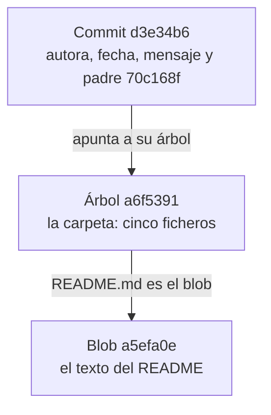
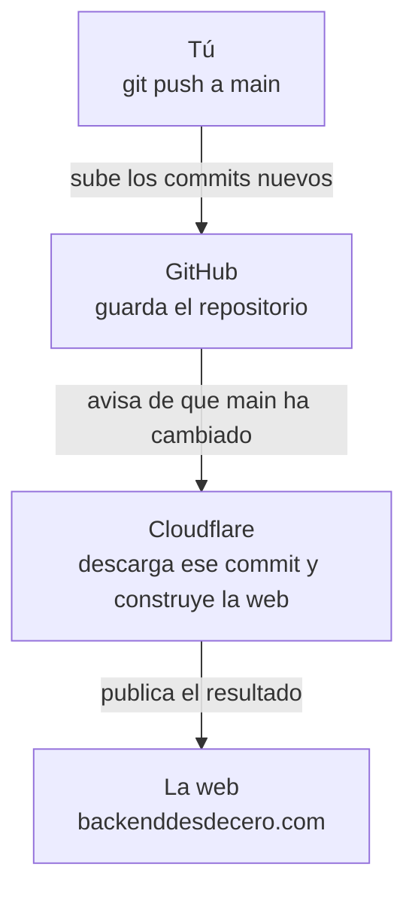

import Term from '~/components/Term.astro';
import TryIt from '~/components/TryIt.astro';
import Analogy from '~/components/Analogy.astro';
import Quiz from '~/components/Quiz.astro';
import QuizQuestion from '~/components/QuizQuestion.astro';
import QuizOption from '~/components/QuizOption.astro';

## El problema

Imagina que Ana y Luis tienen una tienda online pequeña. Un lunes, una clienta escribe: ha comprado 50 € justos y le han cobrado 5 € de envío, cuando la web dice que es gratis a partir de 50 €. La semana pasada funcionaba. Desde entonces han guardado diez cambios, y ninguno dice que toque el precio del envío.

Guardan su código con <Term id="git">Git</Term>, que apunta cada cambio de un proyecto. Cada cambio guardado es un <Term id="commit">commit</Term>. Mucha gente usa Git con cinco órdenes de memoria y, cuando algo se tuerce, borra la carpeta y la vuelve a descargar ([xkcd 1597](https://xkcd.com/1597/)).

En esta lección abres la caja. Cuando sabes qué es un commit y qué es una rama, encontrar ese fallo lleva un minuto, y casi cualquier error tiene arreglo.

## La analogía

<Analogy>

Imagina el álbum de fotos de una casa en obras. Cada vez que terminas algo, haces una foto de **toda** la casa, y detrás apuntas quién la hizo, cuándo, qué hiciste y cuál es la foto anterior. Esas fotos son los commits.

Las fotos no llevan número, sino un código calculado a partir de todo lo que se ve en ellas y de lo que pone detrás. Si alguien retoca una foto, aunque sea un pelo, el código ya no cuadra. Ese código es el hash.

Para no perderte, pegas pósits: «main» en la última foto, «v1.0» en la de la inauguración. Cuando añades una foto, mueves el pósit «main» a la nueva. Las ramas son esos pósits. Y en una libreta apuntas cada vez que mueves uno: es el reflog.

<div slot="limits">

- Dos fotos de verdad nunca salen idénticas; dos commits, sí: con los mismos ficheros, autor, fecha, mensaje y padre, dan el mismo hash en cualquier ordenador.
- Git no guarda cada fichero en cada foto: si un fichero no cambia, todas las fotos apuntan al mismo.
- Quitar un pósit no destruye la foto enseguida, pero tampoco para siempre: lo que no tiene pósit ni sale en la libreta, Git lo tira pasado un tiempo.

</div>

</Analogy>

## Cómo funciona de verdad

### Git en un minuto

Git guarda la historia de una carpeta, el <Term id="repository">repositorio</Term>, en una carpeta oculta dentro de ella, `.git`. El ciclo de siempre:

1. Cambias ficheros con tu editor.
2. `git add precio.sh` elige qué cambios van en la próxima foto.
3. `git commit -m "Arregla el envío"` hace la foto, con un mensaje que cuenta el porqué.

`git log` enseña los commits, del más nuevo al más antiguo. Cada commit lleva tu nombre y tu correo: díselos a Git una vez con `git config --global user.name "Ana García"`, y lo mismo con `user.email`. Si no, tu primer commit falla con `Author identity unknown`.

Si tu Mac no tiene `git`, al escribirlo te ofrece instalar las herramientas de línea de comandos de Apple, que lo traen: acepta. En Ubuntu (tu VM o WSL) suele venir de serie; si no, `sudo apt install git` ([lección 6](/fase-1/servicios-systemd-apt/)).

### Un commit es una foto con huella

Un commit no guarda «los cambios». Git guarda tres tipos de objetos, y cada uno se llama por su hash:

- **Blob:** el contenido de un fichero, sin su nombre.
- **Árbol** (*tree*): una carpeta, es decir, una lista de nombres con sus permisos y el hash de cada blob (o de otro árbol, si es una subcarpeta).
- **Commit:** el hash del árbol principal, el hash del commit anterior (su **padre**), el autor, la fecha y el mensaje.

Así está enlazado el último commit de la tienda que crearás en «Pruébalo»:



Si `README.md` no cambia en el commit siguiente, el árbol nuevo apunta al mismo blob: cada versión de un fichero se guarda una sola vez. Las diferencias que enseña `git show` las calcula al pedírselas, comparando dos fotos.

### El hash, la huella de los datos

Un <Term id="hash">hash</Term> es un resumen de tamaño fijo calculado a partir de unos datos. Mira lo que pasa al cambiar una letra:

```text
$ echo 'hola' | git hash-object --stdin
5c1b14949828006ed75a3e8858957f86a2f7e2eb
$ echo 'Hola' | git hash-object --stdin
a19abfea0f29b668c91c58c834b8965e6c37804f
```

Funciona como una huella dactilar:

- Los mismos datos dan siempre el mismo hash, en cualquier ordenador.
- Un cambio mínimo da uno completamente distinto.
- Con el hash no se puede reconstruir el original, ni fabricar a propósito otros datos con el mismo hash.

Git lo calcula con SHA-1, una fórmula de hash, a partir de la palabra `blob`, el tamaño y el contenido (`printf 'blob 5\0hola\n' | shasum` da el mismo `5c1b149…`). Son 40 caracteres (cifras y letras de la a a la f), y casi siempre bastan los 7 primeros. En 2017 se logró fabricar dos ficheros con el mismo SHA-1 ([SHAttered](https://shattered.io/)), y Git está pasando a SHA-256, más seguro.

En [la lección 8 de la Fase 0](/fase-0/tls-y-https/), una firma dejaba de valer si el mensaje cambiaba una letra: por dentro, se firma un hash del mensaje. Y la huella del servidor de [la lección 9](/fase-1/que-es-ssh/) (`SHA256:…`) es el hash de su clave pública.

Como cada commit lleva el hash de su padre, la historia es una cadena. Cambiar una coma de un commit antiguo cambia su hash, y con él el de todos los que vienen detrás: nadie puede colarte un cambio en el pasado sin que se note.

### Una rama es un pósit

Una <Term id="branch">rama</Term> es un fichero de texto con un hash dentro. La rama `main` de la tienda es `.git/refs/heads/main`, y contiene `d3e34b6…`, el último commit. Crear una rama (`git switch -c arregla-envio`) es escribir otro fichero de 41 bytes: no copia nada.

`HEAD` es el «estás aquí»: el fichero `.git/HEAD` dice en qué rama estás (`ref: refs/heads/main`). Cada commit nuevo tiene como padre el actual, y el pósit de tu rama avanza hasta él.

- **Una etiqueta** (*tag*), como `v1.0`, es un pósit fijo que marca una versión.
- **HEAD suelto** (*detached HEAD*): si vas a un commit concreto (`git switch --detach 99c50e1`), `HEAD` apunta al commit y no a una rama. Puedes mirar y probar, pero lo que guardes ahí no lo sigue ningún pósit. `git bisect` te deja así.

### Juntar ramas: merge o rebase

Imagina que Ana arregla el envío en la rama `arregla-envio` mientras Luis añade otro commit a `main`. `git log --oneline --graph --all` dibuja cómo se han separado (cada `*` es un commit, y las líneas llevan a su padre):

```text
* 5d7d0ac (HEAD -> main) Añade un ejemplo a las novedades
| * 60d5fb4 (arregla-envio) Arregla el envío de los pedidos de 50 €
|/
* d3e34b6 Apunta la opción --ayuda en las novedades
```

**`git merge arregla-envio`**, desde `main`, crea un commit nuevo con dos padres. La historia cuenta lo que pasó: dos líneas de trabajo que se juntan.

```text
*   ecec7b7 (HEAD -> main) Merge branch 'arregla-envio'
|\
| * 60d5fb4 (arregla-envio) Arregla el envío de los pedidos de 50 €
* | 5d7d0ac Añade un ejemplo a las novedades
|/
* d3e34b6 Apunta la opción --ayuda en las novedades
```

**`git rebase main`**, desde `arregla-envio`, vuelve a aplicar los commits de la rama encima del último de `main`, como si Ana hubiera empezado después. Luego, `git merge` solo tiene que adelantar el pósit de `main` (*fast-forward*), y la historia queda recta:

```text
* 6b47226 (HEAD -> main, arregla-envio) Arregla el envío de los pedidos de 50 €
* 5d7d0ac Añade un ejemplo a las novedades
* d3e34b6 Apunta la opción --ayuda en las novedades
```

Fíjate en el hash: el commit de Ana era `60d5fb4` y ahora es `6b47226`. Tiene otro padre, así que es **otro commit**. Rebase no mueve commits: hace copias nuevas y mueve el pósit.

| | Merge | Rebase |
|---|---|---|
| La historia | Tal como pasó, con bifurcaciones | En línea recta, más fácil de leer |
| Tus commits | Los mismos | Copias nuevas, con otros hashes |
| Si ya los habías subido | Sin problema | Quien trabajaba encima se queda con los viejos |

La regla de oro: haz rebase solo de commits que nadie más tiene.

### Reescribir tus commits: rebase interactivo

`git rebase -i HEAD~3` («interactivo», sobre los tres últimos commits) abre tu editor con una lista, del commit más antiguo al más nuevo (las versiones antiguas de Git no ponen el `#`):

```text
pick 1d0a0fc # Añade --ayuda al README
pick 70c168f # Ignora también los .DS_Store de macOS
pick d3e34b6 # Apunta la opción --ayuda en las novedades
```

En un Mac, ese editor es `vim` (cómo salir, en [la lección 2](/fase-1/comandos-linux-archivos/#salir-de-vim)); en Ubuntu, `nano`. Para usar `nano` solo esa vez: `GIT_EDITOR=nano git rebase -i HEAD~3`.

Cambias la palabra del principio, guardas y cierras, y Git rehace esos commits: `reword` cambia el mensaje, `squash` o `fixup` lo funde con el anterior, `drop` lo quita, y mover una línea mueve el commit. Sirve para ordenar tu trabajo antes de compartirlo, con la misma regla de oro: cada commit reescrito es nuevo.

### El reflog: el diario que lo recuerda todo

Git apunta en el **reflog** cada vez que se mueve `HEAD`: cada commit, cambio de rama, merge, rebase o `reset`. Si un `reset` o un rebase se lleva commits, siguen en `.git`, y el reflog te da su hash:

```text
8bd77c9 (HEAD -> main) HEAD@{0}: reset: moving to HEAD~3
d3e34b6 HEAD@{1}: commit: Apunta la opción --ayuda en las novedades
```

`HEAD@{1}` es «donde estaba HEAD un paso antes». `git reset --hard HEAD@{1}` vuelve allí, y `git branch rescate d3e34b6` le pega un pósit nuevo. Por defecto, las entradas duran al menos un mes.

Dos límites: el reflog es local (no se sube con `push`), y solo apunta commits. Lo que no llegaste a guardar en un commit no está en ningún sitio.

### Encontrar el fallo: bisect

`git bisect` hace una **búsqueda binaria**, como cuando buscas una palabra abriendo el diccionario por la mitad: te lleva al commit del medio, lo pruebas, y descarta la mitad de los sospechosos. Con 10 commits bastan 4 pruebas como mucho.

1. `git bisect start main v1.0`: `main` está mal y `v1.0`, bien.
2. Git te deja en el commit del medio. Lo pruebas y le dices `git bisect good` (bien) o `git bisect bad` (mal), hasta que te dice cuál fue el primer commit malo.
3. `git bisect reset` te devuelve a `main`.

Si un script comprueba el fallo, Git prueba solo: `git bisect run ./comprobar.sh`. Mira cómo termina el script, su <Term id="exit-code">código de salida</Term> ([lección 3](/fase-1/pipes-y-redirecciones/)): `0` es «bien», y casi cualquier otro número, «mal».

### Remotos por SSH

Un **remoto** es otra copia del repositorio, en otro ordenador. Por SSH, su dirección se parece mucho a la de `ssh`:

```text
$ ssh ubuntu@curso git init --bare -b main tienda.git
Initialized empty Git repository in /home/ubuntu/tienda.git/
$ git remote add origin ubuntu@curso:tienda.git
$ git push -u origin main
Enumerating objects: 54, done.
Counting objects: 100% (54/54), done.
Delta compression using up to 4 threads
Compressing objects: 100% (52/52), done.
Writing objects: 100% (54/54), 6.41 KiB | 6.41 MiB/s, done.
Total 54 (delta 23), reused 0 (delta 0), pack-reused 0
To curso:tienda.git
 * [new branch]      main -> main
branch 'main' set up to track 'origin/main'.
```

- La primera orden crea en el servidor `curso` un repositorio vacío y sin carpeta de trabajo (`--bare`). Con tu VM, `curso` es el apodo de tu `~/.ssh/config` de la lección 9.
- `origin` es el nombre del remoto, y `ubuntu@curso:tienda.git`, «la carpeta `tienda.git` del usuario `ubuntu` en `curso`».
- `git push` abre una conexión SSH con tu clave y envía los objetos que faltan: 54 blobs, árboles y commits.

Con GitHub es igual: en `git@github.com:ana/tienda.git`, el usuario es `git`, y te reconoce por la clave que subiste en la lección 9. Las direcciones `https://` también funcionan, pero piden un *token* (una contraseña larga que generas en GitHub) en lugar de tu clave.

### Firmar tus commits con tu clave SSH

El nombre y el correo de un commit son texto: cualquiera puede poner el tuyo con `git config`. Para demostrar que un commit es tuyo, fírmalo con tu clave privada de la lección 9. `user.signingkey` apunta a la clave pública, y Git firma con la privada que va con ella:

```sh
git config --global gpg.format ssh
git config --global user.signingkey ~/.ssh/id_ed25519.pub
git config --global commit.gpgsign true
```

Desde entonces, cada commit lleva su <Term id="digital-signature">firma digital</Term> dentro del propio objeto, así que también entra en su hash. `git cat-file -p HEAD` la enseña (recortada):

```text
tree 35872fb66a96203a88d37de3aa5934fdd9054948
parent d3e34b65586eeb9309ba0c5a5ab8ee1a34787822
author Ana García <ana@example.com> 1791810940 +0200
committer Ana García <ana@example.com> 1791810940 +0200
gpgsig -----BEGIN SSH SIGNATURE-----
 U1NIU0lHAAAAAQAAADMAAAALc3NoLWVkMjU1MTkAAAAgt/qSjkV2kMM0FWaIUZIZmDjvdv
 …
 -----END SSH SIGNATURE-----

Arregla el envío de los pedidos de 50 €
```

En GitHub, añade la misma clave pública como *Signing key* (Settings → SSH and GPG keys), y tus commits saldrán con la etiqueta «Verified».

### Avance: un push que despliega

En la [Fase 8](/fase-8/ci-cd-github-actions/), `git push` pondrá tu código en marcha en un servidor: es un <Term id="deployment">despliegue</Term>. Esta misma web funciona así:



Cada versión publicada es un commit: si algo sale mal, se vuelve a publicar el anterior.

## Pruébalo

El objetivo: en la tienda de Ana y Luis, a los pedidos de 50 € justos se les cobra envío. Vas a mirar un commit por dentro, a «perder» tres commits y rescatarlos y, al final, a encontrar el commit culpable.

Las salidas son las de un Mac, y en Linux y WSL son iguales, hashes incluidos: el script fija autores y fechas, así que tu repositorio es idéntico al de esta lección.

<TryIt title="1. ¿Tienes Git?" cmd="git --version" output="git version 2.50.1 (Apple Git-155)">

Tu versión puede ser otra; para firmar commits con SSH hace falta al menos la 2.34. En Ubuntu 24.04 sale `git version 2.43.0`. Si sale `command not found` o una ventana para instalar herramientas, mira [«Git en un minuto»](#git-en-un-minuto).

</TryIt>

<TryIt
  title="2. Descarga el repositorio de prácticas"
  cmd={`cd ~/curso-backend/fase-1\ncurl -O https://backenddesdecero.com/practicas/repo-tienda.sh`}
  output={`  % Total    % Received % Xferd  Average Speed   Time    Time     Time  Current
                                 Dload  Upload   Total   Spent    Left  Speed
100 12621  100 12621    0     0   176k      0 --:--:-- --:--:-- --:--:--  178k`}
>

`curl -O` guarda el fichero con su nombre, `repo-tienda.sh`. Tus cifras de velocidad serán otras. Si sale `Could not resolve host`, revisa tu conexión.

</TryIt>

Antes de ejecutarlo, **léelo**: `less repo-tienda.sh` ([lección 2](/fase-1/comandos-linux-archivos/); sal con <kbd>Q</kbd>). Solo crea una carpeta, `tienda`, escribe unos ficheros y hace 18 commits. Por internet verás a menudo `curl … | bash`, que ejecuta lo que llega sin leerlo: si la web estuviera comprometida, o el fichero llegara a medias, se ejecutaría igual.

<TryIt
  title="3. Crea la tienda y mira su historia"
  cmd={`bash repo-tienda.sh\ncd tienda\ngit log --oneline`}
  output={`Listo: la carpeta «tienda» tiene un repositorio con 18 commits.
Entra con: cd tienda
d3e34b6 (HEAD -> main) Apunta la opción --ayuda en las novedades
70c168f Ignora también los .DS_Store de macOS
1d0a0fc Añade --ayuda al README
8bd77c9 Añade la opción --ayuda
b40de27 Apunta las novedades desde la 1.0
58582d7 Ordena el código y añade comentarios
b699484 Cuenta en el README que hay desglose
a3e7e75 Muestra el desglose: pedido, IVA y envío
ba36895 Ignora las copias de los editores
9501bee Rechaza los precios que no son números
99c50e1 (tag: v1.0) Prepara la versión 1.0
1f811f1 Explica cómo se usa si falta el precio
4054821 Explica en el README cómo se usa
235eaa4 Añade comprobar.sh con los casos de prueba
19e2002 Añade el código de descuento PROMO10
782c8a8 Cobra 5 € de envío en los pedidos de menos de 50 €
72c3ed8 Añade precio.sh: el precio con IVA
6e562fe Añade el README`}
>

Fíjate en los pósits: `HEAD -> main` en el último commit y `tag: v1.0` en el octavo. Si la lista no cabe en la ventana, Git la abre en `less`: sal con <kbd>Q</kbd>. Si sale `Ya existe «tienda»`, ya lo habías ejecutado: bórrala con `rm -rf tienda` y repite.

</TryIt>

<TryIt
  title="4. Un commit por dentro"
  cmd="git cat-file -p d3e34b6"
  output={`tree a6f5391740a1a28e1a74b3f7dd424c01f6046040
parent 70c168f08faaab919597b60050aa7c92f0797700
author Ana García <ana@example.com> 1789974900 +0200
committer Ana García <ana@example.com> 1789974900 +0200

Apunta la opción --ayuda en las novedades`}
>

`cat-file -p` enseña un objeto tal como Git lo guarda. Esto es un commit entero: su árbol, su padre, la autora y quien lo guardó (con la fecha en segundos desde 1970) y el mensaje.

</TryIt>

<TryIt
  title="5. Su árbol y un blob"
  cmd={`git cat-file -p a6f5391\ngit hash-object README.md`}
  output={`100644 blob 9922c9bac9b0e9a2bafecedb8122feaace8328b8	.gitignore
100644 blob aafe9ff15a169de9a914a43997bb5277508612d4	NOVEDADES.md
100644 blob a5efa0e78e20c1db0d1b1bd6b717018844d4d32a	README.md
100755 blob 5ebdf414407b90c4636de3e213f94a072a6de022	comprobar.sh
100755 blob 4fac3b97c005cc65c5f729636f0f6fa0c4d5e7f1	precio.sh
a5efa0e78e20c1db0d1b1bd6b717018844d4d32a`}
>

El árbol es la carpeta: cada fichero con sus permisos (`100755` se puede ejecutar; `100644`, no), su tipo y su hash. `git hash-object` calcula el hash de tu `README.md`, y es el mismo `a5efa0e…` de la lista: el blob se llama así por su contenido. Para leerlo, `git cat-file -p a5efa0e`.

</TryIt>

<TryIt
  title="6. Las ramas son ficheros"
  cmd={`cat .git/HEAD\ncat .git/refs/heads/main`}
  output={`ref: refs/heads/main
d3e34b65586eeb9309ba0c5a5ab8ee1a34787822`}
>

`HEAD` dice «estoy en `main`», y `main` es el hash del último commit. En un repositorio clonado, a veces los punteros están todos juntos en `.git/packed-refs`.

</TryIt>

Ahora, el susto. Imagina que querías deshacer el último commit y escribes `HEAD~3` («tres commits antes de HEAD») en lugar de `HEAD~1`. `git reset --hard` mueve el pósit de la rama a ese commit y deja los ficheros como estaban en él:

<TryIt
  title="7. Pierde tres commits"
  cmd={`git reset --hard HEAD~3\ngit log --oneline -3`}
  output={`HEAD is now at 8bd77c9 Añade la opción --ayuda
8bd77c9 (HEAD -> main) Añade la opción --ayuda
b40de27 Apunta las novedades desde la 1.0
58582d7 Ordena el código y añade comentarios`}
>

Los tres últimos commits ya no salen: `git log` solo enseña lo que se alcanza desde un pósit.

</TryIt>

<TryIt
  title="8. Rescátalos con el reflog"
  cmd={`git reflog -5\ngit reset --hard HEAD@{1}`}
  output={`8bd77c9 (HEAD -> main) HEAD@{0}: reset: moving to HEAD~3
d3e34b6 HEAD@{1}: commit: Apunta la opción --ayuda en las novedades
70c168f HEAD@{2}: commit: Ignora también los .DS_Store de macOS
1d0a0fc HEAD@{3}: commit: Añade --ayuda al README
8bd77c9 (HEAD -> main) HEAD@{4}: commit: Añade la opción --ayuda
HEAD is now at d3e34b6 Apunta la opción --ayuda en las novedades`}
>

El reflog va de lo más reciente a lo más antiguo: `HEAD@{0}` es el `reset`, y justo antes, en `HEAD@{1}`, estabas en `d3e34b6`. El segundo `reset` te devuelve allí; compruébalo con `git log --oneline -3`. Si has hecho más cosas entre medias, `HEAD@{1}` será otra: usa el hash, `git reset --hard d3e34b6`.

</TryIt>

Y ahora, el fallo de la clienta. `comprobar.sh` prueba `precio.sh` con cuatro pedidos cuyo total se sabe:

<TryIt
  title="9. Reproduce el fallo"
  cmd="./comprobar.sh"
  output={`bien  ./precio.sh 10
MAL   ./precio.sh 50: esperaba «Total: 60,50 €» y salió «Total: 65,50 €»
bien  ./precio.sh 100
bien  ./precio.sh 100 PROMO10`}
>

50 € más el 21 % de IVA son 60,50 €, pero salen 65,50 €: los 5 € del envío. El script termina con el código `1`, «algo falla» (compruébalo con `echo $?`), y con eso le basta a `bisect`. Si sale `no such file or directory`, no estás en la tienda: `cd ~/curso-backend/fase-1/tienda`.

</TryIt>

<TryIt
  title="10. Encuentra al culpable con bisect"
  cmd={`git bisect start main v1.0\ngit bisect run ./comprobar.sh`}
  output={`Bisecting: 4 revisions left to test after this (roughly 2 steps)
[58582d7c5fd9e26e3a2966b3f9b31d31c7aa5ea9] Ordena el código y añade comentarios
running './comprobar.sh'
bien  ./precio.sh 10
MAL   ./precio.sh 50: esperaba «Total: 60,50 €» y salió «Total: 65,50 €»
bien  ./precio.sh 100
bien  ./precio.sh 100 PROMO10
Bisecting: 2 revisions left to test after this (roughly 1 step)
[ba368952b5a60ca90c79f76a7d8cd1be4e53c83b] Ignora las copias de los editores
running './comprobar.sh'
bien  ./precio.sh 10
bien  ./precio.sh 50
bien  ./precio.sh 100
bien  ./precio.sh 100 PROMO10
Bisecting: 0 revisions left to test after this (roughly 1 step)
[b699484e0542fb9db0c5d4de2548a5c6010c85f1] Cuenta en el README que hay desglose
running './comprobar.sh'
bien  ./precio.sh 10
bien  ./precio.sh 50
bien  ./precio.sh 100
bien  ./precio.sh 100 PROMO10
58582d7c5fd9e26e3a2966b3f9b31d31c7aa5ea9 is the first bad commit
commit 58582d7c5fd9e26e3a2966b3f9b31d31c7aa5ea9
Author: Luis Pérez <luis@example.com>
Date:   Mon Sep 14 18:25:00 2026 +0200

    Ordena el código y añade comentarios

 precio.sh | 25 ++++++++++++++++++-------
 1 file changed, 18 insertions(+), 7 deletions(-)
bisect found first bad commit`}
>

Sigue la búsqueda: `58582d7`, el del medio, falla; `ba36895`, más antiguo, funciona; y `b699484`, el de justo antes de `58582d7`, también. El primer commit malo es `58582d7`, y han bastado tres pruebas. Decía «solo ordenar»: por eso nadie lo sospechaba.

</TryIt>

<TryIt
  title="11. Vuelve a main y mira el cambio"
  cmd={`git bisect reset\ngit show 58582d7`}
  output={`Previous HEAD position was b699484 Cuenta en el README que hay desglose
Switched to branch 'main'
commit 58582d7c5fd9e26e3a2966b3f9b31d31c7aa5ea9
Author: Luis Pérez <luis@example.com>
Date:   Mon Sep 14 18:25:00 2026 +0200

    Ordena el código y añade comentarios
…
-envio=0
-if [ "$centimos" -lt 5000 ]; then
-  envio=500
+
+# El envío es gratis a partir de 50 €.
+envio=$ENVIO
+if [ "$centimos" -gt 5000 ]; then
+  envio=0
 fi
…`}
>

`git bisect reset` te saca del HEAD suelto y te devuelve a `main`. `git show` enseña el cambio: las líneas con `-` se quitaron y las de `+` se añadieron. Hemos recortado el resto (`…`); en tu terminal se abre en `less`.

Antes, el envío se cobraba si el pedido era **menor** que 50 € (`-lt`, *less than*). Ahora es gratis si es **mayor** (`-gt`, *greater than*), y 50 € justos paga envío. Lo correcto era `-ge` (*greater or equal*, «mayor o igual»).

</TryIt>

## Ya lo has visto

- **El historial de versiones** de Google Docs es la misma idea: fotos del documento a las que puedes volver.
- **Los hashes cortos** como `58582d7` salen en GitHub y GitLab junto a cada cambio, y la etiqueta «Verified» marca un commit firmado.

Y si programas:

- El botón «Squash and merge» de GitHub funde los commits de una pull request en uno, como `squash` en `rebase -i`.
- `git pull` es `git fetch` (traer los objetos nuevos del remoto) más un `merge` o un `rebase`.

## Errores comunes

- **«Si borro una rama, borro sus commits».** Borras el pósit. Los commits siguen ahí, y el reflog te da su hash para ponerles otro.
- **`git reset --hard` con cambios sin guardar.** Lo que no estaba en un commit se pierde de verdad. Antes, haz un commit o apártalo con `git stash`.
- **Hacer rebase de commits que ya subiste.** Tendrás que forzar el push (`git push --force`) y quien trabajaba encima tendrá un lío. Si hace falta, usa `--force-with-lease`, que se niega si alguien ha subido algo que no tienes.
- **Subir un secreto y borrarlo en el commit siguiente.** Sigue en la historia, y cualquiera con una copia puede leerlo: cambia el secreto. (Por qué los `.env` no se suben, en [la lección 7](/fase-1/variables-de-entorno/).)
- **Olvidar `git bisect reset`.** Te quedas con HEAD suelto en un commit antiguo, y lo que guardes no va a ninguna rama.

## Resumen

- Un commit es una foto completa del proyecto, hecha de blobs (ficheros) y árboles (carpetas), con su autor, su mensaje y su padre.
- Cada objeto se llama por su hash, la huella de su contenido: cambiar algo del pasado cambia todos los hashes posteriores.
- Una rama es un fichero con un hash, y `HEAD` dice en cuál estás. Merge junta historias con un commit nuevo; rebase hace copias nuevas encima de otra rama.
- El reflog recuerda dónde ha estado `HEAD` y rescata commits «perdidos». `git bisect` encuentra, partiendo en dos, el commit que rompió algo.
- Los remotos por SSH usan tu clave de la lección 9, que también firma tus commits.

## ¿Lo has entendido?

<Quiz>

<QuizQuestion
  question="Alguien cambia una coma en un commit de hace un mes y reescribe la historia a partir de ahí. ¿Qué hashes cambian?"
  review="El hash, la huella de los datos"
>

<QuizOption text="Solo el de ese commit: cada hash es independiente.">

Cada commit lleva dentro el hash de su padre. Si el padre cambia, el hijo también, y así hasta el último.

</QuizOption>

<QuizOption text="El de ese commit y los de todos los posteriores." correct>

La coma cambia el hash de ese commit, y cada commit posterior lleva dentro el de su padre.

</QuizOption>

<QuizOption text="Ninguno: el hash solo depende del autor y de la fecha.">

El hash se calcula con todo el objeto, ficheros incluidos: una coma cambia el blob, el árbol y el commit.

</QuizOption>

</QuizQuestion>

<QuizQuestion
  question="Borras con git branch -D una rama con dos commits que no están en ninguna otra. ¿Qué ha pasado con esos commits?"
  review="Una rama es un pósit"
>

<QuizOption text="Se han borrado del disco junto con la rama.">

La rama es un fichero con un hash. Al borrarla quitas el pósit, no las fotos.

</QuizOption>

<QuizOption text="Se han pasado solos a la rama main.">

Ningún commit cambia de rama solo: `main` sigue donde estaba, y esos commits se quedan sin pósit.

</QuizOption>

<QuizOption text="Siguen en .git, sin ninguna rama." correct>

Siguen ahí hasta que Git limpie, pasado un tiempo. El reflog te da su hash, y `git branch rescate <hash>` les pone un pósit nuevo.

</QuizOption>

</QuizQuestion>

<QuizQuestion
  question="Tu rama ya está en GitHub y un compañero trabaja encima de ella. Quieres traer a tu rama lo nuevo de main. ¿Qué haces?"
  review="Juntar ramas: merge o rebase"
>

<QuizOption text="Un merge de main en tu rama." correct>

El merge añade un commit nuevo sin tocar los que tu compañero ya tiene.

</QuizOption>

<QuizOption text="Un rebase sobre main: tus commits se quedan iguales.">

Rebase hace copias nuevas de tus commits, con otros hashes, y tu compañero se quedaría con los viejos.

</QuizOption>

<QuizOption text="Da igual: los dos dejan la misma historia.">

Merge conserva tus commits y añade uno con dos padres; rebase los sustituye por copias en línea recta.

</QuizOption>

</QuizQuestion>

<QuizQuestion
  question="Tenías cambios en precio.sh que aún no estaban en ningún commit y escribes git reset --hard. ¿Puede el reflog devolvértelos?"
  review="El reflog: el diario que lo recuerda todo"
>

<QuizOption text="Sí: git reset nunca borra nada.">

`reset --hard` deja los ficheros como estaban en el commit al que vas, y lo que no estaba en ningún commit se pierde.

</QuizOption>

<QuizOption text="No: el reflog solo apunta commits." correct>

Esos cambios no llegaron a un commit, así que no están en ningún sitio. La próxima vez, haz antes un commit o un `git stash`.

</QuizOption>

<QuizOption text="Sí: el reflog guarda cada cambio de cada fichero.">

El reflog no mira tus ficheros: solo apunta por qué commits ha pasado `HEAD`.

</QuizOption>

</QuizQuestion>

<QuizQuestion
  question="Entre la versión que funcionaba y la de hoy hay unos 1000 commits. ¿Cuántos tendrás que probar con bisect, más o menos?"
  review="Encontrar el fallo: bisect"
>

<QuizOption text="Unos 500: la mitad de los commits.">

Bisect no se queda en una mitad: en cada prueba vuelve a partir en dos lo que queda.

</QuizOption>

<QuizOption text="Los 1000: hay que probarlos todos, uno a uno.">

Eso sería buscar de uno en uno. Bisect descarta la mitad de los sospechosos en cada prueba.

</QuizOption>

<QuizOption text="Unos 10." correct>

1000, 500, 250, 125… Diez mitades bastan para quedarse con un solo commit.

</QuizOption>

</QuizQuestion>

<QuizQuestion
  question="En GitHub ves un commit con el nombre y el correo de tu jefa, sin la etiqueta Verified. ¿Prueba que lo hizo ella?"
  review="Firmar tus commits con tu clave SSH"
>

<QuizOption text="No: el nombre y el correo los escribe cualquiera." correct>

Son texto que cada uno pone con `git config`. Lo que lo demostraría es una firma hecha con su clave privada.

</QuizOption>

<QuizOption text="Sí: GitHub comprueba el correo de cada commit que recibe.">

GitHub enseña lo que pone el commit, pero sin firma no puede saber quién lo escribió.

</QuizOption>

<QuizOption text="Sí: el hash del commit demuestra quién lo hizo.">

El hash demuestra que el contenido no ha cambiado, pero lo calcula cualquiera: no dice quién escribió el commit.

</QuizOption>

</QuizQuestion>

</Quiz>

## Para profundizar

- [Pro Git](https://git-scm.com/book/es/v2), de Scott Chacon y Ben Straub, gratis y en español. Su capítulo 10, [«Los entresijos internos de Git»](https://git-scm.com/book/es/v2/Los-entresijos-internos-de-Git-Fontaner%C3%ADa-y-porcelana), cuenta con más detalle los objetos de esta lección.
- [git bisect](https://git-scm.com/docs/git-bisect) y [git reflog](https://git-scm.com/docs/git-reflog), en la documentación oficial (en inglés).
- [Acerca de la verificación de firma de confirmación](https://docs.github.com/es/authentication/managing-commit-signature-verification/about-commit-signature-verification), en la documentación de GitHub: cómo conseguir el «Verified» con tu clave SSH.
