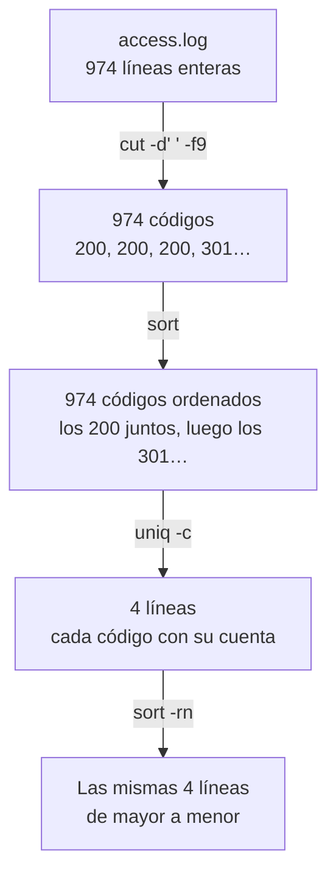

import Term from '~/components/Term.astro';
import TryIt from '~/components/TryIt.astro';
import Analogy from '~/components/Analogy.astro';
import SelfCheck from '~/components/SelfCheck.astro';
import Quiz from '~/components/Quiz.astro';
import QuizQuestion from '~/components/QuizQuestion.astro';
import QuizOption from '~/components/QuizOption.astro';

## El problema

Imagina que tienes una tienda online y que un cliente te escribe: «Ayer por la tarde intenté pagar tres veces y no pude». Entras en el servidor. Allí está el <Term id="log">log</Term>: un fichero donde el servidor web apunta una línea por cada <Term id="request">petición</Term> que recibe. El de ayer tiene 974 líneas.

Con la [lección 2](/fase-1/comandos-linux-archivos/) sabes buscar en él con `grep`. Pero no quieres leer líneas: quieres respuestas. ¿Cuántos pagos fallaron? ¿Desde qué hora?

Ningún comando responde eso solo. Pero la terminal te deja **encadenar comandos pequeños**: uno se queda con la hora de cada línea, otro las ordena y otro las cuenta. Juntos responden en una sola línea.

## La analogía

<Analogy>

Imagina una cocina con varios cocineros en fila. Cada uno hace una sola cosa: uno pela, otro corta y otro emplata. Cada uno recibe lo que necesita por una ventanilla, a su izquierda, y deja lo que ha hecho en otra, a su derecha.

Si pones a dos cocineros juntos, la ventanilla de salida del primero es la de entrada del segundo: eso es una <Term id="pipe">pipe</Term> («tubería»). Si en vez de al siguiente cocinero la ventanilla da a la nevera, lo que sale se guarda para luego: eso es una redirección.

Si un cocinero encuentra un tomate podrido, no lo pone en el plato: lo grita, para que el jefe lo oiga aunque el plato siga su camino. Y al terminar, cada uno dice «listo» o «ha salido mal».

<div slot="limits">

- En la cocina, el plato pasa entero. En la terminal, las líneas pasan una a una y todos los programas trabajan a la vez, aunque `sort`, por ejemplo, tiene que esperar a tenerlas todas.
- Lo que «guardas en la nevera» con `>` sustituye lo que había; una nevera de verdad no tira nada.
- El «listo» de un programa es un número, y al revés de lo que parece: 0 significa que ha ido bien.

</div>

</Analogy>

## Cómo funciona de verdad

### Un programa, una entrada y dos salidas

Ve a tu carpeta de prácticas, donde descargaste `access.log` en la [lección 2](/fase-1/comandos-linux-archivos/), y pide a `ls` dos ficheros, uno que existe y otro que no:

```sh
cd ~/curso-backend/fase-1
ls access.log no-existe
```

```text
ls: no-existe: No such file or directory
access.log
```

(En Linux y WSL, el error dice `ls: cannot access 'no-existe'`.) En la pantalla salen dos líneas mezcladas, pero `ls` las ha escrito por dos sitios distintos. Todo programa que arranca la shell tiene tres canales abiertos, numerados del 0 al 2:

| Número | Nombre | Para qué | Si no dices otra cosa |
|---|---|---|---|
| 0 | <Term id="stdin">stdin</Term>, la entrada estándar | Lo que el programa lee | Lo que tecleas |
| 1 | <Term id="stdout">stdout</Term>, la salida estándar | Los resultados | La pantalla |
| 2 | <Term id="stderr">stderr</Term>, la salida de errores | Los errores y avisos | La pantalla |

La línea `access.log` salió por la salida 1, y el error, por la 2. Como las dos van a la pantalla, se ven juntas. Pero son canales distintos, y puedes mandar cada uno a un sitio.

### Mandar la salida a un fichero

`>` manda la salida estándar a un fichero en vez de a la pantalla:

```sh
ls access.log no-existe > lista.txt
cat lista.txt
```

```text
ls: no-existe: No such file or directory
access.log
```

El error sale igual por la pantalla, porque `>` solo desvía la salida 1. La línea `access.log` ya no sale: ha ido a parar a `lista.txt`, y `cat` la enseña después. Si el fichero no existe, `>` lo crea.

- **`>` sobrescribe:** si el fichero ya tenía algo, la shell lo vacía antes de arrancar el programa, sin preguntar.
- **`>>` añade al final:** lo que había se queda. Sirve para ir juntando resultados en un informe.

### Separar los errores

El número del canal va delante de `>`. Como `>` es lo mismo que `1>`, la salida de errores se manda con `2>`:

```sh
ls access.log no-existe 2> errores.txt
cat errores.txt
```

```text
access.log
ls: no-existe: No such file or directory
```

Ahora es al revés: el resultado sale por pantalla y el error queda guardado. Tres variantes muy usadas:

- **`> todo.txt 2>&1`** junta las dos salidas en el mismo fichero. `2>&1` se lee «manda la salida 2 adonde vaya ahora la 1». El `&` dice que `1` es un canal y no un fichero llamado «1».
- **`2> /dev/null`** tira los errores. `/dev/null` es un fichero especial que se traga todo lo que le escribes.
- **`>&2`** hace lo contrario que `2>&1`: manda la salida normal a la de errores. Así escriben sus avisos los scripts, como verás en la [lección 8](/fase-1/scripts-de-bash/).

El orden importa, porque la shell lee las redirecciones de izquierda a derecha. En `2>&1 > todo.txt`, la 2 va adonde estaba la 1 en ese momento, la pantalla, y solo la 1 acaba en el fichero.

### Conectar programas con una pipe

`|` (la barra vertical; en un teclado español, <kbd>Opción</kbd> + <kbd>1</kbd> en Mac y <kbd>AltGr</kbd> + <kbd>1</kbd> en Windows y Linux) conecta la salida estándar de un programa con la entrada estándar del siguiente. Por ejemplo, para contar los 404 del log con dos programas de la lección 2:

```sh
grep '" 404 ' access.log | wc -l
```

```text
      64
```

`grep` deja pasar las líneas con un código 404 y, en vez de escribirlas en la pantalla, se las pasa a `wc -l`, que las cuenta. Ninguno sabe que el otro existe: `grep` escribe en su salida, `wc` lee de su entrada y la shell los conecta.

La pipe solo lleva la salida 1. Los errores siguen yendo a la pantalla:

```sh
ls access.log no-existe | wc -l
```

```text
ls: no-existe: No such file or directory
       1
```

`wc` solo ha recibido `access.log`. Para que también le llegue el error, escribe `2>&1 |`.

### Cada dato de una línea tiene su número

En la [lección 2](/fase-1/comandos-linux-archivos/) viste qué dice cada trozo de una línea del log. Para sacarle respuestas, te falta saber su número. Esta es la primera línea:

```text
203.0.113.50 - - [01/Oct/2026:00:00:41 +0000] "GET /robots.txt HTTP/1.1" 200 12378 "-" "ExampleBot/1.0 (+https://example.com/bot)"
```

Si la cortas por los espacios, cada trozo es un campo, y se cuentan desde el 1:

| Campo | En esta línea | Qué es |
|---|---|---|
| 1 | `203.0.113.50` | La IP de quien pide |
| 4 | `[01/Oct/2026:00:00:41` | El día y la hora |
| 6 y 7 | `"GET` y `/robots.txt` | Qué pide: el método y la ruta |
| 9 | `200` | El <Term id="status-code">código de estado</Term> de la respuesta |
| 10 | `12378` | Cuántos bytes ocupaba la respuesta |

### Cortar, ordenar y contar

Con tres programas puedes contar casi cualquier cosa de un log:

- **`cut`** se queda con un trozo de cada línea. `-d' '` dice por qué carácter cortar (aquí, el espacio) y `-f9`, con qué campo quedarse.
- **`sort`** ordena las líneas. Con `-n` las ordena como números, y con `-r`, al revés, de mayor a menor.
- **`uniq -c`** junta las líneas iguales que van seguidas y escribe delante cuántas había.

Así se cuentan los códigos de estado del log, paso a paso. Primero, `cut` sobre la primera línea, para ver que el campo 9 es el código:

```sh
head -1 access.log | cut -d' ' -f9
```

```text
200
```

Ahora sobre todo el log, ordenando para que los iguales queden juntos y contándolos:

```sh
cut -d' ' -f9 access.log | sort | uniq -c
```

```text
 865 200
  19 301
  64 404
  26 500
```

Y para que lo más frecuente salga primero, se ordena otra vez, ahora por el número:

```sh
cut -d' ' -f9 access.log | sort | uniq -c | sort -rn
```

```text
 865 200
  64 404
  26 500
  19 301
```

Ayer, el servidor respondió bien 865 veces, no encontró lo que le pedían 64 veces y falló 26. Por el camino, los datos pasan así:



En Linux y WSL, `uniq -c` pone más espacios delante de los números (`    865 200`), y `wc -l`, ninguno (`64`). Es solo el formato: los números son los mismos.

### Cada programa termina con un código

Cuando un programa termina, deja un número: su <Term id="exit-code">código de salida</Term>. No sale en la pantalla, pero la shell lo guarda, y `echo $?` te lo enseña:

```sh
grep '" 500 ' access.log > /dev/null
echo $?
```

```text
0
```

`grep` encontró líneas (las mandaste a `/dev/null` para no verlas), así que terminó con 0. **El 0 significa que todo ha ido bien**, y cualquier otro número, que algo ha fallado. Los de `grep` son tres:

| Código | Qué significa para `grep` | Ejemplo |
|---|---|---|
| 0 | Ha encontrado al menos una línea | `grep '" 500 ' access.log` |
| 1 | No ha encontrado ninguna | `grep '" 503 ' access.log` (no hay ningún 503) |
| 2 | Ha habido un error | `grep '" 500 ' acceso.log` (el fichero no existe) |

`$?` guarda el código de la última orden, así que hay que mirarlo justo después: el propio `echo` lo cambia.

### Encadenar según el resultado

Con el código de salida, la shell decide qué hacer después:

- **`a && b`** ejecuta `b` solo si `a` terminó bien (con 0).
- **`a || b`** ejecuta `b` solo si `a` falló.
- **`a ; b`** ejecuta `b` siempre, pase lo que pase con `a`.

```sh
grep '" 500 ' access.log > /dev/null && echo "Hay errores 500"
grep '" 503 ' access.log > /dev/null || echo "Ningún 503"
```

```text
Hay errores 500
Ningún 503
```

`&&` evita errores en cadena. Con `cd viejos && rm *.txt`, si la carpeta `viejos` no existe, `rm` no se ejecuta; con `;`, borraría los `.txt` de donde estuvieras. Cuando un paso depende del anterior, se unen con `&&`.

## Pruébalo

El objetivo: eres quien vigila la tienda de `example.com`, y el log de ayer, 1 de octubre, esconde cuatro historias. Una ya la conoces: el escáner de la [lección 2](/fase-1/comandos-linux-archivos/). Encuentra las otras tres sin abrirlo, solo con pipes. Todo se hace en tu terminal, dentro de tu carpeta de prácticas.

Las salidas son las de un Mac. En Linux y WSL, los números de `uniq -c` llevan más espacios delante, y los de `wc -l`, ninguno; no hay más diferencias.

<TryIt
  title="1. Comprueba que tienes el log"
  cmd={`cd ~/curso-backend/fase-1\nwc -l access.log`}
  output={`     974 access.log`}
>

Si responde `No such file or directory`, descárgalo como en la [lección 2](/fase-1/comandos-linux-archivos/), con `curl -O https://backenddesdecero.com/practicas/access.log`. Tiene que salir 974: el log es el mismo para todos, así que tus números serán los de esta página.

</TryIt>

<TryIt
  title="2. ¿Quién te pide más?"
  cmd={`cut -d' ' -f1 access.log | sort | uniq -c | sort -rn | head -5`}
  output={` 144 203.0.113.50
  65 192.0.2.10
  40 198.51.100.23
  36 192.0.2.253
  23 203.0.113.99`}
>

La receta de los códigos, con el campo 1, la IP, y `head -5` para quedarte con las cinco primeras. La primera pide más del doble que la segunda. Investígala.

</TryIt>

<TryIt
  title="3. ¿Quién es 203.0.113.50?"
  cmd={`grep '^203.0.113.50 ' access.log | cut -d'"' -f6 | sort | uniq -c\ngrep '^203.0.113.50 ' access.log | cut -d: -f2 | sort | uniq -c | head -3`}
  output={` 144 ExampleBot/1.0 (+https://example.com/bot)
   6 00
   6 01
   6 02`}
>

El espacio detrás de la IP, como en la lección 2, dice que termina ahí. El `^` significa «al principio de la línea»: así solo encuentra la IP en el campo 1.

La primera orden corta por las comillas (`-d'"'`): el sexto trozo es el nombre del programa. Las 144 peticiones son de `ExampleBot`. La segunda corta por los dos puntos, y el campo 2 es la hora: pide 6 veces cada hora, del 00 al 23, como un reloj.

**Primera historia:** es un robot (*bot*) que recorre la tienda todo el día, como los de los buscadores. No hace daño: solo es quien más pide.

</TryIt>

<TryIt
  title="4. ¿Quién pide lo que no existe?"
  cmd={`grep '" 404 ' access.log | cut -d' ' -f1 | sort | uniq -c | sort -rn | head -3`}
  output={`  40 198.51.100.23
   2 203.0.113.50
   2 203.0.113.184`}
>

Primero filtras las líneas con 404 y luego cuentas sus IP. Las comillas y los espacios de `'" 404 '` buscan el 404 en el campo del código, y no dentro de otro número.

De los 64 errores 404, 40 son de una sola IP: `198.51.100.23`, el escáner que encontraste en la lección 2. Las demás tienen 2 o menos: enlaces rotos y direcciones mal escritas.

</TryIt>

<TryIt
  title="5. ¿Qué buscaba 198.51.100.23, y cuándo?"
  cmd={`grep '^198.51.100.23 ' access.log | cut -d' ' -f4,7,9 | head -5`}
  output={`[01/Oct/2026:03:12:23 /.env 404
[01/Oct/2026:03:12:24 /.env.backup 404
[01/Oct/2026:03:12:25 /.git/config 404
[01/Oct/2026:03:12:26 /.git/HEAD 404
[01/Oct/2026:03:12:27 /wp-login.php 404`}
>

`-f4,7,9` se queda con la hora, la ruta y el código. Ahora ves qué más probó el escáner, casi una petición por segundo: además del `.env`, la configuración de Git o la entrada de administración de WordPress.

**La del escáner, completa:** probó direcciones conocidas por si la tienda las había dejado a la vista, y todas le dieron 404. Cambia `head -5` por `tail -2` y verás que terminó a las 03:13.

</TryIt>

<TryIt
  title="6. Las peticiones por hora"
  cmd={`cut -d: -f2 access.log | sort | uniq -c`}
  output={`  13 00
  12 01
  14 02
  51 03
   6 04
  13 05
  24 06
  40 07
  42 08
  44 09
  87 10
  83 11
  49 12
  37 13
  71 14
  46 15
  24 16
  22 17
  45 18
  65 19
  75 20
  72 21
  26 22
  13 23`}
>

Sin el último `sort -rn`, porque aquí quieres las horas en orden. Lo normal en una tienda: poco de madrugada, más a media mañana y otro pico por la noche. Una hora no encaja: las 03, con 51 peticiones. Ya sabes por qué: 40 son del escáner.

</TryIt>

<TryIt
  title="7. ¿Cuándo empezaron los errores 500?"
  cmd={`grep '" 500 ' access.log | cut -d: -f2,3 | sort | uniq -c`}
  output={`   1 14:05
   1 14:07
   2 14:08
   1 14:09
   3 14:10
   2 14:11
   2 14:13
   1 14:14
   1 14:16
   2 14:17
   2 14:21
   2 14:22
   2 14:23
   4 14:24`}
>

Con `-f2,3`, `cut` se queda con la hora y el minuto. Los 26 errores 500 caen en solo veinte minutos: de las 14:05 a las 14:24. Antes y después no hay ninguno.

</TryIt>

<TryIt
  title="8. ¿Qué es lo que fallaba?"
  cmd={`grep '" 500 ' access.log | cut -d' ' -f6,7 | sort | uniq -c`}
  output={`   1 "GET /api/products?page=3
  25 "POST /api/orders`}
>

25 de los 26 fallos son `POST /api/orders`: el envío de un pedido.

**Segunda historia:** entre las 14:05 y las 14:25, la tienda no pudo cobrar los pedidos. Si cuentas las IP de esas líneas, verás que alguna se repite: gente que, como tu cliente, lo intentó otra vez.

</TryIt>

<TryIt
  title="9. Guarda el informe"
  cmd={`echo "Errores 500 por minuto" > informe.txt\ngrep '" 500 ' access.log | cut -d: -f2,3 | sort | uniq -c >> informe.txt && echo "Informe guardado"\nhead -3 informe.txt`}
  output={`Informe guardado
Errores 500 por minuto
   1 14:05
   1 14:07`}
>

La primera línea crea `informe.txt` con un título, y la segunda añade debajo el recuento con `>>` (con `>` habrías borrado el título). `&& echo` solo escribe «Informe guardado» si la pipe terminó bien.

</TryIt>

Queda una historia. Esta vez escribe tú las órdenes, sin copiarlas:

<SelfCheck question="Reto: la segunda IP que más pide, 192.0.2.10, no es un robot. ¿A qué horas pide? ¿Cuántos navegadores distintos usa? ¿Qué crees que es?">

```sh
grep '^192.0.2.10 ' access.log | cut -d: -f2 | sort | uniq -c
grep '^192.0.2.10 ' access.log | cut -d'"' -f6 | sort | uniq | wc -l
```

`uniq` sin `-c` deja una línea de cada, y `wc -l` cuenta cuántas quedan. La primera orden responde con horas de las 09 a las 16: `8 09`, `4 10`, `13 11`, `1 12`, `12 13`, `20 15` y `7 16`. La segunda responde `4`: un iPhone, un Mac, un Windows y un Linux.

**Tercera historia:** es una oficina. Varias personas, cada una con su ordenador o su móvil, salen a internet por el mismo router, y la tienda las ve a todas con una sola IP. Es el <Term id="nat">NAT</Term> de la [lección 5 de la Fase 0](/fase-0/ip-puertos-y-sockets/). Solo pide en horario de trabajo, y casi nada a la hora de comer.

</SelfCheck>

## Ya lo has visto

- **Las páginas de «Error 404» y «Error 500»** que ves al navegar: cada una suele quedar apuntada en el log de ese servidor.
- **Una hoja de cálculo**, cuando ordenas una columna y cuentas cuántas veces sale cada valor con una tabla dinámica: es `sort | uniq -c` con ratón.

Y si programas:

- `npm run build && npm run deploy`: si la compilación falla, no se publica nada. Es el `&&` de esta lección.
- En Node, `console.log` escribe en stdout y `console.error`, en stderr.
- Un paso de GitHub Actions sale en rojo cuando un comando termina con un código distinto de 0, como el que deja `process.exit(1)`.

## Errores comunes

- **Buscar el número sin más.** `grep -c 404 access.log` responde 113, no 64: también cuenta las 49 respuestas que ocupan `4047` bytes. Ancla lo que buscas a su campo, como `'" 404 '`, o córtalo antes con `cut`.
- **`uniq -c` sin `sort` antes.** `uniq` solo junta líneas iguales que van seguidas. Sin ordenar, `cut -d' ' -f9 access.log | uniq -c` empieza con `19 200`, `1 301`, `21 200`…: el mismo código, contado a trozos. Ordena siempre antes.
- **Leer y escribir el mismo fichero.** `sort access.log > access.log` deja el fichero vacío: la shell lo vacía por el `>` antes de que `sort` empiece a leerlo. Escribe en otro fichero; si te pasa con el log, vuelve a descargarlo.
- **Un espacio en `2>`.** En `ls access.log no-existe 2 > errores.txt`, la shell ve un argumento `2` y un `>` normal: `ls` busca un fichero llamado `2`, y en `errores.txt` acaba la salida normal. El `2` va pegado al `>`.
- **Mirar `$?` después de una pipe.** Es el código del último programa. `cut -d' ' -f1 acceso.log | sort | uniq -c` escribe un error, pero `$?` da 0, porque `uniq` terminó bien. En la [lección 8](/fase-1/scripts-de-bash/) verás cómo hacer que una pipe falle si falla cualquiera de sus partes.

## Resumen

- Cada programa tiene una entrada (stdin, 0) y dos salidas: los resultados (stdout, 1) y los errores (stderr, 2).
- `>` manda la salida a un fichero y lo sobrescribe; `>>` añade al final; `2>` manda los errores; `2>&1` junta los errores con la salida, y `/dev/null` se traga lo que le mandes.
- `|` conecta la salida de un programa con la entrada del siguiente. Con `cut`, `sort` y `uniq -c` cuentas lo que quieras de un log.
- Cada programa termina con un código: 0 si ha ido bien y otro número si no. `$?` lo enseña, `&&` sigue solo si fue bien y `||`, solo si falló.

## ¿Lo has entendido?

<Quiz>

<QuizQuestion
  question="Cada noche guardas el resumen del día con una orden que termina en «> resumen.txt». Al cabo de una semana, ¿qué hay en resumen.txt?"
  review="Mandar la salida a un fichero"
>

<QuizOption text="Los siete resúmenes, uno detrás de otro.">

No: `>` vacía el fichero cada vez antes de escribir. Para ir añadiendo, la orden tendría que terminar en `>> resumen.txt`.

</QuizOption>

<QuizOption text="Solo el de la última noche." correct>

Cada noche, `>` vacía el fichero y escribe el resumen nuevo. Los seis anteriores se han perdido.

</QuizOption>

<QuizOption text="Solo el de la primera noche: > no toca un fichero que ya existe.">

`>` no protege nada: si el fichero existe, lo vacía sin preguntar. Por eso, con él, se pierden datos sin darse cuenta.

</QuizOption>

</QuizQuestion>

<QuizQuestion
  question="Escribes cut -d' ' -f1 accesos.log > ips.txt, con el nombre del log mal escrito. En la pantalla sale «cut: accesos.log: No such file or directory». ¿Qué hay en ips.txt?"
  review="Separar los errores"
>

<QuizOption text="Nada: el fichero existe, pero está vacío." correct>

La shell crea `ips.txt` antes de arrancar `cut`. El error va por stderr, que `>` no desvía, y por eso lo ves en la pantalla y no en el fichero.

</QuizOption>

<QuizOption text="El mensaje de error.">

`>` solo desvía la salida estándar, la 1, y el error va por la 2. Para guardarlo, harían falta `2>` o `2>&1`.

</QuizOption>

<QuizOption text="No existe: > no crea el fichero si el comando falla.">

La shell prepara las redirecciones antes de arrancar el programa, así que no sabe si va a fallar: el fichero se crea siempre.

</QuizOption>

</QuizQuestion>

<QuizQuestion
  question="Para contar las peticiones de cada IP escribes cut -d' ' -f1 access.log | uniq -c, y la misma IP sale en muchas líneas, cada una con un número pequeño. ¿Qué pasa?"
  review="Cortar, ordenar y contar"
>

<QuizOption text="Que uniq -c compara las líneas enteras del log, no solo la IP.">

`uniq` no ve el log: solo recibe lo que sale de `cut`, una IP por línea. Dos peticiones de la misma IP le llegan como dos líneas idénticas.

</QuizOption>

<QuizOption text="Que el log escribe la misma IP de formas distintas, y uniq las cuenta aparte.">

Una IP se escribe siempre igual en el log. Si no, ordenar tampoco las juntaría, y con `sort` delante salen bien.

</QuizOption>

<QuizOption text="Que falta un sort antes de uniq -c." correct>

`uniq` solo junta líneas iguales que van seguidas. En el log, las peticiones de una IP están repartidas entre las de otras, y hay que ordenarlas para que queden juntas.

</QuizOption>

</QuizQuestion>

<QuizQuestion
  question="Te avisan de que ayer muchos pedidos fallaron en algún momento de la tarde. Tienes el log del servidor. ¿Cómo averiguas a qué hora empezó?"
  review="Pruébalo"
>

<QuizOption text="Cuentas las peticiones por hora: la hora con más peticiones es la del fallo.">

Más peticiones no es lo mismo que más errores. En el log de prácticas, la hora con más peticiones son las 10 de la mañana, y el fallo fue a las 14.

</QuizOption>

<QuizOption text="Filtras los 500, cortas la hora y el minuto, y los cuentas." correct>

Un 500 es un error del servidor. Al quedarte solo con ellos y contarlos por minuto, ves el primer minuto con fallos y cuánto duró.

</QuizOption>

<QuizOption text="Cuentas las IP que más piden: la primera es la que causó el fallo.">

La IP que más pide no tiene por qué ser la culpable. En el log de prácticas es un robot inofensivo, y los fallos fueron del propio servidor.

</QuizOption>

</QuizQuestion>

<QuizQuestion
  question="En otro servidor, escribes grep 'wp-login' access.log > /dev/null y luego echo $?, y responde 1. ¿Qué significa?"
  review="Cada programa termina con un código"
>

<QuizOption text="Que grep ha encontrado una línea con wp-login.">

`$?` no es un recuento: es el código con el que terminó `grep`. Si hubiera encontrado alguna línea, sería 0.

</QuizOption>

<QuizOption text="Que la orden ha ido bien: 1 significa «sí».">

En la terminal es al revés: 0 significa que todo fue bien, y cualquier otro número, que no.

</QuizOption>

<QuizOption text="Que no hay ninguna línea con wp-login." correct>

Para `grep`, 1 significa «no he encontrado nada»; un error de verdad, como un fichero que no existe, sería un 2. Ese servidor no ha recibido ninguna petición a `wp-login`.

</QuizOption>

</QuizQuestion>

<QuizQuestion
  question="Escribes mkdir informes && cd informes, pero ya tenías una carpeta informes. mkdir responde «File exists». ¿Dónde acabas?"
  review="Encadenar según el resultado"
>

<QuizOption text="En la misma carpeta donde estabas." correct>

`mkdir` no ha podido crear la carpeta y termina con 1, así que `&&` no ejecuta `cd`. Con `mkdir -p informes`, que no se queja si ya existe, terminaría con 0 y sí entrarías.

</QuizOption>

<QuizOption text="Dentro de informes: «File exists» es solo un aviso, y && sigue.">

Para la shell no hay avisos: solo cuenta el código de salida, y el de `mkdir` aquí es 1. Con `;` sí entrarías, porque sigue pase lo que pase.

</QuizOption>

<QuizOption text="Dentro de una carpeta informes nueva y vacía: mkdir sustituye la que había.">

`mkdir` nunca toca una carpeta que ya existe: falla y la deja como estaba, con todo lo que tenía dentro.

</QuizOption>

</QuizQuestion>

</Quiz>

## Para profundizar

- [The Linux Command Line](https://linuxcommand.org/tlcl.php), de William Shotts, en inglés: el capítulo 6, «Redirection», cuenta lo mismo que esta lección con más ejemplos.
- [Redirections](https://www.gnu.org/software/bash/manual/html_node/Redirections.html), en el manual de bash, en inglés: todas las formas de redirigir, incluidas las que no hemos visto.
