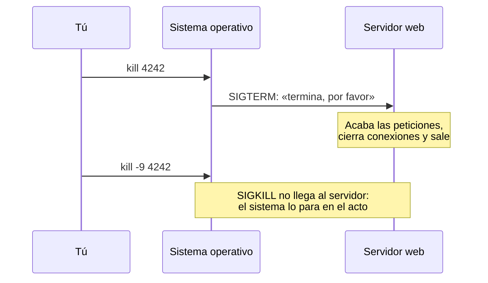

import Term from '~/components/Term.astro';
import TryIt from '~/components/TryIt.astro';
import Analogy from '~/components/Analogy.astro';
import Quiz from '~/components/Quiz.astro';
import QuizQuestion from '~/components/QuizQuestion.astro';
import QuizOption from '~/components/QuizOption.astro';

## El problema

Imagina que ayer dejaste un servidor de pruebas en marcha en alguna ventana de la terminal. Hoy lo arrancas otra vez y responde que el puerto 8080 ya está en uso, pero no ves ninguna ventana que cerrar. ¿Quién ocupa el puerto, y cómo lo paras?

En un servidor pasa a diario: un programa se come la CPU (el procesador), hay que reiniciar la web sin cortar a nadie que esté comprando, o lanzas una tarea larga, cierras la terminal y, al volver, ya no está.

Todo eso son **procesos**: programas en marcha. Aquí aprendes a verlos, a hablarles con señales y a pararlos sin romper nada.

## La analogía

<Analogy>

Piensa en la cocina de un restaurante. Una receta escrita en un libro no cocina nada: es un programa, un fichero quieto en el disco. Cuando un cocinero se pone a prepararla, eso es un proceso: la receta en marcha. Tres cocineros pueden hacer la misma receta a la vez, y cada plato lleva su número de comanda: ese número es el PID.

El jefe de cocina no se mete en los fogones: pasa notas cortas. «Para lo que estás haciendo.» «Termina cuando puedas y recoge tu puesto.» Esas notas son las señales. Y si alguien no hace caso, el jefe llama a seguridad, que lo saca de la cocina en el acto, sin tiempo para apagar el fuego.

<div slot="limits">

- Las notas no llevan texto libre: una señal es solo un número de una lista fija.
- Un proceso puede ignorar la nota «termina» sin perder el puesto. Por eso existe una señal que no se puede ignorar: la de seguridad.
- Cuando un proceso sale a la fuerza, el sistema operativo sí recoge parte de su puesto: cierra sus ficheros y libera su puerto. Lo que se pierde es lo que tenía a medias.

</div>

</Analogy>

## Cómo funciona de verdad

### Un programa en marcha es un proceso

Abre la terminal y escribe esto:

```sh
echo $$
ps
```

La primera orden escribe un número, por ejemplo `75474`: la shell cambia `$$` por su propio número. La segunda, `ps` (de *process status*, «estado de los procesos»), lo enseña en una lista junto a `-zsh` (o `bash`, en Linux). Tu shell es un programa en marcha.

Un **programa** es un fichero en el disco, como `/bin/sleep`. Un <Term id="process">proceso</Term> es una copia de ese programa en marcha, con su propia memoria y su propia carpeta actual (por eso `cd` es parte de la shell, como viste en [la lección 1](/fase-1/comandos-basicos-terminal/)). Tres ventanas de la terminal son tres procesos de zsh: el mismo programa, tres veces.

El sistema operativo le da a cada proceso un número, su <Term id="pid">PID</Term>, que es lo que usas para dirigirte a él. Los PID se reparten en orden y se reutilizan: el `sleep` de hoy no tendrá el mismo número mañana.

Cada proceso tiene además un padre, el que lo arrancó: cuando escribes `sleep 60`, el padre de `sleep` es tu shell. Si subes por la familia, llegas al **PID 1**, el primero que arranca el sistema: `launchd` en el Mac y, en casi todos los Linux, `systemd`, que verás en [la lección 6](/fase-1/servicios-systemd-apt/).

### Ver los procesos: `ps`, `pgrep` y `top`

Sin opciones, `ps` enseña pocos procesos: en el Mac, los tuyos que tienen una terminal; en Linux, solo los de esta ventana. Para verlos todos, de todos los usuarios, se usa `ps aux` (sin guion: es una costumbre antigua de `ps`). Salen cientos de líneas, así que se filtran con `grep`, como en [la lección 3](/fase-1/pipes-y-redirecciones/): `ps aux | grep nginx` busca el servidor web nginx.

Las columnas que más vas a mirar:

| Columna | Qué dice |
|---|---|
| `USER` | El usuario dueño del proceso |
| `PID` | Su número |
| `%CPU` y `%MEM` | Cuánto procesador y cuánta memoria gasta |
| `STAT` | Su estado: `R` está trabajando, `S` espera algo (lo normal), `T` está pausado |
| `COMMAND` | La orden que lo arrancó |

Si sabes el nombre, `pgrep` te da los PID directamente: `pgrep sleep` escribe el de cada proceso cuyo nombre contiene `sleep`. Basta con contenerlo (en el Mac, `pgrep nc` también encuentra `launchservicesd`), así que conviene `-l`, que escribe también el nombre. Y `-f` busca en la orden completa: `pgrep -fl "sleep 600"`.

`top` es la versión en directo: una tabla que se actualiza cada segundo, con los procesos que más gastan arriba. Se sale con <kbd>Q</kbd>. En Linux ordena por CPU; en el Mac, por PID, y hay que pedírselo con `top -o cpu` (de *order*, «ordenar»).

### Las señales: avisos para un proceso

Para parar un proceso, le envías una <Term id="signal">señal</Term> con `kill` y su PID:

```sh
kill 78026
```

El nombre engaña: `kill` («matar») no mata nada por sí mismo. Le pide al sistema operativo que entregue una señal a ese proceso: un aviso corto, un número con un nombre que empieza por `SIG` (de *signal*). El proceso la recibe en mitad de lo que esté haciendo y reacciona.

Hay más de treinta (`kill -l` las lista), pero a diario usarás cuatro, con los mismos números en el Mac y en Linux:

| Señal | Número | Quién la envía | Qué pide | ¿Se puede ignorar? |
|---|---|---|---|---|
| `SIGINT` (*interrupt*, «interrumpir») | 2 | <kbd>Ctrl</kbd> + <kbd>C</kbd> | Que deje lo que está haciendo | Sí |
| `SIGTERM` (*terminate*, «terminar») | 15 | `kill`, sin opciones | Que termine, recogiendo antes | Sí |
| `SIGKILL` | 9 | `kill -9` | Nada: el sistema lo para | No |
| `SIGHUP` (*hang up*, «colgar») | 1 | Cerrar la terminal | «Tu terminal ya no está» | Sí |

<kbd>Ctrl</kbd> + <kbd>C</kbd> no lo envía la shell: la terminal ve esa combinación y le manda `SIGINT` al programa que tienes delante, sea cual sea.

Con `kill` eliges la señal por su nombre, sin el `SIG`, o por su número: `kill -INT 78026` equivale a pulsar <kbd>Ctrl</kbd> + <kbd>C</kbd> en su ventana, y `kill -9 78026` es `kill -KILL 78026`.

Dos límites:

- **Solo puedes enviar señales a tus procesos.** Con los de otros usuarios, `kill` responde `operation not permitted` («operación no permitida»). El usuario root puede con todos, como viste en [la lección 4](/fase-1/usuarios-y-permisos-linux/).
- **Cada programa decide qué hace con cada señal**, menos con `SIGKILL`. Por eso hay programas que no paran con <kbd>Ctrl</kbd> + <kbd>C</kbd>, como el manual de `man`: atrapan la señal y esperan que salgas con <kbd>Q</kbd>.

### Terminar bien o terminar ya: SIGTERM y SIGKILL

`kill` envía `SIGTERM` por defecto por un buen motivo: el programa puede atraparla y **terminar bien**. Un servidor web que recibe `SIGTERM` deja de aceptar peticiones nuevas, acaba las que tiene a medias, cierra la conexión con la base de datos y sale. En inglés se llama *graceful shutdown*, «apagado elegante».

`SIGKILL` ni siquiera llega al programa: el sistema operativo lo quita de en medio en el acto.



Con `SIGKILL`, la compra que estaba a medias se corta, y un fichero puede quedar escrito a medias. Eso sí, el sistema operativo cierra los <Term id="socket">sockets</Term> del proceso, así que su <Term id="port">puerto</Term> queda libre.

La regla: **primero `kill`, espera unos segundos y, solo si sigue vivo, `kill -9`**. `docker stop` (Fase 7) hace eso mismo: envía `SIGTERM`, espera diez segundos por defecto y, si el programa sigue ahí, `SIGKILL`.

Cuando un proceso termina por una señal, su <Term id="exit-code">código de salida</Term> (el `$?` de la lección 3) es 128 más el número de la señal: 130 después de <kbd>Ctrl</kbd> + <kbd>C</kbd>, 143 con `SIGTERM` y 137 con `SIGKILL`.

### Primer plano y segundo plano

Cuando escribes `sleep 60`, la terminal se queda esperando: `sleep` está en **primer plano** (*foreground*): recibe lo que tecleas, y no recuperas el prompt hasta que termina.

Si añades `&` al final, arranca en **segundo plano** (*background*): sigue en marcha y la shell te devuelve el prompt al momento, con dos números, como `[1] 78026`. El `1` es el **número de trabajo** (*job*), que solo existe en esta ventana, y `78026` es el PID.

Para manejar los trabajos de una ventana:

| Lo que quieres | Cómo |
|---|---|
| Arrancar un programa en segundo plano | `orden &` |
| Ver los trabajos de esta ventana | `jobs` |
| Traer un trabajo al primer plano | `fg` (el último) o `fg %2` (el 2) |
| Pausar el que está en primer plano | <kbd>Ctrl</kbd> + <kbd>Z</kbd> |
| Reanudar en segundo plano uno pausado | `bg` |
| Pararlo por su número de trabajo | `kill %1` |

<kbd>Ctrl</kbd> + <kbd>Z</kbd> también envía una señal, `SIGTSTP` (de *terminal stop*), que **pausa** el proceso sin terminarlo: sigue en memoria con todo lo que tenía abierto, incluido su puerto. `fg` y `bg` lo despiertan.

### Cuando cierras la terminal: SIGHUP y nohup

Cuando cierras una ventana de la terminal, su shell recibe `SIGHUP` y se la reenvía a sus trabajos: lo que dejaste en segundo plano muere con la ventana. El nombre viene de cuando las terminales se conectaban por teléfono.

Para que un proceso sobreviva, lánzalo con `nohup` (*no hang up*) delante: `nohup orden &`. `nohup` hace que el programa ignore `SIGHUP` y guarda lo que escriba en un fichero, `nohup.out`, porque al cerrar la ventana ya no habrá terminal donde escribir.

En un servidor, `nohup` es un apaño: si el programa falla o el servidor se reinicia, nadie lo vuelve a arrancar. Para eso están los servicios de `systemd`, en [la lección 6](/fase-1/servicios-systemd-apt/).

Algunos programas sin terminal, como nginx, usan `SIGHUP` con otro sentido: «vuelve a leer tu configuración». Así se cambia sin pararlos.

### Qué proceso escucha en un puerto

En la [lección 5 de la Fase 0](/fase-0/ip-puertos-y-sockets/) usaste `lsof` para ver qué programas escuchan. Ahora te da el PID del que ocupa un puerto:

```sh
lsof -nP -iTCP:8080 -sTCP:LISTEN
```

Pide los sockets TCP del puerto 8080 que están escuchando, con las direcciones y los puertos como números (`-n` y `-P`). En la columna `PID` tienes el número para `kill`. Si no escribe nada, nadie escucha en ese puerto.

Dos detalles:

- **Sin `sudo`, `lsof` solo enseña tus procesos.** Un nginx del sistema, que es de otro usuario, no saldría. En tu servidor de prácticas, `sudo lsof -nP -iTCP:80 -sTCP:LISTEN` lo enseña todo.
- **En Linux, puede que no venga instalado.** En Ubuntu se instala con `sudo apt install lsof`.

## Pruébalo

El objetivo: encontrar y parar un servidor sin saber en qué ventana lo arrancaste. Todo se hace en tu terminal, en la carpeta de prácticas (`cd ~/curso-backend/fase-1`), y solo se crea un fichero vacío, que borrarás al final.

Las salidas son de un Mac con zsh. Tus números serán otros, y cada ejercicio dice qué cambia en Linux y en WSL, con bash.

<TryIt
  title="1. Tu shell también es un proceso"
  cmd={`echo $$\nps`}
  output={`75474
  PID TTY           TIME CMD
75474 ttys015    0:00.02 -zsh
75479 ttys016    0:00.02 -zsh`}
>

Fíjate en que el `75474` sale en la lista. En el Mac, `ps` enseña tus procesos de todas las ventanas, y `TTY` dice de cuál es cada uno. El guion de `-zsh` indica la shell con la que se abrió la ventana. En Linux y WSL solo salen los de esta: `bash` y el propio `ps`.

</TryIt>

<TryIt title="2. Para al que está delante con Ctrl+C" cmd="sleep 60" output="^C">

`sleep 60` espera 60 segundos sin hacer nada, en primer plano. Pulsa <kbd>Ctrl</kbd> + <kbd>C</kbd>. La terminal escribe `^C`, envía `SIGINT` a `sleep` y vuelve el prompt.

Ahora escribe `echo $?`. Responde `130`: 128 más el 2 de `SIGINT`. Es igual en Linux.

</TryIt>

<TryIt
  title="3. Al segundo plano"
  cmd={`sleep 300 &\njobs\nps`}
  output={`[1] 78026
[1]  + running    sleep 300
  PID TTY           TIME CMD
75474 ttys015    0:00.03 -zsh
78026 ttys015    0:00.00 sleep 300
75479 ttys016    0:00.02 -zsh`}
>

Puedes pegar las tres órdenes juntas: con `&`, la shell no espera. `jobs` dice que el trabajo 1 está en marcha (`running`), y `ps` enseña `sleep` con el PID que te dio `[1] 78026`.

En Linux y WSL, `jobs` escribe `[1]+  Running                 sleep 300 &`, y `ps` enseña solo `sleep`, sin el `300`.

</TryIt>

<TryIt
  title="4. Pausa, reanuda y para"
  cmd={`fg\nbg\nkill 78026`}
  output={`[1]  + running    sleep 300
^Z
zsh: suspended  sleep 300
[1]  + continued  sleep 300
[1]  + terminated  sleep 300`}
>

Esta vez, escribe las órdenes de una en una:

1. `fg` trae `sleep` al primer plano: la terminal se queda esperando otra vez.
2. Pulsa <kbd>Ctrl</kbd> + <kbd>Z</kbd>. zsh dice `suspended`: el proceso está pausado, no terminado.
3. `bg` lo reanuda en segundo plano (`continued`) y te devuelve el prompt.
4. `kill`, con el PID del ejercicio 3, le envía `SIGTERM`. zsh avisa con `terminated` (con `kill -9` sería `killed`); si no sale al momento, pulsa Enter.

Si `kill` responde `no such process`, ese PID no es el tuyo: `jobs -l` te lo enseña.

En Linux y WSL, bash escribe `sleep 300` al hacer `fg`, `[1]+  Stopped` al pausarlo, `[1]+ sleep 300 &` al reanudarlo y `[1]+  Terminated` al pararlo.

</TryIt>

Ahora, un proceso que gasta de verdad. `yes` escribe la letra `y` sin parar, y `> /dev/null` tira todo lo que escribe, así que solo consume procesador.

<TryIt
  title="5. ¿Quién se come la CPU?"
  cmd={`yes > /dev/null &\ntop -o cpu`}
  output={`Processes: 521 total, 7 running, 514 sleeping, 3089 threads                                14:58:11
Load Avg: 12.22, 8.13, 6.42  CPU usage: 42.64% user, 42.53% sys, 14.81% idle
…
PID    COMMAND      %CPU  TIME     #TH    #WQ  #PORT MEM    PURG   CMPRS  PGRP  PPID  STATE
47458  yes          91.0  00:11.96 1/1    0    11    816K   0B     0B     47458 45645 running
0      kernel_task  9.9   04:11:54 821/8  0    0     13M+   0B     0B     0     0     running
47670  top          8.5   00:01.14 1/1    0    46+   6256K  0B     0B     47670 45645 running
394    WindowServer 7.8   04:17:39 21     4    2872+ 445M-  5840K+ 128M   394   1     sleeping
…`}
>

Los procesos salen ordenados por `%CPU`, y `yes` va primero, cerca del 100 %: un núcleo del procesador entero. Fíjate en `PPID` (*parent PID*, el PID del padre): `yes` y `top` tienen el mismo, `45645`, tu shell. Hemos quitado líneas de otros programas; los tuyos serán distintos.

Sal con <kbd>Q</kbd> y para `yes` con `kill %1`: zsh responde `[1]  + terminated  yes > /dev/null`.

En Linux y WSL, escribe solo `top`, que ya ordena por CPU: `yes` sale con una `R` en la columna `S` (de *state*, «estado») y `100.0` en `%CPU`.

</TryIt>

Ahora, un proceso que sobrevive a su ventana:

<TryIt
  title="6. Que sobreviva al cerrar la ventana"
  cmd="nohup sleep 600 &"
  output={`[1] 95202
appending output to nohup.out`}
>

`nohup` avisa de que guardará lo que escriba el programa en `nohup.out`, en esta carpeta. Con `sleep` quedará vacío.

Ahora cierra la ventana entera. Si la terminal te pregunta si quieres terminar sus procesos, acepta: `sleep` ignorará el `SIGHUP`.

En Linux y WSL, el aviso es `nohup: ignoring input and appending output to 'nohup.out'`.

</TryIt>

Abre una ventana nueva y búscalo:

<TryIt
  title="7. Encuéntralo desde otra ventana"
  cmd={`pgrep -f "sleep 600"\nps -p 95202`}
  output={`95202
  PID TTY           TIME CMD
95202 ??         0:00.01 sleep 600`}
>

`pgrep -f` lo encuentra por su orden completa. Cambia el `95202` de `ps -p` (de *process*, «proceso») por el tuyo: sigue vivo, y en `TTY` tiene `??`, porque ya no pertenece a ninguna terminal.

`jobs` no lo enseñaría: los trabajos son de la ventana que los lanzó, que ya no existe. Páralo con `kill` y tu PID, y borra el fichero vacío con `rm ~/curso-backend/fase-1/nohup.out`. Si repites la prueba sin `nohup`, `pgrep` no encuentra nada: el proceso murió con la ventana.

En Linux y WSL, `TTY` es `?` y `CMD` es solo `sleep`.

</TryIt>

Y ahora, el servidor fantasma. Abre una ventana, arranca `nc -l 8080`, como en la Fase 0, y olvídate de ella. Desde otra, encuentra quién ocupa el puerto 8080 y páralo:

<TryIt
  title="8. ¿Quién ocupa el puerto 8080?"
  cmd="lsof -nP -iTCP:8080 -sTCP:LISTEN"
  output={`COMMAND   PID USER   FD   TYPE             DEVICE SIZE/OFF NODE NAME
nc      86565  ana    3u  IPv4 0x959f2d62bde58997      0t0  TCP *:8080 (LISTEN)`}
>

Lo ocupa `nc`, con el PID `86565`. Páralo con `kill` y tu número. En la ventana de `nc` aparece `zsh: terminated  nc -l 8080` (en bash, `Terminated`) y vuelve el prompt. Repite el `lsof`: ya no escribe nada.

Hemos cambiado el nombre de usuario por `ana`. Si `lsof` no escribe nada desde el principio, comprueba que `nc` sigue esperando en la otra ventana. En Linux y WSL, la salida es casi igual.

</TryIt>

## Ya lo has visto

- **<kbd>Ctrl</kbd> + <kbd>C</kbd>** ha sido tu forma de parar `nc`, `curl` o `traceroute` desde la Fase 0: era `SIGINT`.
- **El Monitor de Actividad** del Mac (o el Administrador de tareas de Windows) es un `top` con ventanas. Su «Forzar salida» es como `kill -9`: el programa no tiene ocasión de guardar nada.
- **Al cerrar una ventana de la terminal con algo en marcha**, muchas terminales te piden confirmarlo: ese algo morirá con el `SIGHUP`.

Y si programas:

- **`npm run dev`** se para con <kbd>Ctrl</kbd> + <kbd>C</kbd>. Para que tu servidor de Node termine bien, atrapas la señal con `process.on('SIGTERM', …)`, cierras el servidor y sales.
- **`Error: listen EADDRINUSE: address already in use :::3000`** es el servidor fantasma: `lsof -nP -iTCP:3000 -sTCP:LISTEN` te da el PID que debes parar.
- **«Exited with code 137»** en Docker o en un servicio en la nube es 128 + 9: el proceso terminó con `SIGKILL`, muchas veces porque se quedó sin memoria y el sistema lo paró.

## Errores comunes

- **Usar `kill -9` a la primera.** Funciona, pero lo que el programa tenía a medias se pierde. Prueba antes con `kill` y usa `-9` solo si sigue vivo unos segundos después.
- **Pulsar <kbd>Ctrl</kbd> + <kbd>Z</kbd> para salir de un programa.** Solo lo pausa, y el proceso sigue ocupando su memoria y su puerto. Si al salir zsh dice `you have suspended jobs.` («tienes trabajos pausados») o bash dice `There are stopped jobs.`, es eso: vuelve con `fg` y sal con <kbd>Ctrl</kbd> + <kbd>C</kbd>.
- **Creer que `ps aux | grep nginx` ha encontrado algo.** La lista casi siempre incluye el propio `grep`, que está en marcha mientras busca: la línea que termina en `grep nginx` es tu búsqueda, no nginx. `pgrep nginx` no tiene ese problema.
- **Confundir el número de trabajo con el PID.** `kill 1` intenta parar el PID 1, el que arranca el sistema; como no es tuyo, responde `kill: kill 1 failed: operation not permitted` (en bash, `bash: kill: (1) - Operation not permitted`). Querías `kill %1`.

## Resumen

- Un proceso es un programa en marcha, y el PID, su número. `ps`, `pgrep` y `top` te dicen cuáles hay y cuánto gastan.
- Una señal es un aviso que el sistema entrega a un proceso. <kbd>Ctrl</kbd> + <kbd>C</kbd> envía `SIGINT`; `kill`, `SIGTERM`; `kill -9`, `SIGKILL`; y cerrar la terminal, `SIGHUP`.
- `SIGTERM` deja que el programa termine bien; `SIGKILL` lo para en el acto. Primero uno, y el otro solo si hace falta.
- `&` lanza en segundo plano, `jobs` lista los trabajos, `fg` y `bg` los mueven y <kbd>Ctrl</kbd> + <kbd>Z</kbd> pausa. `nohup` hace que un proceso sobreviva al cierre de la terminal.
- `lsof -nP -iTCP:PUERTO -sTCP:LISTEN` te da el PID del proceso que escucha en un puerto.

## ¿Lo has entendido?

<Quiz>

<QuizQuestion
  question="Arrancas tu servidor de pruebas y responde que el puerto 3000 ya está en uso. ¿Qué haces?"
  review="Qué proceso escucha en un puerto"
>

<QuizOption text="Reiniciar el ordenador, porque un puerto ocupado solo se libera al apagarlo.">

No hace falta: el puerto queda libre en cuanto termina el proceso que lo ocupa.

</QuizOption>

<QuizOption text="Buscar con lsof qué proceso escucha en el 3000 y pararlo con kill." correct>

`lsof -nP -iTCP:3000 -sTCP:LISTEN` te da el PID del que lo ocupa, y `kill` con ese PID le pide que termine.

</QuizOption>

<QuizOption text="Escribir kill 3000, que para lo que haya en ese puerto.">

`kill` no entiende de puertos: el número que le das es un PID. `kill 3000` iría al proceso número 3000, si existe.

</QuizOption>

</QuizQuestion>

<QuizQuestion
  question="El servidor de una tienda está atendiendo pedidos y tienes que pararlo para actualizarlo. ¿Qué señal le envías primero?"
  review="Terminar bien o terminar ya: SIGTERM y SIGKILL"
>

<QuizOption text="SIGKILL, con kill -9, que es la forma correcta de apagar un servidor.">

`SIGKILL` lo para en el acto y corta los pedidos que estaba atendiendo. Es el último recurso, no la forma normal.

</QuizOption>

<QuizOption text="SIGHUP, que es la señal de apagar.">

`SIGHUP` avisa de que la terminal se ha cerrado, y servidores como nginx la usan para volver a leer su configuración sin pararse.

</QuizOption>

<QuizOption text="SIGTERM, con kill sin opciones." correct>

`SIGTERM` le pide que termine y le deja hacerlo bien: acabar los pedidos a medias, cerrar sus conexiones y salir.

</QuizOption>

</QuizQuestion>

<QuizQuestion
  question="En una ventana lanzas sleep 500 & y la terminal responde [2] 8123. Desde otra ventana quieres pararlo. ¿Qué escribes?"
  review="Primer plano y segundo plano"
>

<QuizOption text="kill 8123, el PID." correct>

El PID es del sistema operativo y vale desde cualquier ventana.

</QuizOption>

<QuizOption text="kill %2, porque los trabajos se ven desde todas las ventanas.">

Cada ventana tiene sus propios trabajos. En otra, el trabajo 2 no existe (zsh respondería `no such job`) o es otro distinto.

</QuizOption>

<QuizOption text="kill 2, porque el número entre corchetes es el PID.">

El número entre corchetes es el del trabajo, y solo vale con `%` delante. `kill 2` iría al proceso con PID 2, que es otro.

</QuizOption>

</QuizQuestion>

<QuizQuestion
  question="Entras en un servidor, lanzas un script largo con & y cierras la ventana de la terminal. Al volver, el script ya no está. ¿Qué ha pasado?"
  review="Cuando cierras la terminal: SIGHUP y nohup"
>

<QuizOption text="Los procesos en segundo plano terminan solos al cabo de un rato.">

Un proceso en segundo plano sigue en marcha mientras nadie lo pare. Esta vez lo paró una señal.

</QuizOption>

<QuizOption text="Linux no deja que un proceso siga en marcha sin una sesión abierta.">

Sí lo deja: con `nohup` el proceso sobrevive, y los servicios de `systemd` funcionan sin que nadie haya entrado.

</QuizOption>

<QuizOption text="Le llegó SIGHUP al cerrar la ventana." correct>

La shell recibió `SIGHUP` y se la reenvió a sus trabajos. Lanzado con `nohup`, el script la habría ignorado.

</QuizOption>

</QuizQuestion>

<QuizQuestion
  question="Un proceso no hace caso a kill 4242, así que usas kill -9 4242. ¿Qué puede pasar?"
  review="Terminar bien o terminar ya: SIGTERM y SIGKILL"
>

<QuizOption text="Nada distinto: kill -9 hace lo mismo que kill, pero más rápido.">

No hacen lo mismo: `kill` le pide que termine, y él puede recoger antes; con `-9`, el sistema lo para sin avisarle.

</QuizOption>

<QuizOption text="Que se pierda lo que tenía a medias sin guardar." correct>

`SIGKILL` no le da ocasión de guardar ni de cerrar nada. Por eso va después de `SIGTERM`, no antes.

</QuizOption>

<QuizOption text="Que su puerto se quede ocupado hasta que reinicies el ordenador.">

El sistema operativo cierra los sockets de un proceso que termina, también con `SIGKILL`, así que el puerto queda libre.

</QuizOption>

</QuizQuestion>

<QuizQuestion
  question="Para salir de nc -l 8080 pulsas Ctrl+Z en lugar de Ctrl+C. Luego, lsof sigue enseñando a nc escuchando en el 8080. ¿Por qué?"
  review="Primer plano y segundo plano"
>

<QuizOption text="Ctrl+Z solo lo ha pausado: sigue vivo y con el puerto abierto." correct>

<kbd>Ctrl</kbd> + <kbd>Z</kbd> envía `SIGTSTP`, que pausa sin terminar. Tráelo con `fg` y páralo con <kbd>Ctrl</kbd> + <kbd>C</kbd>, o usa `kill %1`.

</QuizOption>

<QuizOption text="lsof enseña también los procesos que terminaron hace poco.">

`lsof` solo enseña lo que está abierto en ese momento. Si `nc` sale, es que sigue vivo.

</QuizOption>

<QuizOption text="Ctrl+Z cierra la terminal, pero deja vivos los programas que había en ella.">

<kbd>Ctrl</kbd> + <kbd>Z</kbd> no cierra nada: la terminal sigue abierta. Lo que cambia es el estado de `nc`.

</QuizOption>

</QuizQuestion>

</Quiz>

## Para profundizar

- [The Linux Command Line](https://linuxcommand.org/tlcl.php), de William Shotts (en inglés): su capítulo 10, «Processes», añade comandos como `pstree` o `killall`.
- [signal(7)](https://man7.org/linux/man-pages/man7/signal.7.html) (en inglés): todas las señales de Linux, con su número y su acción por defecto.
- [El control de trabajos en el manual de bash](https://www.gnu.org/software/bash/manual/html_node/Job-Control-Basics.html) (en inglés): `&`, `jobs`, `fg`, `bg` y los `%`.
