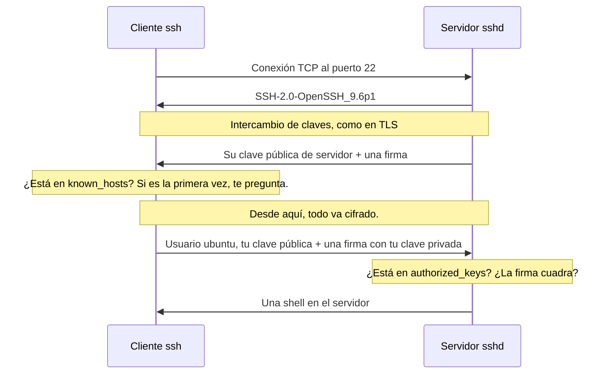
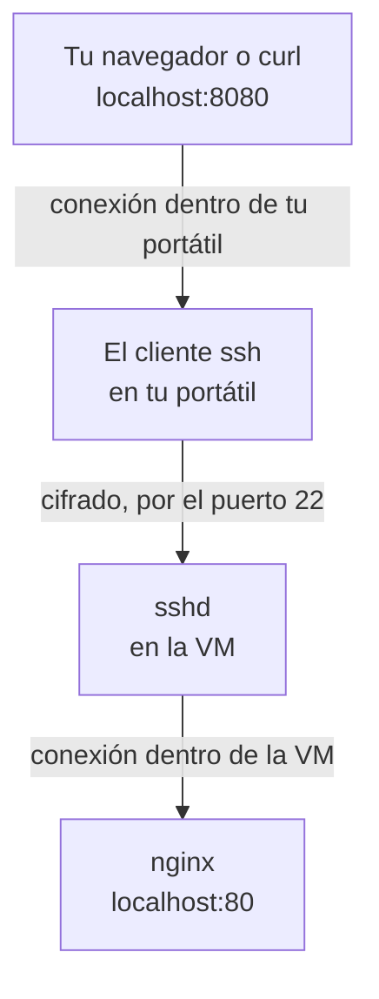

import Term from '~/components/Term.astro';
import TryIt from '~/components/TryIt.astro';
import Analogy from '~/components/Analogy.astro';
import Quiz from '~/components/Quiz.astro';
import QuizQuestion from '~/components/QuizQuestion.astro';
import QuizOption from '~/components/QuizOption.astro';

## El problema

Imagina que en la Fase 8 alquilas un servidor. Está a cientos de kilómetros, sin pantalla ni teclado, y tienes que instalar programas, leer sus logs y arrancar tu web desde tu terminal.

Antes se hacía con Telnet, que conectaba tu teclado con el servidor por la red. Pero todo viajaba como una postal, contraseña incluida. En 1995, después de que alguien robara contraseñas espiando la red de su universidad, el finlandés Tatu Ylönen diseñó un reemplazo cifrado ([la historia, en Wikipedia](https://en.wikipedia.org/wiki/Secure_Shell#History)).

Ese reemplazo es <Term id="ssh">SSH</Term> (*Secure Shell*, «shell segura»). Te da una shell en otro ordenador con todo cifrado, como HTTPS, y te deja entrar con una clave en lugar de una contraseña que se pueda adivinar. Así se administran casi todos los servidores del mundo, y así habla tu ordenador con GitHub cuando haces `git push`.

## La analogía

<Analogy>

Imagina que vas a menudo a una oficina de otra ciudad. La primera vez que llegas, le haces una foto a la fachada. Cada vez que vuelves, la comparas: si un día la fachada es distinta, sospechas que te han llevado a otro edificio y no entras.

Para entrar, no le dices al portero una contraseña en voz alta. Antes de tu primera visita dejaste una foto de la marca de tu sello, y el portero la tiene en su lista. Cada día te da un papel distinto, tú lo sellas y él compara la marca. El sello no sale nunca de tu bolsillo.

La foto de la fachada es la <Term id="fingerprint">huella</Term> del servidor. La lista del portero es el fichero `authorized_keys`, y tu sello, tu <Term id="private-key">clave privada</Term>: el mismo sello de lacre de [la lección de TLS](/fase-0/tls-y-https/).

<div slot="limits">

- Nadie te garantiza que la primera foto sea la buena: si el primer día te llevaron a un edificio falso, guardas la foto del falso. Por eso conviene comparar la huella con una que te llegue por otro camino.
- Una marca de sello se puede copiar mirándola. Una clave privada no se puede calcular a partir de la pública.
- Si pierdes un sello, lo notas. Si alguien copia el fichero de tu clave privada, no: por eso se protege con una frase.

</div>

</Analogy>

## Cómo funciona de verdad

### Un cliente, un servidor y el puerto 22

SSH es cliente-servidor, como la web. En tu ordenador usas el cliente, `ssh`, que ya traen macOS, Linux y WSL. En el servidor corre `sshd`, que escucha en el <Term id="port">puerto</Term> 22. La `d` es de <Term id="daemon">daemon</Term>, como los servicios de [la lección 6](/fase-1/servicios-systemd-apt/).

Con `nc`, el de [la Fase 0](/fase-0/modelo-cliente-servidor/), puedes llamar a ese puerto de tu servidor de prácticas. Aquí habla primero el servidor:

```sh
$ nc 192.168.64.2 22
SSH-2.0-OpenSSH_9.6p1 Ubuntu-3ubuntu13.19
```

`SSH-2.0` es la versión del protocolo, y `OpenSSH`, el programa servidor, el más usado con diferencia. Luego se queda esperando a que tu cliente responda en el mismo idioma: sal con <kbd>Ctrl</kbd> + <kbd>C</kbd>.

Cuando conectas con `ssh` de verdad, pasa esto:



Hay dos comprobaciones: primero el servidor demuestra quién es, y después tú.

### La primera vez: la huella del servidor

La primera vez que te conectas a un servidor, `ssh` se para y te pregunta:

```
The authenticity of host '192.168.64.2 (192.168.64.2)' can't be established.
ED25519 key fingerprint is: SHA256:QKTqvXRhfudHgJEIh0SzUquJe7Qg0OYdTM7N/+Xh+6c
This key is not known by any other names.
Are you sure you want to continue connecting (yes/no/[fingerprint])?
```

«No puedo comprobar que este servidor sea quien dice ser. Su clave tiene esta huella. ¿Sigo?». La **huella** (*fingerprint*) es un resumen corto de la clave pública del servidor: si la clave cambiara en un solo carácter, la huella saldría completamente distinta.

Si respondes `yes`, `ssh` guarda la clave del servidor en `~/.ssh/known_hosts`, la lista de servidores que conoces. Las siguientes veces la compara sin preguntar, y si un día no coincide, se niega a conectar.

Es la misma idea que el <Term id="certificate">certificado</Term> de HTTPS, con una diferencia importante: aquí no hay <Term id="certificate-authority">autoridad certificadora</Term>.

| | HTTPS (TLS) | SSH |
|---|---|---|
| El servidor demuestra quién es con | Su certificado y una firma | Su clave de servidor y una firma |
| Quién avala esa clave | Una autoridad certificadora | Nadie: tú, la primera vez |
| Dónde se guarda en quién confías | La lista de autoridades de tu sistema | Tu `~/.ssh/known_hosts` |
| Si algo no cuadra | Una pantalla de error | `REMOTE HOST IDENTIFICATION HAS CHANGED!` y no conecta |

A esto se le llama *trust on first use*, «confiar en el primer uso». Funciona si la primera vez comparas la huella con una que te llegue por otro camino, como harás en «Pruébalo».

### Tu clave: un par ed25519

Para demostrar quién eres, creas un par de claves con `ssh-keygen`. Salen dos ficheros en `~/.ssh`:

- `id_ed25519`: tu clave privada. No sale nunca de tu ordenador: ni se envía, ni se pega en una web.
- `id_ed25519.pub` (de *public*): tu <Term id="public-key">clave pública</Term>. Es una sola línea, como `ssh-ed25519 AAAAC3Nz… ana@portatil`, y puedes dársela a quien quieras.

`ed25519` es el tipo de clave recomendado hoy, corto y rápido. El de siempre, `rsa`, funciona, pero sus claves son mucho más largas.

Al crearla, `ssh-keygen` te pide una **frase de paso** (*passphrase*) y cifra con ella el fichero de la clave privada. Si alguien lo copia, no le sirve sin la frase. Puedes dejarla vacía, pero entonces el fichero es la llave.

### authorized_keys: la lista de llaves que abren la puerta

En el servidor, cada usuario tiene un fichero `~/.ssh/authorized_keys` con una clave pública por línea: las de quienes pueden entrar como ese usuario.

Cuando te conectas, tu cliente dice «quiero entrar como `ubuntu`, con esta clave pública». Si está en la lista, el servidor le pide una prueba: que firme, con la clave privada, unos datos que son distintos en cada conexión. El servidor comprueba la firma con la clave pública. Tu clave privada no viaja nunca, y una firma grabada no sirve para otra conexión.

`sshd` es desconfiado con los permisos de [la lección 4](/fase-1/usuarios-y-permisos-linux/):

- Si otros usuarios pueden escribir en tu `~/.ssh` o en `authorized_keys`, lo ignora: cualquiera podría añadir su clave y entrar como tú.
- Lo correcto es `700` para la carpeta (solo tú entras) y `600` para `authorized_keys` (solo tú lees y escribes).
- Tu cliente también lo comprueba: si otros usuarios pueden leer tu clave privada, se niega a usarla.

En la VM de Multipass, y en casi todos los servidores en la nube, entrar con contraseña ya viene desactivado: solo se entra con clave. En la Fase 8 harás lo mismo en tu servidor.

### ssh-agent: la frase, una sola vez

Si tu clave tiene frase, `ssh` te la pide en cada conexión. `ssh-agent` es un programa que guarda tus claves ya descifradas en memoria mientras dura tu sesión, y firma por `ssh`.

- `ssh-add` añade tu clave al agente (te pide la frase una vez).
- `ssh-add -l` lista las que tiene.

En macOS, el agente ya está en marcha. En Linux y WSL, a veces no: lo arrancas con `eval "$(ssh-agent -s)"`, que responde algo como `Agent pid 74`.

### ~/.ssh/config: apodos para tus servidores

Escribir `ssh ubuntu@192.168.64.2` cada vez cansa, y en Bandit encima hay que añadir el puerto. El fichero `~/.ssh/config` guarda esos datos con un nombre corto:

```
Host curso
    HostName 192.168.64.2
    User ubuntu

Host bandit
    HostName bandit.labs.overthewire.org
    Port 2220
    User bandit0
```

Con él, `ssh curso` es lo mismo que `ssh ubuntu@192.168.64.2`, y `ssh bandit`, que `ssh bandit0@bandit.labs.overthewire.org -p 2220`. También lo leen `scp`, `rsync` y `git`.

### Copiar ficheros: scp y rsync

`scp` es como `cp`, pero entre ordenadores. El lado remoto se escribe `servidor:ruta`, y si la ruta va vacía, es la carpeta personal del usuario:

```sh
$ scp notas.txt curso:
notas.txt                                     100%   24    35.8KB/s   00:00
$ ssh curso cat notas.txt
Hola desde el portátil
```

El segundo comando ejecuta `cat notas.txt` en la VM y te trae la salida, sin quedarte dentro. Al revés, `scp curso:notas.txt .` trae el fichero a tu carpeta actual.

`rsync` sirve para carpetas: compara los dos lados y solo envía lo que ha cambiado. Copiar una carpeta `web` a la VM dos veces seguidas lo demuestra:

```sh
$ rsync -av web/ curso:web/
Transfer starting: 3 files
created directory web
./
estilos.css
index.html

sent 276 bytes  received 70 bytes  111612 bytes/sec
total size is 38  speedup is 0.11
$ rsync -av web/ curso:web/
Transfer starting: 3 files

sent 140 bytes  received 20 bytes  76190 bytes/sec
total size is 38  speedup is 0.24
```

La primera vez copia los dos ficheros; la segunda, ninguno, porque no han cambiado. `-a` conserva los permisos y las fechas, y `-v` dice qué hace. La `/` final de `web/` significa «lo que hay dentro de `web`»: sin ella, crearías `web/web` en el otro lado. En Linux, la primera línea es `sending incremental file list`.

### Túneles: un puerto lejano en tu ordenador

Un <Term id="ssh-tunnel">túnel SSH</Term> hace que un puerto de tu ordenador lleve a un puerto del servidor, a través de la conexión SSH:

```sh
ssh -N -L 8080:localhost:80 curso
```

Se lee así: «escucha en mi puerto 8080 (`-L`, de *local*). Lo que llegue, llévalo cifrado hasta `curso` y, desde allí, conéctate a `localhost:80`». Ese <Term id="localhost">localhost</Term> es el del servidor, no el tuyo. `-N` dice que no quieres una shell, solo el túnel.



¿Para qué, si a la VM puedes llegar directamente? En un servidor de verdad, el cortafuegos (*firewall*) solo deja abierto el 22, y la base de datos de la Fase 5 solo escucha en `localhost`. El túnel te deja llegar a ellos sin abrir nada más.

## Pruébalo

El objetivo: entrar en tres servidores (Bandit con contraseña, y GitHub y tu VM con tu clave) y ver la página de nginx de tu VM a través de un túnel.

Las salidas son de un Mac con el usuario `ana`, y las de la VM, de Ubuntu 24.04. **En Windows,** haz los ejercicios 1 a 5 en WSL. Del 6 al 8 necesitan la VM de Multipass, que en Windows no usas: léelos sin hacerlos.

<TryIt
  title="1. Entra en Bandit, con contraseña"
  cmd="ssh bandit0@bandit.labs.overthewire.org -p 2220"
  output={`The authenticity of host '[bandit.labs.overthewire.org]:2220 ([13.51.99.177]:2220)' can't be established.
ED25519 key fingerprint is: SHA256:C2ihUBV7ihnV1wUXRb4RrEcLfXC5CXlhmAAM/urerLY
This key is not known by any other names.
Are you sure you want to continue connecting (yes/no/[fingerprint])? yes
Warning: Permanently added '[bandit.labs.overthewire.org]:2220' (ED25519) to the list of known hosts.
…
                      This is an OverTheWire game server.
            More information on http://www.overthewire.org/wargames

backend: gibson-1
bandit0@bandit.labs.overthewire.org's password:
…
bandit0@bandit:~$`}
>

[Bandit](https://overthewire.org/wargames/bandit/) es un juego para aprender Linux, y cada nivel es un usuario en su servidor. `bandit0` es el usuario del nivel 0, y `-p 2220`, el puerto: Bandit no usa el 22.

- Responde `yes` a la pregunta de la huella: no tienes otra con la que compararla.
- La contraseña está en [la página del nivel 0](https://overthewire.org/wargames/bandit/bandit0.html). Al escribirla no sale nada, ni asteriscos: es normal. Si te equivocas, responde `Permission denied, please try again.`
- Dentro, verás las normas del juego, y el prompt cambia a `bandit0@bandit:~$`: estás en otro ordenador. Sal con `exit`.

Las normas piden no publicar contraseñas ni soluciones: los niveles siguientes son cosa tuya. Tu IP de Bandit puede ser otra.

</TryIt>

<TryIt
  title="2. Crea tu par de claves"
  cmd={`ssh-keygen -t ed25519 -C "ana@portatil"`}
  output={`Generating public/private ed25519 key pair.
Enter file in which to save the key (/Users/ana/.ssh/id_ed25519):
Enter passphrase for "/Users/ana/.ssh/id_ed25519" (empty for no passphrase):
Enter same passphrase again:
Your identification has been saved in /Users/ana/.ssh/id_ed25519
Your public key has been saved in /Users/ana/.ssh/id_ed25519.pub
The key fingerprint is:
SHA256:rUzbherNMs8aCRjHI5qzWWRXcbHKm9PN2WuNQtUW6NI ana@portatil
The key's randomart image is:
+--[ED25519 256]--+
|        o.o.  .  |
|     . . . . . . |
|    = =   . o  ..|
|   = * o o o E. o|
|  + o . S o o. . |
|   =   + X +.o   |
|  o     @ o.+ .o |
|       .o*  . o..|
|        o==  o.  |
+----[SHA256]-----+`}
>

`-t` elige el tipo de clave, y `-C` añade un comentario para reconocerla: tu usuario y tu ordenador.

1. A la primera pregunta, pulsa Enter: acepta el sitio de siempre.
2. Escribe una frase de paso dos veces. Tampoco se ve al escribirla.

Si responde `Overwrite (y/n)?`, ya tenías una clave: responde `n` y usa la que tienes. Si la sobrescribes, pierdes el acceso a donde la usabas.

Tu huella y tu dibujo (*randomart*, la huella en forma de dibujo) serán otros. Si aún no tenías la carpeta `~/.ssh`, sale además `Created directory`. En Linux y WSL, la tercera línea es `Enter passphrase (empty for no passphrase):`.

</TryIt>

<TryIt
  title="3. Comprueba los permisos"
  cmd="ls -l ~/.ssh"
  output={`total 24
-rw-------@ 1 ana  staff  444 12 oct.  14:49 id_ed25519
-rw-r--r--@ 1 ana  staff   94 12 oct.  14:49 id_ed25519.pub
-rw-r--r--@ 1 ana  staff  116 12 oct.  14:46 known_hosts`}
>

Fíjate en las letras del principio. La privada es `-rw-------` (`600`): solo tú puedes leerla. La pública, `-rw-r--r--` (`644`): cualquiera puede leerla, y no pasa nada. `ssh-keygen` ya los deja así.

`known_hosts` guarda la clave de Bandit del ejercicio 1. En Linux y WSL sale `ana ana` en lugar de `ana staff`, y sin la `@`.

</TryIt>

<TryIt
  title="4. Dale tu clave al agente"
  cmd={`ssh-add\nssh-add -l`}
  output={`Enter passphrase for /Users/ana/.ssh/id_ed25519:
Identity added: /Users/ana/.ssh/id_ed25519 (ana@portatil)
256 SHA256:rUzbherNMs8aCRjHI5qzWWRXcbHKm9PN2WuNQtUW6NI ana@portatil (ED25519)`}
>

`ssh-add` te pide la frase una vez, y `ssh-add -l` enseña la huella de la clave que tiene el agente: la misma del ejercicio 2. Hasta que cierres la sesión, `ssh` no te la volverá a pedir.

En Linux y WSL, si responde `Could not open a connection to your authentication agent`, arranca antes el agente con `eval "$(ssh-agent -s)"` y repite.

</TryIt>

Ahora, GitHub. Antes de darle tu clave, conéctate para ver qué pasa y comprobar su huella:

<TryIt
  title="5. Tu clave en GitHub"
  cmd="ssh -T git@github.com"
  output={`The authenticity of host 'github.com (140.82.121.3)' can't be established.
ED25519 key fingerprint is: SHA256:+DiY3wvvV6TuJJhbpZisF/zLDA0zPMSvHdkr4UvCOqU
This key is not known by any other names.
Are you sure you want to continue connecting (yes/no/[fingerprint])? yes
Warning: Permanently added 'github.com' (ED25519) to the list of known hosts.
git@github.com: Permission denied (publickey).`}
>

Antes de responder `yes`, abre [las huellas que publica GitHub](https://docs.github.com/es/authentication/keeping-your-account-and-data-secure/githubs-ssh-key-fingerprints) y compara la de `ED25519`. `-T` dice que no quieres una shell, porque GitHub no la da. Tu IP de GitHub puede ser otra.

`Permission denied (publickey)` es lo esperado: GitHub aún no conoce tu clave. Dásela:

1. Enseña tu clave pública con `cat ~/.ssh/id_ed25519.pub` y copia la línea entera.
2. En GitHub, ve a *Settings* → *SSH and GPG keys* → *New SSH key*, pega la línea y guárdala.
3. Repite `ssh -T git@github.com`.

Ahora responde `Hi ana! You've successfully authenticated, but GitHub does not provide shell access.`, con tu usuario de GitHub en lugar de `ana`: te ha reconocido por tu clave. Si sigue diciendo `Permission denied`, mira que hayas pegado el fichero `.pub`.

</TryIt>

Por último, tu VM. Su IP sale en `multipass list`, en la columna `IPv4`: en los ejemplos es `192.168.64.2`, y la tuya puede ser otra. Primero, pídele a la VM su huella por otro camino, el de Multipass, y copia en ella tu clave pública:

<TryIt
  title="6. Prepara la VM"
  cmd={`multipass exec curso -- ssh-keygen -lf /etc/ssh/ssh_host_ed25519_key.pub\ncat ~/.ssh/id_ed25519.pub | multipass exec curso -- tee -a /home/ubuntu/.ssh/authorized_keys`}
  output={`256 SHA256:QKTqvXRhfudHgJEIh0SzUquJe7Qg0OYdTM7N/+Xh+6c root@curso (ED25519)
ssh-ed25519 AAAAC3NzaC1lZDI1NTE5AAAAIN+jtr1lys1W0+4ij3ZzuWnuwBXrK5jnnV7ARlGwdpcK ana@portatil`}
>

`multipass exec curso --` ejecuta en la VM lo que va detrás, a través de Multipass y no de tu `ssh`.

- La primera orden enseña la huella de la clave de servidor de la VM. Apúntala.
- La segunda añade tu clave pública al `authorized_keys` del usuario `ubuntu`. El `|` de [la lección 3](/fase-1/pipes-y-redirecciones/) se la pasa a `tee`, que la escribe en el fichero y en la pantalla (por eso sale), y `-a` (*append*, «añadir») la pone al final. Sin `-a`, borrarías la clave que usa `multipass shell`.

</TryIt>

<TryIt
  title="7. Entra sin contraseña"
  cmd="ssh ubuntu@192.168.64.2"
  output={`The authenticity of host '192.168.64.2 (192.168.64.2)' can't be established.
ED25519 key fingerprint is: SHA256:QKTqvXRhfudHgJEIh0SzUquJe7Qg0OYdTM7N/+Xh+6c
This key is not known by any other names.
Are you sure you want to continue connecting (yes/no/[fingerprint])? yes
Warning: Permanently added '192.168.64.2' (ED25519) to the list of known hosts.
Welcome to Ubuntu 24.04.5 LTS (GNU/Linux 6.8.0-117-generic aarch64)
…
ubuntu@curso:~$`}
>

Compara la huella con la que apuntaste en el ejercicio 6: si es la misma, responde `yes`. Ni contraseña ni frase: tu clave abre la puerta, y el agente la desbloqueó en el ejercicio 4. Sal con `exit`.

Si responde `Permission denied (publickey)`, revisa el ejercicio 6. Tu huella y tus versiones serán otras.

</TryIt>

Ahora crea `~/.ssh/config` con `nano ~/.ssh/config` (el editor de [la lección 2](/fase-1/comandos-linux-archivos/)), copia en él el bloque `Host curso` de arriba, con la IP de tu VM, y guárdalo. Después:

<TryIt
  title="8. Un apodo y un túnel"
  cmd={`ssh curso whoami\nssh -f -N -L 8080:localhost:80 curso\ncurl -I http://localhost:8080`}
  output={`ubuntu
HTTP/1.1 200 OK
Server: nginx/1.24.0 (Ubuntu)
Date: Mon, 12 Oct 2026 12:52:14 GMT
Content-Type: text/html
Content-Length: 615
Last-Modified: Mon, 12 Oct 2026 12:45:36 GMT
Connection: keep-alive
ETag: "6accd670-267"
Accept-Ranges: bytes`}
>

- `ssh curso whoami` usa el apodo, ejecuta `whoami` en la VM y responde `ubuntu`.
- La segunda abre el túnel, y `-f` lo manda a segundo plano para que puedas seguir escribiendo.
- `curl -I` pide la página a tu puerto 8080 y contesta el nginx de la VM, el de la lección 6: fíjate en `Server: nginx/1.24.0 (Ubuntu)`. En el navegador, `http://localhost:8080` enseña «Welcome to nginx!». Tus fechas serán otras.

Si `curl` responde `Failed to connect to localhost port 8080`, el túnel no se abrió: mira si la segunda orden dio algún error. Si dice `Address already in use`, otro programa usa tu 8080: prueba con `-L 8081:localhost:80`.

Para cerrar el túnel, busca su PID con `pgrep -f 8080:localhost` (un patrón que solo aparece en la orden del túnel) y páralo con `kill` y ese número, como en [la lección 5](/fase-1/procesos-y-senales/).

</TryIt>

## Ya lo has visto

- **El botón «Code» de GitHub** tiene una pestaña SSH con direcciones como `git@github.com:usuario/repo.git`: el usuario `git`, en el servidor `github.com`.
- **Al crear un servidor en la nube,** el proveedor te pide tu clave pública SSH y la mete en el `authorized_keys` del servidor nuevo, como hiciste en el ejercicio 6.
- **`multipass shell curso`** también entra por SSH, con una clave que Multipass creó para ti.

Y si programas:

- **`git push` y `git pull`** con una dirección `git@github.com:…` usan tu clave y tu agente. Si fallan, `ssh -T git@github.com` te dice si el problema es la clave.

## Errores comunes

- **Borrar el aviso sin pensar.** Si recreas la VM y le toca la misma IP, la clave ya no coincide, y `ssh` responde `WARNING: REMOTE HOST IDENTIFICATION HAS CHANGED!` y no conecta. Comprueba la huella nueva como en el ejercicio 6, y solo entonces borra la vieja con `ssh-keygen -R 192.168.64.2`. Si no sabes por qué ha cambiado, no conectes.
- **Permisos abiertos en tu clave.** Si otros pueden leer tu clave privada, `ssh` la ignora: `WARNING: UNPROTECTED PRIVATE KEY FILE!` y `Permissions 0644 for '/Users/ana/.ssh/id_ed25519' are too open.` Arréglalo con `chmod 600 ~/.ssh/id_ed25519`.
- **Permisos abiertos en el servidor.** Con `authorized_keys` en `666`, el cliente solo ve `Permission denied (publickey)`. La razón está en el registro de la VM (`sudo journalctl -u ssh`): `Authentication refused: bad ownership or modes for file /home/ubuntu/.ssh/authorized_keys`.
- **Olvidar el usuario.** `ssh 192.168.64.2`, sin `ubuntu@`, usa tu usuario del portátil, que no existe en la VM: `ana@192.168.64.2: Permission denied (publickey).` Pon el usuario, o un `User` en `~/.ssh/config`.

## Resumen

- SSH abre una terminal en otro ordenador con todo cifrado. El cliente es `ssh`, y el servidor, `sshd`, en el puerto 22.
- El servidor demuestra quién es con su clave. La primera vez compruebas su huella tú, porque no hay autoridad certificadora, y `known_hosts` la recuerda.
- Tú entras con tu clave privada, que nunca sale de tu ordenador. La pública va en el `authorized_keys` del servidor o en GitHub, y los permisos tienen que ser `600`.
- `ssh-agent` te ahorra repetir la frase, y `~/.ssh/config` te ahorra repetir la IP, el usuario y el puerto.
- `scp` y `rsync` copian ficheros por SSH, y `ssh -L` lleva un puerto tuyo hasta un puerto del servidor.

## ¿Lo has entendido?

<Quiz>

<QuizQuestion
  question="Entras cada día por SSH en el servidor de tu empresa. Hoy ssh responde WARNING: REMOTE HOST IDENTIFICATION HAS CHANGED!, y nadie ha avisado de ningún cambio. ¿Qué haces?"
  review="La primera vez: la huella del servidor"
>

<QuizOption text="Borras la clave vieja con ssh-keygen -R y vuelves a entrar: el aviso sale cada vez que el servidor se reinicia.">

Reiniciar no cambia la clave del servidor. Si cambia sin explicación, puedes estar hablando con otro ordenador que se hace pasar por el tuyo.

</QuizOption>

<QuizOption text="No entras, y preguntas a quien administra el servidor si ha cambiado su clave." correct>

Una clave nueva necesita una explicación, como un servidor reinstalado. Sin ella, puede ser un servidor falso. Si te la confirman, compruebas la huella nueva y borras la vieja con `ssh-keygen -R`.

</QuizOption>

<QuizOption text="Creas otra clave con ssh-keygen: el aviso dice que la tuya ha caducado y el servidor ya no la acepta.">

El aviso habla de la clave del servidor, no de la tuya, y las claves SSH no caducan. Tu clave sigue valiendo.

</QuizOption>

</QuizQuestion>

<QuizQuestion
  question="Un tutorial te dice: «pega tu clave SSH en GitHub». ¿Qué pegas?"
  review="Tu clave: un par ed25519"
>

<QuizOption text="El contenido de id_ed25519, porque GitHub necesita la privada para comprobar que eres tú.">

Para comprobar una firma basta con la clave pública. La privada no sale nunca de tu ordenador: si la pegas, dala por perdida.

</QuizOption>

<QuizOption text="Tu fichero known_hosts, que es el que le dice a GitHub quién eres.">

`known_hosts` guarda las claves de los servidores en los que confías tú. No dice nada de ti.

</QuizOption>

<QuizOption text="La línea de id_ed25519.pub." correct>

Es tu clave pública, la que se puede dar a cualquiera. GitHub la guarda y, con ella, comprueba las firmas que hace tu clave privada.

</QuizOption>

</QuizQuestion>

<QuizQuestion
  question="Un compañero te pasa por chat su fichero id_ed25519 para que entres en el servidor con su clave, que es más rápido. ¿Qué problema hay?"
  review="authorized_keys: la lista de llaves que abren la puerta"
>

<QuizOption text="Que su clave privada ya no es secreta: debe cambiarla, y tú usar la tuya." correct>

Una clave privada que ha pasado por un chat puede estar en más sitios. Lo correcto es que tu clave pública vaya al `authorized_keys` del servidor, y así cada uno entra con la suya.

</QuizOption>

<QuizOption text="Ninguno, siempre que el chat esté cifrado y guardes el fichero con permisos 600.">

Los permisos protegen el fichero en tu disco, no las copias que hayan quedado en el chat, en otros dispositivos o en copias de seguridad.

</QuizOption>

<QuizOption text="Que el servidor notará que la clave viene de otro ordenador y la rechazará.">

El servidor no sabe desde qué ordenador se usa una clave: solo comprueba la firma. Por eso es tan grave que se copie.

</QuizOption>

</QuizQuestion>

<QuizQuestion
  question="Ejecutas ssh -N -L 5433:localhost:5432 curso. ¿A dónde llega una conexión a localhost:5433 en tu portátil?"
  review="Túneles: un puerto lejano en tu ordenador"
>

<QuizOption text="Al puerto 5432 de tu portátil, porque localhost siempre es tu propio ordenador.">

En un túnel, el `localhost` de en medio se resuelve en el servidor, al otro lado de la conexión SSH. Es el `localhost` de la VM.

</QuizOption>

<QuizOption text="Al puerto 5433 de la VM, porque el túnel mantiene el número de puerto.">

El primer número es el puerto de tu portátil, y el último, el del servidor. Pueden ser distintos, y aquí lo son.

</QuizOption>

<QuizOption text="Al puerto 5432 de la VM." correct>

Tu portátil escucha en el 5433. Lo que llega viaja cifrado por SSH hasta la VM, y allí `sshd` se conecta a `localhost:5432`, su propio puerto.

</QuizOption>

</QuizQuestion>

<QuizQuestion
  question="Añades tu clave pública a authorized_keys en la VM, pero ssh sigue respondiendo Permission denied (publickey). ls -ld ~/.ssh enseña drwxrwxrwx. ¿Qué pasa?"
  review="authorized_keys: la lista de llaves que abren la puerta"
>

<QuizOption text="Que la clave pública tiene que ir en known_hosts, no en authorized_keys.">

`known_hosts` es la lista de servidores en los que confía un cliente. Las claves que pueden entrar en el servidor van en `authorized_keys`.

</QuizOption>

<QuizOption text="Que sshd no se fía de la carpeta, porque cualquiera puede escribir en ella: ponla en 700." correct>

Quien puede escribir en la carpeta puede cambiar `authorized_keys` y entrar como tú, así que `sshd` no lo lee. Con `chmod 700 ~/.ssh`, solo tú entras, y la clave funciona.

</QuizOption>

<QuizOption text="Que authorized_keys también necesita 777, porque sshd tiene que poder escribir en él.">

`sshd` solo lo lee, y su dueño ya puede leerlo. Abrir los permisos empeora el problema: es justo lo que le hace desconfiar.

</QuizOption>

</QuizQuestion>

<QuizQuestion
  question="Tu navegador no te pregunta por ninguna huella al entrar en tu banco por primera vez. ¿Por qué ssh sí lo hace con un servidor nuevo?"
  review="La primera vez: la huella del servidor"
>

<QuizOption text="Porque al banco lo avala una autoridad certificadora; al servidor SSH, nadie." correct>

El navegador confía en el certificado porque lo firma una autoridad de su lista. En SSH no hay autoridad, así que la decisión es tuya.

</QuizOption>

<QuizOption text="Porque la huella es la clave que cifra todo lo que envías al servidor.">

La huella no cifra nada: es un resumen de la clave del servidor para que la reconozcas. Las claves que cifran salen del intercambio de claves, como en TLS.

</QuizOption>

<QuizOption text="Porque HTTPS no usa claves públicas: al banco lo identifica su dominio, y a SSH, una clave.">

HTTPS también usa una clave pública: va dentro del certificado, y el servidor firma con la privada que la acompaña.

</QuizOption>

</QuizQuestion>

</Quiz>

## Para profundizar

- [Conectar a GitHub con SSH](https://docs.github.com/es/authentication/connecting-to-github-with-ssh), la guía de GitHub, en español, con la solución a los problemas más comunes.
- [OverTheWire: Bandit](https://overthewire.org/wargames/bandit/), en inglés: el juego del ejercicio 1, nivel a nivel.
- [El manual de ssh](https://man.openbsd.org/ssh) y [el de ssh_config](https://man.openbsd.org/ssh_config), en inglés, de los autores de OpenSSH.
