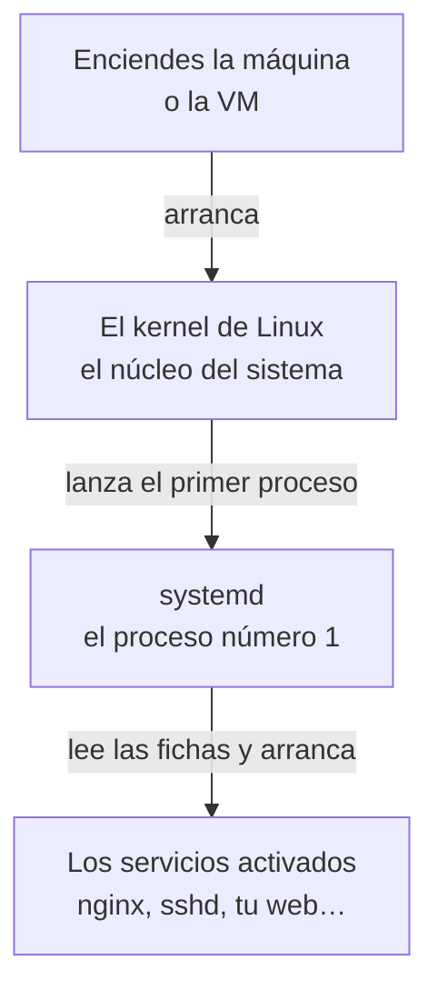

import { Aside } from '@astrojs/starlight/components';
import Term from '~/components/Term.astro';
import TryIt from '~/components/TryIt.astro';
import Analogy from '~/components/Analogy.astro';
import Quiz from '~/components/Quiz.astro';
import QuizQuestion from '~/components/QuizQuestion.astro';
import QuizOption from '~/components/QuizOption.astro';

## El problema

Imagina que ya tienes tu primera web funcionando en tu servidor de prácticas. La arrancaste con una orden, la probaste con `curl` y respondió. Cierras la terminal, te vas a dormir y, por la mañana, no responde nadie. El programa murió con tu sesión.

Y aunque la dejes abierta: ¿quién la vuelve a arrancar si se cae a las tres de la mañana, o si el servidor se reinicia tras una actualización? Un servidor de verdad no puede depender de que haya alguien con la terminal abierta.

Y antes, otra pregunta: ¿de dónde sale el programa, si en un servidor no hay navegador para bajarlo? Esta lección resuelve las dos cosas: instalar programas con apt y mantenerlos en marcha con systemd.

## La analogía

<Analogy>

Piensa en un restaurante. Los cocineros y los camareros son los programas. Ninguno abre el local por su cuenta: cada mañana llega el encargado, abre y llama a quienes tienen turno.

Para cada puesto, el encargado tiene una ficha: quién es, qué hace, desde cuándo entra y qué hacer si se va a mitad del turno (llamarlo otra vez). Todo lo que pasa lo apunta en el libro de incidencias. El encargado es <Term id="systemd">systemd</Term>, las fichas son los *unit files* y el libro es su diario.

El material (los hornos, la cafetera) lo trae un proveedor de confianza con catálogo, que entrega cada aparato con las piezas que necesita y lo deja instalado. Ese proveedor es apt.

<div slot="limits">

- El encargado solo comprueba que el empleado sigue ahí, no que trabaje bien. Un servidor colgado que no responde puede seguir saliendo como «en marcha».
- Un encargado de verdad buscaría a otra persona; systemd vuelve a arrancar el mismo programa. Si el fallo está en la ficha, fallará igual cada vez, y tras varios intentos seguidos se rinde.
- El proveedor no te avisa de sus novedades: el catálogo hay que pedírselo tú.

</div>

</Analogy>

## Cómo funciona de verdad

### Un daemon es un programa que no depende de ti

Cuando instales nginx, un servidor web, en el «Pruébalo», responderá en el puerto 80 sin que lo arranques. Seguirá respondiendo cuando cierres la sesión y después de reiniciar la máquina.

Un programa así es un <Term id="daemon">daemon</Term>: un <Term id="process">proceso</Term> que se queda en marcha por su cuenta, sin ventana ni terminal, esperando a hacer su trabajo. Muchos llevan una `d` al final del nombre: `sshd` es el servidor de SSH y `systemd`, el que vigila a todos los demás.

Lo que arrancas tú desde la terminal, en cambio, vive colgado de ella: como viste en la [lección 5, «Procesos y señales»](/fase-1/procesos-y-senales/), al cerrarla, sus procesos reciben una señal (`SIGHUP`) y terminan.

### systemd arranca todo lo demás

Cuando enciendes un Linux, lo primero que arranca es su núcleo (el *kernel*), la parte que habla con las piezas del ordenador. El *kernel* lanza un único programa, que arranca todo lo demás:



Ese programa es systemd, y siempre tiene el PID 1. Casi todos los Linux de servidor lo usan, Ubuntu incluido.

Cada programa que systemd mantiene en marcha es un **servicio**, con una ficha con nombre (`nginx.service`) que dice qué arrancar y cómo cuidarlo.

### systemctl: el mando de cada servicio

A systemd se le dan órdenes con `systemctl`, casi siempre con el mismo patrón: `systemctl` + acción + servicio:

| Orden | Qué hace |
|---|---|
| `systemctl status nginx` | Dice si está en marcha, su PID y sus últimas líneas de registro |
| `sudo systemctl start nginx` | Lo arranca ahora |
| `sudo systemctl stop nginx` | Lo para ahora |
| `sudo systemctl restart nginx` | Lo para y lo vuelve a arrancar |
| `sudo systemctl enable nginx` | Lo apunta para que arranque cada vez que se enciende la máquina |
| `sudo systemctl disable nginx` | Lo borra de esa lista |
| `systemctl list-units --type=service` | Lista todos los servicios que systemd tiene cargados |

Mirar no necesita permisos, pero cambiar un servicio afecta a toda la máquina: por eso esas órdenes llevan `sudo`, que las ejecuta como root ([lección 4](/fase-1/usuarios-y-permisos-linux/)).

La diferencia que más confunde es **`start` frente a `enable`**. `start` actúa ahora y no deja nada apuntado. `enable` solo lo apunta para el próximo encendido. Para las dos cosas a la vez, `sudo systemctl enable --now nginx`.

### journalctl: el diario de los servicios

Lo que un servicio escribe en pantalla, y lo que systemd hace con él, va a un mismo sitio: el diario (*journal*), el libro de incidencias de la analogía. Se lee con `journalctl`:

- `journalctl -u nginx`: todo lo de un servicio (`-u` viene de *unit*, la ficha).
- `journalctl -u nginx -n 20`: solo las 20 últimas líneas.
- `journalctl -u nginx -f`: enseña las líneas nuevas según llegan, como `tail -f` en la [lección 2](/fase-1/comandos-linux-archivos/). Se sale con <kbd>Ctrl</kbd> + <kbd>C</kbd>.

Si la salida no cabe en la ventana, se abre en un visor como el de `man`: <kbd>Espacio</kbd> baja y <kbd>Q</kbd> sale.

### La ficha de un servicio: el unit file

Cada servicio se describe en un fichero de texto, su *unit file*. Este es el que escribirás en el «Pruébalo» para un servidor web hecho con Python:

```ini
[Unit]
Description=Web de prácticas del curso

[Service]
User=ubuntu
WorkingDirectory=/home/ubuntu/web
ExecStart=/usr/bin/python3 -m http.server 8000
Restart=always

[Install]
WantedBy=multi-user.target
```

Tiene tres partes, y cada línea es un nombre, un `=` y un valor:

- **`[Unit]`**: qué es. `Description` es el nombre que verás en `status` y en el diario.
- **`[Service]`**: cómo se ejecuta.
  - `ExecStart` es la orden que arranca el programa, con la ruta completa.
  - `User` dice con qué usuario corre. Sin esa línea, correría como root, con todos los permisos: justo lo que la [lección 4](/fase-1/usuarios-y-permisos-linux/) desaconseja.
  - `WorkingDirectory` es la carpeta desde la que arranca, como si hicieras `cd` antes.
  - `Restart=always`: si el programa termina, por lo que sea, systemd lo vuelve a arrancar. Solo se queda parado si lo paras tú con `systemctl stop`, o si falla tantas veces seguidas que systemd se rinde (lo verás en el reto).
- **`[Install]`**: qué hace `enable`. `WantedBy=multi-user.target` significa «arráncalo en el encendido normal».

Las fichas de los programas instalados están en `/usr/lib/systemd/system/`, y las tuyas van en `/etc/systemd/system/`.

systemd lee las fichas una vez y las guarda en memoria. **Si cambias una, díselo con `sudo systemctl daemon-reload`**, o seguirá usando la versión anterior.

### apt instala programas desde un catálogo de confianza

En Ubuntu, los programas se instalan como **paquetes**: el programa, su configuración y, si es un servidor, su ficha de systemd, todo en un fichero. Están en los repositorios de Ubuntu, servidores en internet que hacen de catálogo. Quien los busca, descarga e instala es apt, un <Term id="package-manager">gestor de paquetes</Term>.

| Orden | Qué hace |
|---|---|
| `sudo apt update` | Descarga el catálogo actualizado: qué paquetes hay y en qué versión. No instala nada |
| `sudo apt install nginx` | Instala nginx y los paquetes que necesita para funcionar |
| `sudo apt upgrade` | Actualiza lo que ya tienes a las versiones del catálogo |
| `sudo apt remove nginx` | Lo desinstala (con `purge` en lugar de `remove`, borra también su configuración) |
| `apt search` y `apt show` | Buscan en el catálogo y describen un paquete, sin `sudo` |

nginx usa ficheros que vienen en otro paquete, `nginx-common`, y apt lo instala también. A esos paquetes se les llama **dependencias**.

¿Y por qué «de confianza»? Ubuntu firma su catálogo con su clave privada, y apt comprueba la <Term id="digital-signature">firma digital</Term> con la clave pública que ya viene en el sistema, como viste en [la lección 8 de la Fase 0](/fase-0/tls-y-https/). Si alguien cambia un paquete por el camino, la firma no cuadra y apt lo rechaza. Bajar un programa de una web cualquiera no tiene esa garantía.

### En tu Mac: launchd y Homebrew

macOS tiene su equivalente de systemd, launchd, que también es el proceso número 1. Y Homebrew es un gestor de paquetes como apt: `brew install nginx` lo instala y `brew services start nginx` lo deja en marcha con launchd. En este curso no los usarás.

<TryIt title="En tu Mac: ¿quién es el proceso 1?" cmd="ps -p 1" output={`  PID TTY           TIME CMD
    1 ??        56:20.99 /sbin/launchd`}>

`ps -p 1` enseña el proceso con PID 1. Tu `TIME`, el tiempo de procesador que lleva gastado, será otro.

</TryIt>

## Pruébalo

El objetivo: instalar un servidor web de verdad, crear tu propio servicio y comprobar que sobrevive a que lo mates y a que reinicies la máquina. Al final lo romperás a propósito y buscarás la causa.

Todo se hace en tu servidor de prácticas, la VM `curso` de la [lección 4](/fase-1/usuarios-y-permisos-linux/): entra con `multipass shell curso`. Usarás `sudo`, porque instalar programas y tocar servicios cambia el sistema entero, pero todo queda dentro de la VM.

<Aside type="tip" title="En Windows, con WSL">

WSL puede hacer de servidor de prácticas si tiene systemd. Haz el primer ejercicio: si `ps -p 1` dice `systemd`, sigue. Si dice otra cosa, como `init`, abre `sudo nano /etc/wsl.conf`, añade estas dos líneas y guarda:

```ini
[boot]
systemd=true
```

Después, ejecuta `wsl --shutdown` en PowerShell y vuelve a abrir Ubuntu. Las instalaciones recientes ya lo traen activado.

</Aside>

### Primero, nginx desde apt

<TryIt title="1. ¿Quién es el proceso 1?" cmd="ps -p 1" output={`    PID TTY          TIME CMD
      1 ?        00:00:00 systemd`}>

En la VM, el proceso 1 es `systemd`. Comprueba que el prompt dice `ubuntu@curso` (en WSL, tu usuario): si dice `ana@portatil`, estás en tu Mac y verás `launchd`.

</TryIt>

<TryIt title="2. Pide el catálogo" cmd="sudo apt update" output={`Get:1 http://ports.ubuntu.com/ubuntu-ports noble InRelease [256 kB]
…
Get:19 http://ports.ubuntu.com/ubuntu-ports noble-security/main arm64 Packages [1448 kB]
Fetched 35.4 MB in 4s (9916 kB/s)
Reading package lists... Done
Building dependency tree... Done
Reading state information... Done
2 packages can be upgraded. Run 'apt list --upgradable' to see them.`}>

apt descarga el catálogo de cada repositorio (`noble` es Ubuntu 24.04). La última línea avisa de que hay versiones nuevas: `sudo apt upgrade` las instalaría. Tus números serán otros, y con un procesador Intel o AMD verás `archive.ubuntu.com` y `amd64` en lugar de `ports.ubuntu.com` y `arm64`.

</TryIt>

<TryIt title="3. Instala nginx" cmd="sudo apt install -y nginx" output={`Reading package lists... Done
Building dependency tree... Done
Reading state information... Done
The following additional packages will be installed:
  nginx-common
…
The following NEW packages will be installed:
  nginx nginx-common
…
Setting up nginx-common (1.24.0-2ubuntu7.18) ...
Created symlink /etc/systemd/system/multi-user.target.wants/nginx.service → /usr/lib/systemd/system/nginx.service.
Setting up nginx (1.24.0-2ubuntu7.18) ...
…`}>

`-y` contesta «sí» a la pregunta de apt. Fíjate en dos cosas:

- `additional packages`: la dependencia, `nginx-common`, entra sola.
- `Created symlink`: es lo que hace `enable`. El paquete ha activado el servicio, así que nginx ya está en marcha y arrancará en cada encendido.

Hemos quitado partes (`…`), y tu versión puede ser más nueva.

</TryIt>

<TryIt title="4. Mira el servicio" cmd="systemctl status nginx" output={`● nginx.service - A high performance web server and a reverse proxy server
     Loaded: loaded (/usr/lib/systemd/system/nginx.service; enabled; preset: enabled)
     Active: active (running) since Mon 2026-10-12 12:46:28 UTC; 1s ago
       Docs: man:nginx(8)
…
   Main PID: 392 (nginx)
…`}>

Fíjate en tres líneas:

- `Loaded`: dónde está su ficha, y `enabled`, que arrancará al encender.
- `Active: active (running)`: está en marcha, y desde cuándo.
- `Main PID`: el número de su proceso principal. El tuyo será otro.

Si la orden no te devuelve el prompt, sal con <kbd>Q</kbd>.

</TryIt>

<TryIt title="5. Pídele la página" cmd="curl localhost" output={`<!DOCTYPE html>
<html>
<head>
<title>Welcome to nginx!</title>
…
<h1>Welcome to nginx!</h1>
<p>If you see this page, the nginx web server is successfully installed and
working. Further configuration is required.</p>
…`}>

Tu VM ya es un servidor web: nginx responde en el puerto 80, el que usa `curl` si no le dices otro, con su página de bienvenida. Si sale `Couldn't connect to server`, el servicio no está `active`: mira el paso anterior.

</TryIt>

<TryIt title="6. Páralo y vuelve a arrancarlo" cmd={`sudo systemctl stop nginx\nsystemctl is-active nginx\ncurl localhost\nsudo systemctl start nginx`} output={`inactive
curl: (7) Failed to connect to localhost port 80 after 0 ms: Couldn't connect to server`}>

`is-active` responde con una palabra. Con nginx parado, nadie escucha en el puerto 80 y `curl` no puede conectar. `start` lo vuelve a arrancar.

</TryIt>

<TryIt title="7. Lee su diario" cmd="journalctl -u nginx" output={`Oct 12 12:46:28 curso systemd[1]: Starting nginx.service - A high performance web server and a reverse proxy server...
Oct 12 12:46:28 curso systemd[1]: Started nginx.service - A high performance web server and a reverse proxy server.
Oct 12 12:46:42 curso systemd[1]: Stopping nginx.service - A high performance web server and a reverse proxy server...
Oct 12 12:46:43 curso systemd[1]: nginx.service: Deactivated successfully.
Oct 12 12:46:43 curso systemd[1]: Stopped nginx.service - A high performance web server and a reverse proxy server.
Oct 12 12:46:43 curso systemd[1]: Starting nginx.service - A high performance web server and a reverse proxy server...
Oct 12 12:46:43 curso systemd[1]: Started nginx.service - A high performance web server and a reverse proxy server.`}>

Cada línea lleva la fecha, la máquina y quién la escribe: `systemd[1]` es systemd, con su PID entre corchetes. Es la historia de los pasos 3 y 6: arrancó al instalarse, lo paraste y lo volviste a arrancar.

Si sale `No journal files were opened due to insufficient permissions`, tu usuario no puede leer el diario del sistema: repite la orden con `sudo` delante.

Deja nginx instalado: lo usarás en la [lección 9, «SSH»](/fase-1/que-es-ssh/) para abrir un túnel.

</TryIt>

### Después, tu propio servicio

Ahora conviertes en servicio un programa que no viene preparado para ello. Python trae un servidor web mínimo: `python3 -m http.server 8000` sirve, en el puerto 8000, los ficheros de la carpeta donde lo arrancas. Primero, crea esa carpeta con una página:

<TryIt title="8. Una página para servir" cmd={`mkdir -p ~/web\necho '<h1>Hola desde mi servicio</h1>' > ~/web/index.html`}>

No escriben nada: si no sale ningún error, la página está en `~/web/index.html`.

</TryIt>

Ahora, la ficha. Ábrela con `nano`, como en la [lección 2](/fase-1/comandos-linux-archivos/). Lleva `sudo` porque `/etc` es del sistema:

<TryIt title="9. Escribe la ficha" cmd="sudo nano /etc/systemd/system/web-curso.service" />

Copia dentro el unit file de [«La ficha de un servicio»](#la-ficha-de-un-servicio-el-unit-file), tal cual. En WSL, cambia `ubuntu` por tu usuario en `User` y en `WorkingDirectory`. Guarda con <kbd>Ctrl</kbd> + <kbd>O</kbd> y <kbd>Enter</kbd>, y sal con <kbd>Ctrl</kbd> + <kbd>X</kbd>.

<TryIt title="10. Actívalo y arráncalo" cmd={`sudo systemctl daemon-reload\nsudo systemctl enable --now web-curso`} output={`Created symlink /etc/systemd/system/multi-user.target.wants/web-curso.service → /etc/systemd/system/web-curso.service.`}>

`daemon-reload` hace que systemd lea la ficha nueva, y `enable --now` lo activa y lo arranca a la vez. Es el mismo `Created symlink` de nginx.

</TryIt>

<TryIt title="11. Compruébalo" cmd={`systemctl status web-curso\ncurl localhost:8000`} output={`● web-curso.service - Web de prácticas del curso
     Loaded: loaded (/etc/systemd/system/web-curso.service; enabled; preset: enabled)
     Active: active (running) since Mon 2026-10-12 12:47:00 UTC; 88ms ago
   Main PID: 519 (python3)
…
<h1>Hola desde mi servicio</h1>`}>

Está en marcha, y la última línea es tu página. Apunta el `Main PID`: lo necesitas en el paso siguiente. Si `curl` dice `Couldn't connect to server`, repite en un segundo: Python tarda un poco en empezar a escuchar.

</TryIt>

<TryIt title="12. Mátalo, a ver qué pasa" cmd={`kill 519\nsystemctl status web-curso`} output={`● web-curso.service - Web de prácticas del curso
     Loaded: loaded (/etc/systemd/system/web-curso.service; enabled; preset: enabled)
     Active: active (running) since Mon 2026-10-12 12:47:13 UTC; 6s ago
   Main PID: 562 (python3)
…
Oct 12 12:47:13 curso systemd[1]: web-curso.service: Scheduled restart job, restart counter is at 1.
Oct 12 12:47:13 curso systemd[1]: Started web-curso.service - Web de prácticas del curso.`}>

Cambia `519` por tu `Main PID`. `kill` le pide al proceso que termine, como en la [lección 5](/fase-1/procesos-y-senales/), y no necesita `sudo` porque el proceso es de tu usuario. El servicio sigue `active (running)`, pero con otro `Main PID`: las dos últimas líneas cuentan que systemd programó un reinicio (`Scheduled restart job`) y arrancó otro proceso, por el `Restart=always`.

</TryIt>

Falta la última prueba: reiniciar la máquina. Sal de la VM con `exit`, reiníciala desde tu terminal con `multipass restart curso` y vuelve a entrar con `multipass shell curso`. En WSL, cierra Ubuntu, ejecuta `wsl --shutdown` en PowerShell y vuelve a abrirlo.

<TryIt title="13. Después de reiniciar" cmd={`systemctl is-active nginx web-curso\ncurl localhost:8000`} output={`active
active
<h1>Hola desde mi servicio</h1>`}>

Nadie ha arrancado nada a mano: systemd arrancó los dos al encender, porque están `enabled`.

</TryIt>

### El reto: rómpelo y encuentra la causa

En un servidor de verdad, los servicios se rompen. Abre otra vez la ficha con `sudo nano /etc/systemd/system/web-curso.service` y cambia `http.server` por `http.sever` (sin la segunda `r`). Guarda, sal y aplica el cambio:

<TryIt title="14. Rómpelo" cmd={`sudo systemctl daemon-reload\nsudo systemctl restart web-curso\nsystemctl is-active web-curso\ncurl localhost:8000`} output={`failed
curl: (7) Failed to connect to localhost port 8000 after 0 ms: Couldn't connect to server`}>

`restart` no se queja, pero el servicio ha quedado en `failed`. Si `is-active` dice `activating` o `active`, repítelo en un par de segundos: systemd todavía lo está intentando.

</TryIt>

`curl` solo sabe que no contesta nadie; el porqué está en el diario. Antes de seguir leyendo, búscalo tú.

<TryIt title="15. Encuentra la causa" cmd="journalctl -u web-curso -n 12" output={`Oct 12 12:48:14 curso python3[773]: /usr/bin/python3: No module named http.sever
Oct 12 12:48:14 curso systemd[1]: web-curso.service: Main process exited, code=exited, status=1/FAILURE
Oct 12 12:48:14 curso systemd[1]: web-curso.service: Failed with result 'exit-code'.
Oct 12 12:48:14 curso systemd[1]: web-curso.service: Scheduled restart job, restart counter is at 4.
Oct 12 12:48:14 curso systemd[1]: Started web-curso.service - Web de prácticas del curso.
Oct 12 12:48:14 curso python3[775]: /usr/bin/python3: No module named http.sever
Oct 12 12:48:14 curso systemd[1]: web-curso.service: Main process exited, code=exited, status=1/FAILURE
Oct 12 12:48:14 curso systemd[1]: web-curso.service: Failed with result 'exit-code'.
Oct 12 12:48:14 curso systemd[1]: web-curso.service: Scheduled restart job, restart counter is at 5.
Oct 12 12:48:14 curso systemd[1]: web-curso.service: Start request repeated too quickly.
Oct 12 12:48:14 curso systemd[1]: web-curso.service: Failed with result 'exit-code'.
Oct 12 12:48:14 curso systemd[1]: Failed to start web-curso.service - Web de prácticas del curso.`}>

Hay dos voces. `python3[775]` es el programa, y dice el problema: `No module named http.sever`, no existe nada con ese nombre. `systemd[1]` cuenta que el programa terminó con error (`status=1/FAILURE`) y que lo volvió a intentar hasta rendirse: `Start request repeated too quickly`.

</TryIt>

Arréglalo: vuelve a poner `http.server` en la ficha y repite `daemon-reload` y `restart`. Comprueba con `curl localhost:8000` que tu página ha vuelto. Si `restart` responde `Job for web-curso.service failed`, has ido más rápido que systemd: después de rendirse, espera diez segundos antes de dejarte arrancarlo otra vez.

Si quieres quitar el servicio al terminar, `sudo systemctl disable --now web-curso` lo para y lo borra del arranque.

## Ya lo has visto

- **Los programas sin ventana de tu ordenador.** El que sincroniza tus fotos o el que busca actualizaciones están ahí, sin ventana: son daemons.
- **La tienda de aplicaciones del móvil.** Es un gestor de paquetes: un catálogo de confianza, programas firmados y actualizaciones que llegan del mismo sitio.
- **El servidor de la Fase 0.** El `nc -l 8080` de [la lección 2](/fase-0/modelo-cliente-servidor/) se paraba con <kbd>Ctrl</kbd> + <kbd>C</kbd> o al cerrar la terminal. Era un servidor, pero no un servicio.

Y si programas:

- npm es un gestor de paquetes: `npm install` trae también las dependencias de tus dependencias, como apt con `nginx-common`.
- `npm run dev` muere al cerrar la terminal, como el servidor de Python. En producción, a tu Node lo mantiene vivo systemd, una herramienta como pm2 o, en la Fase 7, Docker. Y con systemd, cada `console.log` acaba en `journalctl`.

## Errores comunes

- **Usar `start` y esperar que sobreviva a un reinicio.** `start` lo arranca solo esta vez. Para cada encendido, `enable`, o `enable --now` para las dos cosas.
- **Cambiar la ficha y olvidar `daemon-reload`.** systemd sigue con la versión anterior, y te avisa: `Warning: The unit file, source configuration file or drop-ins of web-curso.service changed on disk. Run 'systemctl daemon-reload' to reload units.`
- **Instalar sin `apt update`.** En un servidor recién creado, el catálogo puede estar vacío, y `sudo apt install nginx` responde `E: Unable to locate package nginx`; o viejo, y la descarga falla con `404 Not Found`. Ejecuta antes `sudo apt update`.
- **Quedarte con `systemctl status`.** Solo enseña unas pocas líneas del diario, a veces cortadas. La causa suele estar más arriba: búscala con `journalctl -u`.
- **Olvidar `User=` en la ficha.** El servicio correrá como root. Si alguien encuentra un fallo en tu programa, podrá hacer lo que quiera con la máquina.

## Resumen

- Un daemon es un programa que corre por su cuenta, sin terminal. En Linux los arranca y los vigila systemd, el proceso número 1.
- `systemctl` maneja los servicios: `status` para mirar, `start`, `stop` y `restart` para ahora, y `enable` para cada encendido.
- Lo que escribe un servicio va al diario: `journalctl -u`. Ahí está la causa cuando algo falla.
- Un unit file de pocas líneas convierte cualquier programa en un servicio. Tras cambiarlo, `sudo systemctl daemon-reload`.
- `apt` instala programas firmados, con sus dependencias. Primero `apt update`, después `apt install`.

## ¿Lo has entendido?

<Quiz>

<QuizQuestion
  question="Arrancaste python3 -m http.server 8000 en tu VM desde una sesión de SSH, cerraste el portátil y por la mañana la web no responde. ¿Qué ha pasado?"
  review="Un daemon es un programa que no depende de ti"
>

<QuizOption text="La VM cierra por la noche los puertos que nadie usa.">

Linux no cierra puertos por estar quietos. Lo que se cerró fue tu sesión, y con ella se fue el programa.

</QuizOption>

<QuizOption text="Se paró al cerrarse la sesión desde la que lo arrancaste." correct>

Vivía colgado de la terminal desde la que lo arrancaste. Para que siga sin ti, conviértelo en un servicio.

</QuizOption>

<QuizOption text="Los servidores de Python se apagan solos tras unas horas sin visitas.">

No tienen límite de tiempo: habría seguido días si nada lo hubiera parado.

</QuizOption>

</QuizQuestion>

<QuizQuestion
  question="Creaste un servicio, lo arrancaste con sudo systemctl start web-curso y funcionó. Después de reiniciar la VM, no está en marcha. ¿Por qué?"
  review="systemctl: el mando de cada servicio"
>

<QuizOption text="systemd borra al reiniciar los servicios que creas tú.">

Tu ficha sigue en `/etc/systemd/system`: systemd no borra nada. Al encender, solo arranca los servicios activados.

</QuizOption>

<QuizOption text="Después de cada reinicio hay que hacer daemon-reload.">

systemd lee todas las fichas al arrancar. `daemon-reload` solo hace falta cuando cambias una con la máquina encendida.

</QuizOption>

<QuizOption text="Faltaba enable: start solo lo arranca esta vez." correct>

`start` actúa ahora, y `enable` lo apunta para cada encendido. `sudo systemctl enable --now web-curso` hace las dos cosas.

</QuizOption>

</QuizQuestion>

<QuizQuestion
  question="Cambias en la ficha de tu servicio el puerto 8000 por el 8080, haces sudo systemctl restart web-curso y sigue escuchando en el 8000. ¿Qué te falta?"
  review="La ficha de un servicio: el unit file"
>

<QuizOption text="Un sudo systemctl daemon-reload antes del restart." correct>

systemd guarda en memoria las fichas que ya leyó, y `daemon-reload` hace que las vuelva a leer. Si se te olvida, `restart` te avisa con un `Warning`.

</QuizOption>

<QuizOption text="Hacer stop y luego start, porque así systemd relee la ficha.">

`stop` y `start` usan la misma copia en memoria que `restart`. Sin `daemon-reload`, seguirá en el 8000.

</QuizOption>

<QuizOption text="Permiso de root: el usuario ubuntu no puede abrir el 8080.">

Solo los puertos del 0 al 1023 necesitan root, y el 8080 no es uno de ellos. Además, sin permiso el servicio fallaría, no seguiría en el 8000.

</QuizOption>

</QuizQuestion>

<QuizQuestion
  question="Tu servicio sale como failed en systemctl status. ¿Dónde buscas por qué ha fallado?"
  review="journalctl: el diario de los servicios"
>

<QuizOption text="En el propio unit file, donde systemd apunta los errores.">

systemd nunca escribe en tus fichas: solo las lee. Los errores van al diario.

</QuizOption>

<QuizOption text="En lo que responde curl, que te dice qué ha fallado en el programa.">

`curl` solo ve que nadie contesta. Por qué, lo sabe el diario.

</QuizOption>

<QuizOption text="En journalctl -u y el nombre del servicio." correct>

El diario guarda lo que el programa escribió antes de terminar, como el `No module named http.sever` del reto.

</QuizOption>

</QuizQuestion>

<QuizQuestion
  question="En un servidor recién creado, sudo apt install nginx responde «Unable to locate package nginx». ¿Qué haces?"
  review="apt instala programas desde un catálogo de confianza"
>

<QuizOption text="Lo descargas de la web de nginx, porque no está en Ubuntu.">

nginx está en el catálogo de Ubuntu: es el que instalaste en el «Pruébalo».

</QuizOption>

<QuizOption text="Ejecutas antes sudo apt update." correct>

El servidor aún no tiene el catálogo, o lo tiene viejo. `apt update` lo descarga, y entonces `apt install` encuentra el paquete.

</QuizOption>

<QuizOption text="Le añades la versión exacta al nombre, como nginx-1.24.0.">

El paquete se llama `nginx`, a secas, y apt elige la versión del catálogo. Sin catálogo, no encontraría ninguna.

</QuizOption>

</QuizQuestion>

<QuizQuestion
  question="Quieres parar web-curso un rato. Haces kill con su PID, pero enseguida vuelve a estar en marcha con otro PID. ¿Por qué?"
  review="La ficha de un servicio: el unit file"
>

<QuizOption text="systemd lo arranca otra vez, por el Restart=always." correct>

Para systemd, un proceso que termina es algo que arreglar. Para pararlo de verdad, `sudo systemctl stop web-curso`.

</QuizOption>

<QuizOption text="kill no lo ha matado: hacía falta kill -9.">

Sí lo mató: por eso cambia el PID. Con `-9` pasaría lo mismo, porque quien lo vuelve a arrancar es systemd.

</QuizOption>

<QuizOption text="Python deja preparada una copia de reserva por si lo matan.">

Python no hace copias de sí mismo. El proceso nuevo lo arranca systemd: `Scheduled restart job`, dice el diario.

</QuizOption>

</QuizQuestion>

</Quiz>

## Para profundizar

- [systemd en la ArchWiki](https://wiki.archlinux.org/title/Systemd_(Espa%C3%B1ol)), en español: systemctl, las fichas y el diario, con más detalle. Es de otro Linux, Arch, pero systemd funciona igual.
- [systemd.service](https://www.freedesktop.org/software/systemd/man/latest/systemd.service.html), en inglés: todo lo que puede llevar la parte `[Service]` de una ficha.
- [Gestión de paquetes en Ubuntu Server](https://documentation.ubuntu.com/server/how-to/software/package-management/), en inglés: apt, los repositorios y las actualizaciones automáticas.
- [Usar systemd en WSL](https://learn.microsoft.com/es-es/windows/wsl/systemd), de Microsoft, en español.
