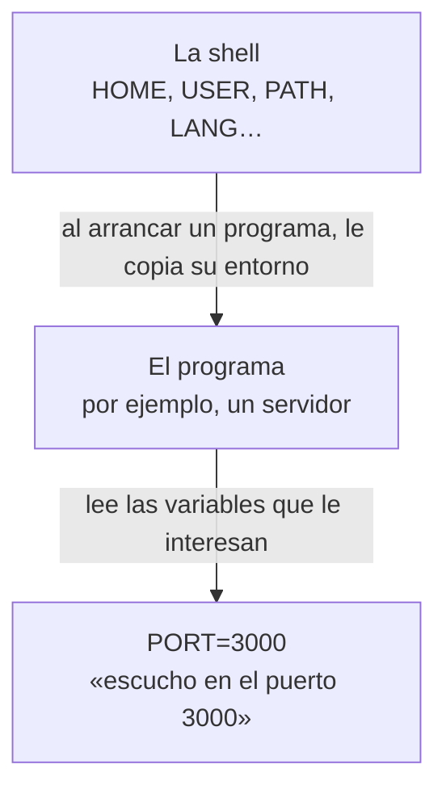

import Term from '~/components/Term.astro';
import TryIt from '~/components/TryIt.astro';
import Analogy from '~/components/Analogy.astro';
import SelfCheck from '~/components/SelfCheck.astro';
import Quiz from '~/components/Quiz.astro';
import QuizQuestion from '~/components/QuizQuestion.astro';
import QuizOption from '~/components/QuizOption.astro';

## El problema

Imagina que has escrito tu primer backend: un programa que escucha en el puerto 3000 y cobra con tarjeta usando una clave que te ha dado el banco. En tu portátil va bien. Ahora lo quieres llevar al servidor, donde tiene que escuchar en otro puerto y usar la clave de verdad, no la de pruebas.

Si el puerto y la clave están escritos dentro del código, tienes dos problemas. Necesitas una versión del código para cada sitio. Y la clave viaja con el código: si lo subes a GitHub, la web donde se guarda y se comparte código, quien pueda leerlo puede cobrar en tu nombre.

La solución es que el código no sepa esas cosas, sino que las reciba al arrancar. Quien lo arranca le dice el puerto y la clave con <Term id="environment-variable">variables de entorno</Term>. Y ya te has cruzado con una: cada `command not found` de la terminal tiene que ver con una variable, `PATH`.

## La analogía

<Analogy>

Imagina la cocina de un restaurante. La jefa tiene una libreta con notas, y marca las que son para el equipo: «hoy, la mesa 3 es sin gluten». Cuando entra un cocinero, le copia en una tarjeta las notas marcadas, y él trabaja con esa tarjeta.

La jefa es la <Term id="shell">shell</Term>; cada cocinero, un programa que la shell arranca, y su tarjeta, su entorno. Cada nota de la tarjeta es una variable de entorno, y marcar una nota es lo que hace `export`.

Una nota dice dónde buscar los utensilios: «primero en el cajón 1, luego en el 2». Si lo que pides no está en ninguno, la jefa responde «no lo encuentro», aunque esté en el almacén. Esa nota es `PATH`.

<div slot="limits">

- La tarjeta se copia al entrar. Si la jefa cambia una nota después, los cocineros que ya trabajan no se enteran, y en el ordenador no se les puede avisar: hay que volver a arrancar el programa.
- Tampoco funciona al revés: lo que un programa cambie en su entorno no llega a la shell que lo arrancó.
- La tarjeta no es del todo privada: en un servidor, el administrador puede leer las variables de cualquier programa.

</div>

</Analogy>

## Cómo funciona de verdad

### Cada programa arranca con su lista de variables

Escribe `env` y pulsa Enter. Sale una lista de unas veinte líneas; en un Mac, entre ellas, estas:

```
TERM_PROGRAM=Apple_Terminal
SHELL=/bin/zsh
USER=ana
PWD=/Users/ana/curso-backend/fase-1
LANG=es_ES.UTF-8
HOME=/Users/ana
```

Cada línea es una variable de entorno: un nombre, un `=` y un valor. Los nombres van en mayúsculas por costumbre. La lista entera es el **entorno**, la tarjeta de la analogía. Cada programa lee las variables que le interesan y no hace caso del resto:

| Variable | Qué guarda | Dónde la has visto |
|---|---|---|
| `HOME` | Tu carpeta personal | `~` es su valor, y `cd` sin nada te lleva ahí |
| `SHELL` | Tu shell | En la [lección 1](/fase-1/comandos-basicos-terminal/), con `echo $SHELL` |
| `LANG` | Tu idioma | Si vale `es_ES.UTF-8`, `ls -l` escribe las fechas en español, «7 oct.» |
| `PWD` | La carpeta donde estás | Es lo que escribe `pwd` |
| `PATH` | Dónde buscar los comandos | Más abajo |

Para ver una sola, `echo $HOME`. El `$` delante del nombre le dice a la shell «pon aquí su valor»: antes de ejecutar `echo`, la cambia por `/Users/ana`.



La copia se hace una sola vez, al arrancar. Si después cambias una variable en la shell, el programa que ya está en marcha no se entera: hay que pararlo y volver a arrancarlo.

### Variables de la shell y variables de entorno

Mira qué pasa al crear una variable:

<TryIt
  title="¿Quién ve la variable?"
  cmd={`SALUDO=hola\necho $SALUDO\nprintenv SALUDO\nexport SALUDO\nprintenv SALUDO`}
  output={`hola
hola`}
>

Solo dos `hola`: el de `echo` y el del último `printenv`. Igual en Linux y WSL.

</TryIt>

`SALUDO=hola` crea una **variable de la shell**: solo la conoce la shell. `echo $SALUDO` funciona porque es la propia shell la que cambia `$SALUDO` por `hola`.

`printenv`, en cambio, es un programa aparte que escribe una variable de *su* entorno. La primera vez no escribe nada: `SALUDO` era una nota sin marcar, y no estaba en su copia.

`export SALUDO` la marca: desde ahí es una **variable de entorno**, y cada programa que arranque la shell recibe una copia. Puedes crearla y marcarla de una vez: `export SALUDO=hola`, sin espacios alrededor del `=`. Todas desaparecen al cerrar la terminal.

### Una variable para un solo programa

Esta orden sale en casi cualquier tutorial de backend:

```sh
PORT=3000 node app.js
```

`node` es Node.js, un programa que ejecuta código JavaScript (lo instalarás en la Fase 3), y `app.js` sería tu servidor. Lo nuevo es el principio: un `NOMBRE=valor` delante de una orden le pasa esa variable **solo a ese programa**, sin crearla en la shell. Es la forma más común de configurar un servidor: el mismo código arranca con `PORT=3000` en tu portátil y con otro puerto en el servidor.

<TryIt title="Lo mismo, sin Node.js" cmd={`PORT=3000 printenv PORT\nprintenv PORT`} output="3000">

El segundo `printenv` no escribe nada: la shell no guardó la variable. Igual en Linux y WSL.

</TryIt>

¿Y cómo la lee el programa? En Node.js, sus variables de entorno están en `process.env`: `process.env.PORT` vale `"3000"`. Las comillas importan: un valor llega siempre como texto, y es el programa el que lo convierte en número.

### PATH: dónde busca la shell los comandos

En la lección 1, `which ls` respondía `/bin/ls`, pero tú solo escribías `ls`. ¿Cómo sabe la shell dónde está? Por `PATH`. Mira su valor, con una carpeta por línea:

<TryIt
  title="Las carpetas de PATH"
  cmd={`echo $PATH | tr ':' '\\n'`}
  output={`/usr/local/bin
/System/Cryptexes/App/usr/bin
/usr/bin
/bin
/usr/sbin
/sbin
/var/run/com.apple.security.cryptexd/codex.system/bootstrap/usr/local/bin
/var/run/com.apple.security.cryptexd/codex.system/bootstrap/usr/bin
/var/run/com.apple.security.cryptexd/codex.system/bootstrap/usr/appleinternal/bin
/Library/Apple/usr/bin
/opt/homebrew/bin`}
>

`tr ':' '\n'` cambia cada `:` por un salto de línea, y el `|` le pasa a `tr` lo que escribe `echo`, como en la [lección 3](/fase-1/pipes-y-redirecciones/).

Tu lista será otra: `/opt/homebrew/bin` solo sale si tienes Homebrew, un programa para instalar herramientas en el Mac. En Ubuntu va de `/usr/local/sbin` a `/snap/bin`, y en WSL lleva además las carpetas de Windows (`/mnt/c/…`).

</TryIt>

`PATH` es una lista de carpetas separadas por `:`.

Cuando escribes `ls`, la shell busca un fichero `ls` en la primera carpeta de la lista, luego en la segunda, y así hasta el final. Ejecuta el primero que encuentra, y si no está en ninguna, responde `command not found`. De ahí salen tres reglas:

- **Un programa fuera de esas carpetas no se encuentra,** aunque exista.
- **El orden importa:** si dos carpetas tienen un programa con el mismo nombre, gana la que va antes.
- **Una orden con `/` no se busca:** `./bin/saluda` o `/bin/ls` se ejecutan tal cual. La carpeta donde estás no está en la lista, y por eso, para ejecutar algo de aquí, se escribe `./` delante.

Para añadir una carpeta, se monta un `PATH` nuevo con ella delante y la lista de antes detrás:

```sh
export PATH="$HOME/bin:$PATH"
```

El `$PATH` del final es la lista antigua. Si lo olvidas, `PATH` se queda con una sola carpeta y dejan de funcionar casi todos los comandos.

### Que dure: .zshrc y .bashrc

Todo lo anterior dura hasta que cierras la terminal: cada terminal nueva arranca una shell nueva, que monta su entorno desde cero. Para que un cambio dure, se escribe en el fichero que la shell lee al arrancar: `~/.zshrc` en zsh (el Mac) y `~/.bashrc` en bash (Linux y WSL).

Son ficheros ocultos (lección 1) con órdenes, una por línea, que la shell ejecuta al arrancar como si las escribieras tú. Para añadir una al final:

```sh
echo 'export PATH="$HOME/curso-backend/fase-1/variables/bin:$PATH"' >> ~/.zshrc
```

- `>>` añade la línea al final. Con un solo `>`, el fichero se vaciaría antes y perderías lo que tenía ([lección 3](/fase-1/pipes-y-redirecciones/)).
- Las comillas simples hacen que `$HOME` y `$PATH` se escriban tal cual. Se cambiarán por su valor cada vez que arranque la shell.

El cambio se nota en las terminales que abras después. En la que tienes abierta, `source ~/.zshrc` vuelve a leer el fichero.

### Los secretos, fuera del código

Un <Term id="secret">secreto</Term> es un dato que da acceso a algo: la contraseña de la <Term id="database">base de datos</Term>, la clave de una <Term id="api">API</Term> de pagos. La regla es que **nunca se escribe dentro del código**.

El código se guarda en <Term id="git">Git</Term>, el programa que lleva el historial de un proyecto ([lección 10](/fase-1/git-por-dentro/)), y de ahí se copia a GitHub, al ordenador de cada compañero y al servidor. El secreto, en cambio, va en una variable de entorno que solo existe en la máquina que lo necesita:

| Qué | Ejemplo | Dónde va |
|---|---|---|
| El código | El programa que cobra | En Git |
| La configuración que cambia de un sitio a otro | El puerto | En variables de entorno |
| Los secretos | La clave de pagos | En variables de entorno, nunca en Git |

Así, el mismo código usa la clave de pruebas en tu portátil y la real en el servidor.

### Los ficheros .env

Escribir `CLAVE_PAGOS=… PORT=… node app.js` cada vez cansa. Por eso, mientras desarrollas, las variables se guardan en un fichero `.env` en la carpeta del proyecto, una por línea:

```
# Configuración para mi portátil
PORT=3000
CLAVE_PAGOS=sk_test_4f9a2c
```

La shell no lo lee sola: lo lee el programa al arrancar. Node.js, por ejemplo, con `node --env-file=.env app.js`.

Como tiene secretos, el `.env` no se guarda nunca en Git. Para que Git no lo vea, su nombre se escribe en otro fichero, `.gitignore`: la lista de lo que Git debe ignorar. Lo que sí se guarda es un `.env.example`, con los nombres de las variables y sin los valores.

En el servidor no suele haber `.env`: las variables se ponen en la configuración del servicio (en la ficha de la [lección 6](/fase-1/servicios-systemd-apt/), con una línea `Environment=PORT=8000`), del contenedor (Fase 7) o de la plataforma donde publicas la web.

## Pruébalo

El objetivo: arrancar un pequeño servidor web eligiendo su puerto con una variable, guardar un secreto donde Git no lo vea y arreglar un `command not found`. Todo se hace en tu terminal, en una carpeta nueva, `~/curso-backend/fase-1/variables`.

Necesitas `python3` y `git`. En Ubuntu y WSL suelen venir de serie (si falta `git`, instálalo con `sudo apt install git`; lo usarás a fondo en la lección 10). En un Mac, si al usarlos aparece una ventana que ofrece instalar las «herramientas de línea de comandos», acepta.

Las salidas son las de un Mac, con el usuario cambiado por uno de ejemplo, `ana`. En cada ejercicio te contamos qué cambia en Linux y en WSL.

Primero, el servidor. Estas órdenes crean la carpeta, una subcarpeta `publico` con un fichero de texto y un script, `servidor.sh`: un fichero con órdenes para la shell ([lección 8](/fase-1/scripts-de-bash/)). Pégalas juntas y pulsa Enter:

<TryIt
  title="1. Un servidor que se configura con variables"
  cmd={`mkdir -p ~/curso-backend/fase-1/variables/publico
cd ~/curso-backend/fase-1/variables
echo 'Hola desde la carpeta publico' > publico/hola.txt
echo 'echo "Sirviendo la carpeta \${CARPETA:-actual} en http://localhost:\${PORT:-8000}/"' > servidor.sh
echo 'python3 -m http.server "\${PORT:-8000}" --bind 127.0.0.1 --directory "\${CARPETA:-.}"' >> servidor.sh
cat servidor.sh`}
  output={`echo "Sirviendo la carpeta \${CARPETA:-actual} en http://localhost:\${PORT:-8000}/"
python3 -m http.server "\${PORT:-8000}" --bind 127.0.0.1 --directory "\${CARPETA:-.}"`}
>

Los dos últimos `echo` escriben el script: `>` crea el fichero y `>>` añade una línea al final.

Lo importante son las variables. `${PORT:-8000}` significa «el valor de `PORT` o, si no existe, `8000`». `python3 -m http.server` es un servidor web que trae Python y sirve los ficheros de una carpeta; `--bind 127.0.0.1` hace que solo responda a tu propio ordenador.

</TryIt>

<TryIt
  title="2. Arráncalo sin variables"
  cmd="bash servidor.sh"
  output={`Sirviendo la carpeta actual en http://localhost:8000/
Serving HTTP on 127.0.0.1 port 8000 (http://127.0.0.1:8000/) ...
^C
Keyboard interrupt received, exiting.`}
>

Sin variables, usa el puerto 8000 y la carpeta actual. El servidor se queda esperando peticiones: páralo con <kbd>Ctrl</kbd> + <kbd>C</kbd> (sale `^C`). Igual en Linux y WSL.

</TryIt>

<TryIt
  title="3. Ahora, en el puerto 3000"
  cmd="PORT=3000 CARPETA=publico bash servidor.sh"
  output={`Sirviendo la carpeta publico en http://localhost:3000/
Serving HTTP on 127.0.0.1 port 3000 (http://127.0.0.1:3000/) ...
127.0.0.1 - - [12/Oct/2026 14:47:39] "GET /hola.txt HTTP/1.1" 200 -`}
>

El mismo script, sin cambiar una letra, escucha en otro puerto y sirve otra carpeta. Déjalo en marcha, abre otra terminal y pídele el fichero, como en la [Fase 0](/fase-0/modelo-cliente-servidor/): `curl http://localhost:3000/hola.txt` responde `Hola desde la carpeta publico`.

La última línea del servidor aparece al llegar tu petición: la hora (la tuya será otra) y el `200` de «todo bien». Páralo con <kbd>Ctrl</kbd> + <kbd>C</kbd>. Igual en Linux y WSL.

Si sale un error largo que acaba en `Address already in use` («dirección ya en uso»), otro programa ocupa ese puerto. Para eso está la variable: prueba con `PORT=3001`.

</TryIt>

Ahora, un secreto. Vas a crear un `.env` con una clave inventada, convertir la carpeta en un <Term id="repository">repositorio</Term> de Git (una carpeta cuyo historial guarda Git) y ver qué guardaría:

<TryIt
  title="4. Un secreto que Git no ve"
  cmd={`printf 'PORT=4000\\nCLAVE_PAGOS=sk_test_4f9a2c\\n' > .env
git init -q
echo '.env' > .gitignore
git status --short --ignored`}
  output={`?? .gitignore
?? publico/
?? servidor.sh
!! .env`}
>

`printf` escribe el texto en el fichero, y cada `\n` es un salto de línea. `git init -q` crea el repositorio sin decir nada, y la tercera línea crea el `.gitignore`, con un solo nombre. `git status` cuenta qué ve Git en la carpeta: `--short`, un fichero por línea con una marca delante, y `--ignored`, también los que ignora.

Fíjate en las marcas: `??` son ficheros que Git podría guardar, y `!!`, los que ignora. Sin el `.gitignore`, el `.env` saldría con `??`, como uno más. Igual en Linux y WSL.

</TryIt>

Y por último, el `command not found`. Este script, `saluda`, va en una carpeta `bin`, el nombre habitual de las carpetas de programas, y saluda usando `$USER`. `chmod +x` le da permiso para ejecutarse como un programa ([lección 4](/fase-1/usuarios-y-permisos-linux/)):

<TryIt
  title="5. Un programa que la shell no encuentra"
  cmd={`mkdir bin
printf '#!/bin/sh\\necho "Hola, $USER"\\n' > bin/saluda
chmod +x bin/saluda
saluda`}
  output="zsh: command not found: saluda"
>

El programa existe, pero la shell buscó `saluda` en las carpetas de `PATH`, y `bin` no es una de ellas. En Linux y WSL, bash lo dice así: `saluda: command not found`.

</TryIt>

<SelfCheck question="Reto: haz que saluda funcione. Hay dos formas: una sin tocar PATH y otra tocándolo.">

```sh
./bin/saluda
export PATH="$PWD/bin:$PATH"
saluda
which saluda
```

La primera le da la ruta: con una `/`, la shell no busca. La segunda pone la carpeta delante en `PATH`; `$PWD` es otra variable de entorno, la carpeta donde estás. Las dos responden `Hola, ana`, y `which` da `/Users/ana/curso-backend/fase-1/variables/bin/saluda` (en Linux y WSL, empieza por `/home/ana`).

Ese `PATH` nuevo solo vale en esta terminal.

</SelfCheck>

Para que `saluda` funcione en todas tus terminales, añade esa carpeta en tu `.zshrc` (es opcional). En Linux y WSL, cambia `~/.zshrc` por `~/.bashrc` en las dos órdenes.

<TryIt
  title="6. Que dure (opcional)"
  cmd={`echo 'export PATH="$HOME/curso-backend/fase-1/variables/bin:$PATH"' >> ~/.zshrc
tail -n 1 ~/.zshrc`}
  output={`export PATH="$HOME/curso-backend/fase-1/variables/bin:$PATH"`}
>

`tail -n 1` enseña la última línea del fichero: la que acabas de añadir. Abre una terminal nueva y escribe `saluda` desde cualquier carpeta: responde `Hola, ana`.

Para deshacerlo, abre el fichero con `nano ~/.zshrc` ([lección 2](/fase-1/comandos-linux-archivos/)), baja con las flechas a esa última línea, bórrala con <kbd>Ctrl</kbd> + <kbd>K</kbd>, guarda con <kbd>Ctrl</kbd> + <kbd>O</kbd> y Enter, y sal con <kbd>Ctrl</kbd> + <kbd>X</kbd>.

</TryIt>

## Ya lo has visto

Estaban ahí desde el principio:

- `~` es el valor de `HOME`, y en la lección 1, `echo $SHELL` ya leía una variable.
- Prueba `LANG=C ls -l`: la misma orden, con otro idioma solo para ella, escribe las fechas en inglés («Oct 7» en vez de «7 oct.»). En Linux y WSL, si tu sistema está en inglés, ya salían así.
- En el log de prácticas de las lecciones [2](/fase-1/comandos-linux-archivos/) y [3](/fase-1/pipes-y-redirecciones/), la IP `198.51.100.23` pide de madrugada `/.env`, `/.git/config` y `/.aws/credentials`. Es un programa que busca servidores que publican sus secretos por error.

Y si programas:

- `npm run` añade `node_modules/.bin` a `PATH` antes de arrancar tu script. Por eso `vite` funciona dentro de `npm run dev` y en la terminal responde `command not found`.
- En Vite, las variables que empiezan por `VITE_` (en Next.js, `NEXT_PUBLIC_`) acaban escritas en el código que descarga el navegador. Una clave ahí deja de ser secreta.

## Errores comunes

- **Espacios alrededor del `=`.** `PORT = 3000` responde `zsh: command not found: PORT` (en bash, `PORT: command not found`): la shell cree que quieres ejecutar un programa llamado `PORT`. Escríbelo junto: `PORT=3000`.
- **Olvidar el `export`.** Si creas la variable con `NOMBRE=valor` y arrancas el programa en otra orden, no la ve. Usa `export NOMBRE=valor`, o ponla delante de la orden.
- **Borrar tu `PATH`.** `PATH=~/bin`, sin `:$PATH` al final, deja una sola carpeta en la lista, y hasta `ls` responde `zsh: command not found: ls`. Abre otra terminal. Si el error está en tu `.zshrc`, arréglalo con `/usr/bin/nano ~/.zshrc`: con la ruta completa, la shell no necesita `PATH`.
- **`>` en lugar de `>>` al añadir algo a `.zshrc` o `.bashrc`.** Con un solo `>`, el fichero se queda solo con tu línea.
- **Guardar el `.env` en Git.** Aunque luego lo borres, sigue en el historial, y quien tenga una copia del repositorio puede leerlo. Da la clave por perdida y cámbiala. Y escribe el `.gitignore` antes de guardar nada.

## Resumen

- Cada programa recibe al arrancar una copia del entorno, con variables como `HOME`, `LANG` o `PORT`. `env` las enseña todas, y `echo $NOMBRE`, una.
- `export` convierte una variable de la shell en variable de entorno. `NOMBRE=valor programa` se la pasa solo a ese programa.
- `PATH` es la lista de carpetas donde la shell busca los comandos. Un `command not found` es un programa que no está en ninguna: dale su ruta o añade su carpeta a `PATH`.
- Para que un cambio dure, se añade con `>>` a `~/.zshrc` (zsh) o `~/.bashrc` (bash).
- Los secretos van en variables de entorno, nunca en el código. En desarrollo, en un `.env` que está en el `.gitignore`.

## ¿Lo has entendido?

<Quiz>

<QuizQuestion
  question="Arrancas el servidor con PORT=4000 bash servidor.sh y responde en el 4000. En esa misma terminal, cuando lo paras, escribes printenv PORT. ¿Qué sale?"
  review="Una variable para un solo programa"
>

<QuizOption text="4000: la shell guarda la variable para las órdenes siguientes.">

No la guarda. Un `NOMBRE=valor` delante de una orden solo existe para ese programa, y desaparece con él.

</QuizOption>

<QuizOption text="Nada." correct>

`PORT=4000` se le pasó solo al servidor. La shell no la creó, así que `printenv` no la recibe.

</QuizOption>

<QuizOption text="8000: al parar el servidor, PORT vuelve a su valor por defecto.">

La shell no tiene ningún `PORT`, ni antes ni después. El 8000 solo existe dentro del script, que lo usa cuando falta la variable.

</QuizOption>

</QuizQuestion>

<QuizQuestion
  question="Escribes CLAVE=abc y, en la línea siguiente, arrancas un programa que lee la variable CLAVE. El programa dice que no existe. ¿Qué ha pasado?"
  review="Variables de la shell y variables de entorno"
>

<QuizOption text="Falta export: la variable solo existe en la shell." correct>

Sin `export`, `CLAVE` es una nota sin marcar: la shell no se la copia a los programas. Con `export CLAVE=abc`, o con `CLAVE=abc` delante de la orden, el programa la ve.

</QuizOption>

<QuizOption text="Los programas solo leen variables de un fichero .env.">

Todo programa recibe su entorno al arrancar, haya `.env` o no. El `.env` es solo una forma cómoda de guardarlas.

</QuizOption>

<QuizOption text="Las variables solo funcionan si las escribes en .zshrc.">

No hace falta: `.zshrc` sirve para que duren en todas las terminales. En esta, con `export` bastaría.

</QuizOption>

</QuizQuestion>

<QuizQuestion
  question="Instalas una herramienta, deploy, en la carpeta ~/.local/bin. ls ~/.local/bin la enseña, pero al escribir deploy sale command not found. ¿Por qué?"
  review="PATH: dónde busca la shell los comandos"
>

<QuizOption text="La instalación ha fallado: si el programa existiera, la shell lo encontraría.">

La shell no busca en todo el disco: solo en las carpetas de `PATH`. El programa puede existir y no encontrarse.

</QuizOption>

<QuizOption text="Tienes que entrar en esa carpeta con cd para poder usarlo.">

La carpeta donde estás no está en `PATH`, así que dentro de ella `deploy` tampoco se encuentra. Haría falta escribir `./deploy`.

</QuizOption>

<QuizOption text="~/.local/bin no está en tu PATH." correct>

La shell solo busca en las carpetas de `PATH`. Añádela con `export PATH="$HOME/.local/bin:$PATH"`, y escribe esa línea en tu `.zshrc` o `.bashrc` para que dure.

</QuizOption>

</QuizQuestion>

<QuizQuestion
  question="Añades la línea de PATH al final de tu .zshrc, vuelves a la terminal que tenías abierta y deploy sigue sin encontrarse. ¿Qué haces?"
  review="Que dure: .zshrc y .bashrc"
>

<QuizOption text="Escribes zsh ~/.zshrc para que se aplique el cambio.">

`zsh ~/.zshrc` arranca otra shell, que lee el fichero, cambia su propio `PATH` y termina. Lo que un programa cambia en su entorno no llega a la shell que lo arrancó: la tuya sigue igual.

</QuizOption>

<QuizOption text="Abres una terminal nueva, o escribes source ~/.zshrc." correct>

`.zshrc` se lee al arrancar la shell. La terminal abierta ya lo leyó antes de tu cambio: o arrancas otra, o se lo haces leer de nuevo con `source`.

</QuizOption>

<QuizOption text="Revisas la línea: si estuviera bien, funcionaría al momento.">

Puede estar perfecta. La shell no vuelve a mirar `.zshrc` mientras está abierta, así que el cambio aún no ha llegado.

</QuizOption>

</QuizQuestion>

<QuizQuestion
  question="Tu backend cobra con una clave de pruebas en tu portátil y con la real en el servidor. ¿Cómo lo organizas?"
  review="Los secretos, fuera del código"
>

<QuizOption text="Con dos versiones del código, una con cada clave.">

Tendrías que mantener dos copias del mismo programa, y las dos llevarían un secreto dentro, que acabaría en Git.

</QuizOption>

<QuizOption text="Con las dos claves en el código, y que el programa elija según el ordenador.">

La clave real viajaría con el código a Git, a GitHub y a cada compañero, aunque solo se use en el servidor.

</QuizOption>

<QuizOption text="El mismo código lee la clave de una variable de entorno." correct>

Cada máquina pone su valor: la de pruebas en tu `.env` y la real en la configuración del servidor. El código no cambia y no lleva ningún secreto.

</QuizOption>

</QuizQuestion>

<QuizQuestion
  question="Subes a GitHub, sin querer, un .env con la clave de pagos. Te das cuenta, borras el fichero y vuelves a subir el proyecto. ¿Ya está arreglado?"
  review="Errores comunes"
>

<QuizOption text="No: la clave sigue en el historial; hay que cambiarla." correct>

Git guarda todas las versiones, también la que tenía el `.env`. Da la clave por perdida, pide una nueva y escribe `.env` en el `.gitignore`.

</QuizOption>

<QuizOption text="Sí: si el fichero ya no está en el proyecto, la clave tampoco.">

Borrarlo solo crea una versión nueva sin él. Las anteriores siguen en el historial, y cualquiera con una copia del repositorio puede leerlas.

</QuizOption>

<QuizOption text="Sí, siempre que el repositorio sea privado.">

Privado no quiere decir seguro: lo leen todos los que tienen acceso, y cada uno guarda una copia. Los secretos no van en Git.

</QuizOption>

</QuizQuestion>

</Quiz>

## Para profundizar

- [The Twelve-Factor App: Configuración](https://12factor.net/es/config): el texto clásico sobre por qué la configuración va en variables de entorno y no en el código.
- [Escaneo de datos confidenciales](https://docs.github.com/es/code-security/concepts/secret-security/secret-scanning), en la documentación de GitHub: cómo busca GitHub las claves subidas por error, porque pasa a menudo.
- [process.env en la documentación de Node.js](https://nodejs.org/api/process.html#processenv), en inglés: lo usarás en la Fase 3.
