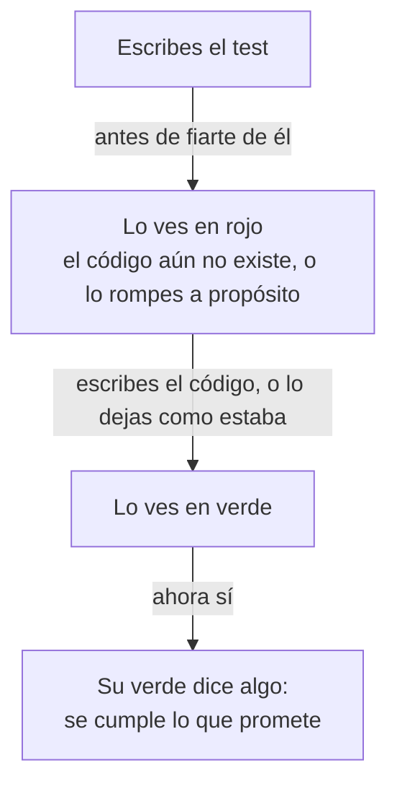

import Term from '~/components/Term.astro';
import TryIt from '~/components/TryIt.astro';
import Analogy from '~/components/Analogy.astro';
import SelfCheck from '~/components/SelfCheck.astro';
import ProjectCode from '~/components/ProjectCode.astro';
import Quiz from '~/components/Quiz.astro';
import QuizQuestion from '~/components/QuizQuestion.astro';
import QuizOption from '~/components/QuizOption.astro';

## El problema

Este test de la tienda se llama «una firma hecha con el mismo secreto vale». Firma un aviso de pago con el secreto de la tienda y comprueba que `firmaValida`, la función que decide si un aviso viene de la pasarela de pago ([Fase 4](/fase-4/webhooks-idempotencia/)), dice que sí. Sale en verde.

Ahora cambia `firmaValida` para que diga que sí a todo, también a un aviso sin firma. Esa tienda da por pagado el pedido de cualquiera que le mande un `curl`. **Y el test sigue en verde**: comprueba que una firma buena vale, y eso sigue siendo verdad.

En la [Fase 3](/fase-3/servidor-http-node/) te prometimos que aprenderías a escribir los tests que copiabas. Escribir uno son pocas líneas; lo que cuesta es saber si comprueba algo. Aquí escribes los de `firmaValida` desde un fichero vacío, ves fallar cada uno y rompes el arreglo de la cantidad de la [introducción](/fase-10/) para ver qué tests lo cazan.

## La analogía

<Analogy>

En el techo de tu casa hay un detector de humo con una lucecita verde. La luz dice que tiene pila, no que pitaría si hubiera humo. Para saberlo, aprietas el botón de prueba: si pita, funciona.

Un test en verde es esa luz. Verlo fallar a propósito es apretar el botón. Y lo que pone en la caja, «detecta humo», es su nombre: la promesa que comprueba.

<div slot="limits">

- El botón imita el humo. Para ver un test en rojo no hay imitación: rompes el código de verdad, un momento, y lo dejas como estaba.
- Un detector de humo no avisa del monóxido de carbono, y nadie se lo reprocha: no lo promete. Un test tampoco caza lo que no comprueba, aunque esté en la misma función.

</div>

</Analogy>

## Cómo funciona de verdad

### Lo que vas a probar: la firma de los webhooks

`firmaValida` calcula la firma que debería traer un aviso de pago y la compara con la que trae ([Fase 4](/fase-4/webhooks-idempotencia/#comprobar-la-firma-el-cuerpo-tal-cual-en-tiempo-constante)). La última línea mira antes que las dos tengan el mismo tamaño, porque `timingSafeEqual` solo compara cosas del mismo tamaño:

<ProjectCode file="tienda-api/42-tests/src/firma.ts" region="comprobar" />

No usa la base de datos ni la red, y con los mismos datos devuelve siempre lo mismo. Un test que prueba una pieza así, sola, es un <Term id="unit-test">test unitario</Term>. Hasta ahora, la firma solo se probaba a través de la ruta del webhook.

### Un test: un nombre y una función que comprueba

Este es `test/firma.test.ts`, el fichero de tests nuevo del paso 42. Empieza por lo marcado:

<ProjectCode file="tienda-api/42-tests/test/firma.test.ts" mark={[5, 6, 7, 9, 10, 12, 13, 14]} />

Palabra a palabra:

- **`import assert from 'node:assert/strict'`** trae las comprobaciones de Node. Con `/strict`, comparan de forma estricta, como `===` en la [lección 2 de la Fase 3](/fase-3/javascript-para-backend/): `9` y `'9'` no son iguales.
- **`import { test } from 'node:test'`** trae la función que define un test. Las dos vienen con Node ([el prefijo `node:`](/fase-3/que-es-node-js/#los-módulos-el-código-en-piezas)): nada que instalar.
- **`import { firmaValida, firmar } from '../src/firma.ts'`** trae lo que vas a probar, y `firmar`, para fabricar firmas buenas.
- **`SECRETO` y `CUERPO`** son los datos de prueba.
- **`test('…', () => { … })`** define un test: su nombre y una función sin nombre con lo que hace.
- **`assert.equal(lo que sale, lo que debería salir)`** es una <Term id="assertion">aserción</Term>: si no son iguales, lanza un error que dice los dos.

Eso es un test: código que llama al tuyo y comprueba lo que devuelve. **Node pinta `✔` si la función del test termina sin error, y `✖` si salta alguno.**

### Preparar, actuar, comprobar

Casi todos los tests tienen tres partes, en este orden: **preparar** los datos, **actuar** (llamar a lo que pruebas) y **comprobar** el resultado. En inglés, *arrange, act, assert*.

En los tests cortos, como los de la firma, actuar y comprobar caben en una línea. En los de la tienda se ven mejor. Así es «pedir menos unidades devuelve la diferencia al stock», en `test/transacciones.test.ts`:

1. **Prepara**: apunta el stock de la taza, `antes`, y hace un pedido de 5.
2. **Actúa**: cambia el pedido a 2, con un `PATCH`, como lo haría un cliente.
3. **Comprueba** un `200`, que el pedido dice 2 y que el stock es `antes - 2`: las 3 de más han vuelto.

### El nombre dice la promesa

Lee los nombres de la firma: «una firma hecha con otro secreto no vale», «sin firma no vale». Cada uno dice qué promete el código, con un caso concreto, **no «firmaValida funciona» ni «test 2»**. Es lo que lees cuando falla, y te dice qué se ha roto sin abrir el fichero.

Los once tests del arreglo de la cantidad ([pull request #48](https://github.com/backendfromscratch/backend-from-scratch/pull/48)) se escribieron así, uno por promesa, como «cambiar la cantidad y después cancelar deja el stock como antes del pedido».

El de la Fase 4 también decía lo que prometía, «cambia la cantidad y devuelve el pedido entero»: leído hoy, se ve que no habla del stock porque no lo miraba.

**Una promesa por test.** Un test se para en la primera aserción que falla: si comprueba cinco cosas, no sabes nada de las otras cuatro.

### Otras comprobaciones: deepEqual y rejects

`assert.equal` compara con `===`: sirve para números, textos, `true` y `false`. Con objetos no, porque dos objetos distintos nunca son `===`, aunque tengan lo mismo dentro.

- **`assert.deepEqual(a, b)`** compara el contenido, campo a campo. La tienda lo usa para comparar el cuerpo entero de un error de [Problem Details](/fase-4/errores-api-problem-details/), con sus cuatro campos.
- **`await assert.rejects(promesa, /mensaje/)`** es para lo que tiene que fallar y devuelve una [promesa](/fase-3/javascript-para-backend/#esperar-lo-que-tarda-promesas-async-y-await): pasa si falla con un mensaje que encaja, y falla si sale bien. «bd.transaction: si la función lanza un error, no se guarda nada de lo que hizo» comprueba así que la transacción falla, y después, que el stock está como antes.

### Rojo primero: un test que nunca ha fallado no prueba nada

Un test en verde puede pasar porque el código está bien, o porque no mira lo que crees: el de «El problema» pasa con una `firmaValida` que dice que sí a todo. **La única forma de saberlo es verlo en rojo una vez.**



Hay dos maneras de llegar al rojo:

- **Escribir el test antes que el código**, y después lo justo para que pase: el desarrollo guiado por tests (*test-driven development*, TDD).
- **Romper el código a propósito**, si ya existe: le quitas lo que el test vigila, ves el `✖` y lo dejas como estaba.

### Antes y después de los tests: before, after y describe

Para tener algo listo antes de los tests, como una base de datos con sus tablas, `node:test` trae cuatro funciones:

- **`before(función)`**: una vez, antes del primer test del fichero.
- **`after(función)`**: una vez, después del último, para recoger.
- **`beforeEach` y `afterEach`**: antes y después de cada test.

La tienda las usa desde la Fase 5: casi todos sus ficheros de tests empiezan con `usarBd()`, de `test/bd.ts`, un `before` que rehace la base de datos de los tests, con sus tablas y los datos de ejemplo, y un `after` que cierra las conexiones.

Como todos los ficheros comparten esa base de datos, `npm test` pasa los ficheros de uno en uno (`--test-concurrency=1`).

`describe('nombre', () => { … })` agrupa tests; la tienda no lo usa, porque ya tiene un fichero por tema.

### Dobles de prueba: piezas de mentira que ya conoces

Si lo que pruebas habla con algo lento, de pago o que no controlas, como un servidor de correo o Google, en el test pones en su lugar una pieza de mentira que por fuera se porta igual: un <Term id="test-double">doble de prueba</Term>. El curso ya te ha dado cuatro:

- **La pasarela de pago**, `npm run pasarela` ([Fase 4](/fase-4/webhooks-idempotencia/)): firma avisos de pago sin cobrar a nadie.
- **Mailpit** ([Fase 9](/fase-9/colas-trabajos-segundo-plano/#el-correo-mailpit-y-esperas-cortas)): un servidor de correo que lo recibe todo y no entrega nada.
- **El proveedor de OpenID Connect de práctica** ([Fase 6](/fase-6/oauth-openid-connect/#arranca-el-proveedor-de-práctica)): hace de Google. `test/oauth.test.ts` lo arranca, y lo para con un `after`.
- **`test/docker-falso.sh`**, desde el paso 40: un `docker` de mentira que apunta cada orden de `desplegar.sh`, para comprobar en qué orden cambia las copias sin arrancar ni un contenedor.

### Mocks y un reloj de mentira

Un <Term id="mock">mock</Term> es un doble que además apunta cómo lo han usado. `node:test` los trae en `mock`:

- **`mock.fn()`** crea una función de mentira que apunta cada llamada. Se la das a la tienda en lugar de, por ejemplo, la que avisa a la empresa de reparto, y compruebas que se llamó una vez, con el pedido que tocaba.
- **`mock.method(objeto, 'nombre')`** envuelve una función de un objeto: sigue haciendo lo suyo y apunta cada llamada: un espía (si le das otra función, la sustituye). En `test/correo.test.ts`, «sin SMTP_URL, no manda nada y lo dice en el log» lo usa con `log.info` y comprueba lo que escribió.

**`mock.timers`** no apunta nada: es un reloj de mentira, otro doble. La tienda ya tiene el suyo: `crearLimitador`, en `src/limites.ts`, recibe de dónde sacar la hora, y `test/limites.test.ts` le pasa `() => ahora`; cambiando `ahora`, pasa un minuto al momento. `mock.timers` hace lo mismo con `Date` y `setTimeout`, sin añadir ese parámetro ([documentación de Node](https://nodejs.org/api/test.html#mocking)).

### La base de datos no se simula

Podrías hacer lo mismo con PostgreSQL: un doble que contesta el stock que diga cada test. **No habría cazado el fallo de la cantidad.**

Ese fallo vivía en la base de datos: en qué `UPDATE` se hacía, dentro de qué <Term id="transaction">transacción</Term> y con qué bloqueos frente a la <Term id="race-condition">condición de carrera</Term> de la [Fase 5](/fase-5/transacciones-acid/#dos-compradores-una-taza-la-condición-de-carrera). Un doble contesta lo que tú creías: comprueba tu idea de PostgreSQL, no PostgreSQL.

Por eso los tests de la tienda hablan con un PostgreSQL de verdad, `tienda_test`: son <Term id="integration-test">tests de integración</Term>, y la [lección 2](/fase-10/tipos-de-tests/) cuenta cuándo compensa cada tipo. **La regla: dobles para lo que está fuera de tu tienda, no para lo que estás probando.**

### Lo que cambia en el paso 42

- **`test/firma.test.ts`**, el fichero de arriba.
- **`npm test` le pasa a Node el patrón `'test/*.test.ts'`**, en lugar de dejarle adivinar ([el reto de la introducción](/fase-10/#fichero-a-fichero)): un fichero de tests nuevo tiene que estar en `test/` y terminar en `.test.ts`.
- Por eso, **`npm test -- test/firma.test.ts` ya no pasa un solo fichero**, como en la [Fase 5](/fase-5/transacciones-acid/#los-tests), sino todos. Para uno solo: `node --env-file=test/.env --test test/firma.test.ts`.

## Pruébalo

El objetivo: escribir los tests de `firmaValida` desde un fichero vacío, ver fallar cada uno, y romper el arreglo de la cantidad para averiguar cuáles de los 18 tests de las transacciones lo cazan.

Las salidas son de Node 26, en Linux, del 24 de octubre de 2026; tus tiempos serán otros. Donde dicen `file:///p/`, en las tuyas sale la carpeta de tu proyecto (el nuestro estaba en `/p`, en un contenedor).

### Prepara el paso

Pon tu proyecto en el paso 42, como en la [introducción](/fase-10/#cada-lección-su-paso):

```sh
cd ~/curso-backend/fase-3
curl -O https://backenddesdecero.com/practicas/tienda-api/42-tests.tar.gz
tar -xzf 42-tests.tar.gz
cp -R 42-tests/. tienda-api/
cd tienda-api
npm install
```

De la carpeta `42-tests` sacarás el código bueno cada vez que lo rompas. Los tests de las transacciones necesitan PostgreSQL con `tienda_test` ([«Antes de empezar»](/fase-10/#antes-de-empezar)).

### Escribe los tests de la firma desde cero

Borra el fichero del paso: `rm test/firma.test.ts`. Queda una copia en `../42-tests/test/firma.test.ts`.

Crea `test/firma.test.ts`, vacío, en tu editor. Escribe los tres `import`, el secreto, el cuerpo de prueba y un test por cada una de estas promesas, con la promesa como nombre:

1. una firma hecha con el mismo secreto vale;
2. una firma hecha con otro secreto no vale;
3. un cuerpo cambiado en un solo byte no vale, aunque la firma sea la del original;
4. sin firma no vale (la firma es `undefined`);
5. una firma de otro tamaño no vale, y no hace fallar a `timingSafeEqual` (prueba con `'sha256=abc'` y con `''`).

Si te atascas, mira el de arriba. Guarda, y **no lo pases todavía: primero, rompe lo que prueba.** En `src/firma.ts`, cambia lo que va entre las llaves de `firmaValida` por una sola línea, `return true;`.

<TryIt
  title="1. Una firmaValida que dice que sí a todo"
  cmd="node --env-file=test/.env --test test/firma.test.ts | head -n 36"
  output={`✔ una firma hecha con el mismo secreto vale (1.292987ms)
✖ una firma hecha con otro secreto no vale (0.502269ms)
✖ un cuerpo cambiado en un solo byte no vale, aunque la firma sea la del original (0.115348ms)
✖ sin firma no vale (0.105012ms)
✖ una firma de otro tamaño no vale, y no hace fallar a timingSafeEqual (0.080217ms)
ℹ tests 5
ℹ suites 0
ℹ pass 1
ℹ fail 4
ℹ cancelled 0
ℹ skipped 0
ℹ todo 0
ℹ duration_ms 67.526169

✖ failing tests:

test at test/firma.test.ts:16:1
✖ una firma hecha con otro secreto no vale (0.502269ms)
  AssertionError [ERR_ASSERTION]: Expected values to be strictly equal:
  
  true !== false
  
      at TestContext.<anonymous> (file:///p/test/firma.test.ts:17:10)
      at Test.runInAsyncScope (node:async_hooks:226:14)
      at Test.run (node:internal/test_runner/test:1402:25)
      at Test.processPendingSubtests (node:internal/test_runner/test:974:18)
      at Test.postRun (node:internal/test_runner/test:1542:19)
      at Test.run (node:internal/test_runner/test:1467:12)
      at async startSubtestAfterBootstrap (node:internal/test_runner/harness:387:3) {
    generatedMessage: true,
    code: 'ERR_ASSERTION',
    actual: true,
    expected: false,
    operator: 'strictEqual',
    diff: 'simple'
  }`}
>

`head -n 36` deja las primeras 36 líneas. **Cuatro de cinco en rojo.** El que sigue en verde, «una firma hecha con el mismo secreto vale», solo, habría aprobado una tienda que acepta cualquier aviso.

En `true !== false` va primero lo que salió y después lo esperado, el orden de `assert.equal`. `test at test/firma.test.ts:16:1` dice dónde empieza el test, y la primera línea `at`, dónde está la aserción; tus números de línea y tu orden serán otros.

Si salen cinco `✔`, no guardaste `src/firma.ts` o tus tests no comprueban lo que crees. Si sale `SyntaxError`, el mensaje dice la línea: casi siempre, un paréntesis o una llave sin cerrar.

</TryIt>

<SelfCheck question="Reto: ¿cómo verías en rojo el primer test, el que acaba de pasar?">

Con `return false;`: falla el primero, que espera `true`, y pasan los otros cuatro.

</SelfCheck>

Deja `src/firma.ts` como estaba: `cp ../42-tests/src/firma.ts src/`. Ahora rompe otra cosa: en la última línea de `firmaValida`, quita `esperada.length === recibida.length && `, para que quede `return timingSafeEqual(esperada, recibida);`.

<TryIt
  title="2. Sin la comprobación del tamaño"
  cmd="node --env-file=test/.env --test test/firma.test.ts"
  output={`✔ una firma hecha con el mismo secreto vale (1.521925ms)
✔ una firma hecha con otro secreto no vale (0.122504ms)
✔ un cuerpo cambiado en un solo byte no vale, aunque la firma sea la del original (0.103962ms)
✔ sin firma no vale (0.071961ms)
✖ una firma de otro tamaño no vale, y no hace fallar a timingSafeEqual (0.124879ms)
ℹ tests 5
ℹ suites 0
ℹ pass 4
ℹ fail 1
ℹ cancelled 0
ℹ skipped 0
ℹ todo 0
ℹ duration_ms 72.597169

✖ failing tests:

test at test/firma.test.ts:29:1
✖ una firma de otro tamaño no vale, y no hace fallar a timingSafeEqual (0.124879ms)
  RangeError [Error]: Input buffers must have the same byte length
      at firmaValida (file:///p/src/firma.ts:21:10)
      at TestContext.<anonymous> (file:///p/test/firma.test.ts:30:16)
      at Test.runInAsyncScope (node:async_hooks:226:14)
      at Test.run (node:internal/test_runner/test:1402:25)
      at Test.processPendingSubtests (node:internal/test_runner/test:974:18)
      at Test.postRun (node:internal/test_runner/test:1542:19)
      at Test.run (node:internal/test_runner/test:1467:12)
      at async Test.processPendingSubtests (node:internal/test_runner/test:974:7) {
    code: 'ERR_CRYPTO_TIMING_SAFE_EQUAL_LENGTH'
  }`}
>

**Solo falla el quinto**, con un `RangeError` de `timingSafeEqual`: un test también falla cuando el código lanza un error. Protege la comprobación que has quitado, y ninguno de los otros cuatro la nota.

</TryIt>

<TryIt
  title="3. El código como estaba: los cinco, en verde"
  cmd={`cp ../42-tests/src/firma.ts src/\nnode --env-file=test/.env --test test/firma.test.ts`}
  output={`✔ una firma hecha con el mismo secreto vale (1.336178ms)
✔ una firma hecha con otro secreto no vale (0.106931ms)
✔ un cuerpo cambiado en un solo byte no vale, aunque la firma sea la del original (0.099972ms)
✔ sin firma no vale (0.072843ms)
✔ una firma de otro tamaño no vale, y no hace fallar a timingSafeEqual (0.088303ms)
ℹ tests 5
ℹ suites 0
ℹ pass 5
ℹ fail 0
ℹ cancelled 0
ℹ skipped 0
ℹ todo 0
ℹ duration_ms 69.199207`}
>

Cinco `✔`, y ahora su verde dice algo: has visto fallar cada uno. El fichero tarda unos 70 milisegundos: no toca la base de datos.

</TryIt>

### Rompe el arreglo de la cantidad

Ahora, los tests de un fallo real. En `src/datos.ts`, busca `async function cambiarCantidad`: tiene un `if (diferencia > 0)`, para cuando el cliente pide más unidades, y un `else if (diferencia < 0)`, para cuando pide menos.

El `else if` tiene una sola sentencia, de cuatro líneas, que empieza por `await tx`: el `UPDATE` que devuelve al stock las unidades de menos. **Coméntala**: `//` al principio de cada una de sus cuatro líneas (en VS Code, selecciónalas y pulsa <kbd>Ctrl</kbd> + <kbd>/</kbd> o <kbd>Cmd</kbd> + <kbd>/</kbd> en el Mac). Guarda.

<TryIt
  title="4. Pedir menos ya no devuelve nada al stock"
  cmd="node --env-file=test/.env --test test/transacciones.test.ts"
  output={`✔ 20 pedidos a la vez de un producto con stock 5: 5 se hacen, 15 reciben 409, y el stock queda en 0 (112.058638ms)
✔ sin bastante stock: 409, con su propio tipo y lo que queda en detail (3.099526ms)
✔ un pedido quita su cantidad del stock; cancelarlo la devuelve, una sola vez (9.019735ms)
✔ un error a mitad de la transacción deja el stock como estaba (2.581223ms)
✔ bd.transaction: si la función lanza un error, no se guarda nada de lo que hizo (1.20272ms)
✔ pedir más unidades de un pedido pendiente quita la diferencia del stock (5.31264ms)
✔ pedir más unidades de las que quedan: 409, con lo que queda, y no cambia ni el pedido ni el stock (5.135816ms)
✖ pedir menos unidades devuelve la diferencia al stock (4.999749ms)
✖ cambiar la cantidad y después cancelar deja el stock como antes del pedido (9.397845ms)
✔ cambiar la cantidad y cancelar a la vez: el stock queda como antes de los pedidos (46.529601ms)
✔ un pedido que ya no está pendiente: 409, y no cambia ni el pedido ni el stock (4.538956ms)
✔ pagar y cancelar a la vez: un pedido cancelado no vuelve a pagado, y el stock vuelve una sola vez (53.080464ms)
✔ pagar y cambiar la cantidad a la vez: el pedido queda pagado con la cantidad final, y el stock cuadra (35.630622ms)
✔ enviar y cancelar a la vez: un pedido cancelado no sale, y solo vuelve el stock de los cancelados (40.914479ms)
✔ cancelar y enviar a la vez: o se cancela y vuelve el stock, o 409 y el pedido sale tal cual (37.078515ms)
✔ si lo envían mientras se cancela, la cancelación no cambia nada y contesta 409 (5.718605ms)
✔ ejemplos/carrera.ts: leyendo y escribiendo por separado se vende de más; con un UPDATE condicional, no (580.664914ms)
✔ el contrato documenta el 409 de POST /pedidos (11.70751ms)
ℹ tests 18
ℹ suites 0
ℹ pass 16
ℹ fail 2
ℹ cancelled 0
ℹ skipped 0
ℹ todo 0
ℹ duration_ms 2121.447256

✖ failing tests:

test at test/transacciones.test.ts:145:1
✖ pedir menos unidades devuelve la diferencia al stock (4.999749ms)
  AssertionError [ERR_ASSERTION]: Expected values to be strictly equal:
  
  30 !== 33
  
      at TestContext.<anonymous> (file:///p/test/transacciones.test.ts:151:10)
      at process.processTicksAndRejections (node:internal/process/task_queues:104:5)
      at async Test.run (node:internal/test_runner/test:1409:7)
      at async Test.processPendingSubtests (node:internal/test_runner/test:974:7) {
    generatedMessage: true,
    code: 'ERR_ASSERTION',
    actual: 30,
    expected: 33,
    operator: 'strictEqual',
    diff: 'simple'
  }

test at test/transacciones.test.ts:154:1
✖ cambiar la cantidad y después cancelar deja el stock como antes del pedido (9.397845ms)
  AssertionError [ERR_ASSERTION]: Expected values to be strictly equal:
  
  29 !== 30
  
      at TestContext.<anonymous> (file:///p/test/transacciones.test.ts:160:10)
      at process.processTicksAndRejections (node:internal/process/task_queues:104:5)
      at async Test.run (node:internal/test_runner/test:1409:7)
      at async Test.processPendingSubtests (node:internal/test_runner/test:974:7) {
    generatedMessage: true,
    code: 'ERR_ASSERTION',
    actual: 29,
    expected: 30,
    operator: 'strictEqual',
    diff: 'simple'
  }`}
>

**Dos de dieciocho en rojo**, y los dos piden menos unidades:

- **«pedir menos unidades devuelve la diferencia al stock»**, con `30 !== 33`: el pedido de 5 dejó el stock en 30, y al bajar a 2 tenían que volver 3.
- **«cambiar la cantidad y después cancelar…»**, con `29 !== 30`. De 4 a 3 tenía que volver una taza, y no volvió.

Los otros dieciséis no piden menos, y siguen en verde. Si salen los dieciocho en verde, no guardaste `src/datos.ts`.

</TryIt>

<TryIt
  title="5. De vuelta al verde"
  cmd={`cp ../42-tests/src/datos.ts src/\nnode --env-file=test/.env --test test/transacciones.test.ts | tail -n 8`}
  output={`ℹ tests 18
ℹ suites 0
ℹ pass 18
ℹ fail 0
ℹ cancelled 0
ℹ skipped 0
ℹ todo 0
ℹ duration_ms 2043.899858`}
>

`tail -n 8` deja el resumen: **`pass 18`, `fail 0`**.

</TryIt>

### El fallo de verdad: todo el bloque

Lo que estuvo en la tienda veinte pasos no era esa sentencia: era que `cambiarCantidad` no movía el stock nunca. Para verlo, comenta el bloque entero, desde `if (diferencia > 0) {` hasta la llave que cierra el `else if`, incluida.

<TryIt
  title="6. Cambiar la cantidad sin tocar el stock"
  cmd="node --env-file=test/.env --test test/transacciones.test.ts | head -n 26"
  output={`✔ 20 pedidos a la vez de un producto con stock 5: 5 se hacen, 15 reciben 409, y el stock queda en 0 (103.273239ms)
✔ sin bastante stock: 409, con su propio tipo y lo que queda en detail (3.174777ms)
✔ un pedido quita su cantidad del stock; cancelarlo la devuelve, una sola vez (8.082493ms)
✔ un error a mitad de la transacción deja el stock como estaba (2.138314ms)
✔ bd.transaction: si la función lanza un error, no se guarda nada de lo que hizo (1.272719ms)
✖ pedir más unidades de un pedido pendiente quita la diferencia del stock (9.598554ms)
✖ pedir más unidades de las que quedan: 409, con lo que queda, y no cambia ni el pedido ni el stock (5.494669ms)
✖ pedir menos unidades devuelve la diferencia al stock (6.69129ms)
✖ cambiar la cantidad y después cancelar deja el stock como antes del pedido (8.108748ms)
✖ cambiar la cantidad y cancelar a la vez: el stock queda como antes de los pedidos (42.742231ms)
✔ un pedido que ya no está pendiente: 409, y no cambia ni el pedido ni el stock (4.501174ms)
✔ pagar y cancelar a la vez: un pedido cancelado no vuelve a pagado, y el stock vuelve una sola vez (52.775332ms)
✔ pagar y cambiar la cantidad a la vez: el pedido queda pagado con la cantidad final, y el stock cuadra (33.434904ms)
✔ enviar y cancelar a la vez: un pedido cancelado no sale, y solo vuelve el stock de los cancelados (41.324524ms)
✔ cancelar y enviar a la vez: o se cancela y vuelve el stock, o 409 y el pedido sale tal cual (35.483867ms)
✔ si lo envían mientras se cancela, la cancelación no cambia nada y contesta 409 (5.174145ms)
✔ ejemplos/carrera.ts: leyendo y escribiendo por separado se vende de más; con un UPDATE condicional, no (563.003915ms)
✔ el contrato documenta el 409 de POST /pedidos (10.509304ms)
ℹ tests 18
ℹ suites 0
ℹ pass 13
ℹ fail 5
ℹ cancelled 0
ℹ skipped 0
ℹ todo 0
ℹ duration_ms 2002.573979`}
>

**Cinco de dieciocho en rojo**: los dos de antes, los dos que piden más unidades y «cambiar la cantidad y cancelar a la vez». Con el fallo que vendía tazas que no había, trece siguen en verde.

</TryIt>

<SelfCheck question="Reto: «pagar y cambiar la cantidad a la vez» comprueba que el stock cuadra, y sigue en verde con el stock roto. ¿Por qué no caza el fallo?">

Lanza a la vez un pago y un cambio a 3 para diez pedidos de una taza. Si el cambio llega antes, el stock no cuadra y el test sale en rojo; si el pago llega antes, el cambio recibe un `409` y todo cuadra. Esa vez ganaron los diez pagos. **Un test solo caza lo que pasa mientras se ejecuta.** En tu ordenador puede que gane algún cambio, y entonces este también saldrá en rojo.

</SelfCheck>

Deja `src/datos.ts` como estaba (`cp ../42-tests/src/datos.ts src/`) y repite el paso 5: 18 de 18.

### En tu servidor

Esta lección solo cambia tests: en tu servidor no hay nada que copiar. Si haces push, el workflow de la [Fase 8](/fase-8/ci-cd-github-actions/) pasa `npm test`, con los tuyos, antes de publicar la imagen: si uno falla, no se publica. Antes del commit, `git diff src/` no debe enseñar nada.

## Ya lo has visto

- **El botón de prueba** del detector de humo, o la tecla «T» del diferencial del cuadro eléctrico: comprobar que salta, sin esperar al incendio.
- **Las marcas verdes de un pull request en GitHub**: tests que alguien escribió, pasados por una máquina.
- **Cada `npm test` del curso**, desde la Fase 3: los ficheros de `test/` que copiabas eran esto.

## Errores comunes

- **Fiarte de un test que nunca has visto fallar.** Puede estar en verde porque no mira nada.
- **Nombres que no dicen nada**, como «funciona» o «test 2», o **varias promesas en un test**: cuando falla, no sabes qué se ha roto.
- **Comparar objetos con `assert.equal`**, o olvidar el `await` delante de `assert.rejects`: el primero falla aunque tengan lo mismo dentro; el segundo pasa sin comprobar nada.
- **Simular la base de datos.** El doble contesta lo que tú crees, no lo que PostgreSQL hace.

## Resumen

- Un test llama a tu código y comprueba lo que devuelve, con `node:test` y `node:assert`: preparar, actuar y comprobar.
- Su nombre dice la promesa: es lo primero que lees cuando falla.
- Un test que nunca has visto fallar no prueba nada: escríbelo antes que el código, o rompe el código a propósito.
- Los dobles de prueba ocupan el lugar de lo que está fuera de la tienda; la base de datos, donde viven sus fallos, va de verdad.
- Un test solo caza lo que comprueba: con el stock roto entero, trece de los dieciocho tests de las transacciones siguieron en verde.

## ¿Lo has entendido?

<Quiz>

<QuizQuestion
  question="Escribes un test para una función nueva, precioConIva, y sale en verde a la primera. ¿Qué haces antes de fiarte de él?"
  review="Rojo primero: un test que nunca ha fallado no prueba nada"
>

<QuizOption text="Nada más: si ha pasado a la primera, la función está bien.">

Puede haber pasado porque la función está bien o porque el test no mira lo que crees. El verde, solo, no distingue entre las dos.

</QuizOption>

<QuizOption text="Romper la función a propósito y ver el test en rojo." correct>

Si se pone en rojo, vigila lo que rompiste; si sigue en verde, no comprobaba eso.

</QuizOption>

<QuizOption text="Pasarlo diez veces más, para estar seguro de que el verde no es casualidad.">

Un test que no comprueba nada pasa las diez veces.

</QuizOption>

</QuizQuestion>

<QuizQuestion
  question="Tres nombres para el mismo test de la tienda. ¿Cuál te sirve más el día que sale con ✖?"
  review="El nombre dice la promesa"
>

<QuizOption text="«cancelarPedido funciona bien en todos los casos»">

Dice qué función, no qué promete: con un `✖` delante, tienes que abrir el fichero.

</QuizOption>

<QuizOption text="«test de la cancelación número 2, el de los pedidos pagados»">

Un número y un tema no dicen qué se espera: ¿es el stock, el estado o el código de la respuesta?

</QuizOption>

<QuizOption text="«cancelar un pedido devuelve su stock una sola vez»" correct>

Es la promesa, con su caso. Si sale con `✖`, ya sabes qué ha dejado de cumplirse.

</QuizOption>

</QuizQuestion>

<QuizQuestion
  question="El test assert.equal(await res.json(), { id: 7, estado: 'pagado' }) falla, y la respuesta trae justo { id: 7, estado: 'pagado' }. ¿Por qué?"
  review="Otras comprobaciones: deepEqual y rejects"
>

<QuizOption text="Porque son dos objetos distintos, y assert.equal compara con ===." correct>

Dos objetos distintos nunca son `===`, aunque tengan lo mismo dentro. `assert.deepEqual` compara su contenido, campo a campo.

</QuizOption>

<QuizOption text="Porque res.json() devuelve el cuerpo como texto, y hay que compararlo con un texto JSON.">

`res.json()` convierte el cuerpo en datos: devuelve un objeto, no un texto. El problema está en cómo compara `assert.equal`.

</QuizOption>

<QuizOption text="Porque assert.equal quiere primero lo esperado y después lo que sale, y aquí están al revés.">

El orden solo cambia el mensaje del error. Al revés, fallaría igual: dos objetos distintos nunca son `===`.

</QuizOption>

</QuizQuestion>

<QuizQuestion
  question="Un test de cancelar falla con 12 !== 10 en la línea assert.equal(await stock(4), antes). ¿Qué ha pasado?"
  review="Escribe los tests de la firma desde cero"
>

<QuizOption text="El stock es 10 y el test esperaba 12: al cancelar faltan 2 tazas por volver.">

Va al revés: el mensaje pone primero lo que salió y después lo esperado, el mismo orden que `assert.equal`.

</QuizOption>

<QuizOption text="El stock es 12 y el test esperaba 10: han vuelto 2 tazas de más." correct>

Salió `12`, y lo esperado, `antes`, era `10`. Cancelar ha devuelto más de lo que el pedido había quitado: quizá lo devuelve dos veces.

</QuizOption>

<QuizOption text="El test está mal: si el stock real es 12, hay que cambiarlo para que espere 12.">

Así queda en verde con el fallo dentro. El test dice qué tiene que pasar; el que está mal es el código.

</QuizOption>

</QuizQuestion>

<QuizQuestion
  question="Alguien de tu equipo propone cambiar PostgreSQL, en los tests, por un doble que contesta el stock que diga cada test: irían diez veces más rápido. ¿Qué pasaría con los tests de la cantidad?"
  review="La base de datos no se simula"
>

<QuizOption text="Cazarían el fallo igual: siguen mirando el stock después de cambiar la cantidad.">

Miran el stock que contesta el doble, que es lo que escribió quien hizo el test.

</QuizOption>

<QuizOption text="Serían más fiables, porque cada test decidiría el stock exacto que necesita.">

Decidir el stock no es comprobarlo: los bloqueos de PostgreSQL, donde estaba el fallo, no pasarían nunca.

</QuizOption>

<QuizOption text="Pasarían en verde con el fallo dentro." correct>

El fallo estaba en lo que hace PostgreSQL (el `UPDATE`, la transacción, los bloqueos), y un doble no hace nada de eso.

</QuizOption>

</QuizQuestion>

<QuizQuestion
  question="Alguien de tu equipo añade un test, «pagar un pedido lo deja pagado», que paga y solo comprueba que la respuesta es 200. ¿Cazará un fallo que deja el pedido en «pendiente»?"
  review="El nombre dice la promesa"
>

<QuizOption text="No: comprueba el 200, no el estado del pedido." correct>

El nombre promete más de lo que el test mira. Para cumplirlo, tiene que leer el pedido después de pagar y comprobar que dice `pagado`.

</QuizOption>

<QuizOption text="Sí: si el pedido no quedara pagado, la ruta no contestaría 200.">

Una ruta puede contestar 200 y no guardar nada: el test solo ve lo que comprueba.

</QuizOption>

<QuizOption text="Sí, si alguien lo ha visto antes en rojo rompiendo la ruta de pago.">

Verlo en rojo dice que vigila lo que rompiste, no lo demás: si la ruta no guarda el estado pero contesta 200, sigue en verde.

</QuizOption>

</QuizQuestion>

</Quiz>

## Para profundizar

- [Test runner](https://nodejs.org/api/test.html), en la documentación de Node, en inglés: `test`, `describe`, `before`, `after` y `mock`.
- [Assert](https://nodejs.org/api/assert.html), en inglés: todas las comprobaciones de `node:assert`, y qué cambia con `/strict`.
- [Mocks Aren't Stubs](https://martinfowler.com/articles/mocksArentStubs.html), de Martin Fowler, en inglés: los tipos de dobles de prueba y cuándo usar cada uno.
- [El pull request #48](https://github.com/backendfromscratch/backend-from-scratch/pull/48) del repositorio del curso: el arreglo de la cantidad y sus once tests nuevos.
