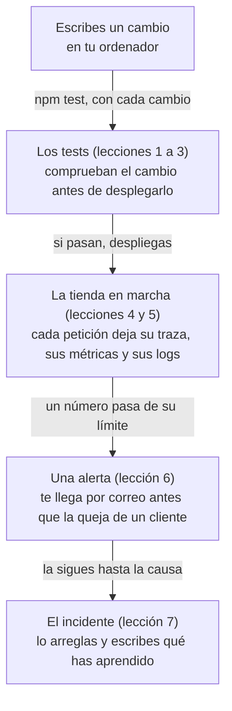

import Term from '~/components/Term.astro';
import TryIt from '~/components/TryIt.astro';
import Analogy from '~/components/Analogy.astro';
import SelfCheck from '~/components/SelfCheck.astro';

Al terminar la Fase 9, la tienda aguanta mucho más que al principio: una cola con su trabajador, una caché, dos copias que se relevan al desplegar y unos eventos que no se pierden. También tiene más de 300 tests que copiaste paso a paso y nunca escribiste, logs en JSON con un id para cada petición y una ruta, `/salud`, que dice si la API llega a su base de datos.

Lo que no tiene es nada que avise cuando algo va mal. Esta fase responde dos preguntas:

- **Antes de desplegar, ¿cómo sé que funciona?** Con tests que escribes tú, del tipo que convenga a lo que quieres comprobar.
- **Después de desplegar, ¿cómo sé que está fallando, y por qué?** Con la <Term id="observability">observabilidad</Term>, lo que la tienda cuenta de sí misma mientras trabaja, y con alertas que te avisan antes que tus clientes.

## Un fallo que nadie vio durante veinte pasos

Empecemos por un fallo de verdad, y de este curso. En la [lección de transacciones de la Fase 5](/fase-5/transacciones-acid/), la tienda empezó a reservar el stock: al hacer un pedido, las tazas salen del stock, y al cancelarlo, vuelven. Desde la [Fase 4](/fase-4/que-es-api-rest/) había además una ruta para cambiar la cantidad de un pedido pendiente, la que hoy es `PATCH /v2/pedidos/:id`. Esa ruta cambiaba el número del pedido y **no tocaba el stock**.

Por ejemplo, con 10 tazas en el almacén:

1. Carmen pide 1 taza: el stock baja a 9.
2. Cambia su pedido a 3 tazas: el stock sigue en 9, cuando debería estar en 7.
3. Cancela el pedido: vuelven sus 3 tazas, y el stock sube a 12.

La tienda cree que tiene 12 tazas, y en el almacén hay 10: puede vender dos que no existen.

El fallo estuvo ahí **veinte pasos, del 22 al 41**: el resto de la Fase 5 y las Fases 6, 7, 8 y 9 enteras. Y la ruta tenía su test, desde la Fase 4: «PATCH /pedidos/:id cambia la cantidad y devuelve el pedido entero». Cambia la cantidad a 5 y comprueba que el pedido vuelve con 5.

Lo que comprueba es verdad, y pasaba. Pero se escribió cuando la tienda aún no tenía stock, y cuando lo tuvo, nadie le añadió la pregunta que importaba: ¿y el stock? **Cientos de tests en verde, y ninguno miraba el stock después de cambiar una cantidad.**

Lo arreglamos en octubre de 2026, justo antes de escribir esta fase, en el [pull request #48](https://github.com/backendfromscratch/backend-from-scratch/pull/48) del repositorio del curso. Cambiar la cantidad mueve ahora el stock, en una transacción, y cada paso del 22 al 41 ganó los tests que lo comprueban: en el paso 41, el fichero de las transacciones pasó de 7 tests a 18.

El mismo arreglo cerró otro hueco parecido: un pago que llegaba justo mientras se cancelaba el pedido lo devolvía a «pagado», y cancelarlo otra vez devolvía su stock por segunda vez.

**Un test solo comprueba lo que alguien pensó en comprobar.** Contarlos no dice nada de lo que comprueban; lo que hace falta es saber escribirlos y saber leer qué promete cada uno. En la [lección 1](/fase-10/escribir-tests-node/) romperás a propósito ese arreglo y verás cuáles de los tests nuevos se ponen en rojo.

## Después de desplegar: cómo te enteras de que algo falla

En muchas webs, el equipo se entera de un fallo de dos maneras: alguien avisa de que la web no funciona, o salta un error en Sentry, un servicio que recoge los errores que saltan, sobre todo los del JavaScript que se ejecuta en los navegadores de los visitantes. Las dos llegan cuando el fallo ya ha pasado, y muchas veces no dicen si la culpa es del frontend o del backend.

La tienda, hoy, tiene esto para mirar por dentro:

- **Logs en JSON**, una línea por petición, con su `requestId` ([Fase 3](/fase-3/errores-y-logs-node/#un-id-para-cada-petición)), que lees con `docker compose logs`.
- **`/salud`**, que contesta `200` si la API llega a PostgreSQL ([Fase 7](/fase-7/docker-multi-stage/#healthcheck-la-tienda-está-bien)).

Con eso no puedes contestar preguntas como estas:

- **«El pago tarda tres segundos».** El log dice cuánto tardó la petición entera, no si el tiempo se fue en PostgreSQL, en Redis o en la cola.
- **«Esta mañana iba más lenta».** Un log es una línea por suceso. Para ver cómo cambia algo a lo largo del día hay que contar, minuto a minuto.
- **«No me ha llegado el correo».** Si el Redis de la cola se queda congelado, los pagos siguen contestando bien y los correos dejan de salir. Ninguna respuesta da error: te enteras cuando una clienta pregunta por el suyo.

**La observabilidad es poder contestar esas preguntas** con lo que la tienda emite mientras trabaja: los logs que ya tienes, las <Term id="metric">métricas</Term> (números que se miden a lo largo del tiempo, como los errores por minuto) y las <Term id="trace">trazas</Term> (el recorrido de una petición, pieza a pieza, con lo que tardó cada una). Y la otra mitad de la fase es la fiabilidad: comprobaciones de salud bien hechas, alertas que te llegan por correo y un orden para atender un <Term id="incident">incidente</Term> cuando llega.

## Revisar antes de salir, vigilar por el camino

<Analogy>

Antes de un viaje largo, llevas el coche al taller. Revisan los frenos, las luces y las ruedas, una cosa detrás de otra, siguiendo su lista. Si todo pasa, sales.

En la carretera, miras el cuadro de mandos: la velocidad, la temperatura del motor, la gasolina. No lo miras todo el rato: si algo pasa de su límite, se enciende un testigo. Y si el coche hace un ruido raro, el mecánico conecta su máquina y lee qué pieza falló, y cuándo.

<div slot="limits">

- El taller revisa el coche una vez antes de salir. Los tests se pasan con cada cambio, en minutos, y una máquina los pasa por ti antes de cada despliegue ([Fase 8](/fase-8/ci-cd-github-actions/)).
- El cuadro de mandos viene de fábrica. En tu API, cada número lo eliges y lo añades tú: lo que no mides, no aparece en ninguna parte.
- Un coche hace un viaje cada vez. Tu API atiende a cientos de personas a la vez, y cada petición hace su propio viaje: por eso hay una traza por petición, y no una para toda la tienda.

</div>

</Analogy>

Las revisiones del taller son los tests; el cuadro de mandos, las métricas; los testigos, las alertas; y la máquina del mecánico, las trazas y los logs.

## El mapa de la fase

Este es el camino de un cambio en la tienda al final de la fase, desde que lo escribes hasta que algo falla y lo arreglas:



Cada lección responde una pregunta, y casi todas traen un paso nuevo del proyecto:

| Lección | La pregunta | Lo que gana la tienda | Carpeta |
|---|---|---|---|
| 1. Escribir tests | ¿Cómo se escribe un test, y cómo sé que comprueba algo? | Tus primeros tests, escritos desde un fichero vacío, y el fallo de la cantidad, roto a propósito para ver sus tests en rojo | `42-tests` |
| 2. Tipos de tests | ¿Qué tipo de test me conviene en cada caso? | Un <Term id="end-to-end-test">test end-to-end</Term> que compra como un cliente de verdad, solo por HTTP, y un informe de las líneas que no ejecuta ningún test | `42-tests` |
| 3. Contrato | ¿Mis respuestas tienen la forma que espera el frontend? | <Term id="contract-test">Tests de contrato</Term> contra el documento OpenAPI, y una API que avisa cuando una respuesta rompe su contrato | `43-contrato` |
| 4. Trazas | ¿Por qué tarda este pago? | <Term id="opentelemetry">OpenTelemetry</Term> y <Term id="jaeger">Jaeger</Term>: el recorrido de un pago, de la API al trabajador, en una sola traza | `44-trazas` |
| 5. Métricas | ¿Cuántas peticiones llegan, cuántas fallan y cuánto tardan? | <Term id="prometheus">Prometheus</Term> y <Term id="grafana">Grafana</Term>, con un panel de la tienda | `45-metricas` |
| 6. Alertas | ¿Cómo me entero antes que mis clientes? | Dos comprobaciones de salud nuevas, cuatro reglas de alerta que llegan por correo, y una tienda que falla mejor cuando Redis no contesta | `46-alertas` |
| 7. Incidentes | ¿Qué hago cuando salta la alerta? | Un incidente de práctica, el Redis de la cola congelado, de principio a fin, y su <Term id="postmortem">postmortem</Term> | La misma `46-alertas` |

## Lo que vas a aprender

Al terminar esta fase sabrás:

- Escribir un <Term id="unit-test">test unitario</Term> desde un fichero vacío, y saber cuándo compensa más uno de <Term id="integration-test">integración</Term> o uno end-to-end.
- Comprobar que las respuestas de tu API cumplen el contrato que publica, en los tests y en producción.
- Seguir una petición con una traza por la API, PostgreSQL, Redis, la cola y el trabajador, leer las métricas de la tienda en un panel y encontrar los logs de esa misma petición.
- Separar «el proceso está vivo» de «puede atender», poner alertas sobre lo que notan los clientes y atender un incidente hasta escribir su postmortem.

## Las lecciones

1. [Escribir tests](/fase-10/escribir-tests-node/)
2. [Tipos de tests](/fase-10/tipos-de-tests/)
3. Contrato
4. Trazas
5. Métricas
6. Alertas
7. Incidentes

## Dónde vas a practicar

Todo, en tu ordenador, con Docker Compose como en la [Fase 9](/fase-9/). Nada de esta fase es de pago.

- **Las herramientas de observabilidad** llegan de una en una: Jaeger, para las trazas, en la lección 4; Prometheus y Grafana, para las métricas y las alertas, en la 5. Viven en un segundo fichero de Compose, `compose.observabilidad.yaml`: `docker compose up` arranca la tienda igual que en la Fase 9, y la lección 4 te enseña a sumarle ese fichero.
- **Caben en un Docker pequeño.** Con la tienda entera y las tres herramientas, nueve contenedores, a nuestra máquina virtual de Docker de 2 GB le quedaban unos 645 MB disponibles en reposo, y unos 530 durante una prueba de carga.
- **Las medidas** están hechas en un MacBook con Docker en Colima (otra forma de tener Docker en el Mac, como Docker Desktop), en una máquina virtual de 2 GB. **Tus números serán otros:** compara tu antes y tu después entre sí, no con los nuestros.
- **Si tu tienda ya está en tu servidor,** cada push sigue desplegando, y los pasos 42 a 46 funcionan allí sin nada nuevo: las trazas y las métricas solo se mandan si les das una dirección, y en el servidor no hay ninguna. Donde haya algo que copiar al servidor, la lección lo dice al final.
- **En Windows,** todo se hace en WSL, con Docker como en la [introducción de la Fase 7](/fase-7/).

## Antes de empezar

Necesitas lo mismo que al final de la Fase 9:

- **Docker en marcha en tu ordenador.**
- **Tu proyecto, en `~/curso-backend/fase-3/tienda-api`,** al día con el paso `41-eventos` y con tu `.env`: el que usas desde la [Fase 7](/fase-7/docker-compose/), con `POSTGRES_PASSWORD` y tus secretos.
- **PostgreSQL 18 en tu ordenador, con la base de datos `tienda_test`,** como en la [introducción de la Fase 5](/fase-5/): los tests la usan, la vacían y la vuelven a llenar cada vez.
- **Un Redis para los tests que lo usan** (la caché, la cola, los límites de intentos). Sin él no fallan: se saltan, y no comprueban nada.

El Redis de la tienda no sirve para esto, porque Compose no publica su puerto en tu ordenador. Arranca otro, aparte, solo para los tests:

```sh
docker run --rm -d --name redis-tests -p 127.0.0.1:6379:6379 redis:8
```

Después, en `test/.env`, quita el `#` del principio de la última línea, para que quede `REDIS_URL_TESTS=redis://localhost:6379/1`. Los tests usan sus propias bases de datos de ese Redis, la 1 y la 2. Cuando termines la fase, lo paras con `docker stop redis-tests`, y como lo arrancaste con `--rm`, se borra.

### Si prefieres empezar limpio

Si tu proyecto se ha quedado a medias, empieza con el final de la Fase 9, como en la [introducción de la Fase 9](/fase-9/#si-prefieres-empezar-limpio): desde `~/curso-backend/fase-3`, `curl -O https://backenddesdecero.com/practicas/tienda-api/41-eventos.tar.gz`, `tar -xzf 41-eventos.tar.gz`, `mv tienda-api tienda-api-antes` y `mv 41-eventos tienda-api`. Después, copia tu `.env` con `cp tienda-api-antes/.env tienda-api/` e instala las dependencias con `npm install` dentro de `tienda-api`.

### Cada lección, su paso

Las lecciones 1, 3, 4, 5 y 6 traen su paso, de `42-tests` a `46-alertas`, y todas lo ponen igual que en la Fase 9: desde `~/curso-backend/fase-3`, lo descargan y lo copian encima de tu proyecto. Para la lección 1:

```sh
cd ~/curso-backend/fase-3
curl -O https://backenddesdecero.com/practicas/tienda-api/42-tests.tar.gz
tar -xzf 42-tests.tar.gz
cp -R 42-tests/. tienda-api/
```

Cada paso es el proyecto entero, tal como queda al final de su lección: copiarlo encima pone el tuyo al día, y pisa lo que hubieras cambiado a mano.

No trae `.env`, así que el tuyo se queda, ni `node_modules`: después de copiarlo, `npm install` dentro de `tienda-api` instala lo que el paso haya añadido a `package.json`. Ningún paso borra ficheros del anterior. Las lecciones 2 y 7 no traen paso: usan el de la lección anterior.

## Pruébalo: cuenta los tests de tu tienda

El objetivo: averiguar cuántos tests tiene de verdad tu tienda, cuál es el fichero que más tiene, y ejecutar los que habrían cazado el fallo de la cantidad.

Todo, desde tu proyecto, con la tienda tal como la dejó la Fase 9 (el paso `41-eventos`). Las salidas son de Node 26, en Linux; tus tiempos serán otros.

### Todos a la vez

<TryIt
  title="1. Todos los tests de la tienda"
  cmd={`cd ~/curso-backend/fase-3/tienda-api\nnpm test`}
  output={`ℹ suites 0
ℹ pass 322
ℹ fail 0
ℹ cancelled 0
ℹ skipped 0
ℹ todo 0
ℹ duration_ms 129085.598129`}
>

Antes de este final salen cientos de líneas, una por test, con su `✔`; aquí está solo el resumen. Fíjate en **`pass 322`** y **`fail 0`**: 322 tests, según Node, todos en verde. Y en `duration_ms`: unos dos minutos, en nuestra máquina.

Si `skipped` no es `0`, y `pass` baja otro tanto, no es un fallo, pero esos tests no han comprobado nada: no encuentran el Redis de los tests. Mira que `redis-tests` esté en marcha (`docker ps`) y que la línea `REDIS_URL_TESTS` de `test/.env` no empiece por `#`, como en [«Antes de empezar»](#antes-de-empezar). Si el primero que falla dice `¿Está PostgreSQL arrancado?`, revisa que PostgreSQL esté en marcha y que exista `tienda_test`. Si después del resumen salen unas líneas `npm notice` que hablan de una versión nueva de npm, son de npm, no de los tests: no tienes que hacer nada.

</TryIt>

### Fichero a fichero

`npm test` los ejecuta todos de una vez. Para contarlos fichero a fichero, puedes pasarle a Node los ficheros de uno en uno con un `for` de la [Fase 1](/fase-1/scripts-de-bash/#for-repetir-lo-mismo-con-cada-elemento):

<TryIt
  title="2. Cuántos tests tiene cada fichero"
  cmd={`for f in test/*.test.ts; do printf '%-36s ' "$f"; node --env-file=test/.env --test "$f" | grep -E '^ℹ (tests|pass|fail) ' | tr '\\n' ' '; echo; done`}
  output={`test/almacen-redis.test.ts           ℹ tests 4 ℹ pass 4 ℹ fail 0 
test/apagado.test.ts                 ℹ tests 7 ℹ pass 7 ℹ fail 0 
test/cache.test.ts                   ℹ tests 14 ℹ pass 14 ℹ fail 0 
test/claves.test.ts                  ℹ tests 4 ℹ pass 4 ℹ fail 0 
test/cola.test.ts                    ℹ tests 7 ℹ pass 7 ℹ fail 0 
test/compose.test.ts                 ℹ tests 6 ℹ pass 6 ℹ fail 0 
test/contrasenas.test.ts             ℹ tests 9 ℹ pass 9 ℹ fail 0 
test/correo.test.ts                  ℹ tests 4 ℹ pass 4 ℹ fail 0 
test/csrf-ssrf.test.ts               ℹ tests 9 ℹ pass 9 ℹ fail 0 
test/despliegue-ficheros.test.ts     ℹ tests 23 ℹ pass 23 ℹ fail 0 
test/docker.test.ts                  ℹ tests 6 ℹ pass 6 ℹ fail 0 
test/errores.test.ts                 ℹ tests 4 ℹ pass 4 ℹ fail 0 
test/escalado.test.ts                ℹ tests 13 ℹ pass 13 ℹ fail 0 
test/eventos.test.ts                 ℹ tests 11 ℹ pass 11 ℹ fail 0 
test/indices.test.ts                 ℹ tests 4 ℹ pass 4 ℹ fail 0 
test/inyeccion-xss.test.ts           ℹ tests 4 ℹ pass 4 ℹ fail 0 
test/jwt.test.ts                     ℹ tests 6 ℹ pass 6 ℹ fail 0 
test/limites.test.ts                 ℹ tests 6 ℹ pass 6 ℹ fail 0 
test/migraciones.test.ts             ℹ tests 6 ℹ pass 6 ℹ fail 0 
test/modelo.test.ts                  ℹ tests 10 ℹ pass 10 ℹ fail 0 
test/oauth.test.ts                   ℹ tests 6 ℹ pass 6 ℹ fail 0 
test/openapi.test.ts                 ℹ tests 10 ℹ pass 10 ℹ fail 0 
test/orm.test.ts                     ℹ tests 9 ℹ pass 9 ℹ fail 0 
test/paginacion.test.ts              ℹ tests 9 ℹ pass 9 ℹ fail 0 
test/postgres.test.ts                ℹ tests 7 ℹ pass 7 ℹ fail 0 
test/problemas.test.ts               ℹ tests 9 ℹ pass 9 ℹ fail 0 
test/produccion-ficheros.test.ts     ℹ tests 14 ℹ pass 14 ℹ fail 0 
test/produccion.test.ts              ℹ tests 8 ℹ pass 8 ℹ fail 0 
test/proveedor-opcional.test.ts      ℹ tests 5 ℹ pass 5 ℹ fail 0 
test/proxy.test.ts                   ℹ tests 6 ℹ pass 6 ℹ fail 0 
test/rest.test.ts                    ℹ tests 12 ℹ pass 12 ℹ fail 0 
test/roles.test.ts                   ℹ tests 8 ℹ pass 8 ℹ fail 0 
test/serializacion.test.ts           ℹ tests 6 ℹ pass 6 ℹ fail 0 
test/sesiones.test.ts                ℹ tests 9 ℹ pass 9 ℹ fail 0 
test/tiempo-real.test.ts             ℹ tests 7 ℹ pass 7 ℹ fail 0 
test/transacciones.test.ts           ℹ tests 18 ℹ pass 18 ℹ fail 0 
test/versiones.test.ts               ℹ tests 9 ℹ pass 9 ℹ fail 0 
test/webhooks.test.ts                ℹ tests 11 ℹ pass 11 ℹ fail 0 `}
>

Palabra a palabra:

- **`for f in test/*.test.ts; do … done`** repite lo de en medio con cada fichero de `test/` que termina en `.test.ts`, y lo guarda en la variable `f`.
- **`printf '%-36s ' "$f"`** escribe el nombre del fichero, rellenado con espacios hasta 36 caracteres, para que las cifras queden en columna.
- **`node --env-file=test/.env --test "$f"`** es lo que hace `npm test`, pero con un solo fichero: lee las variables de los tests y ejecuta los de ese fichero.
- **`grep -E '^ℹ (tests|pass|fail) '`** se queda con tres líneas del resumen, y **`tr '\n' ' '`** las junta en una, cambiando cada salto de línea por un espacio.
- **`echo`** termina la línea del fichero.

Tarda algo más que `npm test`, porque arranca Node una vez por fichero. Son 38 ficheros, y el que más tests tiene es `despliegue-ficheros.test.ts`, con 23. Si en alguno `pass` es menor que `tests` sin ningún `fail`, son tests de Redis que se han saltado, en `almacen-redis`, `cache`, `cola`, `escalado` o `eventos`. La columna `tests` los cuenta igual, se salten o no, así que la suma no cambia.

</TryIt>

Si sumas la columna `tests`, salen 320. `npm test` dijo 322.

<SelfCheck question="Reto: ¿de dónde salen los dos tests de más? Pista: mira qué hay en test/ con ls test.">

En `test/` hay dos ficheros que no terminan en `.test.ts`: `bd.ts`, que prepara la base de datos de los tests, e `identidades.ts`, que crea las sesiones de Ana, Carmen y las demás cuentas. Son ayudantes: los usan los tests, pero no tienen ninguno dentro.

`npm test` ejecuta `node --test` sin decirle qué ficheros. Entonces Node busca él solo, con unos patrones por defecto, y uno de ellos es «cualquier fichero `.ts` dentro de una carpeta `test`». Ejecuta los dos ayudantes y cuenta cada uno como un test que pasa, porque se ejecutan sin error. 320 más 2, 322.

Tu bucle, en cambio, solo cogía `test/*.test.ts`. Es lo que hará `npm test` desde el paso 42: decirle a Node qué ficheros son tests, en lugar de dejar que los adivine. Hasta el número de tests hay que comprobarlo.

</SelfCheck>

### Uno solo: los tests del fallo de la cantidad

<TryIt
  title="3. Los tests de las transacciones"
  cmd="node --env-file=test/.env --test test/transacciones.test.ts"
  output={`✔ 20 pedidos a la vez de un producto con stock 5: 5 se hacen, 15 reciben 409, y el stock queda en 0 (100.753757ms)
✔ sin bastante stock: 409, con su propio tipo y lo que queda en detail (3.209982ms)
✔ un pedido quita su cantidad del stock; cancelarlo la devuelve, una sola vez (7.548207ms)
✔ un error a mitad de la transacción deja el stock como estaba (1.927415ms)
✔ bd.transaction: si la función lanza un error, no se guarda nada de lo que hizo (1.039891ms)
✔ pedir más unidades de un pedido pendiente quita la diferencia del stock (5.831421ms)
✔ pedir más unidades de las que quedan: 409, con lo que queda, y no cambia ni el pedido ni el stock (7.190422ms)
✔ pedir menos unidades devuelve la diferencia al stock (4.35477ms)
✔ cambiar la cantidad y después cancelar deja el stock como antes del pedido (8.74809ms)
✔ cambiar la cantidad y cancelar a la vez: el stock queda como antes de los pedidos (48.54786ms)
✔ un pedido que ya no está pendiente: 409, y no cambia ni el pedido ni el stock (4.646791ms)
✔ pagar y cancelar a la vez: un pedido cancelado no vuelve a pagado, y el stock vuelve una sola vez (54.543942ms)
✔ pagar y cambiar la cantidad a la vez: el pedido queda pagado con la cantidad final, y el stock cuadra (35.639666ms)
✔ enviar y cancelar a la vez: un pedido cancelado no sale, y solo vuelve el stock de los cancelados (38.122492ms)
✔ cancelar y enviar a la vez: o se cancela y vuelve el stock, o 409 y el pedido sale tal cual (36.935843ms)
✔ si lo envían mientras se cancela, la cancelación no cambia nada y contesta 409 (19.130816ms)
✔ ejemplos/carrera.ts: leyendo y escribiendo por separado se vende de más; con un UPDATE condicional, no (564.929326ms)
✔ el contrato documenta el 409 de POST /pedidos (11.111243ms)
ℹ tests 18
ℹ suites 0
ℹ pass 18
ℹ fail 0
ℹ cancelled 0
ℹ skipped 0
ℹ todo 0
ℹ duration_ms 2043.899858`}
>

Es la misma orden del bucle, con un solo fichero y sin `grep`: sale cada test con su nombre, su `✔` y lo que tardó.

Fíjate en los nombres: cada uno dice lo que promete la tienda. **«cambiar la cantidad y después cancelar deja el stock como antes del pedido»** es justo el ejemplo de Carmen, de arriba. Los once que van de «pedir más unidades de un pedido pendiente…» a «si lo envían mientras se cancela…» son los que llegaron con el arreglo: antes de él, este fichero tenía 7.

Si tu fichero tiene 7 tests y no 18, o alguno de los once falla, tu proyecto es de antes del arreglo: descarga otra vez `41-eventos` y cópialo encima, como en [«Cada lección, su paso»](#cada-lección-su-paso).

</TryIt>

### Lo que este número no dice

Los 320 tests en verde dicen que la tienda cumple 320 cosas que alguien pensó en comprobar. No dicen cuáles faltan: durante veinte pasos, faltó una. En la lección 1, [«Escribir tests»](/fase-10/escribir-tests-node/), escribirás tus primeros tests desde un fichero vacío, verás cada uno fallar antes de pasar, y después romperás a propósito el arreglo de la cantidad para ver cuáles de estos once se ponen en rojo.
