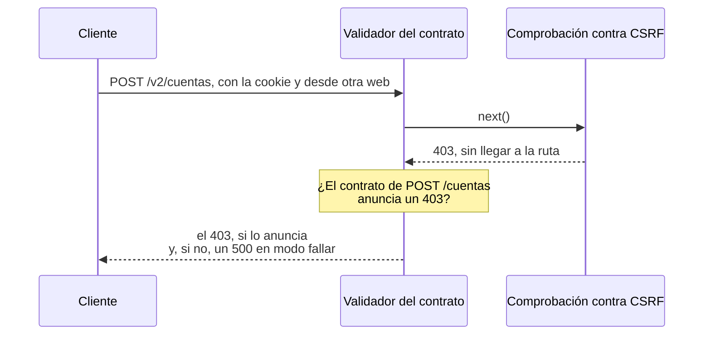

import Term from '~/components/Term.astro';
import TryIt from '~/components/TryIt.astro';
import Analogy from '~/components/Analogy.astro';
import SelfCheck from '~/components/SelfCheck.astro';
import ProjectCode from '~/components/ProjectCode.astro';
import Quiz from '~/components/Quiz.astro';
import QuizQuestion from '~/components/QuizQuestion.astro';
import QuizOption from '~/components/QuizOption.astro';

## El problema

Imagina que haces el frontend de la tienda. Una mañana, la ficha de la taza dice «NaN €». En la pestaña Red de <Term id="devtools">DevTools</Term>, la respuesta de `GET /v2/productos/2` trae `"precio": 850`, y tu código lee `precioCentimos`. ¿Lo has roto tú, o el backend?

Quien escribe este curso viene del frontend, y eso es lo que más echaba de menos: algo que diga que el fallo es del backend, **«un fallo del DTO»**. Un DTO (*data transfer object*, «objeto para transferir datos») es la forma de los datos que viajan de una parte a otra: aquí, el JSON de una respuesta.

Quién tiene razón ya está escrito en el <Term id="api-contract">contrato de la API</Term>, el documento OpenAPI de la [Fase 4](/fase-4/openapi-swagger/): si la respuesta no cumple lo que promete, el fallo es del backend. En esta lección, la tienda lo comprueba ella misma, en los tests y en producción.

## La analogía

<Analogy>

Una panadería sirve cada mañana a veinte cafeterías, y con cada una firmó una hoja: qué lleva cada caja. Antes de cargar la furgoneta, alguien compara cada caja con su hoja. Si falta algo, lo apunta y la manda igual, o no la manda y avisa. Así la cafetería no descubre el fallo delante de sus clientes, sin saber si fue cosa del horno o del reparto.

<div slot="limits">

- Comparar cada caja cuesta tiempo, y en la API también: en nuestras pruebas, entre un 5 y un 15 % menos de peticiones por segundo, según la pasada.
- La hoja dice lo que tiene que haber, no lo que no puede haber: un bollo de regalo pasa. En la API, un campo de más también pasa, aunque sea un dato que no debía salir.

</div>

</Analogy>

## Cómo funciona de verdad

### Un contrato es lo que el frontend da por hecho

El frontend lee `producto.precioCentimos` porque `/v2/openapi.json` lo promete: un producto tiene `id`, `nombre`, `precioCentimos`, `stock` y `categorias`, todos obligatorios.

Un **<Term id="contract-test">test de contrato</Term>** coge una respuesta de verdad y la compara con lo que el documento promete para esa ruta y ese código: los campos, sus nombres y sus tipos. No todos los cambios importan igual. Uno que hace fallar a un cliente que funcionaba es un <Term id="breaking-change">cambio que rompe</Term> ([Fase 4](/fase-4/versionado-api/#un-cambio-rompe-si-un-cliente-que-funcionaba-deja-de-funcionar)):

| Cambio en una respuesta | ¿Rompe? |
|---|---|
| Añadir un campo, `descripcion` | No: quien no lo conoce no lo lee |
| Renombrar o quitar un campo | Sí: quien lo leía recibe `undefined` |
| Cambiar su tipo, `stock` de número a texto | Sí: `"60" + 1` da `"601"` |
| Un código de estado que el contrato no anuncia | Depende: el cliente no sabe qué hacer con él |

### TypeScript mira el código, no los datos

En la [Fase 4](/fase-4/openapi-swagger/#typescript-comprueba-que-el-código-cumple-el-contrato) viste que `npm run check` falla si una ruta devuelve algo que su contrato no tiene. Es la primera barrera, pero comprueba lo que el código **dice** que son los datos, no lo que son al ejecutarse ([Fase 3](/fase-3/typescript-con-node/#node-borra-los-tipos-al-ejecutar)). Hay sitios donde el código lo afirma sin comprobarlo:

- **La caché de la [Fase 9](/fase-9/cache-redis/)** da por bueno lo que lee de Redis con `JSON.parse(guardado) as T`. Tras un despliegue que renombra un campo, puede servir la forma vieja durante el minuto que dura la clave.
- **Un `count(*)` llega como texto** ([Fase 5](/fase-5/postgresql-node-js/#de-filas-a-json-nombres-fechas-y-count)), aunque el código diga que es un número.

Y Zod valida lo que entra, no lo que sale: el agujero que dejó abierto la [Fase 4](/fase-4/openapi-swagger/#lo-que-el-contrato-no-comprueba). Esta lección lo cierra comprobando las respuestas **al ejecutarse**.

### Un validador hecho con el propio contrato

Los esquemas de OpenAPI 3.1 son <Term id="json-schema">JSON Schema</Term>, y en Node el programa más usado para comprobar un dato contra un esquema es **Ajv**, que el paso 43 instala en su versión 8.20.0. El documento es el mismo que publica `/v2/openapi.json`, en `src/contrato-respuestas.ts`:

<ProjectCode file="tienda-api/43-contrato/src/contrato-respuestas.ts" region="documento" />

Con él, `crearValidador`, en el mismo fichero, compila el esquema de cada respuesta la primera vez que hace falta, y lo guarda. Si algo no cumple, dice **dónde** (`/precioCentimos`), **qué regla** de JSON Schema falla (`required`, `type`) y un mensaje, pero **nunca el valor**: una respuesta puede llevar el email de alguien, y esto acaba en el log.

### Los tests de contrato: cada ruta, con su respuesta de verdad

Los tests lo usan con `cumpleContrato`, en `test/contrato.ts`:

<ProjectCode file="tienda-api/43-contrato/test/contrato.ts" />

Recibe una respuesta de `app.request` y la ruta como la escribe el documento, con llaves. Lee una copia (`res.clone()`), y si hay fallos, el mensaje los lista uno por línea.

`test/contrato.test.ts` tiene, para cada ruta de `/v2`, una petición que da la respuesta buena y otra que da un error, un <Term id="problem-details">Problem Details</Term>. Un test más comprueba que la lista está completa: **una ruta nueva sin su caso no pasa**. En total, 57 tests.

### En los tests, cada respuesta pasa por el contrato

Un <Term id="middleware">middleware</Term> nuevo, `validarRespuestas`, deja responder a la ruta y después compara lo que ha respondido con el contrato. Solo mira las respuestas JSON de `/v2`: un `204` sin cuerpo, un flujo de eventos o la página `/tienda` pasan sin tocar.

Qué hace con una respuesta que no cumple lo decide `VALIDAR_RESPUESTAS`, y `test/.env` dice `fallar`: **la cambia por un `500`**. Así, cada test que pide algo a `/v2` también comprueba el contrato.

### Lo que encontró en la propia tienda

La primera vez que pasaron los tests con `fallar`, mientras se construía el paso 43, cinco tests que estaban en verde se pusieron en rojo. No fallaba ningún DTO: **fallaba el contrato**. Las rutas que reciben un cuerpo responden `400` si el JSON está mal escrito y `415` si no dice que es JSON (`Content-Type: application/json`), y el contrato no lo anunciaba desde que existe, en el paso 14.

Otro hueco no lo encontró el validador, sino quienes construyeron y revisaron el paso, leyendo el código: la comprobación contra <Term id="csrf">CSRF</Term> de la [Fase 6](/fase-6/csrf-ssrf/#segunda-muralla-de-dónde-viene-la-petición) responde `403` en `POST /v2/cuentas`, `POST /v2/sesion`, `DELETE /v2/sesion` y `POST /v2/webhooks/pagos`, y ninguna lo anunciaba. El validador no podía verlo: estaba montado detrás de esa comprobación.

El contrato del paso 43 anuncia el `400`, el `415` y el `403`, y cada `403` tiene su test. **Un validador encuentra lo que pasa por delante de él; lo demás, alguien leyendo el código.**

### El validador va justo después del registro

Un middleware solo ve lo que responden los que van detrás de él, dentro de su `next()` ([Fase 3](/fase-3/que-es-middleware/#el-orden-importa)). Al principio, el validador iba justo antes de las rutas, y un `403` de la comprobación contra CSRF salía sin pasar por él. Ahora va el tercero, en `src/app.ts`, después de `requestId()` y de `registro`:



### Un 500 no rompe el contrato

Ninguna ruta anuncia un `500`: no es una respuesta prometida, es una avería. Al principio, el validador lo contaba como rotura, y cada caída de PostgreSQL habría dejado también un aviso del contrato; en `fallar`, además, el «Internal Server Error» de verdad se cambiaba por «La respuesta no cumple el contrato», y la causa quedaba escondida.

Ahora deja pasar cualquier `5xx`: `app.onError` ya lo apunta en el log ([Fase 4](/fase-4/errores-api-problem-details/#el-500-y-su-instance)).

### Tres modos: no, registrar y fallar

| `VALIDAR_RESPUESTAS` | Una respuesta que rompe el contrato… | Dónde lo pone el paso |
|---|---|---|
| `no` | Sale tal cual, y nadie se entera | Si no lo pones, y en `.env.produccion.ejemplo` |
| `registrar` | Sale tal cual, y deja un aviso (`warn`), «respuesta fuera del contrato» | `.env.ejemplo`, para tu ordenador |
| `fallar` | Se cambia por un `500`, y deja la misma línea con nivel `error` | `test/.env` |

El aviso lleva el `requestId`, la ruta, el código y los fallos, **nunca el cuerpo**.

**En producción, el que tiene sentido es `registrar`.** `fallar` cambiaría por un `500`, para todos a la vez, una respuesta que el frontend quizá sabía leer a medias. `registrar` no cambia lo que recibe nadie, pero cuesta, probablemente porque Ajv recorre cada respuesta entera. Por eso el paso lo deja en `no` en producción, hasta que lo midas.

### Del X-Request-Id del navegador a la línea del log

Cada respuesta de la tienda lleva una cabecera `X-Request-Id` ([Fase 3](/fase-3/errores-y-logs-node/#un-id-para-cada-petición)). Con `registrar`, ese id te lleva del navegador al fallo:

1. **En la pestaña Red**, en las cabeceras de la respuesta que falló, copias `x-request-id`.
2. **En el servidor**, buscas ese id en el log de la API.
3. **Si sale un aviso «respuesta fuera del contrato»**, el fallo es del backend, y dice qué campo. Si solo sale la línea de la petición, con un `2xx` o un `4xx` de `/v2`, la respuesta cumplía: mira el frontend.

Sentry, el servicio que recoge los errores del frontend, te da el mismo id si tu código lo apunta junto al error. Si tu frontend está en otra web, la API tiene que nombrar la cabecera en `Access-Control-Expose-Headers` ([CORS](/fase-2/que-es-cors/)) para que tu JavaScript pueda leerla.

### La instantánea: contrato.json

Los tests de contrato comparan el código con el documento. Si alguien renombra `precioCentimos` en el esquema de Zod **y** en la ruta, los dos siguen de acuerdo y todo pasa: el contrato ha cambiado sin que nadie lo vea.

Por eso el paso guarda en Git el contrato publicado, `contrato.json`, que `npm run contrato` vuelve a escribir, y dos tests lo comparan con el que genera la API:

<ProjectCode file="tienda-api/43-contrato/test/contrato.test.ts" region="instantanea" />

El primero compara el contenido, y su mensaje dice qué hacer; el segundo, letra a letra, para que el fichero sea justo lo que escribe `npm run contrato`. Así, **cada cambio del contrato llega a la revisión como un diff de `contrato.json`**, las líneas que cambian. Herramientas como [oasdiff](https://github.com/oasdiff/oasdiff) comparan dos documentos OpenAPI y dicen qué cambios rompen.

### Contratos que escribe el cliente: Pact

Otra forma: cada cliente escribe lo que usa, y los tests de la API comprueban lo de todos. La herramienta más conocida es [Pact](https://docs.pact.io/), y compensa con muchos equipos; a la tienda le basta su contrato.

## Pruébalo

El objetivo: romper el contrato de una ruta a propósito, ver qué capa lo caza primero, qué recibe un cliente en cada modo y cuánto cuesta vigilarlo. Las salidas son de Node 26, en Linux, del 24 de octubre de 2026; tus ids, tiempos y números serán otros.

### Prepara el paso

Pon tu proyecto en el paso 43, como en la [introducción](/fase-10/#cada-lección-su-paso):

```sh
cd ~/curso-backend/fase-3
curl -O https://backenddesdecero.com/practicas/tienda-api/43-contrato.tar.gz
tar -xzf 43-contrato.tar.gz
cp -R 43-contrato/. tienda-api/
cd tienda-api
npm install
```

Los tests necesitan PostgreSQL con `tienda_test` y el Redis de los tests ([«Antes de empezar»](/fase-10/#antes-de-empezar)).

### Cambia el nombre de un campo

En `src/v2.ts`, busca la ruta de ver un producto, `v2.openapi(contrato.verProducto, …)`. Su última línea es `return c.json(producto, 200);`. Bórrala y escribe dos en su lugar: primero, `const { precioCentimos, ...resto } = producto;`, que separa el campo `precioCentimos` y deja todo lo demás en `resto`; después, `return c.json({ ...resto, precio: precioCentimos }, 200);`, que responde el producto con el precio bajo otro nombre, `precio`. Guarda.

<TryIt
  title="1. TypeScript lo caza primero"
  cmd="npm run check"
  output={`> tienda-api@1.0.0 check
> tsc --noEmit

src/v2.ts(79,34): error TS2345: Argument of type '(c: Context<Entorno, "/productos/:id", { in: { param: { id: unknown; }; }; out: { param: { id: number; }; }; }>) => Promise<JSONRespondReturn<...> | JSONRespondReturn<...>>' is not assignable to parameter of type 'Handler<Entorno, "/productos/:id", { in: { param: { id: unknown; }; }; out: { param: { id: number; }; }; }, MaybePromise<RouteConfigToTypedResponse<{ method: "get"; path: "/productos/{id}"; tags: string[]; summary: string; request: { params: ZodObject<...>; }; responses: { ...; }; } & { ...; }>>>'.
…
            Types of property '_data' are incompatible.
              Property 'precioCentimos' is missing in type '{ id: number; nombre: string; stock: number; categorias: string[]; precio: number; }' but required in type '{ id: number; nombre: string; precioCentimos: number; stock: number; categorias: string[]; }'.`}
>

Hemos quitado cinco líneas del medio. La última dice la causa: **falta `precioCentimos`**.

Tampoco se construye la imagen: el `Dockerfile` pasa `npm run check` en su etapa `comprobar` ([Fase 7](/fase-7/docker-multi-stage/#por-qué-la-final-copia-de-comprobar)), y `docker compose up --build` se para con `failed to solve: process "/bin/sh -c npm run check" did not complete successfully: exit code: 1`.

</TryIt>

### Los tests de contrato, sin TypeScript

Node borra los tipos sin comprobarlos, así que los tests corren aunque `npm run check` falle:

<TryIt
  title="2. El test de contrato, con fallar"
  cmd="node --env-file=test/.env --test test/contrato.test.ts | grep -A 5 'failing tests'"
  output={`✖ failing tests:

test at test/contrato.test.ts:302:3
✖ GET /productos/{id}: la respuesta buena cumple el contrato (6.574118ms)
  AssertionError [ERR_ASSERTION]: GET /productos/{id} → 500 no cumple el contrato:
    (raíz): el contrato no describe un 500 para GET /productos/{id} [sin-respuesta-en-el-contrato]`}
>

`grep -A 5` saca la línea que busca y las cinco siguientes. Falla 1 de 57, pero **el mensaje habla de un `500`, no del campo**: con `fallar`, el middleware ha cambiado la respuesta antes de que el test la viera. Si sale `ECONNREFUSED`, PostgreSQL no está en marcha.

</TryIt>

Para ver la respuesta real, apaga el validador en esta ejecución: una variable que ya está en el entorno manda sobre la de `--env-file`.

<TryIt
  title="3. El mismo test, con el validador apagado"
  cmd="VALIDAR_RESPUESTAS=no node --env-file=test/.env --test test/contrato.test.ts | grep -A 5 'failing tests'"
  output={`✖ failing tests:

test at test/contrato.test.ts:302:3
✖ GET /productos/{id}: la respuesta buena cumple el contrato (4.594423ms)
  AssertionError [ERR_ASSERTION]: GET /productos/{id} → 200 no cumple el contrato:
    /precioCentimos: must have required property 'precioCentimos' [required]`}
>

Un `200` al que **le falta `/precioCentimos`**. Fallan 2 de 57: el otro, que `grep` no enseña, vigila que `test/.env` diga `fallar`.

</TryIt>

Con `npm test` entero, fallan **19 de 382**: el de contrato y 18 de siempre, casi todos tests que leen un producto por su id.

### Lo que recibe un cliente en cada modo

Para construir la imagen hay que pasar TypeScript. En tu segunda línea, justo antes de `, 200)`, escribe `as unknown as typeof producto`. Es una afirmación sin comprobar: le dice a TypeScript «este objeto es un producto, créeme», y se lo cree, aunque le falte `precioCentimos`. **Es lo que hace la caché con `JSON.parse(guardado) as T`**, y por eso hace falta comprobar al ejecutar.

En tu `.env`, añade `VALIDAR_RESPUESTAS=no`, y arranca con `docker compose up -d --build --wait`. Si `docker compose port api 3000` dice `3001`, usa ese puerto.

<TryIt
  title="4. Modo no"
  cmd={`curl -si localhost:3000/v2/productos/2; echo\ndocker compose logs api --no-log-prefix | grep 'fuera del contrato'`}
  output={`HTTP/1.1 200 OK
content-type: application/json
…
x-request-id: aec8c20a-99cc-48ae-abb4-6c7aa2d5cb78
…

{"id":2,"nombre":"Taza","stock":60,"categorias":["Hogar","Regalos"],"precio":850}`}
>

Hemos quitado el resto de cabeceras. `; echo` añade el salto de línea que curl no pone, y `--no-log-prefix` quita el `api-1 |` del log. Un `200` con **`"precio":850`**, y el log, callado.

</TryIt>

Cambia tu `.env` a `VALIDAR_RESPUESTAS=registrar` y recrea la API con `docker compose up -d --wait api`:

<TryIt
  title="5. Modo registrar"
  cmd={`curl -si localhost:3000/v2/productos/2; echo\ndocker compose logs api --no-log-prefix | grep 'fuera del contrato'`}
  output={`HTTP/1.1 200 OK
content-type: application/json
…
x-request-id: cc604814-b76a-446b-94f6-02f9ed8e376b
…

{"id":2,"nombre":"Taza","stock":60,"categorias":["Hogar","Regalos"],"precio":850}
{"level":40,"time":1792835909943,"pid":1,"hostname":"72770f2cb37d","requestId":"cc604814-b76a-446b-94f6-02f9ed8e376b","metodo":"GET","ruta":"/productos/{id}","estado":200,"fallos":[{"donde":"/precioCentimos","regla":"required","mensaje":"must have required property 'precioCentimos'"}],"msg":"respuesta fuera del contrato"}`}
>

El cliente recibe lo mismo. Lo nuevo es la línea del log: **`"level":40`**, un aviso ([Fase 3](/fase-3/errores-y-logs-node/#los-niveles-cuánto-cuenta-el-log)); el `requestId` de la cabecera; la ruta del documento, `/productos/{id}`; y **`fallos`**, con dónde, qué regla y el mensaje. **El `850` no aparece.**

</TryIt>

### Del id al campo roto

Ahora, el camino del frontend: guarda el id de una respuesta, como si lo copiaras de DevTools, y búscalo.

<TryIt
  title="6. Del X-Request-Id al log"
  cmd={`ID=$(curl -si localhost:3000/v2/productos/2 | grep -i x-request-id | cut -d' ' -f2 | tr -d '\\r')\necho "X-Request-Id: $ID"\ndocker compose logs api --no-log-prefix | grep "$ID" | jq .`}
  output={`X-Request-Id: 931ee504-9aa2-4105-a683-18d18fa3446a
{
  "level": 40,
  "time": 1792835942140,
  "pid": 1,
  "hostname": "a342fd626fd2",
  "requestId": "931ee504-9aa2-4105-a683-18d18fa3446a",
  "metodo": "GET",
  "ruta": "/productos/{id}",
  "estado": 200,
  "fallos": [
    {
      "donde": "/precioCentimos",
      "regla": "required",
      "mensaje": "must have required property 'precioCentimos'"
    }
  ],
  "msg": "respuesta fuera del contrato"
}
{
  "level": 30,
  "time": 1792835942140,
  "pid": 1,
  "hostname": "a342fd626fd2",
  "requestId": "931ee504-9aa2-4105-a683-18d18fa3446a",
  "metodo": "GET",
  "ruta": "/v2/productos/2",
  "estado": 200,
  "ms": 47,
  "msg": "petición"
}`}
>

`cut` se queda con lo que va tras el espacio, y `tr -d '\r'` quita el retorno de carro del final de cada cabecera HTTP. **Dos líneas con el mismo id:** el aviso y la línea de siempre, «petición». Con eso, el frontend puede decir «fallo del DTO: falta `precioCentimos` en `GET /v2/productos/{id}`», sin abrir el código del backend.

</TryIt>

Por último, `VALIDAR_RESPUESTAS=fallar` en tu `.env`, y otra vez `docker compose up -d --wait api`:

<TryIt
  title="7. Modo fallar"
  cmd={`curl -si localhost:3000/v2/productos/2; echo\ndocker compose logs api --no-log-prefix | grep 'fuera del contrato'`}
  output={`HTTP/1.1 500 Internal Server Error
content-type: application/problem+json
…
x-request-id: fae1d420-3cbf-47d9-af5c-cd96fec16aa6
…

{"type":"about:blank","title":"La respuesta no cumple el contrato","status":500,"detail":"Esta respuesta no tiene la forma que promete el contrato (/v2/openapi.json).","instance":"urn:uuid:fae1d420-3cbf-47d9-af5c-cd96fec16aa6"}
{"level":50,"time":1792835922861,"pid":1,"hostname":"9da7a4675084","requestId":"fae1d420-3cbf-47d9-af5c-cd96fec16aa6","metodo":"GET","ruta":"/productos/{id}","estado":200,"fallos":[{"donde":"/precioCentimos","regla":"required","mensaje":"must have required property 'precioCentimos'"}],"msg":"respuesta fuera del contrato"}`}
>

El cliente recibe un **`500`**, con el id en `instance`. La línea es la misma, con **`"level":50`**, un error, y `"estado":200`, el código que dio la ruta antes de que lo cambiara el validador. En los tests, justo lo que quieres; en producción, la taza desaparecería para todos.

</TryIt>

### Lo que cuesta vigilar

Deja el código como estaba (`cp ../43-contrato/src/v2.ts src/`), pon `VALIDAR_RESPUESTAS=no` y reconstruye con `docker compose up -d --build --wait`. Todas las respuestas cumplen: mides solo el trabajo de comprobarlas. La <Term id="load-test">prueba de carga</Term> es la de la [Fase 9](/fase-9/), con el script del proyecto:

<TryIt
  title="8. Sin validar"
  cmd="npm run carga -- -c 10 -d 10 http://localhost:3000/v2/productos"
  output={`…
┌───────────┬────────┬────────┬─────────┬─────────┬───────────┬────────┬────────┐
│ Stat      │ 1%     │ 2.5%   │ 50%     │ 97.5%   │ Avg       │ Stdev  │ Min    │
├───────────┼────────┼────────┼─────────┼─────────┼───────────┼────────┼────────┤
│ Req/Sec   │ 12,551 │ 12,551 │ 14,447  │ 15,215  │ 14,118.91 │ 945.26 │ 12,545 │
├───────────┼────────┼────────┼─────────┼─────────┼───────────┼────────┼────────┤
│ Bytes/Sec │ 12 MB  │ 12 MB  │ 13.8 MB │ 14.6 MB │ 13.5 MB   │ 906 kB │ 12 MB  │
└───────────┴────────┴────────┴─────────┴─────────┴───────────┴────────┴────────┘

Req/Bytes counts sampled once per second.
# of samples: 11

155k requests in 11.01s, 149 MB read`}
>

Hemos quitado el principio y la tabla de la latencia. **`Req/Sec`, `Avg`**: 14.118,91 por segundo; en otra pasada, 13.324,73.

</TryIt>

Ahora `VALIDAR_RESPUESTAS=registrar`, `docker compose up -d --wait api`, y otra vez:

<TryIt
  title="9. Validando cada respuesta"
  cmd="npm run carga -- -c 10 -d 10 http://localhost:3000/v2/productos"
  output={`…
┌───────────┬─────────┬─────────┬─────────┬─────────┬───────────┬────────┬─────────┐
│ Stat      │ 1%      │ 2.5%    │ 50%     │ 97.5%   │ Avg       │ Stdev  │ Min     │
├───────────┼─────────┼─────────┼─────────┼─────────┼───────────┼────────┼─────────┤
│ Req/Sec   │ 10,367  │ 10,367  │ 12,159  │ 13,023  │ 11,908.73 │ 933.05 │ 10,360  │
├───────────┼─────────┼─────────┼─────────┼─────────┼───────────┼────────┼─────────┤
│ Bytes/Sec │ 9.92 MB │ 9.92 MB │ 11.6 MB │ 12.5 MB │ 11.4 MB   │ 893 kB │ 9.91 MB │
└───────────┴─────────┴─────────┴─────────┴─────────┴───────────┴────────┴─────────┘

Req/Bytes counts sampled once per second.
# of samples: 11

131k requests in 11.01s, 125 MB read`}
>

**11.908,73**, y en otra pasada, 11.543,1. De media, en este par de pasadas, unas 13.700 sin validar y unas 11.700 validando: **un 15 % menos**.

</TryIt>

En otra ronda, con el proyecto en inglés, salió un 5 %: **en nuestro MacBook, con Docker en una máquina virtual de 2 GB, validar costó entre un 5 y un 15 %**, según la pasada. Depende de la máquina y de la pasada: haz varias de cada modo, alternándolas, antes de decidir.

<SelfCheck question="Reto: una compañera añade a los productos un campo nuevo, descripcion, en el esquema y en la ruta. ¿Qué test le avisa, y qué tiene que hacer?">

Los tests de contrato pasan: código y documento dicen lo mismo. Fallan los dos de `contrato.json`. El diff solo **añade** un campo, que no rompe a nadie: `npm run contrato`, y `contrato.json` va en el mismo commit. Si renombrara uno, tocaría [cambiar añadiendo](/fase-4/versionado-api/#lo-primero-cambiar-añadiendo).

</SelfCheck>

Al terminar, deja `VALIDAR_RESPUESTAS=registrar` en tu `.env`, como propone `.env.ejemplo`.

### En tu servidor

El `.env` de tu servidor no tiene `VALIDAR_RESPUESTAS`, así que allí es `no`, y el timer de la [Fase 8](/fase-8/ci-cd-github-actions/) despliega el paso como siempre. Si quieres `registrar`, mide antes en tu servidor y añade la línea a su `.env`. En la lección 5, los avisos se cuentan, además, en un panel.

## Ya lo has visto

- **Las cabeceras de respuesta en la pestaña Red**: el `x-request-id` de la tienda sale ahí desde la Fase 3.
- **Los tipos que `openapi-typescript` genera para un frontend**: si el backend rompe el contrato, el frontend compila igual, y falla al ejecutarse.

## Errores comunes

- **Creer que TypeScript basta.** Un `as`, la caché o una consulta pueden decir otra cosa al ejecutarse.
- **Regenerar `contrato.json` sin mirar el diff.** El test existe para que alguien lea el cambio.
- **`fallar` en producción.** Convierte en un `500` para todos una respuesta que quizá se podía usar.
- **Montar el validador detrás de los middleware que responden**, o contar los `5xx` como roturas: no ves unas respuestas, y mezclas averías con DTOs rotos.

## Resumen

- Un test de contrato compara una respuesta de verdad con lo que promete el documento OpenAPI. Renombrar, quitar o cambiar el tipo de un campo rompe a los clientes; añadir uno, no.
- TypeScript comprueba el código, no los datos al ejecutarse. Ajv comprueba cada respuesta contra los esquemas del propio contrato, sin copiar su valor.
- En los tests, `fallar` convierte cada test que pide algo a `/v2` en un test de contrato. En producción, `registrar` deja un aviso con el id y el campo; en nuestras pruebas costó entre un 5 y un 15 %: mídelo en tu máquina.
- El validador va delante de los middleware que responden y deja pasar los `5xx`.
- `contrato.json`, en Git, hace que cada cambio del contrato llegue a la revisión como un diff.

## ¿Lo has entendido?

<Quiz>

<QuizQuestion
  question="La ficha de un producto enseña «NaN €». En la pestaña Red ves que la respuesta es un 200 y apuntas su x-request-id. La API está en modo registrar. ¿Cómo sabes de quién es el fallo?"
  review="Del X-Request-Id del navegador a la línea del log"
>

<QuizOption text="Abres el error en Sentry: la traza del JavaScript dice si la culpa es del frontend o del backend.">

Sentry dice dónde se rompió el frontend, no si la respuesta era la que el backend prometió. Eso solo lo dice el contrato.

</QuizOption>

<QuizOption text="Buscas el id en el log de la API: un aviso «respuesta fuera del contrato» dice que es del backend, y qué campo." correct>

Con `registrar`, cada respuesta que no cumple deja una línea con su `requestId` y sus fallos. Si solo sale la línea de la petición, con un `2xx` o un `4xx`, la respuesta cumplía.

</QuizOption>

<QuizOption text="Pasas la API a modo fallar: si la respuesta se vuelve un 500, el fallo es del backend.">

Lo sabrías rompiendo la página a todos los clientes.

</QuizOption>

</QuizQuestion>

<QuizQuestion
  question="En una revisión, el diff de contrato.json trae tres cambios. ¿Cuál rompe a los clientes que ya usan la API?"
  review="Un contrato es lo que el frontend da por hecho"
>

<QuizOption text="Los productos ganan un campo nuevo, descripcion.">

Un cliente que no conoce `descripcion` no lo lee, y sigue funcionando: añadir es la forma segura de cambiar.

</QuizOption>

<QuizOption text="Una ruta anuncia ahora un 415 que ya respondía antes.">

La ruta ya lo respondía: el contrato ahora dice la verdad, como hizo el paso 43. Nadie recibe nada distinto.

</QuizOption>

<QuizOption text="El stock de un producto pasa de ser un número a ser un texto." correct>

El campo sigue ahí, con otro tipo, y un cliente que suma unidades obtiene `"601"`. Cambiar el tipo rompe tanto como renombrar.

</QuizOption>

</QuizQuestion>

<QuizQuestion
  question="Un compañero dice: «npm run check ya comprueba que cada ruta devuelve lo que dice su contrato; validar las respuestas al ejecutar es hacerlo dos veces». ¿Qué le contestas?"
  review="TypeScript mira el código, no los datos"
>

<QuizOption text="Que TypeScript comprueba lo que el código dice de los datos, y un as o la caché pueden traer otra cosa." correct>

La caché devuelve `JSON.parse(guardado) as T`: TypeScript se lo cree, y tras un despliegue puede servir la forma vieja. Solo una comprobación al ejecutar ve el dato real.

</QuizOption>

<QuizOption text="Que TypeScript solo comprueba las peticiones, y las respuestas no las mira.">

Sí las mira: en «Pruébalo», el campo renombrado no pasaba `npm run check`. Lo que no ve es el dato al ejecutarse.

</QuizOption>

<QuizOption text="Que tiene razón: si el proyecto compila, todas las respuestas cumplen el contrato.">

Con `as unknown as typeof producto`, el campo renombrado compila y rompe el contrato igual.

</QuizOption>

</QuizQuestion>

<QuizQuestion
  question="Vas a vigilar el contrato en la API de producción, que usan una app del móvil y una web. ¿Qué modo pones?"
  review="Tres modos: no, registrar y fallar"
>

<QuizOption text="fallar: así ningún cliente recibe nunca una respuesta con la forma equivocada.">

Cambia esas respuestas por un `500` para todos, aunque la app supiera usarlas a medias. Es para los tests.

</QuizOption>

<QuizOption text="registrar, después de medir con una prueba de carga lo que le cuesta a tu API." correct>

No cambia lo que recibe nadie y deja un aviso con el id y el campo. Cuesta tiempo en cada respuesta: por eso se mide antes.

</QuizOption>

<QuizOption text="no: los tests de contrato ya comprueban todas las respuestas antes de desplegar.">

Los tests comprueban las respuestas que ellos piden. Lo que solo pasa en producción, como una clave vieja en la caché, no lo ven.

</QuizOption>

</QuizQuestion>

<QuizQuestion
  question="Has renombrado un campo en el esquema de Zod y en la ruta. Los tests de contrato pasan, pero dos fallan con «El contrato ha cambiado: mira el diff de contrato.json…». ¿Qué haces?"
  review="La instantánea: contrato.json"
>

<QuizOption text="Lees el diff: renombrar rompe a los clientes, así que añades el campo nuevo y dejas el viejo." correct>

El test no se queja de un error del código, sino de un cambio del contrato, para que alguien lo piense. Añadir junto al viejo no rompe.

</QuizOption>

<QuizOption text="Pasas npm run contrato y haces el commit: el test solo pide que los dos documentos coincidan.">

Volverás al verde, y el cambio que rompe llegará a los clientes sin que nadie lo haya pensado.

</QuizOption>

<QuizOption text="Borras contrato.json: si el documento sale del código, guardar una copia sobra.">

La copia es lo que hace visible el cambio en la revisión.

</QuizOption>

</QuizQuestion>

<QuizQuestion
  question="PostgreSQL se para y POST /v2/sesion empieza a responder 500. La API está en modo registrar. ¿Sale en el log un aviso «respuesta fuera del contrato»?"
  review="Un 500 no rompe el contrato"
>

<QuizOption text="Sí: ninguna ruta anuncia un 500, así que cada uno rompe el contrato.">

Así era en el primer intento del paso 43, y se cambió: mezclaba caídas con DTOs rotos.

</QuizOption>

<QuizOption text="Sí, y en modo fallar el 500 se cambiaría por «La respuesta no cumple el contrato».">

Eso escondería el error de verdad detrás de otro. El validador deja pasar los `5xx` tal cual, en los dos modos.

</QuizOption>

<QuizOption text="No: un 5xx es una avería, no una forma equivocada, y app.onError ya lo apunta." correct>

El error de PostgreSQL queda en su línea de siempre, y el aviso del contrato sigue significando una sola cosa: un DTO roto.

</QuizOption>

</QuizQuestion>

</Quiz>

## Para profundizar

- [Ajv](https://ajv.js.org/), en inglés: su documentación, con JSON Schema 2020-12, el de OpenAPI 3.1.
- [ContractTest](https://martinfowler.com/bliki/ContractTest.html), de Martin Fowler, en inglés: qué es un test de contrato.
- [Consumer-Driven Contracts](https://martinfowler.com/articles/consumerDrivenContracts.html), de Ian Robinson, en inglés: los contratos que escribe el cliente, la idea detrás de Pact.
- [oasdiff](https://github.com/oasdiff/oasdiff), en inglés: compara dos documentos OpenAPI y dice qué cambios rompen.
