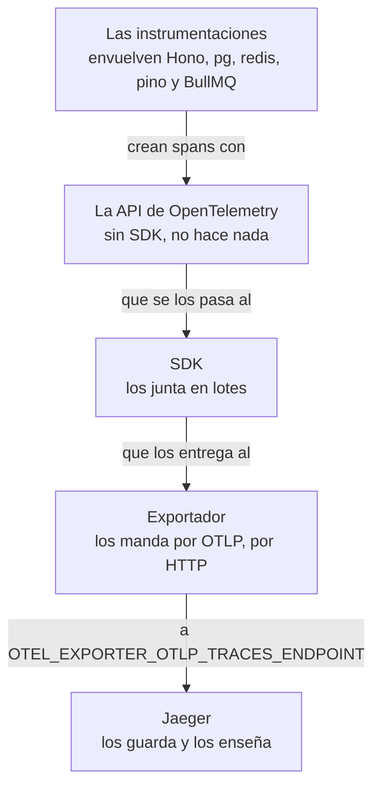
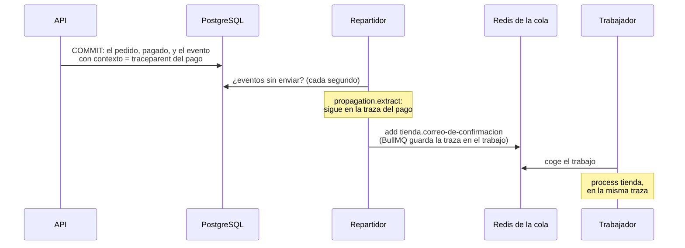

import Term from '~/components/Term.astro';
import TryIt from '~/components/TryIt.astro';
import Analogy from '~/components/Analogy.astro';
import ProjectCode from '~/components/ProjectCode.astro';
import Quiz from '~/components/Quiz.astro';
import QuizQuestion from '~/components/QuizQuestion.astro';
import QuizOption from '~/components/QuizOption.astro';

## El problema

Imagina que una clienta te escribe: «Para entrar en la tienda he esperado doce segundos». En el log encuentras su petición: `POST /v2/sesion`, `200`, `"ms": 12300`. El log dice **cuánto** tardó, no **dónde**: ¿PostgreSQL, Redis, la contraseña?

Con un pago es peor. La API contesta en 7 ms, y el correo lo manda otro proceso, el trabajador, tras pasar por la tabla de eventos salientes y la cola. El `requestId` de la [Fase 3](/fase-3/errores-y-logs-node/#un-id-para-cada-petición) solo existe en uno de los dos.

En la [Fase 9](/fase-9/monolito-vs-microservicios/#lo-que-cuesta-muchas-piezas-que-desplegar-y-vigilar) quedó escrito que, para seguir una petición por varios servicios, existen las trazas. Aquí la tienda deja una por petición.

## La analogía

<Analogy>

Cuando envías un paquete, le pegan una etiqueta con un número de seguimiento. Cada almacén por el que pasa la lee y apunta cuándo llegó y cuándo salió. Con el número ves el viaje entero, y si tarda una semana, en qué almacén se quedó parado cuatro días.

<div slot="limits">

- Un paquete está en un sitio cada vez. En una traza, una pieza pasa **dentro** de otra (la consulta, dentro de la petición), y varias a la vez.
- La etiqueta va pegada al paquete. En un programa, el número hay que pasarlo a mano de un proceso al siguiente; si uno se olvida, el viaje sale partido en dos.
- Escanear un paquete cuesta poco. Apuntar cada petición le quitó a la API, en nuestra prueba, un 30 % de las peticiones por segundo.

</div>

</Analogy>

## Cómo funciona de verdad

### Monitorizar no es lo mismo que observar

Monitorizar es comprobar lo que ya sabes que puede fallar: ¿contesta `/salud`?, ¿hay más de un 5 % de errores? La <Term id="observability">observabilidad</Term> es poder contestar las preguntas que no tenías preparadas, como la de los doce segundos, **con lo que la tienda ya emite**, sin desplegar código nuevo para averiguarlo.

### Tres señales, tres preguntas

| Señal | Qué es | Qué contesta | En la tienda |
|---|---|---|---|
| Log | Una línea por suceso | ¿Qué pasó exactamente con esta petición? | pino, desde la [Fase 3](/fase-3/errores-y-logs-node/#logs-estructurados-una-línea-json-por-suceso) |
| <Term id="metric">Métrica</Term> | Un número a lo largo del tiempo | ¿Cuántas llegan, cuántas fallan, cuánto tardan? | Prometheus, en la lección 5 |
| <Term id="trace">Traza</Term> | El recorrido de una petición, pieza a pieza | ¿Por dónde pasó, y dónde se fue el tiempo? | Jaeger, en esta lección |

Se usan en cadena: **la métrica avisa de que algo va mal, la traza dice dónde y el log dice qué**. Los logs y las trazas comparten id: de una línea del log saltas a su traza, y al revés.

### Una traza es un árbol de spans

Así es la traza de un pago, una línea por pieza: su nombre, el servicio, cuánto duró y cuándo empezó, contando desde el principio. La sangría dice quién va dentro de quién:

```text
POST /v2/webhooks/pagos                                   tienda-api            6.98 ms   +0 ms
  pg-pool.connect                                         tienda-api            0.09 ms   +1 ms
  pg.query:SELECT tienda                                  tienda-api            1.05 ms   +1 ms
  pg-pool.connect                                         tienda-api            0.04 ms   +2 ms
  pg.query:BEGIN tienda                                   tienda-api            0.28 ms   +2 ms
  pg.query:INSERT tienda                                  tienda-api            0.55 ms   +3 ms
  pg.query:UPDATE tienda                                  tienda-api            0.43 ms   +4 ms
  pg.query:SELECT tienda                                  tienda-api            0.23 ms   +4 ms
  pg.query:INSERT tienda                                  tienda-api            0.56 ms   +5 ms
  pg.query:COMMIT tienda                                  tienda-api            0.74 ms   +5 ms
  redis-PUBLISH                                           tienda-api            0.91 ms   +6 ms
  add tienda.correo-de-confirmacion                       tienda-trabajador     1.23 ms   +140 ms
    redis-EVALSHA                                         tienda-trabajador     0.88 ms   +140 ms
    process tienda                                        tienda-trabajador    13.92 ms   +142 ms
      pg-pool.connect                                     tienda-trabajador     5.81 ms   +142 ms
        pg.connect                                        tienda-trabajador     5.52 ms   +142 ms
      pg.query:SELECT tienda                              tienda-trabajador     1.02 ms   +148 ms
      complete tienda                                     tienda-trabajador     0.65 ms   +155 ms
        redis-EVALSHA                                     tienda-trabajador     0.46 ms   +155 ms
```

Es la de nuestro «Pruébalo», sacada de Jaeger y resumida. Cada pieza es un <Term id="span">*span*</Term> (en español, a veces, «tramo»): algo que pasó, con su inicio, su duración y unos datos. Uno que pasa dentro de otro es su **hijo**; el de fuera, su **padre**. Todos comparten el **id de la traza**.

Jaeger los dibuja como barras sobre una línea de tiempo, una debajo de otra: la **cascada** (*waterfall*). Esta se lee así:

- **La API tardó 7 ms**, casi 4 en PostgreSQL: la <Term id="transaction">transacción</Term> del pago, de `BEGIN` a `COMMIT` ([Fase 9](/fase-9/arquitectura-orientada-a-eventos/#el-outbox-el-aviso-en-la-misma-transacción)).
- **Durante 133 ms no pasa nada**: el evento espera en la tabla a que el repartidor, que mira cada segundo, lo ponga en la cola (`add`).
- **El trabajador hace el trabajo en 14 ms**: `process`, con una consulta, y `complete`.

**El envío del correo no tiene span**: la tienda no instrumenta nodemailer, la librería que lo manda, así que su tiempo queda dentro de `process`, sin desglosar. Una traza solo enseña lo que alguien decidió medir.

### OpenTelemetry: de la librería a Jaeger

La tienda no crea estos spans a mano: lo hace <Term id="opentelemetry">OpenTelemetry</Term>, el estándar abierto para emitir trazas, métricas y logs en un formato común. Son cuatro piezas en cadena:



Una <Term id="instrumentation">instrumentación</Term> es el código que hace que una librería emita spans; OTLP, el protocolo de OpenTelemetry. Muchos equipos ponen entre el exportador y el destino un **collector**, un programa que recibe, filtra y reparte; la tienda manda directa a <Term id="jaeger">Jaeger</Term>.

La tienda elige sus instrumentaciones una por una, en `src/instrumentacion.ts`:

<ProjectCode file="tienda-api/44-trazas/src/instrumentacion.ts" region="instrumentaciones" />

- **`HttpInstrumentation`, solo para las peticiones que salen**: de las que llegan hace el span `@hono/otel`, con el nombre de la ruta. Una petición, un solo span de servidor.
- **`requireParentSpan: true`**: PostgreSQL y Redis, solo dentro de una petición o un trabajo. Si no, cada pregunta del repartidor, una por segundo, sería una traza suelta de un span. El precio: esas preguntas no se ven.

Antes de nada, `empezarInstrumentacion` mira `OTEL_EXPORTER_OTLP_TRACES_ENDPOINT`. **Sin ella, no arranca nada**, y la tienda funciona como en la Fase 9.

### La instrumentación se carga antes que la tienda

Cada instrumentación cambia su librería en el momento en que alguien la carga con `import`, la orden que trae el código de otro fichero o <Term id="package">paquete</Term>. Si `src/servidor.ts` ya hubiera cargado `pg`, llegaría tarde: **no habría spans de PostgreSQL, y ningún error que lo avise**.

Por eso se carga antes que la tienda, con la opción `--import` de Node: `node --import ./src/instrumentacion.ts src/servidor.ts`. Así lo hacen `npm start`, `npm run dev`, `npm run trabajador`, el `CMD` del `Dockerfile` y el trabajador en `compose.yaml`.

Con módulos `import`, además, hace falta un gancho en el cargador de Node: `import-in-the-middle`, con `module.registerHooks` (Node 24.11.1 o posterior). La forma antigua, `module.register`, hace que Node 26 avise de que está obsoleta (`DEP0205`).

### Jaeger, en un fichero de Compose aparte

`compose.yaml` no gana ningún servicio: Jaeger vive en un segundo fichero, `compose.observabilidad.yaml`:

<ProjectCode file="tienda-api/44-trazas/compose.observabilidad.yaml" region="jaeger" />

Su web, en el 16686, solo en tu ordenador; el 4318, por donde recibe, solo dentro de la red de Compose. **Guarda las trazas en memoria**: al pararlo, se pierden. El mismo fichero les da la dirección a la API y al trabajador:

<ProjectCode file="tienda-api/44-trazas/compose.observabilidad.yaml" region="api-y-trabajador" />

Compose junta los dos ficheros si se los das con `-f`, o si tu `.env` dice `COMPOSE_FILE=compose.yaml:compose.observabilidad.yaml`, como en el «Pruébalo».

### Del X-Request-Id a la traza

El span de cada petición lo crea `@hono/otel`, el primer <Term id="middleware">middleware</Term> de `src/app.ts`, para medir todo lo que viene detrás:

<ProjectCode file="tienda-api/44-trazas/src/app.ts" region="traza" />

Se llama como la **plantilla de la ruta**, `GET /v2/pedidos/:id`, nunca con el id de un pedido, para agrupar las peticiones a la misma ruta. Y lleva el `requestId` como `tienda.request_id`: **con el `X-Request-Id` que ve el frontend, encuentras la traza**.

### La propagación de contexto: traceparent

Para que otro proceso continúe la misma traza, alguien tiene que pasarle el id: es la <Term id="context-propagation">propagación de contexto</Term>. Por HTTP va en una <Term id="header">cabecera</Term> del estándar W3C, `traceparent`. Con los ids de una línea del log del «Pruébalo», sería esta:

```text
traceparent: 00-d5fc9555698f8baafaaf66ce60bfe45b-9a4084534364c485-01
```

La versión (`00`), **el id de la traza** (32 cifras hexadecimales), **el id del span padre** (16) y unas opciones (`01`: esta traza se guarda). Las instrumentaciones de `node:http` y `fetch` la añaden a cada petición que sale, como el aviso a la empresa de reparto; y si una llega con ella, `@hono/otel` continúa esa traza.

### A través de la cola y del outbox

En una cola, el id viaja con el mensaje. Con la opción `telemetry`, BullMQ guarda en cada trabajo la traza en la que se apuntó, y el trabajador la sigue:

<ProjectCode file="tienda-api/44-trazas/src/cola.ts" region="telemetria" />

No bastó. Desde la [lección 7 de la Fase 9](/fase-9/arquitectura-orientada-a-eventos/#el-repartidor-de-la-tabla-a-la-cola), la API guarda el evento en `eventos_salientes` (el <Term id="transactional-outbox">outbox</Term>), y lo encola el repartidor, en otro proceso y sin petición. **En la primera prueba, el pago y el correo salían en dos trazas**: el repartidor no sabía de cuál venía cada evento.

La solución del paso 44: guardar la traza **con el evento**, en una columna nueva, `contexto` (la migración 012):

<ProjectCode file="tienda-api/44-trazas/bd/migraciones/012-contexto-eventos.sql" region="contexto" />

Al guardar el evento, en la transacción del pago, `propagation.inject` escribe el `traceparent` del span activo:

<ProjectCode file="tienda-api/44-trazas/src/salientes.ts" region="guardar-saliente" />

Y el repartidor lo lee con `propagation.extract` y encola **dentro** de esa traza:

<ProjectCode file="tienda-api/44-trazas/src/salientes.ts" region="en-su-traza" />



Por eso, en la cascada, `add` cuelga del span del pago, aunque lo hiciera otro proceso 133 ms después.

### Del log a la traza, y vuelta

`PinoInstrumentation` añade a cada línea del log `trace_id`, `span_id` y `trace_flags`. Del `trace_id` de una línea llegas a su traza en Jaeger, y del id de una traza, con `docker compose logs api | grep`, a sus líneas. Las del trabajador sobre ese trabajo llevan el mismo.

Los logs siguen en <Term id="stdout">stdout</Term>, como siempre: no van a Jaeger, que solo guarda trazas. Para buscarlos desde una web, un equipo añade otra herramienta, como **Loki**, que los enseña en Grafana junto a las métricas. Grafana llega en la lección 5, para las métricas.

### Lo que nunca va en un span

Una traza sale de la tienda hacia otro sistema, con otras personas y otro tiempo de guardado. **Una traza no debe llevar lo que el log no lleva**: ni contraseñas, ni tokens, ni datos personales. Al revisar el paso 44 aparecieron dos fugas, ya arregladas:

- **La URL, con su *query*.** La vuelta del proveedor de identidad trae en ella el `code` y el `state` del inicio de sesión. Un procesador de spans, `quitarQuery`, le quita la query a cada URL antes de exportarla.
- **La clave de cada orden de Redis.** Las de los [límites de intentos](/fase-6/rate-limiting-secretos/#por-email-y-por-ip-los-límites-de-la-tienda) llevan el email y la IP. Ahora el span solo dice la orden y de qué es la clave:

<ProjectCode file="tienda-api/44-trazas/src/instrumentacion.ts" region="orden-sin-datos" />

`ZADD limites:sesion-email:ana@ejemplo.com` queda en `ZADD limites:?`, y un test del paso comprueba que ningún valor de la traza contiene el email.

### Guardarlo todo cuesta: el muestreo

En tu ordenador, la tienda guarda la traza de **cada** petición, y lo medirás: en nuestra prueba, un 30 % menos de peticiones por segundo. En producción, con mucho tráfico, se hace <Term id="sampling">muestreo</Term> (*sampling*): se guarda una parte, como una de cada diez, decidido al empezar la traza o al terminarla, para quedarse con las lentas y las que fallan.

## Pruébalo

El objetivo: encontrar la traza de un pago desde su `X-Request-Id` y seguirla hasta el trabajador; congelar Redis y ver qué span espera; y medir lo que cuesta trazarlo todo.

Las salidas son de Node 26, en Linux, del 24 de octubre de 2026, en un MacBook con Docker en una máquina virtual de 2 GB. Tus ids, tiempos y números serán otros.

### Prepara el paso

Pon tu proyecto en el paso 44, como en la [introducción](/fase-10/#cada-lección-su-paso), y suma Jaeger con una línea en tu `.env`:

```sh
cd ~/curso-backend/fase-3
curl -O https://backenddesdecero.com/practicas/tienda-api/44-trazas.tar.gz
tar -xzf 44-trazas.tar.gz
cp -R 44-trazas/. tienda-api/
cd tienda-api
npm install
echo 'COMPOSE_FILE=compose.yaml:compose.observabilidad.yaml' >> .env
docker compose up -d --build --wait
```

`migrar` aplica la migración 012, y aparece el servicio `jaeger`. Abre `http://localhost:16686`: es la web de Jaeger. Si `docker compose port api 3000` dice `3001`, usa ese puerto.

### Un pago, con su X-Request-Id

Carmen, la clienta de práctica, inicia sesión y pide una taza. Estas dos órdenes no escriben nada: la cookie queda en `carmen.txt`, y el id del pedido, en la variable `PEDIDO`:

```sh
curl -s -o /dev/null -c carmen.txt --json '{"email":"carmen@ejemplo.com","contrasena":"carmen-practica-2026"}' localhost:3000/v2/sesion
PEDIDO=$(curl -s -b carmen.txt --json '{"productoId":2,"cantidad":1}' localhost:3000/v2/pedidos | jq .id)
```

La pasarela eres tú: firmas el aviso con tu `WEBHOOK_SECRET`, como en el reto de la [Fase 4](/fase-4/webhooks-idempotencia/), y lo mandas con `curl -si`:

<TryIt
  title="1. Paga el pedido"
  cmd={`SECRETO=$(grep '^WEBHOOK_SECRET=' .env | cut -d= -f2-)
CUERPO=$(printf '{"id":"evt_%s","tipo":"pago.completado","pedidoId":%s}' "$(uuidgen)" "$PEDIDO")
FIRMA=$(printf '%s' "$CUERPO" | openssl dgst -sha256 -hmac "$SECRETO" | awk '{print $NF}')
curl -si -H "X-Firma: sha256=$FIRMA" --json "$CUERPO" localhost:3000/v2/webhooks/pagos | tee pago.txt`}
  output={`HTTP/1.1 200 OK
…
x-request-id: 95523221-53d6-4876-842e-93b815cc0820
…

{"recibido":"evt_569C3F9E-9AC9-49B4-8842-8921C75D74F2","repetido":false}`}
>

`cut -d= -f2-` se queda con lo que va tras el primer `=`; `uuidgen` da un id de evento nuevo; `tee` escribe la respuesta en pantalla y en `pago.txt`. Hemos quitado el resto de cabeceras: fíjate en **`x-request-id`**. Si sale `firma-no-valida`, el secreto no es el de la API; con un `400` o un `422`, mira `echo $PEDIDO`: tiene que ser un número.

</TryIt>

### Encuentra su traza en Jaeger

En la web de Jaeger, en **Search**, elige el servicio `tienda-api`; en **Tags**, escribe `tienda.request_id=` y tu `x-request-id`, y pulsa **Find Traces**. Sale una traza, `POST /v2/webhooks/pagos`, con dos servicios. Ábrela: es la [cascada de arriba](#una-traza-es-un-árbol-de-spans), con tus tiempos. Busca la barra corta de la API, el hueco hasta `add` (hasta un segundo) y `process tienda`.

Si falta la parte del trabajador, espera y recarga: manda sus spans en lotes, cada unos 5 segundos. En nuestra prueba, una traza tenía 11 spans a los 3 segundos y 18 a los 10. Verás también muchas trazas `GET /salud`, la comprobación de salud de Docker: por eso se busca por el id, y no por la hora.

### Del log a la traza

<TryIt
  title="2. La línea del log, con su trace_id"
  cmd={`ID=$(grep -i x-request-id pago.txt | cut -d' ' -f2 | tr -d '\\r')
echo "X-Request-Id: $ID"
docker compose logs api --no-log-prefix | grep "$ID" | jq .`}
  output={`X-Request-Id: e98de522-5ff9-46b0-9660-d59b8e657611
{
  "level": 30,
  "time": 1792836195666,
  "pid": 1,
  "hostname": "de2d917c9791",
  "trace_id": "d5fc9555698f8baafaaf66ce60bfe45b",
  "span_id": "9a4084534364c485",
  "trace_flags": "01",
  "requestId": "e98de522-5ff9-46b0-9660-d59b8e657611",
  "metodo": "POST",
  "ruta": "/v2/webhooks/pagos",
  "estado": 200,
  "ms": 4,
  "msg": "petición"
}`}
>

Nuestra salida es de otro pago: el id no es el de arriba. `tr -d '\r'` quita el retorno de carro de la cabecera, como en la [lección 3](/fase-10/tests-de-contrato/#del-id-al-campo-roto). La línea de siempre, con **tres campos nuevos**: `trace_id`, `span_id` y `trace_flags`.

</TryIt>

Pega tu `trace_id` en el cuadro **Lookup by Trace ID**, arriba en Jaeger: abre la traza del pago. Para este `trace_id`, la nuestra tenía 18 spans.

### Congela Redis e inicia sesión

Ahora, los doce segundos. Congela el Redis de la cola, el mismo que guarda los límites de intentos, como en la [Fase 9](/fase-9/arquitectura-orientada-a-eventos/):

<TryIt
  title="3. Congela Redis"
  cmd="docker compose pause redis"
  output={` Container tienda-redis-1 Paused `}
>

Redis no contesta, pero sus conexiones siguen abiertas: quien le pregunta no recibe un error, solo silencio.

</TryIt>

Carmen intenta entrar, y curl se queda esperando:

<TryIt
  title="4. Inicia sesión"
  cmd={`curl -si -o sesion.txt -w 'curl: HTTP %{http_code} en %{time_total} s\\n' --json '{"email":"carmen@ejemplo.com","contrasena":"carmen-practica-2026"}' localhost:3000/v2/sesion`}
  output={`curl: HTTP 200 en 12.299695 s`}
>

`-o` guarda la respuesta en `sesion.txt`, y `-w` escribe al final el código y el tiempo. Mientras espera, abre otra terminal en la carpeta del proyecto, cuenta unos diez segundos y descongela: `docker compose unpause redis` (dice ` Container tienda-redis-1 Unpaused `). En cuanto Redis vuelve, curl termina: **`200` en 12,3 segundos**. Nada ha fallado; solo ha tardado.

</TryIt>

<TryIt
  title="5. Su id"
  cmd="grep -i -e '^HTTP/' -e '^x-request-id' sesion.txt"
  output={`HTTP/1.1 200 OK
x-request-id: d3e583a9-773d-448b-8dc1-0a1f92aa90c9`}
>

Búscala en Jaeger como antes, con `tienda.request_id=`.

</TryIt>

La nuestra, resumida como la del pago:

```text
POST /v2/sesion                                           tienda-api        12299.69 ms   +0 ms
  redis-ZREMRANGEBYSCORE                                  tienda-api        12273.39 ms   +0 ms
  redis-ZRANGE                                            tienda-api        12273.35 ms   +0 ms
  pg-pool.connect                                         tienda-api            0.05 ms   +12274 ms
  redis-ZREMRANGEBYSCORE                                  tienda-api            0.43 ms   +12274 ms
  redis-ZRANGE                                            tienda-api            0.35 ms   +12274 ms
  pg.query:SELECT tienda                                  tienda-api            1.28 ms   +12275 ms
  pg-pool.connect                                         tienda-api            0.09 ms   +12297 ms
  pg.query:INSERT tienda                                  tienda-api            1.37 ms   +12297 ms
```

- **Las dos primeras órdenes a Redis, 12 273 ms**: el límite por email, esperando a un Redis congelado. Casi toda la petición.
- **Las dos siguientes**, el límite por IP, con Redis de vuelta: menos de medio milisegundo.
- **Después, PostgreSQL**: buscar a Carmen y, tras unos 20 ms sin spans (probablemente, comprobar su contraseña con argon2, sin instrumentar), guardar la sesión.

Ningún span lleva error: Redis no falló, tardó. El log decía cuánto; **la traza dice dónde**. Y enseña un fallo del paso 44: la tienda espera a Redis sin límite. En la lección 6, cada límite de intentos esperará 200 ms como mucho.

### Lo que cuesta trazarlo todo

La <Term id="load-test">prueba de carga</Term> de la [Fase 9](/fase-9/#peticiones-por-segundo-cuánto-aguanta), con cada traza camino de Jaeger:

<TryIt
  title="6. Con trazas"
  cmd="npm run carga -- -c 10 -d 10 http://localhost:3000/v2/productos"
  output={`…
┌─────────┬──────┬──────┬───────┬──────┬─────────┬─────────┬────────┐
│ Stat    │ 2.5% │ 50%  │ 97.5% │ 99%  │ Avg     │ Stdev   │ Max    │
├─────────┼──────┼──────┼───────┼──────┼─────────┼─────────┼────────┤
│ Latency │ 0 ms │ 1 ms │ 3 ms  │ 5 ms │ 1.02 ms │ 2.68 ms │ 204 ms │
└─────────┴──────┴──────┴───────┴──────┴─────────┴─────────┴────────┘
┌───────────┬─────────┬─────────┬────────┬─────────┬─────────┬──────────┬─────────┐
│ Stat      │ 1%      │ 2.5%    │ 50%    │ 97.5%   │ Avg     │ Stdev    │ Min     │
├───────────┼─────────┼─────────┼────────┼─────────┼─────────┼──────────┼─────────┤
│ Req/Sec   │ 3,833   │ 3,833   │ 7,111  │ 8,107   │ 6,885.5 │ 1,223.12 │ 3,833   │
├───────────┼─────────┼─────────┼────────┼─────────┼─────────┼──────────┼─────────┤
│ Bytes/Sec │ 3.67 MB │ 3.67 MB │ 6.8 MB │ 7.76 MB │ 6.59 MB │ 1.17 MB  │ 3.67 MB │
└───────────┴─────────┴─────────┴────────┴─────────┴─────────┴──────────┴─────────┘

Req/Bytes counts sampled once per second.
# of samples: 10

69k requests in 10.03s, 65.9 MB read`}
>

Hemos quitado las primeras líneas. **`Req/Sec`, `Avg`**: 6.885,5 por segundo; en otra pasada, 7.759,8. Latencia media: 1,02 ms.

</TryIt>

Ahora, la API sin la URL de Jaeger. `-f compose.yaml` manda sobre tu `COMPOSE_FILE`, así que la API se recrea sin `OTEL_EXPORTER_OTLP_TRACES_ENDPOINT`, y el SDK no arranca:

```sh
docker compose -f compose.yaml up -d api
```

<TryIt
  title="7. Sin trazas"
  cmd="npm run carga -- -c 10 -d 10 http://localhost:3000/v2/productos"
  output={`…
┌─────────┬──────┬──────┬───────┬──────┬─────────┬─────────┬────────┐
│ Stat    │ 2.5% │ 50%  │ 97.5% │ 99%  │ Avg     │ Stdev   │ Max    │
├─────────┼──────┼──────┼───────┼──────┼─────────┼─────────┼────────┤
│ Latency │ 0 ms │ 0 ms │ 1 ms  │ 2 ms │ 0.26 ms │ 1.94 ms │ 198 ms │
└─────────┴──────┴──────┴───────┴──────┴─────────┴─────────┴────────┘
┌───────────┬─────────┬─────────┬─────────┬─────────┬───────────┬──────────┬─────────┐
│ Stat      │ 1%      │ 2.5%    │ 50%     │ 97.5%   │ Avg       │ Stdev    │ Min     │
├───────────┼─────────┼─────────┼─────────┼─────────┼───────────┼──────────┼─────────┤
│ Req/Sec   │ 6,095   │ 6,095   │ 10,831  │ 11,935  │ 10,441.28 │ 1,616.78 │ 6,094   │
├───────────┼─────────┼─────────┼─────────┼─────────┼───────────┼──────────┼─────────┤
│ Bytes/Sec │ 5.83 MB │ 5.83 MB │ 10.4 MB │ 11.4 MB │ 9.99 MB   │ 1.55 MB  │ 5.83 MB │
└───────────┴─────────┴─────────┴─────────┴─────────┴───────────┴──────────┴─────────┘

Req/Bytes counts sampled once per second.
# of samples: 11

115k requests in 11.01s, 110 MB read`}
>

**10.441,28**, y en otra pasada, 11.029,6; latencia media, 0,26 ms. De media, unas 7.300 con trazas y unas 10.700 sin ellas: **un 30 % menos**.

</TryIt>

Con el proyecto en inglés, otra ronda dio casi lo mismo. **En nuestro MacBook, trazar cada petición costó un 30 % de las peticiones por segundo**, más que validar el contrato en la lección 3 (entre un 5 y un 15 %). No medimos qué parte pesa más: crear los spans, las instrumentaciones (que solo se cargan con la URL) o mandarlos. Depende de la máquina: mídelo en la tuya.

Al terminar, `docker compose up -d --wait api` le devuelve la URL a la API.

### En tu servidor

El `.env` de tu servidor no tiene `OTEL_EXPORTER_OTLP_TRACES_ENDPOINT`: allí no arranca nada, y el timer de la [Fase 8](/fase-8/ci-cd-github-actions/) despliega el paso como siempre, con la migración 012. Si algún día tienes dónde mandar las trazas, `.env.produccion.ejemplo` dice dónde va su URL; mide antes lo que cuesta.

## Ya lo has visto

- **El seguimiento de un paquete**: cada escaneo es un span; el número de seguimiento, el id de la traza.
- **La columna «Cascada» de la pestaña Red de <Term id="devtools">DevTools</Term>**: cada petición de la página, una barra en el tiempo. Al pasar el ratón ves en qué se le fue: DNS, conexión, esperar al servidor, descargar.
- **Sentry**, si lo usas en el frontend: su parte de rendimiento también dibuja trazas con spans, y las une con las del backend con su propia cabecera, `sentry-trace`.

## Errores comunes

- **Cargar la instrumentación tarde**, con un `import` en `servidor.ts` detrás de otros, y no con `--import`. Arranca sin errores, y sin los spans de las librerías ya cargadas.
- **Poner en un span lo que no pondrías en un log**: la query de una URL, una clave con un email, el cuerpo de una petición.
- **Romper la cadena.** Una cola sin `telemetry` o un outbox sin la traza guardada parten el viaje en dos trazas.
- **Buscar por la hora entre cientos de `GET /salud`.** Busca por `tienda.request_id` o por el `trace_id` del log.
- **Creer que trazar es gratis.** Aquí costó un 30 %: en producción, muestreo.

## Resumen

- La observabilidad deja contestar preguntas nuevas con lo que el sistema emite: logs (qué pasó), métricas (cuánto) y trazas (por dónde y dónde se fue el tiempo).
- Una traza es un árbol de spans con el mismo id; en la cascada, la sangría dice quién va dentro de quién.
- OpenTelemetry son instrumentaciones, una API, un SDK y un exportador; se carga con `--import`, antes que la tienda, y sin `OTEL_EXPORTER_OTLP_TRACES_ENDPOINT` no exporta nada.
- El contexto viaja en la cabecera `traceparent`, en los trabajos de BullMQ y, en la tienda, guardado con cada evento del outbox: un pago es una sola traza.
- Una traza no lleva lo que el log no lleva. Trazarlo todo costó un 30 %: en producción, muestreo.

## ¿Lo has entendido?

<Quiz>

<QuizQuestion
  question="Una clienta dice que entrar en la tienda le tardó doce segundos, y te pasa el X-Request-Id de esa petición. ¿Qué miras para saber dónde se fue el tiempo?"
  review="Tres señales, tres preguntas"
>

<QuizOption text="La línea del log de esa petición: su campo ms dice cuánto tardó cada parte.">

`ms` es el tiempo total de la petición. El log confirma que tardó, no dónde.

</QuizOption>

<QuizOption text="Su traza en Jaeger, buscada por tienda.request_id." correct>

La traza tiene un span por consulta y por orden a Redis, con su duración: la cascada señala la parte larga.

</QuizOption>

<QuizOption text="El p99 de la ruta en el panel de métricas: si sube, sabes qué parte es la lenta.">

Una métrica cuenta todas las peticiones juntas: dice que el inicio de sesión va lento, no dónde se fue el tiempo en esta.

</QuizOption>

</QuizQuestion>

<QuizQuestion
  question="En una traza, el span POST /v2/sesion dura 12 300 ms. Dentro, un span redis-ZRANGE dura 12 273 ms, sin error, y una consulta a PostgreSQL, 1,28 ms. ¿Qué te dice?"
  review="Una traza es un árbol de spans"
>

<QuizOption text="Que casi todo el tiempo se fue esperando a Redis, que acabó contestando." correct>

El hijo va dentro del padre: sus 12 273 ms son parte de los 12 300. Sin error, Redis no falló: tardó.

</QuizOption>

<QuizOption text="Que la petición duró unos 24 segundos: los 12 300 ms de la API más los 12 273 de Redis.">

Un hijo pasa dentro de su padre: su tiempo ya está contado en el del padre.

</QuizOption>

<QuizOption text="Que Redis devolvió un error, porque un span que funciona nunca dura tanto.">

Un span largo sin error es una espera. En el «Pruébalo», Redis estaba congelado y la respuesta fue un `200`.

</QuizOption>

</QuizQuestion>

<QuizQuestion
  question="Un compañero quita --import de npm start y pone import './instrumentacion.ts' después de los demás import de servidor.ts. La tienda arranca sin errores. ¿Qué pasa con las trazas?"
  review="La instrumentación se carga antes que la tienda"
>

<QuizOption text="Nada: mientras se importe en algún sitio, la instrumentación cambia pg igual.">

La instrumentación cambia cada librería en el momento de cargarla. Si `pg` se cargó antes, llega tarde.

</QuizOption>

<QuizOption text="La tienda dejará de arrancar en cuanto llegue la primera consulta a PostgreSQL.">

No hay ningún error, y eso es lo peligroso: funciona igual, sin esos spans.

</QuizOption>

<QuizOption text="Faltan los spans de pg y de las demás librerías ya cargadas, sin aviso." correct>

Las instrumentaciones cambian `pg` o `redis` al cargarlos. `--import` las pone antes que todo lo demás.

</QuizOption>

</QuizQuestion>

<QuizQuestion
  question="Con trazas pero sin la columna contexto, el pago y su correo salían en dos trazas distintas, aunque BullMQ ya llevaba la traza del trabajo. ¿Por qué?"
  review="A través de la cola y del outbox"
>

<QuizOption text="Porque el repartidor encola desde otro proceso, sin petición, y no sabía de qué traza venía." correct>

BullMQ lleva la traza desde que se apunta el trabajo; el corte estaba antes. Guardar el `traceparent` con el evento se lo dice al repartidor.

</QuizOption>

<QuizOption text="Porque la API y el trabajador tienen distinto OTEL_SERVICE_NAME, y cada servicio hace sus propias trazas.">

Una traza cruza servicios: la del pago tiene spans de `tienda-api` y de `tienda-trabajador`.

</QuizOption>

<QuizOption text="Porque Redis no sabe guardar el id de una traza, y la cola siempre corta el viaje.">

Con `telemetry`, BullMQ guarda la traza en cada trabajo, en Redis, y el trabajador la sigue.

</QuizOption>

</QuizQuestion>

<QuizQuestion
  question="Para depurar los inicios de sesión, alguien propone apuntar en el span el email con el que se intenta entrar. ¿Qué le dices?"
  review="Lo que nunca va en un span"
>

<QuizOption text="Que sí: Jaeger solo lo ve el equipo, y el email no es un secreto como la contraseña.">

El email es un dato personal, y la traza sale a otro sistema, con otras personas. El paso 44 lo quita hasta de las claves de Redis.

</QuizOption>

<QuizOption text="Que no: una traza no debe llevar lo que el log no lleva." correct>

La regla es la de los logs. Para encontrar un inicio de sesión ya tienes el `requestId` y el `trace_id`.

</QuizOption>

<QuizOption text="Que sí, mientras Jaeger guarde las trazas en memoria, porque al pararlo se borran.">

En producción, las trazas van a donde las mandes. La regla no depende de dónde se guarden.

</QuizOption>

</QuizQuestion>

<QuizQuestion
  question="Vas a activar las trazas en una API de producción con mucho tráfico. ¿Qué haces?"
  review="Guardarlo todo cuesta: el muestreo"
>

<QuizOption text="Exportarlas todas: si no hay errores, mandar spans no cuesta nada.">

Cuesta en cada petición, falle o no: en nuestra prueba, un 30 % de las peticiones por segundo.

</QuizOption>

<QuizOption text="Activarlas solo cuando haya un incidente, y apagarlas al terminar.">

La petición lenta ya pasó, y su traza solo existe si se estaba trazando entonces.

</QuizOption>

<QuizOption text="Muestrear: guardar solo una parte, y medir antes lo que cuesta." correct>

Tienes trazas de sobra para ver dónde se va el tiempo, pagando una parte del precio.

</QuizOption>

</QuizQuestion>

</Quiz>

## Para profundizar

- [Traces](https://opentelemetry.io/docs/concepts/signals/traces/), de OpenTelemetry, en inglés: trazas, spans y contexto.
- [Trace Context](https://www.w3.org/TR/trace-context/), del W3C, en inglés: el estándar de la cabecera `traceparent`.
- [Sampling](https://opentelemetry.io/docs/concepts/sampling/), de OpenTelemetry, en inglés: las formas de muestrear.
- [Jaeger](https://www.jaegertracing.io/docs/), en inglés: su documentación, con la búsqueda y la cascada.
- [OpenTelemetry para JavaScript](https://opentelemetry.io/docs/languages/js/), en inglés: el SDK de Node y sus instrumentaciones.
