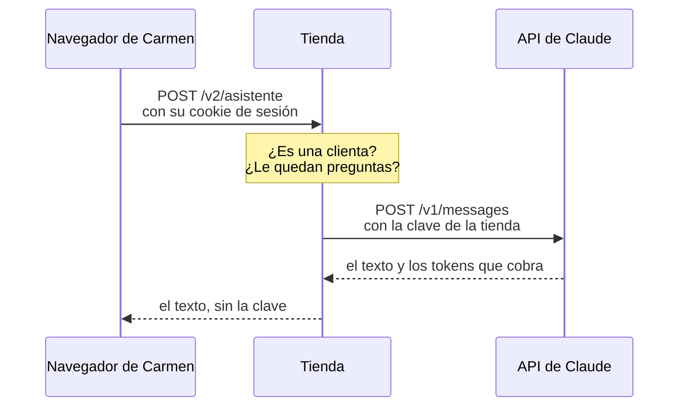

import Term from '~/components/Term.astro';
import TryIt from '~/components/TryIt.astro';
import Analogy from '~/components/Analogy.astro';
import SelfCheck from '~/components/SelfCheck.astro';
import ProjectCode from '~/components/ProjectCode.astro';
import Quiz from '~/components/Quiz.astro';
import QuizQuestion from '~/components/QuizQuestion.astro';
import QuizOption from '~/components/QuizOption.astro';
import Scene from '~/components/Scene.astro';
import '~/scenes/lessons/model-apis.css';

<Scene id="problem" />

## El problema

Imagina que Luis quiere el asistente esta misma tarde. Copia de un ejemplo la llamada al <Term id="llm">modelo</Term>, la pega en el JavaScript de la web de la tienda, con la clave dentro, y funciona: Carmen pregunta y el modelo contesta.

Al día siguiente, la Console dice que la tienda se ha gastado todo su saldo. Alguien abrió DevTools, vio la clave en la pestaña Red y la usó para su propio programa. **Todo lo que llega al navegador lo puede leer quien lo usa.**

La solución es la de siempre: el navegador le pregunta a tu backend, y tu backend, con su clave, al modelo. En esta lección escribes esa ruta, `POST /v2/asistente`, y ves qué viaja, qué vuelve y qué se paga.

<Scene id="analogy" />

## La analogía

<Analogy>

La tienda contrata un servicio de traducción por teléfono y lo paga con su tarjeta. Cuando un cliente extranjero pregunta algo en el mostrador, Ana llama, da el número de la tarjeta y lee la conversación entera desde el principio: el servicio no recuerda las llamadas de antes. Cobra cada palabra que oye y cada palabra que dice.

Ana nunca escribe el número de la tarjeta en un cartel del mostrador: quien lo lea puede cargar sus llamadas a la tienda.

<div slot="limits">

- Una llamada se cobra por minutos. La API cobra por los trozos de texto que lee y escribe, y escribir cuesta cinco veces más que leer.
- Un traductor que no sabe algo, lo dice. Un modelo puede escribir algo falso con la misma seguridad.
- Una persona acaba cansándose de un cliente pesado. La API contesta a quien tenga la clave, a cualquier hora y tantas veces como pida: el límite lo pones tú.

</div>

</Analogy>

<Scene id="key" />

## Cómo funciona de verdad

### La clave vive en el servidor

Así viaja una pregunta de Carmen:



La clave solo sale del servidor hacia la API. Por qué no en el frontend:

- **Todo lo que llega al navegador se puede leer**: el código, las cabeceras de cada petición en la pestaña Red de DevTools, lo que guarda la página.
- **Quien tiene la clave gasta a tu cuenta**, sin tu sesión, sin tus límites y sin pasar por tu backend.
- **El propio SDK se niega**: en un navegador, lanza un error si no le pasas la opción `dangerouslyAllowBrowser`, «permitir el navegador, peligrosamente».

En la tienda, la clave es `ANTHROPIC_API_KEY`, en `.env`, como los demás secretos ([Fase 6](/fase-6/rate-limiting-secretos/#los-secretos-fuera-del-código-y-de-git)). Es opcional: sin ella, `POST /v2/asistente` contesta `503` con `asistente-no-configurado`, y el resto de la tienda funciona igual.

<Scene id="who" />

### Quién puede preguntar, y cuántas veces

Cada pregunta la paga la tienda. Por eso, antes de llegar al modelo:

- **Solo pregunta un cliente con su sesión.** El permiso nuevo, `asistente:usar`, es solo del rol `cliente` ([Fase 6](/fase-6/roles-permisos-rbac/)): sin sesión, `401`; con la clave de Reparto Rápido, `403`.
- **Como mucho, 20 preguntas por cliente cada 10 minutos, y 60 por IP**, con el limitador de la [Fase 6](/fase-6/rate-limiting-secretos/#por-email-y-por-ip-los-límites-de-la-tienda) en Redis. La siguiente recibe `429` con `Retry-After`, sin llegar al modelo. Si Redis no contesta, el límite se cierra: `503`.

<Scene id="request" />

### Una petición: el modelo, las instrucciones, la conversación y un tope

Esta es la petición que la tienda le manda a la API de mensajes de Claude (la *Messages API*), en `src/asistente/conversacion.ts`:

<ProjectCode file="tienda-api/47-modelo/src/asistente/conversacion.ts" region="peticion" />

- **`model`**: qué modelo contesta. Sale de `MODELO`, en `config.ts`: por defecto, `claude-haiku-5-5`.
- **`max_tokens`**: lo más larga que puede ser la respuesta, 2048 <Term id="llm-token">tokens</Term>, los trozos de palabra con los que cuenta y cobra la API. Si llega al tope, se corta.
- **`system`**: las <Term id="system-prompt">instrucciones del sistema</Term> (*system prompt*), lo que el modelo lee antes de la conversación: quién es, qué puede hacer y cómo contestar.
- **`output_config.effort`**: cuánto piensa antes de contestar. Lo que piensa también se paga, y la tienda pide `low`, que tarda y cuesta menos.
- **`messages`**: la conversación, con los roles de la API, `user` y `assistant`.

No lleva `temperature` ni nada parecido: los modelos actuales lo rechazan con un `400`.

Las instrucciones viven en su propio fichero, versionado como el código:

<ProjectCode file="tienda-api/47-modelo/src/asistente/instrucciones.md" />

Fíjate en la última parte: el modelo aún no ve el catálogo ni los pedidos, y se le dice que no se los invente.

<Scene id="response" />

### La respuesta: bloques, por qué ha parado y cuánto cuesta

Esta dio el modelo de mentira de la tienda (abajo) al `curl` de «Pruébalo»: los campos que usa la tienda, con texto y tokens de mentira. La de Claude puede traer alguno más:

```json
{
  "id": "msg_falso_2",
  "type": "message",
  "role": "assistant",
  "model": "claude-haiku-5-5",
  "content": [
    {
      "type": "thinking",
      "thinking": "",
      "signature": "firma-falsa-2"
    },
    {
      "type": "text",
      "text": "Soy el modelo falso: no entiendo nada, solo repito tu última pregunta. Era: «Hola, ¿qué vendéis?»."
    }
  ],
  "stop_reason": "end_turn",
  "stop_sequence": null,
  "stop_details": null,
  "usage": {
    "input_tokens": 120,
    "output_tokens": 30,
    "cache_creation_input_tokens": 0,
    "cache_read_input_tokens": 0
  }
}
```

- **`content`** es una lista de **bloques**. El de tipo `text` es la respuesta. Antes puede ir uno `thinking`, con el texto vacío y una firma (`signature`): lo que el modelo pensó, que no enseña pero cobra.
- **`stop_reason`** dice por qué ha parado: `end_turn`, que ha terminado; `max_tokens`, que se ha quedado sin sitio; `refusal`, que se ha negado; y, en la lección 3, `tool_use`.
- **`usage`** trae los tokens que se cobran: `input_tokens`, lo que ha leído, y `output_tokens`, lo que ha escrito, pensamiento incluido.

La tienda se queda con lo que le sirve a Carmen: el texto de los bloques `text`, los dos números de `usage` y, si el modelo se ha negado, una frase fija.

<ProjectCode file="tienda-api/47-modelo/src/asistente/conversacion.ts" region="respuesta" />

<Scene id="tokens" />

### Los tokens: lo que se cuenta y lo que se paga

Imagina un <Term id="llm-prompt">prompt</Term> de 500 tokens, entre instrucciones y conversación, y una respuesta de 150, pensamiento incluido. Con los precios de Claude Haiku 5.5 del 21 de noviembre de 2026:

| | Tokens | Precio por millón | Cuesta |
|---|---|---|---|
| Entrada | 500 | 0,10 $ | 0,00005 $ |
| Salida | 150 | 0,50 $ | 0,000075 $ |
| **Total** | | | **0,000125 $** |

Unas ocho mil preguntas como esa por dólar. Además del modelo, mueven la cuenta:

- **La salida cuesta cinco veces más**, y lo que el modelo piensa cuenta como salida.
- **La entrada crece con la conversación**, porque viaja entera en cada pregunta (abajo).

Hay también un máximo: la <Term id="context-window">ventana de contexto</Term>, lo más que un modelo puede leer en una petición. La de Claude Haiku 5.5 es de un millón de tokens, y la tienda se queda muy lejos a propósito (abajo).

<Scene id="stateless" />

### La API no recuerda nada

Entre una petición y la siguiente, la API lo olvida todo: es <Term id="stateless">sin estado</Term>, como la API REST de la [Fase 4](/fase-4/que-es-api-rest/). Para que el modelo sepa de qué se hablaba, **cada petición lleva la conversación entera**.

La tienda tampoco guarda conversaciones: el frontend manda cada vez los últimos mensajes, y el esquema de Zod los acota a 20, de 2000 caracteres. Guardarlas añadiría una tabla y decisiones que no son de código: son datos de Carmen.

Lo que sí cambia es el precio: en una conversación de diez preguntas, la primera se paga diez veces. La lección 7 lo abarata con la caché.

<Scene id="retries" />

### El SDK: la misma petición, con tipos y reintentos

La tienda no escribe la petición a mano: usa el <Term id="sdk">SDK</Term> oficial de Anthropic para TypeScript, `@anthropic-ai/sdk` 1.8.0, en `src/asistente/cliente.ts`:

<ProjectCode file="tienda-api/47-modelo/src/asistente/cliente.ts" region="cliente" />

- **Sin clave, no hay cliente**, y la ruta contesta `503`.
- **`maxRetries`**: el SDK repite solo lo pasajero (`429`, `529`, otro `5xx`, un corte de red), esperando lo que diga `retry-after` o, si no lo dice, con una <Term id="exponential-backoff">espera exponencial</Term> como la de la [Fase 9](/fase-9/colas-trabajos-segundo-plano/). Con 2, como mucho tres intentos.
- **`timeout`**: lo que espera cada intento, 15 segundos. Sin él serían 10 minutos.
- **La dirección de la API no está**: el SDK lee `ANTHROPIC_BASE_URL`, y sin ella usa la de Anthropic. Los tests la cambian (abajo).

`cliente.messages.create(…)` es el `POST /v1/messages` de arriba, con tipos y una clase para cada error.

<Scene id="errors" />

### Cuando la API falla: lo pasajero y lo que es culpa de la tienda

En la [Fase 6](/fase-6/rate-limiting-secretos/#429-y-retry-after-cuánto-esperar) te prometimos APIs de modelos que contestan `429`. Aquí está, con una vuelta: **ese 429 no es de Carmen**, sino de la cuenta de la tienda, que ha preguntado demasiado. Pasado tal cual, Carmen creería que la culpa es suya.

| La API contesta | Qué significa | La tienda contesta |
|---|---|---|
| `429` | La cuenta de la tienda ha pedido demasiado | `503` con `Retry-After` |
| `529` u otro `5xx` | La API está sobrecargada, o ha fallado | `503` con `Retry-After` |
| Nada a tiempo, o se corta la red | El modelo no contesta | `503` con `Retry-After` |
| `400`, `401`, `404` | La petición de la tienda está mal: un parámetro, la clave, el modelo | `500`, y el motivo al log |

La decisión está en `src/asistente/errores.ts`:

<ProjectCode file="tienda-api/47-modelo/src/asistente/errores.ts" region="fallo-del-modelo" />

- **Decide por la clase del error** (`instanceof`), nunca por el texto del mensaje, que puede cambiar.
- **El orden importa**: `APIConnectionError` y `RateLimitError` también son `APIError`, así que van antes de la última comprobación.
- **Un `500` no le cuenta a Carmen lo que dijo la API**: eso va al log, como en la [Fase 4](/fase-4/errores-api-problem-details/).

Según la documentación, el límite de gasto no da `429`: el tuyo da `400`, y la tienda, `500`; el tope de tu nivel, un `429` sin `retry-after`. No lo hemos comprobado.

<Scene id="deadline" />

### El tiempo máximo, y el cliente que se va

Tres intentos de 15 segundos y las esperas entre ellos suman 46,5 segundos. Pero si la API pide en `retry-after` dos minutos, el SDK los esperaría enteros. Por eso la respuesta entera tiene su propio tope, 50 segundos (`ASISTENTE_TIEMPO_MAXIMO_MS`), por debajo de los 60 que nginx espera a la API ([Fase 8](/fase-8/nginx-proxy-inverso/)): así contesta el `503` de la tienda, y no un `504` de nginx.

<ProjectCode file="tienda-api/47-modelo/src/asistente/ruta.ts" region="plazo-y-senal" />

- **`AbortSignal.timeout`** crea una señal que salta a los 50 segundos y cancela la llamada al modelo, también mientras el SDK espera para repetirla.
- **`c.req.raw.signal`** es la señal de la petición de Carmen: salta si cierra la pestaña antes de la respuesta.
- **`AbortSignal.any`** junta las dos y cancela con la primera que salte: la tienda no sigue esperando una respuesta que nadie va a leer.

<Scene id="refusal" />

### Una negativa no es un error

A veces el modelo se niega a contestar: la API responde `200`, con `stop_reason: "refusal"` y la categoría del motivo en `stop_details`. Carmen recibe la frase fija de la tienda, con `rechazada: true`, y al log va el id del mensaje y la categoría, nunca la conversación.

<Scene id="fake" />

### Los tests no llaman al modelo

Un test que llamara al modelo de verdad costaría dinero, pediría la clave en la CI y contestaría distinto cada vez. Los tests usan un **modelo de mentira**, `test/modelo-falso.ts`: un servidor HTTP pequeño que habla el trozo de la Messages API que usa la tienda y contesta lo que pide cada test, un texto, un `429` o un silencio. El SDK llega a él porque `ANTHROPIC_BASE_URL` apunta a su dirección: es un <Term id="test-double">doble de prueba</Term> de la [Fase 10](/fase-10/escribir-tests-node/#dobles-de-prueba-piezas-de-mentira-que-ya-conoces).

Tú también puedes arrancarlo, gratis: `docker compose --profile practicas up -d modelo-falso` (con `ESCENARIO=429`, `529` o `lento` delante); pon en tu `.env` `ANTHROPIC_BASE_URL=http://modelo-falso:4100` y cualquier clave, y reinicia la tienda. Para volver al de verdad, borra esa línea.

### Otra opción: un modelo en tu ordenador

Ollama sirve modelos abiertos en tu ordenador, con su propia API: no pagas por token, sino en memoria y velocidad. El curso usa una API de pago porque es lo que encontrarás en casi cualquier empresa.

<Scene id="try" />

## Pruébalo

El objetivo: preguntar a un modelo, a mano y a través de la tienda; calcular lo que ha costado; comprobar que la API no recuerda nada, y ver qué recibe Carmen cuando la API dice `429`.

Las respuestas de la tienda son de su modelo de mentira; las de Claude no las copiamos, porque cambian cada vez.

**Antes de la primera pregunta, tu límite de gasto.** Si no tienes clave, sigue los pasos de [la introducción](/fase-11/#tu-clave-de-la-api-con-un-límite-de-gasto), en ese orden: el límite antes que la clave. Si ya la tienes, comprueba en la Console que el límite sigue ahí.

### Una pregunta a mano

Primero, sin SDK ni tienda: la petición que hará la tienda, con `curl` y unas instrucciones cortas. La respuesta se guarda en una variable, para leerla dos veces pagándola una:

<TryIt
  title="1. Una pregunta, con curl"
  cmd={`cd ~/curso-backend/fase-3/tienda-api
export $(grep '^ANTHROPIC_API_KEY=' .env)
RESPUESTA=$(curl -s https://api.anthropic.com/v1/messages \\
  -H "x-api-key: $ANTHROPIC_API_KEY" -H 'anthropic-version: 2026-10-21' \\
  --json '{"model":"claude-haiku-5-5","max_tokens":2048,"output_config":{"effort":"low"},
    "system":"Eres el asistente de la tienda online de Ana y Luis. Contesta en pocas frases.",
    "messages":[{"role":"user","content":"Hola, ¿qué vendéis?"}]}')
echo "$RESPUESTA" | jq .`}
>

Con la forma de la de arriba: fíjate en el texto, en `content`; en `"stop_reason": "end_turn"`, y en `usage`, con tokens de verdad.

Si sale `"type": "error"`, lee su `error.type`: `authentication_error` es la clave (repite el `export`); `invalid_request_error`, algo de la petición, con el campo en el mensaje; `not_found_error`, el nombre del modelo.

</TryIt>

<TryIt
  title="2. Lo que ha costado"
  cmd={`echo "$RESPUESTA" | jq '.usage | (.input_tokens * 0.10 + .output_tokens * 0.50) / 1000000'`}
>

Los tokens de entrada por su precio, más los de salida por el suyo, entre un millón: dólares. `jq` lee la respuesta guardada, sin volver a llamar. Con la del modelo de mentira (120 y 30) escribe `2.7e-05`: 0,000027 $.

</TryIt>

### La misma pregunta, a través de la tienda

Pon tu proyecto en el paso 47, como en la [introducción](/fase-11/#cada-lección-su-paso):

```sh
cd ~/curso-backend/fase-3
curl -O https://backenddesdecero.com/practicas/tienda-api/47-modelo.tar.gz
tar -xzf 47-modelo.tar.gz
cp -R 47-modelo/. tienda-api/
cd tienda-api
npm install
docker compose up -d --build --wait
```

`npm install` trae `@anthropic-ai/sdk`. Guarda el puerto de la API en `API`, como en la [Fase 10](/fase-10/metricas-prometheus-grafana/#prepara-el-paso), e inicia la sesión de Carmen:

```sh
API=$(docker compose port api 3000)
curl -s -o /dev/null -c carmen.txt --json '{"email":"carmen@ejemplo.com","contrasena":"carmen-practica-2026"}' $API/v2/sesion
```

<TryIt
  title="3. Carmen pregunta"
  cmd={`curl -s -b carmen.txt --json '{"mensajes":[{"rol":"usuario","texto":"Hola, ¿qué vendéis?"}]}' $API/v2/asistente | jq .`}
  output={`{
  "texto": "Soy el modelo falso: no entiendo nada, solo repito tu última pregunta. Era: «Hola, ¿qué vendéis?».",
  "rechazada": false,
  "uso": {
    "entrada": 120,
    "salida": 30
  }
}`}
>

Es la respuesta de la tienda: `texto`, `rechazada` y `uso`, sin bloques ni firmas. Esta es del modelo de mentira, que siempre dice 120 y 30; **en tu `uso.entrada`**, muchos más que en tu `curl`: van las instrucciones enteras.

Con `503` y `asistente-no-configurado`, a la API le falta tu clave: revisa tu `.env` y repite `docker compose up -d --wait`. Con `401`, repite el inicio de sesión.

</TryIt>

### La API no recuerda nada: compruébalo

Carmen pregunta algo que depende de un mensaje anterior. Primero, mandando solo la última pregunta:

<TryIt
  title="4. Solo la última pregunta"
  cmd={`curl -s -b carmen.txt --json '{"mensajes":[{"rol":"usuario","texto":"¿Para quién era el regalo?"}]}' $API/v2/asistente | jq .`}
>

Busca en `texto` que no sabe de qué regalo le hablas: nadie se lo ha dicho en esta petición.

</TryIt>

Ahora, la conversación entera. El segundo mensaje es lo que contestó el asistente: en la web, el frontend manda lo que enseñó.

<TryIt
  title="5. Con la conversación entera"
  cmd={`curl -s -b carmen.txt --json '{"mensajes":[
  {"rol":"usuario","texto":"Hola, soy Carmen. Busco un regalo para mi hermano."},
  {"rol":"asistente","texto":"¡Hola, Carmen! ¿Qué le gusta a tu hermano?"},
  {"rol":"usuario","texto":"¿Para quién era el regalo?"}]}' $API/v2/asistente | jq .`}
>

Ahora `texto` debería hablar de tu hermano: lo ha leído en esta petición. Compara `uso.entrada` con el de la prueba 4: **lo que se dijo antes se vuelve a pagar**.

</TryIt>

### Un 429, con el modelo de mentira

Un `429` de verdad pediría agotar tus límites. El modelo de mentira lo contesta cuando se le pide: ejecuta los tests con «429» en el nombre.

<TryIt
  title="6. Los dos 429"
  cmd="node --env-file=test/.env --test --test-name-pattern=429 test/asistente.test.ts"
  output={`✔ un 429 de la API: un 503 para el cliente, con el Retry-After que dio la API (67.390271ms)
✔ la pregunta 21 de un cliente en 10 minutos: 429 con Retry-After, y al modelo no le llega (70.119602ms)
ℹ tests 2
ℹ suites 0
ℹ pass 2
ℹ fail 0
ℹ cancelled 0
ℹ skipped 0
ℹ todo 0
ℹ duration_ms 1720.955134`}
>

`--test-name-pattern` ejecuta solo los tests cuyo nombre lo contiene. Son dos:

- **«un 429 de la API»**: el modelo de mentira contesta `429` con `retry-after: 17`, y Carmen recibe `503` con `Retry-After: 17`.
- **«la pregunta 21 de un cliente»**: Carmen pasa su límite y recibe `429`, que ese sí es suyo, sin que la pregunta llegue al modelo.

No gastan nada, y necesitan PostgreSQL con `tienda_test`, como en la [introducción](/fase-11/#antes-de-empezar). Si sale `ECONNREFUSED`, PostgreSQL no está en marcha.

</TryIt>

Así es el primero:

<ProjectCode file="tienda-api/47-modelo/test/asistente.test.ts" region="un-429" />

`modelo.guion(…)` le dice al modelo de mentira qué contestará a la próxima petición. `mock.method(log, 'warn', …)` calla el aviso del log y cuenta cuántas veces se escribe, como en la [Fase 10](/fase-10/escribir-tests-node/#mocks-y-un-reloj-de-mentira).

<SelfCheck question="Reto: en errores.ts, sube la última comprobación, la de APIError, al principio de falloDelModelo, y vuelve a ejecutar los tests de la prueba 6. ¿Cuál se pone en rojo, y por qué?">

El primero, «un 429 de la API»: espera `503` y recibe `500`, porque `RateLimitError` también es un `APIError` y la comprobación de arriba se lo queda como un fallo de la tienda. El segundo sigue en verde: el límite de Carmen va antes del modelo. Deja el fichero como estaba con `cp ../47-modelo/src/asistente/errores.ts src/asistente/`.

</SelfCheck>

### En tu servidor

El paso 47 se despliega como siempre: sin clave en el servidor, el asistente contesta `503` y nada más cambia. Para tenerlo allí, **crea en la Console una clave solo para el servidor**, con su propio límite de gasto: si se filtra, la borras sin tocar la de tu ordenador. Pégala en el `.env` de tu servidor, en `/opt/tienda`:

<ProjectCode file="tienda-api/47-modelo/.env.produccion.ejemplo" region="asistente" />

Hazlo antes de desplegar, para que las copias de la API arranquen con ella.

<Scene end />

## Ya lo has visto

- **Los chats de ayuda de muchas webs**, con su «¿En qué puedo ayudarte?»: detrás hay una ruta como esta, con la clave de la empresa.
- **El «demasiadas solicitudes, inténtalo más tarde»** de algunas apps de IA: un `429` o un `529`, traducido por la app.

## Errores comunes

- **Poner la clave en el frontend, o en el código y en Git.** Quien la lea gasta a tu cuenta.
- **Usar la API sin límite de gasto, o una ruta sin límite de preguntas.** Un bucle olvidado gasta sin parar.
- **Pasarle a tu cliente el `429` de la API.** El límite es de tu cuenta, no suyo: para él, `503`.
- **Mirar el texto del error en lugar de su clase.** El texto cambia; la clase, no.
- **Olvidar que la conversación viaja entera.** Una conversación larga paga cada mensaje muchas veces.
- **Fiarte de lo que el modelo diga de tu tienda.** Solo sabe lo que le das.

## Resumen

- La clave vive en el servidor: el navegador le pregunta a tu backend, y tu backend, al modelo.
- Una petición lleva el modelo, las instrucciones (`system`), la conversación (`messages`) y un tope (`max_tokens`); la respuesta, bloques (`content`), por qué ha parado (`stop_reason`) y los tokens (`usage`).
- Se pagan los tokens que lee y los que escribe, cinco veces más caros, y la conversación entera viaja en cada pregunta.
- Lo pasajero (`429`, `529`, un corte) es un `503` con `Retry-After` para tu cliente; una petición mal hecha, un `500` y el motivo al log; una negativa, un `200` con una frase fija.
- Los tests hablan con un modelo de mentira, al que apunta `ANTHROPIC_BASE_URL`.

## ¿Lo has entendido?

<Quiz>

<QuizQuestion
  question="Alguien de tu equipo propone llamar a la API del modelo desde el navegador, con la clave dentro del JavaScript minificado: «así nadie la encuentra». ¿Qué le dices?"
  review="La clave vive en el servidor"
>

<QuizOption text="Que vale, si además la API solo acepta peticiones que vengan de vuestro dominio.">

CORS lo aplica el navegador, no la API: con la clave, cualquiera la usa desde `curl` o desde su servidor, donde no hay navegador que compruebe nada.

</QuizOption>

<QuizOption text="Que no: lo que llega al navegador se puede leer, minificado o no." correct>

La clave sale en las cabeceras de cada petición, en la pestaña Red de DevTools. Tiene que quedarse en el servidor.

</QuizOption>

<QuizOption text="Que vale: minificado, el código no se puede leer.">

Minificar quita espacios y acorta nombres, pero el texto de la clave sigue ahí, y viaja en cada petición.

</QuizOption>

</QuizQuestion>

<QuizQuestion
  question="Para ahorrar tokens, el frontend de la tienda manda solo el último mensaje de Carmen, no la conversación entera. ¿Qué pasará?"
  review="La API no recuerda nada"
>

<QuizOption text="Nada: la API recuerda la conversación por la clave de la tienda.">

La API no guarda nada entre peticiones, y la clave es la misma para todos los clientes de la tienda.

</QuizOption>

<QuizOption text="Nada: la tienda recuerda la conversación por la sesión de Carmen.">

La tienda tampoco guarda conversaciones: le pasa al modelo lo que manda el frontend, y nada más.

</QuizOption>

<QuizOption text="El modelo contestará sin saber lo que se habló antes." correct>

Cada petición es lo único que el modelo lee: si «¿Y en azul?» llega sola, no sabe de qué producto se habla.

</QuizOption>

</QuizQuestion>

<QuizQuestion
  question="Una respuesta de Claude Haiku 5.5 trae usage con 1.200 tokens de entrada y 300 de salida. A 0,10 $ y 0,50 $ el millón, ¿cuánto ha costado?"
  review="Los tokens: lo que se cuenta y lo que se paga"
>

<QuizOption text="0,00027 $" correct>

1.200 × 0,10 entre un millón son 0,00012 $, y 300 × 0,50 entre un millón, 0,00015 $: juntos, 0,00027 $.

</QuizOption>

<QuizOption text="0,00015 $, porque solo se paga lo que escribe el modelo">

También se paga lo que lee, las instrucciones y la conversación: aquí, 0,00012 $ más.

</QuizOption>

<QuizOption text="0,00075 $, porque todo se paga al precio de la salida">

La entrada tiene su precio, 0,10 $ el millón, cinco veces más barato que el de la salida.

</QuizOption>

</QuizQuestion>

<QuizQuestion
  question="Son las tres de la mañana y la API contesta 429 a la tienda: su cuenta ha pedido demasiado. ¿Qué debe recibir Carmen?"
  review="Cuando la API falla: lo pasajero y lo que es culpa de la tienda"
>

<QuizOption text="Un 429, para que sepa que está preguntando demasiado.">

El límite pasado es el de la cuenta de la tienda: quizá es la primera pregunta de Carmen hoy.

</QuizOption>

<QuizOption text="Un 503 con Retry-After, el que dio la API." correct>

Es algo pasajero que no depende de ella: `503` dice «ahora no puedo», y `Retry-After`, cuándo volver.

</QuizOption>

<QuizOption text="Un 500, porque la petición al modelo ha fallado.">

Un `500` dice que la tienda ha hecho algo mal, y la petición estaba bien: esperar lo arregla.

</QuizOption>

</QuizQuestion>

<QuizQuestion
  question="Tras un despliegue, cada pregunta al asistente recibe 500, y el log dice not_found_error con «model: claude-haiku-5-6». ¿Qué ha pasado?"
  review="Cuando la API falla: lo pasajero y lo que es culpa de la tienda"
>

<QuizOption text="La API se ha caído: hay que esperar a que vuelva.">

Una API caída contesta `5xx`, y la tienda daría `503`. Un `404` dice que lo que se pide no existe.

</QuizOption>

<QuizOption text="Carmen manda una conversación mal formada.">

Una conversación que no cumple el esquema recibe `422` antes de llegar al modelo. Aquí falla la petición de la tienda.

</QuizOption>

<QuizOption text="MODELO tiene un nombre que no existe." correct>

Es un fallo de la tienda: `500`, con el motivo en el log. Esperar no lo arregla; cambiar `MODELO`, sí.

</QuizOption>

</QuizQuestion>

<QuizQuestion
  question="Alguien propone que los tests del asistente llamen al modelo de verdad, «para probar lo real». ¿Qué pasaría?"
  review="Los tests no llaman al modelo"
>

<QuizOption text="Costarían dinero, pedirían la clave y fallarían al azar." correct>

Cada ejecución pagaría tokens, la CI necesitaría la clave, y el modelo contesta distinto cada vez. Lo real se mide aparte, con evals, a mano.

</QuizOption>

<QuizOption text="Nada malo: el SDK repite la misma respuesta si la pregunta es la misma.">

El SDK no guarda respuestas, y la API contesta distinto cada vez.

</QuizOption>

<QuizOption text="Serían mejores: comprobarían también que el modelo contesta bien.">

Para eso hacen falta casos que miren el comportamiento, no las palabras exactas, y que no fallen al azar: son las evals de la lección 7.

</QuizOption>

</QuizQuestion>

</Quiz>

## Para profundizar

- [Messages API](https://platform.claude.com/docs/en/api/messages/create), en la documentación de Claude, en inglés: cada campo de la petición y de la respuesta.
- [Errores](https://platform.claude.com/docs/en/api/errors), en inglés: cada código y cuáles se reintentan.
- [Límites de la API](https://platform.claude.com/docs/en/api/rate-limits), en inglés: los límites por minuto, los de gasto y sus cabeceras.
- [Precios](https://platform.claude.com/docs/en/about-claude/pricing), en inglés: lo que cuesta cada modelo.
- [El SDK de TypeScript](https://github.com/anthropics/anthropic-sdk-typescript), de Anthropic, en inglés: reintentos, tiempos máximos y errores.
