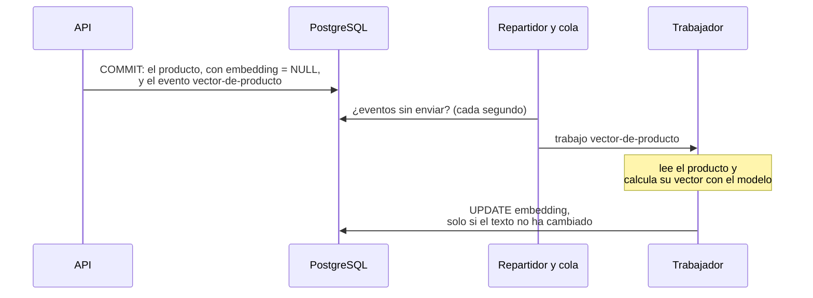

import Term from '~/components/Term.astro';
import TryIt from '~/components/TryIt.astro';
import Analogy from '~/components/Analogy.astro';
import ProjectCode from '~/components/ProjectCode.astro';
import SelfCheck from '~/components/SelfCheck.astro';
import Quiz from '~/components/Quiz.astro';
import Scene from '~/components/Scene.astro';
import QuizQuestion from '~/components/QuizQuestion.astro';
import QuizOption from '~/components/QuizOption.astro';

<Scene id="problem" />

## El problema

Imagina que Carmen le escribe al asistente: «¿tenéis algo para el frío?». `buscar_productos`, la herramienta de la [lección 3](/fase-11/tool-use-function-calling/), busca productos cuyo nombre contenga «algo para el frío». No hay ninguno.

Y la tienda vende una bufanda, unos guantes, un gorro de lana y una manta. **Las palabras no coinciden; el significado, sí.** Buscar por palabras encuentra palabras, y la gente pide lo que necesita.

La [Fase 5](/fase-5/sql-vs-nosql/) prometió para la Fase 11 pgvector, la extensión de PostgreSQL que busca por parecido de significado. Aquí la tienda la usa para la <Term id="semantic-search">búsqueda semántica</Term>: buscar por lo que significa la pregunta, no por sus palabras.

<Scene id="analogy" />

## La analogía

<Analogy>

En un supermercado, las cosas están colocadas por lo que son: un pasillo para la ropa de invierno, otro para la playa. Pides «algo para el frío», y te llevan al pasillo del invierno, aunque ningún cartel diga «frío».

Un *embedding* le da a cada producto su sitio en un supermercado enorme, colocado por lo que significa. Tu pregunta también recibe un sitio, y los productos más cercanos son la respuesta.

<div slot="limits">

- Un supermercado tiene dos dimensiones. Un *embedding* tiene cientos (los de la tienda, 384), y ninguna significa algo que se pueda nombrar, como «abrigo».
- Para el modelo, «frío» y «calor» hablan de lo mismo, la temperatura: verás un abanico entre las cosas para el frío.
- En un supermercado puedes oír «eso no lo tenemos». Aquí siempre hay un producto más cercano.

</div>

</Analogy>

<Scene id="embed" />

## Cómo funciona de verdad

### Un embedding: un texto convertido en 384 números

Así empieza el vector de la bufanda, tal y como lo guarda PostgreSQL:

```text
[-0.025254654,0.018033236,0.029661806,0.12813672,0.057782944
```

Son los primeros números de una lista de 384: el <Term id="embedding">*embedding*</Term> de «Bufanda. Bufanda larga de lana gruesa, suave y calentita, para los días de invierno.». Un **vector**, que puedes ver como un punto en un espacio de 384 dimensiones.

Lo calcula un modelo entrenado para que **dos textos que significan lo mismo den puntos cercanos**. No escribe texto, como el del asistente: convierte texto en números. De cada producto, convierte su nombre y su descripción:

<ProjectCode file="tienda-api/51-embeddings/src/embeddings.ts" region="texto-del-producto" />

Por eso los productos tienen ahora descripción, y el catálogo pasa de 4 a 20: abrigo, café, verano y regalos.

<Scene id="cosine" />

### Cerca es parecido: la distancia del coseno

Piensa en cada vector como una flecha que sale del mismo sitio: dos textos que hablan de lo mismo apuntan hacia el mismo lado. **La <Term id="cosine-distance">distancia del coseno</Term> mide el ángulo entre las flechas**, no lo largas que son:

| Distancia | Las flechas | Los textos |
|---|---|---|
| 0 | Apuntan exactamente igual | Significan lo mismo |
| 1 | Forman un ángulo recto | No tienen nada que ver |
| 2 | Apuntan en sentidos contrarios | Casi nunca pasa |

El 21 de noviembre de 2026, en el Mac del autor, estos fueron los cinco productos más cercanos a «algo para el frío»:

| Puesto | Producto | Distancia |
|---|---|---|
| 1 | Guantes | 0,371 |
| 2 | Manta | 0,394 |
| 3 | Bufanda | 0,410 |
| 4 | Gorro de lana | 0,444 |
| 5 | Abanico | 0,453 |

Ninguno lleva «frío» en el nombre. El modelo da vectores de **longitud 1**, y la cuenta es corta: 1 menos la suma de multiplicarlos número a número:

<ProjectCode file="tienda-api/51-embeddings/scripts/probar-embeddings.ts" region="distancia" />

<Scene id="local" />

### Un modelo pequeño, en tu ordenador

La API de Claude no calcula *embeddings*: su documentación [señala a Voyage AI](https://platform.claude.com/docs/en/build-with-claude/embeddings), de MongoDB, con otra cuenta. La tienda usa un modelo pequeño en tu ordenador, con Transformers.js: **gratis, sin internet después de descargarlo, en español y en inglés**.

<ProjectCode file="tienda-api/51-embeddings/src/embeddings.ts" region="embebedor" />

- `MODELO_EMBEDDINGS`: un modelo abierto, de Hugging Face. Lo elegimos midiendo: el primero que probamos ponía la gorra para el sol primera para «algo para el frío».
- `DIMENSIONES = 384`: la columna de la base de datos tiene que tener los mismos números.
- `REVISION_EMBEDDINGS`: su versión exacta. Con otra, los vectores nuevos no se podrían comparar con los guardados, **sin que nada avisara**.
- `Embebedor`: textos dentro, vectores fuera. Los tests ponen uno de mentira.

El modelo se carga la primera vez que alguien pide un vector:

<ProjectCode file="tienda-api/51-embeddings/src/embeddings.ts" region="cargar-modelo" />

- `import()` dentro de la función: un proceso que nunca busca por el significado no carga la librería.
- `env.cacheDir`: dónde quedan los ficheros. En Compose, un <Term id="volume">volumen</Term>, `modelos`, que comparten la API y el trabajador.
- `origenDelModelo`: con los ficheros ya en esa carpeta, carga de ahí sin preguntar a nadie; si falta alguno, los descarga.
- `dtype: 'q8'`: cada número del modelo, en 8 bits en lugar de 32: cuatro veces más pequeño, y casi igual de bueno.

Medido en el Mac del autor: 135 MB que descargar, unos 30 segundos la primera vez, menos de uno las siguientes y unos 3 ms por texto. La imagen no lo lleva dentro; con la librería, pasa de 580 a 669 MB.

<Scene id="pgvector" />

### pgvector: vectores dentro de PostgreSQL

pgvector le añade a PostgreSQL un tipo, `vector`, sus operadores de distancia y sus índices. Viene en la imagen `pgvector/pgvector`, en los dos ficheros de Compose:

<ProjectCode file="tienda-api/51-embeddings/compose.yaml" region="db" />

Es PostgreSQL 18 con la extensión dentro. La migración `014` la activa y añade dos columnas:

<ProjectCode file="tienda-api/51-embeddings/bd/migraciones/014-embeddings.sql" region="extension" />

<ProjectCode file="tienda-api/51-embeddings/bd/migraciones/014-embeddings.sql" region="columnas" />

- `vector(384)`: exactamente 384 números.
- `NULL` es «aún sin calcular»: lo calcula el trabajador, más abajo.

Para buscar, el operador `<=>`, la distancia del coseno. Los más parecidos a la bufanda, sin ningún modelo:

```sql
SELECT nombre, embedding <=> (SELECT embedding FROM productos WHERE nombre = 'Bufanda') AS distancia
FROM productos
WHERE nombre <> 'Bufanda'
ORDER BY distancia
LIMIT 5;
```

En la tienda, la misma idea va escrita con Drizzle:

<ProjectCode file="tienda-api/51-embeddings/src/asistente/herramientas/buscar-productos.ts" region="cercanos" />

`distancia` es el `<=>` con el vector de la consulta (`cosineDistance`), y `yaEstan`, los que ya han salido por el nombre. `ORDER BY` la distancia y `LIMIT 5`: los cinco vecinos más cercanos. Sin un índice, PostgreSQL calcula la distancia a **cada** fila.

<Scene id="hnsw" />

### HNSW: saltar de vecino en vecino

Con 20 productos, no cuesta nada; con un millón, sí. El [árbol B de la Fase 5](/fase-5/indices-sql-explain/#por-dentro-un-árbol-b) no sirve: 384 números juntos no tienen un orden. La tienda usa un índice <Term id="hnsw">HNSW</Term> (*Hierarchical Navigable Small World*, «mundo pequeño navegable por pisos»), un grafo:

- **Abajo**, un piso con todos los vectores, cada uno unido a sus vecinos cercanos.
- **Arriba**, pisos con cada vez menos vectores, unidos a vecinos más lejanos.
- **Para buscar**, entra por arriba y salta al vecino más cercano a la pregunta hasta que ninguno está más cerca. Baja un piso y repite. Abajo, junta los mejores candidatos.

Como un viaje en coche: autopista, carretera, calle. Lo crea la migración `014`:

<ProjectCode file="tienda-api/51-embeddings/bd/migraciones/014-embeddings.sql" region="indice" />

`vector_cosine_ops`: para ordenar por `<=>`.

<Scene id="recall" />

### Lo que cuesta: aproximado, y medido

**HNSW es aproximado**: mira una parte pequeña de la tabla, y si el camino de saltos no pasa cerca de un vecino, se lo salta. Cuántos candidatos junta lo decide `hnsw.ef_search` (40, si no se dice).

`scripts/muchos-vectores.ts` lo mide, como `muchos-pedidos` en la Fase 5, con 50.000 vectores en una tabla aparte, agrupados en 500 temas, como los de un modelo. En el Mac del autor (Colima, 4 GB), el 21 de noviembre de 2026:

| En 20 búsquedas de los 10 más cercanos | Leyendo la tabla entera | Con el índice (`ef_search` 40) | Con el índice (`ef_search` 100) |
|---|---|---|---|
| Lo que tarda cada una | 18,5 ms | 0,8 ms | 0,6 ms |
| De los 10 de verdad, encuentra | 10 | 8,5 de media | 9,9 de media |
| Distancia media de los que da | 0,183 | 0,285 | 0,183 |

Su `EXPLAIN ANALYZE`: 21,7 ms sin el índice y 0,5 ms con él. **Rápido, y casi todos los de verdad**: con 40 candidatos, 169 de 200; con 100, 198 de 200.

Con `--al-azar`, 384 números al azar sin temas, es el peor caso: todos los vectores quedan casi a la misma distancia de todos, y el grafo no tiene por dónde guiarse. Ese día encontró 26 de 200 con `ef_search` 40, y 47 con 100.

Construirlo tardó 11 segundos (40 con vectores al azar): como cualquier [índice de la Fase 5](/fase-5/indices-sql-explain/#lo-que-cuesta-un-índice), se paga al construirlo y en cada escritura.

<Scene id="hybrid" />

### La búsqueda híbrida: por qué «taza» encuentra la taza

Un modelo de *embeddings* entiende frases mejor que palabras sueltas: para «taza», la Taza queda a 0,793, más lejos que la Camiseta, a 0,711, y **ni sale entre los cinco más cercanos**. Por eso la tienda junta las dos búsquedas, por las palabras y por el significado: una **búsqueda híbrida**.

<ProjectCode file="tienda-api/51-embeddings/src/asistente/herramientas/buscar-productos.ts" region="por-el-nombre-primero" />

1. El vector de la consulta, con el **mismo** modelo que los de los productos: lo único que calcula la API.
2. Primero, los productos con la consulta en el nombre, también los que aún no tienen vector (`distancia: null`).
3. Después, los cinco más cercanos, sin repetir: la consulta de antes.

La usan el asistente y el servidor MCP de la [lección 4](/fase-11/mcp-model-context-protocol/).

<Scene id="nearest" />

### Siempre hay un vecino más cercano

En «algo para el frío», **el quinto es el abanico**, «para darte aire en los días de calor», por delante de la sudadera. El modelo ha entendido de qué trata la pregunta, la temperatura, pero no hacia qué lado.

Y siempre devuelve cinco, aunque ninguno sirva: los vectores no saben decir «no hay nada». Por eso cada producto viaja con su distancia y su descripción, para que el modelo del asistente las mire antes de recomendar. En la [lección 6](/fase-11/rag-retrieval-augmented-generation/) lo verás decir «no lo sé».

<Scene id="worker" />

### Los vectores los calcula el trabajador

Un producto nuevo, o con otro nombre u otra descripción, necesita un vector nuevo. La tienda no lo recalcula en esa petición: **lo apunta en el [outbox de la Fase 9](/fase-9/arquitectura-orientada-a-eventos/#el-outbox-el-aviso-en-la-misma-transacción)**, en la <Term id="transaction">transacción</Term> del cambio:

<ProjectCode file="tienda-api/51-embeddings/src/datos.ts" region="vector-pendiente" />

El vector viejo pasa a `NULL`; mientras tanto, el producto sale por el nombre. Un cambio de precio no toca el vector.



El <Term id="worker">trabajador</Term> hace el trabajo:

<ProjectCode file="tienda-api/51-embeddings/src/cola.ts" region="calcular-vector" />

- **Por qué el trabajador**: el modelo ocupa memoria y tarda, y quien cambia un producto no tiene por qué esperarlo.
- **Si el modelo falla**, la cola repite el trabajo.
- **Si el producto cambia mientras se calcula**, `guardarVectores` no escribe el vector viejo.

`npm run embeddings` calcula los que faltan.

<Scene id="memory" />

### Viene apagada: lo que ocupa el modelo en memoria

Medido con `docker stats` el 21 de noviembre de 2026:

| Proceso | Sin el modelo | Con el modelo cargado |
|---|---|---|
| API | 193 MiB | 492 MiB |
| Trabajador | 152 MiB | 532 MiB |

**Entre 300 y 400 MB más por proceso.** Con los dos cargados y Docker en 2 GB, al arrancar otro proceso el sistema mató la API por falta de memoria: <Term id="exit-code">código de salida</Term> `137`. Por eso viene apagada:

<ProjectCode file="tienda-api/51-embeddings/.env.ejemplo" region="busqueda-semantica" />

<Scene id="words" />

### Cuándo basta con buscar por palabras

| | `ILIKE '%taza%'` (lección 3) | Texto completo de PostgreSQL | *Embeddings* |
|---|---|---|---|
| Qué encuentra | El trozo exacto, en el nombre | Las palabras, con sus variantes (guante, guantes) | Lo que significa, con otras palabras o en otro idioma |
| Lo que falla | «tazas», «algo para el café» | Lo que se pide sin esas palabras | Códigos y palabras sueltas; a veces, el sentido |
| Lo que necesita | Nada | Un índice GIN, en la misma base de datos | Un modelo, su memoria y un vector por fila |
| Por qué sale cada resultado | Se ve | Se ve | No se ve: es una distancia |

La <Term id="full-text-search">búsqueda de texto completo</Term> de PostgreSQL parte cada texto en palabras, quita las que no dicen nada («el», «para») y deja cada una en su raíz. **Si la gente busca por el nombre de lo que quiere**, o por códigos, basta, y es más barata. Los *embeddings* compensan cuando la gente describe lo que necesita.

Hay <Term id="vector-database">bases de datos de vectores</Term> aparte, como Pinecone o Qdrant. pgvector deja los vectores junto a los productos, con sus transacciones: para la tienda, sobra.

<Scene id="try" />

## Pruébalo

El objetivo: buscar «algo para el frío» por el nombre y no encontrar nada; encender la búsqueda por el significado y encontrar la ropa de abrigo; averiguar en qué puesto entra un producto nuevo, y medir lo que ahorra el índice y lo que se deja. Sin ningún modelo de pago.

Las salidas son de Node 26, en Linux, del 21 de noviembre de 2026, en un MacBook con Docker en Colima (4 GB). Tus tiempos y tu memoria serán otros; las distancias, las mismas o casi.

### Prepara el paso

El catálogo de 20 productos solo se carga en una base de datos vacía. `docker compose down -v` borra los volúmenes, y con ellos tus pedidos y tus claves:

```sh
cd ~/curso-backend/fase-3
curl -O https://backenddesdecero.com/practicas/tienda-api/51-embeddings.tar.gz
tar -xzf 51-embeddings.tar.gz
cp -R 51-embeddings/. tienda-api/
cd tienda-api
npm install
docker compose down -v
docker compose up -d --build --wait
```

`npm install` trae Transformers.js: casi 500 MB. Vuelve a crear la clave del comparador y la función `mcp` de la [lección 4](/fase-11/mcp-model-context-protocol/#dos-claves-dos-roles), y una más, `buscar`:

```sh
API=$(docker compose port api 3000)
docker compose exec api node scripts/crear-clave.ts "Comparador de precios" catalogo
CATALOGO=tienda_…
mcp() { curl -s "http://$API/mcp" -H "Authorization: Bearer $1" -H 'Accept: application/json, text/event-stream' --json "$2"; }
buscar() { mcp "$CATALOGO" "$(jq -nc --arg q "$1" '{jsonrpc:"2.0",id:1,method:"tools/call",params:{name:"buscar_productos",arguments:{consulta:$q}}}')" | jq -r '.result.content[0].text'; }
```

Pon tu clave en `CATALOGO=`. `--arg q "$1"` le pasa a `jq` la consulta, con sus comillas bien puestas.

### «algo para el frío», por el nombre

<TryIt
  title="1. Con la búsqueda semántica apagada"
  cmd={`buscar "algo para el frío"`}
  output={`[]`}
>

Ningún nombre contiene «algo para el frío». Si `jq` da un error, quita el último `jq` de la función y mira qué contesta la tienda.

</TryIt>

<TryIt
  title="2. Por palabras, en las descripciones"
  cmd={`docker compose exec db psql -U tienda -d tienda -c "SELECT nombre FROM productos WHERE to_tsvector('spanish', nombre || ' ' || descripcion) @@ websearch_to_tsquery('spanish', 'frío');"`}
  output={`    nombre     
---------------
 Gorro de lana
(1 row)`}
>

Texto completo, sin índice: con 20 filas no hace falta. Encuentra el gorro, «cuando hace frío», y se pierde lo que lo dice de otra forma, como las «manos heladas» de los guantes.

</TryIt>

### Dale memoria a Docker y enciende la búsqueda

Dale a Docker 4 GB. Con Colima, `colima stop && colima start --memory 4`. En Docker Desktop, en **Settings**, **VM resources**, **Advanced**, **Memory limit** (según su documentación, por defecto, la mitad de la de tu ordenador). Si no puedes, quédate aquí.

Pon `BUSQUEDA_SEMANTICA=si` en tu `.env` y ejecuta `docker compose up -d --wait`: Compose ve el cambio y vuelve a crear la API y el trabajador. Después, calcula los vectores del catálogo en el trabajador, que tiene el volumen del modelo:

<TryIt
  title="3. Los vectores del catálogo"
  cmd="docker compose exec trabajador node scripts/embeddings.ts"
  output={`{"level":30,…,"modelo":"Xenova/paraphrase-multilingual-MiniLM-L12-v2","revision":"2c4055b12046f11709e9df2c122e59ffbdc2f900","carpeta":"./modelos","msg":"cargando el modelo de embeddings"}
{"level":30,…,"ms":33496,"msg":"modelo de embeddings cargado"}
Vectores calculados: 20, en 33.6 s`}
>

Casi todo el tiempo es la descarga. Si dice `BUSQUEDA_SEMANTICA=no: la tienda no usa los vectores`, repite `docker compose up -d --wait`. Si el contenedor se cae con el código `137`, a Docker le falta memoria.

</TryIt>

La consulta de los parecidos a la bufanda, con tres decimales:

<TryIt
  title="4. Los productos más parecidos a la bufanda"
  cmd={`docker compose exec db psql -U tienda -d tienda -c "SELECT nombre, round((embedding <=> (SELECT embedding FROM productos WHERE nombre = 'Bufanda'))::numeric, 3) AS distancia FROM productos WHERE nombre <> 'Bufanda' ORDER BY distancia LIMIT 5;"`}
  output={`    nombre     | distancia 
---------------+-----------
 Gorro de lana |     0.284
 Abanico       |     0.370
 Sudadera      |     0.379
 Delantal      |     0.406
 Manta         |     0.467
(5 rows)`}
>

Tres son ropa de abrigo, y nadie le ha dicho a la base de datos qué es eso. El abanico y el delantal también son de tela, y el abanico es «para darte aire en los días de calor», como la bufanda «para los días de invierno»: el modelo junta lo que se parece, aunque sea al revés.

</TryIt>

### «algo para el frío», por el significado

<TryIt
  title="5. Con la búsqueda semántica encendida"
  cmd={`buscar "algo para el frío" | jq -c '.[] | {nombre, distancia}'`}
  output={`{"nombre":"Guantes","distancia":0.371}
{"nombre":"Manta","distancia":0.394}
{"nombre":"Bufanda","distancia":0.41}
{"nombre":"Gorro de lana","distancia":0.444}
{"nombre":"Abanico","distancia":0.453}`}
>

Ahora sí: la ropa de abrigo, y **el abanico, quinto**. La API ha cargado el modelo en menos de un segundo.

</TryIt>

<TryIt
  title="6. «taza»"
  cmd={`buscar "taza" | jq -c '.[] | {nombre, distancia}'`}
  output={`{"nombre":"Taza","distancia":0.793}
{"nombre":"Camiseta","distancia":0.711}
{"nombre":"Gorra","distancia":0.732}
{"nombre":"Abanico","distancia":0.735}
{"nombre":"Libreta","distancia":0.741}
{"nombre":"Delantal","distancia":0.741}`}
>

La Taza, primera porque su nombre coincide, aunque esté más lejos que los cinco de detrás.

</TryIt>

### Un producto nuevo, encontrado en segundos

Ana, la dueña, añade unos calcetines de lana. Inicia sesión como ella y crea el producto:

```sh
curl -s -o /dev/null -c ana.txt --json '{"email":"ana@tienda.example","contrasena":"ana-practica-2026"}' "http://$API/v2/sesion"
curl -s -b ana.txt --json '{"nombre":"Calcetines de lana","precioCentimos":900,"descripcion":"Calcetines gruesos de lana para que no se te enfríen los pies en invierno."}' "http://$API/v2/productos" | jq -c '{id, nombre}'
```

<TryIt
  title="7. El trabajador calcula su vector"
  cmd={`docker compose logs trabajador --no-log-prefix --since 1m | grep 'vector de producto' | jq -c '{productoId, guardado, msg}'`}
  output={`{"productoId":21,"guardado":true,"msg":"vector de producto calculado"}`}
>

`guardado: true`: el vector ya está en su fila, después del evento, el repartidor, la cola y el modelo.

</TryIt>

<SelfCheck question="Reto: repite el paso 5. ¿En qué puesto salen los calcetines, y quién se queda fuera?">

Terceros, a 0,409, entre la manta y la bufanda. El abanico se queda fuera: ahora hay un producto de abrigo más cerca que él.

</SelfCheck>

Al terminar, borra `ana.txt`, con la sesión de Ana.

### El modelo, sin base de datos

`npm run probar-embeddings` prueba el modelo en tu ordenador, fuera de Docker, con el catálogo de `bd/datos.sql` y cuatro preguntas:

<TryIt
  title="8. El modelo, en tu ordenador"
  cmd="npm run probar-embeddings"
  output={`> tienda-api@1.0.0 probar-embeddings
> node --env-file=test/.env scripts/probar-embeddings.ts

Modelo: ./modelos
Carga del modelo y 20 vectores: 29.3 s; los 20 otra vez, ya cargado: 66 ms (3 ms cada uno)
Memoria del proceso (RSS): 304 MB antes, 519 MB con el modelo

«algo para el frío»
  0.371  Guantes
  0.394  Manta
  0.410  Bufanda
  0.444  Gorro de lana
  0.453  Abanico

«un regalo para alguien a quien le encanta el café»
  0.244  Taza
  0.258  Cafetera italiana
  0.302  Café en grano
  0.537  Tarjeta regalo
  0.568  Vela aromática

«algo para el verano»
  0.320  Chanclas
  0.425  Gorra
  0.491  Abanico
  0.518  Gafas de sol
  0.565  Sombrero de paja

«taza»
  0.711  Camiseta
  0.732  Gorra
  0.735  Abanico
  0.741  Libreta
  0.741  Delantal

Bien: para «algo para el frío», los tres primeros son ropa de abrigo`}
>

Descarga el modelo otra vez, en `modelos/`, fuera de Git: tu ordenador no ve el volumen de Docker. «algo para el verano» acierta los cinco: no siempre se equivoca de lado. Y «taza», sin el nombre, deja fuera la Taza. Si termina con `Mal: …`, cuéntanoslo con el enlace del final.

</TryIt>

### Lo que ocupa en memoria

<TryIt
  title="9. La API y el trabajador, con el modelo cargado"
  cmd={`docker stats --no-stream --format 'table {{.Name}}\\t{{.MemUsage}}'`}
  output={`NAME                  MEM USAGE / LIMIT
tienda-trabajador-1   540.5MiB / 3.813GiB
tienda-api-1          558.9MiB / 3.813GiB
tienda-redis-1        8.426MiB / 3.813GiB
tienda-cache-1        6.953MiB / 3.813GiB
tienda-db-1           84.08MiB / 3.813GiB
tienda-mailpit-1      7.328MiB / 3.813GiB`}
>

Compáralos con [la tabla de arriba](#viene-apagada-lo-que-ocupa-el-modelo-en-memoria). Tus números serán otros.

</TryIt>

### El índice, con 50.000 vectores

<TryIt
  title="10. Con el índice, sin él, y lo que acierta"
  cmd="docker compose exec api node scripts/muchos-vectores.ts"
  output={`50000 vectores agrupados en 500 temas, en 7.1 s
Índice HNSW, en 10.8 s

Con el índice:
Limit  (cost=647.03..656.07 rows=5 width=12) (actual time=0.428..0.460 rows=5.00 loops=1)
  Buffers: shared hit=429 read=6 written=6
  InitPlan 1
    ->  Index Scan using vectores_de_prueba_pkey on vectores_de_prueba vectores_de_prueba_1  (cost=0.29..8.31 rows=1 width=1544) (actual time=0.020..0.020 rows=1.00 loops=1)
          Index Cond: (id = 1)
          Index Searches: 1
          Buffers: shared hit=1 read=2 written=2
  ->  Index Scan using vectores_de_prueba_embedding_idx on vectores_de_prueba  (cost=638.72..91004.00 rows=50000 width=12) (actual time=0.427..0.458 rows=5.00 loops=1)
        Order By: (embedding <=> (InitPlan 1).col1)
        Index Searches: 1
        Buffers: shared hit=429 read=6 written=6
Planning:
  Buffers: shared hit=26 read=8 dirtied=1 written=8
Planning Time: 0.205 ms
Execution Time: 0.496 ms

Sin el índice:
Limit  (cost=11463.79..11463.80 rows=5 width=12) (actual time=21.677..21.679 rows=5.00 loops=1)
  Buffers: shared hit=3680 read=6323 written=40
  InitPlan 1
    ->  Bitmap Heap Scan on vectores_de_prueba vectores_de_prueba_1  (cost=4.30..8.31 rows=1 width=1544) (actual time=0.005..0.006 rows=1.00 loops=1)
          Recheck Cond: (id = 1)
          Heap Blocks: exact=1
          Buffers: shared hit=3
          ->  Bitmap Index Scan on vectores_de_prueba_pkey  (cost=0.00..4.30 rows=1 width=0) (actual time=0.003..0.003 rows=1.00 loops=1)
                Index Cond: (id = 1)
                Index Searches: 1
                Buffers: shared hit=2
  ->  Sort  (cost=11455.48..11580.48 rows=50000 width=12) (actual time=21.677..21.677 rows=5.00 loops=1)
        Sort Key: ((vectores_de_prueba.embedding <=> (InitPlan 1).col1))
        Sort Method: top-N heapsort  Memory: 25kB
        Buffers: shared hit=3680 read=6323 written=40
        ->  Seq Scan on vectores_de_prueba  (cost=0.00..10625.00 rows=50000 width=12) (actual time=0.035..17.882 rows=50000.00 loops=1)
              Buffers: shared hit=3680 read=6323 written=40
Planning:
  Buffers: shared hit=1
Planning Time: 0.036 ms
Execution Time: 21.696 ms

De los 10 más cercanos de verdad, en 20 búsquedas (vectores agrupados en 500 temas):
  leyendo la tabla entera: 200 de 200 (100 %), a 0.183 de media, en 18.5 ms por búsqueda
  con el índice, hnsw.ef_search = 40: 169 de 200 (85 %), a 0.285 de media, en 0.8 ms por búsqueda
  con el índice, hnsw.ef_search = 100: 198 de 200 (99 %), a 0.183 de media, en 0.6 ms por búsqueda`}
>

Los planes se leen de abajo arriba, como en la [Fase 5](/fase-5/indices-sql-explain/#explain-el-plan-antes-de-ejecutar): un `Index Scan` sobre el HNSW, que para en cuanto tiene cinco, y un `Seq Scan` de las 50.000 filas con un `Sort` encima. Las últimas líneas son la tabla de [«Lo que cuesta»](#lo-que-cuesta-aproximado-y-medido): con más candidatos, acierta más. Tus números serán otros.

</TryIt>

Con `--al-azar` verás el peor caso. Después, bórrala: `docker compose exec api node scripts/muchos-vectores.ts --borrar`.

### En tu servidor

`.env.produccion.ejemplo` también trae `BUSQUEDA_SEMANTICA=no`: **en la máquina de 2 GB de la Fase 8, déjala así.** El timer despliega el paso con la imagen de pgvector y la migración `014`. Con memoria de sobra, pon `si` y calcula los vectores: `docker compose -f compose.produccion.yaml exec trabajador node scripts/embeddings.ts`. Tus productos siguen sin descripción: dásela con `PATCH /v2/productos/{id}`, y el trabajador calculará su vector.

<Scene end />

## Ya lo has visto

- **Google Fotos**, cuando buscas «perro» o «playa» y salen fotos que nadie etiquetó así: la misma idea, con imágenes.
- **El buscador de muchas tiendas en línea**, que encuentra productos aunque no escribas su nombre exacto.

## Errores comunes

- **Comparar vectores de dos modelos**, o de dos versiones del mismo. Fija la versión y, si la cambias, recalcula todos (`npm run embeddings -- --todos`).
- **Creer que la búsqueda dice «no hay nada».** Siempre devuelve los más cercanos: mira la distancia.
- **Buscar solo por el significado** nombres y códigos: búsqueda híbrida.
- **Calcular el vector en la petición que guarda el producto.** Al trabajador, por el outbox.
- **Encender la búsqueda con Docker a 2 GB.** Un proceso termina con el código `137`.

## Resumen

- Un *embedding* es un texto convertido en un vector, un punto: los textos que significan lo mismo quedan cerca. La distancia del coseno mide el ángulo: 0, lo mismo; 1, nada que ver.
- La tienda lo calcula con un modelo pequeño en tu ordenador, gratis, de versión fija. Ocupa entre 300 y 400 MB por proceso: por eso la búsqueda viene apagada.
- pgvector guarda los vectores en PostgreSQL, los compara con `<=>` y los indexa con HNSW: rápido, pero sin garantizar los más cercanos.
- La búsqueda es híbrida, y siempre devuelve algo: cada resultado lleva su distancia.
- Los vectores los calcula el trabajador, por el outbox. Si la gente busca por el nombre, basta el texto completo.

## ¿Lo has entendido?

<Quiz>

<QuizQuestion
  question="Una clienta busca «un regalo para alguien a quien le encanta el café». Por el nombre no sale nada; por el significado, la taza, la cafetera italiana y el café en grano. ¿Por qué?"
  review="Un embedding: un texto convertido en 384 números"
>

<QuizOption text="Porque el modelo busca la palabra «café» dentro de la descripción de cada producto.">

Eso sería buscar por palabras. El modelo convierte la frase en un punto y mira qué productos quedan cerca.

</QuizOption>

<QuizOption text="Porque la frase y esas descripciones dan vectores cercanos: hablan de lo mismo." correct>

El modelo está entrenado para que lo que significa lo mismo quede cerca.

</QuizOption>

<QuizOption text="Porque el asistente reescribe la pregunta con el nombre exacto de cada producto.">

Nadie reescribe nada: se compara el vector de la frase con el de cada producto.

</QuizOption>

</QuizQuestion>

<QuizQuestion
  question="Para «algo para el frío», el abanico sale quinto, a 0,453, por delante de la sudadera. ¿Qué te dice?"
  review="Siempre hay un vecino más cercano"
>

<QuizOption text="Que el vector del abanico está mal calculado y hay que calcularlo otra vez.">

Está bien calculado: «calor» y «frío» hablan de lo mismo, la temperatura, y el modelo los coloca cerca.

</QuizOption>

<QuizOption text="Que la distancia del coseno no sirve para comparar el significado de dos textos.">

Los cuatro primeros son ropa de abrigo. Sirve, con sus límites: capta el tema mejor que el sentido.

</QuizOption>

<QuizOption text="Que el modelo capta de qué trata la pregunta, no siempre hacia qué lado." correct>

Por eso la herramienta devuelve la descripción y la distancia.

</QuizOption>

</QuizQuestion>

<QuizQuestion
  question="Con dos millones de vectores y un índice HNSW, compruebas a mano que uno de los cinco más cercanos de verdad no ha salido en el resultado. ¿Es un fallo de pgvector?"
  review="Lo que cuesta: aproximado, y medido"
>

<QuizOption text="Sí: un índice tiene que devolver siempre lo mismo que leer la tabla entera.">

Un árbol B, sí. HNSW es aproximado: a cambio de no mirar toda la tabla, no garantiza los más cercanos.

</QuizOption>

<QuizOption text="No: HNSW es aproximado. Con más candidatos (ef_search), acierta más." correct>

Es el precio de saltar de vecino en vecino en lugar de calcular dos millones de distancias.

</QuizOption>

<QuizOption text="Sí: las estadísticas están viejas, y con un ANALYZE saldría el que falta.">

`ANALYZE` ayuda a elegir un plan, pero no cambia el camino de saltos de HNSW.

</QuizOption>

</QuizQuestion>

<QuizQuestion
  question="Una ferretería tiene 50.000 piezas, y sus clientes buscan por el código de la pieza: «T-4512». ¿Le pones búsqueda por el significado?"
  review="Cuándo basta con buscar por palabras"
>

<QuizOption text="No: para códigos y nombres exactos basta buscar por palabras, más barato." correct>

Sin modelo ni memoria de más, y se ve por qué sale cada resultado.

</QuizOption>

<QuizOption text="Sí: con embeddings, cualquier búsqueda sale mejor que buscando por palabras.">

Un código no significa nada para el modelo: como «taza», puede ni salir entre los más cercanos.

</QuizOption>

<QuizOption text="Sí, siempre que el índice HNSW tenga dentro las 50.000 piezas de la tienda.">

El índice acelera la búsqueda por el significado, pero no hace que el modelo entienda un código.

</QuizOption>

</QuizQuestion>

<QuizQuestion
  question="Ana cambia la descripción de la manta y, al momento, buscas «algo para el sofá»: la manta no sale por el significado. Unos segundos después, sí. ¿Qué ha pasado?"
  review="Los vectores los calcula el trabajador"
>

<QuizOption text="La caché de la API tenía guardada la búsqueda anterior, de antes del cambio.">

La búsqueda por el significado no pasa por la caché de la lista. El vector de la manta estaba en `NULL`.

</QuizOption>

<QuizOption text="PostgreSQL tarda unos segundos en poner al día el índice HNSW después de un UPDATE.">

El índice se pone al día con la escritura. Lo que tardó fue calcular el vector.

</QuizOption>

<QuizOption text="Su vector quedó en NULL hasta que el trabajador calculó el nuevo." correct>

El evento del outbox, el repartidor, la cola y el modelo. Mientras tanto, la manta solo sale por el nombre.

</QuizOption>

</QuizQuestion>

<QuizQuestion
  question="Enciendes la búsqueda semántica con Docker a 2 GB. Haces unas búsquedas y la API desaparece: docker compose ps dice Exited (137). ¿Qué haces?"
  review="Viene apagada: lo que ocupa el modelo en memoria"
>

<QuizOption text="Darle 4 GB a Docker, o apagarla: el sistema la mató por falta de memoria." correct>

Cada proceso con el modelo cargado ocupa entre 300 y 400 MB más. En 2 GB, la API y el trabajador no caben.

</QuizOption>

<QuizOption text="Borrar el volumen modelos y arrancar otra vez: el modelo se ha descargado mal.">

Un modelo mal descargado da un error al cargar, no un `137`. El `137` es el sistema matando un proceso.

</QuizOption>

<QuizOption text="Quitar el índice HNSW de productos, que es lo que más memoria le ocupa a la API.">

El índice vive en PostgreSQL, en otro contenedor. Lo que pesa es el modelo, dentro de la API.

</QuizOption>

</QuizQuestion>

</Quiz>

## Para profundizar

- [pgvector](https://github.com/pgvector/pgvector), en inglés: tipos, operadores y HNSW.
- [El artículo que presentó HNSW](https://arxiv.org/abs/1603.09320), de Malkov y Yashunin, en inglés.
- [Transformers.js](https://huggingface.co/docs/transformers.js), en inglés: modelos en Node y en el navegador.
- [Búsqueda de texto completo](https://www.postgresql.org/docs/18/textsearch.html), de PostgreSQL, en inglés.
- [Embeddings](https://platform.claude.com/docs/en/build-with-claude/embeddings), de la documentación de Claude, en inglés: los modelos de Voyage AI.
