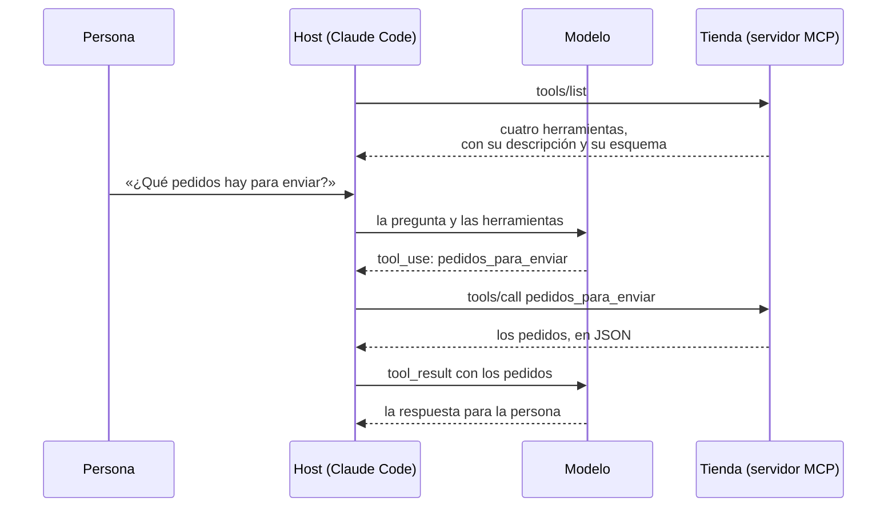
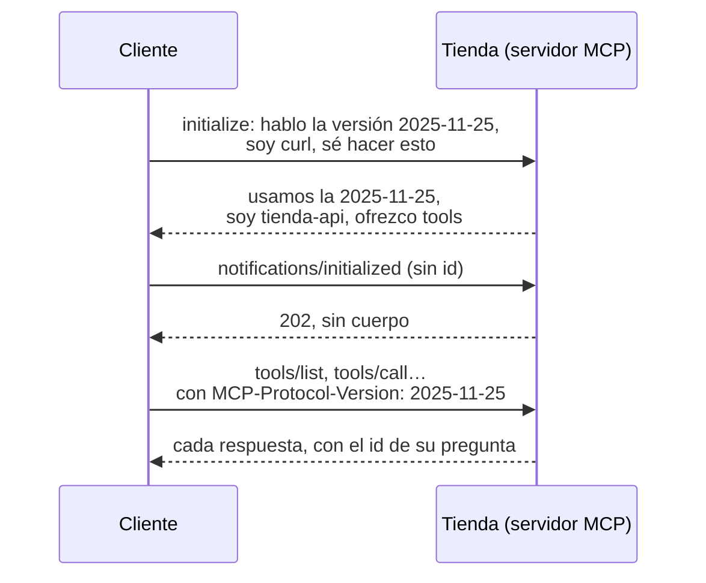

import Term from '~/components/Term.astro';
import TryIt from '~/components/TryIt.astro';
import Analogy from '~/components/Analogy.astro';
import ProjectCode from '~/components/ProjectCode.astro';
import Quiz from '~/components/Quiz.astro';
import Scene from '~/components/Scene.astro';
import QuizQuestion from '~/components/QuizQuestion.astro';
import QuizOption from '~/components/QuizOption.astro';

<Scene id="problem" />

## El problema

Imagina que Reparto Rápido, la empresa de reparto de la [Fase 6](/fase-6/roles-permisos-rbac/#mínimo-privilegio-también-para-la-clave-de-reparto), cambia su programa por un agente: un programa en el que un modelo de lenguaje, como Claude, decide qué herramientas usar hasta terminar una tarea. El suyo mira qué pedidos hay que llevar y los marca como enviados. Un comparador de precios quiere que su agente consulte tu catálogo. Y tú quieres preguntarle a Claude Code qué queda por enviar.

Las herramientas de tu asistente, de la [lección 3](/fase-11/tool-use-function-calling/), viven dentro de tu bucle: esos agentes no pueden usarlas. Tendrías que escribir un conector para cada agente, y cada agente, uno para cada servicio.

<Term id="mcp">MCP</Term> (*Model Context Protocol*, «protocolo de contexto para modelos») es el acuerdo que lo evita. Anthropic lo [publicó el 25 de noviembre de 2024](https://www.anthropic.com/news/model-context-protocol) como estándar abierto: un agente que habla MCP usa cualquier servidor que hable MCP. En esta lección, la tienda se convierte en uno.

<Scene id="analogy" />

## La analogía

<Analogy>

Hace unos años, cada móvil tenía su cargador, y el de un amigo no te servía. Con USB-C, cualquier cargador carga cualquier móvil y muchos portátiles: los fabricantes no se ponen de acuerdo pareja a pareja, todos siguen la misma norma.

MCP es esa norma para los agentes: el que sabe hablarlo se conecta a cualquier servidor que la siga.

<div slot="limits">

- Un enchufe no dice qué hace el aparato. Un servidor MCP sí: el agente pide la lista de herramientas, cada una con una descripción para el modelo.
- Cualquiera con un cable puede enchufarse. Un servidor MCP tiene que decidir quién entra y qué puede hacer: el protocolo no lo decide por ti.
- Un cargador no decide nada. Al otro lado de MCP, un modelo elige qué herramienta usar, y se puede equivocar o dejarse engañar.

</div>

</Analogy>

<Scene id="mesh" />

## Cómo funciona de verdad

### De doce conectores a siete piezas

Tres agentes (Claude Code, el de Reparto Rápido y el del comparador) y cuatro servicios (la tienda, GitHub, un calendario y una base de datos):

| | Sin un protocolo común | Con MCP |
|---|---|---|
| Qué se escribe | Un conector por cada pareja de agente y servicio | Un cliente MCP por agente y un servidor MCP por servicio |
| 3 agentes y 4 servicios | 3 × 4 = 12 conectores | 3 + 4 = 7 piezas |
| Llega un agente más | 4 conectores más | 1 cliente más |

El agente del comparador no sabe nada de tu tienda: **le basta hablar MCP**.

<Scene id="who" />

### Host, cliente y servidor: quién es quién

- **El host** es la aplicación que usa la persona, con el modelo dentro: Claude Code, Claude Desktop o el agente de Reparto Rápido.
- **El cliente** es la pieza del host que mantiene la conexión con **un** servidor. Un host conectado a tres servidores tiene tres clientes.
- **El servidor** es el programa que ofrece las herramientas. Aquí, la tienda, en `POST /mcp`.

El modelo nunca habla con el servidor. Una pregunta en Claude Code conectado a la tienda:



En el centro, el `tool_use` y el `tool_result` de la lección 3. **MCP es lo de los lados**: cómo sabe el host qué herramientas hay y cómo las llama. Para el modelo, una herramienta de un servidor MCP es una más.

### Lo que ofrece un servidor: herramientas, recursos y prompts

Un servidor MCP puede ofrecer tres cosas, y cada una la decide usar alguien distinto:

| Qué | Qué es | Quién decide usarla | Un ejemplo |
|---|---|---|---|
| Herramientas (*tools*) | Funciones que hacen algo o consultan algo | El modelo | `buscar_productos`, `marcar_enviado` |
| Recursos (*resources*) | Datos para leer, cada uno con su dirección (una URI) | La aplicación, o la persona que lo adjunta | Un fichero, una página de ayuda |
| Prompts | Plantillas de mensaje con huecos | La persona, al elegirla en un menú | «Resume los pedidos de hoy» |

**La tienda solo ofrece herramientas**: lo que necesita un agente que actúa.

<Scene id="jsonrpc" />

### Por debajo, JSON-RPC

Cada mensaje de MCP es <Term id="json-rpc">JSON-RPC</Term> 2.0: llamar a una función de otro programa con un mensaje JSON. Es la idea de [gRPC, de la Fase 4](/fase-4/graphql-grpc-rest/#grpc-llamar-a-una-función-de-otro-servicio), en texto que puedes leer. Así pide un cliente que la tienda busque gorras:

```json
{
  "jsonrpc": "2.0",
  "id": 3,
  "method": "tools/call",
  "params": { "name": "buscar_productos", "arguments": { "consulta": "gorra" } }
}
```

- `method`: la función que se llama. `params`: sus argumentos.
- `id`: un número que elige el cliente. **La respuesta lleva el mismo**: así sabe qué respuesta es de qué pregunta.
- La respuesta trae `result`, o `error` con un código y una frase si el mensaje no vale.
- Un mensaje sin `id` es una **notificación**: avisa de algo y no espera respuesta.

Y así contestó la tienda:

```json
{
  "result": {
    "content": [
      {
        "type": "text",
        "text": "[{\"id\":4,\"nombre\":\"Gorra\",\"precioCentimos\":1500,\"stock\":15}]"
      }
    ]
  },
  "jsonrpc": "2.0",
  "id": 3
}
```

`result.content` es una lista de bloques. Aquí, uno de texto con el resultado en JSON dentro (las `\"` son sus comillas): cualquier cliente sabe leer texto.

<Scene id="init" />

### Cada conexión empieza con initialize

Antes de pedir nada, cliente y servidor se presentan:



**La versión del protocolo es una fecha**, la de la especificación que siguen los dos: el 21 de noviembre de 2026, la tienda contestaba `2025-11-25`. `notifications/initialized` no lleva `id`, y recibe un `202 Accepted` sin cuerpo.

<Scene id="transport" />

### Streamable HTTP: un POST por mensaje

MCP tiene dos formas de llevar los mensajes, dos **transportes**:

- **stdio**: el host arranca el servidor en tu ordenador, y se hablan por <Term id="stdin">stdin</Term> y <Term id="stdout">stdout</Term>. Para herramientas locales, como una que lee tus ficheros.
- **Streamable HTTP**: el servidor está en la red. Cada mensaje es un `POST` a una sola dirección, y la respuesta, un JSON o un flujo de eventos <Term id="sse">SSE</Term> como los de la [lección 2](/fase-11/streaming-sse-ia/).

La tienda usa Streamable HTTP, con el SDK oficial de MCP para TypeScript, en `src/mcp.ts`:

<ProjectCode file="tienda-api/50-mcp/src/mcp.ts" region="ruta" />

- **Cada `POST` crea su servidor y su transporte**, con la clave de esa petición, y los tira al terminar. Es el modo <Term id="stateless">sin estado</Term>: no hay cabecera `Mcp-Session-Id`, y da igual qué copia de la API conteste, como en la [Fase 9](/fase-9/escalado-horizontal/).
- `enableJsonResponse: true`: la respuesta, un JSON entero, no un flujo. nginx no necesita nada especial.
- `GET` y `DELETE` abrirían un flujo y cerrarían una sesión: sin sesiones, `405`.

El cliente tiene que mandar `Accept: application/json, text/event-stream`. Con un tipo solo, `406 Not Acceptable`.

<Scene id="tool" />

### Una herramienta: nombre, descripción y esquema

Así registra la tienda `buscar_productos`:

<ProjectCode file="tienda-api/50-mcp/src/mcp.ts" region="buscar-productos" />

- **`description` es para el modelo**: la lee para decidir cuándo usarla, qué pasarle y cómo leer lo que devuelve.
- **`inputSchema`, el esquema de Zod, hace dos trabajos.** El SDK lo convierte en el <Term id="json-schema">JSON Schema</Term> que el agente ve en `tools/list`, y comprueba con él cada llamada antes de ejecutar nada.
- **`annotations: { readOnlyHint: true }`** es una pista para el cliente, «solo lee»: puede usarla sin preguntar a la persona. Nunca es seguridad.
- **`buscarProductosPorNombre` es la misma función** que usa el asistente: una forma de buscar, dos puertas.

Lo que devuelve cada herramienta pasa por dos ayudantes:

<ProjectCode file="tienda-api/50-mcp/src/mcp.ts" region="resultados" />

`enJson` mete el resultado en un bloque de texto, y `fallo`, una frase con `isError: true`. Todo resultado está **acotado**, a 10 productos o 50 pedidos: entra en la conversación del modelo, y todo lo que lee el modelo se paga ([lección 1](/fase-11/api-modelos-ia/)).

<Scene id="errors" />

### Dos clases de error

- **Un error del protocolo** llega en `error`, con un código de JSON-RPC (`-32601`: ese método no existe). Lo lee el cliente.
- **Un error de la herramienta** llega en `result`, con `isError: true` y una frase. Lo lee el modelo, que decide: probar con otro id, decírselo a la persona.

Con el SDK de la tienda, una entrada que no cumple el esquema, o una herramienta que no existe, es un error de la herramienta, con el código en el texto: `MCP error -32602: …`.

Si algo se rompe **dentro** de una herramienta, el agente recibe una frase corta, y el log, el error entero. Lo hace `usar`:

<ProjectCode file="tienda-api/50-mcp/src/mcp.ts" region="usar" />

Sin ella, el agente recibiría el error tal cual, con una consulta SQL o la dirección de un servidor dentro.

<Scene id="auth" />

### Quién entra: una clave de API, no una sesión

Antes de MCP, la tienda mira quién llama, con la clave que ya buscó `cargarClave`, el <Term id="middleware">middleware</Term> de la Fase 6:

<ProjectCode file="tienda-api/50-mcp/src/mcp.ts" region="exigir-clave" />

- **Solo entra una <Term id="api-key">clave de API</Term>**, la de la [Fase 6](/fase-6/que-es-jwt/#las-claves-de-api-cómo-se-identifica-un-programa). Un agente trabaja con un rol, como una empresa, no como un cliente: la sesión de Carmen recibe `401`.
- **El `401` llega antes de MCP**, con la cabecera `WWW-Authenticate` de siempre. Sin clave, ni la lista de herramientas.

La especificación de MCP propone <Term id="oauth">OAuth</Term> 2.1, el de la [Fase 6](/fase-6/oauth-openid-connect/), para los servidores públicos. Claude Code y el MCP Inspector aceptan además una cabecera fija, y eso usa la tienda.

<Scene id="roles" />

### Cada rol, sus herramientas

Desde este paso hay un rol más, `catalogo`, sin ningún permiso: el de un agente que solo consulta el catálogo. Lo añade la migración `013`:

<ProjectCode file="tienda-api/50-mcp/src/permisos.ts" region="permisos" />

El servidor de cada petición solo registra las herramientas que puede usar el rol de su clave. Las de los pedidos van dentro de un `if`, con los permisos de las rutas de `/v2`:

<ProjectCode file="tienda-api/50-mcp/src/mcp.ts" region="marcar-enviado" />

| Clave | Rol | Lo que ve en `tools/list` |
|---|---|---|
| Comparador de precios | `catalogo` | `buscar_productos` y `ver_producto` |
| Reparto Rápido | `reparto` | Las dos, más `pedidos_para_enviar` y `marcar_enviado` |
| Una de Ana o Luis | `admin` | Las cuatro |

**Una herramienta que la clave no puede usar no existe en su servidor.** No sale en la lista, y si el agente la llama de todas formas, recibe `Tool marcar_enviado not found`. Y dentro, `marcar_enviado` solo envía un pedido pagado, la llame quien la llame.

Desde el paso 52, el de la [lección 6](/fase-11/rag-retrieval-augmented-generation/), habrá una herramienta más para cualquier clave, `buscar_en_ayuda`: el comparador verá tres, y Reparto Rápido, cinco.

<Scene id="notauth" />

### MCP no es la autorización

MCP lleva la llamada; no sabe quién puede hacer qué. **Lo decide tu código**: la clave, su rol y las reglas de cada herramienta, la <Term id="authorization">autorización</Term> de siempre. No protegen nada:

- **La descripción.** «Solo para la empresa de reparto» es texto para un modelo.
- **Las `annotations`.** Son pistas para el cliente, y el cliente es de otro.
- **Las instrucciones del agente.** No son tuyas, y a un modelo se le engaña con texto escondido en los datos: la inyección de instrucciones de la lección 3.

**El poder de un agente es el de su clave.** Al comparador, `catalogo`; nunca `admin` «por si acaso». Es el <Term id="least-privilege">mínimo privilegio</Term> de la Fase 6: si la clave se filtra, o engañan al agente, el daño se queda en lo que podía tocar.

<Scene id="try" />

## Pruébalo

El objetivo: descubrir qué ve un agente de tu tienda con cada clave, enviar un pedido como el agente de Reparto Rápido, y comprobar que el del comparador no puede, aunque lo intente. Solo la última parte, opcional, usa un modelo y gasta.

Las salidas son de Node 26, en Linux, del 21 de noviembre de 2026, en un MacBook con Docker en Colima. Tus claves, tus pedidos y tus horas serán otros.

### Prepara el paso

Pon tu proyecto en el paso 50, como en la [introducción](/fase-11/):

```sh
cd ~/curso-backend/fase-3
curl -O https://backenddesdecero.com/practicas/tienda-api/50-mcp.tar.gz
tar -xzf 50-mcp.tar.gz
cp -R 50-mcp/. tienda-api/
cd tienda-api
npm install
docker compose up -d --build --wait
```

`npm install` trae `@modelcontextprotocol/sdk`, y `migrar` aplica la migración `013`. Guarda la dirección de la API, como en la [Fase 10](/fase-10/metricas-prometheus-grafana/#prepara-el-paso):

```sh
API=$(docker compose port api 3000)
```

### Dos claves, dos roles

<TryIt
  title="1. Las claves de Reparto Rápido y del comparador"
  cmd={`docker compose exec api node scripts/crear-clave.ts "Reparto Rápido"
docker compose exec api node scripts/crear-clave.ts "Comparador de precios" catalogo`}
  output={`Clave 1, para «Reparto Rápido» (rol reparto):
tienda_q7Rk2mXc9VbN4tLp0sWd8yHf3gJa6eZu1oPiT5nKxQw
Cópiala ahora: la tienda solo guarda su hash y no te la puede volver a enseñar.
Clave 2, para «Comparador de precios» (rol catalogo):
tienda_W3nB8vYk1cQx6mRt0pLs9dFg2hJz5aEu4iOy7wKbT_M
Cópiala ahora: la tienda solo guarda su hash y no te la puede volver a enseñar.`}
>

Sin rol detrás del nombre, la clave es de `reparto`. Hemos cambiado las claves por unas de ejemplo; las tuyas se enseñan una sola vez: cópialas. Si ya tenías una de Reparto Rápido de la Fase 6, esta es otra, y las dos valen.

</TryIt>

Guárdalas en dos variables, con tus claves, y define una función para no repetir el `curl` entero:

```sh
REPARTO=tienda_…
CATALOGO=tienda_…
mcp() { curl -s "http://$API/mcp" -H "Authorization: Bearer $1" -H 'Accept: application/json, text/event-stream' --json "$2"; }
```

`mcp` es una función de la shell, como las de la [Fase 9](/fase-9/despliegue-sin-cortes/): `$1` es la clave, y `$2`, el mensaje, que `--json` manda como JSON.

### El saludo: initialize

Primero, la presentación. Con `curl -si`, para ver las cabeceras:

<TryIt
  title="2. initialize"
  cmd={`curl -si "http://$API/mcp" -H "Authorization: Bearer $CATALOGO" -H 'Accept: application/json, text/event-stream' \\
  --json '{"jsonrpc":"2.0","id":1,"method":"initialize","params":{"protocolVersion":"2025-11-25","capabilities":{},"clientInfo":{"name":"curl","version":"8"}}}'`}
  output={`HTTP/1.1 200 OK
content-type: application/json
…
content-length: 165
Date: Sat, 21 Nov 2026 12:49:27 GMT
…

{"result":{"protocolVersion":"2025-11-25","capabilities":{"tools":{"listChanged":true}},"serverInfo":{"name":"tienda-api","version":"1.0.0"}},"jsonrpc":"2.0","id":1}`}
>

Hemos quitado las cabeceras de seguridad y `x-request-id`. Fíjate en que **no hay cabecera `mcp-session-id`**, porque la tienda no guarda sesiones, y en `capabilities`, solo con `tools` (`listChanged` lo pone el SDK). Si sale `406 Not Acceptable`, revisa el `Accept`.

</TryIt>

### Lo que ve cada clave

La misma pregunta, `tools/list`, con cada clave. `jq -r` deja solo los nombres:

<TryIt
  title="3. tools/list, con las dos claves"
  cmd={`mcp "$CATALOGO" '{"jsonrpc":"2.0","id":2,"method":"tools/list"}' | jq -r '.result.tools[].name'
echo ---
mcp "$REPARTO" '{"jsonrpc":"2.0","id":2,"method":"tools/list"}' | jq -r '.result.tools[].name'`}
  output={`buscar_productos
ver_producto
---
buscar_productos
ver_producto
pedidos_para_enviar
marcar_enviado`}
>

**Dos herramientas con la clave del comparador, cuatro con la de Reparto Rápido**, en la misma dirección. Si `jq` da un error, quita `| jq …` y mira qué ha contestado la tienda.

</TryIt>

No has mandado `initialize`, y ha funcionado: sin estado, cada `POST` vale por sí solo. Un cliente de verdad lo manda siempre al empezar.

Ahora, lo que sabe el modelo de una herramienta:

<TryIt
  title="4. buscar_productos, vista por un agente"
  cmd={`mcp "$CATALOGO" '{"jsonrpc":"2.0","id":2,"method":"tools/list"}' | jq '.result.tools[0]'`}
  output={`{
  "name": "buscar_productos",
  "title": "Buscar productos",
  "description": "Busca productos en el catálogo de la tienda por su nombre. Busca por una palabra del nombre, en singular y sin artículos (taza, sudadera, gorra): no entiende frases ni descripciones. Devuelve una lista JSON de como mucho 10 productos, cada uno con su id, su nombre, su precio en céntimos de euro (precioCentimos: 850 son 8,50 €) y las unidades que quedan (stock: 0 es que está agotado). Una lista vacía es que no hay ninguno con ese nombre.",
  "inputSchema": {
    "$schema": "http://json-schema.org/draft-07/schema#",
    "type": "object",
    "properties": {
      "consulta": {
        "type": "string",
        "minLength": 1,
        "maxLength": 100,
        "description": "Una palabra del nombre del producto, en singular: taza, camiseta, sudadera."
      }
    },
    "required": [
      "consulta"
    ],
    "additionalProperties": false
  },
  "annotations": {
    "readOnlyHint": true
  },
  "execution": {
    "taskSupport": "forbidden"
  }
}`}
>

Todo lo que el agente sabe de ella. `minLength` y `maxLength` son el `.min(1)` y el `.max(100)` de Zod. `execution` lo añade el SDK: no se usa como tarea larga (*task*).

</TryIt>

### Reparto Rápido envía un pedido

<TryIt
  title="5. Los pedidos para enviar"
  cmd={`mcp "$REPARTO" '{"jsonrpc":"2.0","id":3,"method":"tools/call","params":{"name":"pedidos_para_enviar","arguments":{"limite":2}}}' \\
  | jq -r '.result.content[0].text' | jq .`}
  output={`{
  "pedidos": [
    {
      "id": 20,
      "productoId": 3,
      "cantidad": 1,
      "estado": "pagado",
      "creadoEn": "2026-10-06T22:00:00.000Z",
      "clienteId": 4
    },
    {
      "id": 19,
      "productoId": 2,
      "cantidad": 4,
      "estado": "pagado",
      "creadoEn": "2026-10-06T15:00:00.000Z",
      "clienteId": 3
    }
  ],
  "siguiente": "WyIyMDI2LTEwLTA2VDE1OjAwOjAwLjAwMFoiLDE5XQ"
}`}
>

El primer `jq` saca el texto; el segundo lee su JSON. Los dos pagados más nuevos y el cursor de la [Fase 4](/fase-4/paginacion-api/).

</TryIt>

Guarda el id del primero (en nuestra prueba, 20). `fromjson` hace lo que hacía el segundo `jq`:

```sh
PEDIDO=$(mcp "$REPARTO" '{"jsonrpc":"2.0","id":3,"method":"tools/call","params":{"name":"pedidos_para_enviar","arguments":{"limite":1}}}' \
  | jq -r '.result.content[0].text | fromjson | .pedidos[0].id')
echo $PEDIDO
```

`jq -n` construye el mensaje sin leer nada, con el número como `$id`. Primero lo intenta el comparador:

<TryIt
  title="6. El comparador intenta enviarlo"
  cmd={`ENVIAR=$(jq -nc --argjson id "$PEDIDO" '{jsonrpc:"2.0",id:4,method:"tools/call",params:{name:"marcar_enviado",arguments:{id:$id}}}')
mcp "$CATALOGO" "$ENVIAR" | jq .`}
  output={`{
  "result": {
    "content": [
      {
        "type": "text",
        "text": "MCP error -32602: Tool marcar_enviado not found"
      }
    ],
    "isError": true
  },
  "jsonrpc": "2.0",
  "id": 4
}`}
>

**`Tool marcar_enviado not found`**: en su servidor, la herramienta no existe. El pedido sigue pagado.

</TryIt>

Ahora, Reparto Rápido, dos veces seguidas:

<TryIt
  title="7. Reparto Rápido lo envía"
  cmd={`mcp "$REPARTO" "$ENVIAR" | jq -r '.result.content[0].text'
mcp "$REPARTO" "$ENVIAR" | jq '.result'`}
  output={`{"id":20,"productoId":3,"cantidad":1,"estado":"enviado","creadoEn":"2026-10-06T22:00:00.000Z","clienteId":4}
{
  "content": [
    {
      "type": "text",
      "text": "El pedido está enviado: solo se envía uno pagado."
    }
  ],
  "isError": true
}`}
>

La primera vez, el pedido vuelve `"enviado"`. La segunda, `isError: true` y por qué no. Por eso lleva `idempotentHint: true`: llamarla dos veces no cambia nada más.

</TryIt>

Y sin clave:

<TryIt
  title="8. Sin clave"
  cmd={`curl -si "http://$API/mcp" -H 'Accept: application/json, text/event-stream' --json '{"jsonrpc":"2.0","id":2,"method":"tools/list"}'`}
  output={`HTTP/1.1 401 Unauthorized
content-type: application/problem+json
…
www-authenticate: Bearer realm="tienda-api"
…

{"type":"about:blank","title":"Unauthorized","status":401,"detail":"Identifícate con una clave de API de la tienda: Authorization: Bearer tienda_…"}`}
>

`401`, con `www-authenticate` y un *Problem Details* como los de la [Fase 4](/fase-4/errores-api-problem-details/): la petición no ha llegado a MCP.

</TryIt>

### Lo que apunta el log

<TryIt
  title="9. Cada herramienta usada, en el log"
  cmd={`docker compose logs api --no-log-prefix | grep '(MCP)' | jq -c '{herramienta, clave, error}'`}
  output={`{"herramienta":"pedidos_para_enviar","clave":1,"error":false}
{"herramienta":"pedidos_para_enviar","clave":1,"error":false}
{"herramienta":"marcar_enviado","clave":1,"error":false}
{"herramienta":"marcar_enviado","clave":1,"error":true}`}
>

Una línea por herramienta que ha trabajado, sin lo que le pasó el agente. **El intento del comparador no aparece**: en su servidor, `marcar_enviado` no existía, y `usar` no llegó a ejecutarse.

</TryIt>

### Con un cliente de verdad: el MCP Inspector

El MCP Inspector es la herramienta oficial para probar servidores MCP. No usa ningún modelo: eliges tú qué herramienta llamar. Necesita Node 22.23.4, 24.22.1, 26.12.1 o posterior (`node --version`).

<TryIt
  title="10. El Inspector, conectado a la tienda"
  cmd={`npx @modelcontextprotocol/inspector@2.15.0 --transport http --server-url "http://$API/mcp" --header "Authorization: Bearer $REPARTO"`}
  output={`Starting MCP inspector...
…
MCP Inspector Web is up and running at:
   http://127.0.0.1:6274?MCP_INSPECTOR_API_TOKEN=4e7d…

   Sandbox (MCP Apps): http://127.0.0.1:6275/sandbox

   Auth token: 4e7d…
…
Opening browser...`}
>

`npx` lo descarga en su caché, sin tocar tu proyecto, y abre tu navegador en el puerto 6274, con un token que solo vale esta vez (lo hemos acortado). Las líneas quitadas dicen dónde guarda los secretos, y cambian con tu sistema. Lo paras con <kbd>Ctrl</kbd> + <kbd>C</kbd>.

</TryIt>

En el navegador:

1. La tienda sale en una tarjeta, **Disconnected**. Pulsa su interruptor: **Connected**, `MCP 2025-11-25`.
2. A la derecha, **Messages**: `initialize`, `notifications/initialized`, la única sin `OK` porque no espera respuesta, y `tools/list`.
3. Arriba, **Tools**: «Tools (4)». Elige **Pedidos para enviar**: la etiqueta **READ-ONLY** (su `readOnlyHint`) y un campo por propiedad del esquema. Pon 2 en `limite` y pulsa **Execute Tool**: **Results** enseña los pedidos.
4. **Marcar un pedido como enviado** lleva la etiqueta **IDEMPOTENT**.

Con `$CATALOGO`, la lista se queda en dos. Con `--cli` delante y `--method tools/list` al final, contesta en la terminal, sin navegador.

### Opcional: Claude Code, en tu tienda

Si usas Claude Code, conéctalo con la clave que menos puede, la del comparador:

<TryIt
  title="11. La tienda, en Claude Code"
  cmd={`claude mcp add --transport http tienda "http://$API/mcp" --header "Authorization: Bearer $CATALOGO"
claude mcp list`}
  output={`Added HTTP MCP server tienda with URL: http://127.0.0.1:3000/mcp to local config
Headers: {
  "Authorization": "[REDACTED]"
}
File modified: /Users/ana/.claude.json [project: /Users/ana/curso-backend/fase-3/tienda-api]
Checking MCP server health…

tienda: http://127.0.0.1:3000/mcp (HTTP) - ✔ Connected`}
>

**local config** es el ámbito que usa si no le dices otro: solo tú, en esta carpeta. La clave queda en `~/.claude.json`: la salida la tapa, pero el fichero la guarda tal cual. ✔ Connected: la tienda ha contestado, y ningún modelo ha trabajado aún.

</TryIt>

Abre Claude Code en esa carpeta (`claude`) y pregúntale «¿Qué tazas tenéis y cuánto cuestan?»: **esto sí usa un modelo, y gasta**. Te pedirá permiso para usar `mcp__tienda__buscar_productos`, el nombre completo de la herramienta. Su respuesta cambia cada vez: no la copiamos. Si le pides que envíe un pedido, no puede: esa herramienta no existe para su clave. Al terminar, `claude mcp remove tienda`.

### En tu servidor

El timer de la [Fase 8](/fase-8/ci-cd-github-actions/) despliega el paso 50 con su migración. `/mcp` pasa por el `location /` de nginx, y allí está en internet: solo entra quien tenga una clave. Crea una por empresa, con el rol más pequeño que le sirva:

```sh
docker compose -f compose.produccion.yaml exec api-a node scripts/crear-clave.ts "Comparador de precios" catalogo
```

Para echar a un agente, borra la fila de su clave, como en la [Fase 6](/fase-6/que-es-jwt/#la-clave-de-reparto-rápido).

<Scene end />

## Ya lo has visto

- **Los conectores que puedes añadir a Claude**, en claude.ai y en Claude Desktop: por debajo son servidores MCP, como tu tienda, y Claude es el host.
- **El documento OpenAPI de la [Fase 4](/fase-4/openapi-swagger/)** describe `/v2` para quien programa; `tools/list` describe `/mcp` para un modelo. Por eso `/mcp` no está en el contrato.

## Errores comunes

- **Proteger con la descripción.** «Solo para reparto» no frena a nadie.
- **Tomar las `annotations` por seguridad.** `readOnlyHint` es una pista que el cliente puede ignorar.
- **Darle a un agente una clave con más rol del que necesita.** Su poder es el de su clave, también cuando lo engañan.
- **Devolver listas sin límite.** Cada resultado entra en la conversación del modelo, y se paga.
- **Mandar al agente el error entero.** Al agente, una frase; al log, el error.

## Resumen

- MCP es un protocolo abierto para que cualquier agente use cualquier servidor. El host es la aplicación con el modelo; el cliente, su conexión con un servidor, y el servidor ofrece herramientas, recursos y prompts.
- Por debajo es JSON-RPC 2.0: `initialize`, `tools/list` y `tools/call`, cada respuesta con el `id` de su pregunta.
- La tienda es un servidor MCP en `POST /mcp`, con Streamable HTTP y sin estado.
- Entra una clave de API, y cada petición se hace un servidor con lo que permite su rol: `catalogo` ve dos herramientas; `reparto`, cuatro.
- MCP no es la autorización: descripciones, pistas e instrucciones no protegen nada. La clave, su rol y el código, sí.

## ¿Lo has entendido?

<Quiz>

<QuizQuestion
  question="Usas Claude Code conectado a tres servidores MCP: tu tienda, GitHub y tu calendario. ¿Cuántos hosts, clientes y servidores hay?"
  review="Host, cliente y servidor: quién es quién"
>

<QuizOption text="Un host, tres clientes y tres servidores." correct>

Claude Code es el host, y dentro tiene un cliente por cada servidor al que se conecta.

</QuizOption>

<QuizOption text="Tres hosts, uno por servidor, cada uno con su modelo.">

Hay una sola aplicación con un modelo. Lo que se multiplica son los clientes, uno por conexión.

</QuizOption>

<QuizOption text="Un host y un cliente, que habla con los tres servidores a la vez.">

Cada cliente mantiene la conexión con un solo servidor. Tres servidores, tres clientes.

</QuizOption>

</QuizQuestion>

<QuizQuestion
  question="Un comparador de precios quiere que su agente consulte tu catálogo por MCP. ¿Qué clave le das?"
  review="Cada rol, sus herramientas"
>

<QuizOption text="Una de admin: así no tendrá que pedir otra si un día necesita más.">

Si esa clave se filtra, o engañan al agente, podría enviar pedidos. Su poder es el de su clave.

</QuizOption>

<QuizOption text="Una de reparto, y en las instrucciones de su agente pones que solo consulte.">

Las instrucciones del agente no protegen nada: con esa clave, su servidor tiene `marcar_enviado`.

</QuizOption>

<QuizOption text="Una de catalogo: solo verá buscar_productos y ver_producto." correct>

Lo justo para su trabajo. Las herramientas de los pedidos no existen en el servidor de su clave.

</QuizOption>

</QuizQuestion>

<QuizQuestion
  question="El agente del comparador, con su clave de catalogo, llama a marcar_enviado con el pedido 14, porque leyó el nombre de la herramienta en un foro. ¿Qué pasa?"
  review="Cada rol, sus herramientas"
>

<QuizOption text="Se envía: MCP ejecuta cualquier herramienta que se llame por su nombre.">

MCP solo lleva la llamada. En el servidor de esa clave, `marcar_enviado` ni siquiera está registrada.

</QuizOption>

<QuizOption text="Recibe isError, «Tool marcar_enviado not found», y nada cambia." correct>

El servidor de cada petición solo tiene las herramientas que permite su rol: para el comparador, esa no existe.

</QuizOption>

<QuizOption text="La tienda contesta 403, como una ruta de /v2 sin permiso.">

La clave existe, así que la petición entra en MCP. Lo que falla es la herramienta: un resultado con `isError`.

</QuizOption>

</QuizQuestion>

<QuizQuestion
  question="Para ahorrarse el if por rol, alguien propone dejar las cuatro herramientas a todas las claves y escribir en la descripción de marcar_enviado «Solo para la empresa de reparto». ¿Qué le dices?"
  review="MCP no es la autorización"
>

<QuizOption text="Que vale: el modelo lee la descripción y no la usará si no es de reparto.">

La descripción es texto para un modelo, que se puede equivocar o dejarse engañar. Cualquier clave podría enviar pedidos.

</QuizOption>

<QuizOption text="Que vale si además pone readOnlyHint: false, para que el cliente pregunte antes.">

Las pistas son para el cliente, que es de otro y puede ignorarlas.

</QuizOption>

<QuizOption text="Que no: lo que puede hacer cada uno lo decide el código con la clave y su rol." correct>

MCP no es la autorización. Descripciones, pistas e instrucciones no protegen nada.

</QuizOption>

</QuizQuestion>

<QuizQuestion
  question="Tu cliente manda notifications/initialized, y la tienda contesta 202, sin cuerpo y sin ningún result. ¿Por qué?"
  review="Por debajo, JSON-RPC"
>

<QuizOption text="Porque no lleva id: es una notificación, y no espera respuesta." correct>

Sin `id`, no hay a qué pregunta contestar. El `202` solo dice que el mensaje ha llegado.

</QuizOption>

<QuizOption text="Porque ha fallado: un 202 es el error de un mensaje mal formado.">

Un mensaje que no vale recibe un `error` de JSON-RPC. El `202` es «recibido».

</QuizOption>

<QuizOption text="Porque el resultado llegará después, por el flujo que abre un GET.">

La tienda no abre flujos: un `GET` recibe `405`. Y sin `id`, no hay resultado que mandar.

</QuizOption>

</QuizQuestion>

<QuizQuestion
  question="En producción, la tienda tiene dos copias de la API detrás de nginx, que reparte las peticiones. ¿Tiene que ir siempre a la misma copia el agente de Reparto Rápido?"
  review="Streamable HTTP: un POST por mensaje"
>

<QuizOption text="Sí: su initialize solo lo conoce la copia que lo contestó, y la otra lo rechazaría.">

La tienda no guarda nada entre peticiones: cada `POST` crea su servidor y lo tira al terminar.

</QuizOption>

<QuizOption text="No: la tienda no guarda sesiones, y contesta cualquier copia." correct>

Sin sesiones, cada `POST` lleva todo lo que hace falta, clave incluida.

</QuizOption>

<QuizOption text="Sí: cada copia tiene sus propias herramientas, y el agente solo conoce las de una.">

Las dos copias son el mismo código: con la misma clave, registran las mismas herramientas.

</QuizOption>

</QuizQuestion>

</Quiz>

## Para profundizar

- [La especificación de MCP](https://modelcontextprotocol.io/specification/2025-11-25), en inglés: la versión `2025-11-25`, con los transportes, las herramientas y la autorización.
- [JSON-RPC 2.0](https://www.jsonrpc.org/specification), en inglés: la especificación, corta.
- [MCP Inspector](https://github.com/modelcontextprotocol/inspector), en inglés: su código y sus opciones.
- [MCP en Claude Code](https://code.claude.com/docs/en/mcp), en inglés: servidores, ámbitos y autenticación.
- [Managed Agents](https://platform.claude.com/docs/en/managed-agents/overview), en inglés: agentes de Anthropic que corren en sus servidores y usan los servidores MCP que les digas, como tu tienda si estuviera en internet.
