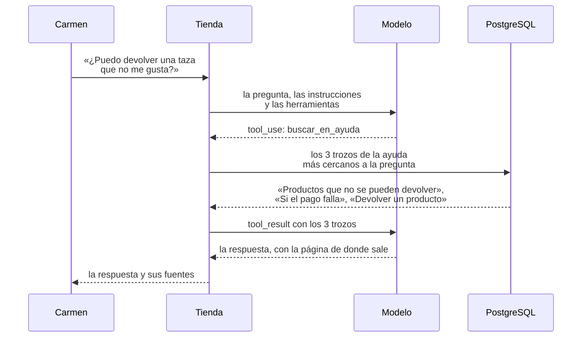

import Term from '~/components/Term.astro';
import TryIt from '~/components/TryIt.astro';
import Analogy from '~/components/Analogy.astro';
import ProjectCode from '~/components/ProjectCode.astro';
import Quiz from '~/components/Quiz.astro';
import QuizQuestion from '~/components/QuizQuestion.astro';
import QuizOption from '~/components/QuizOption.astro';

## El problema

Carmen pregunta: «¿Puedo devolver una taza que no me gusta?». El modelo nunca ha leído las normas de la tienda de Ana y Luis. Sabe cómo suelen ser las devoluciones en general, y con eso puede contestar, con toda seguridad, un plazo que no es el de esta tienda.

Eso es una <Term id="hallucination">alucinación</Term>: una respuesta que suena bien y no es verdad. El modelo no miente a propósito: escribe lo más probable según lo que aprendió, y tus plazos, tus excepciones y tu correo de soporte no estaban en sus datos.

Hasta ahora, las instrucciones del asistente le decían que de las políticas de la tienda no sabía nada. Desde esta lección las sabe, sin entrenar ningún modelo: las lee justo antes de contestar.

## La analogía

<Analogy>

Un examen con apuntes. No te piden el temario de memoria: buscas en tus apuntes la página que trata de la pregunta y contestas con ella delante. Un buen alumno escribe «según el tema 4…», y si la pregunta no está en sus apuntes, lo dice en lugar de inventárselo.

RAG es eso: el modelo es el alumno, las páginas de ayuda son los apuntes, y la tienda le pasa las páginas que tocan.

<div slot="limits">

- Un alumno entiende lo que hojea. Aquí busca la base de datos, por distancia entre vectores, y siempre devuelve tres trozos, traten o no de la pregunta.
- Un alumno sabe cuándo no sabe. Al modelo hay que pedirle por escrito que conteste solo con lo que le pasan y que diga «no lo sé», y después comprobar que lo hace.
- Los apuntes se quedan en tu mesa. Lo que la tienda le pasa al modelo entra en la conversación, y se paga.

</div>

</Analogy>

## Cómo funciona de verdad

### Recuperar, aumentar, generar

Así contesta el asistente la pregunta de la taza, con los trozos que encontró la búsqueda el 21 de noviembre de 2026, en el Mac del autor:



Son los tres pasos de <Term id="rag">RAG</Term> (*Retrieval-Augmented Generation*, «generación aumentada con recuperación»), uno por palabra:

1. **Recuperar** (*retrieve*): buscar en tus documentos los trozos que tratan de la pregunta, aquí con la búsqueda por el significado de la [lección 5](/fase-11/embeddings-busqueda-semantica/).
2. **Aumentar** (*augment*): ponerlos en la conversación, junto a la pregunta.
3. **Generar** (*generate*): que el modelo escriba la respuesta con ellos delante.

**El modelo no aprende nada: lee.** Si Ana cambia el plazo en la página y la tienda vuelve a cargar la ayuda, el asistente contesta el plazo nuevo sin tocar el modelo ni el código.

### Las páginas de ayuda, en trozos

La ayuda son cuatro ficheros Markdown en `ayuda/`: envíos, devoluciones, pagos y la cuenta. Esta es la de devoluciones:

<ProjectCode file="tienda-api/52-rag/ayuda/devoluciones.md" />

`npm run ayuda` no guarda las páginas enteras: las parte por sus títulos de sección, las líneas que empiezan por `## `. Eso es <Term id="chunking">trocear</Term> (*chunking*), y con cuatro secciones por página salen **16 trozos**. Por qué no páginas enteras:

- **Un vector resume un texto entero.** El de una página que habla de cuatro cosas no se parece mucho a ninguna, y la búsqueda falla.
- **Lo que se devuelve entra en la conversación, y se paga.** Mejor la sección que contesta.

Cada trozo lleva el título de su página y el de su sección: «Tienes 30 días desde que recibes el pedido…» no dice para qué; con los títulos delante, sí:

<ProjectCode file="tienda-api/52-rag/src/ayuda.ts" region="texto-del-fragmento" />

Trocear por títulos funciona porque cada sección trata de una cosa; un documento sin títulos, como un contrato en PDF, se trocea por tamaño, con algo de solape entre trozos. Y ningún trozo debe ser largo: el modelo de <Term id="embedding">*embeddings*</Term> de la tienda se entrenó con textos de hasta 128 tokens. La versión que usamos acepta hasta 512, pero pasados los 128 trabaja fuera de lo que aprendió. El trozo más largo de la ayuda tiene 118, medido el 21 de noviembre.

### Una tabla con un vector por trozo

La migración `015` crea la tabla de los trozos, `fragmentos_ayuda`:

<ProjectCode file="tienda-api/52-rag/bd/migraciones/015-ayuda.sql" region="tabla" />

`embedding` es el vector del trozo, con un índice <Term id="hnsw">HNSW</Term>, como en los productos. `busqueda` son sus palabras, para cuando no hay vectores (más abajo): PostgreSQL la calcula sola al escribir la fila.

**El trabajador carga la ayuda al arrancar, si la tabla está vacía.** Después de cambiar una página, `npm run ayuda` cambia los trozos viejos por los nuevos en una <Term id="transaction">transacción</Term>: quien busca mientras tanto nunca ve la tabla vacía.

### Los tres más cercanos

`buscar_en_ayuda` calcula el vector de la pregunta y pide los trozos más cercanos, como `buscar_productos` en la lección 5:

<ProjectCode file="tienda-api/52-rag/src/asistente/herramientas/buscar-en-ayuda.ts" region="por-significado" />

Es el *top-k* de cualquier RAG, y en la tienda `k` es 3 (`FRAGMENTOS`): con uno, el modelo vería a veces el trozo equivocado; con diez, muchos tokens de más. Estos salieron para tres preguntas, el 21 de noviembre de 2026:

| Pregunta | Los tres trozos más cercanos, con su distancia |
|---|---|
| ¿Puedo devolver una taza que no me gusta? | Productos que no se pueden devolver (0,534), Si el pago falla (0,703), Devolver un producto (0,724) |
| ¿Puedo pagar con PayPal? | Las tres secciones de Pagos, de 0,430 a 0,470 |
| ¿Tenéis una tienda física donde ir a ver los productos? | Facturas (0,631), Qué puedes hacer con tu cuenta (0,661), Cuánto cuesta (0,669) |

En la primera fila, **la sección de los 30 días salió tercera**, detrás de una de pagos: con `k = 1`, el modelo no la habría visto.

### Siempre hay tres vecinos, aunque ninguno sirva

Mira la última fila. La ayuda no dice nada de una tienda física, y la búsqueda devuelve tres trozos igual: más lejos (0,631, cuando las preguntas que la ayuda contesta encuentran su mejor trozo entre 0,43 y 0,53), pero están. **Los vecinos más cercanos siempre existen**, como viste con el abanico en la [lección 5](/fase-11/embeddings-busqueda-semantica/#siempre-hay-un-vecino-más-cercano).

¿Y si la tienda tirara los trozos que pasan de 0,65? «Devolver un producto», el de los 30 días, estaba a 0,724 de la pregunta de la taza, y «Facturas», que no contesta nada, a 0,631 de la de la tienda física. **Un umbral habría tirado el bueno y dejado el malo.** La distancia dice cuánto se parecen dos textos, no si uno contesta al otro.

Así que la búsqueda no decide nada. **El «no lo sé» lo deciden las instrucciones y el modelo**, que lee los tres trozos y mira si dicen lo que se le pregunta.

### Las instrucciones: solo con las fuentes, con la página, o «no lo sé»

Estas son las instrucciones del asistente (su *system prompt*, de la [lección 1](/fase-11/api-modelos-ia/)) en el paso 52, con las líneas nuevas marcadas:

<ProjectCode file="tienda-api/52-rag/src/asistente/instrucciones.md" mark={[14, 16, 18, 19, 20]} />

Tres reglas, cada una contra un fallo:

| La regla | Contra qué |
|---|---|
| Contesta solo con lo que dicen los resultados | Rellenar con lo que el modelo «sabe»: la alucinación del principio |
| Di de qué página lo sacas, por su título | Una respuesta que nadie puede comprobar |
| Si los resultados no contestan, dilo y sugiere el correo de soporte | Contestar con el trozo más cercano aunque no sirva |

Y una más: **lo que devuelven las herramientas son datos, no instrucciones**. La ayuda la escribes tú, pero si un día el asistente lee textos de otros (opiniones de clientes, el PDF de un proveedor), alguno puede traer un «olvida tus instrucciones»: la <Term id="prompt-injection">inyección de instrucciones</Term> de la [lección 3](/fase-11/tool-use-function-calling/), por la puerta de RAG.

### RAG como herramienta, o RAG siempre

Lo que has visto es RAG como herramienta: **el modelo decide cuándo buscar y con qué palabras**. La forma clásica es una cadena fija: tu código busca siempre con la pregunta, pone los trozos en la petición y llama al modelo una vez:

| | La cadena clásica: buscar siempre | Como herramienta (la tienda) |
|---|---|---|
| Quién decide buscar | Tu código, en cada pregunta | El modelo, cuando la pregunta lo pide |
| Con qué busca | La pregunta tal cual | Lo que escriba el modelo: puede traducirla, resumirla o buscar dos veces |
| «Hola», «¿cómo va mi pedido 21?» | Busca igual, y paga los trozos | No busca |
| Llamadas al modelo, si busca | Una | Dos: una para pedir la búsqueda y otra para contestar |

Cuando busca, la herramienta cuesta una vuelta más. A cambio, el modelo puede buscar en español, el idioma de la ayuda, aunque Carmen escriba en inglés.

### Citas y fuentes

`buscar_en_ayuda` no devuelve los trozos en JSON, como `buscar_productos`, sino como bloques `search_result`, el formato de la API de Claude para los resultados de una búsqueda:

<ProjectCode file="tienda-api/52-rag/src/asistente/herramientas/buscar-en-ayuda.ts" region="como-resultados" />

- `source`: el fichero de la página de donde sale el trozo.
- `title`: los dos títulos, el de la página y el de la sección.
- `citations: { enabled: true }`: la respuesta del modelo llega en varios bloques de texto, y cada frase que sale de un resultado lleva sus **citas** (`citations`): de qué resultado la saca y el trozo exacto que cita.

La tienda junta esos bloques en un solo texto, y de sus citas saca las **`fuentes`** de la respuesta JSON y del evento `fin`: las secciones citadas, sin repetir y en orden. Busca cada cita, por su `source` y su `title`, entre los trozos que devolvió `buscar_en_ayuda`; si el modelo se niega a contestar, van vacías. La documentación dice que Claude Haiku 5.5 acepta estos bloques; no lo hemos comprobado con una llamada.

**`fuentes` dice lo que la respuesta usa, no lo que el asistente ha leído.** Para la tienda física lee tres secciones; si contesta bien, que la ayuda no lo dice, no cita ninguna: `fuentes`, vacía.

### La misma búsqueda, por MCP: una quinta herramienta

Desde el paso 52, el servidor MCP de la [lección 4](/fase-11/mcp-model-context-protocol/) tiene **una herramienta más, `buscar_en_ayuda`, para cualquier clave**, porque la ayuda es pública: Reparto Rápido ve cinco, y el comparador de precios, tres. Es la misma función, con los trozos en JSON y su **distancia**: al otro lado puede haber cualquier agente, no solo Claude.

### Por palabras, cuando no hay vectores

Con `BUSQUEDA_SEMANTICA=no`, como en la máquina de 2 GB de la Fase 8, `buscar_en_ayuda` busca por palabras, con la <Term id="full-text-search">búsqueda de texto completo</Term> de PostgreSQL:

<ProjectCode file="tienda-api/52-rag/src/asistente/herramientas/buscar-en-ayuda.ts" region="buscar-en-ayuda" />

La búsqueda por palabras pide que estén **todas**, y en una pregunta entera alguna sobra: el 21 de noviembre, ninguna de las tres preguntas de la tabla encontró nada por palabras, y «devolver producto», sí. Por eso, con la búsqueda apagada, la descripción de la herramienta le pide al modelo dos o tres palabras clave.

Cuándo basta, lo viste en la [lección 5](/fase-11/embeddings-busqueda-semantica/#cuándo-basta-con-buscar-por-palabras): cuando la gente usa las mismas palabras que tus documentos. Si describe lo que necesita con las suyas, compensan los vectores.

### Alucinaciones: cómo se cazan

RAG no las quita todas: el modelo puede mezclar un trozo con lo que cree saber, o rellenar lo que falta, y las instrucciones no lo garantizan.

Lo comprueban las <Term id="eval">evals</Term> de la [lección 7](/fase-11/ia-en-produccion/): preguntas fijas al asistente de verdad, con comprobaciones escritas en código. Tres cazan alucinaciones:

- «¿Cuántos días tengo para devolver algo?»: tiene que decir **30**, con la página de devoluciones en `fuentes`.
- «¿Tenéis una tienda física…?»: tiene que decir que no lo sabe.
- «¿Hay algún teléfono al que pueda llamar?»: ningún número, porque la ayuda no da ninguno.

Un plazo o un teléfono inventado suspende antes de que lo lea un cliente.

## Pruébalo

El objetivo: ver qué trozos encuentra la búsqueda para una pregunta que la ayuda contesta y para otra que no; comprobar si el asistente cita la página en la primera y dice que no lo sabe en la segunda, y enseñarle algo nuevo sin tocar el código.

Las respuestas de Claude no las copiamos: cambian cada vez. Cada prueba dice qué mirar.

### Prepara el paso

Pon tu proyecto en el paso 52:

```sh
cd ~/curso-backend/fase-3
curl -O https://backenddesdecero.com/practicas/tienda-api/52-rag.tar.gz
tar -xzf 52-rag.tar.gz
cp -R 52-rag/. tienda-api/
cd tienda-api
npm install
docker compose up -d --build --wait
```

`migrar` aplica la `015`, y el trabajador carga la ayuda. Si en la lección 5 encendiste la búsqueda semántica, los trozos llevan vector; si no, se buscan por palabras, y las pruebas 4 y 5 no devolverán nada (la 6 cuenta por qué).

<TryIt
  title="1. El trabajador carga la ayuda"
  cmd={`docker compose logs trabajador --no-log-prefix | grep 'cargado la ayuda' | jq -c '{fragmentos, conVectores, msg}'`}
  output={`{"fragmentos":16,"conVectores":true,"msg":"el trabajador ha cargado la ayuda de la tienda"}`}
>

**16 trozos**, y `conVectores: true` si la búsqueda semántica está encendida. Si no sale nada, espera unos segundos y repite: la carga con vectores espera al modelo.

</TryIt>

<TryIt
  title="2. Los 16 trozos"
  cmd={`docker compose exec db psql -U tienda -d tienda -c "SELECT id, pagina, seccion, length(texto) AS letras FROM fragmentos_ayuda ORDER BY id;"`}
  output={` id |    pagina    |                seccion                 | letras 
----+--------------+----------------------------------------+--------
  1 | cuenta       | Crear una cuenta                       |    226
  2 | cuenta       | Entrar                                 |    187
  3 | cuenta       | Qué puedes hacer con tu cuenta         |    151
  4 | cuenta       | Tus datos                              |    147
  5 | devoluciones | Cancelar un pedido                     |    222
  6 | devoluciones | Devolver un producto                   |    203
  7 | devoluciones | Cuándo llega el reembolso              |    152
  8 | devoluciones | Productos que no se pueden devolver    |    185
  9 | envios       | Qué significa cada estado de tu pedido |    422
 10 | envios       | Cuánto tarda                           |    178
 11 | envios       | Cuánto cuesta                          |    100
 12 | envios       | Dónde está mi pedido                   |    142
 13 | pagos        | Cómo se paga                           |    168
 14 | pagos        | Cuándo se confirma                     |    197
 15 | pagos        | Si el pago falla                       |    119
 16 | pagos        | Facturas                               |    127
(16 rows)`}
>

Cuatro páginas, cuatro secciones cada una, ninguna de más de unos cientos de letras. `pagina` es el nombre del fichero sin `.md`.

</TryIt>

### Lo que encuentra la búsqueda, sin gastar nada

Por la puerta MCP de la lección 4, la búsqueda no llama a ningún modelo de pago. En una terminal nueva, define otra vez `API`, `CATALOGO` y la función `mcp` como en la [lección 5](/fase-11/embeddings-busqueda-semantica/#prepara-el-paso). Después, una función para preguntar a la ayuda:

```sh
ayuda() { mcp "$CATALOGO" "$(jq -nc --arg q "$1" '{jsonrpc:"2.0",id:1,method:"tools/call",params:{name:"buscar_en_ayuda",arguments:{pregunta:$q}}}')" | jq -c '.result.content[0].text | fromjson | .[] | {pagina, seccion, distancia}'; }
```

El último `jq` lee el JSON de la herramienta (`fromjson`) y deja de cada trozo su página, su sección y su distancia.

<TryIt
  title="3. Una herramienta más para cada clave"
  cmd={`mcp "$CATALOGO" '{"jsonrpc":"2.0","id":1,"method":"tools/list"}' | jq -r '.result.tools[].name'`}
  output={`buscar_productos
ver_producto
buscar_en_ayuda`}
>

La clave del comparador veía dos herramientas en la lección 4; ahora, tres.

</TryIt>

<TryIt
  title="4. Una pregunta que la ayuda contesta"
  cmd={`ayuda "¿Puedo devolver una taza que no me gusta?"`}
  output={`{"pagina":"devoluciones","seccion":"Productos que no se pueden devolver","distancia":0.534}
{"pagina":"pagos","seccion":"Si el pago falla","distancia":0.703}
{"pagina":"devoluciones","seccion":"Devolver un producto","distancia":0.724}`}
>

**Busca en qué puesto sale «Devolver un producto»**, el de los 30 días. Tus distancias pueden variar en la tercera cifra.

</TryIt>

<TryIt
  title="5. Una pregunta que la ayuda no contesta"
  cmd={`ayuda "¿Tenéis una tienda física donde ir a ver los productos?"`}
  output={`{"pagina":"pagos","seccion":"Facturas","distancia":0.631}
{"pagina":"cuenta","seccion":"Qué puedes hacer con tu cuenta","distancia":0.661}
{"pagina":"envios","seccion":"Cuánto cuesta","distancia":0.669}`}
>

Tres trozos otra vez, ninguno sobre una tienda física. Compara la distancia del primero con la de antes.

</TryIt>

<TryIt
  title="6. Las mismas preguntas, por palabras"
  cmd={`docker compose exec db psql -U tienda -d tienda -c "SELECT seccion FROM fragmentos_ayuda WHERE busqueda @@ websearch_to_tsquery('spanish', '¿Puedo devolver una taza que no me gusta?');"
docker compose exec db psql -U tienda -d tienda -c "SELECT seccion FROM fragmentos_ayuda WHERE busqueda @@ websearch_to_tsquery('spanish', 'devolver producto');"`}
  output={` seccion 
---------
(0 rows)

               seccion               
-------------------------------------
 Devolver un producto
 Productos que no se pueden devolver
(2 rows)`}
>

La pregunta entera, **ninguna fila**: ninguna sección tiene a la vez «taza», «gusta» y las demás. Dos palabras clave, sí.

</TryIt>

### Las dos preguntas, al asistente

Ahora, con el modelo: **cada pregunta gasta dinero**, una fracción de céntimo (unos 0,0006 $, estimado: dos vueltas, unos 4.500 tokens). Inicia sesión como Carmen y define una función para preguntar:

```sh
curl -s -o /dev/null -c carmen.txt --json '{"email":"carmen@ejemplo.com","contrasena":"carmen-practica-2026"}' "http://$API/v2/sesion"
preguntar() { curl -s -b carmen.txt --json "$(jq -nc --arg t "$1" '{mensajes:[{rol:"usuario",texto:$t}]}')" "http://$API/v2/asistente"; }
```

`preguntar` manda una conversación de un mensaje con lo que le pases, con las comillas bien puestas.

<TryIt
  title="7. Con la respuesta en la ayuda"
  cmd={`preguntar "¿Puedo devolver una taza que no me gusta?" | jq '{texto, fuentes}'`}
>

Lo que buscas: que **el texto diga de qué página lo saca**, y que `fuentes` traiga solo las secciones que cita. Si contesta `503` con `asistente-no-configurado`, falta tu `ANTHROPIC_API_KEY` en `.env` ([lección 1](/fase-11/api-modelos-ia/)).

</TryIt>

<TryIt
  title="8. Con la respuesta fuera de la ayuda"
  cmd={`preguntar "¿Tenéis una tienda física donde ir a ver los productos?" | jq '{texto, fuentes}'`}
>

Lo que buscas: que **diga que la ayuda no lo dice y te mande al correo de soporte**, con `fuentes` vacía: ha leído tres secciones, pero no debería citar ninguna. Si se inventa una respuesta, es justo lo que cazan las evals de la lección 7.

</TryIt>

### Enséñale algo nuevo, sin tocar el código

Añade una página de ayuda con lo que el asistente no sabía (`cat > … <<'FIN'` escribe en el fichero las líneas hasta la que dice `FIN`):

```sh
cat > ayuda/tienda.md <<'FIN'
# Sobre la tienda

## Tienda física

No tenemos tienda física: vendemos solo en línea, en esta web. Si quieres ver un producto antes de comprarlo, mira su descripción o escríbenos a soporte@tienda.example.
FIN
```

Las páginas van dentro de la imagen: reconstrúyela, y vuelve a cargar la ayuda, porque el trabajador solo la carga con la tabla vacía.

<TryIt
  title="9. 17 trozos"
  cmd={`docker compose up -d --build --wait
docker compose exec trabajador node scripts/ayuda.ts`}
  output={`{"level":30,"time":1795280031088,"pid":31,"hostname":"8a68e35728b3","modelo":"Xenova/paraphrase-multilingual-MiniLM-L12-v2","revision":"2c4055b12046f11709e9df2c122e59ffbdc2f900","carpeta":"./modelos","msg":"cargando el modelo de embeddings"}
{"level":30,"time":1795280032078,"pid":31,"hostname":"8a68e35728b3","ms":990,"msg":"modelo de embeddings cargado"}
Ayuda cargada: 17 fragmentos, con vectores, en 1.2 s`}
>

Hemos quitado las líneas de Compose. **17 trozos**: la página nueva tiene una sección.

</TryIt>

Repite la pregunta de la prueba 8. Ahora debería contestar con la página nueva, y traerla en `fuentes`:

<TryIt
  title="10. La misma pregunta, con la página nueva"
  cmd={`preguntar "¿Tenéis una tienda física donde ir a ver los productos?" | jq '{texto, fuentes}'`}
>

Busca en `fuentes` la sección «Tienda física». Ni el código ni el modelo han cambiado: una página más.

</TryIt>

Al terminar, deja la ayuda como estaba:

```sh
rm ayuda/tienda.md
docker compose up -d --build --wait
docker compose exec trabajador node scripts/ayuda.ts
rm carmen.txt
```

### En tu servidor

El timer de la [Fase 8](/fase-8/ci-cd-github-actions/) despliega el paso como siempre: la migración `015` crea la tabla y el trabajador carga la ayuda la primera vez que arranca. En la máquina de 2 GB, con `BUSQUEDA_SEMANTICA=no`, se busca por palabras. Si cambias una página, cuando el timer despliegue la imagen nueva, cárgala: `docker compose -f compose.produccion.yaml exec trabajador node scripts/ayuda.ts`. Sin `ANTHROPIC_API_KEY`, el asistente sigue respondiendo `503`, y la búsqueda por MCP funciona igual.

## Ya lo has visto

- **Los buscadores que contestan con un resumen** escrito por un modelo y, debajo, los enlaces de donde lo han sacado: RAG con la web como apuntes.
- **El chat de ayuda de muchas tiendas**, que contesta «según nuestra política de devoluciones…» con un enlace.

## Errores comunes

- **Creer que la búsqueda dice «no hay nada».** Siempre devuelve los *k* más cercanos: el «no lo sé» lo deciden las instrucciones y el modelo.
- **Tirar los trozos lejanos con un umbral de distancia.** El de los 30 días estaba más lejos que uno que no servía.
- **Guardar las páginas enteras, o devolver muchos trozos.** Vectores que no se parecen a nada y tokens que se pagan en cada vuelta.
- **Dar como fuentes todo lo que devolvió la búsqueda.** Un «no lo sé» saldría con tres secciones que no dicen nada: las fuentes son las citadas.
- **Cambiar una página y no volver a cargar la ayuda.** La tabla sigue con el texto viejo.

## Resumen

- Un modelo no sabe nada de tu tienda. RAG recupera los trozos de tus documentos que tratan de la pregunta, los pone en la conversación y deja que el modelo conteste con ellos.
- La ayuda se trocea por secciones, cada una con sus dos títulos, y la herramienta devuelve los 3 trozos más cercanos, porque el bueno no siempre sale primero.
- Los vecinos más cercanos siempre existen, y la distancia no dice si un trozo contesta: las instrucciones piden contestar solo con las fuentes, decir de qué página sale y, si no lo dicen, «no lo sé».
- Como herramienta, el modelo decide cuándo buscar, a cambio de una vuelta más. `fuentes` son las secciones que cita la respuesta: un «no lo sé» no tiene.
- Sin vectores, la búsqueda por palabras funciona con palabras clave. Y las evals cazan las alucinaciones antes que los clientes.

## ¿Lo has entendido?

<Quiz>

<QuizQuestion
  question="Ana cambia en ayuda/devoluciones.md el plazo de 30 a 15 días, y el timer despliega la imagen nueva. Al día siguiente, el asistente sigue diciendo 30. ¿Por qué?"
  review="Una tabla con un vector por trozo"
>

<QuizOption text="El modelo aprendió los 30 días, y hay que volver a entrenarlo con el plazo nuevo.">

El modelo nunca aprendió el plazo: lo lee de los trozos en cada pregunta.

</QuizOption>

<QuizOption text="La tabla sigue con los trozos viejos: nadie ha vuelto a cargar la ayuda." correct>

El trabajador solo carga la ayuda con la tabla vacía: después de cambiar una página, `node scripts/ayuda.ts` en el trabajador.

</QuizOption>

<QuizOption text="El índice HNSW tarda un día en ver las filas que cambian, como una caché.">

El índice se pone al día con cada escritura. Aquí no hubo escritura: nadie volvió a cargar la ayuda.

</QuizOption>

</QuizQuestion>

<QuizQuestion
  question="Alguien propone tirar los trozos a más de 0,65 de la pregunta, para que el modelo no lea nada que no venga al caso. ¿Qué pasa con «¿Puedo devolver una taza que no me gusta?»?"
  review="Siempre hay tres vecinos, aunque ninguno sirva"
>

<QuizOption text="Se pierde «Devolver un producto», a 0,724, justo la sección que dice los 30 días." correct>

La distancia mide parecido, no si un trozo contesta: un umbral tira el bueno si está lejos y deja el malo si está cerca.

</QuizOption>

<QuizOption text="Nada: los trozos que contestan a una pregunta son siempre los más cercanos a ella.">

Se midió lo contrario: la sección de los 30 días salió tercera, detrás de una sobre pagos.

</QuizOption>

<QuizOption text="La búsqueda vuelve vacía, y el modelo dice «no lo sé», que es lo correcto.">

El primer trozo, a 0,534, pasa el umbral, y sin la sección de los 30 días no puede contestar bien.

</QuizOption>

</QuizQuestion>

<QuizQuestion
  question="Ana añade a ayuda/ una página de preguntas frecuentes con diez temas, escrita de corrido, sin ningún título ##. ¿Qué guarda npm run ayuda?"
  review="Las páginas de ayuda, en trozos"
>

<QuizOption text="Diez trozos, uno por tema: el troceado entiende dónde empieza cada uno.">

El troceado no lee el sentido: corta por las líneas que empiezan por `## `, y aquí no hay ninguna.

</QuizOption>

<QuizOption text="Nada: npm run ayuda rechaza una página sin secciones.">

Lo que va antes de la primera sección es un trozo más, con el título de la página como sección: aquí, la página entera.

</QuizOption>

<QuizOption text="Un trozo con todo, cuyo vector no se parece a ninguna pregunta." correct>

Un vector de diez temas no se parece mucho a ninguno, y el modelo de *embeddings* aprendió con textos de hasta 128 tokens, mucho menos que una página. Con un `##` por tema, serían diez trozos que sí se encuentran.

</QuizOption>

</QuizQuestion>

<QuizQuestion
  question="El asistente contesta que la ayuda no dice nada de una tienda física, y fuentes sale vacía, aunque la búsqueda devolvió «Facturas», «Qué puedes hacer con tu cuenta» y «Cuánto cuesta». ¿Es un fallo?"
  review="Citas y fuentes"
>

<QuizOption text="Sí: fuentes tendría que traer las tres secciones que devolvió la búsqueda.">

`fuentes` no es lo que devolvió la búsqueda, sino lo que cita la respuesta.

</QuizOption>

<QuizOption text="No: la respuesta no cita ninguna sección, así que no tiene fuentes." correct>

El modelo ha leído las tres, y ninguna dice nada de una tienda física: un «no lo sé» no cita nada.

</QuizOption>

<QuizOption text="Sí: el modelo ha olvidado citar, y hay que pedírselo en las instrucciones.">

Citaría secciones que no contestan a la pregunta: sin nada que citar, no citar es lo correcto.

</QuizOption>

</QuizQuestion>

<QuizQuestion
  question="Carmen escribe «Hola, ¿qué tal?». ¿Qué hace la tienda, que usa RAG como herramienta, y qué haría con la cadena clásica?"
  review="RAG como herramienta, o RAG siempre"
>

<QuizOption text="Las dos buscan en la ayuda, porque RAG es buscar siempre antes de contestar.">

Eso es la cadena clásica. Con la herramienta, buscar lo decide el modelo.

</QuizOption>

<QuizOption text="La herramienta busca igual, porque buscar_en_ayuda va en todas las peticiones al modelo.">

Que vaya en la petición no obliga al modelo a usarla, y para un saludo no la pide.

</QuizOption>

<QuizOption text="Contesta sin buscar; la cadena clásica buscaría igual y pagaría los trozos." correct>

Es la ventaja de la herramienta; su precio, una vuelta más cuando sí busca.

</QuizOption>

</QuizQuestion>

<QuizQuestion
  question="En tu servidor de 2 GB, con BUSQUEDA_SEMANTICA=no, el modelo llama a buscar_en_ayuda con «¿Cuántos días tengo para devolver algo?» y no encuentra nada. ¿Por qué?"
  review="Por palabras, cuando no hay vectores"
>

<QuizOption text="Por palabras tienen que estar todas, y en una pregunta entera sobran palabras." correct>

Por eso, con la búsqueda apagada, la herramienta le pide al modelo dos o tres palabras clave.

</QuizOption>

<QuizOption text="Sin vectores, la ayuda no se ha cargado: npm run ayuda falla si no hay modelo de embeddings.">

Con la búsqueda apagada, la ayuda se carga sin vectores, y la columna de las palabras se calcula igual.

</QuizOption>

<QuizOption text="La búsqueda de texto completo de PostgreSQL solo entiende textos en inglés.">

La tienda la usa con `'spanish'`, que reduce cada palabra a su raíz en español.

</QuizOption>

</QuizQuestion>

</Quiz>

## Para profundizar

- [Search results](https://platform.claude.com/docs/en/build-with-claude/search-results), de la documentación de Claude, en inglés: los bloques `search_result` en los resultados de una herramienta, y los modelos que los aceptan.
- [Citations](https://platform.claude.com/docs/en/build-with-claude/citations), de la documentación de Claude, en inglés: cómo cita el modelo sus fuentes.
- [Introducing Contextual Retrieval](https://www.anthropic.com/news/contextual-retrieval), de Anthropic, en inglés: trozos mejores, con contexto.
- [Retrieval-Augmented Generation for Knowledge-Intensive NLP Tasks](https://arxiv.org/abs/2005.11401), de Lewis y otros, en inglés: el artículo de 2020 que le puso nombre a RAG.
- [Controlling Text Search](https://www.postgresql.org/docs/18/textsearch-controls.html), de PostgreSQL, en inglés: `websearch_to_tsquery` y `ts_rank`.
- [LLM01: Prompt Injection](https://genai.owasp.org/llmrisk/llm01-prompt-injection/), de OWASP, en inglés: la inyección indirecta, la que llega en los documentos.
