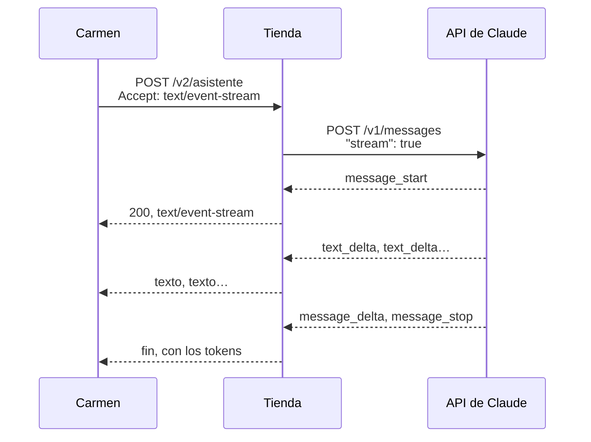

import Term from '~/components/Term.astro';
import TryIt from '~/components/TryIt.astro';
import Analogy from '~/components/Analogy.astro';
import SelfCheck from '~/components/SelfCheck.astro';
import ProjectCode from '~/components/ProjectCode.astro';
import Quiz from '~/components/Quiz.astro';
import QuizQuestion from '~/components/QuizQuestion.astro';
import QuizOption from '~/components/QuizOption.astro';
import Scene from '~/components/Scene.astro';
import '~/scenes/lessons/streaming.css';

<Scene id="problem" />

## El problema

Imagina que Carmen pregunta y la pantalla se queda quieta. La tienda de la lección 1 espera la respuesta entera del modelo antes de mandar nada. Carmen no sabe si el asistente está pensando o se ha colgado, y recarga la página: otra pregunta, otra vez pagada.

En los chats de IA que usas, el texto aparece palabra a palabra. La respuesta no termina antes: empieza antes. En la [Fase 4](/fase-4/websockets-sse/#cuál-usar-para-qué) te dijimos que las APIs de los modelos mandan sus respuestas trozo a trozo con <Term id="sse">SSE</Term>. Aquí lo ves, del modelo a la tienda y de la tienda al navegador.

<Scene id="analogy" />

## La analogía

<Analogy>

En una conferencia, el intérprete simultáneo no espera a que el ponente termine: traduce frase a frase, según la oye, y tú la escuchas casi a la vez. El intérprete consecutivo espera al final y lo cuenta todo de golpe: mientras tanto, la sala en silencio.

El streaming es el intérprete simultáneo. Y si te levantas y te vas, en la cabina se enteran y dejan de traducir para ti.

<div slot="limits">

- Un intérprete cambia las palabras. La tienda no toca el texto del modelo: solo cambia el envoltorio, los nombres de los eventos.
- Lo dicho, dicho está, también en un flujo. Pero si el modelo se niega a mitad, el último evento le dice al navegador que cambie lo que ha enseñado por una frase fija.
- El ponente sigue hablando aunque la sala se vacíe, y el modelo también, si nadie cuelga: por eso la tienda cuelga cuando Carmen se va.

</div>

</Analogy>

<Scene id="ttft" />

## Cómo funciona de verdad

### Lo que nota quien espera: el primer trozo, no el último

El modelo escribe la respuesta trozo a trozo, en orden. Sin streaming, la tienda los junta todos y manda la respuesta al final. Con streaming, manda cada trozo en cuanto llega:

| | Respuesta entera (lección 1) | En streaming |
|---|---|---|
| Primer texto en la pantalla de Carmen | Cuando el modelo termina | Cuando el modelo escribe el primer trozo |
| Tiempo hasta la última palabra | El mismo | El mismo |
| Lo que ve mientras espera | Nada | El texto, creciendo |

Lo que nota Carmen es el <Term id="time-to-first-token">tiempo hasta el primer token</Term>: lo que tarda en llegar el primer trozo de la respuesta. Es el primo del <Term id="ttfb">TTFB</Term> de las páginas web, para una respuesta que se escribe mientras llega. Lo medirás en «Pruébalo».

El primer trozo no sale al instante: antes, el modelo lee la pregunta y piensa un poco. Cuanto más larga es la respuesta, más se nota la diferencia.

<Scene id="events" />

### Lo que manda la API: sus eventos, en orden

Con `"stream": true` en la petición, la API de Claude contesta con un flujo de eventos SSE, con el formato de la [Fase 4](/fase-4/websockets-sse/#el-formato-líneas-de-texto-y-una-línea-en-blanco): una línea `event:`, una `data:` con JSON y una línea en blanco. Este es el principio y el final de uno del [modelo de mentira](/fase-11/api-modelos-ia/#los-tests-no-llaman-al-modelo) de la tienda, que imita a la API, sin los eventos de en medio:

```text
event: message_start
data: {"type":"message_start","message":{"id":"msg_falso_3","type":"message","role":"assistant","model":"claude-haiku-5-5","content":[],"stop_reason":null,"stop_sequence":null,"stop_details":null,"usage":{"input_tokens":120,"output_tokens":1,"cache_creation_input_tokens":0,"cache_read_input_tokens":0}}}

…

event: content_block_start
data: {"type":"content_block_start","index":1,"content_block":{"type":"text","text":""}}

event: content_block_delta
data: {"type":"content_block_delta","index":1,"delta":{"type":"text_delta","text":"Soy el m"}}

event: content_block_delta
data: {"type":"content_block_delta","index":1,"delta":{"type":"text_delta","text":"odelo fa"}}

…

event: message_delta
data: {"type":"message_delta","delta":{"stop_reason":"end_turn","stop_sequence":null,"stop_details":null},"usage":{"output_tokens":30}}

event: message_stop
data: {"type":"message_stop"}
```

Los eventos llegan siempre en este orden:

1. **`message_start`**: el mensaje, todavía vacío, con los tokens de entrada.
2. Por cada bloque, **`content_block_start`**, sus trozos en **`content_block_delta`** y **`content_block_stop`**. En un bloque de texto, cada trozo es un `text_delta`; en uno de pensamiento, `thinking_delta` y `signature_delta`.
3. **`message_delta`**: por qué ha parado (`stop_reason`) y los tokens de salida.
4. **`message_stop`**: el final.

Entre medias puede llegar un **`ping`**, para que la conexión no parezca muerta. Y si algo falla a mitad, un evento **`error`**: la respuesta ya había empezado con un `200`, así que el fallo no puede ir en el código de estado.

La tienda no lee esto a mano. El SDK pide el flujo con `messages.stream()`, que manda la misma petición con `"stream": true`:

<ProjectCode file="tienda-api/48-streaming/src/asistente/cliente.ts" region="preguntar-en-flujo" />

Lo que devuelve se recorre evento a evento, y al final, `finalMessage()` da el mensaje entero, el mismo que daría `messages.create()`: con su texto, su `stop_reason` y su `usage`.

<Scene id="accept" />

### Una ruta, dos respuestas: lo decide Accept

La ruta sigue siendo `POST /v2/asistente`. Lo que cambia es lo que pide el cliente en la cabecera `Accept`:

<ProjectCode file="tienda-api/48-streaming/src/asistente/ruta.ts" region="negociar" />

Con `text/event-stream`, eventos; con cualquier otra cosa, el JSON entero de la lección 1. Es la <Term id="content-negotiation">negociación de contenido</Term> de la [Fase 2](/fase-2/cabeceras-http/): lo que se pide es lo mismo, la respuesta del asistente, en dos formatos. Un frontend que ya usaba el JSON sigue funcionando sin cambiar nada.

<Scene id="translate" />

### Los eventos de la tienda, no los del modelo

La tienda no le pasa al navegador los eventos de la API tal cual. Tiene los suyos, pocos y con sus nombres, en `src/asistente/eventos.ts`:

<ProjectCode file="tienda-api/48-streaming/src/asistente/eventos.ts" region="eventos" />

Y una función que traduce cada evento del modelo:

<ProjectCode file="tienda-api/48-streaming/src/asistente/eventos.ts" region="traducir" />

- **Solo pasan los trozos de texto**, como eventos `texto`. Lo que el modelo piensa no es para Carmen, y los demás eventos solo marcan dónde empieza y acaba cada bloque.
- **Los tokens y el porqué de la parada** llegan juntos al final, en `fin`, con la misma respuesta que el JSON: `texto`, `rechazada` y `uso`. Si `rechazada` es `true`, el frontend cambia lo que ha enseñado por la frase fija.
- **Si algo falla a medias**, un evento `error` con un <Term id="problem-details">*Problem Details*</Term>, como el cuerpo de cualquier error de la tienda ([Fase 4](/fase-4/errores-api-problem-details/)).

¿Por qué traducir? **El frontend solo conoce los eventos de la tienda.** Si mañana cambias de modelo, o de proveedor, o su API cambia el formato de sus eventos, cambias esta función, y el frontend ni se entera. Y el documento OpenAPI de la tienda puede describirlos, porque son suyos.

<Scene id="errors" />

### Antes del primer evento, un error normal; después, un evento error

El código de estado de una respuesta HTTP va en su primera línea, y sale una sola vez. Por eso la tienda espera al primer evento del modelo antes de abrir su flujo:

<ProjectCode file="tienda-api/48-streaming/src/asistente/ruta.ts" region="primer-evento" />



- **Si la API falla antes de su primer evento** (un `429`, un `529`, un modelo que no contesta), la tienda todavía no ha mandado nada: contesta el `503` de la lección 1, en JSON y con `Retry-After`.
- **Si falla después**, el `200` ya ha salido. El fallo llega como evento `error`, con el mismo *Problem Details* que habría sido el cuerpo del `503`, y el flujo se cierra, sin `fin`.

El frontend tiene que tratar los dos casos: un código de error antes de empezar, y un evento `error` a medias, con parte del texto ya en pantalla.

<Scene id="cancel" />

### El cliente se va: cancelar la llamada al modelo

Si Carmen cierra la pestaña a mitad, nadie va a leer el resto. La tienda lo nota y cancela la llamada al modelo:

<ProjectCode file="tienda-api/48-streaming/src/asistente/ruta.ts" region="cancelar" />

- **`cancelar` es un `AbortController`**: un objeto con una señal (`cancelar.signal`) que salta cuando alguien llama a `cancelar.abort()`.
- **La llamada al modelo recibe las señales juntas** (`AbortSignal.any`): la de `cancelar` y `senal`, que ya junta el tiempo máximo de 50 segundos y la petición de Carmen ([lección 1](/fase-11/api-modelos-ia/#el-tiempo-máximo-y-el-cliente-que-se-va)). La cancela la primera que salte.
- Ya dentro del flujo, **`sse.onAbort(() => cancelar.abort())`** llama a `abort()` cuando se cierra la conexión con Carmen.

Al saltar, el SDK corta su conexión con la API, y en el log queda una línea: «el cliente se ha ido: se cancela la llamada al modelo». Si la API deja entonces de cobrar lo que ya no escribe, no lo hemos comprobado: su documentación no lo dice.

<Scene id="reader" />

### En el navegador: fetch y un lector

En la Fase 4, el navegador leía los eventos de un pedido con `EventSource`. Aquí no sirve: `EventSource` solo hace peticiones `GET`, sin cuerpo, y la conversación va en el cuerpo de un `POST`. El frontend usa `fetch`, como para cualquier otra petición, y lee la respuesta según llega:

1. **`fetch`** manda el `POST` con `Accept: text/event-stream`, y contesta en cuanto llegan las cabeceras, sin esperar al cuerpo.
2. **`res.body`** es el cuerpo como <Term id="stream">*stream*</Term>: un **lector** (`getReader()`) devuelve los trozos según llegan, y `TextDecoderStream` los convierte de bytes a texto.
3. **Un trozo no es un evento.** Puede traer dos eventos, o medio: el frontend junta el texto y lo corta por cada línea en blanco, el final de un evento.
4. **De cada evento**, la línea `event:` dice qué es, y la `data:`, en JSON, sus datos: con `texto`, añade el trozo; con `fin`, termina; con `error`, enseña el problema.

`EventSource` se reconecta solo si se corta la conexión. Con `fetch`, reconectar es cosa tuya, y aquí no conviene: volver a pedir es volver a preguntar, y volver a pagar. Lo escribirás en «Pruébalo».

<Scene id="nginx" />

### Lo que hace un proxy con un flujo: el buffering de nginx

En tu servidor, nginx se pone delante de la API ([Fase 8](/fase-8/nginx-proxy-inverso/#eventos-que-no-esperan-sse-y-websocket)). Por defecto, guarda lo que manda la API hasta tener un bloque entero: es el *buffering*, que va bien para respuestas normales. Con un flujo, Carmen recibiría la respuesta de golpe, al final, y el streaming no serviría de nada. El paso 48 lo apaga para esta ruta:

<ProjectCode file="tienda-api/48-streaming/nginx/tienda.conf" region="asistente" />

- **`location = /v2/asistente`**: solo esta dirección, exacta.
- **`proxy_buffering off`**: cada trozo sale hacia Carmen en cuanto llega. A una respuesta en JSON, corta y entera, no le cambia nada.
- **`proxy_read_timeout` se queda en 60 segundos**: es lo que nginx espera entre dos lecturas, y entre dos trozos pasa mucho menos. La respuesta en JSON, que no manda nada hasta el final, la corta antes la tienda, a los 50.

<Scene id="try" />

## Pruébalo

El objetivo: ver llegar la respuesta trozo a trozo, medir cuándo llega el primer byte con y sin streaming, irte a mitad y comprobar que la tienda cancela, y leer el flujo desde el navegador como lo haría tu frontend.

Las salidas de la tienda son del modelo de mentira de la lección 1; las de Claude no las copiamos.

### Prepara el paso

Pon tu proyecto en el paso 48, como en la [introducción](/fase-11/#cada-lección-su-paso), arranca la tienda y abre la sesión de Carmen:

```sh
cd ~/curso-backend/fase-3
curl -O https://backenddesdecero.com/practicas/tienda-api/48-streaming.tar.gz
tar -xzf 48-streaming.tar.gz
cp -R 48-streaming/. tienda-api/
cd tienda-api
docker compose up -d --build --wait
API=$(docker compose port api 3000)
curl -s -o /dev/null -c carmen.txt --json '{"email":"carmen@ejemplo.com","contrasena":"carmen-practica-2026"}' $API/v2/sesion
export $(grep '^ANTHROPIC_API_KEY=' .env)
```

El paso 48 no trae paquetes nuevos: sin `npm install`. La última línea carga tu clave para la primera prueba, como en la [lección 1](/fase-11/api-modelos-ia/#una-pregunta-a-mano).

### Los eventos de la API, una vez

<TryIt
  title="1. El flujo de la API de Claude"
  cmd={`curl -sN https://api.anthropic.com/v1/messages \\
  -H "x-api-key: $ANTHROPIC_API_KEY" -H 'anthropic-version: 2026-10-21' \\
  --json '{"model":"claude-haiku-5-5","max_tokens":2048,"output_config":{"effort":"low"},"stream":true,
    "messages":[{"role":"user","content":"¿Qué es una sudadera, en dos frases?"}]}'`}
>

**`-N`** hace que `curl` escriba cada trozo en cuanto llega, sin guardarlo. Saldrá como el de «Lo que manda la API», con el texto de Claude. Fíjate en el orden: `message_start` con `input_tokens`, los `content_block_delta` con su `text_delta`, y al final `message_delta`, con `stop_reason` y `output_tokens`. Si hay un bloque `thinking` antes del texto, llega vacío: el modelo no enseña lo que piensa.

Si en lugar de eventos sale un JSON con `"type": "error"`, el flujo ni ha empezado: léelo como en la [lección 1](/fase-11/api-modelos-ia/#una-pregunta-a-mano). Es la única vez que verás estos eventos: desde aquí, la tienda los traduce.

</TryIt>

### Los eventos de la tienda

<TryIt
  title="2. El flujo de la tienda"
  cmd={`curl -N -b carmen.txt -H 'Accept: text/event-stream' \\
  --json '{"mensajes":[{"rol":"usuario","texto":"¿Qué me llevo para el frío?"}]}' $API/v2/asistente`}
  output={`event: texto
data: {"texto":"Te lo cu"}

event: texto
data: {"texto":"ento des"}

event: texto
data: {"texto":"pacio, t"}

event: texto
data: {"texto":"rozo a t"}

event: texto
data: {"texto":"rozo, co"}

…

event: fin
data: {"texto":"Te lo cuento despacio, trozo a trozo, como llega una respuesta larga del modelo: primero unas palabras, luego otras, y así hasta el final. En streaming las ves llegar; sin él, esperas a que esté entera.","rechazada":false,"uso":{"entrada":120,"salida":30}}`}
>

Una línea `event: texto` por cada trozo, y al final `event: fin`, con la respuesta entera y sus tokens. Junta los `texto` en orden, y tienes el `texto` de `fin`. **Ni rastro de los eventos de la API**: ni `message_start`, ni el pensamiento. Esta salida, recortada, es del modelo de mentira de la lección 1, que escribe despacio: con Claude, el texto será otro.

`--json` pone `Accept: application/json`, y el `-H` lo cambia por `text/event-stream`. Sin él, la respuesta llega entera en JSON, como en la lección 1.

</TryIt>

### Con y sin streaming: cuándo llega el primer byte

Ahora la misma pregunta dos veces, sin enseñar la respuesta (`-o /dev/null`): `curl` solo escribe cuándo llegó el primer byte y cuándo el último.

<TryIt
  title="3. Los tiempos"
  cmd={`PREGUNTA='{"mensajes":[{"rol":"usuario","texto":"¿Cómo lavo una sudadera de algodón para que no encoja?"}]}'
curl -s -o /dev/null -w 'JSON:      primer byte %{time_starttransfer} s, total %{time_total} s\\n' \\
  -b carmen.txt --json "$PREGUNTA" $API/v2/asistente
curl -s -o /dev/null -w 'streaming: primer byte %{time_starttransfer} s, total %{time_total} s\\n' \\
  -b carmen.txt -H 'Accept: text/event-stream' --json "$PREGUNTA" $API/v2/asistente`}
  output={`JSON:      primer byte 8.743711 s, total 8.743878 s
streaming: primer byte 0.010599 s, total 8.863798 s`}
>

Son del modelo de mentira con `ESCENARIO=lento`, que escribe durante unos 9 segundos. En JSON, el primer byte llega a la vez que el último: la tienda espera al final. En streaming, al momento, y el total es parecido. Con Claude, mide los tuyos.

En streaming, el primer byte son las cabeceras, que la tienda manda en cuanto empieza el modelo; el primer trozo de texto llega después: con el modelo de mentira, a los 1,75 segundos; con Claude, cuando termina de pensar.

</TryIt>

### Vete a mitad

`--max-time 2` hace que `curl` se rinda a los 2 segundos y cierre la conexión, como Carmen al cerrar la pestaña:

<TryIt
  title="4. Irse a mitad, y lo que dice el log"
  cmd={`curl -N --max-time 2 -b carmen.txt -H 'Accept: text/event-stream' \\
  --json '{"mensajes":[{"rol":"usuario","texto":"Cuéntame con detalle qué diferencia hay entre una camiseta y una sudadera."}]}' $API/v2/asistente
docker compose logs api --since 1m --no-log-prefix | grep 'se ha ido'`}
  output={`event: texto
data: {"texto":"Te lo cu"}

curl: (28) Operation timed out after 2005 milliseconds with 41 bytes received
{"level":30,"time":1795279873125,"pid":1,"hostname":"42e0d8bf1440","requestId":"b3d991e6-39d1-40e8-85c8-5698957ef806","msg":"el cliente se ha ido: se cancela la llamada al modelo"}`}
>

Primero salen uno o varios `event: texto` (aquí, uno: es el modelo de mentira de la lección 1, que escribe despacio), y después `curl: (28)`, que se ha rendido. **Fíjate en la línea del log**: la tienda ha visto irse a Carmen y ha cancelado la llamada al modelo. No hay `fin`: nadie lo iba a leer.

Si te llega el `fin` antes de los 2 segundos, la respuesta ha sido corta: baja a `--max-time 1`. Si el log no dice nada, espera un segundo y repite la segunda línea.

</TryIt>

### Desde el navegador

Abre `http://localhost:3000/` en Chrome (o el puerto de tu `$API`) y, en DevTools ([cómo abrirlo](/fase-2/#antes-de-empezar-devtools)), la pestaña **Consola**. Tiene que ser una página de la tienda, para que las peticiones vayan a su mismo origen. Si Chrome te pide escribir `permitir pegado`, hazlo, como en la [Fase 4](/fase-4/websockets-sse/#sigue-un-pedido-desde-el-navegador).

<TryIt
  title="5. El flujo, con fetch y un lector"
  lang="js"
  cmd={`await fetch('/v2/sesion', { method: 'POST', headers: { 'Content-Type': 'application/json' },
  body: JSON.stringify({ email: 'carmen@ejemplo.com', contrasena: 'carmen-practica-2026' }) })
const res = await fetch('/v2/asistente', {
  method: 'POST',
  headers: { 'Content-Type': 'application/json', Accept: 'text/event-stream' },
  body: JSON.stringify({ mensajes: [{ rol: 'usuario', texto: '¿Qué me llevo para el frío?' }] }),
})
const lector = res.body.pipeThrough(new TextDecoderStream()).getReader()
for (let trozo = await lector.read(); !trozo.done; trozo = await lector.read()) console.log(trozo.value)`}
  output={`event: texto
data: {"texto":"Soy el m"}

event: texto
data: {"texto":"odelo fa"}

event: texto
data: {"texto":"lso: no "}

…

event: fin
data: {"texto":"Soy el modelo falso: no entiendo nada, solo repito tu última pregunta. Era: «¿Qué me llevo para el frío?».","rechazada":false,"uso":{"entrada":120,"salida":30}}`}
>

Línea a línea:

- **El primer `fetch`** inicia la sesión de Carmen: el navegador guarda la cookie y la manda en el siguiente, como hace la web de la tienda.
- **El segundo** pide la respuesta en streaming. `await` espera solo a las cabeceras: el cuerpo sigue llegando.
- **`res.body.pipeThrough(new TextDecoderStream())`** pasa los bytes del cuerpo a texto, y **`getReader()`** da un lector.
- **El `for`** pide un trozo con `lector.read()` hasta que llega con `done: true`, el final, y escribe cada uno.

**Fíjate en dónde corta cada `console.log`.** El modelo de mentira lo manda todo de golpe: salió todo en uno solo (sin los eventos de en medio); con `ESCENARIO=lento`, uno por evento. Un trozo puede traer dos eventos, o medio: por eso un frontend de verdad junta el texto y lo corta por las líneas en blanco antes de leer cada evento.

</TryIt>

<SelfCheck question="Reto: repite el segundo fetch con un AbortController (const parar = new AbortController(), y signal: parar.signal en las opciones), y escribe setTimeout(() => parar.abort(), 1500) antes del for. ¿Qué pasa en la consola, y qué dice el log de la tienda?">

A los 1,5 segundos, `parar.abort()` cancela la petición: el `for` se para con un error `AbortError` en rojo, y el navegador cierra la conexión. La tienda lo ve como en la prueba 4: `docker compose logs api --since 1m --no-log-prefix | grep 'se ha ido'` enseña la misma línea. Es lo que haría tu frontend con un botón «Parar»: cancelar en el navegador y que el servidor corte la llamada al modelo.

</SelfCheck>

Al terminar, borra `carmen.txt`: lleva la sesión de Carmen.

### En tu servidor

El código del paso 48 llega con el push de siempre. **nginx no**: vive en el servidor, fuera de la imagen. Añade el `location` de arriba a tu sitio, `/etc/nginx/sites-available/tienda`, junto a los otros, y recarga como en la [Fase 8](/fase-8/nginx-proxy-inverso/):

```sh
sudo nginx -t && sudo systemctl reload nginx
```

Mejor añadirlo a mano que copiar el fichero entero del paso: si usas Let's Encrypt, tu fichero tiene las líneas del certificado que puso `certbot`, y copiarlo encima las borraría. Hazlo antes del push: un `location` de más no cambia nada a la respuesta en JSON.

<Scene end />

## Ya lo has visto

- **Los chats de IA que escriben palabra a palabra**, como la app de Claude: un flujo como este, leído con `fetch` y pintado según llega.
- **El botón «Detener» de esos chats**: cancela la petición en el navegador, y el servidor deja de pedirle texto al modelo.
- **Una pestaña de DevTools con una petición «pendiente» que no acaba** mientras el texto aparece: es la respuesta en streaming, todavía abierta.

## Errores comunes

- **Pasar al navegador los eventos del proveedor.** Tu frontend queda atado a su formato: si cambia, o cambias de modelo, se rompe.
- **Usar `EventSource` para una pregunta.** Solo hace `GET`: la conversación va en el cuerpo de un `POST`.
- **Leer cada trozo como si fuera un evento entero.** Un trozo puede traer dos eventos, o medio.
- **No cancelar cuando el cliente se va.** El modelo sigue escribiendo, y tú pagando, una respuesta que nadie lee.
- **Olvidar el `proxy_buffering off` de nginx.** El flujo funciona en tu ordenador y llega de golpe en producción.
- **Reconectar solo tras un corte.** Volver a pedir es volver a pagar: que lo decida quien pregunta.

## Resumen

- Con streaming, el tiempo total es el mismo, pero la primera palabra llega mucho antes: lo que nota quien espera es el tiempo hasta el primer token.
- La API manda eventos SSE en orden (`message_start`, los `content_block_delta`, `message_delta`, `message_stop`), y el SDK los lee con `messages.stream()` y `finalMessage()`.
- La tienda los traduce a los suyos, `texto`, `fin` y `error`: el frontend no depende del formato del proveedor.
- Antes del primer evento, un fallo es un `503` normal; después, un evento `error`. Si el cliente se va, un `AbortController` cancela la llamada al modelo.
- En el navegador, `fetch` con un lector, cortando por líneas en blanco; en producción, `proxy_buffering off` en nginx.

## ¿Lo has entendido?

<Quiz>

<QuizQuestion
  question="Una respuesta tarda 6 segundos entera. Con streaming, ¿cuándo termina de llegar?"
  review="Lo que nota quien espera: el primer trozo, no el último"
>

<QuizOption text="Antes: el streaming hace que el modelo escriba más deprisa.">

El modelo escribe igual de deprisa. Lo que cambia es que la tienda manda cada trozo en cuanto llega, en lugar de juntarlos.

</QuizOption>

<QuizOption text="Antes: cada trozo viaja por separado, y la red tarda menos.">

Mandar en trozos no acorta el camino: el último trozo sale cuando el modelo lo escribe, igual que antes.

</QuizOption>

<QuizOption text="A la vez, pero la primera palabra llega mucho antes." correct>

Más o menos a los mismos 6 segundos: el total no cambia. Lo que cambia es el tiempo hasta el primer token, que es lo que nota quien espera.

</QuizOption>

</QuizQuestion>

<QuizQuestion
  question="El equipo quiere cambiar de proveedor de modelos, y su API manda eventos con otros nombres. ¿Qué tiene que cambiar en el frontend de la tienda?"
  review="Los eventos de la tienda, no los del modelo"
>

<QuizOption text="Nada: el frontend solo conoce texto, fin y error, los eventos de la tienda." correct>

La traducción vive en el backend, en una función. Se cambia esa función, y el frontend sigue recibiendo lo mismo.

</QuizOption>

<QuizOption text="Los nombres de los eventos que escucha, para que coincidan con los del nuevo proveedor.">

Eso pasaría si la tienda le pasara al navegador los eventos del proveedor tal cual. Por eso no lo hace.

</QuizOption>

<QuizOption text="Nada, porque todos los proveedores mandan los mismos eventos SSE.">

SSE es el formato de las líneas, no el nombre ni el contenido de los eventos: cada API decide los suyos.

</QuizOption>

</QuizQuestion>

<QuizQuestion
  question="A mitad de una respuesta en streaming, la API se sobrecarga y manda un evento error. ¿Qué recibe Carmen?"
  review="Antes del primer evento, un error normal; después, un evento error"
>

<QuizOption text="Un 503 con Retry-After, en lugar de la respuesta.">

El `200` ya salió con el primer evento, y el código de estado no se puede cambiar después. Por eso el fallo va dentro del flujo.

</QuizOption>

<QuizOption text="El texto que ya llegó y un evento error con el problema." correct>

El evento `error` lleva el mismo *Problem Details* que habría sido el cuerpo del `503`, y después el flujo se cierra, sin `fin`.

</QuizOption>

<QuizOption text="Nada nuevo: el SDK repite la petición y el flujo sigue donde estaba.">

El SDK repite una petición que falla antes de empezar. A mitad de un flujo no puede seguir donde estaba: el fallo llega a la tienda.

</QuizOption>

</QuizQuestion>

<QuizQuestion
  question="Carmen cierra la pestaña cuando el modelo lleva escrita la mitad de una respuesta larga. Sin el AbortController, ¿qué pasaría?"
  review="El cliente se va: cancelar la llamada al modelo"
>

<QuizOption text="Nada: al cerrarse la pestaña, la API deja de escribir sola.">

La API no sabe nada de la pestaña de Carmen: su conexión es con la tienda, y seguiría abierta.

</QuizOption>

<QuizOption text="La tienda daría un error, y el modelo se pararía con él.">

La tienda solo notaría que no tiene a quién escribir. La llamada al modelo seguiría hasta el final.

</QuizOption>

<QuizOption text="El modelo seguiría escribiendo, y la tienda pagándolo." correct>

Hasta el final, para nadie. Es lo que evita cancelar: la tienda corta su conexión con la API y no espera una respuesta que nadie va a leer.

</QuizOption>

</QuizQuestion>

<QuizQuestion
  question="Tu frontend escribe cada trozo que devuelve lector.read() como si fuera un evento, y a veces sale un JSON roto. ¿Por qué?"
  review="En el navegador: fetch y un lector"
>

<QuizOption text="Porque un trozo no es un evento: puede traer medio, o dos." correct>

La red parte el flujo donde le parece. Hay que juntar el texto y cortarlo por las líneas en blanco, el final de cada evento.

</QuizOption>

<QuizOption text="Porque la tienda manda el JSON partido en varias líneas data:.">

Cada evento de la tienda lleva sus datos en una sola línea `data:`: `JSON.stringify` escribe los saltos de línea del texto como `\n`.

</QuizOption>

<QuizOption text="Porque fetch no sirve para leer un flujo: hace falta EventSource.">

`fetch` lee flujos con su lector, y aquí hace falta: `EventSource` solo hace `GET`, y la pregunta va en el cuerpo de un `POST`.

</QuizOption>

</QuizQuestion>

<QuizQuestion
  question="En tu ordenador el asistente escribe palabra a palabra, y en tu servidor la respuesta aparece de golpe, al final. ¿Qué miras primero?"
  review="Lo que hace un proxy con un flujo: el buffering de nginx"
>

<QuizOption text="La tienda: en producción no se manda la respuesta en streaming.">

Es el mismo código en los dos sitios. Lo que hay en el servidor y no en tu ordenador es nginx, en medio.

</QuizOption>

<QuizOption text="El proxy_buffering de nginx para /v2/asistente." correct>

Sin un `location` con `proxy_buffering off`, nginx guarda los trozos hasta tener un bloque, y Carmen lo recibe todo junto. Es lo que hay en el servidor y no en tu ordenador.

</QuizOption>

<QuizOption text="El modelo: en producción hay que pedirle stream con otra clave.">

La clave no cambia la forma de contestar: `"stream": true` va en la petición, y es la misma en los dos sitios.

</QuizOption>

</QuizQuestion>

</Quiz>

## Para profundizar

- [Streaming de mensajes](https://platform.claude.com/docs/en/build-with-claude/streaming), en la documentación de Claude, en inglés: cada evento del flujo, con ejemplos.
- [Using readable streams](https://developer.mozilla.org/en-US/docs/Web/API/Streams_API/Using_readable_streams), en MDN, en inglés: el lector de `fetch`, paso a paso.
- [`proxy_buffering`](https://nginx.org/en/docs/http/ngx_http_proxy_module.html#proxy_buffering), en la documentación de nginx, en inglés.
- [Server-sent events](https://html.spec.whatwg.org/multipage/server-sent-events.html), la especificación del formato, en inglés.
