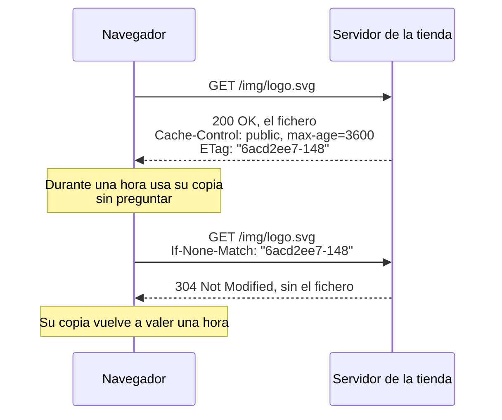

import Term from '~/components/Term.astro';
import TryIt from '~/components/TryIt.astro';
import Analogy from '~/components/Analogy.astro';
import SelfCheck from '~/components/SelfCheck.astro';
import Quiz from '~/components/Quiz.astro';
import QuizQuestion from '~/components/QuizQuestion.astro';
import QuizOption from '~/components/QuizOption.astro';

## El problema

Imagina que Ana cambia el logo de la tienda a las 10:00. Luis abre la web desde su móvil y ve el nuevo. Ana, que tenía la web abierta en su portátil, recarga y sigue viendo el viejo. Y una clienta que entró a las 9:30 lo verá viejo hasta las 10:30. Nadie ha roto nada: el servidor de la tienda dijo a los navegadores que podían guardar las imágenes una hora, y le han hecho caso.

Ahora, el problema contrario. La hoja de estilos de esta web pesa unos 80 KB, 17 comprimida. Si cada página que visitas la descargara otra vez, cada clic pagaría la descarga y los viajes de ida y vuelta que viste en [«De la URL a la página»](/fase-0/que-pasa-cuando-escribes-una-url/). Guardar una copia lo evita.

Una <Term id="cache">caché</Term> es eso: un trato entre velocidad y frescura. Lo fija el servidor con unas pocas <Term id="header">cabeceras</Term>, que aquí aprendes a leer y a escribir.

## La analogía

<Analogy>

Piensa en el horario del gimnasio pegado en la puerta de tu nevera. Al pie, el gimnasio ha impreso «válido hasta el domingo». Hasta el domingo lo miras sin llamar a nadie: es la **frescura**.

El lunes no lo tiras: llamas. «Tengo la versión 7, ¿sigue valiendo?». Si no ha cambiado, te dicen «sí, la 7 sigue» y no te mandan nada nuevo: es la **validación**. Si ha cambiado, te mandan la 8.

Y si el gimnasio cambia el horario el miércoles, no puede entrar en tu cocina a arrancar el papel. Hasta el domingo seguirás mirando el viejo. Esa es la parte difícil: la **invalidación**.

<div slot="limits">

- Llamar parece gratis. En HTTP, preguntar cuesta un viaje de ida y vuelta: «sigue valiendo» ahorra la descarga, no la espera.
- Tu nevera tiene un solo papel. En internet hay copias en varios sitios a la vez, como tu navegador y una CDN, y cada una caduca por su cuenta.
- El servidor no entiende «¿ha cambiado algo de los martes?»: compara tu etiqueta de versión con la suya, letra a letra, y contesta sí o no.

</div>

</Analogy>

## Cómo funciona de verdad

### Las copias se guardan en dos tipos de caché

- **La caché del navegador** es privada: solo te sirve a ti. Guarda copias en memoria y en el disco.
- **Las cachés compartidas** están entre los navegadores y el servidor, y sirven a mucha gente a la vez. La más común es una <Term id="cdn">CDN</Term>, como la de Cloudflare que tiene delante esta web.

Las dos obedecen a las mismas cabeceras de la respuesta, y la principal es `Cache-Control`.

### La frescura: max-age dice cuánto vale una copia

Estas son las cabeceras que importan de una respuesta real del servidor de la tienda, que vas a pedir en «Pruébalo»:

```http
HTTP/1.1 200 OK
Content-Type: image/svg+xml
Last-Modified: Mon, 12 Oct 2026 19:03:03 GMT
ETag: "6acd2ee7-148"
Cache-Control: public, max-age=3600
```

`max-age=3600` significa «esta copia vale 3600 segundos», una hora. Mientras tanto, la copia está **fresca** y el navegador la usa sin preguntar a nadie: ni una petición, ni un byte, ni un viaje de ida y vuelta. Es la misma idea que el <Term id="ttl">TTL</Term> de una respuesta DNS, que viste en [«Qué es DNS»](/fase-0/que-es-dns/).

Pasada la hora, la copia está **caducada** (*stale*), pero no se tira: todavía sirve si el servidor confirma que no ha cambiado.

### La validación: el ETag y el 304

Para confirmarlo, el servidor dio dos pistas en su respuesta. El **<Term id="etag">ETag</Term>** es una etiqueta para esa versión del fichero, `"6acd2ee7-148"`. Cuando la copia caduca, el navegador la devuelve en una petición condicional:

```http
GET /img/logo.svg HTTP/1.1
Host: localhost:8080
If-None-Match: "6acd2ee7-148"
```

`If-None-Match` significa «mándamelo solo si tu versión no es esta». Si la etiqueta coincide, el servidor contesta `304 Not Modified`, sin contenido: «la que tienes sigue valiendo». Si no coincide, contesta un `200` con el fichero nuevo y su ETag nuevo. Esa pregunta se llama <Term id="revalidation">revalidación</Term>.



Cada servidor fabrica su ETag a su manera. nginx junta dos números en hexadecimal: la fecha de modificación del fichero y su tamaño (`148` son 328 bytes). Al navegador le da igual: solo lo guarda y lo devuelve tal cual.

La otra pista, `Last-Modified`, funciona igual con una fecha: el navegador la devuelve en `If-Modified-Since`. Cuenta en segundos, así que dos cambios en el mismo segundo no se distinguen; si llegan las dos, el estándar manda mirar el ETag.

### Las directivas de Cache-Control

`Cache-Control` lleva una o varias directivas separadas por comas. Las más comunes:

| Directiva | Qué le dice a las cachés |
|---|---|
| `max-age=3600` | La copia está fresca durante 3600 segundos |
| `no-cache` | Guárdala, pero pregunta al servidor antes de cada uso |
| `no-store` | No la guardes en ningún sitio |
| `private` | Solo la puede guardar el navegador del usuario, no una caché compartida |
| `public` | La puede guardar también una caché compartida, como una CDN |
| `must-revalidate` | Cuando caduque, no la uses sin preguntar, ni siquiera si el servidor no contesta |
| `immutable` | Mientras esté fresca, no preguntes ni aunque el usuario recargue |

Cuidado con los nombres. **`no-cache` no significa «no guardes»**: significa «guarda, pero pregunta siempre», y con un ETag cada pregunta suele acabar en un 304 sin contenido. La que prohíbe guardar es `no-store`, la de los datos sensibles.

`private` y `public` dicen quién puede guardarla. Una página que dice «Hola, Ana» y enseña sus pedidos tiene que ser `private`: si una CDN la guardara, se la daría al siguiente que la pidiera.

### Esta web: el HTML pregunta siempre, los ficheros con hash no

Esta web usa a la vez dos estrategias opuestas.

**Las páginas HTML** llevan `Cache-Control: public, max-age=0, must-revalidate`: caducan en cuanto llegan, así que el navegador pregunta cada vez. Como no traen ETag, no hay versión que comparar, y la página viaja entera en cada visita. Pesa poco, la portada unos 11 KB comprimida, y a cambio siempre ves la última versión.

**Los ficheros de `/_astro/`**, los estilos, el JavaScript y las fuentes, tienen un nombre como `common.xUsh8mTP.css`. Ese `xUsh8mTP` es un trozo de un <Term id="hash">hash</Term> de su contenido, calculado cuando se construye la web. Si el CSS cambia, cambia su nombre, y el HTML nuevo apunta al nombre nuevo: un nombre nunca cambia de contenido. Por eso se pueden guardar un año sin preguntar, como dice `_headers`, la configuración de Cloudflare que viste en [la lección 4](/fase-2/cabeceras-http/):

```
/_astro/*
  Cache-Control: public, max-age=31536000, immutable
```

31.536.000 segundos son 365 días. Juntas, las dos reglas dan lo mejor de cada una: el HTML siempre es el último, y apunta a ficheros que casi nunca hay que descargar. En inglés se llama *cache busting* («reventar la caché»): en vez de invalidar la copia vieja, cambias el nombre y nadie la vuelve a pedir.

### Las CDN guardan copias para todos

Cuando el servidor de la CDN más cercano a ti tiene una copia fresca, te la da sin preguntar al servidor de origen, que puede estar en otro continente. Dos cabeceras lo delatan:

- **`Age`**, del estándar: cuántos segundos lleva esa copia en la caché compartida.
- **`cf-cache-status`**, propia de Cloudflare: `HIT` si la copia salió de su caché, `MISS` si no la tenía y tuvo que pedirla al origen, `DYNAMIC` si esa respuesta no se guarda.

Una CDN lee `Cache-Control` como tu navegador, además de las reglas que le configures en su panel, con dos diferencias: no guarda nada `private`, y si hay `s-maxage`, usa ese tiempo en lugar de `max-age`.

Por esas reglas, el HTML de esta web sale con `cf-cache-status: HIT` aunque diga `max-age=0`: Cloudflare la aloja y guarda sus ficheros por su cuenta. El `max-age=0` es para tu navegador.

### Invalidar es lo difícil

La <Term id="cache-invalidation">invalidación</Term> es el problema de Ana: el logo ha cambiado, pero las copias frescas ya están repartidas, y el servidor no puede ir a decirle a un navegador «olvida lo que te di». Solo contesta cuando le preguntan, y mientras la copia está fresca, nadie le pregunta.

Hay tres salidas, cada una con su precio:

1. **Un `max-age` corto, o `no-cache`.** Las copias viejas duran poco, pero se pregunta más a menudo, y cada pregunta es un viaje de ida y vuelta.
2. **Cambiar el nombre.** `logo-2.svg` es otra dirección, sin copias viejas. Es lo que hace esta web, y obliga a que el HTML que lo enlaza no se guarde mucho.
3. **Purgar la CDN.** Las CDN tienen un botón para borrar sus copias. Pero solo borra las suyas: las de los navegadores siguen ahí hasta que caduquen.

En la Fase 3 escribirás tú el servidor, y será tu código el que ponga `Cache-Control` a cada respuesta, calcule su ETag y conteste los 304.

## Pruébalo

El objetivo: averiguar qué guarda tu navegador de esta web y por qué, conseguir un 304 de verdad y ver cómo el servidor de la tienda fabrica sus ETag.

### En tu terminal: la caché de esta web

Las salidas son las de un Mac con curl 8.7.1, el 12 de octubre de 2026. En Linux y WSL salen igual.

<TryIt
  title="1. Las reglas de la página"
  cmd={`curl -sI https://backenddesdecero.com/ | grep -iE 'cache-control|etag'`}
  output={`cache-control: public, max-age=0, must-revalidate`}
>

`curl -sI` pide solo las cabeceras, y `grep -iE` deja las líneas con `cache-control` o `etag`, sin mirar mayúsculas. Sale una: la página caduca al instante (`max-age=0`) y no trae ETag con que preguntar «¿ha cambiado?».

</TryIt>

<TryIt
  title="2. Los ficheros que la página enlaza"
  cmd={`curl -s https://backenddesdecero.com/ | grep -o '/_astro/[^"]*\\.css'`}
  output={`/_astro/print.ehPL0gv-.css
/_astro/common.xUsh8mTP.css`}
>

Ahora pides la página entera y `grep -o` saca los nombres de sus hojas de estilos. **Tus nombres pueden ser otros:** si hemos cambiado los estilos desde entonces, tendrán otro hash. Usa los tuyos en los pasos siguientes.

</TryIt>

<TryIt
  title="3. Las reglas de un fichero con hash"
  cmd={`curl -sI https://backenddesdecero.com/_astro/common.xUsh8mTP.css | grep -iE 'cache-control|etag'`}
  output={`cache-control: public, max-age=31536000, immutable
etag: "6ef0c6c77b665a281104009081fe9adf"`}
>

Un año, `immutable` y un ETag. Si te sale un 404, ese nombre ya no existe: vuelve al paso 2 y copia el tuyo.

</TryIt>

<TryIt
  title="4. Un 304 de verdad"
  cmd={`curl -s -o /dev/null -w '%{http_code}, %{size_download} bytes\\n' https://backenddesdecero.com/_astro/common.xUsh8mTP.css
curl -s -o /dev/null -w '%{http_code}, %{size_download} bytes\\n' -H 'If-None-Match: "6ef0c6c77b665a281104009081fe9adf"' https://backenddesdecero.com/_astro/common.xUsh8mTP.css`}
  output={`200, 81317 bytes
304, 0 bytes`}
>

`-o /dev/null` tira el contenido y `-w` escribe el <Term id="status-code">código de estado</Term> y los bytes descargados. La primera petición recibe los 81 KB del CSS sin comprimir, porque `curl` no pide compresión ([lección 4](/fase-2/cabeceras-http/)). La segunda manda el ETag en `If-None-Match`, como haría tu navegador con una copia caducada, y recibe un 304 con cero bytes.

Copia el ETag con sus comillas dobles, dentro de las simples. Si sale `200` en las dos, tu ETag no coincide letra a letra.

</TryIt>

<TryIt
  title="5. Una copia servida por la CDN"
  cmd={`curl -sI https://example.com | grep -iE '^(age|cf-cache-status)'`}
  output={`age: 10447
cf-cache-status: HIT`}
>

example.com está detrás de Cloudflare. `HIT` dice que la respuesta salió de su caché, y `age`, que esa copia lleva allí 10447 segundos, casi tres horas. **Tus números serán otros:** dependen del servidor de Cloudflare que te toque. Si sale `MISS` sin `age`, ese servidor no tenía copia: repite la orden y verás un `HIT`.

</TryIt>

### En el navegador: lo que guarda Chrome

Este ejercicio no tiene salida que copiar: lo miras en <Term id="devtools">DevTools</Term>, que viste en [la introducción de la fase](/fase-2/).

1. Abre `https://backenddesdecero.com`, abre DevTools y ve a la pestaña **Red** (*Network*). Recarga la página.
2. Mira la columna **Tamaño** (*Size*). La primera fila, la página, ha viajado entera, como decía el paso 1. Los ficheros de `/_astro/` dicen **«(caché de memoria)»** (*memory cache*): ni siquiera se han pedido.
3. Cierra el navegador del todo, vuelve a abrirlo y entra otra vez con la pestaña Red abierta. Ahora dicen **«(caché de disco)»** (*disk cache*): la copia en memoria se fue al cerrar, pero la del disco sigue.
4. Marca la casilla **Inhabilitar caché** (*Disable cache*), arriba en la pestaña Red, y recarga: todo vuelve a viajar, como en una primera visita. Solo funciona con DevTools abierto; desmárcala al acabar.

Si haces clic en una fila de `/_astro/`, la pestaña **Encabezados** (*Headers*) enseña el `cache-control` del paso 3. En Firefox, la columna que te interesa es **Transferido** (*Transferred*), que dice «cacheado» (*cached*), y la casilla se llama **Desactivar caché** (*Disable Cache*).

### En tu servidor: el logo de la tienda

Ahora eres el servidor. Entra en tu VM con `multipass shell curso`, o abre Ubuntu en WSL. La configuración de la tienda ya está instalada desde [la introducción de la fase](/fase-2/) y responde en el puerto 8080. Las salidas son las de Ubuntu 24.04 con nginx 1.24.0 y curl 8.5.0; tus fechas y tus ETag serán otros. Si no tienes la VM, lee las salidas: son las de un servidor real con la misma configuración.

<TryIt
  title="6. Antes de que exista la imagen"
  cmd="curl -I localhost:8080/img/logo.svg"
  output={`HTTP/1.1 404 Not Found
Server: nginx/1.24.0 (Ubuntu)
Date: Mon, 12 Oct 2026 19:03:02 GMT
Content-Type: text/html; charset=utf-8
Content-Length: 162
Connection: keep-alive`}
>

La carpeta de imágenes aún no existe: 404. Fíjate en lo que falta: el `Cache-Control` de `/img/`. nginx solo lo añade a las respuestas buenas, y es lo que quieres (lo verás en «Errores comunes»).

</TryIt>

<TryIt
  title="7. Sube el logo y pídelo"
  cmd={`sudo mkdir -p /var/www/tienda/img
sudo curl -so /var/www/tienda/img/logo.svg https://backenddesdecero.com/favicon.svg
curl -I localhost:8080/img/logo.svg`}
  output={`HTTP/1.1 200 OK
Server: nginx/1.24.0 (Ubuntu)
Date: Mon, 12 Oct 2026 19:03:03 GMT
Content-Type: image/svg+xml
Content-Length: 328
Last-Modified: Mon, 12 Oct 2026 19:03:03 GMT
Connection: keep-alive
ETag: "6acd2ee7-148"
Cache-Control: public, max-age=3600
Accept-Ranges: bytes`}
>

El logo de la tienda es, de momento, el icono de esta web: `curl -o` lo guarda en la carpeta que nginx sirve. Ahora sí están las tres piezas: `Last-Modified` y `ETag`, que pone nginx por su cuenta, y `Cache-Control`, que pone la configuración.

Si sale `Permission denied`, o un 404 en lugar del 200, te falta algún `sudo`: `/var/www` es de root, y `curl -s` falla sin decir nada.

</TryIt>

<TryIt
  title="8. Pregunta con el ETag"
  cmd={`curl -I -H 'If-None-Match: "6acd2ee7-148"' localhost:8080/img/logo.svg`}
  output={`HTTP/1.1 304 Not Modified
Server: nginx/1.24.0 (Ubuntu)
Date: Mon, 12 Oct 2026 19:03:06 GMT
Last-Modified: Mon, 12 Oct 2026 19:03:03 GMT
Connection: keep-alive
ETag: "6acd2ee7-148"
Cache-Control: public, max-age=3600`}
>

**Usa el ETag de tu paso 7**, con sus comillas. El 304 no trae `Content-Type` ni `Content-Length`: no hay contenido. Y trae otra vez `Cache-Control`, porque renueva la frescura de la copia: otra hora.

</TryIt>

<TryIt
  title="9. Cambia el logo y vuelve a preguntar"
  cmd={`sudo touch /var/www/tienda/img/logo.svg
curl -I -H 'If-None-Match: "6acd2ee7-148"' localhost:8080/img/logo.svg`}
  output={`HTTP/1.1 200 OK
Server: nginx/1.24.0 (Ubuntu)
Date: Mon, 12 Oct 2026 19:03:09 GMT
Content-Type: image/svg+xml
Content-Length: 328
Last-Modified: Mon, 12 Oct 2026 19:03:09 GMT
Connection: keep-alive
ETag: "6acd2eed-148"
Cache-Control: public, max-age=3600
Accept-Ranges: bytes`}
>

`touch` cambia la fecha de modificación del fichero, como si Ana lo hubiera vuelto a subir. El ETag de nginx sale de esa fecha, así que ya no coincide: 200 y ETag nuevo. El servidor sabe que ha cambiado, pero un navegador que lo guardó hace diez minutos no preguntará en otros cincuenta: es el problema de Ana.

</TryIt>

Y ahora, el reto. Escribe tú los comandos:

<SelfCheck question="Reto: haz que los navegadores pregunten por las imágenes cada vez que las usen, sin perder el 304. Después, deja la configuración como estaba.">

Cambia `public, max-age=3600` por `no-cache` en la línea de `/img/`. Abre la configuración con `sudo nano /etc/nginx/sites-available/tienda`, edita la línea, guarda y sal, y aplica el cambio:

```sh
sudo nginx -t && sudo systemctl reload nginx
curl -I localhost:8080/img/logo.svg
```

La respuesta trae `Cache-Control: no-cache` (si aún sale la vieja, repite el `curl`: nginx tarda un instante en recargar), y el ETag sigue ahí, así que cada pregunta acabará en un 304. Con `no-store`, en cambio, el navegador no guardaría nada: ni copia ni ETag que mandar.

Para dejarlo como estaba, vuelve a poner `public, max-age=3600` y repite el `nginx -t` y el `reload`. Si `nginx -t` da un error, te has comido una comilla o el `;` del final de la línea.

</SelfCheck>

## Ya lo has visto

- **La recarga forzada,** <kbd>Cmd</kbd> + <kbd>Mayús</kbd> + <kbd>R</kbd> en Mac o <kbd>Ctrl</kbd> + <kbd>Mayús</kbd> + <kbd>R</kbd> en Windows y Linux, pide todo otra vez sin mirar la caché. La normal de Chrome solo vuelve a pedir la página, como viste en DevTools.
- **«Prueba a borrar la caché»,** el consejo de cualquier soporte técnico, es la invalidación hecha a mano: como el servidor no puede borrar tu copia vieja, te piden que la borres tú.

Y si programas:

- Vite y Astro ponen un hash en el nombre de los ficheros que generan, y webpack, si se lo pides con `[contenthash]`: así se pueden guardar un año.
- `fetch(url, { cache: 'no-store' })` pide una respuesta sin mirar la caché del navegador y sin guardarla.

## Errores comunes

- **Usar `no-cache` para que no se guarde nada.** `no-cache` guarda y pregunta. Para datos sensibles, `no-store`.
- **Dejar que una caché compartida guarde páginas personales.** En la Navidad de 2015, una configuración equivocada en la caché de Steam pudo enseñar a otras personas páginas de unos 34.000 usuarios con la <Term id="session">sesión</Term> iniciada, con su dirección, sus compras o su correo. Lo contó Valve en su [nota oficial](https://store.steampowered.com/oldnews/19852). Lo personal va con `private` o `no-store`.
- **Guardar los errores.** Un 404 guardado una hora sigue ahí después de arreglarlo. En nginx, `add_header` solo va en las respuestas buenas, salvo que le añadas `always`: úsalo solo con cabeceras que deban ir también en los errores.
- **Pensar que sin `Cache-Control` no se guarda nada.** Si una respuesta trae `Last-Modified` y nada más, el navegador puede decidir por su cuenta cuánto guardarla. Si no quieres sorpresas, dilo tú.

## Resumen

- `Cache-Control` decide quién guarda una respuesta (`private`, `public`, `no-store`) y cuánto vale (`max-age`). Mientras está fresca, la copia se usa sin preguntar; `no-cache` obliga a preguntar siempre.
- Una copia caducada se revalida: el navegador manda su `ETag` en `If-None-Match` (o la fecha en `If-Modified-Since`) y, si no ha cambiado, el servidor contesta `304` sin contenido.
- Los ficheros con un hash en el nombre se pueden guardar un año con `immutable`, porque si cambian, cambian de nombre. Esta web lo hace con `/_astro/`, y su HTML se pregunta siempre.
- Las CDN son cachés compartidas (`Age`, `cf-cache-status`). Invalidar es lo difícil: el servidor no puede avisar a los navegadores de que su copia ya no vale.

## ¿Lo has entendido?

<Quiz>

<QuizQuestion
  question="Ana sube un logo nuevo con el mismo nombre. Media hora después, algunos clientes aún ven el viejo, y el servidor manda Cache-Control: public, max-age=3600. ¿Qué pasa?"
  review="La frescura: max-age dice cuánto vale una copia"
>

<QuizOption text="Sus navegadores guardaron la copia hace menos de una hora y no preguntan." correct>

Cada navegador cuenta la hora desde que guardó su copia, y hasta entonces no pregunta.

</QuizOption>

<QuizOption text="nginx sigue sirviendo una copia del logo viejo que se guardó en su memoria al arrancar.">

nginx lee el fichero del disco: en el paso 9, nada más cambiarlo, dio un ETag nuevo. Las copias viejas están en los navegadores.

</QuizOption>

<QuizOption text="Las imágenes se quedan en la caché del navegador hasta que el usuario la borra a mano.">

Una copia vale lo que diga `max-age`. Cuando caduca, el navegador pregunta y recibe el logo nuevo.

</QuizOption>

</QuizQuestion>

<QuizQuestion
  question="Tu banco online enseña tus movimientos, y no quiere que queden guardados en el disco de un ordenador compartido. ¿Qué cabecera debe poner?"
  review="Las directivas de Cache-Control"
>

<QuizOption text="Cache-Control: no-cache, que impide que la página se guarde.">

`no-cache` deja guardar la copia: solo obliga a preguntar antes de usarla.

</QuizOption>

<QuizOption text="Cache-Control: private, que impide que se guarde en el ordenador del usuario.">

Es al revés: `private` deja que la guarde el navegador del usuario y solo se lo prohíbe a las cachés compartidas, como una CDN.

</QuizOption>

<QuizOption text="Cache-Control: no-store." correct>

`no-store` es la única que prohíbe guardar la respuesta en cualquier sitio, el navegador incluido.

</QuizOption>

</QuizQuestion>

<QuizQuestion
  question="Pides el logo a la tienda con If-None-Match y el ETag de tu copia, y la respuesta empieza por HTTP/1.1 304 Not Modified. ¿Qué significa?"
  review="La validación: el ETag y el 304"
>

<QuizOption text="Que el fichero con esa versión ya no existe en el servidor y hay que pedirlo de nuevo.">

Un fichero que no existe da un 404. El 304 dice lo contrario: la versión con ese ETag es la que el servidor tiene ahora.

</QuizOption>

<QuizOption text="Que la versión de ese ETag sigue siendo la actual, así que no manda el contenido." correct>

Pediste «mándamelo solo si tu versión no es esta». Lo es, así que el servidor contesta sin contenido y tu copia sigue valiendo.

</QuizOption>

<QuizOption text="Que se ha usado la copia guardada sin llegar a hablar con el servidor.">

El 304 es una respuesta del servidor: hubo viaje de ida y vuelta. Solo se ahorra el contenido.

</QuizOption>

</QuizQuestion>

<QuizQuestion
  question="Los ficheros de /_astro/ de esta web se pueden guardar un año sin preguntar. Si cambiamos el CSS mañana, ¿por qué nadie verá el viejo?"
  review="Esta web: el HTML pregunta siempre, los ficheros con hash no"
>

<QuizOption text="Porque al publicar la web, Cloudflare borra las copias viejas también de los navegadores.">

Cloudflare solo puede borrar sus propias copias. Las de los navegadores siguen ahí hasta que caducan.

</QuizOption>

<QuizOption text="Porque immutable obliga al navegador a comprobar una vez al día si el fichero ha cambiado.">

`immutable` dice lo contrario: mientras la copia esté fresca, no preguntes ni aunque el usuario recargue.

</QuizOption>

<QuizOption text="Porque el CSS nuevo tendrá otro nombre, y la página, que se pide siempre, lo enlazará." correct>

El nombre lleva un trozo del hash del contenido. La copia vieja se queda en la caché, pero ya nadie la pide.

</QuizOption>

</QuizQuestion>

<QuizQuestion
  question="La tienda, detrás de una CDN, va a enseñar en /carrito lo que lleva cada cliente. ¿Qué Cache-Control le pones a esa página?"
  review="Las directivas de Cache-Control"
>

<QuizOption text="private, no-cache: solo la guarda el navegador, que pregunta antes de usarla." correct>

`private` impide que la CDN se la dé a otra persona, y `no-cache` hace que el navegador pregunte antes de usar su copia.

</QuizOption>

<QuizOption text="public, max-age=600: la CDN ya guarda por su cuenta una copia distinta para cada cliente.">

Una CDN no separa a los clientes por su cuenta: con `public`, la copia de uno se la puede dar al siguiente. Algo así le pasó a Steam en 2015.

</QuizOption>

<QuizOption text="Ninguna: sin la cabecera Cache-Control, ni la CDN ni el navegador guardan nada.">

Sin `Cache-Control`, las cachés pueden decidir por su cuenta, por ejemplo a partir de `Last-Modified`.

</QuizOption>

</QuizQuestion>

<QuizQuestion
  question="Una respuesta trae age: 1800 y cf-cache-status: HIT. ¿Qué te dice?"
  review="Las CDN guardan copias para todos"
>

<QuizOption text="Que el servidor tardó 1800 milisegundos en contestar, pero que la petición llegó bien.">

`Age` cuenta los segundos que esa copia lleva en una caché compartida, y `HIT` dice que salió de ella.

</QuizOption>

<QuizOption text="Que salió de la caché de Cloudflare, donde esa copia llevaba media hora." correct>

`HIT` dice que Cloudflare la tenía, y `age`, desde hace cuánto: 1800 segundos. El servidor de origen ni se enteró de tu petición.

</QuizOption>

<QuizOption text="Que tu navegador tenía esa copia guardada desde hace media hora.">

Esas cabeceras las pone la caché compartida, la CDN, no la de tu navegador.

</QuizOption>

</QuizQuestion>

</Quiz>

## Para profundizar

- [Caché HTTP, en MDN](https://developer.mozilla.org/es/docs/Web/HTTP/Guides/Caching): la guía completa, con más directivas y casos.
- [Prevent unnecessary network requests with the HTTP Cache](https://web.dev/articles/http-cache), en web.dev (en inglés): qué poner en cada tipo de fichero.
- [Cloudflare cache responses](https://developers.cloudflare.com/cache/concepts/cache-responses/) (en inglés): todos los valores de `cf-cache-status`.
- [RFC 9111](https://www.rfc-editor.org/rfc/rfc9111), el estándar de la caché HTTP (en inglés).
