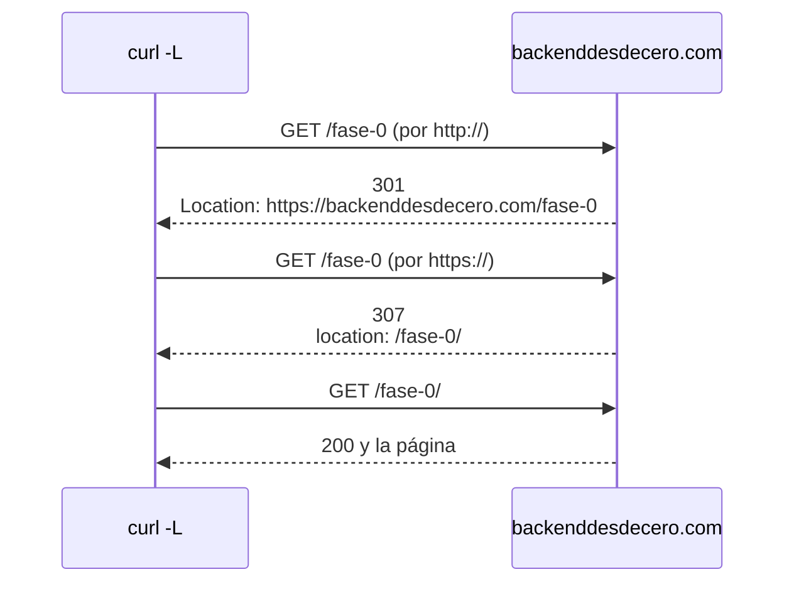

import Term from '~/components/Term.astro';
import TryIt from '~/components/TryIt.astro';
import Analogy from '~/components/Analogy.astro';
import SelfCheck from '~/components/SelfCheck.astro';
import Quiz from '~/components/Quiz.astro';
import QuizQuestion from '~/components/QuizQuestion.astro';
import QuizOption from '~/components/QuizOption.astro';

## El problema

Imagina que un cliente de la tienda de Ana y Luis pide una sudadera desde la app del móvil. La app enseña «¡Pedido realizado!», pero el pedido nunca llega: no había stock. La <Term id="api">API</Term> de la tienda había contestado `200 OK`, con un texto que decía `{"error": "sin stock"}`.

La app no leyó el texto: vio un `200` y dio el pedido por bueno. **Los programas deciden por el <Term id="status-code">código de estado</Term>**, no por lo que pone debajo. El navegador, Google, las cachés y tus propias alarmas también.

En la [Fase 0](/fase-0/que-es-un-protocolo/) viste `200`, `400` y `404`. En el día a día se usan unos veinte: esta lección cuenta qué promete cada uno.

## La analogía

<Analogy>

Imagina la ventanilla de una oficina pública. Entregas un trámite y el funcionario te lo devuelve con un sello de uno de cuatro colores:

- **Verde, «tramitado»:** todo ha ido bien.
- **Azul, «esto se hace en la ventanilla 5»:** no es un error; vas a la otra ventanilla.
- **Naranja, «le falta una firma»:** el problema es tuyo. Si entregas lo mismo, te pondrán el mismo sello.
- **Rojo, «se ha caído el sistema»:** el problema es de la oficina. Si vuelves más tarde con el mismo papel, quizá salga bien.

El color es la primera cifra del código, y el texto del sello, el resto.

<div slot="limits">

- El funcionario te explica el sello con palabras. Un programa solo lee el número: la frase que acompaña al código es decorativa, y en HTTP/2 ni siquiera viaja.
- Cuando te mandan a la ventanilla 5, vas tú andando. Ante una redirección, el navegador va solo, sin preguntarte.
- El funcionario te dice por qué no te atiende. Un servidor, a veces, debe callárselo: lo verás con el `404` que esconde.

</div>

</Analogy>

## Cómo funciona de verdad

### La primera cifra dice de quién es el problema

En la [lección 3 de la Fase 1](/fase-1/pipes-y-redirecciones/) contaste los `200`, `301`, `404` y `500` del log de prácticas. La primera cifra pone cada código en una de cinco familias:

| Familia | Qué dice | ¿De quién es el problema? | ¿Sirve repetir lo mismo? |
|---|---|---|---|
| `1xx` | Un aviso previo, que casi nunca verás | De nadie | No hace falta |
| `2xx` | Todo ha ido bien | De nadie | No hace falta |
| `3xx` | Lo que buscas está en otro sitio, o ya lo tienes | De nadie: falta un paso más | El cliente da ese paso solo |
| `4xx` | Error del <Term id="client">cliente</Term> | De quien pide | No: hay que cambiar la petición (o, con un `429`, esperar) |
| `5xx` | Error del <Term id="server">servidor</Term> | Del servidor | Quizá, más tarde |

La última columna es la que más importa. Ante un `4xx`, repetir la petición dará el mismo error. Ante un `5xx`, volver a intentarlo más tarde puede funcionar, y por eso muchos programas reintentan solos (de ahí que importe si el método es <Term id="idempotent">idempotente</Term>, como viste en [«Métodos»](/fase-2/metodos-http/#idempotente-repetirla-no-cambia-el-resultado)).

La familia importa tanto que el estándar lo deja escrito: un cliente que recibe un código que no conoce, como un `499`, lo trata como el `x00` de su familia, aquí un `400`.

### La frase es para humanos

Detrás del número va una frase, como `Not Found` en `404 Not Found`. Es para las personas, y ningún programa debe fiarse de ella. nginx pone las suyas: `302 Moved Temporarily`, donde el estándar dice `302 Found`. Y en <Term id="http2">HTTP/2</Term> la frase ya no viaja: Cloudflare responde `HTTP/2 404`, solo el número.

### Los códigos que importan

Es para consultar, no para memorizar. Los ejemplos son de la tienda:

| Código | Qué dice | Un ejemplo |
|---|---|---|
| `200 OK` | Aquí tienes lo que pediste | `GET /productos` devuelve la lista |
| `201 Created` | He creado algo nuevo | `POST /api/pedidos` crea un pedido |
| `204 No Content` | Hecho, y no hay nada que contar | Borras algo del carrito: la respuesta va sin <Term id="request-body">cuerpo</Term> |
| `301`, `302`, `307` y `308` | Está en otra dirección | `/ofertas` lleva a `/productos` ([las redirecciones](#el-código-y-la-cabecera-location-las-redirecciones)) |
| `304 Not Modified` | Lo que ya tienes guardado sigue valiendo | Lo verás en [«Caché»](/fase-2/cache-http/#la-validación-el-etag-y-el-304) |
| `400 Bad Request` | Tu petición está mal hecha | El cuerpo dice ser <Term id="json">JSON</Term> y no lo es |
| `401 Unauthorized` | No sé quién eres | Pides tus pedidos sin haber iniciado sesión |
| `403 Forbidden` | Sé quién eres, y no puedes | Un cliente intenta entrar en el panel de administración |
| `404 Not Found` | Eso no existe (o no te lo digo) | `/productos/999` |
| `405 Method Not Allowed` | Existe, pero no con ese método | `POST /productos` ([«Métodos»](/fase-2/metodos-http/)) |
| `409 Conflict` | Choca con cómo están las cosas | Te registras con un correo que ya tiene cuenta |
| `422 Unprocessable Content` | Se entiende, pero los datos no valen | Un pedido de `-3` sudaderas |
| `429 Too Many Requests` | Demasiadas peticiones: espera | Cien contraseñas por minuto (Fase 6) |
| `500 Internal Server Error` | He fallado yo | Un error en el programa de la tienda |
| `502 Bad Gateway` | El de detrás me ha respondido mal | El programa de la tienda se ha caído |
| `503 Service Unavailable` | Ahora no puedo atender | La tienda está en mantenimiento |
| `504 Gateway Timeout` | El de detrás tarda demasiado | El programa de la tienda está atascado |

Dos parejas confunden a casi todo el mundo:

- **`400` frente a `422`:** con un `400`, el servidor ni siquiera ha podido leer la petición. Con un `422`, la ha leído, y lo que pide no tiene sentido.
- **`502` y `504` frente a `500`:** en muchas webs, delante del programa que responde hay otro servidor, como nginx o Cloudflare, que le pasa las peticiones. `500` dice «he fallado yo»; `502` y `504`, «ha fallado el de detrás» (lo montarás en la [Fase 8](/fase-8/nginx-proxy-inverso/)).

### 401 o 403: «no sé quién eres» o «no puedes»

La API de GitHub te pide que te identifiques antes de decirte quién eres:

```sh
curl -si https://api.github.com/user
```

```text
HTTP/2 401 
content-type: application/json; charset=utf-8
server: github.com
…

{
  "message": "Requires authentication",
  "documentation_url": "https://docs.github.com/rest",
  "status": "401"
}
```

`Requires authentication` significa «hace falta identificarse». Esa es la diferencia:

- **`401`: no sé quién eres.** No has iniciado sesión, o tu identificación ha caducado. Si te identificas, puede salir bien.
- **`403`: sé quién eres, y no puedes.** Has iniciado sesión, pero tu cuenta no tiene permiso. Identificarte otra vez no cambia nada.

Es como un concierto: sin pulsera no pasas del control (`401`), y con la pulsera normal no entras en la zona VIP (`403`). El nombre del `401`, *Unauthorized* («no autorizado»), despista: debería ser «no identificado». Lo verás en la Fase 6.

### El 404 también sirve para esconder

Un `403` dice «eso existe, pero no es para ti», y a veces eso ya es demasiado. Si un cliente pide `/api/pedidos/1044`, el pedido de otra persona, un `403` le confirma que el 1044 existe, y puede probar con el 1045. Un `404` no le dice nada.

GitHub lo hace así con los repositorios privados: si no tienes acceso, responde `404` y no `403`, y [su documentación](https://docs.github.com/en/rest/using-the-rest-api/troubleshooting-the-rest-api#404-not-found-for-an-existing-resource) explica que es para no confirmar que existen. **Si saber que algo existe ya da información, responde `404`.**

### El 200 con un error dentro

Esta es la respuesta de la tienda en «El problema»:

```http
HTTP/1.1 200 OK
Content-Type: application/json

{"error": "sin stock"}
```

El cuerpo dice que algo ha fallado, y el código, que todo va bien. Gana el código:

- **La app del móvil** da el pedido por hecho.
- **Tus alarmas no saltan.** En la Fase 1 encontraste los pagos fallidos contando los `500` del log. Con `200` en todo, serían invisibles.
- **Una <Term id="cache">caché</Term>** puede guardar esa respuesta como buena y repartirla.
- **Google** puede guardar en su índice una página que solo dice «no encontrado». Su documentación lo llama [*soft 404*](https://developers.google.com/crawling/docs/troubleshooting/http-status-codes?hl=es), un «404 blando».

Lo correcto es un código que diga la verdad y un cuerpo que dé los detalles: `409 Conflict` con `{"error": "sin stock"}`.

### El código y la cabecera Location: las redirecciones

Pide la portada de este curso por `http://`, sin la `s`:

```sh
curl -sI http://backenddesdecero.com
```

```text
HTTP/1.1 301 Moved Permanently
Date: Mon, 12 Oct 2026 18:35:32 GMT
Content-Type: text/html; charset=UTF-8
Connection: keep-alive
Location: https://backenddesdecero.com/
…
Server: cloudflare
…
```

Hemos recortado algunas <Term id="header">cabeceras</Term>. El servidor no manda la página, sino un `301` y una cabecera `Location` con la dirección buena. Eso es una <Term id="redirect">redirección</Term>: un código `3xx` más `Location`. El navegador, o `curl -L`, hace por su cuenta una petición nueva a esa dirección.

`Location` puede llevar una dirección completa, como esta, o solo una ruta, como `/fase-0/`, que el cliente completa con el sitio donde ya está. Una redirección puede llevar a otra, y cada salto cuesta un viaje de ida y vuelta ([«De la URL a la página»](/fase-0/que-pasa-cuando-escribes-una-url/)):



Hay cuatro redirecciones de uso diario, y se eligen con dos preguntas:

| | Para siempre | De momento |
|---|---|---|
| **Puede convertir un `POST` en `GET`** | `301 Moved Permanently` | `302 Found` |
| **Mantiene el método y el cuerpo** | `308 Permanent Redirect` | `307 Temporary Redirect` |

**¿Para siempre o de momento?** Un `301` le dice a Google que use la dirección nueva en sus resultados, y los navegadores pueden guardarlo en caché y no volver a preguntar. Un `302` dice lo contrario: la dirección de siempre sigue siendo la buena.

**¿Puede cambiar el método?** Hace años, los navegadores que seguían un `301` o un `302` tras enviar un formulario cambiaban el `POST` por un `GET`, y los datos se perdían. El estándar acabó aceptándolo, y creó el `307` y el `308` para cuando eso no debe pasar. Con un `GET`, el de casi todas las páginas, las dos filas funcionan igual.

## Pruébalo

El objetivo: ver qué código responde cada servidor, encontrar un enlace roto en el log de prácticas y cambiar una redirección de la tienda en tu VM.

### Los códigos de esta web

En la terminal de tu ordenador. Las salidas son de un Mac, del 12 de octubre de 2026.

<TryIt
  title="1. Tres respuestas, tres familias"
  cmd={`curl -s -o /dev/null -w '%{http_code}\\n' https://backenddesdecero.com/fase-0/\ncurl -s -o /dev/null -w '%{http_code}\\n' https://backenddesdecero.com/fase-0\ncurl -s -o /dev/null -w '%{http_code}\\n' https://backenddesdecero.com/fase-0/no-existe`}
  output={`200
307
404`}
>

Como en [«Métodos»](/fase-2/metodos-http/), `-o /dev/null` tira el cuerpo y `-w` escribe solo el código. Con la barra final, la página; sin ella, una redirección; con un nombre inventado, un `404`.

Si sale `000`, `curl` no ha podido conectar: revisa tu conexión.

</TryIt>

<TryIt
  title="2. Sigue la cadena de redirecciones"
  cmd={`curl -sIL http://backenddesdecero.com/fase-0 | grep -i '^http\\|^location'`}
  output={`HTTP/1.1 301 Moved Permanently
Location: https://backenddesdecero.com/fase-0
HTTP/2 307 
location: /fase-0/
HTTP/2 200 `}
>

`-L` hace que `curl` siga las redirecciones, como el navegador, y `-I` pide solo las cabeceras. `grep -i` se queda con las líneas que empiezan por `http` o por `location`, sin mirar mayúsculas; `\|` significa «o».

Es la cadena del diagrama. Fíjate en que la primera respuesta llega por HTTP/1.1, con frase, y las demás por HTTP/2, sin ella.

</TryIt>

### Lo que cuenta el log de prácticas

Ahora, el log de prácticas de la Fase 1, en `~/curso-backend/fase-1`. Si no lo tienes, descárgalo ahí con `curl -O https://backenddesdecero.com/practicas/access.log`. Es el mismo para todos, así que tus números serán estos; en Linux y WSL, `uniq -c` pone más espacios delante.

<TryIt
  title="3. Cuenta por familias"
  cmd={`cd ~/curso-backend/fase-1\ncut -d' ' -f9 access.log | cut -c1 | sort | uniq -c`}
  output={` 865 2
  19 3
  64 4
  26 5`}
>

El primer `cut` se queda con el código, como en la Fase 1, y el segundo, con `-c1`, con su primer carácter: la familia. De los 90 errores del día, 64 fueron culpa de quien pedía y 26, del servidor.

</TryIt>

<TryIt
  title="4. ¿Qué páginas se han mudado?"
  cmd={`grep '" 301 ' access.log | cut -d' ' -f7 | sort | uniq -c`}
  output={`   8 /about-us
  11 /shop`}
>

Las 19 redirecciones vienen de dos direcciones viejas. El log no guarda la cabecera `Location`, así que no dice adónde llevaban.

</TryIt>

<TryIt
  title="5. ¿Quién enlaza a un producto que no existe?"
  cmd={`grep '" 404 ' access.log | cut -d' ' -f7 | sort | uniq -c | sort -rn | head -3\ngrep '/products/57 ' access.log | cut -d'"' -f4 | sort | uniq -c`}
  output={`   9 /products/57
   5 /prodcuts
   4 /contact
   5 -
   1 https://example.com/about
   1 https://example.com/blog
   1 https://example.com/products
   1 https://example.com/products/20`}
>

La primera orden cuenta qué rutas dan `404`: la que más, `/products/57`. La segunda corta por las comillas y se queda con el cuarto trozo, la página donde estaba el enlace pulsado. Un `-` es que no hubo enlace: el visitante escribió la dirección.

Cuatro visitas vienen de páginas de la propia web. **El producto 57 se borró, pero los enlaces siguen ahí.** Hay que quitarlos y, si otro producto lo sustituye, redirigir `/products/57` a él con un `301`.

</TryIt>

### Una redirección en la tienda

El resto se hace en tu VM (`multipass shell curso`), con la tienda que instalaste en [la introducción](/fase-2/). Si no tienes VM, lee las salidas: son las de un Ubuntu 24.04 con nginx 1.24.0.

<TryIt
  title="6. La redirección de /ofertas"
  cmd={`curl -sI localhost:8080/ofertas`}
  output={`HTTP/1.1 301 Moved Permanently
Server: nginx/1.24.0 (Ubuntu)
Date: Mon, 12 Oct 2026 18:42:05 GMT
Content-Type: text/html
Content-Length: 178
Location: http://localhost:8080/productos
Connection: keep-alive`}
>

La configuración dice `return 301 /productos;`, solo la ruta, y nginx la completa con el nombre y el puerto a los que llamaste. Tu fecha será otra. Si sale `Couldn't connect to server`, nginx no escucha en el 8080: repasa la introducción.

</TryIt>

<TryIt
  title="7. La tienda en mantenimiento"
  cmd={`curl -si localhost:8080/mantenimiento`}
  output={`HTTP/1.1 503 Service Temporarily Unavailable
Server: nginx/1.24.0 (Ubuntu)
Date: Mon, 12 Oct 2026 18:42:05 GMT
Content-Type: text/html; charset=utf-8
Content-Length: 206
Connection: keep-alive
Retry-After: 120

<html>
<head><title>503 Service Temporarily Unavailable</title></head>
<body>
<center><h1>503 Service Temporarily Unavailable</h1></center>
<hr><center>nginx/1.24.0 (Ubuntu)</center>
</body>
</html>`}
>

Un `503` con `Retry-After: 120`: «no puedo atenderte, vuelve dentro de 120 segundos». Es lo que toca en un mantenimiento: Google entiende que es pasajero. Con un `200`, podría guardar en su índice la página de «en mantenimiento».

</TryIt>

Ahora, el cambio. Ana quiere que `/ofertas` lleve a los productos solo durante la campaña de otoño, y después volverá a tener su propia página. Con un `301`, los navegadores y Google la darían por perdida: hace falta una redirección temporal.

Abre la configuración con `sudo nano /etc/nginx/sites-available/tienda`, como en [«Métodos»](/fase-2/metodos-http/). Busca la línea `return 301 /productos;` con <kbd>Ctrl</kbd> + <kbd>W</kbd>, cambia `301` por `302`, guarda con <kbd>Ctrl</kbd> + <kbd>O</kbd> y <kbd>Enter</kbd>, y sal con <kbd>Ctrl</kbd> + <kbd>X</kbd>.

<TryIt
  title="8. Comprueba y recarga"
  cmd={`sudo nginx -t && sudo systemctl reload nginx`}
  output={`nginx: the configuration file /etc/nginx/nginx.conf syntax is ok
nginx: configuration file /etc/nginx/nginx.conf test is successful`}
>

`nginx -t` revisa la configuración, y `&&` solo recarga si está bien. Si sale `test failed`, nginx dice en qué línea está la errata.

</TryIt>

<TryIt
  title="9. Pide /ofertas otra vez"
  cmd={`curl -sI localhost:8080/ofertas | head -1`}
  output={`HTTP/1.1 302 Moved Temporarily`}
>

Ahora la redirección es temporal, con la frase propia de nginx. Si sigue saliendo `301`, mira que guardaste el fichero y repite el paso 8.

**Para deshacerlo**, vuelve a poner `301` y repite el paso 8.

</TryIt>

<SelfCheck question="Reto: al final, la campaña de otoño se cancela y /ofertas no va a volver nunca, ni hay otra página que la sustituya. ¿Qué código pondrías? Cámbialo en la tienda y compruébalo.">

Un `410 Gone`, «se ha ido para siempre», o un `404`: no hay ningún sitio al que redirigir. La línea queda así, sin ruta:

```nginx
return 410;
```

Después de `sudo nginx -t && sudo systemctl reload nginx`, `curl -sI localhost:8080/ofertas | head -1` responde `HTTP/1.1 410 Gone`. Si `nginx -t` falla, mira que la línea acabe en punto y coma.

Cuando termines, vuelve a poner `return 301 /productos;` y recarga.

</SelfCheck>

## Ya lo has visto

- **Las páginas de «Error 404»** de cualquier web, y las de Cloudflare con un «Error 502» o «Error 504»: el servidor de delante te dice que el de detrás no ha respondido bien.
- **En <Term id="devtools">DevTools</Term>,** abre la pestaña **Red** (*Network*) y entra en `https://backenddesdecero.com/fase-0`, sin la barra final. En la columna **Estado** (*Status*) verás dos filas: `fase-0` con un `307` y `fase-0/` con un `200`. Cómo abrir DevTools está en [la introducción](/fase-2/).

Y si programas:

- `fetch` sigue las redirecciones por su cuenta, y `response.redirected` te dice si hubo alguna. `response.ok` es `true` con cualquier código entre `200` y `299`, también con un `200` que lleva un error dentro.
- En Next.js, una redirección con `permanent: true` responde `308`, y sin él, `307`: Next.js elige las que mantienen el método.

## Errores comunes

- **Usar `301` para algo temporal.** Los navegadores pueden guardarlo en caché, y si luego lo deshaces, algunos visitantes seguirán yendo a la dirección nueva sin preguntar. Si dudas, empieza con `302` o `307`.
- **Responder `401` a quien ya ha iniciado sesión y no tiene permiso.** Muchas apps, ante un `401`, mandan a la pantalla de iniciar sesión: el usuario entra otra vez y recibe otro `401`, en bucle. Lo que toca es `403`.
- **Dar un `500` por un error del cliente.** Si alguien manda un JSON roto y tu servidor falla al leerlo, saltan tus alarmas por un error ajeno, y el cliente cree que reintentar puede servir. Comprueba lo que llega y responde `400` o `422`.
- **Una redirección que vuelve a sí misma.** Si `/a` lleva a `/b` y `/b` a `/a`, Chrome se rinde con `ERR_TOO_MANY_REDIRECTS`, y `curl -L`, tras 50 saltos, con `curl: (47) Maximum (50) redirects followed`. Sigue la cadena con `curl -sIL`, como en el ejercicio 2.

## Resumen

- La primera cifra dice de quién es el problema: `4xx` de quien pide (repetir no sirve) y `5xx` del servidor (quizá sirva más tarde).
- Los programas leen el número, no la frase ni el cuerpo: un `200` con un error dentro engaña a las apps, a las alarmas, a las cachés y a Google.
- `401` es «no sé quién eres» y `403`, «no puedes». Si confirmar que algo existe ya da información, se responde `404`.
- Una redirección es un `3xx` con `Location`: `301` y `308` para siempre, `302` y `307` de momento.
- En la Fase 3 escribirás tu propio servidor, y elegirás tú el código de cada respuesta.

## ¿Lo has entendido?

<Quiz>

<QuizQuestion
  question="La API de una tienda responde 200 a todo y, cuando algo falla, lo dice con un campo error en el cuerpo. Cuentas los códigos de su log de ayer, un día con muchos pagos fallidos. ¿Qué ves?"
  review="El 200 con un error dentro"
>

<QuizOption text="Muchos 500 a la hora de los fallos: el servidor los apunta aunque responda otra cosa.">

El log apunta el código que se envió de verdad, y fue `200`. En los códigos no queda rastro del fallo.

</QuizOption>

<QuizOption text="Solo 200: en los códigos, el día parece perfecto." correct>

El servidor responde `200` también cuando falla, así que contar códigos no encuentra nada. Con un `500` o un `409`, el fallo saldría al contar.

</QuizOption>

<QuizOption text="Muchos 400: el log detecta la palabra error en el cuerpo y cambia el código.">

El log no lee el cuerpo ni cambia nada: apunta el código tal como salió. Y ese código fue `200`.

</QuizOption>

</QuizQuestion>

<QuizQuestion
  question="Luis ha iniciado sesión en la tienda con su cuenta de cliente e intenta abrir el panel de administración. ¿Qué debería responder el servidor?"
  review="401 o 403: «no sé quién eres» o «no puedes»"
>

<QuizOption text="403: sabe quién es, y su cuenta no tiene permiso." correct>

El servidor ya sabe quién es Luis: el problema es lo que intenta hacer. Iniciar sesión otra vez no cambiaría nada.

</QuizOption>

<QuizOption text="401: su nombre es «no autorizado», y Luis no está autorizado a entrar.">

El nombre despista: `401` significa «no sé quién eres», y aquí el servidor lo sabe. La app le mandaría a iniciar sesión, y volvería a recibir lo mismo.

</QuizOption>

<QuizOption text="400: la petición pide algo que no le corresponde, así que está mal hecha.">

`400` es para una petición que el servidor no ha podido leer. La de Luis está bien escrita: lo que falla es el permiso.

</QuizOption>

</QuizQuestion>

<QuizQuestion
  question="En una tienda, /api/pedidos/1044 responde 403 cuando lo pide alguien que no es su dueño, y 404 si el pedido no existe. ¿Qué problema tiene?"
  review="El 404 también sirve para esconder"
>

<QuizOption text="Ninguno: dar siempre el código más exacto nunca da información de más.">

Aquí la da: probando números, cualquiera sabe qué pedidos existen. Cuando la existencia misma es un dato, toca `404` en los dos casos.

</QuizOption>

<QuizOption text="Que tendría que responder 401: el pedido no es suyo, así que no está autorizado.">

`401` significa «no sé quién eres», y no arreglaría nada: sigue siendo distinto del `404`, y sigue delatando qué pedidos existen.

</QuizOption>

<QuizOption text="Que el 403 confirma qué pedidos existen, y se pueden ir probando números." correct>

Con dos respuestas distintas, cualquiera distingue un pedido que existe de uno que no. Con `404` en los dos casos, como GitHub, no aprende nada.

</QuizOption>

</QuizQuestion>

<QuizQuestion
  question="Durante dos semanas de rebajas, /novedades tiene que llevar a /rebajas. Después, /novedades vuelve a ser la de siempre. ¿Qué redirección usas?"
  review="El código y la cabecera Location: las redirecciones"
>

<QuizOption text="301: es la redirección normal, y los navegadores no la recuerdan.">

Los navegadores sí pueden recordar un `301`. Al terminar las rebajas, algunos visitantes seguirían yendo a `/rebajas` sin preguntar.

</QuizOption>

<QuizOption text="302 o 307: es una redirección de momento." correct>

Una redirección temporal dice que `/novedades` sigue siendo la dirección de verdad. Al quitarla, todo vuelve a ser como antes.

</QuizOption>

<QuizOption text="308: es la versión temporal del 301.">

`308` es permanente, como `301`. Lo que cambia es que mantiene el método. La versión temporal que mantiene el método es `307`.

</QuizOption>

</QuizQuestion>

<QuizQuestion
  question="Alguien envía a la API de la tienda un pedido de -3 sudaderas. El JSON está bien escrito. ¿Qué responde el servidor?"
  review="Los códigos que importan"
>

<QuizOption text="422: ha podido leer la petición, pero los datos no tienen sentido." correct>

El servidor ha leído el JSON: lo que no vale es la cantidad. Para eso está el `422`, con un cuerpo que diga qué campo falla.

</QuizOption>

<QuizOption text="500: todo pedido que el servidor rechaza es un error del servidor.">

`500` dice «he fallado yo», y aquí el problema lo trae quien pide. Tus alarmas saltarían, y el cliente pensaría que reintentar sirve.

</QuizOption>

<QuizOption text="200 con el error en el cuerpo: con otro código, la app no podría leer el mensaje.">

Con un `422`, la app también puede leer el error del cuerpo. Con un `200`, cualquier programa que mire el código daría el pedido por bueno.

</QuizOption>

</QuizQuestion>

<QuizQuestion
  question="Son las tres de la mañana y la tienda, que tiene nginx delante de su programa, responde 502 a todo. ¿Qué miras primero?"
  review="Los códigos que importan"
>

<QuizOption text="Las peticiones de los clientes: los 5xx aparecen cuando alguien pide algo mal hecho.">

Es al revés: los errores de quien pide son los `4xx`. Un `5xx` es del lado del servidor.

</QuizOption>

<QuizOption text="Las redirecciones de nginx: un 502 es una redirección que apunta a una página rota.">

Las redirecciones son la familia `3xx`. `502` es un error del servidor: el de delante no ha recibido una respuesta válida del de detrás.

</QuizOption>

<QuizOption text="El programa de la tienda, detrás de nginx: probablemente no está respondiendo." correct>

`502` es nginx diciendo «el de detrás me ha respondido mal, o nada». Lo primero es ver si el programa de la tienda está en marcha.

</QuizOption>

</QuizQuestion>

</Quiz>

## Para profundizar

- [Códigos de estado de respuesta HTTP](https://developer.mozilla.org/es/docs/Web/HTTP/Reference/Status), en MDN: la lista completa, con una página por código.
- [RFC 9110, sección 15](https://www.rfc-editor.org/rfc/rfc9110.html#name-status-codes), en inglés: lo que el estándar dice de cada código.
- [Cómo afectan los códigos de estado HTTP a los rastreadores de Google](https://developers.google.com/crawling/docs/troubleshooting/http-status-codes?hl=es): qué hace Google con cada familia y con los *soft 404*.
