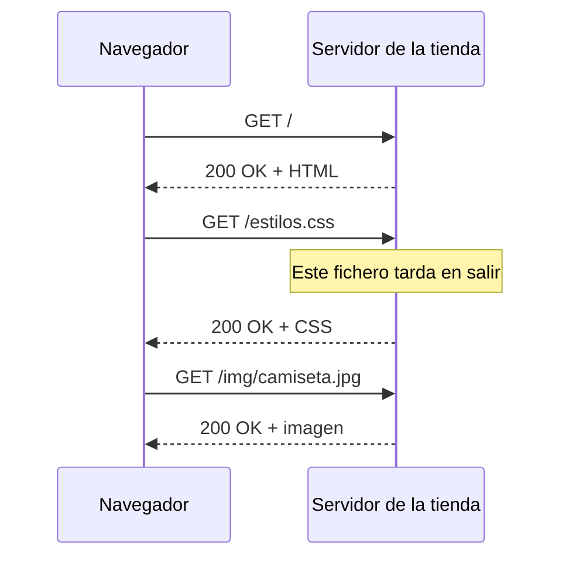
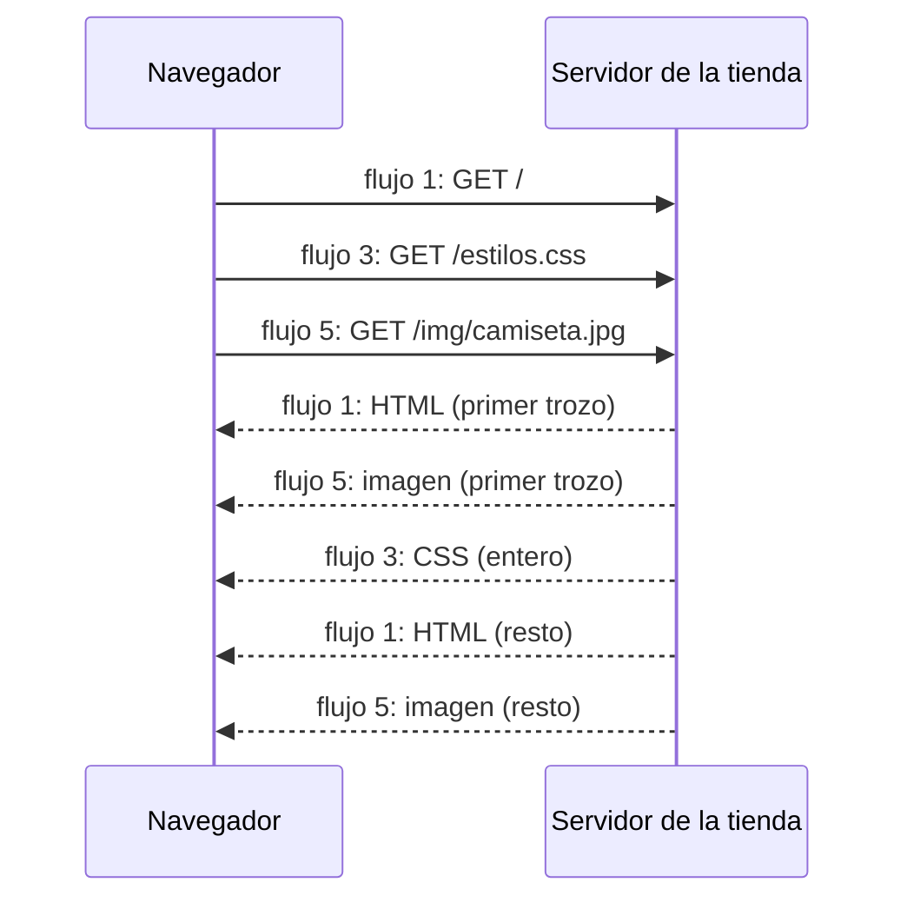

import Term from '~/components/Term.astro';
import TryIt from '~/components/TryIt.astro';
import Analogy from '~/components/Analogy.astro';
import Quiz from '~/components/Quiz.astro';
import QuizQuestion from '~/components/QuizQuestion.astro';
import QuizOption from '~/components/QuizOption.astro';

## El problema

Imagina la portada de la tienda de Ana y Luis: el HTML, dos hojas de estilos, cinco scripts y cuarenta fotos de productos. Casi cincuenta ficheros, todos del mismo servidor. Un cliente la abre desde el móvil, en un tren, con una cobertura que va y viene.

Con HTTP/1.1, su navegador pide los ficheros de seis en seis, y el resto espera turno. Con HTTP/2, los pide todos a la vez por una sola conexión, pero cada vez que se pierde un trozo por el camino, se paran todos. Y cuando el tren entra en una estación y el móvil pasa del 4G al wifi, la conexión se rompe y hay que empezar otra.

Cada versión de HTTP nació para arreglar el atasco de la anterior. Los métodos, los códigos y las cabeceras de esta fase son los mismos en las tres: lo que cambia es **cómo viajan**.

## La analogía

<Analogy>

Imagina que pides la comida en un restaurante.

Con **HTTP/1.1**, el camarero te trae un plato, y hasta que no lo deja en la mesa no le puedes pedir el siguiente. Para comer antes, llamas a seis camareros a la vez, y cada uno se ocupa de un plato.

Con **HTTP/2**, le das la comanda entera a un solo camarero, y la cocina saca los platos según están listos. Pero todo sale por la misma ventanilla, y en orden estricto: si se cae el tercer plato, el cuarto y el quinto esperan, aunque estén listos, hasta que rehacen el tercero.

Con **HTTP/3**, cada plato sale por su propia ventanilla: si se cae uno, solo espera ese. Y tu pedido va con un número, no con tu mesa: si te cambias a la terraza, te lo siguen trayendo.

<div slot="limits">

- En HTTP/2 y HTTP/3, cada respuesta viaja troceada y los trozos de varias se intercalan. En el restaurante, cada plato llega entero.
- Llamar a más camareros no te cuesta nada. Abrir más conexiones, sí: cada una paga su handshake de TCP y de TLS.
- En HTTP/3 no hay varias ventanillas de verdad: todo viaja por la misma conexión. Lo que va por separado es el orden de cada respuesta.

</div>

</Analogy>

## Cómo funciona de verdad

### HTTP/1.1: una petición cada vez por conexión

HTTP/1.1 es de 1997, y es la versión de texto que escribiste a mano en [«Qué es un protocolo»](/fase-0/que-es-un-protocolo/). Su conexión se queda abierta para la siguiente petición (el `Connection: keep-alive` de la Fase 0), así que la segunda no repite los handshakes.

Pero una conexión de HTTP/1.1 solo lleva **una petición cada vez**. El navegador envía, espera la respuesta entera y solo entonces envía la siguiente:



Si una respuesta tarda, todo lo que va detrás en esa conexión espera. Es el <Term id="head-of-line-blocking">bloqueo de cabeza de línea</Term>: lo primero de la cola se atasca y retiene a los demás, aunque estén listos. En [«TCP frente a UDP»](/fase-0/tcp-vs-udp/) lo viste dentro de TCP; aquí pasa un piso más arriba, en HTTP.

El estándar permite el *pipelining* («en tubería»): enviar varias peticiones seguidas sin esperar. Pero las respuestas tienen que volver en el mismo orden, así que una lenta sigue reteniendo a las demás, y algunos servidores lo hacían mal. Chrome y Firefox nunca lo activaron por defecto, y acabaron quitándolo: hoy ningún navegador lo usa.

Así que, en la práctica, **un navegador abre hasta seis conexiones con cada servidor** que hable HTTP/1.1, cada una con su handshake de TCP y de TLS. Si la página necesita cincuenta ficheros, el resto hace cola dentro del navegador: en la pestaña **Tiempos** (*Timing*) de <Term id="devtools">DevTools</Term>, ese tiempo sale como **En cola** (*Queueing*) o **Detenida** (*Stalled*).

### HTTP/2: muchas peticiones a la vez por una sola conexión

<Term id="http2">HTTP/2</Term> (2015) no cambia lo que se dice, sino cómo se escribe. Los mensajes van en binario, cortados en **tramas** (*frames*), y cada trama lleva el número del **flujo** (*stream*) al que pertenece. Cada petición, con su respuesta, es un flujo, y los que abre el navegador llevan números impares: 1, 3, 5…

Con eso, el navegador puede enviar todas sus peticiones seguidas, y el servidor puede responderlas en el orden que quiera, intercalando trozos:



Esto se llama <Term id="multiplexing">multiplexación</Term>: muchas conversaciones por el mismo canal, troceadas y con una etiqueta en cada trozo. Una respuesta lenta ya no retiene a las demás, y basta **una sola conexión** por servidor: un handshake de TCP y uno de TLS, en lugar de seis.

HTTP/2 trae dos cambios más:

- **Cabeceras comprimidas.** Cada petición repite casi las mismas cabeceras (`User-Agent`, `Accept`, las cookies). HTTP/2 envía lo ya enviado como un número corto.
- **Pseudocabeceras.** La primera línea de HTTP/1.1, `GET / HTTP/1.1`, se convierte en campos como `:method` y `:path`, y el `Host` pasa a ser `:authority`. Las viste en [«El modelo TCP/IP»](/fase-0/modelo-tcp-ip/).

¿Cómo saben el navegador y el servidor que van a hablar HTTP/2? Lo acuerdan dentro del handshake de TLS, con <Term id="alpn">ALPN</Term>, una extensión de TLS para elegir el protocolo de aplicación. El cliente dice lo que sabe hablar (`h2`, `http/1.1`) y el servidor elige. No cuesta ningún viaje de más. Y **los navegadores solo usan HTTP/2 con HTTPS**: sin TLS, se quedan en HTTP/1.1.

Queda un problema. Todos los flujos viajan por una sola conexión TCP, y TCP entrega los bytes en orden: si se pierde un <Term id="segment">segmento</Term>, retiene todo lo que llega detrás, sea del flujo que sea. El bloqueo de cabeza de línea ha bajado de HTTP a TCP. Con buena red casi no se nota; en un tren, una sola pérdida frena la página entera.

### HTTP/3: QUIC sobre UDP

Para quitar ese último bloqueo había que cambiar TCP, que vive en el sistema operativo de cada ordenador y en los cortafuegos del camino: cambiarlo en todo internet llevaría décadas. Así que se construyó un transporte nuevo encima de UDP, <Term id="quic">QUIC</Term>, y <Term id="http3">HTTP/3</Term> (2022) es HTTP sobre QUIC.

QUIC rehace lo que hacía TCP: confirmar lo recibido, reenviar lo perdido y ordenar. La diferencia es que **ordena cada flujo por separado**. Como viste en [«TCP frente a UDP»](/fase-0/tcp-vs-udp/), una pérdida solo retrasa el flujo al que pertenecía; los demás siguen llegando.

Trae dos ventajas más:

- **Un viaje menos al conectar.** QUIC lleva TLS 1.3 dentro y hace los dos handshakes, el de transporte y el de cifrado, en uno solo. Es el viaje de ida y vuelta que ahorraba HTTP/3 en [«De la URL a la página»](/fase-0/que-pasa-cuando-escribes-una-url/).
- **Sobrevive a un cambio de red.** Una conexión TCP se identifica por cuatro valores: la IP y el puerto de cada extremo ([«IP, puertos y sockets»](/fase-0/ip-puertos-y-sockets/)). Si tu móvil pasa del wifi al 4G, cambia tu IP y la conexión muere. QUIC identifica la conexión con un número propio, así que puede seguir desde la dirección nueva.

### Cómo se entera el navegador de que existe HTTP/3

Con HTTP/2 había ALPN, pero ALPN va dentro de TLS, que va sobre TCP. HTTP/3 va por UDP: antes de conectar, el navegador no tiene dónde preguntar. Así que la primera vez se conecta por TCP, como siempre, y el servidor le avisa en una cabecera de la respuesta:

```http
alt-svc: h3=":443"; ma=86400
```

Se lee así: «también hablo HTTP/3 (`h3`) en el puerto 443, por UDP; recuérdalo durante 86.400 segundos», que es un día. *Alt-Svc* viene de *alternative service*, «servicio alternativo». Desde ahí, las conexiones nuevas con ese servidor van por QUIC. Hay una segunda vía, más reciente: un registro DNS de tipo `HTTPS` que lo anuncia antes de conectar.

Si UDP está bloqueado, algo que pasa en algunas redes de empresa, QUIC no llega a conectar y el navegador sigue por TCP, con HTTP/2, sin que lo notes.

### Lo que cambia para el servidor (y lo que no)

| | HTTP/1.1 | HTTP/2 | HTTP/3 |
|---|---|---|---|
| Año | 1997 | 2015 | 2022 |
| Formato | Texto | Binario, en tramas | Binario, en tramas |
| Conexiones por servidor | Hasta seis | Una | Una |
| Peticiones a la vez por conexión | Una | Muchas | Muchas |
| Transporte | TCP (y TLS, con HTTPS) | TCP y TLS | QUIC, sobre UDP, con TLS dentro |
| Bloqueo de cabeza de línea | En HTTP y en TCP | Solo en TCP | No, cada flujo por separado |
| Cómo se elige | Por defecto | ALPN, en el handshake de TLS | `alt-svc` o un registro DNS |

**Lo que no cambia es el significado.** Las tres comparten el mismo estándar de semántica, el RFC 9110 que viste en la Fase 0. Un `GET` es un `GET`, un `404` es un `404` y [`Cache-Control`](/fase-2/cache-http/) funciona igual en las tres.

**Lo que sí cambia es el trabajo de quien recibe las conexiones.** Casi nunca es tu programa: delante suele haber un servidor web como nginx, o una <Term id="cdn">CDN</Term>, que habla HTTP/2 y HTTP/3 con los navegadores y le pasa las peticiones a tu aplicación, muchas veces en HTTP/1.1. Esta web la sirve Cloudflare, y es Cloudflare quien habla HTTP/3 contigo. Y el nginx de la tienda, en tu VM, escucha en el puerto 8080 sin TLS: habla HTTP/1.1, y le basta hasta que le pongas HTTPS en la [Fase 8](/fase-8/lets-encrypt-nginx/).

## Pruébalo

El objetivo: averiguar qué versión de HTTP usa de verdad esta web contigo, y ver con tus propios ojos la diferencia entre varias conexiones y una sola.

Empieza obligando a `curl` a hablar HTTP/1.1. La opción `-v` enseña el handshake, y `-o /dev/null` tira la página, que no nos interesa:

<TryIt
  title="1. Con HTTP/1.1"
  cmd="curl --http1.1 -sv -o /dev/null https://backenddesdecero.com/"
  output={`* Connected to backenddesdecero.com (2606:4700:3037::6815:379f) port 443
* ALPN: curl offers http/1.1
* (304) (OUT), TLS handshake, Client hello (1):
…
* ALPN: server accepted http/1.1
…
* using HTTP/1.x
> GET / HTTP/1.1
> Host: backenddesdecero.com
> User-Agent: curl/8.7.1
> Accept: */*
>
* Request completely sent off
< HTTP/1.1 200 OK
< Date: Mon, 12 Oct 2026 18:35:25 GMT
< Content-Type: text/html
< Transfer-Encoding: chunked
< Connection: keep-alive
< CF-Cache-Status: HIT
…
< alt-svc: h3=":443"; ma=86400
<
{ [728 bytes data]
* Connection #0 to host backenddesdecero.com left intact`}
>

Fíjate en las dos líneas `ALPN`. `curl` ofrece una sola versión, `http/1.1`, y el servidor la acepta. Todo pasa dentro del handshake de TLS, antes de que empiece HTTP.

La respuesta trae dos cabeceras que vas a echar de menos en el ejercicio siguiente: `Transfer-Encoding: chunked` (el contenido llega en trozos, cada uno con su tamaño) y `Connection: keep-alive`. Y al final, `alt-svc`: el servidor anuncia HTTP/3.

Hemos recortado parte de la salida, marcada con `…`. La IP y la fecha serán otras, y quizá conectes por IPv4. En Linux, las líneas de TLS empiezan por `TLSv1.3` en lugar de `(304)`, y tu versión de `curl` puede ser otra.

</TryIt>

<TryIt
  title="2. Con HTTP/2"
  cmd="curl --http2 -sv -o /dev/null https://backenddesdecero.com/"
  output={`* Connected to backenddesdecero.com (2606:4700:3037::6815:379f) port 443
* ALPN: curl offers h2,http/1.1
…
* ALPN: server accepted h2
…
* using HTTP/2
* [HTTP/2] [1] OPENED stream for https://backenddesdecero.com/
* [HTTP/2] [1] [:method: GET]
* [HTTP/2] [1] [:scheme: https]
* [HTTP/2] [1] [:authority: backenddesdecero.com]
* [HTTP/2] [1] [:path: /]
* [HTTP/2] [1] [user-agent: curl/8.7.1]
* [HTTP/2] [1] [accept: */*]
> GET / HTTP/2
> Host: backenddesdecero.com
> User-Agent: curl/8.7.1
> Accept: */*
>
* Request completely sent off
< HTTP/2 200
< date: Mon, 12 Oct 2026 18:35:28 GMT
< content-type: text/html
< cf-cache-status: HIT
…
< alt-svc: h3=":443"; ma=86400
<
{ [1360 bytes data]
* Connection #0 to host backenddesdecero.com left intact`}
>

Ahora `curl` ofrece `h2,http/1.1`, por orden de preferencia, y el servidor elige `h2`. Fíjate en lo que cambia:

- **`[1]`** es el número del flujo. La petición es el flujo 1, el primero que abre el cliente.
- **`HTTP/2 200`** no lleva la frase `OK`: en HTTP/2 desapareció, y el código basta.
- **Las cabeceras van en minúsculas.** HTTP/2 lo exige.
- **Ya no hay `Connection` ni `Transfer-Encoding`.** Las tramas ya dicen a qué flujo pertenece cada trozo y dónde termina, así que esas cabeceras sobran.

Las líneas `>` salen en el formato de HTTP/1.1, pero no es lo que viaja: es `curl` traduciéndote las tramas para que las leas.

</TryIt>

Ahora, lo que de verdad cambia: pedir varias páginas a la vez. `--parallel` le dice a `curl` que pida todas las URL a la vez, cada `-o /dev/null` tira una de las tres páginas y `-w` escribe una línea por petición, con la versión y las conexiones nuevas que abrió:

<TryIt
  title="3. Tres páginas a la vez, con HTTP/1.1"
  cmd={`curl --http1.1 --parallel -s -o /dev/null -o /dev/null -o /dev/null -w '%{url}  HTTP/%{http_version}  conexiones nuevas: %{num_connects}\\n' https://backenddesdecero.com/ https://backenddesdecero.com/en/ https://backenddesdecero.com/fase-0/`}
  output={`https://backenddesdecero.com/  HTTP/1.1  conexiones nuevas: 1
https://backenddesdecero.com/fase-0/  HTTP/1.1  conexiones nuevas: 1
https://backenddesdecero.com/en/  HTTP/1.1  conexiones nuevas: 1`}
>

Tres peticiones a la vez, tres conexiones, cada una con sus handshakes. Es lo que hace el navegador con HTTP/1.1. Las líneas salen en el orden en que terminan, así que el tuyo puede ser otro.

Si quitas `--parallel`, `curl` pide las páginas una detrás de otra y verás `1`, `0` y `0`: las dos últimas reutilizan la conexión de la primera gracias a `keep-alive`. Reutilizar se puede; lo que HTTP/1.1 no puede es llevar dos a la vez.

</TryIt>

<TryIt
  title="4. Lo mismo, con HTTP/2"
  cmd={`curl --http2 --parallel -s -o /dev/null -o /dev/null -o /dev/null -w '%{url}  HTTP/%{http_version}  conexiones nuevas: %{num_connects}\\n' https://backenddesdecero.com/ https://backenddesdecero.com/en/ https://backenddesdecero.com/fase-0/`}
  output={`https://backenddesdecero.com/  HTTP/2  conexiones nuevas: 1
https://backenddesdecero.com/en/  HTTP/2  conexiones nuevas: 0
https://backenddesdecero.com/fase-0/  HTTP/2  conexiones nuevas: 0`}
>

Una sola conexión para las tres: una petición la abre (la del `1`), y las otras dos viajan por ella a la vez, cada una en su flujo. Es la multiplexación. El orden de las líneas, de nuevo, puede cambiar.

</TryIt>

¿Y HTTP/3? `curl` tiene la opción `--http3`, pero solo si se compiló con soporte para QUIC, y el de macOS y el de Ubuntu no lo traen:

<TryIt
  title="5. HTTP/3 con curl, de momento no"
  cmd="curl --http3 -sI https://backenddesdecero.com/"
  output={`curl: option --http3: the installed libcurl version doesn't support this
curl: try 'curl --help' or 'curl --manual' for more information`}
>

«La versión de libcurl instalada no lo admite» (libcurl es la parte de `curl` que habla con la red). El error es de tu `curl`, no de la web, y en Linux sale el mismo.

</TryIt>

Pero sí puedes ver el anuncio. `-I` pide solo las cabeceras y `grep -i` se queda con la línea que buscas, sin distinguir mayúsculas (lo viste en [la lección 3 de la Fase 1](/fase-1/pipes-y-redirecciones/)). Compara esta web con la Wikipedia:

<TryIt
  title="6. ¿Quién anuncia HTTP/3?"
  cmd={`curl -sI https://backenddesdecero.com/ | grep -i alt-svc\ncurl -sI https://www.wikipedia.org/ | grep -i alt-svc`}
  output={`alt-svc: h3=":443"; ma=86400`}
>

Solo sale una línea: la segunda orden no escribe nada, porque la Wikipedia no anuncia HTTP/3, y tu navegador hablará con ella por HTTP/2. Los anuncios pueden cambiar: lo comprobamos en octubre de 2026.

</TryIt>

Para ver HTTP/3 de verdad, usa el navegador. En Chrome, abre DevTools (<kbd>F12</kbd>, o <kbd>Cmd</kbd> + <kbd>Opción</kbd> + <kbd>I</kbd> en Mac) y ve a la pestaña **Red** (*Network*). Haz clic derecho en los títulos de las columnas y activa **Protocolo** (*Protocol*). Después, entra en `https://backenddesdecero.com/` en una ventana de incógnito, para empezar sin nada guardado:

1. **La primera carga.** El documento sale con `h2`: el navegador aún no sabía nada. Puede que algunos ficheros que llegan después, como las fuentes de letra, ya salgan con `h3`: en cuanto leyó el `alt-svc`, abrió una conexión QUIC.
2. **Recarga la página.** Ahora el documento también sale con `h3`. Los ficheros que el navegador ya tenía guardados pueden seguir diciendo `h2`: no han vuelto a viajar.
3. **Entra en otras webs.** Las grandes, como Google, salen casi siempre con `h3`. Muchas otras, como la Wikipedia, con `h2`.

Lo comprobamos con Chromium, la base libre de Chrome, en octubre de 2026. Si todo sale `h2` aunque recargues, quizá tu red bloquea UDP. En Firefox, la columna también se llama **Protocolo**, y dice `HTTP/2` o `HTTP/3`.

## Ya lo has visto

- **La columna Protocolo de DevTools,** con `h2` y `h3` en casi todas las webs, ya salía en [«Qué es un protocolo»](/fase-0/que-es-un-protocolo/).
- **Las líneas `ALPN` de `curl -v`,** en [«El modelo TCP/IP»](/fase-0/modelo-tcp-ip/): eran HTTP/2 eligiéndose dentro del handshake de TLS.
- **Las barras largas de «En cola» o «Detenida»** en la pestaña **Tiempos**, en webs antiguas con muchos ficheros: son peticiones esperando una de las seis conexiones de HTTP/1.1.

Y si programas:

- **Tu servidor de desarrollo** (el de Vite, en `localhost:5173`, por ejemplo) sale como `http/1.1` en la columna Protocolo: va sin TLS, así que no hay ALPN.
- **En la consola,** `performance.getEntriesByType('navigation')[0].nextHopProtocol` devuelve la versión con la que llegó la página: `h2` o `h3`.

## Errores comunes

- **«Para pasar a HTTP/2 tengo que cambiar mi API».** Métodos, códigos y cabeceras significan lo mismo en las tres versiones. El cambio lo hace quien recibe las conexiones, casi siempre nginx o una CDN.
- **«HTTP/3 siempre va más rápido».** Con buena red y un servidor cercano, la diferencia es pequeña. Se nota con servidores lejanos y en redes con pérdidas, como la de un tren.
- **«He activado HTTP/3 en el servidor y nadie lo usa».** Mira dos cosas: que la respuesta lleve `alt-svc` y que el cortafuegos deje pasar el puerto 443 de **UDP**, no solo el de TCP.
- **«Más subdominios, más velocidad».** Era verdad con HTTP/1.1, por las seis conexiones de cada uno. Con HTTP/2, una sola conexión lo lleva todo, y cada dominio de más añade DNS, TCP y TLS.

## Resumen

- HTTP/1.1 lleva una petición cada vez por conexión, así que los navegadores abren hasta seis por servidor. El *pipelining* está en el estándar, pero los navegadores nunca lo activaron.
- HTTP/2 manda tramas binarias y multiplexa muchas peticiones por una sola conexión TCP, elegida con ALPN dentro de TLS. Le queda el bloqueo de cabeza de línea de TCP.
- HTTP/3 va sobre QUIC, por UDP: cada flujo se recupera por separado, conecta con un viaje menos y sobrevive a un cambio de red. Se anuncia con la cabecera `alt-svc`.
- Las tres significan lo mismo: métodos, códigos y cabeceras no cambian. Lo que cambia es el trabajo de quien recibe las conexiones.
- En la Fase 3 escribirás un servidor con el módulo `http` de Node, que habla HTTP/1.1: tu código leerá el método, la ruta y las cabeceras igual, sea cual sea la versión que use el navegador.

## ¿Lo has entendido?

<Quiz>

<QuizQuestion
  question="Una web antigua, solo con HTTP/1.1, carga 60 ficheros pequeños. En la pestaña Tiempos ves que casi todos pasan mucho tiempo «Detenida» antes de enviarse. ¿Por qué?"
  review="HTTP/1.1: una petición cada vez por conexión"
>

<QuizOption text="Cada fichero necesita su propio handshake de TCP y de TLS antes de enviarse.">

Las conexiones se reutilizan con `keep-alive`, sin repetir handshakes. La espera viene de que no hay ninguna libre.

</QuizOption>

<QuizOption text="Solo hay seis conexiones, y cada una lleva una petición cada vez." correct>

Con HTTP/1.1, una conexión no puede llevar dos peticiones a la vez. Con seis conexiones, los otros 54 ficheros esperan turno dentro del navegador, y eso es lo que mide «Detenida».

</QuizOption>

<QuizOption text="El servidor solo puede atender una petición a la vez de cada navegador.">

El servidor atiende las seis conexiones a la vez. La cola está en el navegador.

</QuizOption>

</QuizQuestion>

<QuizQuestion
  question="En curl -v ves «ALPN: curl offers h2,http/1.1» y, después, «ALPN: server accepted http/1.1». ¿Qué ha pasado?"
  review="HTTP/2: muchas peticiones a la vez por una sola conexión"
>

<QuizOption text="El servidor ha elegido HTTP/1.1 y seguirán con él por esta conexión." correct>

`curl` ofrece las dos versiones y el servidor elige. Ha elegido HTTP/1.1, y la petición va por la conexión que ya está abierta, sin viajes de más.

</QuizOption>

<QuizOption text="La conexión irá sin cifrar, porque HTTP/1.1 no usa TLS.">

ALPN va dentro del handshake de TLS: si aparece, la conexión ya está cifrada. HTTP/1.1 también va cifrado cuando es HTTPS.

</QuizOption>

<QuizOption text="curl abrirá ahora una segunda conexión para volver a probar con HTTP/2.">

No hay segundo intento: la versión se elige una vez, en el handshake.

</QuizOption>

</QuizQuestion>

<QuizQuestion
  question="Vas en un tren, con mala cobertura, y abres una web con HTTP/2. Se pierde un segmento TCP con un trozo de una foto. ¿Qué pasa con el CSS que llegaba detrás por la misma conexión?"
  review="HTTP/2: muchas peticiones a la vez por una sola conexión"
>

<QuizOption text="Nada: en HTTP/2, cada flujo se recupera por separado de los demás.">

Eso es lo que hace QUIC, en HTTP/3. Los flujos de HTTP/2 viajan por una sola conexión TCP, y TCP no sabe nada de flujos.

</QuizOption>

<QuizOption text="Se pierde, y el navegador lo tiene que pedir otra vez.">

TCP reenvía el segmento perdido por su cuenta, y al navegador le llega todo. El problema es lo que tarda.

</QuizOption>

<QuizOption text="Espera también, hasta que TCP recupera el segmento perdido." correct>

TCP entrega los bytes en orden, así que retiene todo lo que llega detrás, sea del flujo que sea. Es el bloqueo de cabeza de línea que HTTP/3 quita.

</QuizOption>

</QuizQuestion>

<QuizQuestion
  question="Activas HTTP/3 en tu servidor y sus respuestas ya llevan alt-svc: h3. Pero en DevTools todo sigue saliendo h2, y el cortafuegos solo deja pasar TCP al puerto 443. ¿Qué pasa?"
  review="Cómo se entera el navegador de que existe HTTP/3"
>

<QuizOption text="QUIC va por UDP, que no pasa: el navegador sigue por TCP." correct>

El anuncio llega, pero los paquetes UDP no pasan del cortafuegos. El navegador vuelve a HTTP/2 sin avisar. Hay que abrir también el 443 de UDP.

</QuizOption>

<QuizOption text="HTTP/3 no usa el 443, sino el puerto 80, y hay que abrir ese también.">

El anuncio dice `h3=":443"`: HTTP/3 usa el puerto 443, pero de UDP. El 80 es el de HTTP sin cifrar.

</QuizOption>

<QuizOption text="HTTP/3 necesita su propio certificado, distinto del de HTTP/2.">

QUIC usa el mismo TLS, con el mismo certificado. El problema es que no llega ningún paquete por UDP.

</QuizOption>

</QuizQuestion>

<QuizQuestion
  question="Tu CDN empieza a hablar HTTP/2 con los navegadores. ¿Qué tienes que cambiar en las rutas y las respuestas de tu API?"
  review="Lo que cambia para el servidor (y lo que no)"
>

<QuizOption text="Los códigos de estado, porque HTTP/2 tiene una lista de códigos propia.">

HTTP/2 usa los mismos códigos que HTTP/1.1: un `404` sigue siendo un `404`. Lo único que desaparece es la frase, como `OK`.

</QuizOption>

<QuizOption text="Las cabeceras, que en HTTP/2 se sustituyen por pseudocabeceras.">

Las pseudocabeceras solo sustituyen a la primera línea (método, ruta) y al `Host`. Las demás cabeceras siguen ahí, con el mismo significado.

</QuizOption>

<QuizOption text="Nada: las tres versiones significan lo mismo." correct>

Métodos, códigos y cabeceras comparten el RFC 9110. Cambia cómo viajan, y de eso se encarga la CDN.

</QuizOption>

</QuizQuestion>

<QuizQuestion
  question="Vas por la calle con una web abierta en el móvil, y este pasa del wifi de una cafetería al 4G. ¿Con qué versión puede seguir la misma conexión?"
  review="HTTP/3: QUIC sobre UDP"
>

<QuizOption text="Con cualquiera: la conexión es con la web, no con tu red.">

Una conexión TCP se identifica por las IP y los puertos de los dos extremos. Al cambiar de red, cambia tu IP, y la conexión TCP muere.

</QuizOption>

<QuizOption text="Con HTTP/3, porque QUIC no identifica la conexión por tu IP." correct>

QUIC le da a la conexión un número propio, así que puede seguir desde tu dirección nueva. Con TCP habría que abrir otra.

</QuizOption>

<QuizOption text="Con HTTP/2, porque su conexión no depende de tu dirección IP.">

La conexión de HTTP/2 es una conexión TCP, y TCP la identifica por las IP y los puertos: muere en cuanto cambia tu IP.

</QuizOption>

</QuizQuestion>

</Quiz>

## Para profundizar

- [Evolución del protocolo HTTP](https://developer.mozilla.org/es/docs/Web/HTTP/Guides/Evolution_of_HTTP) (MDN): la historia de HTTP, versión a versión.
- [HTTP/3 explained](https://http3-explained.haxx.se/es), de Daniel Stenberg, el autor de `curl`: un libro corto y gratuito sobre QUIC y HTTP/3, traducido al español.
- [RFC 9113 (HTTP/2)](https://www.rfc-editor.org/rfc/rfc9113) y [RFC 9114 (HTTP/3)](https://www.rfc-editor.org/rfc/rfc9114), en inglés: los estándares, para cuando quieras el detalle.
