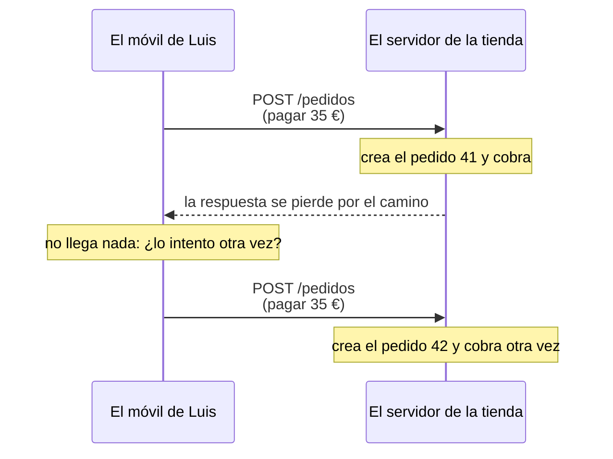

import Term from '~/components/Term.astro';
import TryIt from '~/components/TryIt.astro';
import Analogy from '~/components/Analogy.astro';
import SelfCheck from '~/components/SelfCheck.astro';
import Quiz from '~/components/Quiz.astro';
import QuizQuestion from '~/components/QuizQuestion.astro';
import QuizOption from '~/components/QuizOption.astro';

## El problema

Imagina que Luis está pagando un pedido en la tienda desde el tren. Pulsa «Pagar», el móvil se queda pensando y no pasa nada. Lo vuelve a pulsar. ¿Le cobran dos veces? Depende de cómo hable su móvil con el servidor, y de lo que el servidor haya prometido.

Otro caso, este real. Una gran web de un gobierno se quedó de golpe sin contenido. No fue un ataque: el robot de Google la recorrió siguiendo enlaces, como hace siempre, y entre ellos había enlaces para borrar páginas. Los siguió todos. Eran para los editores, pero la web solo los protegía con una <Term id="cookie">cookie</Term> y con JavaScript, y el robot no usa ninguno de los dos. Lo contó [The Daily WTF](https://thedailywtf.com/articles/The_Spider_of_Doom) en 2006 (en inglés).

Los dos tienen la misma raíz: una petición que se repite, o que envía alguien que no eres tú. HTTP lo resuelve con la primera palabra de cada petición, el método. En la [Fase 0](/fase-0/que-es-un-protocolo/) solo escribiste `GET`; ahora estás del lado que responde, y decides qué métodos aceptas y qué contestas a los demás.

## La analogía

<Analogy>

Piensa en la ventanilla de un banco. Puedes pedir varias cosas, y cada una se pide con su impreso:

- **Consultar el saldo.** Lo puedes pedir diez veces: la cuenta no cambia.
- **Hacer un ingreso.** Cada impreso que entregas es otro ingreso. Si lo entregas dos veces, ingresas dos veces.
- **Cambiar tu dirección por la del impreso.** Si lo entregas dos veces, la dirección acaba siendo la misma.
- **Cerrar la cuenta.** La segunda vez, el empleado te dice «ya está cerrada». La respuesta cambia, pero la cuenta acaba igual: cerrada.

Y si en la ventanilla de consultas intentas hacer un ingreso, el empleado no lo acepta, pero te dice qué se hace ahí: «aquí, solo consultas». Eso es un `405` con su <Term id="header">cabecera</Term> `Allow`.

<div slot="limits">

- El empleado mira qué haces. En HTTP, el método es una promesa que cumple, o no, quien programó el servidor: nada impide escribir un servidor que borre con un `GET`. Es lo que pasó en la web del gobierno.
- Un empleado entiende lo que quieres aunque traigas el impreso equivocado. Un servidor no adivina qué querías: si el método no le sirve, responde con un error.
- Algunos cambios se pueden repetir («mi teléfono es este») y otros no («súmame 10 €»). Con `PATCH`, que verás después, pasa lo mismo.

</div>

</Analogy>

## Cómo funciona de verdad

### El método es la primera palabra de la petición

Estas dos peticiones van a la misma dirección, pero piden cosas distintas:

```http
GET /productos HTTP/1.1
Host: localhost:8080
```

```http
POST /productos HTTP/1.1
Host: localhost:8080
Content-Type: application/json
Content-Length: 30

{"nombre":"Gorra","precio":15}
```

La primera pide la lista de productos. La segunda pide crear un producto nuevo, la gorra, con los datos que van en el <Term id="request-body">cuerpo de la petición</Term>, el que viste en la [lección 1, «Petición y respuesta»](/fase-2/peticion-y-respuesta-http/). La diferencia la marca la primera palabra, el <Term id="http-method">método</Term>.

La ruta dice **sobre qué** actúas, el recurso, y el método dice **qué haces** con él. Así podría ser la API completa de la tienda (hoy, su nginx solo contesta a `GET /productos`):

| Petición | Qué pide |
|---|---|
| `GET /productos` | La lista de productos |
| `POST /productos` | Crear un producto con los datos del cuerpo; el servidor le da un número |
| `GET /productos/2` | Un producto: la taza |
| `PUT /productos/2` | Sustituir la taza entera por lo que va en el cuerpo |
| `PATCH /productos/2` | Cambiar solo una parte de la taza, como el precio |
| `DELETE /productos/2` | Borrar la taza |

### Lo que promete cada método

Cada método tiene un significado fijado en el estándar de HTTP, el <Term id="rfc">RFC</Term> 9110, salvo `PATCH`, que llegó después con su propio RFC, el 5789. Estos son los que vas a usar:

| Método | Para qué | ¿Seguro? | ¿Idempotente? | ¿Suele llevar cuerpo? |
|---|---|---|---|---|
| `GET` | Leer un recurso | Sí | Sí | No |
| `HEAD` | Lo mismo que `GET`, pero solo las cabeceras | Sí | Sí | No |
| `OPTIONS` | Preguntar qué se puede hacer con un recurso | Sí | Sí | No |
| `POST` | Enviar datos para que el servidor haga algo: crear, pagar, enviar un mensaje | No | No | Sí |
| `PUT` | Sustituir un recurso entero, o crearlo en una ruta que eliges tú | No | Sí | Sí |
| `PATCH` | Cambiar una parte de un recurso | No | No siempre | Sí |
| `DELETE` | Borrar un recurso | No | Sí | No |

El RFC 9110 define dos más, `CONNECT` y `TRACE`, que no vas a usar, y solo obliga a aceptar `GET` y `HEAD`. Las columnas «¿Seguro?» e «¿Idempotente?» son sus promesas, y merecen una sección cada una.

### Seguro: solo lee

Pide `GET /productos` cien veces: la lista sigue igual. Eso es un <Term id="safe-method">método seguro</Term>: uno que no pide ningún cambio en el servidor.

Algo pasa: cada `GET` añade una línea al <Term id="log">registro</Term> del servidor. Pero no es un cambio que el cliente haya pedido.

**Por qué importa:** muchos programas hacen `GET` sin preguntarte.

- Los robots de los buscadores siguen todos los enlaces que encuentran.
- Las apps de mensajería piden la página cuando pegas un enlace, para enseñar la vista previa.
- Algunos filtros de correo abren los enlaces de los mensajes para comprobar si son peligrosos.
- El navegador puede pedir por adelantado páginas que cree que vas a visitar.

Todos confían en que `GET` no cambia nada. Un enlace siempre es un `GET`, así que un enlace «Borrar» rompe esa confianza: es la historia de la web del gobierno.

### Idempotente: repetirla no cambia el resultado

Ahora borra la taza dos veces. El primer `DELETE /productos/2` la borra, y el servidor responde que todo ha ido bien. El segundo no encuentra nada que borrar, y responde `404`, «eso no existe». Las respuestas son distintas, pero la tienda ha quedado igual las dos veces: sin taza.

Una petición es <Term id="idempotent">idempotente</Term> si hacerla una vez o diez deja el servidor igual. Fíjate en que se mide el efecto, no la respuesta. `PUT` también lo es: sustituir la taza por los mismos datos dos veces la deja igual. Y todos los métodos seguros lo son, porque no cambian nada.

`POST` no lo es: cada `POST /pedidos` crea un pedido nuevo. Y eso es lo que le puede pasar a Luis en el tren:



**Por qué importa:** las redes fallan. Si la respuesta no llega, el cliente no sabe si su petición llegó o no. Con un método idempotente puede repetirla sin miedo; con uno que no lo es, repetir puede duplicar. Por eso el estándar pide que los programas no repitan solos una petición que no es idempotente.

Si un `POST` tiene que poder repetirse, como un pago, el cliente manda con él una clave única; si el servidor ve la misma clave dos veces, devuelve el primer resultado sin cobrar otra vez. Así lo hacen APIs de pago como la de Stripe.

### PUT sustituye, PATCH cambia una parte

Ahora la taza está así: `{"id":2,"nombre":"Taza","precio":8.5}`. Ana quiere subirle el precio a 9 €. Hay tres formas de pedirlo, y no dan lo mismo:

| Petición | Cuerpo | Cómo queda la taza |
|---|---|---|
| `PUT /productos/2` | `{"nombre":"Taza","precio":9}` | `{"id":2,"nombre":"Taza","precio":9}` |
| `PUT /productos/2` | `{"precio":9}` | `{"id":2,"precio":9}`: ha perdido el nombre |
| `PATCH /productos/2` | `{"precio":9}` | `{"id":2,"nombre":"Taza","precio":9}` |

**`PUT` sustituye el recurso entero** por lo que envías. Si solo envías el precio, el resto desaparece. **`PATCH` solo cambia lo que envías** y deja el resto como estaba.

¿Y es `PATCH` idempotente? «El precio es 9» sí lo es: repetirlo deja 9. Pero «suma una unidad al stock» no, y también se puede pedir con `PATCH`. Por eso el estándar no lo promete.

### HEAD y OPTIONS: preguntar sin pedir el contenido

`HEAD` es un `GET` sin contenido: el servidor responde con las mismas cabeceras, pero sin el cuerpo. Sirve para saber si algo existe, cuánto ocupa (`Content-Length`) o de qué tipo es, sin descargarlo. `curl -I` envía un `HEAD`.

`OPTIONS` pregunta: «¿qué puedo hacer con esto?». La respuesta debería llevar la cabecera `Allow`, con la lista de métodos que acepta ese recurso. Casi nunca lo envía una persona: lo envía el navegador solo, antes de ciertas peticiones a otras webs. Lo verás en la [lección 6, «CORS»](/fase-2/que-es-cors/).

### El 405 y la cabecera Allow

Si un recurso no admite un método, el servidor responde `405 Method Not Allowed`, «método no permitido». No es un `404`: el recurso existe.

El estándar es claro: un `405` **tiene que llevar** la cabecera `Allow`, con los métodos que sí acepta. Así, quien recibe el error sabe qué puede hacer. Pero no todos los servidores lo cumplen:

| Servidor | Respuesta a un `POST` | ¿Lleva `Allow`? |
|---|---|---|
| backenddesdecero.com (Cloudflare) | `405` | No |
| nginx sirviendo ficheros, como la página de bienvenida del puerto 80 de tu VM | `405 Not Allowed` | No |
| nginx con la configuración de la tienda, en `/productos` | `405 Not Allowed` | Sí: `Allow: GET, HEAD` |

La tienda la lleva porque su configuración la añade a mano, con `add_header Allow`. (`Not Allowed` es la frase de nginx; lo que cuenta es el número.)

## Pruébalo

El objetivo: averiguar qué métodos acepta cada servidor y cuál de los dos cumple la regla del `Allow`. Después harás que el nginx de la tienda la incumpla, y lo arreglarás.

### En tu ordenador: el sitio del curso

Estas tres órdenes van en tu ordenador. Las salidas son de un Mac; en Linux y WSL salen igual.

<TryIt
  title="1. Pide solo las cabeceras"
  cmd="curl -sI https://backenddesdecero.com/"
  output={`HTTP/2 200
date: Mon, 12 Oct 2026 18:42:13 GMT
content-type: text/html
cf-cache-status: HIT
cache-control: public, max-age=0, must-revalidate
…
server: cloudflare
cf-ray: a4983e43180fc69e-MAD
alt-svc: h3=":443"; ma=86400`}
>

`-I` envía un `HEAD`, y `-s` quita los mensajes de progreso de `curl`. Llegan las cabeceras de la portada, pero ni una línea de HTML: el `200` dice que la página existe, sin descargarla.

Salen en minúsculas porque `curl` habla HTTP/2 con este sitio (lo verás en la [lección 8](/fase-2/http2-http3/)). Hemos quitado dos cabeceras largas de Cloudflare (`…`); tus fechas y tu `cf-ray` serán otros.

</TryIt>

<TryIt
  title="2. Intenta enviarle algo"
  cmd="curl -si -X POST https://backenddesdecero.com/"
  output={`HTTP/2 405
date: Mon, 12 Oct 2026 18:42:16 GMT
content-length: 0
…
server: cloudflare
cf-ray: a4983e55ece8c3b2-MAD
alt-svc: h3=":443"; ma=86400`}
>

`-X POST` cambia el método, e `-i` enseña las cabeceras de la respuesta delante del contenido. Fíjate en dos cosas:

- El `405`: el sitio es estático, solo sirve ficheros, y no tiene nada que hacer con lo que le envías.
- Lo que falta: ninguna cabecera `allow`. Este sitio no cumple la regla, y quien reciba el error no sabe qué se acepta.

Si te sale un `200`, has olvidado el `-X POST`.

</TryIt>

Ahora, todos los métodos de una vez, con un bucle `for` como los de la [lección 8 de la Fase 1](/fase-1/scripts-de-bash/):

<TryIt
  title="3. Prueba todos los métodos"
  cmd={`for m in GET POST PUT PATCH DELETE OPTIONS; do
  curl -s -o /dev/null -w "$m %{http_code}\\n" -X $m https://backenddesdecero.com/
done`}
  output={`GET 200
POST 405
PUT 405
PATCH 405
DELETE 405
OPTIONS 405`}
>

`-o /dev/null` tira el contenido, y `-w` escribe al terminar el método y el <Term id="status-code">código de estado</Term>. Pega las tres líneas a la vez.

Solo `GET` funciona. Hasta `OPTIONS`, el método que sirve para preguntar qué se acepta, recibe un `405` que no dice nada. Y Cloudflare ni mira si el fichero existe: `POST /no-existe` también recibe un `405`, no un `404`.

</TryIt>

### En tu VM: el servidor de la tienda

Entra en la VM con `multipass shell curso`. Necesitas la configuración de la tienda, que se instala en [la introducción](/fase-2/). Si no tienes la VM, lee las salidas: son las de un Ubuntu 24.04 con nginx 1.24.0.

<TryIt
  title="4. La lista de productos"
  cmd="curl -i localhost:8080/productos"
  output={`HTTP/1.1 200 OK
Server: nginx/1.24.0 (Ubuntu)
Date: Mon, 12 Oct 2026 18:42:24 GMT
Content-Type: application/json
Content-Length: 122
Connection: keep-alive

[{"id":1,"nombre":"Camiseta","precio":20},{"id":2,"nombre":"Taza","precio":8.5},{"id":3,"nombre":"Sudadera","precio":35}]`}
>

Un `GET`: los tres productos, en <Term id="json">JSON</Term>, con `Content-Length: 122`. Aquí `curl` habla HTTP/1.1, y las cabeceras van con mayúsculas.

Si sale `Couldn't connect to server`, nginx no escucha en el puerto 8080: comprueba que instalaste la configuración de la tienda y que `systemctl is-active nginx` dice `active`.

</TryIt>

<TryIt
  title="5. Lo mismo, con HEAD"
  cmd="curl -I localhost:8080/productos"
  output={`HTTP/1.1 200 OK
Server: nginx/1.24.0 (Ubuntu)
Date: Mon, 12 Oct 2026 18:42:24 GMT
Content-Type: application/json
Content-Length: 122
Connection: keep-alive`}
>

Las mismas cabeceras, `Content-Length: 122` incluida, pero sin la lista: dice cuánto ocuparía con un `GET`.

</TryIt>

<TryIt
  title="6. Intenta crear un producto"
  cmd="curl -i -X POST localhost:8080/productos"
  output={`HTTP/1.1 405 Not Allowed
Server: nginx/1.24.0 (Ubuntu)
Date: Mon, 12 Oct 2026 18:42:24 GMT
Content-Type: text/html; charset=utf-8
Content-Length: 166
Connection: keep-alive
Allow: GET, HEAD

<html>
<head><title>405 Not Allowed</title></head>
<body>
<center><h1>405 Not Allowed</h1></center>
<hr><center>nginx/1.24.0 (Ubuntu)</center>
</body>
</html>`}
>

El mismo `405` que en backenddesdecero.com, pero esta vez con `Allow: GET, HEAD`: este recurso solo se puede leer. El HTML es la página de error de nginx, para los navegadores.

Con `-X PUT`, `-X DELETE` u `-X OPTIONS` sale lo mismo: esta configuración no atiende `OPTIONS`, que no es obligatorio, pero su `405` ya dice qué se acepta.

</TryIt>

### Rompe la regla y arréglala

Vas a quitarle a la tienda su cabecera `Allow`, para ver que la pone tu configuración y no nginx. Abre el fichero:

<TryIt title="7. Abre la configuración" cmd="sudo nano /etc/nginx/sites-available/tienda" />

Busca la línea con <kbd>Ctrl</kbd> + <kbd>W</kbd>, escribe `add_header Allow` y pulsa Enter. Pon un `#` delante para convertirla en un comentario, una línea que nginx no lee:

```nginx
    location = /productos {
        if ($request_method !~ ^(GET|HEAD)$) {
            # add_header Allow "GET, HEAD" always;
            return 405;
        }
```

Guarda con <kbd>Ctrl</kbd> + <kbd>O</kbd> y <kbd>Enter</kbd>, y sal con <kbd>Ctrl</kbd> + <kbd>X</kbd>. Después, comprueba y aplica el cambio:

<TryIt
  title="8. Comprueba y recarga"
  cmd="sudo nginx -t && sudo systemctl reload nginx"
  output={`nginx: the configuration file /etc/nginx/nginx.conf syntax is ok
nginx: configuration file /etc/nginx/nginx.conf test is successful`}
>

`nginx -t` revisa la configuración, y `&&` solo deja pasar el `reload` si la revisión ha ido bien. `reload` aplica el cambio sin cortar a nadie, y no escribe nada si funciona.

Si sale `test failed`, abre otra vez el fichero y comprueba que solo has añadido el `#`.

</TryIt>

<TryIt
  title="9. El mismo POST, otra vez"
  cmd="curl -i -X POST localhost:8080/productos"
  output={`HTTP/1.1 405 Not Allowed
Server: nginx/1.24.0 (Ubuntu)
Date: Mon, 12 Oct 2026 18:42:32 GMT
Content-Type: text/html; charset=utf-8
Content-Length: 166
Connection: keep-alive

<html>
<head><title>405 Not Allowed</title></head>
<body>
<center><h1>405 Not Allowed</h1></center>
<hr><center>nginx/1.24.0 (Ubuntu)</center>
</body>
</html>`}
>

Sin `Allow`: tu tienda ya contesta como backenddesdecero.com. Si todavía sale, repite la orden: justo después del `reload`, nginx tarda un instante en dejar de responder con la configuración anterior.

</TryIt>

Ahora, déjala como estaba: vuelve a abrir el fichero con `sudo nano /etc/nginx/sites-available/tienda`, borra el `#`, guarda y repite el paso 8. Con el paso 6 compruebas que `Allow: GET, HEAD` ha vuelto.

<SelfCheck question="Reto: la portada de la tienda responde 200 OK a curl -i -X DELETE localhost:8080/. ¿Ha borrado algo? ¿Por qué responde así?">

No ha borrado nada. Esta es la respuesta:

```
HTTP/1.1 200 OK
Server: nginx/1.24.0 (Ubuntu)
Date: Mon, 12 Oct 2026 18:42:24 GMT
Content-Type: text/plain; charset=utf-8
Content-Length: 99
Connection: keep-alive

Tienda de Ana y Luis. Prueba /productos, /ofertas, /carrito, /api/pedidos, /img/ y /mantenimiento.
```

Busca `location = /` en la configuración: hace `return 200` con el texto de la portada y no mira el método, así que responde lo mismo a todos. `/productos`, en cambio, tiene el `if` que comprueba `$request_method`.

Un programa que envíe ese `DELETE` creerá que ha funcionado. Lo correcto sería un `405` con `Allow: GET, HEAD`, como en `/productos`.

</SelfCheck>

## Ya lo has visto

- **Recargar después de enviar un formulario.** El navegador te pregunta si quieres volver a enviarlo: esa página llegó con un `POST`, y repetirlo puede duplicar lo que hiciste.
- **En DevTools** ([cómo abrirlo](/fase-2/)). En la pestaña **Red** (*Network*), haz clic en una petición: en **Encabezados** (*Headers*; en Firefox, «Cabeceras»), **Método de solicitud** (*Request Method*) dice su método. En Chrome, con clic derecho sobre los títulos de las columnas puedes añadir la columna **Método** (*Method*); Firefox ya la enseña.

Y si programas:

- `fetch(url)` hace un `GET` si no le dices otra cosa; para otro método, `fetch(url, { method: 'DELETE' })`.
- Un formulario HTML solo envía `GET` y `POST`. Por eso Rails o Laravel simulan `PUT` y `DELETE` con un campo oculto, `_method`.
- TanStack Query (React Query) repite tres veces una consulta que falla, pero una mutación, ninguna: leer se puede repetir, cambiar quizá no.

## Errores comunes

- **Cambiar cosas con `GET`.** Un enlace «Borrar» lo seguirá cualquier robot, vista previa o filtro de correo. Lo que cambia algo va con `POST`, `PUT`, `PATCH` o `DELETE`.
- **Creer que idempotente significa «misma respuesta».** El segundo `DELETE` puede responder `404`, y sigue siendo idempotente: lo que no cambia es el estado del servidor.
- **Un `PUT` con solo los campos que cambian.** El servidor sustituye el recurso entero y se pierden los demás. Para cambiar una parte, `PATCH`.
- **Confundir «seguro» con protegido.** Un método seguro es uno que solo lee; no tiene nada que ver con proteger tus datos.
- **`curl -X HEAD`.** `curl` avisa (`Warning: Setting custom HTTP method to HEAD with -X/--request may not work the way you want. Consider using -I/--head instead.`) y, con HTTP/1.1, como en la VM, se queda esperando un contenido que no va a llegar. Usa `curl -I`.
- **Un `405` sin `Allow`, o un `200` a todo.** Si un recurso no admite un método, responde `405` y di cuáles admite; un `200`, como el del reto, hace creer que ha funcionado.

## Resumen

- El método dice qué haces con un recurso: `GET` lee, `POST` envía datos para crear o hacer algo, `PUT` sustituye, `PATCH` cambia una parte y `DELETE` borra.
- Seguro significa que solo lee; idempotente, que repetirlo deja el servidor igual. `GET`, `HEAD`, `PUT` y `DELETE` se pueden repetir sin miedo; `POST`, no.
- `HEAD` trae las cabeceras sin el contenido, y `OPTIONS` pregunta qué métodos acepta un recurso.
- Un `405` debe llevar `Allow` con los métodos aceptados, aunque no todos los servidores lo cumplen.
- En la Fase 3 escribirás un servidor en código, y para cada ruta y cada método decidirás tú qué hace y qué responde.

## ¿Lo has entendido?

<Quiz>

<QuizQuestion
  question="El formulario de contacto de la tienda envía un POST /mensajes. Ana pulsa «Enviar» dos veces porque la página no responde. Si el servidor no ha previsto nada, ¿qué puede pasar?"
  review="Idempotente: repetirla no cambia el resultado"
>

<QuizOption text="Nada: el servidor ve que es la misma petición y descarta la segunda.">

Un servidor no reconoce las peticiones repetidas por su cuenta. Para eso, el cliente tiene que mandar una clave única y el servidor tiene que comprobarla.

</QuizOption>

<QuizOption text="Que la tienda reciba el mensaje dos veces." correct>

`POST` no es idempotente: cada uno pide un mensaje nuevo. Por eso las APIs de pago usan una clave única que les deja reconocer la repetición.

</QuizOption>

<QuizOption text="Que el navegador bloquee el segundo POST: nunca envía uno repetido.">

El navegador solo avisa cuando recargas una página que vino de un `POST`. Si pulsas un botón dos veces, envía las dos peticiones.

</QuizOption>

</QuizQuestion>

<QuizQuestion
  question="Una web de notas tiene, junto a cada nota, un enlace «Borrar» que lleva a /notas/7/borrar. ¿Qué riesgo tiene?"
  review="Seguro: solo lee"
>

<QuizOption text="Que un robot o una vista previa siga el enlace y borre la nota." correct>

Un enlace es un `GET`, y los robots, las vistas previas y algunos filtros de correo hacen `GET` sin preguntar, porque confían en que no cambia nada.

</QuizOption>

<QuizOption text="Ninguno: los robots de los buscadores solo leen el texto, no siguen enlaces.">

Seguir enlaces es justo lo que hacen: así encuentran las páginas. Es lo que le pasó a la web del gobierno de «El problema».

</QuizOption>

<QuizOption text="Ninguno: el navegador pide confirmación antes de seguir un enlace que borra.">

El navegador no sabe qué hace el servidor con un enlace: lo sigue sin preguntar. Solo pide confirmación al repetir un `POST`.

</QuizOption>

</QuizQuestion>

<QuizQuestion
  question="Tu perfil tiene nombre, email y foto. Envías PUT /perfil con un cuerpo que solo trae el email nuevo. Si el servidor cumple el estándar, ¿cómo queda el perfil?"
  review="PUT sustituye, PATCH cambia una parte"
>

<QuizOption text="Con su nombre, su foto y el email nuevo: PUT cambia solo lo que envías.">

Eso es lo que hace `PATCH`. `PUT` sustituye el recurso entero por lo que envías.

</QuizOption>

<QuizOption text="Igual que antes: PUT solo sirve para crear recursos, no para cambiarlos.">

`PUT` sustituye un recurso si existe, y lo crea si no. Aquí el perfil existe, así que lo sustituye.

</QuizOption>

<QuizOption text="Solo con el email: el nombre y la foto se pierden." correct>

`PUT` sustituye el perfil entero por el cuerpo, y el cuerpo solo trae el email. Para cambiar solo el email, `PATCH`.

</QuizOption>

</QuizQuestion>

<QuizQuestion
  question="Una app envía dos veces DELETE /fotos/7. La primera respuesta dice que todo ha ido bien y la segunda es un 404. ¿Es DELETE idempotente?"
  review="Idempotente: repetirla no cambia el resultado"
>

<QuizOption text="No: si lo fuera, las dos respuestas serían iguales.">

La idempotencia se mide en el estado del servidor, no en la respuesta. Las dos veces, la foto acaba borrada.

</QuizOption>

<QuizOption text="Sí: la foto acaba borrada igual, aunque cambie la respuesta." correct>

Borrar una vez o diez deja el mismo resultado. Que la segunda diga `404` solo cuenta que ya no había nada que borrar.

</QuizOption>

<QuizOption text="No: la segunda vez tendría que ser un 405, porque ya no se puede borrar.">

`405` significa que el recurso no admite ese método. Aquí el recurso ya no existe, y eso es un `404`.

</QuizOption>

</QuizQuestion>

<QuizQuestion
  question="Tu API de productos solo deja leer. Un programa le envía un POST y recibe un 405 sin ninguna otra cabecera. ¿Qué le falta a tu respuesta?"
  review="El 405 y la cabecera Allow"
>

<QuizOption text="La cabecera Allow, con los métodos que sí acepta." correct>

El estándar obliga a que un `405` lleve `Allow`. Sin ella, el programa no sabe qué puede hacer, como pasaba con backenddesdecero.com.

</QuizOption>

<QuizOption text="Nada: Allow es opcional, una cortesía que cada servidor decide.">

Con un `405`, el RFC 9110 dice que el servidor tiene que enviarla. Que muchos no lo hagan no la convierte en opcional.

</QuizOption>

<QuizOption text="El código correcto: para un método no admitido, lo que toca es un 404.">

`404` dice que el recurso no existe, y aquí existe: lo que no admite es ese método. Eso es un `405`.

</QuizOption>

</QuizQuestion>

<QuizQuestion
  question="Quieres saber cuánto ocupa un vídeo de 2 GB de un servidor sin descargarlo. ¿Qué petición haces?"
  review="HEAD y OPTIONS: preguntar sin pedir el contenido"
>

<QuizOption text="Un OPTIONS: le pregunta al servidor los datos del fichero.">

`OPTIONS` pregunta qué métodos acepta un recurso, no cuánto ocupa.

</QuizOption>

<QuizOption text="Un GET, cortándolo al llegar las cabeceras: es el único método que las trae.">

`HEAD` trae las mismas cabeceras que `GET`, sin el contenido. No hace falta empezar a descargar nada.

</QuizOption>

<QuizOption text="Un HEAD, con curl -I, y mirar su Content-Length." correct>

`HEAD` devuelve las cabeceras que daría un `GET`, sin el cuerpo, y `Content-Length` dice cuántos bytes ocuparía.

</QuizOption>

</QuizQuestion>

</Quiz>

## Para profundizar

- [Métodos de petición HTTP](https://developer.mozilla.org/es/docs/Web/HTTP/Reference/Methods) (MDN): una página por método, con ejemplos.
- [405 Method Not Allowed](https://developer.mozilla.org/es/docs/Web/HTTP/Reference/Status/405) (MDN): el código y su cabecera `Allow`.
- [RFC 9110, sección 9: Methods](https://www.rfc-editor.org/rfc/rfc9110.html#name-methods) (en inglés): dónde se definen los métodos, qué es seguro y qué es idempotente.
- [RFC 5789: PATCH](https://www.rfc-editor.org/rfc/rfc5789.html) (en inglés): el método `PATCH` y por qué no se promete idempotente.
- [Idempotent requests](https://docs.stripe.com/api/idempotent_requests) (Stripe, en inglés): cómo una API de pagos deja repetir un `POST` sin cobrar dos veces.
