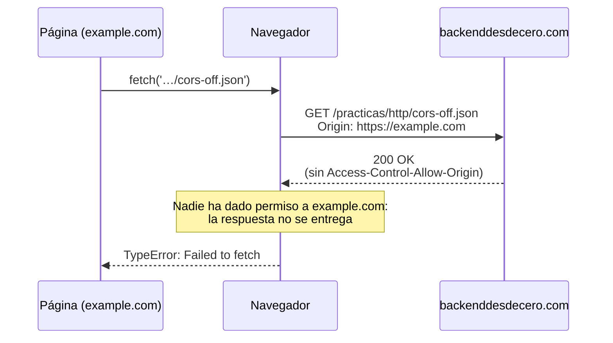
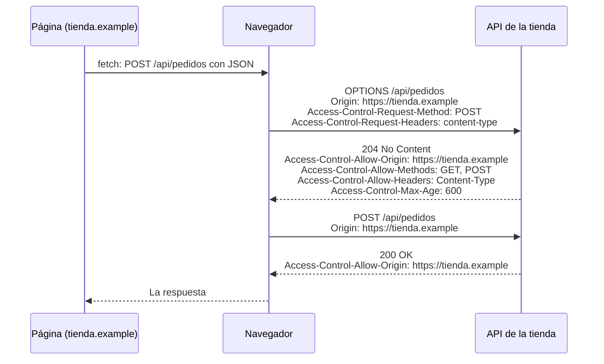

import Term from '~/components/Term.astro';
import TryIt from '~/components/TryIt.astro';
import Analogy from '~/components/Analogy.astro';
import SelfCheck from '~/components/SelfCheck.astro';
import Quiz from '~/components/Quiz.astro';
import QuizQuestion from '~/components/QuizQuestion.astro';
import QuizOption from '~/components/QuizOption.astro';
import CorsLab from '~/playgrounds/cors-lab/CorsLab';

## El problema

Imagina que Luis, el de la tienda, publica la web nueva. La página vive en `https://tienda.example`, y los pedidos los da una <Term id="api">API</Term> en otro servidor, `https://api.tienda.example`. Luis pulsa «Mis pedidos» y no pasa nada. En la consola del navegador hay una línea roja:

```text
Access to fetch at 'https://api.tienda.example/pedidos' from origin 'https://tienda.example' has been blocked by CORS policy: No 'Access-Control-Allow-Origin' header is present on the requested resource.
```

Luis prueba la misma dirección con `curl` y responde perfectamente. La pega en la barra del navegador y también. Entonces, ¿quién la bloquea? **No es el servidor: es el navegador**, que ha recibido la respuesta y no deja que la página la lea.

Muchos arreglos que circulan lo empeoran. Aquí verás por qué pasa y cómo se arregla: en el servidor.

## La analogía

<Analogy>

Imagina un asistente que hace recados y acepta encargos de cualquiera que esté en tu casa, también de visitas que apenas conoces. Una visita le pide que vaya a tu banco y le traiga tu extracto. El asistente va, enseña tu carné y el banco le da el sobre.

Pero antes de entregarlo, el asistente mira el sello del sobre: «Se puede entregar a…». Si quien hizo el encargo no está en el sello, se guarda el sobre y le dice a la visita: «Esto no te lo puedo dar».

El asistente es tu navegador; las visitas, las páginas que abres; el banco, un servidor; el carné, tus <Term id="cookie">cookies</Term>; y el sello, una cabecera de la respuesta que se llama `Access-Control-Allow-Origin`.

<div slot="limits">

- **El recado se hace igual.** Si el encargo era «haz una transferencia», el banco la hace: el asistente solo se niega a entregar la respuesta. Por eso CORS no protege al servidor de las peticiones que no quiere.
- **Hay encargos raros por los que el asistente llama antes** al banco para preguntar si los acepta. Si el banco dice que no, no va. Es la petición previa, que verás enseguida.
- **Quien va al banco por su cuenta,** sin el asistente, recibe el sobre sin que nadie mire el sello: el sello solo obliga al asistente. Es lo que hace `curl`.
- **El asistente no siempre lleva tu carné:** depende de cómo te lo dio el banco y de si la visita lo pide expresamente.

</div>

</Analogy>

## Cómo funciona de verdad

### Un origen es esquema, nombre y puerto

Para el navegador, cada web tiene un <Term id="origin">origen</Term>: el esquema (`http` o `https`), el nombre del servidor y el <Term id="port">puerto</Term>. Si cambia cualquiera de los tres, es otro origen. Comparado con `https://tienda.example/productos`:

| Dirección | ¿Mismo origen? | Por qué |
|---|---|---|
| `https://tienda.example/carrito` | Sí | Solo cambia la ruta, y la ruta no cuenta |
| `http://tienda.example/productos` | No | Otro esquema: `http` en lugar de `https` |
| `https://www.tienda.example/` | No | Otro nombre: el `www` también cuenta |
| `https://api.tienda.example/pedidos` | No | Otro nombre, aunque sea de la misma empresa |
| `https://tienda.example:8443/` | No | Otro puerto: sin número, `https` usa el 443 |

El puerto por defecto de cada esquema lo viste en la [lección 3 de la Fase 0](/fase-0/que-es-un-protocolo/), y los puertos, en la [5](/fase-0/ip-puertos-y-sockets/).

### El navegador deja enviar, pero no leer

Imagina que tienes abierta la web de tu banco en una pestaña y, en otra, una página cualquiera. Esa página puede hacer que tu navegador envíe peticiones al banco: con un formulario, con una imagen que apunta a su dirección o con código.

Y algunas llevan tus cookies, las de la [lección 5](/fase-2/cookies-httponly-secure-samesite/). Un formulario o una imagen las llevan según cómo las marcó el banco (`SameSite`). Una petición hecha desde el código de la página (con `fetch`) solo las lleva a su propio origen, salvo que el código lo pida expresamente con `credentials: 'include'`.

Si esa página pudiera leer las respuestas, leería tu saldo con tu sesión. Para impedirlo existe la <Term id="same-origin-policy">política del mismo origen</Term>: **el código de una página puede enviar peticiones a otros orígenes, pero no leer sus respuestas**.

### CORS: el servidor da permiso para leer

A veces un servidor quiere que otros orígenes lean sus respuestas: la API de la tienda, para su página, o un servicio público, para cualquiera. Para eso existe <Term id="cors">CORS</Term>. Funciona con dos <Term id="header">cabeceras</Term>:

1. En cada petición a otro origen, el navegador añade `Origin`, con el origen de la página: `Origin: https://example.com`. El código de la página no puede cambiarla.
2. El servidor responde y, si quiere dar permiso, añade `Access-Control-Allow-Origin` con ese origen, o con `*`, que significa «cualquiera».

El navegador compara las dos. Si coinciden, entrega la respuesta a la página. Si no, o si la cabecera no está, la esconde, escribe el error en la consola y el código recibe `TypeError: Failed to fetch`. Es lo que harás en el Pruébalo, desde `example.com`:



Fíjate en el `200 OK`: **la petición llegó, y el servidor respondió**. Si hubiera sido un formulario que crea un pedido, el pedido estaría creado. CORS decide si la página lee la respuesta, no si la petición llega.

Que una página ajena haga cosas en tu nombre aprovechando tus cookies es un ataque con nombre propio, el <Term id="csrf">CSRF</Term>. Sus defensas, como `SameSite` o un código secreto en cada formulario, las verás en la Fase 6.

### Las peticiones no sencillas piden permiso antes

Mira otra vez el diagrama: la petición salió sin preguntar. El navegador hace eso solo con las peticiones **sencillas**, las que una web ya podía enviar con un formulario antes de que existiera CORS:

- el <Term id="http-method">método</Term> es `GET`, `HEAD` o `POST`;
- si lleva contenido, es de un formulario o texto plano, no <Term id="json">JSON</Term>;
- y no lleva cabeceras propias, como `Authorization`.

Las demás (un `PUT`, un `DELETE`, un `POST` con JSON, cualquier petición con `Authorization`) podrían sorprender a un servidor antiguo, que nunca las recibía de otra web. Así que el navegador pregunta antes con una <Term id="preflight">petición previa</Term> (*preflight*): una petición con el método `OPTIONS` que cuenta qué viene detrás. Si el servidor no la autoriza, **la petición de verdad no se envía**.

Así se ve con la API de la tienda, la que tienes en tu VM:



`Access-Control-Max-Age: 600` deja que el navegador recuerde el permiso 600 segundos, sin repetir la pregunta (cada navegador pone además su propio límite).

Si la petición previa falla, Chrome lo dice en el mensaje. Esto escribe al intentar un `DELETE` desde `example.com` a este mismo sitio, que no da permiso:

```text
Access to fetch at 'https://backenddesdecero.com/' from origin 'https://example.com' has been blocked by CORS policy: Response to preflight request doesn't pass access control check: No 'Access-Control-Allow-Origin' header is present on the requested resource.
```

«La respuesta a la petición previa no pasa la comprobación»: el `DELETE` nunca salió.

### Con cookies, el permiso lleva nombre

Si el código pide enviar cookies a otro origen (`credentials: 'include'`), el servidor tiene que cumplir dos cosas más, o el navegador esconde la respuesta:

- responder `Access-Control-Allow-Credentials: true`;
- y poner en `Access-Control-Allow-Origin` el origen exacto, nunca `*`.

La razón: `*` está pensado para datos públicos, que no cambian según quién los pida. Con cookies, la respuesta lleva datos de una persona concreta, y el servidor tiene que decir a quién se los confía.

### Lo aplica el navegador, no el servidor

El servidor no bloquea nada: responde y pone, o no, unas cabeceras. Quien las lee y decide es el navegador, porque es él quien ejecuta código ajeno con tus cookies.

`curl` no ejecuta páginas de nadie, y solo envía las cookies que tú le des. Por eso **con `curl` nunca verás un error de CORS**, y que una dirección funcione con `curl` no dice nada sobre si funcionará desde una página. Lo mismo pasa entre servidores: cuando tu backend llama a otra API, no hay navegador, y no hay CORS.

Así que el arreglo está en el servidor: que responda con las cabeceras correctas para los orígenes en los que confía.

## Pruébalo

El objetivo: averiguar quién bloquea de verdad, si el servidor o el navegador, y después abrir la API de la tienda a una página nueva. Para practicar hay dos ficheros en este sitio: `cors-on.json`, que da permiso a cualquier origen, y `cors-off.json`, que no se lo da a nadie.

### En el navegador

Abre `https://example.com` en Chrome y abre <Term id="devtools">DevTools</Term>, como en [la introducción de la fase](/fase-2/#antes-de-empezar-devtools). Ve a la pestaña **Consola** (*Console*). Lo que escribas ahí se ejecuta como si fuera código de la página, con el origen `https://example.com`.

Puede que, la primera vez que pegues algo, Chrome te pida escribir `permitir pegado` (en un Chrome en inglés, `allow pasting`). Es una protección contra las estafas que piden pegar código en la consola: hazlo solo con código que entiendas, como este.

<TryIt
  title="1. Un fichero que da permiso"
  lang="js"
  cmd={`await fetch('https://backenddesdecero.com/practicas/http/cors-on.json').then(r => r.json())`}
  output={`{cors: 'on', message: 'Any origin can read this file from JavaScript: its response carries Access-Control-Allow-Origin: *'}`}
>

Palabra a palabra:

- `fetch('…')` pide esa dirección, igual que lo haría el código de la página.
- `.then(r => r.json())`: cuando llegue la respuesta (`r`), lee su contenido como JSON.
- `await` espera a que todo termine, y la consola enseña el resultado.

La consola enseña el contenido del fichero como un objeto, en una línea (el triángulo de la izquierda lo despliega). La página ha leído un fichero de otro origen, porque su respuesta lleva `Access-Control-Allow-Origin: *`. Si te sale un error, comprueba que estás en la pestaña de `example.com`.

</TryIt>

<TryIt
  title="2. Un fichero que no da permiso"
  lang="js"
  cmd={`await fetch('https://backenddesdecero.com/practicas/http/cors-off.json').then(r => r.json())`}
  output={`Access to fetch at 'https://backenddesdecero.com/practicas/http/cors-off.json' from origin 'https://example.com' has been blocked by CORS policy: No 'Access-Control-Allow-Origin' header is present on the requested resource.`}
>

La misma línea, con otro fichero. Ahí está el error, en inglés en todos los Chrome: se ha bloqueado el acceso desde `https://example.com` porque el recurso no lleva la cabecera `Access-Control-Allow-Origin`. Salen otras dos líneas rojas: la de la petición fallida, con `net::ERR_FAILED`, y `TypeError: Failed to fetch`, que es lo que recibe el código.

En Firefox el mensaje es otro, pero nombra la misma cabecera.

</TryIt>

Ahora abre la pestaña **Red** (*Network*) y repite el paso 2. La petición a `cors-off.json` está en la lista: salió del navegador. En la columna de estado, Chrome escribe `Error CORS` (`CORS error` en inglés): no es un código del servidor, sino la decisión del navegador.

### En el laboratorio

El laboratorio enseña lo que DevTools no deja ver entero: cada paso entre la página, el navegador y el servidor, con sus cabeceras. Empieza por «El error de siempre», lo que acabas de provocar, y fíjate en que el servidor recibe el `GET` antes de que el navegador diga que no. Después prueba «Un POST con JSON», donde la petición real ni sale, y «El preflight aprobado», que es lo que hace la API de la tienda en la VM. En «La petición» y «El servidor» puedes cambiar cada detalle.

<CorsLab client:visible lang="es" />

### En la terminal

¿Y si le preguntas al servidor directamente, sin navegador?

<TryIt
  title="3. El mismo fichero, con curl"
  cmd="curl https://backenddesdecero.com/practicas/http/cors-off.json"
  output={`{
  "cors": "off",
  "message": "Only backenddesdecero.com can read this file from JavaScript: its response carries no Access-Control-Allow-Origin"
}`}
>

El fichero entero, sin errores. El servidor da la misma respuesta al navegador y a `curl`; la diferencia es que `curl` no aplica la política del mismo origen.

</TryIt>

<TryIt
  title="4. Busca el permiso en las cabeceras"
  cmd={`curl -sI https://backenddesdecero.com/practicas/http/cors-on.json | grep -i access-control
curl -sI https://backenddesdecero.com/practicas/http/cors-off.json | grep -i access-control`}
  output="access-control-allow-origin: *"
>

`-I` pide solo las cabeceras, `-s` quita los avisos de `curl`, y `grep -i` deja las líneas con `access-control`, sin mirar mayúsculas ([lección 2 de la Fase 1](/fase-1/comandos-linux-archivos/)). Sale una sola línea, la del primer fichero: esa ausencia en el segundo es todo el error del paso 2. Va en minúsculas porque `curl` habla HTTP/2 con este sitio ([lección 8](/fase-2/http2-http3/)).

</TryIt>

### En la VM: la API de la tienda

Ahora, del lado del servidor. Entra en la VM con `multipass shell curso`. Damos por hecho que instalaste la tienda en [la introducción de la fase](/fase-2/#antes-de-empezar-el-servidor-de-la-tienda): si `curl localhost:8080` no responde `Tienda de Ana y Luis…`, vuelve allí. Sin VM, lee las salidas: son las de un Ubuntu 24.04 con nginx 1.24.0.

<TryIt
  title="5. La API, vista por su página"
  cmd="curl -i -H 'Origin: https://tienda.example' localhost:8080/api/pedidos"
  output={`HTTP/1.1 200 OK
Server: nginx/1.24.0 (Ubuntu)
Date: Mon, 12 Oct 2026 19:10:10 GMT
Content-Type: application/json
Content-Length: 15
Connection: keep-alive
Access-Control-Allow-Origin: https://tienda.example
Vary: Origin

{"pedidos":[]}`}
>

`-H` añade una cabecera, aquí la `Origin` que pondría el navegador en la página de la tienda, e `-i` enseña las cabeceras de la respuesta. Fíjate en `Access-Control-Allow-Origin: https://tienda.example`: el permiso, con el origen exacto. `Vary: Origin` avisa a las <Term id="cache">cachés</Term> de que la respuesta puede cambiar según el `Origin`. Tu fecha será otra.

</TryIt>

<TryIt
  title="6. Un pedido desde otro origen"
  cmd={`curl -i -H 'Origin: https://otra.example' -d 'producto=1' localhost:8080/api/pedidos
sudo tail -n 1 /var/log/nginx/access.log`}
  output={`HTTP/1.1 200 OK
Server: nginx/1.24.0 (Ubuntu)
Date: Mon, 12 Oct 2026 19:10:10 GMT
Content-Type: application/json
Content-Length: 15
Connection: keep-alive
Access-Control-Allow-Origin: https://tienda.example
Vary: Origin

{"pedidos":[]}
::1 - - [12/Oct/2026:19:10:10 +0000] "POST /api/pedidos HTTP/1.1" 200 15 "-" "curl/8.5.0"`}
>

Te haces pasar por `https://otra.example`. Con `-d`, `curl` envía un `POST` con datos de formulario, como un formulario de HTML: una petición sencilla. nginx la atiende y la apunta en su registro, la última línea (`::1` es `localhost`).

El permiso es para `tienda.example`: un navegador en `otra.example` escondería la respuesta, pero el pedido ya estaría en el registro. Ese es el hueco que aprovecha el CSRF.

</TryIt>

<TryIt
  title="7. La petición previa"
  cmd="curl -i -X OPTIONS -H 'Origin: https://tienda.example' -H 'Access-Control-Request-Method: POST' -H 'Access-Control-Request-Headers: Content-Type' localhost:8080/api/pedidos"
  output={`HTTP/1.1 204 No Content
Server: nginx/1.24.0 (Ubuntu)
Date: Mon, 12 Oct 2026 19:10:10 GMT
Connection: keep-alive
Access-Control-Allow-Origin: https://tienda.example
Access-Control-Allow-Methods: GET, POST
Access-Control-Allow-Headers: Content-Type
Access-Control-Max-Age: 600
Vary: Origin`}
>

Es la pregunta que haría el navegador antes de un `POST` con JSON: «desde `https://tienda.example`, ¿puedo enviar un `POST` con la cabecera `Content-Type`?». nginx contesta con un `204` (sin contenido) y cuatro permisos: el origen, los métodos, las cabeceras y cuánto tiempo vale la respuesta. Son las líneas del bloque `if ($request_method = OPTIONS)` de la configuración.

</TryIt>

Ahora, el arreglo. Imagina que Luis publica la página también en `https://www.tienda.example`, y desde ahí sale el error: el `www` cuenta. Abre la configuración con `sudo nano /etc/nginx/sites-available/tienda` (el editor de la [lección 2 de la Fase 1](/fase-1/comandos-linux-archivos/)). Busca las dos líneas con `Access-Control-Allow-Origin` (<kbd>Ctrl</kbd> + <kbd>W</kbd> busca) y, en las dos, cambia `https://tienda.example` por `https://www.tienda.example`. Guarda y sal.

<TryIt
  title="8. Comprueba y recarga"
  cmd="sudo nginx -t && sudo systemctl reload nginx"
  output={`nginx: the configuration file /etc/nginx/nginx.conf syntax is ok
nginx: configuration file /etc/nginx/nginx.conf test is successful`}
>

Es el paso 3 de la introducción. Si `nginx -t` da un error con un número de línea, mira esa línea: lo más probable es una comilla borrada.

</TryIt>

<TryIt
  title="9. El nuevo origen, con permiso"
  cmd="curl -i -H 'Origin: https://www.tienda.example' localhost:8080/api/pedidos"
  output={`HTTP/1.1 200 OK
Server: nginx/1.24.0 (Ubuntu)
Date: Mon, 12 Oct 2026 19:10:16 GMT
Content-Type: application/json
Content-Length: 15
Connection: keep-alive
Access-Control-Allow-Origin: https://www.tienda.example
Vary: Origin

{"pedidos":[]}`}
>

El permiso ya nombra el origen nuevo: la página de `www` podría leer la respuesta. Si sigue saliendo el antiguo, espera un segundo y repítelo: `reload` tarda un momento.

Para dejarlo como estaba, haz el cambio al revés en las dos líneas y repite el paso 8.

</TryIt>

<SelfCheck question="Reto: Luis quiere que la API sirva a las dos páginas, con y sin www. ¿Le vale con poner los dos orígenes en Access-Control-Allow-Origin, separados por una coma?">

No. La cabecera admite un solo origen (o `*`): con dos, el navegador la da por mala y esconde la respuesta. Lo que se hace es comparar el `Origin` de cada petición con una lista y devolver el que coincide, con `Vary: Origin` para que las cachés no mezclen las respuestas. Lo harás en el código de tu servidor en la Fase 3.

</SelfCheck>

## Ya lo has visto

- **Las fuentes de Google Fonts** se cargan en webs de todo el mundo. Las fuentes se piden en modo CORS (el `crossorigin` de la [lección 9 de la Fase 0](/fase-0/que-pasa-cuando-escribes-una-url/)), y por eso `fonts.gstatic.com` responde con `access-control-allow-origin: *`.
- **Las imágenes de otras webs** se ven en cualquier página: mostrarlas está permitido. Leer su contenido desde el código, no.

Y si programas:

- `localhost:5173` y `localhost:3000` son orígenes distintos, porque cambia el puerto. Por eso tu frontend en desarrollo choca con CORS al llamar a tu backend. El `server.proxy` de Vite lo evita: el navegador pide a su mismo origen, y Vite reenvía la petición al backend.
- Un `fetch` con `Content-Type: application/json` o con `Authorization` provoca una petición previa: en la pestaña **Red** verás otra fila con la misma dirección y el tipo `preflight` («Solicitud preparatoria» en español).
- En axios, `credentials: 'include'` se llama `withCredentials: true`.

## Errores comunes

- **«CORS protege mi servidor».** Protege a quien usa el navegador, de que otras páginas lean sus datos. Una petición sencilla llega aunque se esconda la respuesta, y `curl` ni lo nota. Lo que no quieres se frena en el servidor (Fase 6).
- **Añadir `Access-Control-Allow-Origin` a la petición,** en el `fetch`. Es una cabecera de respuesta: en la petición no sirve de nada, y como es una cabecera propia, provoca una petición previa.
- **`mode: 'no-cors'` en el `fetch`.** El error desaparece, pero la respuesta llega opaca: sin estado, sin cabeceras y sin contenido que leer. Solo calla el aviso.
- **Desactivar la seguridad del navegador o instalar una extensión que «quita CORS».** Tus usuarios no la tendrán, y mientras la tengas, cualquier página que visites podría leer tus datos de otras webs.
- **Poner `*` en todo, o devolver cualquier `Origin` tal cual.** `*` vale para datos públicos sin cookies. Devolver el `Origin` que llegue, con `Access-Control-Allow-Credentials: true`, equivale a apagar la protección: compara siempre con una lista.
- **Un error de verdad disfrazado de CORS.** Si tu API falla con un `500` o un `404` sin las cabeceras CORS, la consola solo enseña el error de CORS. En nginx pasa con `add_header` sin `always`, que no la añade a las respuestas de error. Mira el <Term id="status-code">código de estado</Term> con `curl` antes de tocar nada.

## Resumen

- Un origen es esquema, nombre y puerto. Si cambia cualquiera de los tres, es otro origen.
- La política del mismo origen deja que una página envíe peticiones a otros orígenes, pero no que lea sus respuestas.
- CORS es el permiso que da el servidor con `Access-Control-Allow-Origin`, y el navegador lo comprueba. Una petición sencilla llega aunque se esconda la respuesta; las demás preguntan antes con `OPTIONS`, y sin permiso no se envían.
- Con cookies, el permiso tiene que nombrar el origen exacto, nunca `*`, y llevar `Access-Control-Allow-Credentials: true`.
- El error lo da el navegador, nunca `curl`, y se arregla en el servidor.

## ¿Lo has entendido?

<Quiz>

<QuizQuestion
  question="La página de la tienda está en https://tienda.example y su API en https://tienda.example:8443. ¿Necesita CORS la página para leer la API?"
  review="Un origen es esquema, nombre y puerto"
>

<QuizOption text="No: para ser otro origen tiene que cambiar el nombre del servidor.">

El origen son tres cosas: esquema, nombre y puerto. Aquí cambia el puerto, 443 por defecto contra 8443.

</QuizOption>

<QuizOption text="Sí: el puerto es distinto, así que es otro origen." correct>

Esquema, nombre y puerto tienen que coincidir. Sin número, `https` usa el 443, y la API está en el 8443: tiene que dar permiso con `Access-Control-Allow-Origin`.

</QuizOption>

<QuizOption text="No: el puerto solo forma parte del origen en HTTP sin cifrar.">

El puerto cuenta igual con `https`. El 443 no se escribe porque es el de por defecto, y el 8443 sí.

</QuizOption>

</QuizQuestion>

<QuizQuestion
  question="Una página de otra web envía un formulario a /api/pedidos de la tienda, con un POST normal. La API no da permiso CORS a ese origen. ¿Qué pasa con el pedido?"
  review="El navegador deja enviar, pero no leer"
>

<QuizOption text="Se crea: la petición llega; la página no lee la respuesta." correct>

Un formulario es una petición sencilla: el navegador la envía sin preguntar. CORS decide si el código de una página lee la respuesta, no si la petición llega. Frenar esas peticiones es cosa de las defensas contra el CSRF.

</QuizOption>

<QuizOption text="No se crea: sin permiso CORS, el navegador no envía la petición.">

Eso pasa con las peticiones que necesitan petición previa. Un `POST` de formulario es sencillo: sale sin preguntar a nadie.

</QuizOption>

<QuizOption text="No se crea: el servidor rechaza la petición con un error de CORS.">

El servidor no da errores de CORS: responde y pone, o no, unas cabeceras. Quien decide es el navegador, y para entonces el servidor ya ha atendido la petición.

</QuizOption>

</QuizQuestion>

<QuizQuestion
  question="Tu página hace un fetch con el método DELETE a una API de otro origen. La API responde al OPTIONS con un 405 y sin cabeceras CORS. ¿Llega el DELETE al servidor?"
  review="Las peticiones no sencillas piden permiso antes"
>

<QuizOption text="Sí: el navegador lo envía, y después esconde la respuesta.">

Eso pasa con las peticiones sencillas. Un `DELETE` no lo es: el navegador pregunta antes con `OPTIONS` y espera el permiso.

</QuizOption>

<QuizOption text="Sí: el OPTIONS y el DELETE salen a la vez, y el navegador solo mira las respuestas.">

Salen uno detrás de otro: el `DELETE` espera a la respuesta del `OPTIONS`, que existe para preguntar antes de enviar.

</QuizOption>

<QuizOption text="No: si la petición previa falla, la petición de verdad no se envía." correct>

Sin permiso, el navegador no envía el `DELETE`, y Chrome lo dice: `Response to preflight request doesn't pass access control check`.

</QuizOption>

</QuizQuestion>

<QuizQuestion
  question="Luis prueba su API con curl y responde bien, pero desde la página sale el error de CORS. ¿Qué concluye?"
  review="Lo aplica el navegador, no el servidor"
>

<QuizOption text="Que falta el permiso, y tiene que ponerlo el servidor." correct>

`curl` no aplica la política del mismo origen, así que funciona con permiso o sin él. El navegador sí la aplica, y el arreglo es que el servidor responda con `Access-Control-Allow-Origin`.

</QuizOption>

<QuizOption text="Que el fallo está en su navegador, y en otro funcionará.">

Cualquier navegador esconde las respuestas sin permiso, y la cabecera que falta solo la puede poner el servidor.

</QuizOption>

<QuizOption text="Que el servidor distingue a curl del navegador, y solo bloquea al navegador.">

El servidor da la misma respuesta a los dos, como viste en el paso 3 del Pruébalo.

</QuizOption>

</QuizQuestion>

<QuizQuestion
  question="La API responde Access-Control-Allow-Origin: *, y la página hace un fetch con credentials: 'include' para que vaya su cookie. ¿Qué pasa?"
  review="Con cookies, el permiso lleva nombre"
>

<QuizOption text="Funciona: el asterisco permite cualquier origen, con cookies o sin ellas.">

Con cookies, el asterisco no vale: el navegador exige el origen exacto y `Access-Control-Allow-Credentials: true`.

</QuizOption>

<QuizOption text="El navegador no envía la petición, porque con asterisco nunca se mandan cookies.">

El navegador no conoce el asterisco hasta que llega la respuesta. Si la petición es sencilla, sale, con la cookie si su `SameSite` lo permite; lo que hace es esconder la respuesta.

</QuizOption>

<QuizOption text="El navegador esconde la respuesta: con cookies, el asterisco no vale." correct>

Con cookies, la respuesta es de una persona concreta: el servidor tiene que nombrar el origen exacto y responder `Access-Control-Allow-Credentials: true`.

</QuizOption>

</QuizQuestion>

<QuizQuestion
  question="Para quitar el error, alguien añade mode: 'no-cors' al fetch. El error desaparece. ¿Ya puede leer la respuesta?"
  review="Errores comunes"
>

<QuizOption text="Sí: no-cors le pide al navegador que no aplique CORS a esa petición.">

`no-cors` no apaga nada: le dice al navegador que la página acepta no leer la respuesta. Por eso no hay error.

</QuizOption>

<QuizOption text="No: la respuesta llega opaca; solo se ha callado el error." correct>

Con `no-cors`, el código recibe una respuesta opaca: sin estado, sin cabeceras y sin contenido. El arreglo de verdad es que el servidor dé permiso.

</QuizOption>

<QuizOption text="Sí, siempre que el servidor responda con un 200.">

Con `no-cors`, la página no ve ni siquiera ese `200`: la respuesta llega opaca.

</QuizOption>

</QuizQuestion>

</Quiz>

## Para profundizar

- [CORS en MDN](https://developer.mozilla.org/es/docs/Web/HTTP/Guides/CORS): la guía completa, con todas las cabeceras.
- [Errores de CORS en MDN](https://developer.mozilla.org/es/docs/Web/HTTP/Guides/CORS/Errors): cada mensaje de error, con su causa.
- [Política del mismo origen en MDN](https://developer.mozilla.org/es/docs/Web/Security/Defenses/Same-origin_policy): qué se puede incrustar, enviar y leer.
- [El protocolo CORS en el estándar Fetch](https://fetch.spec.whatwg.org/#http-cors-protocol) (en inglés): las reglas exactas que siguen los navegadores.
