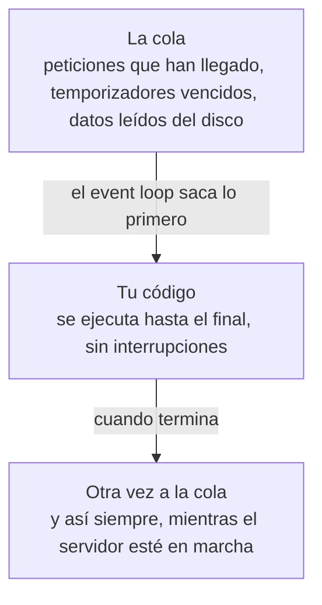
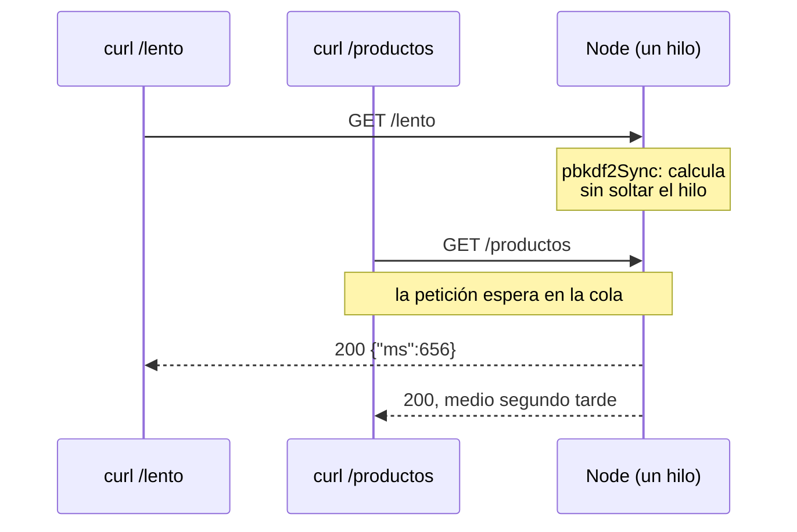
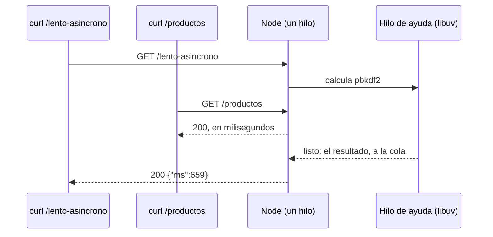

import Term from '~/components/Term.astro';
import TryIt from '~/components/TryIt.astro';
import Analogy from '~/components/Analogy.astro';
import SelfCheck from '~/components/SelfCheck.astro';
import Quiz from '~/components/Quiz.astro';
import QuizQuestion from '~/components/QuizQuestion.astro';
import QuizOption from '~/components/QuizOption.astro';
import ProjectCode from '~/components/ProjectCode.astro';

## El problema

Imagina que Luis le pide a la API de la tienda una ruta nueva: un informe con las ventas del año. Calcularlo tarda un segundo y medio, y a Luis le parece bien, porque solo lo usa él.

Pero mientras Luis lo pide, Ana recarga la tienda en el móvil, y la lista de productos, que tardaba 3 milisegundos, tarda más de un segundo. Les pasa lo mismo a todos los que están comprando. El servidor no se ha caído: está ocupado con el informe y no puede hacer nada más.

En esta lección vas a provocar ese atasco en tu API, medirlo con `curl` y quitarlo. Para entenderlo, hay que saber cómo reparte Node.js su tiempo.

## La analogía

<Analogy>

Piensa en un restaurante con un solo camarero. Toma nota en la mesa 1, lleva el papel a la cocina y, mientras cocinan, va a la mesa 2. No se queda de pie esperando el plato: cuando la cocina toca la campana, lo recoge y lo sirve. Así, él solo atiende veinte mesas, porque casi todo el tiempo es espera de la cocina, no trabajo suyo.

Ahora, la mesa 3 le pide que pele él mismo tres kilos de patatas. Mientras pela, no toma notas, no sirve platos y no cobra: todas las mesas esperan por culpa de una.

El camarero es el hilo de Node.js, la cocina es el sistema operativo, y pelar patatas es un cálculo largo.

<div slot="limits">

- Un camarero puede dejar las patatas a medias. Node nunca interrumpe un trozo de código: lo ejecuta hasta el final.
- El camarero atiende a quien le parece. El event loop sigue un orden fijo: las promesas antes que los temporizadores, como verás.
- Un restaurante contrata otro camarero y listo. Node también puede usar más hilos, pero tienes que pedírselo tú: tu código JavaScript, por defecto, va en uno.

</div>

</Analogy>

## Cómo funciona de verdad

### Un solo hilo para tu código

En la [Fase 1](/fase-1/procesos-y-senales/) viste que un programa en marcha es un <Term id="process">proceso</Term>. Dentro de un proceso trabajan uno o varios <Term id="thread">hilos</Term> (*threads*): líneas de trabajo que el procesador ejecuta instrucción a instrucción. Con cuatro hilos, un proceso puede hacer cuatro cosas a la vez, cada una en un núcleo del procesador (los de hoy tienen varios).

Tu servidor es un proceso, y **todo tu JavaScript corre en un solo hilo**: las rutas, los <Term id="middleware">middleware</Term>, la validación y los logs. Muchos servidores de otros lenguajes, como los clásicos de Java o PHP, atienden cada petición en su propio hilo o proceso. Node no: un hilo atiende a todos, una cosa cada vez.

¿Cómo puede uno solo con miles de clientes? Con el <Term id="event-loop">event loop</Term> («bucle de eventos»), que repite siempre lo mismo:



Cada petición no es un único trozo de código. Si tu ruta hace `await` ([lección 2](/fase-3/javascript-para-backend/#esperar-lo-que-tarda-promesas-async-y-await)), se parte en dos: lo de antes del `await` es un trozo, y lo de después es otro que entrará en la cola cuando su <Term id="promise">promesa</Term> se cumpla. Entre los dos, el hilo queda libre para otras cosas.

### Esperar no bloquea

Cuando tu código pide algo a la red, al disco o, desde la Fase 5, a una base de datos, Node no se queda mirando. Le pasa el encargo a una biblioteca escrita en C que lleva dentro, **libuv**, y sigue con la cola. libuv trabaja de dos maneras:

- **La red:** le pide al sistema operativo que le avise cuando lleguen datos. Esperar a mil conexiones no ocupa ningún hilo.
- **Lo demás** (leer ficheros, comprimir, algunas operaciones de criptografía): lo hace en un pequeño equipo de **cuatro hilos de ayuda**, el *thread pool*. Cuando acaban, dejan el resultado en la cola.

Un servidor web pasa casi todo su tiempo esperando: al cliente, a la base de datos, a otra API. Por eso le basta un hilo: mientras espera, atiende a otros, como el camarero que no se queda en la cocina.

### Calcular sí bloquea

Calcular es otra cosa: es trabajo del propio hilo, y nadie más puede hacerlo por él. Mientras calcula, no saca nada de la cola. A eso se le llama <Term id="blocking">código bloqueante</Term>.

Ejemplos de un servidor de verdad: comprobar una contraseña, que se calcula lento a propósito (Fase 6), redimensionar una imagen, recorrer una lista de millones de elementos o convertir con `JSON.parse` un <Term id="json">JSON</Term> de muchos megas.

Para verlo, la API de esta lección tiene dos rutas con el mismo cálculo caro. Necesitan dos importaciones al principio de `src/app.ts`:

<ProjectCode file="tienda-api/09-event-loop/src/app.ts" region="importar-crypto" />

- De `node:crypto`, el <Term id="module">módulo</Term> de criptografía de Node, salen `pbkdf2Sync` y `pbkdf2`: dos versiones de la misma función.
- De `node:util` sale `promisify`, que convierte una función de las antiguas, que avisan al terminar llamando a otra función, en una que devuelve una promesa, la que entiende `await`.

Y las dos rutas, que van detrás de `app.get('/pedidos/:id', …)`:

<ProjectCode file="tienda-api/09-event-loop/src/app.ts" region="lento" />

Pieza a pieza:

- `pbkdf2` convierte una contraseña en un <Term id="hash">hash</Term>, repitiendo la operación muchas veces para que adivinar contraseñas sea lento. Recibe la contraseña, una «sal» (Fase 6), las vueltas, los bytes del resultado y el algoritmo.
- `VUELTAS = 3_000_000`: tres millones de vueltas. Los `_` solo separan los miles para leerlo mejor; JavaScript los ignora.
- `promisify(pbkdf2)` crea `pbkdf2Asincrono`, la versión de `pbkdf2` que devuelve una promesa.
- `performance.now()` da los milisegundos que lleva el programa en marcha: el del final menos el del principio es lo que ha tardado, y `Math.round` lo redondea.
- **`/lento`** llama a `pbkdf2Sync`. *Sync* viene de «síncrono»: no devuelve nada hasta terminar, y lo hace en tu hilo.
- **`/lento-asincrono`** hace `await pbkdf2Asincrono(…)`. El cálculo es el mismo, pero lo hace uno de los hilos de ayuda de libuv, y el tuyo queda libre mientras tanto.

Las dos responden con lo que ha tardado el cálculo, `{"ms": …}`. Lo que cambia es qué les pasa a los demás mientras tanto:





### El orden: tu código, las promesas y los temporizadores

La cola no es una sola: hay varias, con prioridades. `ejemplos/orden.ts` lo enseña en cuatro líneas. Antes de ejecutarlo, adivina en qué orden salen:

<ProjectCode file="tienda-api/09-event-loop/ejemplos/orden.ts" />

- `console.log` escribe una línea en la terminal.
- `setTimeout(función, 0)` programa un temporizador: «ejecuta esta función dentro de 0 milisegundos».
- `Promise.resolve().then(función)` crea una promesa ya cumplida y le dice qué hacer con ella.

<TryIt
  title="El orden de las cosas"
  cmd="node ejemplos/orden.ts"
  output={`1. Empieza el programa
2. Termina el código, de arriba abajo
3. La promesa ya resuelta
4. El temporizador, aunque sea de 0 ms`}
>

Ejecútalo desde la carpeta del proyecto. Si sale `Cannot find module`, comprueba que estás en `tienda-api` (con `pwd`) y que el fichero está en `ejemplos/`.

</TryIt>

Ni el temporizador ni la promesa se ejecutan donde están escritos. Las reglas:

1. **Primero, el trozo de código actual, entero**, de arriba abajo: los mensajes 1 y 2.
2. **Después, todas las promesas ya cumplidas.** Esta cola se vacía cada vez que termina un trozo de código, antes de mirar nada más: el 3.
3. **Luego, lo demás**, en vueltas del bucle: temporizadores vencidos, peticiones que han llegado, ficheros leídos. El 4.

Así que `setTimeout(…, 0)` no significa «ahora», sino «en cuanto el bucle llegue a los temporizadores». Y si un trozo de código tarda un segundo, el temporizador de 0 ms tarda un segundo.

### Cómo no bloquear el servidor

Si una ruta tiene que hacer un cálculo caro, hay cuatro salidas, de la más sencilla a la más completa:

| Qué hacer | Cuándo | Cómo |
|---|---|---|
| Usar la versión asíncrona | Si Node la tiene: criptografía, ficheros, compresión | `pbkdf2` en vez de `pbkdf2Sync`, `readFile` en vez de `readFileSync` |
| Partir el trabajo en trozos | Un bucle muy largo de tu propio código | Procesar mil elementos, devolver el turno al bucle (`setImmediate`) y seguir |
| Llevarlo a otro hilo | Un cálculo tuyo pesado: una imagen, un informe | `worker_threads`, un módulo de Node que ejecuta tu JavaScript en otro hilo |
| Llevarlo a otro servicio | Trabajos largos que no tienen que responder al momento | Una cola de trabajos y otro proceso que los hace ([Fase 9](/fase-9/colas-trabajos-segundo-plano/)) |

Las funciones `Sync` no son malas en sí. Al arrancar, antes de aceptar peticiones, leer la configuración con `readFileSync` no hace esperar a nadie. El problema es usarlas dentro de una ruta.

### Por qué importa con muchos usuarios

Haz la cuenta con una ruta que bloquea un segundo y medio, como el informe de Luis. Si la piden diez personas a la vez, la décima espera quince segundos. Y no solo ellas: cualquier otra petición que llegue entre medias espera también.

Un ordenador más grande no lo arregla: tu JavaScript va en un hilo, y un hilo usa un solo núcleo del procesador. La versión asíncrona sí aprovecha más, porque los hilos de ayuda calculan a la vez en otros núcleos. Repartir el trabajo entre varios procesos de Node es la [Fase 9](/fase-9/escalado-horizontal/#node-usa-un-núcleo-para-tu-código-y-a-veces-más).

## Pruébalo

El objetivo: medir cuánto espera la lista de productos mientras otra petición calcula, descubrir por qué tu log no lo ve, y hacer que deje de esperar.

Añade a tu `src/app.ts` las dos importaciones y las dos rutas lentas, crea la carpeta `ejemplos` con `orden.ts` y arranca el servidor como en la [lección 8](/fase-3/errores-y-logs-node/), con `npm start`. Si te atascas, descarga la carpeta de esta lección desde `~/curso-backend/fase-3` y compárala con la tuya:

```sh
cd ~/curso-backend/fase-3
curl -O https://backenddesdecero.com/practicas/tienda-api/09-event-loop.tar.gz
tar -xzf 09-event-loop.tar.gz
```

Y dentro, `npm install`. Las salidas son de Node 26.11.1 en Linux. **Tus tiempos serán otros**: depende de tu procesador y de lo ocupado que esté. Fíjate en las proporciones, no en los números exactos.

### Las dos rutas, por separado

Con el servidor en marcha en una terminal, abre otra.

<TryIt
  title="1. Una petición lenta, sola"
  cmd="curl -w '\n' localhost:3000/lento"
  output={`{"ms":668}`}
>

`-w '\n'` añade un salto de línea al final, como en la [lección 7](/fase-3/validar-datos-zod/). Menos de un segundo. En tu ordenador puede ser medio segundo o dos; si pasa de cinco, baja `VUELTAS` a un millón para no esperar tanto.

</TryIt>

<TryIt
  title="2. La lista de productos, sola"
  cmd={`curl -s -o /dev/null -w "productos: %{time_total} s\\n" localhost:3000/productos`}
  output={`productos: 0.000799 s`}
>

`-o /dev/null` tira la lista, que ahora no te interesa, y `-w` escribe al terminar lo que tardó la petición entera, en segundos (`%{time_total}`), y el salto de línea. Menos de un milisegundo: esa es la referencia.

</TryIt>

### Las dos a la vez

Ahora, la lenta y la lista casi al mismo tiempo. Pega el bloque entero:

<TryIt
  title="3. La lista, mientras /lento calcula"
  cmd={`( curl -s -o /dev/null -w "lento:     %{time_total} s\\n" localhost:3000/lento &
  sleep 0.2
  curl -s -o /dev/null -w "productos: %{time_total} s\\n" localhost:3000/productos
  wait )`}
  output={`lento:     0.657301 s
productos: 0.455318 s`}
>

- `&` lanza el primer `curl` en segundo plano, como en la [Fase 1](/fase-1/procesos-y-senales/#primer-plano-y-segundo-plano): no esperas a que termine.
- `sleep 0.2` espera dos décimas, para que `/lento` llegue primero.
- `wait` espera a que termine lo que está en segundo plano.
- Los paréntesis agrupan las órdenes, y así la shell no escribe sus avisos de trabajo (`[1] 4321`, `done`).

La lista, que tardaba menos de un milisegundo, ha tardado casi medio segundo: lo que le quedaba a `/lento` cuando llegó. Puede que las dos líneas salgan en el otro orden: terminan casi a la vez.

</TryIt>

### Lo que el log no ve

Mira la terminal del servidor. Entre sus líneas JSON, las de la [lección 8](/fase-3/errores-y-logs-node/), están las de estas dos peticiones:

<TryIt
  title="4. El log de las dos peticiones"
  cmd="npm start"
  output={`…
{"level":30,"time":1791888900906,"pid":62,"hostname":"portatil","requestId":"20683b26-3f38-4fae-9db5-24730c26471c","metodo":"GET","ruta":"/lento","estado":200,"ms":656,"msg":"petición"}
{"level":30,"time":1791888900907,"pid":62,"hostname":"portatil","requestId":"58a8bfe9-49c7-4bb6-a381-8203f127bc49","metodo":"GET","ruta":"/productos","estado":200,"ms":0,"msg":"petición"}`}
>

No la vuelvas a lanzar: es la terminal donde ya está en marcha. Tus `time`, `pid`, `hostname` y `requestId` serán otros.

</TryIt>

Fíjate en el `"ms":0` de `/productos`. Para el servidor, la lista ha tardado menos de un milisegundo; para el cliente, casi medio segundo. Los dos dicen la verdad: el middleware `registro` empieza a contar cuando la petición sale de la cola, y la espera fue antes. **Un servidor bloqueado no lo ve en sus propios tiempos**: hay que medir desde fuera, como acabas de hacer con `curl`. Lo verás en la [Fase 10, con las métricas](/fase-10/metricas-prometheus-grafana/#lo-que-dice-prometheus-y-por-qué-no-coincide).

### Ahora, sin bloquear

<TryIt
  title="5. La lista, mientras /lento-asincrono calcula"
  cmd={`( curl -s -o /dev/null -w "lento-asincrono: %{time_total} s\\n" localhost:3000/lento-asincrono &
  sleep 0.2
  curl -s -o /dev/null -w "productos:       %{time_total} s\\n" localhost:3000/productos
  wait )`}
  output={`productos:       0.001121 s
lento-asincrono: 0.659849 s`}
>

La lista sale primero, en un milisegundo, aunque llegó después: el cálculo está en un hilo de ayuda, y el tuyo la ha atendido sin esperar. Si `productos` sigue tardando lo mismo que la lenta, revisa que llamas a `/lento-asincrono` y que su ruta usa `await pbkdf2Asincrono`, no `pbkdf2Sync`.

</TryIt>

<SelfCheck question="Reto: lanza dos /lento a la vez, y después dos /lento-asincrono a la vez. ¿Cuánto tarda cada una? ¿Por qué?">

Las dos `/lento`, en segundo plano y sin el `sleep`:

```sh
( curl -s -o /dev/null -w "lento A: %{time_total} s\n" localhost:3000/lento &
  curl -s -o /dev/null -w "lento B: %{time_total} s\n" localhost:3000/lento &
  wait )
```

```
lento B: 0.698229 s
lento A: 1.374617 s
```

Y lo mismo con `/lento-asincrono`, llamándolas `asincrono A` y `asincrono B`:

```
asincrono A: 0.672460 s
asincrono B: 0.680074 s
```

Las dos `/lento` van en fila: la que llega segunda espera a que termine la otra y tarda el doble. Las dos `/lento-asincrono` calculan a la vez, cada una en un hilo de ayuda, y tardan lo mismo que una sola. Con cinco a la vez, la quinta esperaría: los hilos de ayuda son cuatro.

</SelfCheck>

## Ya lo has visto

- **Una pestaña congelada.** Cuando el navegador avisa de que «la página no responde», es lo mismo: el JavaScript de la página corre en un hilo con su event loop, y algo lo ha bloqueado.
- **En DevTools** ([cómo abrirlo](/fase-2/#antes-de-empezar-devtools)). La pestaña **Rendimiento** (*Performance*) graba lo que hace una página y marca con un triángulo rojo las tareas de más de 50 milisegundos: trozos de código que han bloqueado el hilo.
- **En tu terminal.** `sleep 60` te deja sin prompt hasta que termina, y `sleep 60 &` te lo devuelve al momento: bloquear o no bloquear, en la [Fase 1](/fase-1/procesos-y-senales/#primer-plano-y-segundo-plano).
- **En HTTP/1.1.** Una respuesta lenta retenía a las de detrás: el [bloqueo de cabeza de línea](/fase-2/http2-http3/), la misma idea.

## Errores comunes

- **Funciones `Sync` dentro de una ruta.** `readFileSync` o `pbkdf2Sync` bloquean el hilo mientras duran: en una ruta, usa la versión asíncrona.
- **Creer que `async` manda el trabajo a otro hilo.** Una función `async` corre en el mismo hilo. Si dentro hay un cálculo de un segundo, bloquea un segundo, con o sin `await` en otras líneas.
- **Fiarse de los tiempos del propio servidor.** Tu log no ve lo que una petición espera en la cola. Mide desde el cliente.
- **Olvidar que leer un JSON también es calcular.** Un `JSON.parse` de 50 MB bloquea el servidor entero: limita el tamaño de lo que aceptas.

## Resumen

- Todo tu JavaScript corre en un solo hilo: el event loop ejecuta un trozo de código hasta el final y saca lo siguiente de la cola.
- Esperar a la red o al disco no bloquea: lo hace libuv, y el hilo queda libre. Calcular sí, y mientras dura, todas las peticiones esperan.
- Primero va el código actual, luego las promesas cumplidas y luego los temporizadores: `setTimeout(…, 0)` no es «ahora».
- Para no bloquear: la versión asíncrona, partir el trabajo, `worker_threads` u otro servicio.
- Tu log no ve el bloqueo: mídelo desde fuera, con varias peticiones a la vez.

### Lo que has construido en esta fase

Quizá empezaste la fase sin haber programado nunca, y la acabas con una API de verdad para la tienda de Ana y Luis, la que sustituye al `/api/pedidos` de mentira del nginx de la Fase 2:

- rutas para ver los productos y los pedidos, todos o uno a uno, y para crearlos: primero con `node:http` y después con Hono;
- middleware que registra cada petición, abre CORS a la tienda y responde `401` a quien añade productos sin el token de Ana;
- validación con Zod: un `422` que dice qué campo falla y por qué, y un `400` si la petición ni siquiera se puede leer;
- errores que no se escapan: un `404` o un `500` en JSON, sin la traza y con un id para buscarlo en el log;
- logs en JSON, configuración en variables de entorno y, ahora, lo que hace lenta una API y cómo medirlo.

Hasta aquí, tú decidías cómo se llamaba cada ruta y qué respondía. En la Fase 4, «Diseño de APIs», la diseñas para otros: rutas que se entienden sin preguntarte, paginación, versiones y un contrato escrito con OpenAPI.

## ¿Lo has entendido?

<Quiz>

<QuizQuestion
  question="La tienda tiene una ruta /informe que recorre un millón de pedidos y tarda dos segundos. Mientras Luis la pide, ¿qué les pasa a los clientes que piden /productos?"
  review="Calcular sí bloquea"
>

<QuizOption text="Nada: Node atiende cada petición en su propio hilo, así que van en paralelo.">

Eso hacen otros servidores, como muchos de Java o PHP. Node ejecuta todo tu JavaScript en un solo hilo, y mientras recorre los pedidos no atiende nada más.

</QuizOption>

<QuizOption text="Esperan a que termine el informe, y después reciben su lista." correct>

El cálculo ocupa el único hilo de tu código. Sus peticiones esperan en la cola hasta que el informe termina.

</QuizOption>

<QuizOption text="Reciben un error 503 al momento: el servidor rechaza peticiones mientras está ocupado.">

El servidor no rechaza nada: ni siquiera puede, porque está calculando. Las peticiones esperan en la cola y se atienden al terminar.

</QuizOption>

</QuizQuestion>

<QuizQuestion
  question="Un programa escribe A, programa un setTimeout de 0 ms que escribe B, crea una promesa ya cumplida que escribe C y, al final, escribe D. ¿En qué orden salen?"
  review="El orden: tu código, las promesas y los temporizadores"
>

<QuizOption text="A, D, C, B." correct>

Primero el código actual entero (A y D), luego las promesas cumplidas (C) y, en la siguiente vuelta del bucle, los temporizadores (B).

</QuizOption>

<QuizOption text="A, B, C, D: un temporizador de 0 ms se ejecuta en el acto.">

`setTimeout(…, 0)` no ejecuta nada en el acto: programa la función para cuando el bucle llegue a los temporizadores, después del código actual.

</QuizOption>

<QuizOption text="A, D, B, C: el temporizador se programó antes que la promesa, así que va primero.">

El orden en que se escriben no decide: la cola de promesas se vacía antes de mirar los temporizadores, aunque estos se programaran antes.

</QuizOption>

</QuizQuestion>

<QuizQuestion
  question="Para que /lento deje de bloquear, alguien convierte su función en async, pero dentro sigue llamando a pbkdf2Sync. ¿Deja de bloquear?"
  review="Cómo no bloquear el servidor"
>

<QuizOption text="Sí: una función async se ejecuta en otro hilo.">

`async` no cambia de hilo. Solo hace que la función devuelva una promesa y deje usar `await` dentro; el código sigue en el hilo de siempre.

</QuizOption>

<QuizOption text="Sí, siempre que haya algún await en la función, en cualquier línea.">

Un `await` libera el hilo mientras espera su promesa, pero `pbkdf2Sync` no espera nada: calcula, y ocupa el hilo hasta terminar.

</QuizOption>

<QuizOption text="No: pbkdf2Sync sigue calculando en el hilo de tu código." correct>

Lo que bloquea es `pbkdf2Sync`, no la función que la rodea. La solución es la versión asíncrona, `pbkdf2`, que calcula en un hilo de ayuda.

</QuizOption>

</QuizQuestion>

<QuizQuestion
  question="Mientras alguien pedía /lento, tu log dice que una petición a /productos tardó 1 ms, pero el cliente que la hizo se queja de que tardó un segundo. ¿Quién tiene razón?"
  review="Lo que el log no ve"
>

<QuizOption text="Los dos: el log solo mide desde que la petición sale de la cola." correct>

La espera en la cola pasa antes de que el middleware empiece a contar. Para el servidor fue 1 ms; para el cliente, un segundo. Por eso se mide desde fuera.

</QuizOption>

<QuizOption text="El log: si el servidor tardó 1 ms, el segundo que falta es de la red del cliente.">

En `localhost` no hay red lenta. El segundo lo pasó la petición esperando dentro del servidor, en una cola que el log no ve.

</QuizOption>

<QuizOption text="El cliente: el log está mal, porque el middleware cuenta el tiempo de otra petición.">

El middleware cuenta bien el tiempo de su petición, desde que empieza a atenderla. Lo que no ve es lo que esperó antes.

</QuizOption>

</QuizQuestion>

<QuizQuestion
  question="Una ruta pide datos a otra API con await fetch(…), y esa API tarda tres segundos en responder. Mientras tanto, ¿puede tu servidor atender otras peticiones?"
  review="Esperar no bloquea"
>

<QuizOption text="No: hasta que llegue la respuesta, el hilo está parado esperándola.">

El hilo no espera: el `await` parte la ruta en dos, y la segunda parte entra en la cola cuando llegue la respuesta. Mientras, el hilo está libre.

</QuizOption>

<QuizOption text="Sí: mientras espera a la red, el hilo atiende otras." correct>

Esperar a la red no ocupa el hilo: libuv le pide al sistema operativo que avise cuando lleguen los datos.

</QuizOption>

<QuizOption text="Solo con varios hilos: un hilo no puede esperar y atender a la vez.">

Puede, y es la idea del event loop: la espera la hace el sistema operativo, no tu hilo. Por eso un solo hilo atiende miles de conexiones.

</QuizOption>

</QuizQuestion>

<QuizQuestion
  question="Diez personas piden a la vez una ruta que bloquea un segundo. Te ofrecen un ordenador con el doble de núcleos. ¿Qué mejora?"
  review="Por qué importa con muchos usuarios"
>

<QuizOption text="La décima persona espera la mitad: Node reparte las peticiones entre los núcleos.">

Node no reparte tu JavaScript entre núcleos: va en un hilo, y un hilo usa un núcleo. Para usar más, hacen falta varios procesos ([Fase 9](/fase-9/escalado-horizontal/#node-usa-un-núcleo-para-tu-código-y-a-veces-más)).

</QuizOption>

<QuizOption text="Nada, y la versión asíncrona tampoco ayudaría: Node nunca usa más de un núcleo.">

Los hilos de ayuda de libuv sí calculan en otros núcleos. Con la versión asíncrona, varias peticiones calculan a la vez, como en el reto.

</QuizOption>

<QuizOption text="Casi nada: la ruta sigue bloqueando el único hilo de tu código." correct>

Mientras la ruta bloquee, las diez van en fila por el mismo hilo, haya los núcleos que haya. Lo que mejora las cosas es dejar de bloquear.

</QuizOption>

</QuizQuestion>

</Quiz>

## Para profundizar

- [The Node.js Event Loop](https://nodejs.org/learn/asynchronous-work/event-loop-timers-and-nexttick) (Node.js, en inglés): las fases del bucle, una a una, con `setImmediate` y `process.nextTick`.
- [Don't Block the Event Loop (or the Worker Pool)](https://nodejs.org/learn/asynchronous-work/dont-block-the-event-loop) (Node.js, en inglés): qué bloquea, incluidas las expresiones regulares y los JSON grandes, y cómo evitarlo.
- [Modelo de ejecución de JavaScript](https://developer.mozilla.org/es/docs/Web/JavaScript/Reference/Execution_model) (MDN): el mismo modelo en el navegador, con sus colas de tareas.
- [What the heck is the event loop anyway?](https://www.youtube.com/watch?v=8aGhZQkoFbQ) (Philip Roberts, JSConf EU 2014, en inglés): una charla que dibuja el event loop paso a paso.
