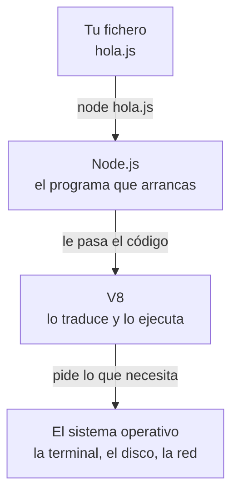

import { FileTree } from '@astrojs/starlight/components';
import Term from '~/components/Term.astro';
import TryIt from '~/components/TryIt.astro';
import Analogy from '~/components/Analogy.astro';
import SelfCheck from '~/components/SelfCheck.astro';
import ProjectCode from '~/components/ProjectCode.astro';
import Quiz from '~/components/Quiz.astro';
import QuizQuestion from '~/components/QuizQuestion.astro';
import QuizOption from '~/components/QuizOption.astro';

## El problema

En la Fase 2, el nginx de la tienda de Ana y Luis respondía a `/api/pedidos` con una respuesta escrita a mano en su configuración. Siempre la misma, pidieras lo que pidieras. Una tienda de verdad necesita un programa que lea el pedido, compruebe los productos, calcule el total y conteste: un <Term id="backend">backend</Term>, y hay que escribirlo.

¿En qué lenguaje? Uno ya está en todos los navegadores: <Term id="javascript">JavaScript</Term>. Pero JavaScript nació para vivir dentro de una página web, y ahí está encerrado a propósito. Una página no puede leer los ficheros de tu disco ni quedarse escuchando en un <Term id="port">puerto</Term>. Por suerte: si pudiera, cualquier web te robaría los documentos.

Un servidor necesita justo lo que el navegador prohíbe. Node.js saca JavaScript del navegador y lo deja trabajar con tu ordenador.

## La analogía

<Analogy>

Piensa en el motor de un coche. Solo sabe girar, y lo que consigues depende de dónde lo montes. En el coche mueve las ruedas, y tienes volante y faros. Monta el mismo motor en una lancha y mueve una hélice: no hay ruedas ni faros, pero hay timón.

El motor es V8, el programa de Chrome que ejecuta JavaScript. El coche es el navegador, que le da la página web para trabajar. La lancha es Node.js: el mismo motor, montado con otras piezas, las que necesita un servidor.

<div slot="limits">

- Un motor no sabe dónde lo han montado, y tu código tampoco: no se entera de que está en Node hasta que usa una pieza que ahí no existe, como la página web. Entonces falla.
- No todos los coches llevan este motor: Firefox y Safari ejecutan JavaScript con otros. El lenguaje es el mismo en todos.
- Node no es solo V8 con piezas atornilladas: tiene su propia forma de esperar al disco y a la red sin pararse, lo más importante de un servidor ([lección 9](/fase-3/event-loop-node/)).

</div>

</Analogy>

## Cómo funciona de verdad

### JavaScript necesita un programa que lo ejecute

JavaScript es un lenguaje de programación: texto con instrucciones que el ordenador no entiende tal cual. Hace falta un programa que lo traduzca a instrucciones del procesador y lo ejecute. En Chrome, ese programa es V8.

En 2009, Ryan Dahl tomó V8, lo sacó del navegador y lo metió en un programa que se arranca desde la terminal: Node.js. Le pasas un fichero de JavaScript y lo ejecuta:



V8 más lo que Node le pone alrededor forman un <Term id="runtime">entorno de ejecución</Term> (*runtime*): el programa que ejecuta un lenguaje y le da acceso a lo que hay fuera. El navegador es uno para páginas web, y Node.js, uno para programas de un ordenador o un servidor.

### Lo que Node.js añade y lo que le falta

El lenguaje es el mismo en los dos sitios: `2 + 3` da `5` en Chrome y en Node. Lo que cambia es lo que hay alrededor:

| | En el navegador | En Node.js |
|---|---|---|
| La página web (`document`, `window`) | Sí | No: no hay página |
| Leer y escribir ficheros del disco | No | Sí |
| Escuchar en un puerto, ser un servidor | No | Sí |
| Las variables de entorno, el propio proceso | No | Sí, en `process` |
| Dónde escribe `console.log` | La consola de DevTools | La terminal |

Un programa de Node en marcha es un <Term id="process">proceso</Term>, como los de la [lección 5 de la Fase 1](/fase-1/procesos-y-senales/): tiene su PID y se para con <kbd>Ctrl</kbd> + <kbd>C</kbd>. Desde el código, lo que sabe de sí mismo está en `process`: `process.version` es su versión de Node, y `process.env`, sus [variables de entorno](/fase-1/variables-de-entorno/).

### El REPL: JavaScript línea a línea

Si escribes `node` sin nada más, Node te deja escribir JavaScript línea a línea: lee cada línea, la ejecuta, te enseña el resultado y vuelve a esperar. Por eso se llama <Term id="repl">REPL</Term>: lee, evalúa, imprime, y vuelta a empezar.

Sirve para probar cosas sueltas. Al salir con `.exit`, Node recuerda las líneas en un historial, como la shell (<kbd>↑</kbd>), pero no queda ningún programa que puedas volver a ejecutar: eso va en un fichero.

### Un programa es un fichero `.js`

El `hola.js` que escribiste en [la introducción](/fase-3/) ya es un programa: un fichero de texto con JavaScript. `node hola.js` lo ejecuta de arriba abajo y termina: el proceso acaba y vuelve el prompt. Un servidor, en cambio, se queda en marcha esperando peticiones ([lección 4](/fase-3/servidor-http-node/)).

### Los módulos: el código, en piezas

El segundo programa hace algo que una página web no puede: leer un fichero del disco. Lee este, con los productos de la tienda en <Term id="json">JSON</Term>:

<ProjectCode file="tienda-api/01-node/productos.json" />

Y este es el programa:

<ProjectCode file="tienda-api/01-node/leer-productos.js" />

Pieza a pieza:

- `import { readFile } from 'node:fs/promises'` trae una pieza de otro sitio: la <Term id="function">función</Term> `readFile`, «leer fichero». Viene de `fs` (*file system*, «sistema de ficheros»), y el prefijo `node:` dice que es de Node, que la trae de serie.
- `const texto = await readFile('productos.json', 'utf8')` lee el fichero como texto (`'utf8'` dice cómo están guardadas sus letras, tildes y `€` incluidos) y lo guarda con un nombre, `texto`. `await` espera a que el disco conteste ([lección 2](/fase-3/javascript-para-backend/)).
- `JSON.parse(texto)` convierte ese texto en datos que el programa puede recorrer: una lista de productos. `productos.length` dice cuántos tiene.
- `for (const producto of productos) { … }` repite lo que hay entre llaves una vez por cada producto. Dentro, `producto.nombre` y `producto.precio` son sus datos, metidos en el texto con `${…}`, como en `hola.js`.

Cada fichero de código es un <Term id="module">módulo</Term>: puede ofrecer piezas a otros, que las traen con `import`. Las piezas vienen de Node (`node:fs/promises`), de otros ficheros tuyos ([lección 3](/fase-3/typescript-con-node/)) o de código escrito por otras personas, con npm.

### También TypeScript

Node 26 ejecuta también ficheros `.ts`, de <Term id="typescript">TypeScript</Term>: JavaScript con anotaciones sobre el tipo de cada dato, que Node borra antes de ejecutar. Qué ganas con ellas lo cuenta la [lección 3](/fase-3/typescript-con-node/).

### npm: el código de otros

Con Node se instala <Term id="npm">npm</Term>, su <Term id="package-manager">gestor de paquetes</Term> (se suele leer *Node Package Manager*, aunque oficialmente no es una sigla). Son dos cosas:

- **Un catálogo** en internet, el registro de npm, con millones de <Term id="package">paquetes</Term>: código que alguien ha publicado con un nombre y una versión para que otros lo usen.
- **Un comando**, `npm`, que los descarga en tu proyecto y apunta cuáles usas.

Hay una diferencia importante con apt, el de la [lección 6 de la Fase 1](/fase-1/servicios-systemd-apt/): su catálogo lo prepara y lo firma Ubuntu. **En npm, cualquiera puede publicar un paquete, y nadie lo revisa antes.** Esa es su fuerza y su riesgo.

### package.json: la ficha del proyecto

Un proyecto de npm es una carpeta con un fichero `package.json`. `npm init -y` crea uno. Este es el de la carpeta de esta lección:

<ProjectCode file="tienda-api/01-node/package.json" />

Pieza a pieza:

- `name` y `version`: el nombre del proyecto y su versión.
- `"private": true`: npm se niega a publicarlo, aunque alguien escriba `npm publish` por error.
- `"type": "module"`: los ficheros `.js` de esta carpeta usan `import`. Con `"commonjs"`, Node espera el sistema antiguo, `require`, el de los tutoriales viejos.
- `engines`: con qué versiones de Node funciona. Aquí, de la 24 en adelante.
- `scripts`: órdenes con nombre. `npm test` ejecuta `node --test`, que pasa las pruebas de la carpeta `test/` de cada paso ([lección 4](/fase-3/servidor-http-node/)).

### node_modules y el lockfile

Cuando instalas un paquete, npm hace tres cosas:

1. Lo descarga en la carpeta `node_modules`, junto a los paquetes que necesite él.
2. Lo apunta en `package.json`, en `dependencies`, con la versión que quieres.
3. Apunta en `package-lock.json`, el *lockfile*, la versión exacta de todo lo que ha instalado, de dónde vino y su <Term id="hash">hash</Term>, la huella del fichero.

<FileTree>

- tienda-api/
  - node_modules/ lo que npm descarga: no se guarda en Git
    - picocolors/
  - .npmrc
  - hola.js
  - leer-productos.js
  - package-lock.json el lockfile: las versiones exactas
  - package.json la ficha del proyecto
  - productos.json

</FileTree>

Gracias al lockfile, tu proyecto se instala igual en todas partes: `npm install`, sin nombre de paquete, descarga exactamente lo que dice, con su hash comprobado. Por eso `package.json` y el lockfile se guardan en Git, y `node_modules` va en el `.gitignore` (lo viste en [«Variables de entorno»](/fase-1/variables-de-entorno/)): se vuelve a crear con una orden.

### Las versiones y el `^`

En `1.1.1`, el primer número cambia cuando algo deja de funcionar como antes, el segundo cuando se añade algo y el tercero cuando se arregla un fallo. Sin configurar nada, npm apunta `"^1.1.1"`: «la 1.1.1 o cualquier posterior que empiece por 1». El lockfile frena el salto, pero un `npm update` o un lockfile borrado instalan la última 1.x, quizá publicada hace una hora.

### El .npmrc: tres líneas contra los ataques de 2025

En 2025, npm sufrió varios ataques graves. Dos de ellos:

- **Septiembre: chalk y debug.** Un correo que imitaba al soporte de npm llevó al responsable de 18 paquetes, entre ellos chalk y debug, a escribir su contraseña y su código de verificación en una web falsa. Los atacantes publicaron versiones que desviaban pagos en criptomonedas, en paquetes que sumaban más de 2.000 millones de descargas por semana. La mayoría se retiró en unas horas ([Aikido](https://www.aikido.dev/blog/npm-debug-and-chalk-packages-compromised), en inglés).
- **Septiembre y noviembre: Shai-Hulud.** Un gusano: código que se ejecutaba al instalar un paquete, robaba las claves de npm, GitHub y la nube que encontraba en el ordenador y, con la de npm, publicaba versiones infectadas de los paquetes de su víctima. Infectó más de 500 en septiembre y volvió en noviembre ([CISA](https://www.cisa.gov/news-events/alerts/2025/09/23/widespread-supply-chain-compromise-impacting-npm-ecosystem), en inglés).

Este es el `.npmrc` del proyecto, la configuración de npm para esta carpeta:

<ProjectCode file="tienda-api/01-node/.npmrc" />

Pieza a pieza:

- Las líneas con `#` son comentarios.
- `min-release-age=7`: npm solo instala versiones publicadas hace al menos 7 días. Las malas suelen retirarse en horas o días: cuando te tocarían, ya no están.
- `ignore-scripts=true`: un paquete puede traer una orden que npm ejecuta al instalarlo, con tus permisos. Así entraba Shai-Hulud. Con esta línea, npm no ejecuta ninguna. Tus `npm test` y `npm start` siguen funcionando.
- `save-exact=true`: npm apunta `"1.1.1"`, sin `^`. La versión solo cambia cuando tú lo decides.

Tiene un precio: un arreglo urgente también espera una semana, y los pocos paquetes que necesitan su orden de instalación no funcionan (ninguno de este curso). El repositorio de esta web hace las dos primeras con pnpm, su gestor de paquetes.

## Pruébalo

El objetivo: convertir tu carpeta en un proyecto de npm, con un segundo programa que lee del disco y un `.npmrc` que instala paquetes con cuidado. Por el camino romperás un programa y lo arreglarás.

Trabaja en la carpeta de [la introducción](/fase-3/), `~/curso-backend/fase-3/tienda-api`, donde ya está tu `hola.js`. Las salidas son de Node 26.11.1 y npm 11.20.0 en Linux, con las rutas de un Mac (en Linux y WSL empiezan por `/home/ana`); tus versiones, tiempos y números pueden ser otros.

<TryIt
  title="1. Abre el REPL"
  cmd="node"
  output={`Welcome to Node.js v26.11.1.
Type ".help" for more information.
> 2 + 3
5
> "hola".toUpperCase()
'HOLA'
> process.platform
'linux'
> window
Uncaught ReferenceError: window is not defined
> document
Uncaught ReferenceError: document is not defined
> .exit`}
>

Escribe cada línea después del `>` y pulsa Enter. `toUpperCase()` pasa un texto a mayúsculas, y `process.platform` dice en qué sistema corre Node: en tu Mac, `'darwin'`; en Linux y WSL, `'linux'`.

`window` y `document`, la ventana y la página del navegador, no existen aquí (*is not defined*). `.exit` cierra el REPL.

</TryIt>

Crea en tu carpeta `productos.json` y `leer-productos.js`, con el código de arriba, igual que creaste `hola.js`.

<TryIt
  title="2. Lee un fichero del disco"
  cmd={`cd ~/curso-backend/fase-3/tienda-api
node leer-productos.js`}
  output={`La tienda tiene 3 productos:
- Camiseta: 20 €
- Taza: 8.5 €
- Sudadera: 35 €`}
>

Si sale `ENOENT: no such file or directory, open 'productos.json'`, Node no encuentra `productos.json` en la carpeta desde la que arrancas el programa: es una ruta relativa, como las de la [lección 1 de la Fase 1](/fase-1/comandos-basicos-terminal/). Comprueba con `ls` que lo guardaste en `tienda-api`, con ese nombre.

</TryIt>

<TryIt
  title="3. Crea el proyecto de npm"
  cmd="npm init -y"
  output={`Wrote to /Users/ana/curso-backend/fase-3/tienda-api/package.json:

{
  "name": "tienda-api",
  "version": "1.0.0",
  "description": "",
  "main": "hola.js",
  "scripts": {
    "test": "echo \\"Error: no test specified\\" && exit 1"
  },
  "keywords": [],
  "author": "",
  "license": "ISC",
  "type": "commonjs"
}`}
>

`-y` acepta las respuestas por defecto sin preguntar. Campos como `description` o `license` solo importan si publicas el paquete. No es igual que el `package.json` de la carpeta de la lección, y no pasa nada: lo que importa ahora es la última línea, `"type": "commonjs"`.

</TryIt>

<TryIt
  title="4. Vuelve a leer los productos"
  cmd="node leer-productos.js"
  output={`(node:98) Warning: Failed to load the ES module: /Users/ana/curso-backend/fase-3/tienda-api/leer-productos.js. Make sure to set "type": "module" in the nearest package.json file or use the .mjs extension.
(Use \`node --trace-warnings ...\` to show where the warning was created)
/Users/ana/curso-backend/fase-3/tienda-api/leer-productos.js:2
import { readFile } from 'node:fs/promises';
^^^^^^

SyntaxError: Cannot use import statement outside a module
    at wrapSafe (node:internal/modules/cjs/loader:1900:18)
    …

Node.js v26.11.1`}
>

El mismo programa, y ahora falla. Sin `package.json`, Node vio el `import` y entendió que era un módulo. Ahora `package.json` le dice `"commonjs"`, el sistema antiguo, que no conoce `import`.

El aviso de la primera línea da la solución: `"type": "module"`. Hemos quitado las líneas que siguen a `wrapSafe`, que dicen en qué parte de Node saltó el error. Tu número de proceso, el `98`, será otro.

</TryIt>

<TryIt
  title="5. Arréglalo"
  cmd={`npm pkg set type=module
node leer-productos.js`}
  output={`La tienda tiene 3 productos:
- Camiseta: 20 €
- Taza: 8.5 €
- Sudadera: 35 €`}
>

`npm pkg set` cambia un campo de `package.json` sin abrirlo. `npm` no escribe nada si va bien.

</TryIt>

Antes de instalar nada, crea el fichero `.npmrc` en la carpeta, con las líneas del `.npmrc` de más arriba. Después instala picocolors, un paquete pequeño que pinta de colores el texto de la terminal, con su versión exacta:

<TryIt
  title="6. Instala un paquete"
  cmd="npm install picocolors@1.1.1"
  output={`added 1 package, and audited 2 packages in 1s

found 0 vulnerabilities`}
>

*added 1 package* es picocolors, que no necesita otros. *audited 2 packages* cuenta tu proyecto y él: npm busca fallos de seguridad conocidos, y no hay (*0 vulnerabilities*).

</TryIt>

<TryIt
  title="7. Mira qué ha cambiado"
  cmd={`ls node_modules
grep -A2 '"dependencies"' package.json`}
  output={`picocolors
  "dependencies": {
    "picocolors": "1.1.1"
  }`}
>

`grep -A2` enseña la línea que busca y las dos siguientes. La versión va sin `^`, por el `save-exact`. Si ves `"^1.1.1"`, npm no ha leído tu `.npmrc`: comprueba su nombre, con el punto, y que está en `tienda-api`. En `package-lock.json` verás la versión, de dónde vino (`resolved`) y su hash (`integrity`).

</TryIt>

<SelfCheck question="Reto: borra node_modules con rm -rf node_modules. ¿Sigue funcionando leer-productos.js? ¿Cómo recuperas picocolors con una orden corta, sin escribir su nombre ni su versión?">

`leer-productos.js` sigue funcionando: solo usa `node:fs/promises`, que viene con Node. Para recuperar picocolors, `npm install`, sin nada más, que lee el lockfile:

```
added 1 package, and audited 2 packages in 458ms

found 0 vulnerabilities
```

Por eso `node_modules` no se guarda en Git: con el lockfile, se vuelve a crear igual.

</SelfCheck>

Para terminar, quita picocolors: la carpeta `01-node` no lo usa.

<TryIt
  title="8. Desinstálalo"
  cmd="npm uninstall picocolors"
  output={`removed 1 package, and audited 1 package in 254ms

found 0 vulnerabilities`}
>

npm lo borra de `node_modules`, de `package.json` y del lockfile. La carpeta `node_modules` se queda, sin paquetes.

</TryIt>

Si algo no te cuadra, descarga la carpeta de esta lección y compárala con la tuya: desde `~/curso-backend/fase-3`, `curl -O https://backenddesdecero.com/practicas/tienda-api/01-node.tar.gz`, `tar -xzf 01-node.tar.gz` y, dentro, `npm install` y `npm test`.

## Ya lo has visto

- **Esta web.** Sus páginas las genera Astro, un programa de Node, antes de publicarlas.
- **VS Code.** Está hecho con Electron, que lleva dentro Chromium y Node.js: por eso un editor puede leer tus ficheros con JavaScript.
- **`npm run dev`.** Si alguna vez has arrancado una web en tu ordenador con esta orden, estabas usando Node y npm: `dev` es uno de los `scripts` de su `package.json`.

## Errores comunes

- **Escribir `node hola.js` dentro del REPL.** El REPL solo entiende JavaScript, y responde `Uncaught SyntaxError: Unexpected identifier 'hola'`. Sal con `.exit` y escríbelo en la terminal.
- **Usar `window` o `document` en Node** (`is not defined`): es código pensado para una página web.
- **`Cannot use import statement outside a module`.** Falta `"type": "module"` en `package.json`.
- **Guardar `node_modules` en Git, o borrar el lockfile para «arreglar» algo.** El primero llena el repositorio de código ajeno; lo segundo pierde las versiones exactas.
- **Pedir una versión de hace menos de 7 días.** El `.npmrc` responde `No matching version found for typescript@7.1.0-dev.20261013.1 with a date before 10/6/2026, 10:51:50 AM.`: existe, pero es demasiado nueva. Pide una anterior, o espera.

## Resumen

- Node.js ejecuta JavaScript fuera del navegador con V8, el motor de Chrome, y le añade ficheros, red y procesos, pero no la página (`window`, `document`).
- `node` solo abre el REPL, para probar líneas sueltas; `node fichero.js` ejecuta un programa. Cada fichero es un módulo, y `import` trae piezas de otros.
- npm instala paquetes de un catálogo donde cualquiera publica. `package.json` dice qué usa tu proyecto, `node_modules` lo guarda y el lockfile fija las versiones exactas.
- El `.npmrc` del proyecto espera 7 días por cada versión nueva, no ejecuta órdenes al instalar y guarda versiones exactas: lo que enseñaron los ataques de 2025.

## ¿Lo has entendido?

<Quiz>

<QuizQuestion
  question="Copias de un tutorial de frontend una línea que usa document.querySelector y la ejecutas con node. ¿Qué pasa?"
  review="Lo que Node.js añade y lo que le falta"
>

<QuizOption text="Falla: en Node no hay página web, así que document no existe." correct>

`document` es la página que el navegador le da a JavaScript. Node ejecuta el mismo lenguaje, pero sin página: responde `document is not defined`.

</QuizOption>

<QuizOption text="Funciona: Node usa el motor de Chrome, así que trae todo lo de Chrome.">

Node usa V8, el motor, pero no el resto del navegador. La página, `window` y `document` son piezas de Chrome, no de V8.

</QuizOption>

<QuizOption text="Node abre una ventana del navegador para poder ejecutarla.">

Node no abre ningún navegador. Es un programa de la terminal, y lo que necesita una página no lo puede hacer.

</QuizOption>

</QuizQuestion>

<QuizQuestion
  question="Un compañero borra la carpeta node_modules de su proyecto para liberar espacio. ¿Qué ha perdido?"
  review="node_modules y el lockfile"
>

<QuizOption text="Las versiones de sus paquetes: tendrá que averiguarlas e instalarlas una a una.">

Las versiones exactas están en el lockfile, no en `node_modules`. Con `npm install`, npm las lee de ahí.

</QuizOption>

<QuizOption text="Nada que no pueda recuperar: npm install lo descarga otra vez igual." correct>

`node_modules` es una copia de lo que dice el lockfile. Por eso no se guarda en Git: se vuelve a crear con una orden.

</QuizOption>

<QuizOption text="Su código: los programas del proyecto se guardan dentro de node_modules.">

`node_modules` solo tiene los paquetes descargados. Tus ficheros, como `hola.js`, están fuera, en la carpeta del proyecto.

</QuizOption>

</QuizQuestion>

<QuizQuestion
  question="Ayer, alguien publicó una versión nueva de un paquete que usas, con código malicioso. Hoy instalas el paquete en un proyecto con el .npmrc de esta lección. ¿Qué pasa?"
  review="El .npmrc: tres líneas contra los ataques de 2025"
>

<QuizOption text="npm la detecta como maliciosa y la rechaza: revisa cada paquete antes de instalarlo.">

npm no revisa el código de los paquetes: cualquiera publica y nadie lo mira antes. El `.npmrc` no detecta nada, solo espera.

</QuizOption>

<QuizOption text="Se instala, pero no hace daño: ignore-scripts impide que se ejecute su código.">

`ignore-scripts` solo evita las órdenes que se ejecutan al instalar. El código del paquete se ejecuta igual cuando tu programa lo usa, como pasó con chalk.

</QuizOption>

<QuizOption text="npm instala la versión anterior: la nueva tiene menos de 7 días." correct>

`min-release-age=7` hace que npm ignore las versiones de menos de una semana. Las maliciosas suelen retirarse antes de que cumplan los 7 días.

</QuizOption>

</QuizQuestion>

<QuizQuestion
  question="Ana instala un paquete y su package.json dice 1.1.1. Luis lo instala en su ordenador, sin .npmrc, y el suyo dice ^1.1.1. ¿Qué diferencia hay?"
  review="Las versiones y el ^"
>

<QuizOption text="Ninguna: el ^ es solo una marca de npm para las versiones estables.">

El `^` cambia lo que npm acepta: «esta o cualquier posterior que empiece por 1». Sin él, solo esa.

</QuizOption>

<QuizOption text="El de Luis acepta versiones posteriores, como una 1.2.0; el de Ana, solo la 1.1.1." correct>

Con el `^`, una actualización puede instalar una 1.x más nueva sin que nadie lo decida. `save-exact` lo evita.

</QuizOption>

<QuizOption text="El de Ana ya no se puede actualizar nunca: una versión exacta se queda congelada para siempre.">

Puede instalar otra versión cuando quiera, con `npm install` y la versión nueva. La diferencia es que lo decide ella, no npm.

</QuizOption>

</QuizQuestion>

<QuizQuestion
  question="Antes de usarlo en tu programa, quieres comprobar qué da 'tienda'.length. ¿Qué haces?"
  review="El REPL: JavaScript línea a línea"
>

<QuizOption text="Escribirlo en la terminal tal cual: la shell también entiende JavaScript.">

La shell solo entiende sus órdenes: buscaría un programa llamado `tienda.length` y no lo encontraría. JavaScript lo entiende Node.

</QuizOption>

<QuizOption text="Crear antes un proyecto con npm init: Node solo ejecuta código dentro de uno.">

Node ejecuta cualquier fichero o línea, haya proyecto o no: en el Pruébalo, `leer-productos.js` funcionó antes de que existiera `package.json`.

</QuizOption>

<QuizOption text="Abrir el REPL con node, escribir la línea y ver qué da." correct>

Para eso está el REPL: ejecuta cada línea al momento y te enseña el resultado, sin crear ningún fichero. Aquí, `6`.

</QuizOption>

</QuizQuestion>

<QuizQuestion
  question="Un programa empieza con import { readFile } from 'node:fs/promises'. ¿De dónde sale readFile?"
  review="Los módulos: el código, en piezas"
>

<QuizOption text="De Node, que lo trae de serie: lo dice el prefijo node:." correct>

`node:fs/promises` es uno de los módulos que vienen con Node. No hay que instalar nada.

</QuizOption>

<QuizOption text="De un paquete de npm llamado fs, que hay que instalar antes.">

Con el prefijo `node:` no se busca en npm ni en `node_modules`: es un módulo de Node, que ya tienes.

</QuizOption>

<QuizOption text="Del navegador, que es quien sabe leer ficheros del disco.">

Es al revés: el navegador no deja leer ficheros del disco. Esa es una de las cosas que añade Node.

</QuizOption>

</QuizQuestion>

</Quiz>

## Para profundizar

- [Introducción a Node.js](https://nodejs.org/en/learn/getting-started/introduction-to-nodejs) (en inglés): la guía oficial.
- [Diferencias entre Node.js y el navegador](https://nodejs.org/en/learn/getting-started/differences-between-nodejs-and-the-browser) (en inglés).
- [Módulos de JavaScript](https://developer.mozilla.org/es/docs/Web/JavaScript/Guide/Modules) (MDN): `import` y `export`, con ejemplos.
- [package.json](https://docs.npmjs.com/cli/configuring-npm/package-json) y [package-lock.json](https://docs.npmjs.com/cli/configuring-npm/package-lock-json) (npm, en inglés): todos sus campos.
- [Our plan for a more secure npm supply chain](https://github.blog/security/supply-chain-security/our-plan-for-a-more-secure-npm-supply-chain/) (GitHub, en inglés): qué cambió npm después de Shai-Hulud.
