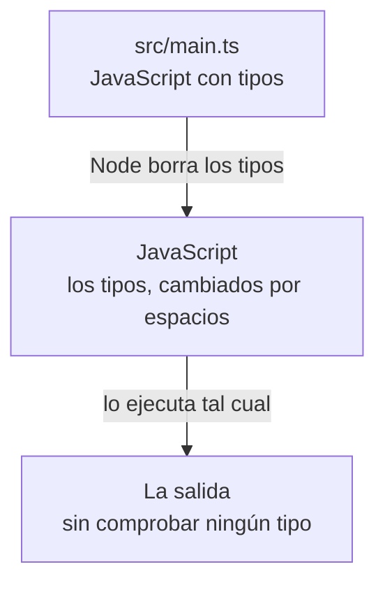

import Term from '~/components/Term.astro';
import TryIt from '~/components/TryIt.astro';
import Analogy from '~/components/Analogy.astro';
import SelfCheck from '~/components/SelfCheck.astro';
import ProjectCode from '~/components/ProjectCode.astro';
import Quiz from '~/components/Quiz.astro';
import QuizQuestion from '~/components/QuizQuestion.astro';
import QuizOption from '~/components/QuizOption.astro';

## El problema

Imagina que la API de la tienda guarda el precio de la taza como texto, `'8.5'`, en vez de como número, `8.5`: alguien lo escribió a mano en un <Term id="json">JSON</Term>. Dos tazas, `'8.5' * 2`, dan `17`, y todo parece ir bien. Pero con 2 € de envío, `'8.5' + 2` da `8.52`: <Term id="javascript">JavaScript</Term> ha pegado los dos textos.

JavaScript no se queja: decide sobre la marcha qué hacer con cada dato. Te enteras cuando un cliente ve un total de 8,52 € en su carrito. Y un servidor recibe datos de muchos sitios: cuanto más crece, más fácil es que uno llegue con la forma equivocada.

<Term id="typescript">TypeScript</Term> te deja escribir qué forma tiene cada dato, y un programa revisa todo tu código contra esa descripción **antes de ejecutarlo**. En esta lección pasas el código de la tienda a TypeScript y ves qué errores atrapa, y cuáles no.

## La analogía

<Analogy>

Piensa en un impreso de la administración. Cada casilla dice qué va en ella: «Fecha (dd/mm/aaaa)», «Importe en euros». Esas indicaciones son los tipos.

Antes de entregarlo, el empleado de la ventanilla lo revisa entero y te marca en rojo «aquí has puesto letras donde va un número». Ese revisor es tsc, el comprobador de TypeScript, y su boli rojo, el subrayado de tu editor.

Después, el impreso se tramita. Quien lo tramita ya no lee las indicaciones de las casillas, solo lo que has escrito: ese es Node.

<div slot="limits">

- El empleado solo revisa el impreso que rellenas tú. Los papeles que te llegan de fuera, como el JSON que te envía un cliente, nadie los revisa con esas casillas: eso se hace al recibirlos, en la [lección 7, «Validación»](/fase-3/validar-datos-zod/).
- Un impreso sin revisar no se tramita. Un `.ts` con errores de tipos, sí: Node lo ejecuta igual, con el error dentro.
- Las casillas del impreso las diseña otro. Los tipos los escribes tú, y si los escribes mal, el revisor compara con un modelo equivocado.

</div>

</Analogy>

## Cómo funciona de verdad

### Un tipo dice qué clase de dato va en cada sitio

Esto es JavaScript de la [lección 2, «JavaScript»](/fase-3/javascript-para-backend/), con una novedad: dos puntos y una palabra detrás de cada nombre.

```ts
const precio: number = 8.5;
const nombre: string = 'Taza';
const disponible: boolean = true;
```

`: number` es una **anotación**: dice que `precio` es un número. `string` es un texto, y `boolean`, un sí o un no (`true` o `false`). Cada uno es un <Term id="type">tipo</Term>: la clase de dato que puede ir en un sitio.

No hace falta anotarlo todo: en `const precio = 8.5`, TypeScript deduce solo que es un número (**inferencia**). Los tipos se escriben donde no puede adivinarlos: en la forma de tus datos y en lo que recibe cada función.

### Una interface describe un objeto: el producto

Los productos de la tienda son <Term id="object">objetos</Term> con tres datos. Este es su tipo, al principio de `src/productos.ts`:

<ProjectCode file="tienda-api/03-typescript/src/productos.ts" region="producto" />

- `interface Producto` le pone nombre a una forma: todo `Producto` tiene un `id` numérico, un `nombre` de texto y un `precio` numérico. Con él, la taza con el precio `'8.5'` deja de ser un producto válido.
- `export` es nuevo: deja usar `Producto` desde otros ficheros. Cada fichero es un <Term id="module">módulo</Term>, y otro fichero solo puede traer con `import` lo que este exporta, igual que trajiste `readFile` de Node en la [lección 1, «Node.js»](/fase-3/que-es-node-js/). Aquí lo traerá `src/main.ts`.

### type, uniones y tipos literales: el estado de un pedido

Un pedido de la tienda está pendiente, pagado o enviado. Nada más:

<ProjectCode file="tienda-api/03-typescript/src/productos.ts" region="pedido" />

- `type EstadoPedido = …` también le pone nombre a un tipo.
- `'pendiente' | 'pagado' | 'enviado'` es una **unión**: la barra `|` se lee «o». Cada opción es un **tipo literal**, un valor concreto: solo valen esos tres textos.
- `estado: EstadoPedido` lo usa dentro de `Pedido`. Con `'cancelado'`, el comprobador te avisa.

`interface` y `type` sirven las dos para un objeto, pero solo `type` puede nombrar una unión. En el curso, `interface` para los objetos y `type` para lo demás.

Una forma también se puede escribir sin nombre, en el mismo sitio donde se usa: `{ productoId: number; cantidad: number }` es «un objeto con esos dos datos». La verás así a partir de la [lección 4, «Servidor HTTP»](/fase-3/servidor-http-node/).

### Funciones con tipos, y el undefined que no puedes olvidar

El resto del fichero son los datos y dos <Term id="function">funciones</Term>, ya con tipos, también exportados:

<ProjectCode file="tienda-api/03-typescript/src/productos.ts" region="funciones" />

- `Producto[]` es un <Term id="array">array</Term> de productos: los corchetes dicen «una lista de».
- `buscarProducto(id: number)` solo acepta un número.
- `productos.find(…)` recorre la lista y devuelve el primer producto que cumple la condición: aquí, que su `id` sea el que buscas. Si ninguno la cumple, devuelve `undefined`, «sin valor».
- `: Producto | undefined`, tras el paréntesis, es lo que **devuelve** la función: un producto, o `undefined`.
- `total` recibe un producto y una cantidad, y devuelve un número.

### Usar los tipos: el programa principal

`src/main.ts` crea un pedido y calcula lo que cuesta:

<ProjectCode file="tienda-api/03-typescript/src/main.ts" region="buscar" />

- El `import` trae tres piezas que `productos.ts` exporta. `./` significa «en esta misma carpeta», y la extensión `.ts` va escrita porque Node busca el fichero tal cual. `type Pedido` avisa de que `Pedido` es solo un tipo.
- `const pedido: Pedido` obliga a que el objeto tenga los cuatro datos, con sus tipos.
- `producto` no lleva anotación: TypeScript deduce que es `Producto | undefined`. En VS Code, pasa el ratón por encima y te lo enseña.
- `if (producto === undefined)` comprueba si no se encontró. En el `else`, TypeScript ya sabe que es un `Producto` y te deja leer `producto.nombre`: ha **estrechado** el tipo (*narrowing*).

Si borras el `if`, el comprobador protesta: `'producto' is possibly 'undefined'`. Sin TypeScript, te enterarías al pedir un producto que no existe: `TypeError: Cannot read properties of undefined (reading 'nombre')`. En un servidor, un error `500`.

### unknown y any: lo que llega de fuera

El final de `main.ts` recibe un producto en JSON, como lo enviaría un cliente en una petición:

<ProjectCode file="tienda-api/03-typescript/src/main.ts" region="de-fuera" />

TypeScript no puede saber qué traerá el texto que lee `JSON.parse`. Para lo que no conoces hay dos tipos:

| Tipo | Qué significa | Qué te deja hacer |
|---|---|---|
| `any` | «Cualquier cosa: no compruebes nada» | Todo, sin avisos: apaga TypeScript para ese dato |
| `unknown` | «No sé qué es» | Nada, hasta que compruebes qué es |

`JSON.parse` devuelve `any`, y por eso el código anota `datos: unknown`. La condición del `if` comprueba el dato en tres pasos, unidos con `&&` («y»):

1. `typeof datos === 'object'`: es un objeto, no un número ni un texto.
2. `datos !== null`: no es `null`, el valor «vacío». Hace falta porque, por una rareza de JavaScript, `typeof null` también es `'object'`.
3. `'nombre' in datos`: tiene un dato llamado `nombre`.

Dentro del `if`, TypeScript ya te deja usar `datos.nombre`, y `String(…)` lo convierte en texto, sea lo que sea.

### Node borra los tipos al ejecutar

Node 26, la versión del curso, ejecuta un `.ts` sin ninguna opción y sin avisos. Pero no entiende de tipos: antes de ejecutar, los **borra**. Este ejemplo, `ejemplos/error-de-tipo.ts`, tiene un error a propósito:

<ProjectCode file="tienda-api/03-typescript/ejemplos/error-de-tipo.ts" />

Y esto es lo que ejecuta Node de verdad, sacado con `stripTypeScriptTypes`, su función de borrar tipos:

```js
                                                    

// El precio es un texto, no un número: tsc lo marca como error, pero Node lo ejecuta igual.
const taza           = { id: 2, nombre: 'Taza', precio: '8.5' };
console.log(taza.precio * 2);
```

La línea del `import type` ha quedado en blanco (arriba no se ve, porque es la primera) y el `: Producto`, convertido en espacios. Así cada línea y cada columna siguen en su sitio, y un error señala el mismo punto de tu fichero. Lo que queda es JavaScript, que no sabe que el precio debía ser un número.



**Al ejecutar, no queda ningún tipo.** Un pedido que llega con `"cantidad": "muchas"` entra igual, aunque tu `interface` diga `number`: los datos de una petición se comprueban al recibirlos, con código. Es la regla de oro de la [Fase 0](/fase-0/que-es-el-backend/), «nunca te fíes del cliente», y la [lección 7, «Validación»](/fase-3/validar-datos-zod/), la pone en práctica.

### tsc --noEmit: el comprobador, aparte

Quien comprueba es `tsc`, el compilador de TypeScript. Compilar es traducir un programa a otro lenguaje, y `tsc` nació para traducir `.ts` a `.js`. Aquí Node ya borra los tipos, así que solo lo usas para comprobar:

- `tsc --noEmit` revisa todo el proyecto sin escribir ningún fichero (*no emit*, «no emitas»). Si todo está bien, no dice nada.
- **El editor** hace la misma revisión mientras escribes: VS Code subraya en rojo cada error y, al pasar el ratón, te dice qué falla.

Instalarás TypeScript 7, que salió en julio de 2026: el mismo lenguaje, con el compilador reescrito en Go, otro lenguaje de programación. En las mediciones de Microsoft, con proyectos grandes, revisa unas diez veces más rápido.

### El tsconfig.json: las reglas del comprobador

`tsc` lee sus reglas de `tsconfig.json`, en la carpeta del proyecto:

<ProjectCode file="tienda-api/03-typescript/tsconfig.json" />

Es JSON con una excepción: admite comentarios, las líneas que empiezan por `//`. Lo que importa, pieza a pieza:

- `strict: true` activa todas las revisiones estrictas, como la del `undefined`.
- `noEmit` es el `--noEmit`, ya escrito aquí.
- `allowImportingTsExtensions` acepta los `import` con `.ts`.
- `erasableSyntaxOnly` avisa si usas algo que Node no sabe borrar (la próxima sección).
- `verbatimModuleSyntax` exige el `type` al importar un tipo: al ejecutar, `Pedido` no existe, y Node fallaría al buscarlo.
- `types: ["node"]` carga los tipos de Node, del paquete `@types/node`.
- `exclude` deja fuera `ejemplos`, que tiene errores a propósito.

El resto (`target`, `module`, `skipLibCheck`) dice que apuntas al JavaScript más moderno y a los módulos de Node, y que no revise los tipos de los paquetes instalados.

### Lo que Node no sabe borrar

Casi todo TypeScript se puede borrar sin cambiar lo que hace el programa. Unas pocas piezas, no, porque generan código. La más conocida es `enum`, una lista de valores con nombre que crea un objeto de verdad. Node no las acepta.

No te hacen falta: una unión de tipos literales, como `EstadoPedido`, hace lo mismo y se borra sin dejar rastro.

## Pruébalo

El objetivo: pasar la tienda a TypeScript y ver qué errores te pilla el comprobador antes de ejecutar nada. Todo va en tu terminal, en `~/curso-backend/fase-3/tienda-api`. Si te atascas, descarga la carpeta de esta lección y compárala con la tuya:

```sh
cd ~/curso-backend/fase-3
curl -O https://backenddesdecero.com/practicas/tienda-api/03-typescript.tar.gz
tar -xzf 03-typescript.tar.gz
```

Las salidas son de Node 26.11.1. Tus tiempos serán otros.

### Prepara el proyecto

<TryIt
  title="1. Instala TypeScript"
  cmd="npm install --save-dev typescript@7.0.2 @types/node@26.6.4"
  output={`added 4 packages, and audited 5 packages in 3s

found 0 vulnerabilities`}
>

Dos <Term id="package">paquetes</Term>, con su versión exacta, como en la [lección 1](/fase-3/que-es-node-js/): `typescript`, que trae `tsc`, y `@types/node`, los tipos de Node. `--save-dev` los apunta como dependencias de desarrollo: hacen falta para escribir el código, no para ejecutarlo. Los otros dos «packages» son dependencias suyas.

</TryIt>

Ahora crea `tsconfig.json`, `src/productos.ts` y `src/main.ts` con lo que has visto en «Cómo funciona de verdad». El código pasa a la carpeta `src/` (de *source*, «código fuente»), y los ficheros de la [lección 2](/fase-3/javascript-para-backend/) ya no hacen falta: puedes borrarlos.

<TryIt
  title="2. Añade las órdenes del proyecto"
  cmd={`npm pkg set scripts.start="node src/main.ts"
npm pkg set scripts.test="node --test"
npm pkg set scripts.check="tsc --noEmit"
npm pkg get scripts`}
  output={`{
  "test": "node --test",
  "start": "node src/main.ts",
  "check": "tsc --noEmit"
}`}
>

`npm pkg set` cambia `package.json` sin abrirlo, como en la [lección 1](/fase-3/que-es-node-js/), y `npm pkg get scripts` te enseña cómo han quedado. Tres órdenes con nombre: `npm start` ejecuta el programa, `npm test` pasa las pruebas (las usarás desde la [lección 4](/fase-3/servidor-http-node/)) y `npm run check` comprueba los tipos. `start` y `test` son nombres que npm conoce; para cualquier otro, como `check`, se escribe `npm run`.

Si falta alguna, o sale cortada, vuelve a ejecutar su línea con las comillas: sin ellas, la terminal parte `node --test` por el espacio. Tu `package.json` tendrá algún campo más, de `npm init -y`; el de la carpeta descargable es este:

</TryIt>

<ProjectCode file="tienda-api/03-typescript/package.json" />

<TryIt
  title="3. Ejecuta el programa"
  cmd="node src/main.ts"
  output={`Pedido 1: 3 × Taza = 25.5 €
Ha llegado un producto: Gorra`}
>

Node ejecuta el `.ts` directamente: nada de compilar antes. `npm start` hace lo mismo.

Si sale `ERR_MODULE_NOT_FOUND`, revisa que el `import` de `main.ts` termina en `productos.ts`, con su extensión.

</TryIt>

<TryIt
  title="4. Comprueba los tipos"
  cmd="npx tsc --noEmit"
>

`npx` ejecuta un programa instalado en el proyecto, aquí `tsc`. No sale nada: en la terminal, el silencio es buena señal. `npm run check` hace lo mismo.

</TryIt>

### Error 1: un estado que no existe

En `src/main.ts`, cambia `'pendiente'` por `'cancelado'` y guarda. Si tienes la carpeta abierta en VS Code, verás el subrayado rojo antes de ejecutar nada. Ahora, ejecuta y comprueba:

<TryIt
  title="5. Node lo ejecuta, tsc lo pilla"
  cmd={`node src/main.ts
npx tsc --noEmit`}
  output={`Pedido 1: 3 × Taza = 25.5 €
Ha llegado un producto: Gorra
src/main.ts:3:61 - error TS2322: Type '"cancelado"' is not assignable to type 'EstadoPedido'.

3 const pedido: Pedido = { id: 1, productoId: 2, cantidad: 3, estado: 'cancelado' };
                                                              ~~~~~~

  src/productos.ts:16:3 - The expected type comes from property 'estado' which is declared here on type 'Pedido'
    16   estado: EstadoPedido;
         ~~~~~~


Found 1 error in src/main.ts:3`}
>

Node ejecuta el programa como si nada. `tsc`, no: `'cancelado'` no cabe en `EstadoPedido` («no se puede asignar»), y debajo te dice de dónde sale la regla, el campo `estado` de `Pedido`.

`3:61` es la línea y la columna: si tu fichero tiene una línea más o menos, cambian. Vuelve a poner `'pendiente'`.

</TryIt>

### Error 2: un precio en texto

Crea la carpeta `ejemplos` con dos ficheros: `error-de-tipo.ts`, el de «Node borra los tipos al ejecutar», y su propio `tsconfig.json`, que hereda las reglas del principal (`extends`) y solo revisa esta carpeta:

<ProjectCode file="tienda-api/03-typescript/ejemplos/tsconfig.json" />

<TryIt
  title="6. El precio de dos tazas"
  cmd={`node ejemplos/error-de-tipo.ts
npx tsc -p ejemplos`}
  output={`17
ejemplos/error-de-tipo.ts:4:49 - error TS2322: Type 'string' is not assignable to type 'number'.

4 const taza: Producto = { id: 2, nombre: 'Taza', precio: '8.5' };
                                                  ~~~~~~

  src/productos.ts:6:3 - The expected type comes from property 'precio' which is declared here on type 'Producto'
    6   precio: number;
        ~~~~~~


Found 1 error in ejemplos/error-de-tipo.ts:4`}
>

`17` es correcto por casualidad: con `*`, JavaScript convierte el texto en número. Con un `+`, como en «El problema», saldría `8.52`. `tsc` no espera a ver el resultado: un texto no cabe donde va un número.

`-p ejemplos` (de *project*) le dice a `tsc` qué `tsconfig.json` usar: el de la carpeta `ejemplos`.

</TryIt>

### Error 3: un enum

Crea `src/estado.ts` con un `enum`, como los de muchos tutoriales:

```ts
enum Estado {
  Pendiente,
  Pagado,
}
console.log(Estado.Pagado);
```

<TryIt
  title="7. Lo que Node no sabe borrar"
  cmd="node src/estado.ts"
  output={`node:internal/modules/run_main:111
    triggerUncaughtException(
    ^

file:///Users/ana/curso-backend/fase-3/tienda-api/src/estado.ts:1
  > enum Estado {
      Pendiente,
      Pagado,
  > }
    console.log(Estado.Pagado);

SyntaxError [ERR_UNSUPPORTED_TYPESCRIPT_SYNTAX]: TypeScript enum is not supported in strip-only mode
    at parseTypeScript (node:internal/modules/typescript:57:40)
    …
    at afterResolve (node:internal/modules/esm/loader:614:52) {
  code: 'ERR_UNSUPPORTED_TYPESCRIPT_SYNTAX'
}

Node.js v26.11.1`}
>

Esta vez Node sí se para: «enum no se admite en el modo que solo borra» (*strip-only*). Las líneas con `>` señalan el trozo culpable. Hemos quitado ocho líneas `at …`, que dicen por dónde pasaba Node por dentro.

En Linux y WSL, la ruta empieza por `/home/ana`.

</TryIt>

<TryIt
  title="8. tsc te lo habría dicho antes"
  cmd="npx tsc --noEmit"
  output={`src/estado.ts:1:6 - error TS1294: This syntax is not allowed when 'erasableSyntaxOnly' is enabled.

1 enum Estado {
       ~~~~~~


Found 1 error in src/estado.ts:1`}
>

«Esta sintaxis no se permite con `erasableSyntaxOnly`»: el editor te lo habría marcado mientras escribías. Borra el fichero con `rm src/estado.ts`, y `npx tsc --noEmit` vuelve al silencio.

</TryIt>

<SelfCheck question="Reto: en src/main.ts, borra la línea del if (typeof datos …) y su llave de cierre, }. ¿Qué dice npx tsc --noEmit? ¿Y si además cambias unknown por any?">

Con `unknown`, `tsc` no te deja leer `datos.nombre` sin comprobar antes qué es:

```
src/main.ts:16:49 - error TS18046: 'datos' is of type 'unknown'.

16   console.log(`Ha llegado un producto: ${String(datos.nombre)}`);
                                                   ~~~~~


Found 1 error in src/main.ts:16
```

Con `any`, silencio: no porque el código esté bien, sino porque has apagado la revisión. Si el JSON no trajera `nombre`, nadie te avisaría. Deja `main.ts` como estaba.

</SelfCheck>

## Ya lo has visto

- **«Hola, undefined» o un total de «NaN €»** en un correo o en una web: un dato que faltaba, o de otro tipo, y nadie lo comprobó.
- **Las sugerencias de VS Code**, incluso en ficheros `.js`: por dentro, el editor usa TypeScript para saber qué tiene cada objeto.
- **Esta misma web.** Cada cambio en su código pasa una revisión automática de tipos antes de publicarse. Cada carpeta del proyecto `tienda-api` también, con `npm run check`.

## Errores comunes

- **Creer que los tipos se comprueban al ejecutar.** Node los borra. Lo que llega en una petición hay que comprobarlo con código ([lección 7, «Validación»](/fase-3/validar-datos-zod/)).
- **Usar `any` para que se calle el comprobador.** Desaparece el aviso, no el error. Para lo que no conoces, `unknown`, y compruébalo.
- **Copiar un `enum` de un tutorial.** Node responde `ERR_UNSUPPORTED_TYPESCRIPT_SYNTAX`. Usa una unión: `'pendiente' | 'pagado'`.
- **Importar sin `.ts` o sin `type`.** Sin la extensión, Node da `ERR_MODULE_NOT_FOUND`. Sin `type`, `does not provide an export named 'Pedido'`: al ejecutar, ese tipo ya no existe.

## Resumen

- Un tipo dice qué clase de dato va en cada sitio. Se anota con `:`, se nombra con `interface` o `type`, y una unión de literales (`'pendiente' | 'pagado'`) limita los valores posibles.
- `Producto | undefined` te obliga a contar con que algo no exista, y `unknown` te obliga a comprobar lo que llega de fuera. `any` apaga la revisión.
- Node ejecuta los `.ts` borrando los tipos: no compila ni comprueba nada, y solo acepta la sintaxis que se puede borrar.
- Quien comprueba es `tsc --noEmit`, y tu editor mientras escribes. Al ejecutar no queda ningún tipo: los datos de una petición se validan con código.

## ¿Lo has entendido?

<Quiz>

<QuizQuestion
  question="Escribes const gorra: Producto = { id: 4, nombre: 'Gorra', precio: '15' }. VS Code lo subraya en rojo, pero ejecutas node src/main.ts igualmente. ¿Qué pasa?"
  review="Node borra los tipos al ejecutar"
>

<QuizOption text="Node se niega a ejecutarlo hasta que arregles el tipo.">

Node no mira los tipos: los borra y ejecuta lo que queda. Solo se para con sintaxis que no sabe borrar, como `enum`.

</QuizOption>

<QuizOption text="Se ejecuta, y el precio sigue siendo un texto." correct>

Node borra `: Producto` y ejecuta el JavaScript que queda, con `'15'` dentro. El error saldrá, si sale, cuando algo opere con ese precio.

</QuizOption>

<QuizOption text="Node convierte '15' en el número 15, porque el tipo dice number.">

Los tipos no convierten nada: desaparecen antes de ejecutar. El texto sigue siendo texto.

</QuizOption>

</QuizQuestion>

<QuizQuestion
  question='Tu API guarda cada pedido que recibe en una variable de tipo Pedido. Un cliente envía un JSON con "cantidad": "muchas". ¿Qué hace TypeScript?'
  review="Node borra los tipos al ejecutar"
>

<QuizOption text="Nada: al ejecutar no hay tipos, y ese dato hay que comprobarlo al recibirlo." correct>

Los tipos solo existen mientras escribes y revisas el código. Lo que llega en una petición se valida con código, como hará la [lección 7](/fase-3/validar-datos-zod/).

</QuizOption>

<QuizOption text="Responde un error al cliente por su cuenta, sin que escribas nada.">

TypeScript no responde a nadie: cuando el servidor está en marcha, la `interface` ya no existe. La respuesta de error la tiene que enviar tu código.

</QuizOption>

<QuizOption text="tsc lo detecta en npm run check, porque revisa también los datos que recibe el servidor.">

`tsc` solo lee tu código, antes de ejecutarlo. Nunca ve las peticiones que llegan después.

</QuizOption>

</QuizQuestion>

<QuizQuestion
  question="Lees un JSON con JSON.parse y no sabes qué trae. ¿Qué tipo le pones al resultado?"
  review="unknown y any: lo que llega de fuera"
>

<QuizOption text="any: así TypeScript te avisa si el dato no cuadra.">

Con `any`, TypeScript no avisa de nada: es apagar la revisión para ese dato.

</QuizOption>

<QuizOption text="Producto: así TypeScript comprueba que de verdad lo es.">

TypeScript te cree sin comprobar nada, porque al ejecutar no hay tipos. Si el JSON trae otra cosa, el error aparece más tarde y más lejos.

</QuizOption>

<QuizOption text="unknown: no te deja usarlo hasta que compruebes qué es." correct>

Con `unknown`, cada uso exige una comprobación antes, como el `if` de `main.ts`. Es lo honesto: no sabes qué es.

</QuizOption>

</QuizQuestion>

<QuizQuestion
  question="Copias de un tutorial enum Estado { Pendiente, Pagado } y Node responde ERR_UNSUPPORTED_TYPESCRIPT_SYNTAX. ¿Por qué?"
  review="Lo que Node no sabe borrar"
>

<QuizOption text="Porque enum genera código, y Node solo sabe borrar tipos." correct>

Un `enum` no es solo una anotación: genera código. Node solo borra, así que lo rechaza. Una unión de literales hace lo mismo y se borra.

</QuizOption>

<QuizOption text="Porque tu Node es antiguo: Node 26 ya ejecuta los enum.">

El error de la lección sale de Node 26.11.1. Node solo borra tipos, y un `enum` no se puede borrar sin cambiar el programa.

</QuizOption>

<QuizOption text="Porque falta ejecutar tsc --noEmit antes: así Node ya lo entiende.">

`--noEmit` no escribe ningún fichero, y Node no usa `tsc` para nada. `tsc` solo te habría avisado antes.

</QuizOption>

</QuizQuestion>

<QuizQuestion
  question="Quieres que el método de pago de un pedido solo pueda ser 'tarjeta' o 'bizum'. ¿Cómo lo escribes?"
  review="type, uniones y tipos literales: el estado de un pedido"
>

<QuizOption text="metodo: string, y un comentario que diga qué valores valen.">

Nadie revisa los comentarios, y `string` acepta cualquier texto, `'efectivo'` incluido.

</QuizOption>

<QuizOption text="Con un enum: una unión de textos no impide escribir otro valor.">

Una unión de literales sí lo impide: `'efectivo'` no cabe en `'tarjeta' | 'bizum'`. Y Node no ejecuta los `enum`.

</QuizOption>

<QuizOption text="type MetodoPago = 'tarjeta' | 'bizum', y metodo: MetodoPago." correct>

Una unión de tipos literales: solo esos dos textos. Como `EstadoPedido`, se borra al ejecutar sin dejar rastro.

</QuizOption>

</QuizQuestion>

<QuizQuestion
  question="Un compañero borra el if (producto === undefined) de main.ts porque «ese producto siempre existe», y tsc se queja. ¿Qué te está diciendo?"
  review="Funciones con tipos, y el undefined que no puedes olvidar"
>

<QuizOption text="Que hay un error de sintaxis y Node no podrá ejecutar el fichero.">

Node lo ejecutaría sin problema mientras el producto exista. El fallo llegaría el día que no exista.

</QuizOption>

<QuizOption text="Que buscarProducto puede no encontrar nada, y no lo compruebas." correct>

El tipo `Producto | undefined` dice que la búsqueda puede fallar. Sin la comprobación, un id que no existe acaba en `Cannot read properties of undefined`.

</QuizOption>

<QuizOption text="Nada importante: es un aviso de estilo que se puede ignorar.">

Es un error de verdad: `tsc` termina con fallo, y en un servidor ese caso sería un `500`.

</QuizOption>

</QuizQuestion>

</Quiz>

## Para profundizar

- [TypeScript for the New Programmer](https://www.typescriptlang.org/docs/handbook/typescript-from-scratch.html) (documentación oficial, en inglés): TypeScript para quien empieza a programar.
- [Everyday Types](https://www.typescriptlang.org/docs/handbook/2/everyday-types.html) (documentación oficial, en inglés): los tipos de cada día, uniones y tipos literales incluidos.
- [Modules: TypeScript](https://nodejs.org/api/typescript.html) (Node.js, en inglés): cómo ejecuta Node los `.ts` y qué sintaxis no acepta.
- [erasableSyntaxOnly](https://www.typescriptlang.org/tsconfig/#erasableSyntaxOnly) (documentación oficial, en inglés): la regla que avisa de lo que Node no sabe borrar.
- [A 10x Faster TypeScript](https://devblogs.microsoft.com/typescript/typescript-native-port/) (Microsoft, en inglés): el anuncio del compilador reescrito en Go.
