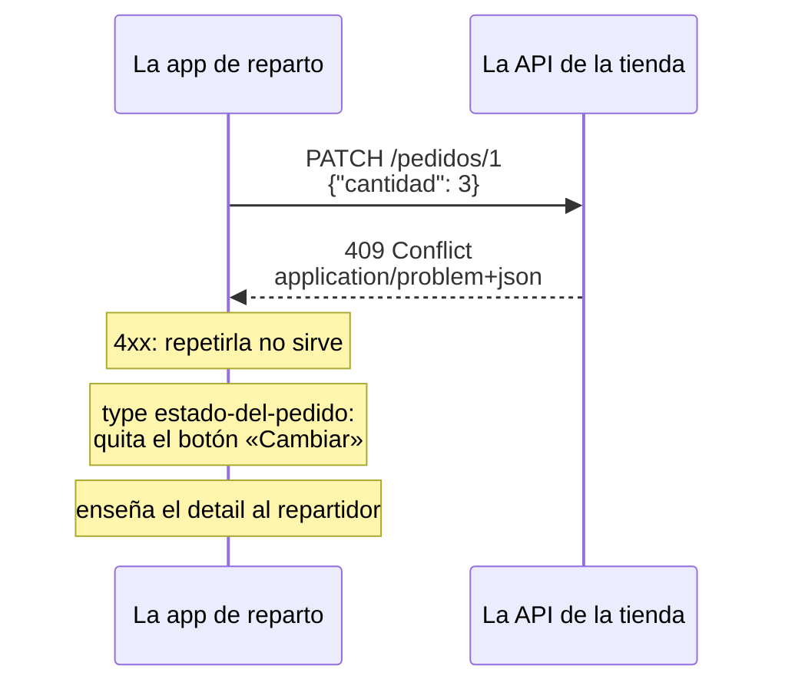

import Term from '~/components/Term.astro';
import TryIt from '~/components/TryIt.astro';
import Analogy from '~/components/Analogy.astro';
import ProjectCode from '~/components/ProjectCode.astro';
import Quiz from '~/components/Quiz.astro';
import QuizQuestion from '~/components/QuizQuestion.astro';
import QuizOption from '~/components/QuizOption.astro';

## El problema

Imagina que la empresa de reparto ya usa la <Term id="api">API</Term> de la tienda. Su programadora, Marta, quiere que la app de los repartidores explique bien cada fallo. Pide cosas que no existen, envía datos mal y un día le llega un fallo del servidor. Esto le contesta la tienda tal y como la dejaste en la lección 1, «REST»:

```text
{"error":"No existe ese pedido"}
{"error":"Los datos no son válidos","detalles":[{"campo":"productoId","problema":"Tiene que ser un número"},{"campo":"cantidad","problema":"Como mínimo, 1"}]}
{"error":"La petición no se puede leer","detalle":"Malformed JSON in request body"}
{"error":"Error interno del servidor","requestId":"9309531a-277f-4a53-a38c-bfa4d4ee5845"}
```

Cuatro errores, cuatro formas: `detalles` en uno, `detalle` en otro, `requestId` en el último. Marta tiene que escribir un caso para cada forma y adivinar las que aún no ha visto. Y cada API inventa la suya: GitHub responde `{"message": "Not Found", "documentation_url": "…", "status": "404"}`.

Una API que otros usan necesita **una sola forma para todos sus errores**, y mejor si es un estándar que los programas ya conocen. Existe, y se llama Problem Details.

## La analogía

<Analogy>

Piensa en el aviso que te deja el repartidor cuando no puede entregarte un paquete. Siempre es el mismo impreso: una casilla marcada con el motivo («ausente», «dirección incompleta»), una línea escrita a mano («el portero no estaba») y el número de envío.

La casilla dice qué ha pasado, y correos actúa igual con todas las de «ausente»: vuelve mañana. La nota cuenta tu caso. Y si reclamas, das el número de envío y con él lo encuentran.

<div slot="limits">

- El aviso lo lee una persona. Un error de una API lo lee primero un programa, que decide por la casilla y no por la nota.
- Las casillas del aviso son siempre las mismas; cada API inventa sus propios tipos de problema.
- El número de envío siempre está; en un error de una API, el identificador del caso es opcional.

</div>

</Analogy>

## Cómo funciona de verdad

Las salidas son de Node 26.11.1, con el proyecto de esta lección.

### Un error con cinco campos

Este es el `409 Conflict` de la tienda cuando intentas cambiar la cantidad de un pedido cancelado, sin las demás cabeceras y con saltos de línea:

```http
HTTP/1.1 409 Conflict
content-type: application/problem+json

{
  "type": "https://tienda.example/problemas/estado-del-pedido",
  "title": "El estado del pedido no lo permite",
  "status": 409,
  "detail": "El pedido está cancelado: ya no se puede cambiar"
}
```

Es un <Term id="problem-details">Problem Details</Term>, la forma que define el <Term id="rfc">RFC</Term> 9457, «Problem Details for HTTP APIs» (2023). Sustituye al RFC 7807, de 2016: verás los dos números en documentación y librerías. Define cinco campos, todos opcionales:

| Campo | Qué dice | Cambia de una vez a otra |
|---|---|---|
| `type` | Qué tipo de problema es, con una URI | No: es su nombre |
| `title` | El resumen de ese tipo, para una persona | No |
| `status` | El <Term id="status-code">código de estado</Term>, repetido en el cuerpo | No |
| `detail` | Qué ha pasado esta vez, para una persona | Sí |
| `instance` | Cuál de las veces: un identificador de este caso | Sí |

Una URI es el nombre general de las direcciones como las <Term id="url">URL</Term>. Algunas solo nombran algo, sin llevar a ninguna parte, como el `urn:uuid:…` que verás en el `500`.

El cuerpo es <Term id="json">JSON</Term>, pero va como `application/problem+json`, su propio <Term id="mime-type">tipo de contenido</Term>. Así el cliente sabe por la <Term id="header">cabecera</Term>, antes de leer el cuerpo, que es un error con esta forma.

### El type es para los programas; el detail, para las personas

El programa de Marta no lee frases: compara `type`. Si es `…/estado-del-pedido`, quita el botón «Cambiar» de ese pedido. El RFC lo dice así: el cliente usa `type` como identificador del problema, y **no debería sacar información de `detail`**.

`detail` cambia con cada caso: el día que lo redactes de otra forma, un programa que buscaba «cancelado» fallará sin avisar. Un dato que el cliente necesite va en un campo propio, una extensión (más abajo).

`title` es fijo para cada `type`, y es lo que una app enseña si no conoce el tipo. `status` tiene que coincidir con el código de la respuesta: va también en el cuerpo por si el JSON se guarda sin las cabeceras.

### problema(): todos los errores pasan por aquí

El proyecto tiene un fichero nuevo, `src/problemas.ts`, con todo lo que escribe errores. Empieza así:

<ProjectCode file="tienda-api/11-errores-api/src/problemas.ts" region="problema" />

Palabra a palabra:

- **`interface Problema`** describe los cinco campos, como las `interface` de la [lección 3 de la Fase 3](/fase-3/typescript-con-node/). El `?` detrás de un nombre lo hace opcional: `detail` e `instance` pueden faltar.
- **`errores`** no está en el RFC: es una extensión de la tienda.
- **`ContentfulStatusCode`** es un tipo de Hono: los códigos que pueden llevar cuerpo. Un `204` no puede, y TypeScript no te dejará usarlo aquí.
- **`problema(c, datos, cabeceras)`** responde con `c.json` y le pasa las cabeceras: su `Content-Type` sustituye al `application/json` que pondría `c.json`, y `cabeceras` añade las del error, como el `Allow` de un `405`.

Si todos los errores pasan por una función, todos tienen la misma forma: nadie los escribe a mano en una ruta.

### about:blank, cuando el código ya lo dice todo

Un `404` es «no existe», y el código ya lo dice: no necesita un tipo propio. Para estos casos, el RFC reserva un `type` especial, `about:blank`, que significa «nada más que el código», y pide que el `title` sea la frase del código, como `Not Found`:

<ProjectCode file="tienda-api/11-errores-api/src/problemas.ts" region="problema-http" />

- **`STATUS_CODES`** es un objeto de Node con la frase de cada código: `STATUS_CODES[404]` es `'Not Found'`. `?? 'Error'` pone `'Error'` si un código no la tuviera.
- **`detail`** cuenta el caso en español: «No existe ese pedido». El `title` se queda con la frase del estándar, en inglés; el RFC deja traducirlo, pero aquí no hace falta.

Con `problemaHttp` responden los `404` (también el de una <Term id="route">ruta</Term> que no existe, en `app.notFound`), el `401` de `soloAdmin`, el `405` y el `400` de un cuerpo que no se puede leer.

### Un tipo propio cuando el cliente tiene que distinguir

Un `409` no basta para que la app de Marta sepa qué hacer: puede ser un pedido cancelado, sin stock o pagado dos veces. Ahí hace falta un `type` de la tienda:

<ProjectCode file="tienda-api/11-errores-api/src/problemas.ts" region="tipos" />

- **`tipo('estado-del-pedido')`** devuelve `https://tienda.example/problemas/estado-del-pedido`: bajo el dominio de la tienda, no choca con los tipos de nadie. No tiene por qué abrirse, pero el RFC anima a que lleve a una página que explique el problema.
- **`datosNoValidos`** es el `422` de la validación, con su tipo, un `title` fijo y la lista de `errores`.

Y en `src/app.ts`, el `409` de los pedidos. Lo usan dos rutas: cambiar un pedido que ya no está `pendiente` y cancelar uno `enviado`. El `title` es siempre el mismo; el `detail`, el de cada caso:

<ProjectCode file="tienda-api/11-errores-api/src/app.ts" region="conflicto" />

### Los errores de validación, con cada campo

El RFC deja añadir campos propios, las **extensiones**. La tienda añade `errores`, una lista con cada campo que falla: lo que necesita un formulario para marcar en rojo cada casilla. El <Term id="middleware">middleware</Term> `validar` de la [lección 7 de la Fase 3](/fase-3/validar-datos-zod/) cambia dos líneas:

<ProjectCode file="tienda-api/11-errores-api/src/middleware/validar.ts" region="validar" />

Cada problema de Zod se convierte en `{ campo, problema }`, como antes, y `datosNoValidos` los envía todos a la vez.

El producto que no existe, que la ruta comprueba después del <Term id="schema">esquema</Term>, usa el mismo tipo, con su campo:

<ProjectCode file="tienda-api/11-errores-api/src/app.ts" region="pedidos" />

Para el cliente, un dato mal escrito y un producto que no existe son lo mismo: un dato que no vale, en un campo. **Un solo tipo, y una sola forma de leerlo.**

El nombre `errores` lo elige cada API (el ejemplo del RFC usa `errors`). Y el RFC añade una regla que protege a todos: **un cliente ignora las extensiones que no conoce**, así que añadir una mañana no rompe a nadie.

### Lo que nunca va en un error

Cualquiera puede provocar un error con `curl`, y lo que pongas en él lo lee también quien busca un hueco:

- **La <Term id="stack-trace">traza</Term> o el mensaje de un error inesperado:** dicen qué carpetas, librerías y versiones usas ([lección 8 de la Fase 3](/fase-3/errores-y-logs-node/#un-500-que-no-cuenta-nada)).
- **La consulta a la base de datos o su error.** PostgreSQL, en la Fase 5, falla con mensajes como `duplicate key value violates unique constraint "usuarios_email_key"`: el nombre de una tabla y de una regla interna.
- **Datos de otras personas**, o pistas sobre ellos. «Ese correo ya tiene cuenta» le confirma a cualquiera quién es cliente de la tienda: lo verás en la Fase 6.

El RFC lo pide también: `detail` ayuda al cliente a arreglar su petición, no a depurar tu servidor. El `500` de la tienda sigue la regla:

<ProjectCode file="tienda-api/11-errores-api/src/app.ts" region="errores" />

- **El `400`** ya no copia el mensaje de Hono: lo escribe una librería, en inglés, y puede cambiar en la próxima versión.
- **El `500`** usa `about:blank` y el `title` del código. El `detail` no cuenta qué ha fallado: dice qué hacer.
- **`instance`** lleva el id de la petición de la [lección 8 de la Fase 3](/fase-3/errores-y-logs-node/#un-id-para-cada-petición), escrito como `urn:uuid:…`: así se convierte en URI un id aleatorio de este tipo, un UUID. El mismo id está en el <Term id="log">log</Term>, junto a la traza.

### 4xx o 5xx: el contrato con el cliente

En la [lección 3 de la Fase 2](/fase-2/codigos-de-estado-http/#la-primera-cifra-dice-de-quién-es-el-problema) viste que la primera cifra dice de quién es el problema. Para una API, eso es un **contrato**: los programas de otros deciden con él.

| Lo que recibe el cliente | Qué hace |
|---|---|
| Un `4xx` | No repite la petición igual: fallaría igual. La corrige, o le enseña el `detail` a la persona |
| Un `5xx` | Puede reintentar más tarde, si repetir no duplica nada ([idempotente](/fase-2/metodos-http/#idempotente-repetirla-no-cambia-el-resultado)). A la persona, un mensaje general y el `instance` |
| Un `type` que no conoce | Se guía por el código y enseña el `title` |

Así lo usa la app de Marta con el `409`:



Por eso, una vez publicada la API, **un `type` no se cambia**: otros programas dependen de él. Cambiar un código o un `type` rompe a tus clientes; añadir un campo o una extensión, no. Lo verás a fondo en la lección 4, «[Versionado](/fase-4/versionado-api/)».

## Pruébalo

El objetivo: que todos los errores de la tienda tengan la misma forma, y comprobarlo con un solo filtro de `jq` que los lea todos.

Trabajas en tu `tienda-api` de `~/curso-backend/fase-3`, como la dejaste en la lección 1. No hay que instalar nada. Los cambios:

1. Crea `src/problemas.ts`: tres `import` (`STATUS_CODES` de `'node:http'`, y con `import type`, `Context` de `'hono'` y `ContentfulStatusCode` de `'hono/utils/http-status'`) y debajo, las tres partes de arriba.
2. En `src/middleware/`, `validar.ts` importa `datosNoValidos` de `'../problemas.ts'` y cambia como has visto. `solo-admin.ts` importa `problemaHttp` y responde con él su `401`, con `WWW-Authenticate` en `cabeceras`.
3. En `src/app.ts`, importa `datosNoValidos`, `problema`, `problemaHttp` y `tipo` de `'./problemas.ts'` y añade `type Context` al `import` de Hono. Cambia cada `c.json({ error: … })` por la función que toca, `onError` incluido. El `405` también usa `problemaHttp`, con la lista de métodos en `Allow`.

Si te atascas, descarga la carpeta de esta lección y compárala con la tuya: desde `~/curso-backend/fase-3`, `curl -O https://backenddesdecero.com/practicas/tienda-api/11-errores-api.tar.gz` y `tar -xzf 11-errores-api.tar.gz`. Su `test/problemas.test.ts` comprueba la forma de cada error: `npm test` debería terminar con `pass 23` y `fail 0`.

Arranca el servidor con `npm start --silent | tee tienda.log`, como en la [lección 8 de la Fase 3](/fase-3/errores-y-logs-node/), y abre otra terminal en la misma carpeta. Tus ids y fechas serán otros.

<TryIt
  title="1. Una ruta que no existe"
  cmd="curl -i localhost:3000/ofertas"
  output={`HTTP/1.1 404 Not Found
content-type: application/problem+json
vary: Origin
x-request-id: 2f423f72-dc81-48df-8bf8-0d8085d77a8f
content-length: 85
Date: Tue, 13 Oct 2026 14:28:39 GMT
Connection: keep-alive
Keep-Alive: timeout=5

{"type":"about:blank","title":"Not Found","status":404,"detail":"No existe esa ruta"}`}
>

Fíjate en `content-type: application/problem+json` y en el `about:blank`: el código lo dice todo, y `detail` añade el caso.

Si sale `{"error":"No existe esa ruta"}`, el servidor no tiene tus cambios: páralo con <kbd>Ctrl</kbd> + <kbd>C</kbd> y arráncalo otra vez.

</TryIt>

<TryIt
  title="2. Un pedido con dos campos mal"
  cmd={`curl -i --json '{"productoId":"uno","cantidad":0}' localhost:3000/pedidos`}
  output={`HTTP/1.1 422 Unprocessable Entity
content-type: application/problem+json
vary: Origin
x-request-id: 6ada548c-019f-4ac4-a93d-45b641c01f47
content-length: 289
Date: Tue, 13 Oct 2026 14:28:39 GMT
Connection: keep-alive
Keep-Alive: timeout=5

{"type":"https://tienda.example/problemas/datos-no-validos","title":"Los datos no son válidos","status":422,"detail":"Mira en «errores» qué falla en cada campo.","errores":[{"campo":"productoId","problema":"Tiene que ser un número"},{"campo":"cantidad","problema":"Como mínimo, 1"}]}`}
>

Un solo `422` con los dos problemas en `errores`: el producto no es un número y la cantidad es menor que 1.

</TryIt>

Ahora, léelo como un programa. `jq` ([lección 8 de la Fase 3](/fase-3/errores-y-logs-node/)) saca cada campo de la lista:

<TryIt
  title="3. Los errores, campo a campo"
  cmd={`curl -s --json '{"productoId":"uno","cantidad":0}' localhost:3000/pedidos | jq -r '.errores[] | "\\(.campo): \\(.problema)"'`}
  output={`productoId: Tiene que ser un número
cantidad: Como mínimo, 1`}
>

`.errores[]` recorre la lista, y `"\(.campo): \(.problema)"` escribe cada elemento como texto, con sus dos valores. Así marcaría la app de Marta cada casilla de su formulario.

</TryIt>

<TryIt
  title="4. Un producto que no existe"
  cmd={`curl -w '\\n' --json '{"productoId":99,"cantidad":1}' localhost:3000/pedidos`}
  output={`{"type":"https://tienda.example/problemas/datos-no-validos","title":"Los datos no son válidos","status":422,"detail":"Mira en «errores» qué falla en cada campo.","errores":[{"campo":"productoId","problema":"No existe ese producto"}]}`}
>

El mismo `type` que en el paso 2, aunque esta vez lo detecta la ruta y no el esquema: el filtro del paso 3 también lo lee.

</TryIt>

<TryIt
  title="5. Un pedido que ya no se puede cambiar"
  cmd={`curl -w '\\n' --json '{"productoId":1,"cantidad":2}' localhost:3000/pedidos
curl -w '\\n' -X POST localhost:3000/pedidos/1/cancelacion
curl -i -X PATCH --json '{"cantidad":3}' localhost:3000/pedidos/1`}
  output={`{"id":1,"productoId":1,"cantidad":2,"estado":"pendiente"}
{"id":1,"productoId":1,"cantidad":2,"estado":"cancelado"}
HTTP/1.1 409 Conflict
content-type: application/problem+json
vary: Origin
x-request-id: ae6f71ce-5476-4235-979e-6abae9d58d21
content-length: 180
Date: Tue, 13 Oct 2026 14:28:48 GMT
Connection: keep-alive
Keep-Alive: timeout=5

{"type":"https://tienda.example/problemas/estado-del-pedido","title":"El estado del pedido no lo permite","status":409,"detail":"El pedido está cancelado: ya no se puede cambiar"}`}
>

Creas el pedido 1, lo cancelas e intentas cambiar su cantidad: `409` con el tipo propio de la tienda. Si el pedido sale con otro `id`, ya tenías pedidos creados: usa ese número en las otras dos órdenes.

</TryIt>

<TryIt
  title="6. Los errores de HTTP de siempre"
  cmd={`curl -w '\\n' -X PUT localhost:3000/pedidos/1
curl -w '\\n' --json '{"productoId":1,"cant' localhost:3000/pedidos
curl -w '\\n' --json '{"nombre":"Gorra","precio":15}' localhost:3000/productos`}
  output={`{"type":"about:blank","title":"Method Not Allowed","status":405,"detail":"Esta ruta no admite PUT"}
{"type":"about:blank","title":"Bad Request","status":400,"detail":"La petición no se puede leer"}
{"type":"about:blank","title":"Unauthorized","status":401,"detail":"Hace falta un token válido"}`}
>

Un método que la ruta no tiene, un cuerpo cortado y un producto nuevo sin token: tres `about:blank`, cada uno con la frase de su código. Con `-i` verías el `Allow` del `405` y el `WWW-Authenticate` del `401`.

</TryIt>

<TryIt
  title="7. Un filtro para todos"
  cmd={`for ruta in /ofertas /productos/99 /productos/abc /pedidos/1/cancelacion; do
  curl -s localhost:3000$ruta | jq -c '{status, type, title}'
done`}
  output={`{"status":404,"type":"about:blank","title":"Not Found"}
{"status":404,"type":"about:blank","title":"Not Found"}
{"status":422,"type":"https://tienda.example/problemas/datos-no-validos","title":"Los datos no son válidos"}
{"status":405,"type":"about:blank","title":"Method Not Allowed"}`}
>

`for` repite la orden de dentro con cada valor de `ruta`, como en los scripts de la [lección 8 de la Fase 1](/fase-1/scripts-de-bash/#for-repetir-lo-mismo-con-cada-elemento). `{status, type, title}` se queda con esos tres campos, y `-c` escribe cada resultado en una línea. Cuatro errores distintos, un solo filtro: en la lección 1 habrías necesitado uno por forma.

</TryIt>

### El 500 y su instance

La tienda ya no tiene ninguna ruta que falle a propósito: una API pública no la tendría. Para ver el `500`, añade una **ruta de prueba** solo un momento, al final de `src/app.ts`:

```ts title="src/app.ts (al final, solo para esta prueba)"
// Solo para probar el 500: bórrala después.
app.get('/prueba-de-error', () => {
  throw new Error('Algo ha fallado a propósito');
});
```

`throw` lanza un error que la ruta no captura, como `/error` en la Fase 3, y lo recoge `onError`. Para el servidor con <kbd>Ctrl</kbd> + <kbd>C</kbd> y arráncalo otra vez con `npm start --silent | tee tienda.log`.

<TryIt
  title="8. Un fallo del servidor"
  cmd="curl -i localhost:3000/prueba-de-error"
  output={`HTTP/1.1 500 Internal Server Error
content-type: application/problem+json
vary: Origin
x-request-id: 03a4f7df-4727-4a3c-a26f-bf41252119ee
content-length: 219
Date: Tue, 13 Oct 2026 14:29:10 GMT
Connection: keep-alive
Keep-Alive: timeout=5

{"type":"about:blank","title":"Internal Server Error","status":500,"detail":"Algo ha fallado en el servidor. Si se repite, avísanos con el valor de instance.","instance":"urn:uuid:03a4f7df-4727-4a3c-a26f-bf41252119ee"}`}
>

Ni rastro de «Algo ha fallado a propósito» ni de la traza. El cliente solo sabe que el fallo es del servidor, y tiene un número para reclamar: el de `instance`, el mismo que `x-request-id`.

</TryIt>

<TryIt
  title="9. Del instance a la línea que falla"
  cmd={`grep 03a4f7df tienda.log | jq -r 'select(.err) | .err.stack'`}
  output={`Error: Algo ha fallado a propósito
    at file:///Users/ana/curso-backend/fase-3/tienda-api/src/app.ts:153:9
    at dispatch (file:///Users/ana/curso-backend/fase-3/tienda-api/node_modules/hono/dist/compose.js:35:17)
    at file:///Users/ana/curso-backend/fase-3/tienda-api/node_modules/hono/dist/compose.js:35:40
    at cors (file:///Users/ana/curso-backend/fase-3/tienda-api/node_modules/hono/dist/middleware/cors/index.js:103:9)
    at async dispatch (file:///Users/ana/curso-backend/fase-3/tienda-api/node_modules/hono/dist/compose.js:35:11)
    at async registro (file:///Users/ana/curso-backend/fase-3/tienda-api/src/middleware/registro.ts:7:3)
    at async dispatch (file:///Users/ana/curso-backend/fase-3/tienda-api/node_modules/hono/dist/compose.js:35:11)
    at async requestId (file:///Users/ana/curso-backend/fase-3/tienda-api/node_modules/hono/dist/middleware/request-id/request-id.js:30:3)
    at async dispatch (file:///Users/ana/curso-backend/fase-3/tienda-api/node_modules/hono/dist/compose.js:35:11)
    at async file:///Users/ana/curso-backend/fase-3/tienda-api/node_modules/hono/dist/hono-base.js:287:21`}
>

Usa tu id, no el de aquí. `grep` encuentra las líneas de esa petición, y `select(.err)` se queda con la de `log.error`. La traza dice dónde está el `throw`: `src/app.ts:153:9` (en tu fichero, la línea puede ser otra). Lo que el cliente no ve, tú lo tienes entero.

</TryIt>

Ya has visto el `500`: **borra la ruta `/prueba-de-error`** de `src/app.ts` y reinicia el servidor. `curl -i localhost:3000/prueba-de-error` debería responder ahora el `404` del paso 1.

## Ya lo has visto

- **Los formularios que, al enviar, marcan en rojo varios campos a la vez** suelen recibir del servidor una lista como `errores`. En [DevTools](/fase-2/#antes-de-empezar-devtools), pestaña **Red** (*Network*), verás esa respuesta: un `400` o un `422` con los campos.
- **«Algo ha salido mal. Código de referencia: 7F3A…»** es un `instance`, o algo que hace su papel: el número que soporte busca en su log.

## Errores comunes

- **Un formato de error por ruta** (el de cada ruta, el de Hono para un cuerpo roto, el de `notFound`…). Que todos pasen por una función, como `problema`.
- **Hacer que el cliente lea `detail`.** Es para personas y cambia de un caso a otro. Lo que un programa necesita va en `type` o en una extensión.
- **Enviar como `application/json`.** El cuerpo es el mismo, pero el cliente no sabe, antes de leerlo, que es un Problem Details.
- **Un `status` en el cuerpo que no coincide con el de la respuesta,** o un `200` con un error dentro ([lección 3 de la Fase 2](/fase-2/codigos-de-estado-http/#el-200-con-un-error-dentro)). El cliente hará lo que dice el código de la respuesta.

## Resumen

- Una API que otros usan responde todos sus errores con la misma forma, para que un solo código de cliente los lea. Problem Details (RFC 9457) es la estándar: `type`, `title`, `status`, `detail` e `instance`, como `application/problem+json`.
- Los programas deciden por el código y el `type`; las personas leen `title` y `detail`. `about:blank`, cuando el código lo dice todo; un tipo propio, cuando el cliente tiene que distinguir.
- Las extensiones, como `errores`, añaden datos; un cliente ignora las que no conoce.
- Un error nunca enseña la traza, la base de datos ni datos de otros. El `500` lleva solo un `instance` para encontrarlo en el log.

## ¿Lo has entendido?

<Quiz>

<QuizQuestion
  question="El programa de la empresa de reparto busca la palabra «cancelado» en el detail para saber si un pedido se puede cambiar. La semana que viene reescribes ese texto. ¿Qué debería comprobar en su lugar?"
  review="El type es para los programas; el detail, para las personas"
>

<QuizOption text="El status: el 409 ya dice que el pedido está cancelado.">

Un `409` puede ser un pedido cancelado, uno enviado o cualquier otro conflicto. Hace falta el `type`.

</QuizOption>

<QuizOption text="El type: es el nombre del problema y no depende del texto." correct>

El `type` es el nombre del problema para los programas. El `detail` es para personas, y su redacción puede cambiar en cualquier momento.

</QuizOption>

<QuizOption text="Nada: el RFC prohíbe cambiar el texto del detail una vez publicado.">

Es al revés: `detail` cambia de un caso a otro, y el RFC pide a los clientes que no saquen información de él.

</QuizOption>

</QuizQuestion>

<QuizQuestion
  question="Un compañero quiere poner en el detail del 500 el mensaje del error, sin la traza: «así el cliente sabe qué ha pasado». ¿Qué le contestas?"
  review="Lo que nunca va en un error"
>

<QuizOption text="Que sí: el detail es justo para explicar qué ha fallado en el servidor.">

El RFC dice que `detail` ayuda al cliente a arreglar su petición, no a depurar el servidor. En un `500`, el cliente no tiene nada que arreglar.

</QuizOption>

<QuizOption text="Que sí: sin la traza, el mensaje solo no revela nada del servidor.">

Un mensaje puede revelar mucho: el de PostgreSQL nombra tablas y reglas internas. El mensaje y la traza van al log.

</QuizOption>

<QuizOption text="Que no: el mensaje va al log; al cliente le basta el instance." correct>

Con el `instance` encuentras en el log el error entero, traza incluida. Y nadie de fuera ve cómo está hecho tu servidor.

</QuizOption>

</QuizQuestion>

<QuizQuestion
  question="La app del móvil quiere enseñar un aviso especial cuando un producto se queda sin stock, distinto de otros conflictos. ¿Cómo lo respondes?"
  review="Un tipo propio cuando el cliente tiene que distinguir"
>

<QuizOption text="Con un 409 y un type propio, como …/problemas/sin-stock." correct>

El código dice la familia del problema, y el `type`, cuál es. La app compara el `type`; un cliente que no lo conozca se guía por el `409`.

</QuizOption>

<QuizOption text="Con un código propio, como un 499, para que no se confunda con nada.">

Un código que el cliente no conoce se trata como el `x00` de su familia, aquí un `400`, y además no es un estándar. Los códigos los fija HTTP; los tipos, tú.

</QuizOption>

<QuizOption text="Con about:blank y «Sin stock» en el detail, que la app reconoce.">

`about:blank` significa «nada más que el código», y obliga a la app a leer el `detail`, que es para personas y puede cambiar.

</QuizOption>

</QuizQuestion>

<QuizQuestion
  question="El cuerpo de un Problem Details ya es JSON. ¿Para qué sirve enviarlo como application/problem+json y no como application/json?"
  review="Un error con cinco campos"
>

<QuizOption text="Para que el navegador lo enseñe como un error, con su propia página.">

El navegador no hace nada especial con este tipo. Quien lo aprovecha es el código del cliente.

</QuizOption>

<QuizOption text="Para que el cliente sepa por la cabecera que es un error así." correct>

El cliente lo sabe antes de leer el cuerpo, y puede pasarlo siempre por el mismo código.

</QuizOption>

<QuizOption text="Para que solo lo puedan leer las librerías que conocen el RFC 9457.">

Es JSON normal: `jq` y cualquier lector de JSON lo leen. El tipo de contenido solo avisa de la forma que tiene.

</QuizOption>

</QuizQuestion>

<QuizQuestion
  question="Añades a todos los errores de la tienda una extensión nueva, ayuda, con un enlace. La app de reparto no sabe nada de ella. ¿Qué le pasa?"
  review="Los errores de validación, con cada campo"
>

<QuizOption text="Deja de funcionar: un Problem Details solo admite los cinco campos del RFC.">

El RFC permite extensiones, como `errores`, y pide a los clientes que ignoren las que no conocen.

</QuizOption>

<QuizOption text="Deja de funcionar hasta que publiques un type nuevo para cada problema.">

El `type` no cambia por añadir un campo. Cambiarlo, en cambio, sí rompería a la app.

</QuizOption>

<QuizOption text="Nada: un cliente ignora las extensiones que no conoce." correct>

Es una regla del RFC: por eso añadir una extensión no rompe a nadie. Cambiar un `type` o un código, sí.

</QuizOption>

</QuizQuestion>

<QuizQuestion
  question="La app de reparto recibe un 422 al crear un pedido, y otro día, al consultar un pedido con GET, un 500. ¿Cuál debería volver a intentar sola, más tarde?"
  review="4xx o 5xx: el contrato con el cliente"
>

<QuizOption text="Los dos: si reintenta suficientes veces, alguna acabará saliendo bien.">

Un `422` dice que los datos no valen: la misma petición fallará siempre igual. Hay que corregirla.

</QuizOption>

<QuizOption text="El 500: puede ir bien más tarde, y un GET se puede repetir sin miedo." correct>

Un `5xx` es un fallo del servidor, que puede arreglarse solo. Y un `GET` no cambia nada, así que repetirlo no duplica ningún pedido.

</QuizOption>

<QuizOption text="El 422: es un error leve, y un 500 significa que el servidor ya no funciona.">

Un `500` dice que esa petición falló en el servidor, no que el servidor ya no funcione. Y el `422` fallará igual hasta que el cliente cambie los datos.

</QuizOption>

</QuizQuestion>

</Quiz>

## Para profundizar

- [RFC 9457, Problem Details for HTTP APIs](https://www.rfc-editor.org/rfc/rfc9457.html) (en inglés): corto y legible, con ejemplos de cada campo y de las extensiones, y un apartado, «[Security Considerations](https://www.rfc-editor.org/rfc/rfc9457.html#name-security-considerations)», sobre qué no enseñar en un error.
- [Error Handling Cheat Sheet](https://cheatsheetseries.owasp.org/cheatsheets/Error_Handling_Cheat_Sheet.html) (OWASP, en inglés): cómo responder errores sin dar pistas a un atacante.
- [Error handling](https://hono.dev/docs/api/hono#error-handling) (Hono, en inglés): `notFound` y `onError`.
