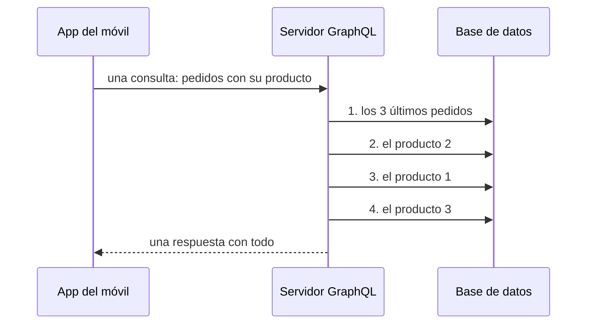

import Term from '~/components/Term.astro';
import TryIt from '~/components/TryIt.astro';
import Analogy from '~/components/Analogy.astro';
import SelfCheck from '~/components/SelfCheck.astro';
import Quiz from '~/components/Quiz.astro';
import QuizQuestion from '~/components/QuizQuestion.astro';
import QuizOption from '~/components/QuizOption.astro';

## El problema

La app del móvil de la tienda, la de la [introducción de esta fase](/fase-4/), tiene una pantalla, «Mis pedidos», con los tres últimos pedidos y el nombre del producto de cada uno. Con tu API, la app tiene que hacer esto:

```sh
curl -w '\n' 'localhost:3000/v2/pedidos?limite=3'
curl -w '\n' localhost:3000/v2/productos/2
curl -w '\n' localhost:3000/v2/productos/1
curl -w '\n' localhost:3000/v2/productos/3
```

```
[{"id":25,"productoId":2,"cantidad":2,"estado":"pendiente","creadoEn":"2026-10-08T09:00:00.000Z"},{"id":24,"productoId":1,"cantidad":1,"estado":"pendiente","creadoEn":"2026-10-08T02:00:00.000Z"},{"id":23,"productoId":3,"cantidad":4,"estado":"pendiente","creadoEn":"2026-10-07T19:00:00.000Z"}]
{"id":2,"nombre":"Taza","precioCentimos":850}
{"id":1,"nombre":"Camiseta","precioCentimos":2000}
{"id":3,"nombre":"Sudadera","precioCentimos":3500}
```

Son salidas reales del proyecto de la lección 8, con Node 26. Cuatro peticiones para una pantalla, cada una con su viaje por la red del móvil y su <Term id="latency">latencia</Term>; con veinte pedidos, veintiuna. Y el precio viaja aunque la pantalla no lo enseñe.

El estudio que hace la app te pide una ruta a medida, `/v2/mis-pedidos-con-productos`. La semana que viene, la empresa de reparto querrá otra. Una ruta por cada pantalla de cada cliente no se acaba nunca.

Facebook se topó con este problema en 2012, con su app, y [se inventó GraphQL](https://engineering.fb.com/2015/09/14/core-infra/graphql-a-data-query-language/). Google tenía otro, entre sus propios servicios, y de ahí salió [gRPC](https://grpc.io/blog/principles/). En esta lección verás cuándo vale la pena cada uno.

## La analogía

<Analogy>

En un restaurante con carta, cada plato llega como lo ha pensado la cocina. Si quieres el pollo del plato 3 y la ensalada del 5, pides los dos platos, y te sobran las patatas de uno y el arroz del otro. Eso es REST: cada dirección devuelve un plato cerrado.

Imagina ahora una cocina que te da una hoja con todo lo que tiene, y tú marcas lo que quieres: «pollo, ensalada». Te lo traen en un solo plato. Eso es GraphQL.

Y entre la cocina y el obrador que les hace el pan hay un interfono con pedidos en clave, sobre hojas preimpresas que los dos tienen: «P-12, cuarenta». Rápido, pero ningún cliente lo usa. Eso es gRPC.

<div slot="limits">

- En el restaurante, una hoja con todo marcado se nota. En GraphQL, una consulta que pide miles de datos cabe en tres líneas, y el servidor tiene que ponerle límites.
- La carta cerrada deja tener platos preparados de antemano: es la caché de HTTP, y GraphQL la pierde.
- Las hojas preimpresas de gRPC son un fichero del que se genera código. Si cambian, los dos lados necesitan la versión nueva.

</div>

</Analogy>

## Cómo funciona de verdad

### GraphQL: una sola dirección y una consulta con los campos que quieres

Esta consulta va a `https://countries.trevorblades.com/graphql`, una API pública de países que no pide cuenta:

```graphql
{
  country(code: "ES") {
    name
    capital
    currency
  }
}
```

Y responde:

```json
{"data":{"country":{"capital":"Madrid","currency":"EUR","name":"Spain"}}}
```

`country(code: "ES")` es lo que pides: un país, con su código como argumento. Entre llaves, los campos que quieres de él, y solo llegan esos tres, dentro de `data` y con la forma de la consulta.

**<Term id="graphql">GraphQL</Term> es un lenguaje para pedir datos a una API: el cliente escribe qué campos quiere, y el servidor responde con esa misma forma.** Todas las consultas van a la misma URL, casi siempre con `POST`, y la consulta viaja en el <Term id="request-body">cuerpo</Term>, dentro de un <Term id="json">JSON</Term>: `{"query": "…"}`. Ya no es la URL la que dice qué pides, sino el cuerpo.

¿Cómo sabes qué campos existen? El servidor publica un <Term id="schema">esquema</Term> con sus tipos: un `Country` tiene `name`, `capital` o `languages`, y `languages` es una lista de `Language`. Cada consulta se comprueba contra él antes de ejecutarse, como hacía Zod en la [Fase 3](/fase-3/validar-datos-zod/). Y al esquema se le puede preguntar qué tiene: así autocompletan los editores.

### Qué resuelve: pedir de más y pedir de menos

Una API REST decide qué devuelve cada dirección, y eso falla de dos maneras:

- **Pedir de más** (*over-fetching*): llegan datos que no usas, como el precio en la pantalla de «Mis pedidos».
- **Pedir de menos** (*under-fetching*): una respuesta no basta, y hay que hacer otra por cada cosa que falta, como las cuatro peticiones de «El problema».

Si la tienda tuviera GraphQL, la app escribiría esta consulta:

```graphql
{
  pedidos(limite: 3) {
    id
    cantidad
    producto {
      nombre
    }
  }
}
```

`producto` va dentro de cada pedido, y el servidor se encarga de juntarlos. Un solo viaje, y del producto, solo el nombre. Si mañana la empresa de reparto quiere otra combinación, escribe otra consulta, y tú no añades ninguna ruta.

### Lo que cuesta GraphQL

Lo que GraphQL le ahorra al cliente lo paga el servidor:

- **La caché de HTTP deja de servir.** Las cachés y las CDN de la [Fase 2](/fase-2/cache-http/#las-cdn-guardan-copias-para-todos) guardaban una copia por URL. Aquí todo va a la misma URL, y con `POST`, que en la práctica no se guarda. Hace falta una caché que lea el cuerpo, como la que verás en «Pruébalo».
- **Los errores llegan con `200`.** Una consulta mal escrita suele recibir `200 OK` y, en vez de `data`, una lista `errors`. Es el [«200 con un error dentro»](/fase-2/codigos-de-estado-http/#el-200-con-un-error-dentro) de la Fase 2: una alarma que cuenta los errores por su código no lo ve, y el cliente tiene que mirar el cuerpo.
- **Una consulta puede costar muchísimo.** Un país tiene su continente, el continente sus países, cada país su continente… En pocas líneas se piden miles de datos. Por eso los servidores GraphQL limitan la profundidad y el coste de cada consulta.
- **Más piezas que mantener:** el esquema, una función por campo que busca sus datos y una librería que lo une todo. Con uno o dos clientes, no compensa.

Y hay un coste escondido, el **problema N+1**. Para la consulta de la tienda, el servidor busca los pedidos una vez y, después, el producto de cada pedido, uno a uno:



Una búsqueda para los pedidos, más N, una por pedido: N+1. Con los datos en memoria, como hoy, no cuesta nada. Con una <Term id="database">base de datos</Term>, cada búsqueda es un viaje: cien pedidos, ciento una consultas, los viajes de «El problema» escondidos dentro del servidor. Se arregla agrupando las búsquedas (lo hace la librería DataLoader) o pidiendo todo en una sola consulta, como verás en la Fase 5.

### gRPC: llamar a una función de otro servicio

En una empresa grande, los servicios se llaman entre ellos miles de veces por segundo: el de pedidos pregunta al de stock, el de pagos al de fraude. Ahí nadie lee JSON. Para eso está **<Term id="grpc">gRPC</Term>: un servicio llama a una función de otro como si estuviera en su propio código.** RPC es *Remote Procedure Call* («llamada a un procedimiento remoto»).

Todo empieza en un fichero `.proto`. Este es el pedido de la lección 6 con un servicio encima:

```proto
syntax = "proto3";

package tienda;

import "pedido.proto";

service Pedidos {
  rpc VerPedido (PeticionPedido) returns (Pedido);
  rpc SeguirPedido (PeticionPedido) returns (stream Pedido);
}

message PeticionPedido {
  uint32 id = 1;
}
```

Palabra a palabra:

- `import "pedido.proto"` trae el mensaje `Pedido` de la lección 6.
- `service Pedidos` agrupa las funciones que ofrece el servicio.
- `rpc VerPedido (PeticionPedido) returns (Pedido)` es una función: recibe una `PeticionPedido` y devuelve un `Pedido`. Hace lo mismo que `GET /v2/pedidos/7`, con nombre de función en vez de URL.
- `stream Pedido` devuelve muchos, uno detrás de otro, mientras la conexión siga abierta, como Server-Sent Events en la lección 8.
- `message PeticionPedido` son los datos de entrada: un id, con su número de campo.

Lo demás que hace gRPC:

- **Genera el código.** Una herramienta, `protoc`, lee el `.proto` y escribe código en cada lenguaje: en el cliente, una <Term id="function">función</Term> `verPedido` que se llama como cualquier otra; en el servidor, el hueco donde escribes qué hace. Los bytes y la red van por su cuenta.
- **El `.proto` es el contrato, y es obligatorio.** Con OpenAPI, en la lección 5, el contrato era una ayuda; aquí, sin él, ningún lado entiende los bytes del otro.
- **Va en Protobuf sobre HTTP/2:** bytes en vez de texto, y muchas llamadas a la vez por una sola conexión, con la [multiplexación de HTTP/2](/fase-2/http2-http3/#http2-muchas-peticiones-a-la-vez-por-una-sola-conexión).
- **Tiene sus propios códigos.** La respuesta HTTP es un `200` aunque la llamada falle; el resultado de verdad (`OK`, `NOT_FOUND`, `UNAVAILABLE`…) llega en unas <Term id="header">cabeceras</Term> al final de la respuesta.

¿Y para una API pública? Un navegador no puede hacer una llamada gRPC: no deja a JavaScript manejar HTTP/2 a ese nivel. Hace falta gRPC-Web, una variante que el navegador sí puede enviar, y un intermediario que la traduzca. Con `curl` tampoco se prueba a mano, y quien te llame necesita tu `.proto`. Entre tus servicios, nada de eso importa; para la empresa de reparto, es un muro.

### Cuál elegir

| | REST | GraphQL | gRPC |
|---|---|---|---|
| Qué viaja | JSON, con una URL por recurso | Una consulta y JSON, siempre a la misma URL | Protobuf, en binario |
| Quién elige los campos | El servidor | El cliente | El `.proto`, para los dos |
| Contrato | Opcional (OpenAPI) | El esquema, obligatorio | El `.proto`, obligatorio |
| Caché de HTTP | Sí | No, sin una caché propia | No |
| Desde el navegador y con `curl` | Sí | Sí | No, sin intermediario |
| Errores | Códigos de estado | `errors`, a menudo con `200` | Sus propios códigos, con `200` |
| Dónde encaja | APIs públicas | Apps propias con muchas pantallas distintas | Entre servicios propios |

Y con las otras formas de hablar de esta fase:

| Necesitas… | Usa |
|---|---|
| Que cualquiera use tu API sin conocerte | REST, documentada con OpenAPI |
| Que tus apps pidan combinaciones distintas de los mismos datos | GraphQL |
| Que tus servicios se llamen entre ellos, muchas veces y rápido | gRPC |
| Avisar a otro servidor cuando pasa algo | Un webhook (lección 7) |
| Mandar al navegador lo que va pasando | Server-Sent Events (lección 8) |
| Hablar en los dos sentidos, como en un chat | WebSockets (lección 8) |

No se excluyen. Muchas empresas usan gRPC por dentro, REST hacia fuera y GraphQL para sus propias apps.

### Por qué REST sigue siendo lo normal en una API pública

Quien usa una API pública es un desconocido, y REST es lo que menos le pide:

- **Lo entiende cualquier herramienta:** `curl`, el navegador o cualquier lenguaje, sin generar código.
- **Aprovecha lo que HTTP ya tiene:** la caché por URL y las CDN, <Term id="status-code">códigos de estado</Term> que cualquier alarma entiende, y límites por ruta (Fase 6).
- **No te obliga a defenderte de consultas caras de desconocidos,** que con GraphQL serían cosa tuya.

GitHub ofrece las dos: su API REST, la de esta fase, sin cuenta, y una de GraphQL que [pide un token](https://docs.github.com/es/graphql/guides/forming-calls-with-graphql#authenticating-with-graphql).

## Pruébalo

El objetivo: averiguar qué responde una API GraphQL cuando aciertas, cuando te equivocas y cuando pides algo que no existe, y compararla con la API REST de GitHub. Solo necesitas `curl` y `jq`, el de la [lección 8 de la Fase 3](/fase-3/errores-y-logs-node/). Las salidas son de un Mac, del 13 de octubre de 2026.

<TryIt
  title="1. Tu primera consulta"
  cmd={`API=https://countries.trevorblades.com/graphql
curl -s -w '\\n' --json '{"query": "{ country(code: \\"ES\\") { name capital currency } }"}' $API`}
  output={`{"data":{"country":{"capital":"Madrid","currency":"EUR","name":"Spain"}}}`}
>

Palabra a palabra:

- `API=…` guarda la dirección en una variable de la terminal, y `$API` la usa. Dura mientras no cierres esa terminal.
- `--json`, de la [lección 1 de la Fase 2](/fase-2/peticion-y-respuesta-http/), envía el cuerpo con `POST` y `Content-Type: application/json`.
- El cuerpo es `{"query": "…"}`, con la consulta dentro como texto. Las comillas de `"ES"` llevan `\` delante porque van dentro de otro texto entre comillas.

Fíjate en que esta API devuelve los campos por orden alfabético, no en el de tu consulta. Da igual: un programa los busca por su nombre. Si ves `option --json: is unknown`, tu `curl` es anterior a 2022: actualízalo, o cambia `--json` por `-H 'Content-Type: application/json' -d`.

</TryIt>

<TryIt
  title="2. Datos dentro de datos"
  cmd={`curl -s --json '{"query": "{ country(code: \\"ES\\") { name continent { name } languages { native } } }"}' $API | jq`}
  output={`{
  "data": {
    "country": {
      "continent": {
        "name": "Europe"
      },
      "languages": [
        {
          "native": "Español"
        },
        {
          "native": "Euskara"
        },
        {
          "native": "Català"
        },
        {
          "native": "Galego"
        },
        {
          "native": "Occitan"
        }
      ],
      "name": "Spain"
    }
  }
}`}
>

`continent` es otro objeto, y `languages`, una lista; de cada uno pides sus propios campos. `jq` a secas solo reparte la respuesta en líneas para que se lea.

Si ves `curl: (2) no URL specified`, `$API` está vacía: estás en otra terminal. Vuelve a escribir la primera línea del paso 1.

</TryIt>

<TryIt
  title="3. Una consulta mal escrita y un país que no existe"
  cmd={`curl -s -w '\\n%{http_code}\\n' --json '{"query": "{ country(code: \\"ES\\") { nombre } }"}' $API
curl -s -w '\\n%{http_code}\\n' --json '{"query": "{ country(code: \\"XX\\") { name } }"}' $API`}
  output={`{"errors":[{"message":"Cannot query field \\"nombre\\" on type \\"Country\\". Did you mean \\"name\\"?","locations":[{"line":3,"column":5}],"extensions":{"code":"GRAPHQL_VALIDATION_FAILED"}}]}
200
{"data":{"country":null}}
200`}
>

`-w '\n%{http_code}\n'` escribe el código de estado debajo del cuerpo. **Los dos son `200`.**

- En el primero, no hay `data`: el campo `nombre` no está en el esquema, y la consulta ni se ha ejecutado. `locations` cuenta las líneas de la consulta como la reescribe el servicio.
- En el segundo, no hay error: el país `XX` no existe, y `country` es `null`. En REST sería un `404`.

</TryIt>

<TryIt
  title="4. El mismo error, con la especificación nueva"
  cmd={`curl -s -w '\\n%{http_code}\\n' -H 'Accept: application/graphql-response+json' --json '{"query": "{ country(code: \\"ES\\") { nombre } }"}' $API`}
  output={`{"errors":[{"message":"Cannot query field \\"nombre\\" on type \\"Country\\". Did you mean \\"name\\"?","locations":[{"line":3,"column":5}],"extensions":{"code":"GRAPHQL_VALIDATION_FAILED"}}]}
400`}
>

Ahora, `400`. [GraphQL over HTTP](https://http-spec.graphql.org/draft/), una especificación aún en borrador, define el formato `application/graphql-response+json` y, con él, un `4xx` para una consulta mal escrita (recomienda `422`). Esta API solo lo usa si el cliente lo pide en `Accept`, para no romper a los clientes antiguos.

</TryIt>

<TryIt
  title="5. La caché de esta API"
  cmd={`curl -si --json '{"query": "{ country(code: \\"ES\\") { name capital currency } }"}' $API | grep -i -e '^cache-control' -e '^x-cache' -e '^x-powered-by'`}
  output={`x-cache: HIT
x-powered-by: Stellate
cache-control: public, s-maxage=2628000, stale-while-revalidate=2628000`}
>

`-i` añade las cabeceras, y `grep` se queda con tres. Stellate es una caché hecha para GraphQL: lee el cuerpo de cada `POST` y guarda la respuesta de cada consulta. `x-cache: HIT` dice que esta salió de ahí, y `s-maxage`, que se guarda 2.628.000 segundos, un mes: los países casi no cambian.

Las cabeceras pueden salir en otro orden, según el servidor de la caché que te conteste, y con `x-cache: MISS` si allí aún no estaba guardada.

</TryIt>

<TryIt
  title="6. Lo mismo, con REST: un repositorio de GitHub"
  cmd={`curl -s -o node.json -w '%{size_download} bytes\\n' https://api.github.com/repos/nodejs/node
jq 'keys | length' node.json
jq '{name, description, stargazers_count}' node.json`}
  output={`6618 bytes
86
{
  "name": "node",
  "description": "Node.js JavaScript runtime ✨🐢🚀✨",
  "stargazers_count": 122367
}`}
>

`-o node.json` guarda la respuesta en un fichero, y `-w` dice cuánto ocupa. `jq 'keys | length'` cuenta sus campos, y el último `jq` saca tres.

La API REST de GitHub decide qué te manda: 86 campos y 6.618 bytes para tres datos, y `jq` filtra cuando todo ha llegado ya. Tus números serán otros: el repositorio cambia cada día. Si salen unos cientos de bytes y `null`, mira dentro de `node.json`: `API rate limit exceeded` es que has gastado las 60 peticiones por hora que GitHub da sin cuenta.

</TryIt>

<SelfCheck question="Reto: saca en una sola consulta el nombre, el prefijo telefónico y el continente de Japón (código JP). No sabes cómo se llaman los campos: pregúntaselo al esquema.">

Al esquema se le pregunta con una consulta especial, `__type`, que devuelve los campos de un tipo:

```sh
curl -s --json '{"query": "{ __type(name: \"Country\") { fields { name } } }"}' $API | jq -c '[.data.__type.fields[].name]'
```

```
["awsRegion","capital","code","continent","currencies","currency","emoji","emojiU","languages","name","native","phone","phones","states","subdivisions"]
```

El prefijo es `phone`, y el continente, `continent`, que es un objeto: pide su `name`.

```sh
curl -s --json '{"query": "{ country(code: \"JP\") { name phone continent { name } } }"}' $API | jq -c
```

```
{"data":{"country":{"phone":"81","continent":{"name":"Asia"},"name":"Japan"}}}
```

Una petición, y solo lo que pediste.

</SelfCheck>

## Ya lo has visto

- **En DevTools, en una web que usa GraphQL** ([cómo abrirlo](/fase-2/#antes-de-empezar-devtools)), la pestaña **Red** se llena de `POST` a la misma URL, a menudo `/graphql`. Para saber qué pide cada uno, ábrelo y mira su cuerpo en **Carga útil** (*Payload*).
- **gRPC no lo verás en el navegador:** vive entre servidores. Si encuentras un fichero `.proto`, ya sabes leerlo.

## Errores comunes

- **Mirar solo el código de estado en GraphQL.** Un `200` puede traer `errors`. Mira el cuerpo, o pide `application/graphql-response+json` si el servidor lo entiende.
- **Abrir GraphQL al público sin límites.** Sin un tope de profundidad y de coste, una sola consulta puede tumbar tu servidor.
- **Construir la consulta pegando lo que escribe el usuario.** Usa las variables de GraphQL, que viajan aparte (`"variables": {"codigo": "ES"}`). El peligro de pegar textos lo verás en la Fase 6.
- **Creer que REST no deja elegir campos.** Una ruta puede aceptar `?campos=nombre,precio`, y muchas APIs lo hacen.

## Resumen

- GraphQL: una URL, una consulta con los campos que quieres y una respuesta con esa forma. Resuelve pedir de más y de menos.
- Lo paga el servidor: sin caché de HTTP, errores con `200`, consultas que hay que limitar y el problema N+1.
- gRPC: un servicio llama a funciones de otro, descritas en un `.proto`, con Protobuf sobre HTTP/2 y código generado. Es para servicios propios, no para el navegador.
- REST sigue siendo lo normal en una API pública: la entiende cualquiera y aprovecha todo lo que HTTP ya tiene.

### Lo que has construido en esta fase

Empezaste la fase con una API que solo usaba tu web, y la acabas con una que otros usan sin preguntarte:

- rutas que se adivinan y errores con Problem Details;
- páginas con cursor, filtros y orden;
- `/v1/` y `/v2/` a la vez, con fecha de despedida para la antigua;
- un contrato, `openapi.json`, con su página en `/docs`;
- fechas en ISO 8601 y dinero en céntimos;
- un webhook firmado, pedidos que no se duplican y su estado en directo.

Pero si paras el servidor, todo desaparece: los pedidos viven en la memoria del programa. En la Fase 5 los guardas en PostgreSQL, y el problema N+1 aparece de verdad, con su solución.

## ¿Lo has entendido?

<Quiz>

<QuizQuestion
  question="La empresa de reparto, el único cliente de tu API, solo lee pedidos por páginas, y le funciona bien. Alguien propone pasar la API a GraphQL «porque es más moderno». ¿Qué le dices?"
  review="Por qué REST sigue siendo lo normal en una API pública"
>

<QuizOption text="Que sí: con GraphQL, la caché de HTTP funciona mejor.">

Al revés: todo va con `POST` a la misma URL, y la caché de HTTP deja de servir.

</QuizOption>

<QuizOption text="Que no compensa: con un solo cliente bien servido, solo añade trabajo." correct>

GraphQL compensa con muchos clientes que piden cosas distintas. A uno que ya tiene lo que necesita no le resuelve nada, y te añade esquema, límites y caché propia.

</QuizOption>

<QuizOption text="Que sí: GraphQL es más rápido que REST en cualquier API, tenga los clientes que tenga.">

GraphQL solo ahorra viajes cuando REST obligaba a hacer varios, y aquí no es el caso.

</QuizOption>

</QuizQuestion>

<QuizQuestion
  question="Tu programa envía una consulta GraphQL y recibe un 200 sin data y con una lista errors que dice «Cannot query field precio on type Producto». ¿Qué ha pasado?"
  review="Lo que cuesta GraphQL"
>

<QuizOption text="Ha ido bien: el 200 dice que ha funcionado, y errors es solo un aviso.">

En GraphQL, el `200` no dice que la consulta haya funcionado. Sin `data` y con `errors`, no se ha ejecutado nada.

</QuizOption>

<QuizOption text="El campo precio existe, pero está vacío, y GraphQL lo avisa así.">

Un campo vacío llega dentro de `data` con `null`, como el país `XX` de «Pruébalo». «Cannot query field» quiere decir que el esquema no lo tiene.

</QuizOption>

<QuizOption text="El esquema no tiene un campo precio: la consulta ni se ha ejecutado." correct>

El servidor comprueba cada consulta contra el esquema antes de ejecutarla, como en el paso 3 de «Pruébalo». Quizá el campo se llame `precioCentimos`.

</QuizOption>

</QuizQuestion>

<QuizQuestion
  question="Una consulta GraphQL pide 50 pedidos y, de cada uno, su producto. Los datos están en una base de datos, y el servidor no agrupa las búsquedas. ¿Cuántas consultas hace a la base de datos?"
  review="Lo que cuesta GraphQL"
>

<QuizOption text="51: una para los pedidos y una por cada producto." correct>

Es el problema N+1: el servidor resuelve `producto` una vez por pedido, y cada vez va a la base de datos.

</QuizOption>

<QuizOption text="Una: GraphQL junta las dos partes en una sola consulta a la base de datos.">

GraphQL no sabe nada de tu base de datos: llama a la función de cada campo, y cada una busca por su cuenta.

</QuizOption>

<QuizOption text="Dos: una para los pedidos y otra para todos los productos.">

Eso es lo que consigues al agrupar las búsquedas, por ejemplo con DataLoader. Sin agrupar, cada producto es una búsqueda.

</QuizOption>

</QuizQuestion>

<QuizQuestion
  question="La empresa de reparto quiere llamar a tu API desde su web, con JavaScript en el navegador. ¿Puedes ofrecerle solo gRPC?"
  review="gRPC: llamar a una función de otro servicio"
>

<QuizOption text="Sí: gRPC va sobre HTTP/2, y los navegadores hablan HTTP/2.">

El navegador usa HTTP/2 por dentro, pero no deja a JavaScript manejarlo al nivel que gRPC necesita.

</QuizOption>

<QuizOption text="No sin un intermediario: el navegador no puede hacer llamadas gRPC." correct>

Haría falta gRPC-Web y un intermediario que lo traduzca a gRPC. Para un cliente de fuera, REST es lo que menos le pide.

</QuizOption>

<QuizOption text="Sí, si le mandas el fichero .proto para que genere el código de su web.">

El `.proto` hace falta, pero no basta: el navegador sigue sin poder hacer la llamada.

</QuizOption>

</QuizQuestion>

<QuizQuestion
  question="Pones delante de tu API GraphQL una CDN configurada como en la Fase 2. ¿Qué respuestas guarda?"
  review="Lo que cuesta GraphQL"
>

<QuizOption text="Ninguna: son POST a la misma URL, y la CDN no mira el cuerpo." correct>

Una CDN guarda copias de `GET` por URL. Para guardar consultas GraphQL hace falta una caché que lea el cuerpo, como Stellate en el paso 5.

</QuizOption>

<QuizOption text="Una copia de cada consulta distinta, porque cada una tiene su cuerpo.">

Una CDN normal no guarda respuestas a `POST`, ni mira el cuerpo para distinguirlas.

</QuizOption>

<QuizOption text="Solo las de las consultas pequeñas, que caben en su memoria.">

El tamaño no importa: son `POST`, y la CDN no puede distinguirlas por la URL.

</QuizOption>

</QuizQuestion>

<QuizQuestion
  question="Quieres que la pasarela de pago, de otra empresa, te avise en cuanto se complete un pago. ¿Qué encaja?"
  review="Cuál elegir"
>

<QuizOption text="gRPC: es lo más rápido para hablar entre servidores.">

gRPC encaja entre servicios propios, que comparten el `.proto`. Y aquí no importa la velocidad, sino que sea la pasarela quien te llame.

</QuizOption>

<QuizOption text="GraphQL: le pides a la pasarela los pagos que quieras con una consulta.">

Así preguntas tú, cada cierto tiempo, si hay pagos nuevos: es *polling*, el problema que resuelven los webhooks.

</QuizOption>

<QuizOption text="Un webhook: la pasarela llama a una dirección tuya cuando pasa algo." correct>

Es la lección 7: el servidor de fuera te avisa, con una firma para que sepas que es él.

</QuizOption>

</QuizQuestion>

</Quiz>

## Para profundizar

- [Introduction to GraphQL](https://graphql.org/learn/) (en inglés): consultas, esquemas y variables, con ejemplos.
- [GraphQL over HTTP](https://http-spec.graphql.org/draft/) (borrador, en inglés): cómo viaja GraphQL por HTTP, y cuándo responder `200` o `4xx`.
- [DataLoader](https://github.com/graphql/dataloader) (en inglés): la librería que agrupa las búsquedas para evitar el problema N+1.
- [Introduction to gRPC](https://grpc.io/docs/what-is-grpc/introduction/) (en inglés): servicios, `.proto` y código generado.
- [Countries](https://github.com/trevorblades/countries) (en inglés): el código de la API de países de «Pruébalo».
