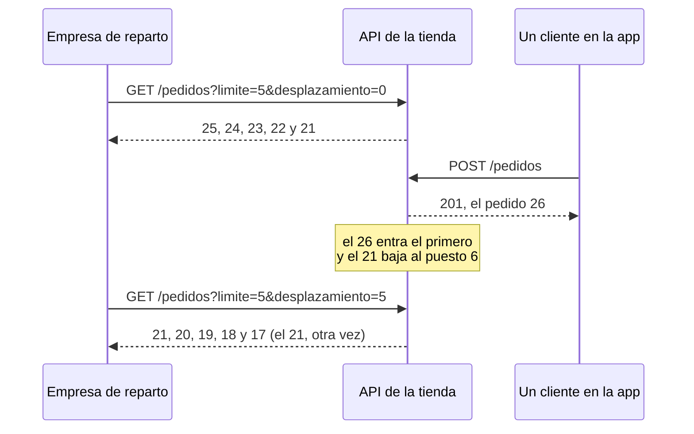

import Term from '~/components/Term.astro';
import TryIt from '~/components/TryIt.astro';
import Analogy from '~/components/Analogy.astro';
import SelfCheck from '~/components/SelfCheck.astro';
import ProjectCode from '~/components/ProjectCode.astro';
import Quiz from '~/components/Quiz.astro';
import QuizQuestion from '~/components/QuizQuestion.astro';
import QuizOption from '~/components/QuizOption.astro';

## El problema

Imagina que la tienda tiene 40 000 pedidos. La app del móvil enseña los diez últimos, y pide `GET /pedidos`. La API de la lección anterior le manda los 40 000: unos 2,4 MB de <Term id="json">JSON</Term>, con cuatro campos por pedido. El móvil tira 39 990, y el servidor los ha preparado todos.

La solución es **paginar**: devolver la lista por trozos. Pero la forma más intuitiva tiene trampa. La empresa de reparto de la [introducción](/fase-4/) lee cada mañana los pedidos pagados, de 50 en 50. Si mientras lee la primera página se paga un pedido nuevo, la segunda empieza por uno que ya tenía. Y si uno de la primera sale de la lista, la segunda se salta otro: un paquete sin repartir.

## La analogía

<Analogy>

Piensa en el buzón de la tienda: una pila de cartas, con las nuevas encima. Luis lee las cinco de arriba, se apunta «llevo cinco» y se va a comer.

Mientras come, llega una carta. Al volver, aparta las cinco de arriba y sigue. Pero entre ellas está la nueva, así que la primera que lee ya la había leído. Y si alguien se hubiera llevado una de las leídas, se habría saltado otra sin enterarse.

Ana se apunta otra cosa: «la última fue la de la imprenta». Al volver, busca esa carta y sigue por la de debajo, lleguen las que lleguen encima. «Llevo cinco» es un desplazamiento; «la de la imprenta» es un cursor.

<div slot="limits">

- Ana reconoce su carta a la vista. Un servidor necesita que cada elemento tenga un sitio único en el orden, como el id.
- Con «llevo cinco», Luis puede saltar a la carta 40. Con un cursor no se salta a la página 8: solo se sigue desde donde ibas.

</div>

</Analogy>

## Cómo funciona de verdad

### Una lista larga se pide por páginas

Una <Term id="pagination">paginación</Term> tiene dos partes: el cliente dice cuántos elementos quiere y desde dónde, en la <Term id="query-string">query string</Term> ([Fase 2](/fase-2/peticion-y-respuesta-http/#la-query-string-datos-en-la-propia-url)), y la respuesta le dice cómo pedir los siguientes.

En la tienda, cuántos se pide con `?limite=`: 10 si no dices nada, y 50 como mucho. **El máximo lo pone el servidor, no el cliente**: sin él, `?limite=1000000` volvería a ser la lista entera. GitHub hace lo mismo con su `per_page`: 30 por defecto y 100 como máximo.

### El desplazamiento: «sáltate los 20 primeros»

El desplazamiento (*offset*, en inglés) cuenta posiciones. `?limite=10&desplazamiento=20` significa «sáltate los 20 primeros y dame 10»: la página 3. Muchas APIs lo llaman `offset`, o usan `page` y `per_page`: lo mismo, con otra cuenta.

En el proyecto, la función está en un fichero nuevo:

<ProjectCode file="tienda-api/12-paginacion/src/paginacion.ts" region="pagina-por-desplazamiento" />

- `lista.slice(desde, hasta)` copia los elementos de la posición `desde` a la `hasta`, sin incluir esta. Las posiciones empiezan en 0.
- `condición ? a : b` vale `a` si se cumple la condición y `b` si no. `siguiente` es dónde empieza la página siguiente, o `undefined` si no quedan más (`hayMas`).

### Si la lista cambia, el desplazamiento se equivoca

El desplazamiento cuenta posiciones, y las posiciones se mueven. Los pedidos van del más nuevo al más antiguo, así que uno nuevo entra el primero y empuja a todos los demás un puesto:



Al revés, si un pedido de la primera página sale de la lista (se cancela, y la empresa pide solo los pendientes), todos suben un puesto. El primero de la página siguiente pasa al puesto 5, ya leído, y nadie lo ve.

**Con un desplazamiento, lo que entra delante repite y lo que sale delante se salta.** Y el servidor no puede avisar: no recuerda quién leía qué.

### El cursor: «dame los que van después de este»

Un <Term id="cursor">cursor</Term> no cuenta posiciones: señala un elemento. En la tienda, el cursor lleva el id del último pedido de la página, y la página siguiente son los de id menor:

<ProjectCode file="tienda-api/12-paginacion/src/paginacion.ts" region="pagina-por-cursor" />

- `despuesDe?: number` es opcional: la primera página no tiene cursor.
- `filter` deja solo los pedidos de id menor ([lección 2 de la Fase 3](/fase-3/javascript-para-backend/#elegir-y-transformar-una-lista-filter-y-map)), y `slice(0, limite)` toma los primeros.
- `pagina.at(-1)` es el último de la página. El `!` le dice a TypeScript que no será `undefined`: si `hayMas` es verdadero, la página no está vacía.

Que llegue el 26 no cambia qué pedidos tienen un id menor que 21, ni que se cancele el 24. **El cursor guarda un valor, no una posición**, y funciona aunque el pedido que señala ya no esté en la lista.

### El cursor es opaco, no secreto

El cliente recibe un texto como `MjM`, no el número 23:

<ProjectCode file="tienda-api/12-paginacion/src/paginacion.ts" region="cursor" />

- `Buffer.from(String(id))` convierte el id en bytes ([lección 4 de la Fase 3](/fase-3/servidor-http-node/#el-cuerpo-llega-en-trozos)), y `toString('base64url')` los escribe con letras, números, `-` y `_`, que viajan bien en una URL.
- `leerCursor` deshace el camino. Si el texto no era un cursor, sale `NaN` («no es un número») o `0`.

Base64url no cifra nada: `node -p "Buffer.from('MjM', 'base64url').toString()"` escribe `23`. Sirve para que el cursor sea **opaco**: el cliente no lo interpreta, solo lo devuelve, y el servidor puede cambiar su contenido sin romper a nadie. Los de GitHub, decodificados, empiezan por `cursor:v2:`: llevan hasta versión.

Como llega de fuera, se valida ([lección 7 de la Fase 3](/fase-3/validar-datos-zod/)), en `src/esquemas.ts`:

<ProjectCode file="tienda-api/12-paginacion/src/esquemas.ts" region="esquema-cursor" />

`.transform(leerCursor)` convierte el texto en el id, y `.pipe(…)` comprueba ese id con otro esquema: un entero mayor que 0. `?cursor=hola` acaba en un `422`.

### Desplazamiento o cursor: qué ganas y qué pierdes

| | Desplazamiento | Cursor |
|---|---|---|
| Si la lista cambia entre dos páginas | Repite o se salta elementos | Sigue justo después del último |
| Saltar a la página 8 | Sí: `desplazamiento=70` | No: solo la siguiente (y la anterior, si la API la da) |
| «Página 3 de 12» | Se puede calcular | No hay número de página |
| Con millones de filas en una base de datos | Lento: lee y descarta todas las que se salta | Rápido: va directo al cursor |

La última fila la verás en la Fase 5: con `desplazamiento=100000`, la <Term id="database">base de datos</Term> recorre 100 000 filas y las tira. Con un cursor, salta al id con un índice, como el de un libro.

**El desplazamiento sirve para listas que casi no cambian y donde quieres saltar de página**, como un catálogo. Para las que crecen mientras se leen, como pedidos o mensajes, el cursor.

### La cabecera Link dice dónde está la página siguiente

Falta decirle al cliente cómo pedir la página siguiente. GitHub lo hace con una <Term id="header">cabecera</Term>, la `link` que viste en la [introducción](/fase-4/#4-lo-que-dicen-las-cabeceras). Pide otra vez las dos issues abiertas más recientes de Node.js, ahora con su título:

<TryIt
  title="La primera página de GitHub y su cabecera Link"
  cmd={`curl -sI 'https://api.github.com/repos/nodejs/node/issues?per_page=2' | grep -i '^link'
curl -s 'https://api.github.com/repos/nodejs/node/issues?per_page=2' | jq -c '.[] | {number, title}'`}
  output={`link: <https://api.github.com/repositories/27193779/issues?per_page=2&after=Y3Vyc29yOnYyOpLPAAABoTU4rEjPAAAAAVuCfJw%3D&page=2>; rel="next"
{"number":66705,"title":"test: deflake test-net-autoselectfamily-local-port"}
{"number":66704,"title":"tools: update OpenSSL on the selected branch"}`}
>

`jq` ([lección 8 de la Fase 3](/fase-3/errores-y-logs-node/)) saca de cada issue su número y su título. Fíjate en `after=`: el cursor de GitHub. Las issues cambian cada día, así que tus números y cursores serán otros. Si sale `API rate limit exceeded`, has gastado las 60 peticiones por hora que GitHub da sin cuenta: espera.

</TryIt>

La cabecera `Link` la define el [RFC 8288](https://www.rfc-editor.org/rfc/rfc8288): una URL entre `<` y `>`, y en `rel`, su relación con esta respuesta. `next` es la siguiente; también existen `prev`, `first` y `last`. Copia la URL de tu `link` y pídela:

<TryIt
  title="Sigue el enlace de GitHub"
  cmd={`curl -si 'https://api.github.com/repositories/27193779/issues?per_page=2&after=Y3Vyc29yOnYyOpLPAAABoTU4rEjPAAAAAVuCfJw%3D&page=2' | grep -i '^link'
curl -s 'https://api.github.com/repositories/27193779/issues?per_page=2&after=Y3Vyc29yOnYyOpLPAAABoTU4rEjPAAAAAVuCfJw%3D&page=2' | jq -c '.[] | {number, title}'`}
  output={`link: <https://api.github.com/repositories/27193779/issues?per_page=2&after=Y3Vyc29yOnYyOpLPAAABoTSeNVDPAAAAAVtgJ8I%3D&page=3>; rel="next", <https://api.github.com/repositories/27193779/issues?per_page=2&page=1&before=Y3Vyc29yOnYyOpLPAAABoTUSnhjPAAAAAVt5sXQ%3D>; rel="prev"
{"number":66702,"title":"stream: trim webstreams sink wrappers and BYOB transfers"}
{"number":66700,"title":"deps: V8: cherry-pick 99f317d69ac7"}`}
>

Dos enlaces, separados por una coma: `next`, con un cursor nuevo, y `prev`, con `before=`. Faltan la 66703 y la 66701: están cerradas, y esta lista solo trae las abiertas.

</TryIt>

El cliente no construye la URL: la sigue. Si GitHub cambia sus cursores, quien sigue `next` no se entera. La tienda también devuelve la URL entera:

<ProjectCode file="tienda-api/12-paginacion/src/paginacion.ts" region="enlace" />

`new URL(urlActual)` separa las partes de la URL, como en la [lección 4 de la Fase 3](/fase-3/servidor-http-node/), y `searchParams.set` cambia o añade un parámetro sin tocar los demás: si la petición traía un filtro, el enlace también.

Otras APIs lo dicen en el cuerpo: [Stripe](https://docs.stripe.com/api/pagination) manda `has_more`, y el cliente pide la siguiente con el id del último en `starting_after`. La tienda usa `Link` para que `GET /pedidos` siga devolviendo una lista.

### La ruta, con las dos formas

Para que haya algo que paginar, `src/datos.ts` crea 25 pedidos de ejemplo al arrancar:

<ProjectCode file="tienda-api/12-paginacion/src/datos.ts" region="pedidos-de-ejemplo" />

- `for (let numero = 1; numero <= 25; numero++)` repite el bloque con `numero` de 1 a 25: empieza en 1, sigue mientras sea 25 o menos y suma 1 cada vez.
- `%` es el resto de la división: `(numero % 3) + 1` va dando los productos 1, 2 y 3.
- `toSorted` ordena una copia de la lista. Su función compara dos pedidos: si `b.id - a.id` es positivo, `b` va antes. Queda del id más alto al más bajo.

Y la ruta usa una forma u otra según lo que llegue:

<ProjectCode file="tienda-api/12-paginacion/src/app.ts" region="listar-pedidos" />

- `validar('query', esquemaListaPedidos)` comprueba la query string, con el middleware de la [lección 7 de la Fase 3](/fase-3/validar-datos-zod/#un-middleware-valida-antes-de-que-llegue-la-ruta).
- Primero se filtra por estado, si lo piden, y después se pagina: el filtro decide la lista, y la página, el trozo.
- `c.header('Link', …)` añade la cabecera si hay página siguiente. `c.req.url` es la URL entera de la petición.

El desplazamiento está solo para comparar: una API de verdad elegiría una forma.

### Filtrar y ordenar en la query string

Filtrar y ordenar también van en la query string. Esto es lo que acepta `GET /pedidos`:

<ProjectCode file="tienda-api/12-paginacion/src/esquemas.ts" region="lista-pedidos" />

- `.default(10)`: si no llega `limite`, vale 10. `.max(50)` es el máximo.
- `estado` solo admite los cuatro que existen. Otro valor da `422`: ignorarlo devolvería todos, y el cliente creería que son los que ha pedido.
- `.refine(…)` es una regla sobre dos campos: cursor o desplazamiento, no los dos. `path` dice a qué campo se le echa la culpa en `errores` (lección 2).

Los productos se ordenan por precio, y con un menos delante, `-precio`, de mayor a menor: la costumbre de muchas APIs, como [JSON:API](https://jsonapi.org/format/#fetching-sorting) (`sort=-created`).

<ProjectCode file="tienda-api/12-paginacion/src/app.ts" region="filtrar-y-ordenar" />

`a.precio - b.precio` pone primero el más barato; `b.precio - a.precio`, el más caro. En `src/esquemas.ts`, `esquemaFiltro` solo admite esos dos órdenes:

<ProjectCode file="tienda-api/12-paginacion/src/esquemas.ts" region="parametros" mark={[11, 12]} />

### Ordenar, y el cursor que lleva el orden

Los pedidos se paginan por id, que es único y no cambia. Para paginar productos por precio, el cursor llevaría el precio del último. Y si dos cuestan 20 €, «los de más de 20» se salta el segundo. **El cursor lleva el valor del orden y, para desempatar, el id**: «después de 20 €, el 7».

### El total cuesta

«Página 3 de 1 200» exige contar todo lo que cumple el filtro, y con muchos datos, contar es recorrerlo en cada página. Por eso muchas APIs no dan el total: GitHub no lo da en esta lista, y Stripe solo dice `has_more`. En la tienda, si llega `Link`, hay más; si no, has terminado.

## Pruébalo

El objetivo: recorrer los pedidos por páginas, hacer que el desplazamiento repita un pedido y comprobar que el cursor no.

### Prepara el proyecto

Sigues en `~/curso-backend/fase-3/tienda-api`, con el código de la lección 2. Escribe los cambios:

1. Crea `src/paginacion.ts`, con la línea `import type { Pedido } from './datos.ts';` y, debajo, los cuatro bloques de ese fichero que has visto.
2. En `src/datos.ts`, añade al final los pedidos de ejemplo y `pedidosMasNuevosPrimero`.
3. En `src/esquemas.ts`, importa `leerCursor` de `./paginacion.ts`, añade `orden` a `esquemaFiltro` y, al final, `esquemaCursor` y `esquemaListaPedidos`.
4. En `src/app.ts`, importa `pedidosMasNuevosPrimero` en lugar de `pedidos`, `esquemaListaPedidos` y las tres funciones de `./paginacion.ts`, y cambia las rutas `GET /productos` y `GET /pedidos`.

Las pruebas vienen en la carpeta de esta lección: desde `~/curso-backend/fase-3`, `curl -O https://backenddesdecero.com/practicas/tienda-api/12-paginacion.tar.gz` y `tar -xzf 12-paginacion.tar.gz`. Si te atascas, compara tu código con el suyo. Después, en tu proyecto:

<TryIt
  title="1. Las pruebas de la paginación"
  cmd={`cp ../12-paginacion/test/paginacion.test.ts test/
npm test -- test/paginacion.test.ts`}
  output={`> tienda-api@1.0.0 test
> node --env-file=test/.env --test test/paginacion.test.ts

✔ sin nada: los 10 más nuevos primero, y un Link a la página siguiente (8.069921ms)
✔ el cursor es opaco: el id en base64url, que el servidor sabe leer (0.125635ms)
✔ siguiendo Link se recorren los 25 pedidos, sin repetir ni saltarse ninguno (2.209255ms)
✔ el filtro por estado se mantiene en el enlace a la página siguiente (1.389233ms)
✔ con desplazamiento, el enlace lleva el desplazamiento siguiente (1.053665ms)
✔ lo que no vale en la query string: 422, con cada campo (2.777675ms)
✔ los productos, ordenados por precio en los dos sentidos y filtrados (0.791936ms)
✔ con desplazamiento, un pedido que llega entre dos páginas hace que uno salga dos veces (1.515701ms)
✔ con cursor, el pedido que llega entre dos páginas no cambia la siguiente (1.502201ms)
ℹ tests 9
ℹ suites 0
ℹ pass 9
ℹ fail 0
ℹ cancelled 0
ℹ skipped 0
ℹ todo 0
ℹ duration_ms 190.166452`}
>

`--` le dice a npm que lo de detrás es para el script: así `node --test` ejecuta solo el fichero nuevo. Si sale `does not provide an export named`, falta un `export`; si sale `is not defined`, un `import`. Las salidas son de Node 26.11.1 y `curl` 8.14.1, en Linux; tus tiempos, ids de petición y fechas serán otros.

</TryIt>

### Recorre los pedidos

Arranca el servidor con `npm run dev` y abre otra terminal.

<TryIt
  title="2. La primera página"
  cmd={`curl -i 'localhost:3000/pedidos?limite=3'`}
  output={`HTTP/1.1 200 OK
content-type: application/json
link: <http://localhost:3000/pedidos?limite=3&cursor=MjM>; rel="next"
vary: Origin
x-request-id: 00f0990a-d14a-411c-87c0-6a4614804738
content-length: 178
Date: Tue, 13 Oct 2026 14:30:00 GMT
Connection: keep-alive
Keep-Alive: timeout=5

[{"id":25,"productoId":2,"cantidad":2,"estado":"pendiente"},{"id":24,"productoId":1,"cantidad":1,"estado":"pendiente"},{"id":23,"productoId":3,"cantidad":4,"estado":"pendiente"}]`}
>

Del 25 al 23, y en `link`, la página siguiente: `cursor=MjM`, el 23. Las comillas hacen falta: sin ellas, la shell toma el `?` y el `&` por otra cosa. Si sale la lista entera sin `link`, el servidor sigue con la ruta antigua: mira si `npm run dev` se ha reiniciado.

</TryIt>

<TryIt
  title="3. Sigue el enlace"
  cmd={`curl -i 'localhost:3000/pedidos?limite=3&cursor=MjM'`}
  output={`HTTP/1.1 200 OK
content-type: application/json
link: <http://localhost:3000/pedidos?limite=3&cursor=MjA>; rel="next"
vary: Origin
x-request-id: 59dfea99-9273-465b-9e02-fc9899f96755
content-length: 175
Date: Tue, 13 Oct 2026 14:30:00 GMT
Connection: keep-alive
Keep-Alive: timeout=5

[{"id":22,"productoId":2,"cantidad":3,"estado":"pendiente"},{"id":21,"productoId":1,"cantidad":2,"estado":"pendiente"},{"id":20,"productoId":3,"cantidad":1,"estado":"pagado"}]`}
>

Justo después del 23, el 22, y un `link` nuevo con el cursor del 20. Un filtro se conserva en el enlace:

```sh
curl -si 'localhost:3000/pedidos?estado=enviado&limite=5' | grep -i '^link'
```

```
link: <http://localhost:3000/pedidos?estado=enviado&limite=5&cursor=OA>; rel="next"
```

</TryIt>

### Haz que el desplazamiento repita un pedido

Ahora, la trampa del diagrama. Si has creado pedidos, tus ids serán otros: para volver a los 25 de ejemplo, para el servidor con <kbd>Ctrl</kbd> + <kbd>C</kbd> y arráncalo otra vez.

<TryIt
  title="4. Una página, un pedido nuevo y la página siguiente"
  cmd={`curl -s 'localhost:3000/pedidos?limite=5&desplazamiento=0' | jq -c 'map(.id)'
curl -s --json '{"productoId":1,"cantidad":1}' localhost:3000/pedidos | jq .id
curl -s 'localhost:3000/pedidos?limite=5&desplazamiento=5' | jq -c 'map(.id)'`}
  output={`[25,24,23,22,21]
26
[21,20,19,18,17]`}
>

`map(.id)` saca el id de cada pedido, y `.id`, el del creado. Fíjate en el 21: es el último de la primera página y el primero de la segunda. La empresa de reparto prepararía su paquete dos veces.

</TryIt>

### Y que el cursor no

<TryIt
  title="5. Lo mismo, con el cursor"
  cmd={`curl -s 'localhost:3000/pedidos?limite=5' | jq -c 'map(.id)'
curl -si 'localhost:3000/pedidos?limite=5' | grep -i '^link'
curl -s --json '{"productoId":1,"cantidad":1}' localhost:3000/pedidos | jq .id
curl -s 'localhost:3000/pedidos?limite=5&cursor=MjI' | jq -c 'map(.id)'`}
  output={`[26,25,24,23,22]
link: <http://localhost:3000/pedidos?limite=5&cursor=MjI>; rel="next"
27
[21,20,19,18,17]`}
>

La primera página empieza por el 26 del paso anterior. Llega el 27, y la siguiente sigue justo después del 22. El 27 no se pierde: saldrá en la próxima lectura.

</TryIt>

### Filtros, orden y valores que no valen

<TryIt
  title="6. Un límite y un cursor que no valen"
  cmd={`curl -i 'localhost:3000/pedidos?limite=500&cursor=hola'`}
  output={`HTTP/1.1 422 Unprocessable Entity
content-type: application/problem+json
vary: Origin
x-request-id: 919b801b-1933-4721-9cdb-805fcdea34f9
content-length: 283
Date: Tue, 13 Oct 2026 14:30:00 GMT
Connection: keep-alive
Keep-Alive: timeout=5

{"type":"https://tienda.example/problemas/datos-no-validos","title":"Los datos no son válidos","status":422,"detail":"Mira en «errores» qué falla en cada campo.","errores":[{"campo":"limite","problema":"Como máximo, 50"},{"campo":"cursor","problema":"El cursor no es válido"}]}`}
>

El error de la lección 2, con un problema por campo. Con `?cursor=MjI&desplazamiento=10`, el problema es `Usa cursor o desplazamiento, no los dos`.

</TryIt>

<TryIt
  title="7. Los productos, ordenados"
  cmd={`curl -w '\\n' 'localhost:3000/productos?orden=-precio'
curl -w '\\n' 'localhost:3000/productos?orden=precio&max=30'
curl -w '\\n' 'localhost:3000/productos?orden=nombre'`}
  output={`[{"id":3,"nombre":"Sudadera","precio":35},{"id":1,"nombre":"Camiseta","precio":20},{"id":2,"nombre":"Taza","precio":8.5}]
[{"id":2,"nombre":"Taza","precio":8.5},{"id":1,"nombre":"Camiseta","precio":20}]
{"type":"https://tienda.example/problemas/datos-no-validos","title":"Los datos no son válidos","status":422,"detail":"Mira en «errores» qué falla en cada campo.","errores":[{"campo":"orden","problema":"Tiene que ser precio o -precio"}]}`}
>

De mayor a menor; de menor a mayor, sin los de más de 30 €; y un orden que la API no sabe hacer, con un `422` que dice cuáles sí.

</TryIt>

<SelfCheck question="Reto: haz que el desplazamiento se salte un pedido. Pide los pendientes de 2 en 2 y, entre la primera página y la segunda, cancela uno de la primera. Después, repítelo con el cursor.">

Reinicia el servidor. Los pendientes son del 21 al 25, y se cancela con `POST /pedidos/:id/cancelacion` (lección 1):

```sh
curl -s 'localhost:3000/pedidos?estado=pendiente&limite=2&desplazamiento=0' | jq -c 'map(.id)'
curl -s -X POST localhost:3000/pedidos/24/cancelacion | jq -c '{id, estado}'
curl -s 'localhost:3000/pedidos?estado=pendiente&limite=2&desplazamiento=2' | jq -c 'map(.id)'
```

```
[25,24]
{"id":24,"estado":"cancelado"}
[22,21]
```

¿Y el 23? Al cancelarse el 24, subió al puesto 2, ya leído. Con el cursor, en la misma lista (ahora 25, 23, 22 y 21):

```sh
curl -s 'localhost:3000/pedidos?estado=pendiente&limite=2' | jq -c 'map(.id)'
curl -si 'localhost:3000/pedidos?estado=pendiente&limite=2' | grep -i '^link'
curl -s -X POST localhost:3000/pedidos/25/cancelacion | jq -c '{id, estado}'
curl -s 'localhost:3000/pedidos?estado=pendiente&limite=2&cursor=MjM' | jq -c 'map(.id)'
```

```
[25,23]
link: <http://localhost:3000/pedidos?estado=pendiente&limite=2&cursor=MjM>; rel="next"
{"id":25,"estado":"cancelado"}
[22,21]
```

El cursor señala el 23, y lo siguiente al 23 sigue siendo el 22. Con `desplazamiento=2`, habría salido solo el 21.

</SelfCheck>

## Ya lo has visto

- **Los resultados de Google** tienen páginas numeradas: en la segunda, la URL lleva `start=10`, un desplazamiento.
- **El scroll infinito** de las redes sociales pide más al llegar al final, sin números de página: la lista cambia cada segundo, y lo habitual es un cursor. Lo verás al bajar, en la pestaña **Red** (*Network*) de DevTools ([cómo abrirlo](/fase-2/#antes-de-empezar-devtools)).
- **Los filtros de una tienda online**, como talla o «ordenar por precio», cambian la query string: si compartes la URL, se ve la misma lista.

## Errores comunes

- **No poner un límite máximo.** `?limite=1000000` es la lista entera otra vez.
- **Paginar con desplazamiento una lista que cambia mientras se lee**, como pedidos o mensajes: cursor.
- **Fabricar el cursor en el cliente.** Sigue `Link`, o devuelve tal cual el cursor que te dé la API: es opaco y su formato puede cambiar.
- **Un cursor con un valor que se repite**, como el precio, sin el id para desempatar: se saltan elementos.
- **Ignorar un filtro o un orden que no entiendes.** El cliente cree que la lista es la que ha pedido: mejor un `422` que diga qué se admite.

## Resumen

- Una API devuelve sus listas por páginas, con un límite que pide el cliente y un máximo que pone el servidor.
- El desplazamiento cuenta posiciones: deja saltar a cualquier página, pero si la lista cambia, repite o se salta elementos, y con millones de filas es lento.
- El cursor señala el último elemento leído y sigue justo después aunque la lista cambie. Es opaco: el cliente lo devuelve sin interpretarlo.
- La cabecera `Link` (RFC 8288) da la URL de la página siguiente con `rel="next"`; cuando no llega, se ha terminado.
- Filtros y orden van en la query string, validados. Para paginar una lista ordenada, el cursor lleva el valor del orden y el id.

## ¿Lo has entendido?

<Quiz>

<QuizQuestion
  question="La empresa de reparto lee los pedidos pagados de 50 en 50, con desplazamiento. Mientras lee la primera página, uno de esos pedidos pasa a enviado y sale de la lista. ¿Qué pasa con la segunda?"
  review="Si la lista cambia, el desplazamiento se equivoca"
>

<QuizOption text="Se salta un pedido, que la empresa no llega a ver." correct>

Todos suben un puesto: el primero de la segunda página pasa al último puesto de la primera, ya leída.

</QuizOption>

<QuizOption text="Repite el último pedido de la primera página.">

Se repite cuando algo entra delante y empuja la lista hacia abajo. Aquí sale uno y la lista sube: se pierde uno.

</QuizOption>

<QuizOption text="Nada: el servidor recuerda qué pedidos ha enviado ya a cada cliente.">

El servidor no recuerda nada entre peticiones: recibe `desplazamiento=50` y cuenta 50 posiciones en la lista de ese momento.

</QuizOption>

</QuizQuestion>

<QuizQuestion
  question="El catálogo de una tienda grande cambia una vez al mes, y la web quiere botones para saltar a cualquier página: 1, 2, 3… 40. ¿Qué paginación encaja?"
  review="Desplazamiento o cursor: qué ganas y qué pierdes"
>

<QuizOption text="Un cursor: es mejor que un desplazamiento en todos los casos.">

Un cursor no deja saltar a la página 8, solo seguir: para botones con números, no sirve.

</QuizOption>

<QuizOption text="Un desplazamiento: deja saltar a cualquier página, y el catálogo casi no cambia." correct>

El desplazamiento solo se equivoca si la lista cambia entre dos páginas. En un catálogo casi fijo, poder saltar vale más.

</QuizOption>

<QuizOption text="Ninguna: para eso, la API tiene que mandar el catálogo entero y la web lo reparte en páginas.">

Es el problema del principio: mandarlo todo para enseñar un trozo.

</QuizOption>

</QuizQuestion>

<QuizQuestion
  question="Escribes un programa que recorre las issues de un repositorio con la API de GitHub. ¿Cómo pide la página siguiente?"
  review="La cabecera Link dice dónde está la página siguiente"
>

<QuizOption text="Decodifica el cursor de after=, le suma el número de issues de la página y construye la URL.">

El cursor es opaco: lo que lleva dentro es cosa de GitHub, que puede cambiarlo cuando quiera.

</QuizOption>

<QuizOption text="Lee el campo next del cuerpo de la respuesta.">

En GitHub, el cuerpo es solo la lista: la página siguiente va en una cabecera.

</QuizOption>

<QuizOption text='Pide la URL de rel="next" de la cabecera Link, tal cual, hasta que no llegue.' correct>

Ahí va la URL entera, con su cursor. Sin `next`, has llegado al final.

</QuizOption>

</QuizQuestion>

<QuizQuestion
  question="Alguien pide GET /pedidos?limite=100000 a la API de esta lección. ¿Qué responde?"
  review="Una lista larga se pide por páginas"
>

<QuizOption text="Un 422 que dice «Como máximo, 50» en el campo limite." correct>

El esquema tiene `.max(50)`. El máximo lo pone el servidor: si no, cualquiera pediría la lista entera.

</QuizOption>

<QuizOption text="Todos los pedidos que haya: el cliente sabe cuántos necesita.">

Sin tope, sería otra vez la lista entera: el problema del principio.

</QuizOption>

<QuizOption text="Los 50 primeros, con un 200: el servidor recorta el límite sin avisar.">

Esta API valida `limite` como cualquier dato y responde `422`: así el cliente sabe que no recibiría lo que ha pedido.

</QuizOption>

</QuizQuestion>

<QuizQuestion
  question="Paginas los productos por precio con un cursor que solo lleva el precio del último: «los que cuestan más de 20». Dos cuestan 20 €, y la página acaba en el primero. ¿Qué pasa?"
  review="Ordenar, y el cursor que lleva el orden"
>

<QuizOption text="El segundo sale dos veces: al final de una página y al principio de la siguiente.">

«Más de 20» deja fuera los dos de 20 €, también el que no se ha leído: no sale ninguna vez.

</QuizOption>

<QuizOption text="El segundo de 20 € no sale en ninguna página." correct>

El cursor no distingue dos productos con el mismo precio. Con el precio y el id, el segundo sí sale.

</QuizOption>

<QuizOption text="Nada: un cursor nunca se salta elementos, se ordene por lo que se ordene.">

El cursor tiene que señalar un sitio único en el orden, y un precio no lo es: hace falta el id para desempatar.

</QuizOption>

</QuizQuestion>

<QuizQuestion
  question="La app quiere enseñar «1 248 pedidos» encima de la lista, y la tienda ya tiene millones. ¿Qué tienes en cuenta?"
  review="El total cuesta"
>

<QuizOption text="Que el total sale gratis: para sacar la página, el servidor ya sabe cuántos hay.">

Con un cursor, sacar 10 pedidos es leer 10. Saber cuántos cumplen el filtro exige contarlos todos.

</QuizOption>

<QuizOption text="Que hay que enviarlo siempre: sin el total, el cliente no sabe cuándo parar.">

El cliente sabe que ha terminado cuando no llega `Link` con `rel="next"`, sin contar nada.

</QuizOption>

<QuizOption text="Que contarlos en cada página obliga a recorrerlos todos." correct>

Contar es recorrer todos los que cumplen el filtro, en cada página. Por eso muchas APIs, como GitHub o Stripe, no lo dan.

</QuizOption>

</QuizQuestion>

</Quiz>

## Para profundizar

- [Usar la paginación en la API REST](https://docs.github.com/es/rest/using-the-rest-api/using-pagination-in-the-rest-api) (GitHub): su cabecera `Link` y `per_page`.
- [RFC 8288: Web Linking](https://www.rfc-editor.org/rfc/rfc8288) (en inglés): la cabecera `Link` y sus relaciones.
- [Link](https://developer.mozilla.org/es/docs/Web/HTTP/Reference/Headers/Link) (MDN): la cabecera, con ejemplos.
- [Pagination](https://docs.stripe.com/api/pagination) (Stripe, en inglés): otra API con cursor, con `starting_after` en la petición y `has_more` en el cuerpo.
- [Evolving API Pagination at Slack](https://slack.engineering/evolving-api-pagination-at-slack/) (Slack, en inglés): por qué pasó de los números de página a los cursores.
