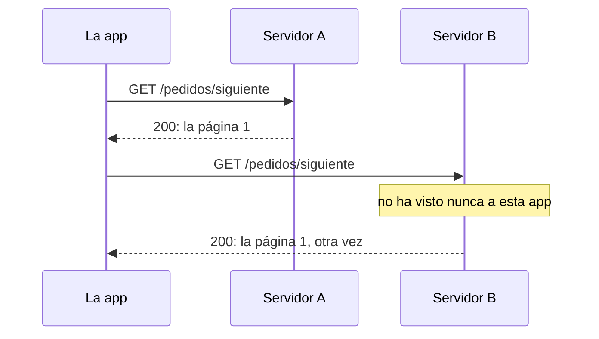

import { FileTree } from '@astrojs/starlight/components';
import Term from '~/components/Term.astro';
import TryIt from '~/components/TryIt.astro';
import Analogy from '~/components/Analogy.astro';
import SelfCheck from '~/components/SelfCheck.astro';
import ProjectCode from '~/components/ProjectCode.astro';
import Quiz from '~/components/Quiz.astro';
import QuizQuestion from '~/components/QuizQuestion.astro';
import QuizOption from '~/components/QuizOption.astro';

## El problema

La tienda de Ana y Luis va a tener una app para el móvil, y la programa otra persona. Su primera pregunta es: «¿cómo cancelo un pedido?». Imagina que la API hubiera crecido a golpe de necesidad, una ruta cada vez:

```
GET  /getProductos.json
POST /crearPedido
GET  /pedido?id=17
POST /pedidos/17/cambiar
GET  /cancelarPedido?id=17
```

Cada ruta sigue su propia regla, así que ninguna te dice cómo será la siguiente: hay que preguntar. Y la de cancelar es peligrosa: es un `GET`, y la vista previa de un enlace en un chat ya cancelaría el pedido ([Fase 2](/fase-2/metodos-http/#seguro-solo-lee)).

En esta lección diseñas la API para que quien no te conoce la entienda viendo dos rutas. Para eso existe REST, las convenciones que siguen casi todas las APIs públicas.

## La analogía

<Analogy>

Piensa en un almacén. Cada estantería lleva un rótulo, «Pedidos», y cada caja, su número: «Pedidos / 17». En el mostrador hay solo cuatro impresos, los mismos para todo: «Enséñame», «Guarda esto nuevo», «Cambia esto» y «Retira esto». Eliges uno y escribes la etiqueta: «Enséñame: Pedidos / 17».

Con las etiquetas y los cuatro impresos sabes pedirlo todo, sin un manual para cada caja. Y como cada impreso lleva todo lo necesario, te atiende cualquier empleado, aunque no te haya visto nunca.

Las etiquetas son las URL de los recursos; los impresos, los métodos de HTTP; y que te atienda cualquiera es que el servidor no guarde estado.

<div slot="limits">

- Una API, además de la caja, responde con un código que dice qué ha pasado: creado, no existe, no se puede.
- Hay acciones que no son cajas, como «cancela el pedido 17». REST las convierte en una caja nueva: «la cancelación del pedido 17».
- El empleado no se acuerda de ti, pero el almacén sí guarda las cajas: «sin estado» habla de la conversación, no de los datos.

</div>

</Analogy>

## Cómo funciona de verdad

### Los ficheros de esta lección

Sigues en tu proyecto, `~/curso-backend/fase-3/tienda-api`. Como ahora la usarán otros, la API pierde lo que era solo para aprender: la ruta `/error` de la [lección 8](/fase-3/errores-y-logs-node/), las rutas lentas de la [lección 9](/fase-3/event-loop-node/) (con sus importaciones de `node:crypto` y `node:util`) y la carpeta `ejemplos`. Cambian estos ficheros:

<FileTree>

- src/
  - app.ts cambia
  - datos.ts cambia
  - esquemas.ts cambia
- test/
  - errores.test.ts cambia
  - rest.test.ts nuevo
  - event-loop.test.ts se borra

</FileTree>

Descarga la carpeta de esta lección para copiar sus tests y, si te atascas, comparar:

```sh
cd ~/curso-backend/fase-3
curl -O https://backenddesdecero.com/practicas/tienda-api/10-rest.tar.gz
tar -xzf 10-rest.tar.gz
rm -r tienda-api/ejemplos tienda-api/test/event-loop.test.ts
cp -r 10-rest/test tienda-api/
```

`rm -r` borra la carpeta `ejemplos` y el test de las rutas lentas, que ya no existen ([Fase 1](/fase-1/comandos-linux-archivos/)).

### Un recurso es un sustantivo con su dirección

Estas son las URL de la tienda al final de la lección:

| URL | Qué es |
|---|---|
| `/productos` | La colección: todos los productos |
| `/productos/2` | Un elemento de la colección: la taza |
| `/pedidos` | Todos los pedidos |
| `/pedidos/17` | El pedido 17 |
| `/pedidos/17/cancelacion` | La cancelación del pedido 17 |

Todas nombran **cosas**, nunca acciones. Cada una es un <Term id="resource">recurso</Term>: algo de lo que habla la API y que tiene su propia URL. Lo que recibes al pedirlo, `{"id":2,"nombre":"Taza","precio":8.5}`, no es la taza, sino una **representación** de ella en <Term id="json">JSON</Term>.

Las colecciones van en plural, y un elemento es la colección más su id: `/pedidos/17`, «el 17 de los pedidos». Cada combinación de método y URL, como `GET /pedidos` o `POST /pedidos`, es un <Term id="endpoint">endpoint</Term>: una <Term id="route">ruta</Term> de tu código, vista desde fuera.

**Anidar, un nivel como mucho.** `/pedidos/17/cancelacion` cuelga del pedido porque no existe sin él. Pero el pedido 17 vive en `/pedidos/17`, no en `/clientes/5/pedidos/17`: cada cosa tiene una sola dirección. Anida cuando el id del hijo solo tiene sentido dentro del padre, como en GitHub, donde cada repositorio tiene su propia *issue* número 1: `/repos/nodejs/node/issues/1`.

### Los métodos son los verbos

La URL dice **sobre qué** actúas, y el <Term id="http-method">método</Term>, **qué haces**, como viste en la [lección 2 de la Fase 2](/fase-2/metodos-http/). Leer (`GET`) y crear (`POST`) ya los tenías. La tienda gana tres acciones:

| Endpoint | Qué hace |
|---|---|
| `DELETE /productos/2` | Borrar un producto (solo Ana, con su token) |
| `PATCH /pedidos/17` | Cambiar la cantidad de un pedido |
| `POST /pedidos/17/cancelacion` | Cancelar un pedido |

Borrar va en `src/app.ts`, detrás de `app.post('/productos', …)`:

<ProjectCode file="tienda-api/10-rest/src/app.ts" region="borrar" />

- **`app.delete(…)`** crea una ruta para `DELETE`. Pasa antes por `soloAdmin`, el guardia de la [lección 6 de la Fase 3](/fase-3/que-es-middleware/#un-guardia-que-responde-401), y por la validación del id.
- **`borrarProducto(…)`** está en `datos.ts` y devuelve `false` si el producto no existía: entonces, `404`.
- **`c.body(null, 204)`** responde `204 No Content`: hecho, y nada que contar. `null` es «sin cuerpo».

Cambiar la cantidad usa `PATCH`, que cambia solo una parte del recurso ([PUT sustituye, PATCH cambia una parte](/fase-2/metodos-http/#put-sustituye-patch-cambia-una-parte)). Va detrás de `app.post('/pedidos', …)`:

<ProjectCode file="tienda-api/10-rest/src/app.ts" region="cambiar-pedido" />

- **Dos `validar` seguidos:** primero el id de la URL, después el cuerpo ([lección 7 de la Fase 3](/fase-3/validar-datos-zod/)). Si alguno falla, `422`, y la ruta ni se ejecuta.
- **`pedido.estado !== 'pendiente'`**: un pedido pagado, enviado o cancelado ya no se cambia: `409 Conflict`, con el estado en el mensaje.
- **`pedido.cantidad = …`** cambia el pedido guardado, y la respuesta es el pedido entero, con `200`: el cliente ve cómo ha quedado sin pedirlo otra vez.

El cuerpo se comprueba con un esquema nuevo, en `src/esquemas.ts`, debajo del de los pedidos:

<ProjectCode file="tienda-api/10-rest/src/esquemas.ts" region="cambio-pedido" />

`esquemaPedido.shape.cantidad` reutiliza la regla de la cantidad (un entero de 1 a 10). Y el esquema solo tiene `cantidad`: **el estado no lo escribe el cliente**. Cambia por lo que pasa (un pago, un envío, una cancelación), y Zod descarta cualquier otro campo.

Añade `borrarProducto` y `esquemaCambioPedido` a las importaciones de `app.ts`, junto a las que ya tenías.

### Cada respuesta, su código de estado

Un cliente que no te conoce decide qué hacer según el <Term id="status-code">código de estado</Term>, así que cada acción responde siempre igual ([lección 3 de la Fase 2](/fase-2/codigos-de-estado-http/#los-códigos-que-importan)):

| Acción | Si sale bien | Si no |
|---|---|---|
| Leer (`GET`) | `200` y el recurso | `404` si no existe |
| Crear (`POST /pedidos`) | `201` y el recurso nuevo, con su URL en `Location` | `422` si los datos no valen |
| Cambiar (`PATCH`) | `200` y el recurso como ha quedado | `404`, `422` o `409` |
| Cancelar (`POST …/cancelacion`) | `200` y el pedido | `404` o `409` |
| Borrar (`DELETE`) | `204`, sin cuerpo | `401` sin token, `404` |

Fíjate en dos parejas:

- **`422` frente a `409`.** Con `{"cantidad":0}`, los datos no valen: `422`. Con `{"cantidad":3}` sobre un pedido cancelado, los datos están bien, pero chocan con el estado del recurso: `409`. Tras un `409`, la misma petición puede funcionar si el estado cambia; tras un `422`, nunca.
- **`404` frente a `405`.** Una ruta que no existe es un `404`; un método que la ruta no tiene, un `405` con `Allow` ([Fase 2](/fase-2/metodos-http/#el-405-y-la-cabecera-allow)). Sus listas cambian:

<ProjectCode file="tienda-api/10-rest/src/app.ts" region="no-permitido" />

`noPermitido` guarda el cuerpo en una <Term id="variable">variable</Term> para no repetirlo, y las líneas siguen después de todas las rutas ([lección 5 de la Fase 3](/fase-3/express-hono-fastify/#un-método-equivocado-hono-responde-404)).

### Una acción que no encaja: conviértela en un recurso

Cancelar no es crear, leer, cambiar ni borrar. La tentación es un verbo en la URL, `/cancelarPedido`. La salida de REST es nombrar la acción como una cosa, **la cancelación** del pedido, y crearla con un `POST`:

<ProjectCode file="tienda-api/10-rest/src/app.ts" region="cancelar" />

- **Un pedido enviado no se cancela:** `409`. Uno pendiente o pagado pasa a `'cancelado'`.
- **Cancelar dos veces deja el pedido igual,** cancelado, así que la segunda vez no es un error.
- **Responde `200` con el pedido, no `201`**: la cancelación no tiene una URL propia que leer después. Lo que ha cambiado es el pedido, y eso devuelve.

GitHub hace algo parecido para [bloquear una *issue*](https://docs.github.com/es/rest/issues/issues): `PUT /repos/{owner}/{repo}/issues/{issue_number}/lock` la bloquea, y un `DELETE` a la misma URL la desbloquea.

El estado nuevo va en `src/datos.ts`:

<ProjectCode file="tienda-api/10-rest/src/datos.ts" region="estado" />

**Un pedido cancelado no se borra:** sigue en `/pedidos/17`, y quien lo consulte sabe qué le pasó. Un `404` no le contaría nada.

### Una URL no cambia de dueño

Borrar un producto tiene una trampa. Hasta ahora, un producto nuevo recibía como id «cuántos hay + 1». Si borras el 3 de `[1, 2, 3]` y creas una gorra, quedan dos productos, y la gorra recibe… el 3. La app que guardó un enlace a `/productos/3`, la sudadera, ahora enseñaría una gorra. Por eso cambia `crearProducto`, en `src/datos.ts`:

<ProjectCode file="tienda-api/10-rest/src/datos.ts" region="borrar-producto" />

- **`ultimoIdProducto`** empieza en 3, el último id que existe, y `crearProducto` le suma uno cada vez. Es `let` porque cambia, y solo sube: aunque borres, no repite.
- **`borrarProducto`** busca la posición del producto con `findIndex`, que da `-1` si no está, y `splice(posicion, 1)` quita el elemento de esa posición.

**Una URL siempre señala la misma cosa.** Si la cosa desaparece, la URL da `404`; nunca pasa a ser otra.

### Sin estado: cada petición se entiende sola

Imagina una API que recuerda qué página de pedidos te enseñó, y te da la siguiente con `GET /pedidos/siguiente`. Funciona hasta que la tienda pone dos copias del servidor que se reparten las peticiones ([Fase 9](/fase-9/escalado-horizontal/#sin-estado-lo-que-no-puede-vivir-en-una-copia)):



La solución es que la petición lleve lo que hace falta: `GET /pedidos?pagina=2` lo entiende cualquiera de los dos. Eso es una API <Term id="stateless">sin estado</Term> (*stateless*): **el servidor no recuerda nada de una petición a la siguiente.**

La tuya ya lo es. Ana manda su token en `Authorization` en cada petición, y `soloAdmin` lo comprueba cada vez: el servidor no recuerda que «ya se identificó». Sí guarda los pedidos, el estado de los recursos; no el de la conversación.

A cambio de enviar un poco más en cada petición, ganas:

- **Cualquier copia del servidor puede responder**, así que puedes añadir más cuando haga falta ([Fase 9](/fase-9/escalado-horizontal/#sin-estado-lo-que-no-puede-vivir-en-una-copia)).
- **Se puede repetir una petición** idempotente sin miedo: no depende de lo que pasó antes.
- **Las cachés funcionan** ([Fase 2](/fase-2/cache-http/)): la misma URL significa lo mismo para todos.

### Cómo nombrar las URL

No hay un estándar de nombres, pero sí costumbres que siguen casi todas las APIs públicas:

| Mejor | Peor | Por qué |
|---|---|---|
| `POST /pedidos` | `POST /crearPedido` | El verbo ya lo dice el método |
| `/pedidos/17` | `/pedido?id=17` | El id identifica el recurso: va en la ruta. La <Term id="query-string">query string</Term> filtra una lista, como `?max=10` |
| `/metodos-de-pago` | `/metodosDePago` | Siempre en minúsculas: en la ruta, `/Pedidos` y `/pedidos` pueden ser distintas. Para separar palabras, lo más común es el guion (*kebab-case*) |
| `/productos/2` | `/productos/2.json` | El formato se pide con [la cabecera `Accept`](/fase-2/cabeceras-http/#el-servidor-elige-según-lo-que-pides), no en la URL |

Y sin tildes ni eñes: `/cancelacion`, no `/cancelación`, que viajaría codificada como `/cancelaci%C3%B3n`.

### Qué quería decir REST, y qué quiere decir hoy

<Term id="rest">REST</Term> nace en la tesis doctoral de Roy Fielding, uno de los autores de HTTP, en el año 2000. No es un estándar ni una herramienta, sino una lista de condiciones que, según él, explicaban el éxito de la web. Ya has visto tres: sin estado, respuestas que se pueden guardar en caché y una **interfaz uniforme**, la misma forma de pedirlo todo.

La parte de esa interfaz que casi nadie cumple es la **hipermedia**: que cada respuesta lleve enlaces a lo que puedes hacer después, como una página web. En 2008, Fielding se quejó de las APIs que se llamaban REST sin ella.

| | Lo que describió Fielding | Lo que se llama REST hoy |
|---|---|---|
| Recursos, métodos y códigos | Sí | Sí |
| Sin estado | Sí | Sí, casi siempre |
| Enlaces en cada respuesta | Obligatorios | Pocas APIs los ponen |

Quien te pide «una API REST» casi siempre quiere la segunda columna, la que sigue la tienda.

## Pruébalo

El objetivo: llevar un pedido por toda su vida, comprobar que la API dice que no cuando debe, y comparar tu diseño con el de GitHub.

Escribe los cambios de arriba y arranca el servidor. Las salidas son de Node 26.11.1 y `curl` 8.14.1, en Linux; tus fechas y tus `x-request-id` serán otros.

<TryIt
  title="1. Arranca la API"
  cmd="npm start"
  output={`> tienda-api@1.0.0 start
> node --env-file-if-exists=.env src/servidor.ts

{"level":30,"time":1791902111468,"pid":281,"hostname":"portatil","msg":"La tienda escucha en http://localhost:3000"}`}
>

En `hostname` saldrá el nombre de tu ordenador. Si sale `does not provide an export named`, revisa las importaciones de `app.ts`. Abre otra terminal para lo demás.

</TryIt>

### La vida de un pedido

<TryIt
  title="2. Crea un pedido"
  cmd={`curl -i --json '{"productoId":2,"cantidad":1}' localhost:3000/pedidos`}
  output={`HTTP/1.1 201 Created
content-type: application/json
location: /pedidos/1
vary: Origin
x-request-id: 059e5793-ef42-452e-bdab-d33d0b23abaf
content-length: 57
Date: Tue, 13 Oct 2026 14:35:14 GMT
Connection: keep-alive
Keep-Alive: timeout=5

{"id":1,"productoId":2,"cantidad":1,"estado":"pendiente"}`}
>

`201`, y en `location`, la URL del recurso nuevo. Si tu número es otro, úsalo en los pasos siguientes.

</TryIt>

<TryIt
  title="3. Cambia la cantidad"
  cmd={`curl -i -X PATCH --json '{"cantidad":3}' localhost:3000/pedidos/1`}
  output={`HTTP/1.1 200 OK
content-type: application/json
vary: Origin
x-request-id: 5253044a-8e49-4665-9af4-1b70d60c8344
content-length: 57
Date: Tue, 13 Oct 2026 14:35:14 GMT
Connection: keep-alive
Keep-Alive: timeout=5

{"id":1,"productoId":2,"cantidad":3,"estado":"pendiente"}`}
>

`-X PATCH` cambia el método que pondría `--json` (`POST`) y deja el cuerpo. Vuelve el pedido entero. Si sale `405`, tu `app.all('/pedidos/:id', …)` está antes que el `app.patch`: muévelo al final.

</TryIt>

<TryIt
  title="4. Cancélalo, dos veces"
  cmd={`curl -i -w '\\n' -X POST localhost:3000/pedidos/1/cancelacion
curl -w '\\n' -X POST localhost:3000/pedidos/1/cancelacion`}
  output={`HTTP/1.1 200 OK
content-type: application/json
vary: Origin
x-request-id: 4ca13328-d869-4564-9172-fab0602eda3f
content-length: 57
Date: Tue, 13 Oct 2026 14:35:14 GMT
Connection: keep-alive
Keep-Alive: timeout=5

{"id":1,"productoId":2,"cantidad":3,"estado":"cancelado"}
{"id":1,"productoId":2,"cantidad":3,"estado":"cancelado"}`}
>

Un `POST` sin cuerpo: la URL lo dice todo. La segunda vez (sin `-i`, solo el cuerpo) responde lo mismo: repetirlo no cambia nada.

</TryIt>

<TryIt
  title="5. Intenta cambiarlo otra vez"
  cmd={`curl -i -X PATCH --json '{"cantidad":2}' localhost:3000/pedidos/1`}
  output={`HTTP/1.1 409 Conflict
content-type: application/json
vary: Origin
x-request-id: 64b4f584-2a74-40f3-bce0-788ccd50ac5c
content-length: 61
Date: Tue, 13 Oct 2026 14:35:14 GMT
Connection: keep-alive
Keep-Alive: timeout=5

{"error":"El pedido está cancelado: ya no se puede cambiar"}`}
>

La petición del paso 3, con datos válidos, y ahora un `409`: choca con el estado del pedido.

</TryIt>

<TryIt
  title="6. Lee la cancelación"
  cmd="curl -i localhost:3000/pedidos/1/cancelacion"
  output={`HTTP/1.1 405 Method Not Allowed
allow: POST
content-type: application/json
vary: Origin
x-request-id: b9156937-dd25-45e8-ab18-e61399ab16e6
content-length: 32
Date: Tue, 13 Oct 2026 14:35:14 GMT
Connection: keep-alive
Keep-Alive: timeout=5

{"error":"Método no permitido"}`}
>

La ruta existe, pero solo para `POST`: `405`, y `allow` lo dice. Si sale `404`, falta la línea de `/pedidos/:id/cancelacion` en los `app.all`.

</TryIt>

### Borrar sin repetir ids

Borrar pide el token de Ana, el de tu `.env` ([lección 8 de la Fase 3](/fase-3/errores-y-logs-node/)). Guárdalo en una variable de la shell ([Fase 1](/fase-1/variables-de-entorno/)), con el tuyo en lugar de este:

<TryIt
  title="7. Borra la sudadera"
  cmd={`TOKEN=6bb3a19879dcf82e36c2e623dff47255dfb115160d44ae38
curl -i -X DELETE -H "Authorization: Bearer $TOKEN" localhost:3000/productos/3`}
  output={`HTTP/1.1 204 No Content
vary: Origin
x-request-id: 59a9489e-b0b2-482e-b37c-072a2247c98a
Date: Tue, 13 Oct 2026 14:35:14 GMT
Connection: keep-alive
Keep-Alive: timeout=5`}
>

`204` y nada más: ni `content-type` ni cuerpo. Repite el `curl` y verás un `404`. Si sale `401`, el token no es el de tu `.env`, o `TOKEN` está vacía: una variable de la shell solo existe en la terminal donde la creaste.

</TryIt>

<TryIt
  title="8. Crea un producto y mira su id"
  cmd={`curl -i -w '\\n' -H "Authorization: Bearer $TOKEN" --json '{"nombre":"Gorra","precio":15}' localhost:3000/productos
curl -w '\\n' localhost:3000/productos`}
  output={`HTTP/1.1 201 Created
content-type: application/json
location: /productos/4
vary: Origin
x-request-id: c0176316-2049-459b-9d2b-6ff024e9b849
content-length: 37
Date: Tue, 13 Oct 2026 14:35:14 GMT
Connection: keep-alive
Keep-Alive: timeout=5

{"id":4,"nombre":"Gorra","precio":15}
[{"id":1,"nombre":"Camiseta","precio":20},{"id":2,"nombre":"Taza","precio":8.5},{"id":4,"nombre":"Gorra","precio":15}]`}
>

La gorra es el 4, no el 3, aunque solo haya tres productos: `/productos/3` sigue siendo la sudadera borrada, y da `404`.

</TryIt>

<TryIt
  title="9. Pasa las pruebas"
  cmd="npm test"
  output={`> tienda-api@1.0.0 test
> node --env-file=test/.env --test

✔ un error inesperado: 500 sin detalles, con el id de la petición (32.364765ms)
✔ una ruta que no existe: 404 en JSON (0.76581ms)
✔ un cuerpo que no es JSON: 400, también en JSON (1.121546ms)
✔ el token sale de la variable de entorno (1.376732ms)
✔ sin ADMIN_TOKEN, el servidor no arranca y dice por qué (189.497721ms)
✔ cada petición escribe una línea JSON con su id (130.605438ms)
✔ crear un pedido: 201, con su URL en Location, y aparece en la lista (34.751158ms)
✔ DELETE /productos/:id sin token: 401 (1.337979ms)
✔ DELETE /productos/:id: 204 sin cuerpo; después, 404 (3.909053ms)
✔ después de borrar, un producto nuevo no repite el id de otro (2.996566ms)
✔ PATCH /pedidos/:id cambia la cantidad y devuelve el pedido entero (6.3337ms)
✔ PATCH con una cantidad que no vale: 422; a un pedido que no existe: 404 (3.416932ms)
✔ PATCH a un pedido ya pagado: 409, y el pedido no cambia (1.155132ms)
✔ POST /pedidos/:id/cancelacion: el pedido queda cancelado, aunque se repita (1.263723ms)
✔ cancelar un pedido enviado: 409; uno que no existe: 404 (1.444237ms)
✔ un método que la ruta no tiene: 405, con los que sí tiene en Allow (0.808938ms)
ℹ tests 16
ℹ suites 0
ℹ pass 16
ℹ fail 0
ℹ cancelled 0
ℹ skipped 0
ℹ todo 0
ℹ duration_ms 665.686381`}
>

Dieciséis pruebas y `fail 0`; tus tiempos serán otros. Si sale un fallo en `/lento`, no has borrado `test/event-loop.test.ts`.

</TryIt>

### Compara con GitHub

Pide a la API de GitHub el repositorio de Node.js y quédate con unos campos con `jq` ([lección 8 de la Fase 3](/fase-3/errores-y-logs-node/)). Esta salida es de un Mac, con `curl` 8.7.1:

<TryIt
  title="10. Un recurso de GitHub"
  cmd={`curl -s https://api.github.com/repos/nodejs/node | jq '{full_name, description, url, issues_url, pulls_url}'`}
  output={`{
  "full_name": "nodejs/node",
  "description": "Node.js JavaScript runtime ✨🐢🚀✨",
  "url": "https://api.github.com/repos/nodejs/node",
  "issues_url": "https://api.github.com/repos/nodejs/node/issues{/number}",
  "pulls_url": "https://api.github.com/repos/nodejs/node/pulls{/number}"
}`}
>

Fíjate en las URL: sustantivos en plural, en minúsculas, y las *issues* anidadas bajo su repositorio. La respuesta trae además enlaces a lo relacionado, un poco de lo que pedía Fielding; `{/number}` es el hueco del número de la *issue*. Capturado el 13 de octubre de 2026: la descripción puede cambiar.

</TryIt>

<SelfCheck question="Reto: rediseña las cinco rutas de «El problema» con lo que has visto. ¿Cuál se convierte en un recurso nuevo?">

| Antes | Después |
|---|---|
| `GET /getProductos.json` | `GET /productos` |
| `POST /crearPedido` | `POST /pedidos` |
| `GET /pedido?id=17` | `GET /pedidos/17` |
| `POST /pedidos/17/cambiar` | `PATCH /pedidos/17` |
| `GET /cancelarPedido?id=17` | `POST /pedidos/17/cancelacion` |

La última se convierte en un recurso, «la cancelación», y deja de ser un `GET`: ya no la dispara un enlace.

</SelfCheck>

## Ya lo has visto

- **En la barra del navegador.** `github.com/nodejs/node/issues/1` es una URL de recurso para personas: el repositorio, su colección de *issues* y una de ellas.
- **En DevTools** ([cómo abrirlo](/fase-2/#antes-de-empezar-devtools)). En la pestaña **Red** de cualquier web, filtra por *Fetch/XHR*: verás las peticiones a su API, muchas con este estilo.

## Errores comunes

- **Verbos en la URL** (`/crearPedido`, `/borrarProducto`). El método ya es el verbo. Si una acción no encaja, conviértela en un recurso.
- **Un `GET` que cambia algo**, como `GET /cancelarPedido?id=17`. Cualquier robot o vista previa que siga el enlace lo ejecuta.
- **Un `200` con el error dentro.** Si el pedido no se puede cambiar, es un `409`, no un `200` con `{"ok":false}` ([Fase 2](/fase-2/codigos-de-estado-http/#el-200-con-un-error-dentro)).
- **Dejar que el cliente escriba el estado.** Con `PATCH {"estado":"enviado"}` cualquiera envía un pedido sin pagarlo.

## Resumen

- Una API REST nombra recursos con sustantivos en plural: la colección (`/pedidos`) y cada elemento con su id (`/pedidos/17`), una sola dirección por cosa.
- El método es el verbo, y cada acción responde siempre su código: `201` con `Location` al crear, `200` al leer o cambiar, `204` al borrar; `409` si choca con el estado, `422` si los datos no valen.
- Una acción que no encaja en un método se convierte en un recurso: `POST /pedidos/17/cancelacion`.
- Sin estado: cada petición lleva lo necesario, y por eso cualquier copia del servidor puede responderla.
- Fielding describió REST en 2000, con enlaces en cada respuesta; hoy, REST es recursos, métodos, códigos y JSON.

## ¿Lo has entendido?

<Quiz>

<QuizQuestion
  question="La empresa de reparto tiene que avisar a la tienda de que ha entregado el pedido 17. ¿Qué endpoint le das?"
  review="Una acción que no encaja: conviértela en un recurso"
>

<QuizOption text="GET /pedidos/17/entregar, para que lo puedan probar desde el navegador.">

Un `GET` no debe cambiar nada: un robot o una vista previa lo pedirían sin querer.

</QuizOption>

<QuizOption text="POST /pedidos/17/entrega." correct>

Entregar no encaja en ningún método: se convierte en un recurso, «la entrega del pedido», y se crea con `POST`, como la cancelación.

</QuizOption>

<QuizOption text="POST /marcarEntregado?id=17: una acción se nombra con un verbo.">

En REST, el verbo es el método. La URL nombra una cosa, y el id va en la ruta, no en la query string.

</QuizOption>

</QuizQuestion>

<QuizQuestion
  question={`La app envía PATCH /pedidos/5 con {"cantidad":2}, pero el pedido 5 ya está pagado. ¿Qué responde la API?`}
  review="Cada respuesta, su código de estado"
>

<QuizOption text="409 Conflict." correct>

Los datos son válidos, pero chocan con el estado del pedido. Si estuviera pendiente, la misma petición funcionaría.

</QuizOption>

<QuizOption text="422, porque esa cantidad no se puede aceptar.">

`422` es para datos que no valen nunca, como `{"cantidad":0}`. Un `2` es una cantidad correcta.

</QuizOption>

<QuizOption text="403, porque el cliente ha perdido el permiso para tocar ese pedido.">

`403` habla de quién eres y qué puedes hacer. Aquí nadie puede cambiar el pedido, sea quien sea.

</QuizOption>

</QuizQuestion>

<QuizQuestion
  question="Ana borra un producto desde la app y recibe un 204 sin cuerpo. La app enseña «Error: respuesta vacía». ¿Dónde está el fallo?"
  review="Cada respuesta, su código de estado"
>

<QuizOption text={`En la API: toda respuesta tiene que llevar un JSON, aunque sea {"ok":true}.`}>

`204 No Content` dice justo eso: hecho, sin cuerpo. Un `{"ok":true}` no añade nada al código.

</QuizOption>

<QuizOption text="En la API: 204 significa que no ha encontrado nada que borrar.">

Si no hubiera nada que borrar, sería un `404`. El `204` es el borrado que ha salido bien.

</QuizOption>

<QuizOption text="En la app: con un 204 no debe esperar cuerpo; el producto está borrado." correct>

El código ya dice que ha ido bien: la app tiene que mirarlo antes de buscar un JSON que no hay.

</QuizOption>

</QuizQuestion>

<QuizQuestion
  question="Una API apunta en memoria quién ha hecho POST /login, para no pedirle el token cada vez. Desde que hay dos copias del servidor, a veces da 401 a quien acaba de entrar. ¿Por qué?"
  review="Sin estado: cada petición se entiende sola"
>

<QuizOption text="Porque dos servidores no pueden atender la misma URL: cada uno necesita las suyas.">

Varias copias del mismo servidor atienden las mismas URL: es lo normal cuando una web crece.

</QuizOption>

<QuizOption text="Porque la petición llega a veces a la copia que no vio el login." correct>

Esa copia no recuerda nada: la API tiene estado. Si el token viaja en cada petición, como en la tienda, cualquier copia lo comprueba sola.

</QuizOption>

<QuizOption text="Porque una de las copias está caída, y un servidor caído responde 401.">

Un servidor caído no responde, o responde por él un intermediario, con un `502` o un `503`. El `401` («no sé quién eres») lo da la copia que no vio el login.

</QuizOption>

</QuizQuestion>

<QuizQuestion
  question="En una API que da a cada producto nuevo el id «cuántos hay + 1», borras el 1 de [1, 2, 3] y creas otro. ¿Qué id recibe?"
  review="Una URL no cambia de dueño"
>

<QuizOption text="El 3, que ya es de otro producto: dos con el mismo id." correct>

Quedan dos productos, así que «cuántos hay + 1» da 3, un id que ya existe: `/productos/3` señalaría dos cosas. Con el contador del proyecto, que solo sube, recibiría el 4.

</QuizOption>

<QuizOption text="El 1, el hueco que ha quedado libre.">

Esa API no busca huecos: cuenta. Y reutilizar un id es lo que hay que evitar: un enlace guardado a `/productos/1` enseñaría otro producto.

</QuizOption>

<QuizOption text="El 4, porque la cuenta incluye los productos borrados.">

La lista ya no tiene el producto borrado: la cuenta da 2, y el nuevo recibe el 3.

</QuizOption>

</QuizQuestion>

<QuizQuestion
  question="Un compañero dice que la API de la tienda no es REST «de verdad», porque sus respuestas no llevan enlaces. ¿Tiene razón?"
  review="Qué quería decir REST, y qué quiere decir hoy"
>

<QuizOption text="No: REST solo exige que las respuestas sean JSON.">

REST no exige ningún formato: Fielding lo describió para toda la web, con HTML e imágenes. JSON es la costumbre de hoy.

</QuizOption>

<QuizOption text="No: REST es un estándar del IETF, y en él los enlaces son opcionales.">

REST no es un estándar: es un estilo que describió Fielding en su tesis, y en él los enlaces no eran opcionales.

</QuizOption>

<QuizOption text="Según Fielding, sí; según el uso de hoy, no." correct>

Fielding pedía hipermedia: enlaces en cada respuesta. Hoy se llama REST a recursos, métodos, códigos y JSON, y eso la tienda lo cumple.

</QuizOption>

</QuizQuestion>

</Quiz>

## Para profundizar

- [Representational State Transfer (REST)](https://ics.uci.edu/~fielding/pubs/dissertation/rest_arch_style.htm) (Roy Fielding, 2000, en inglés): el capítulo 5 de la tesis, donde nace REST.
- [REST APIs must be hypertext-driven](https://roy.gbiv.com/untangled/2008/rest-apis-must-be-hypertext-driven) (Roy Fielding, 2008, en inglés): su queja sobre las APIs REST sin enlaces.
- [Richardson Maturity Model](https://martinfowler.com/articles/richardsonMaturityModel.html) (Martin Fowler, en inglés): los escalones hasta REST, del «todo con `POST`» a la hipermedia.
- [Diseño de API web RESTful](https://learn.microsoft.com/es-es/azure/architecture/best-practices/api-design) (Microsoft): recursos, métodos, códigos y nombres.
