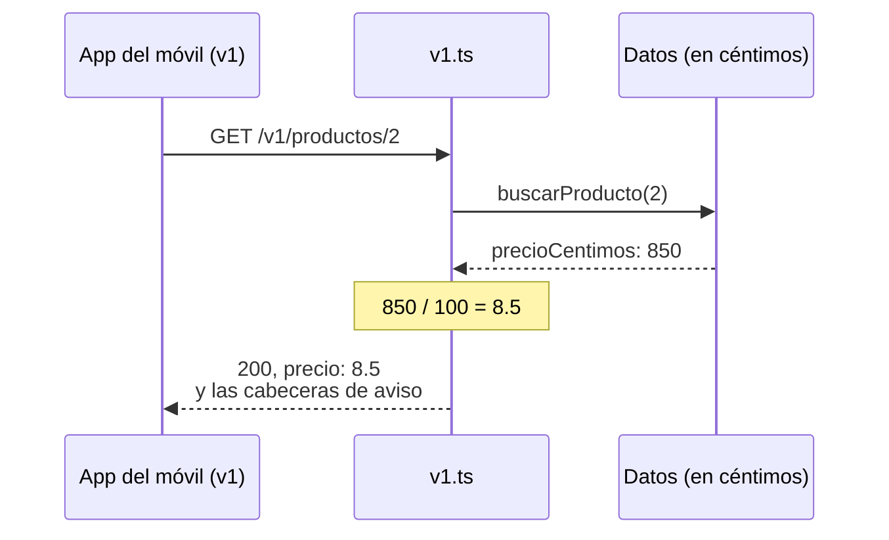

import Term from '~/components/Term.astro';
import TryIt from '~/components/TryIt.astro';
import Analogy from '~/components/Analogy.astro';
import Quiz from '~/components/Quiz.astro';
import QuizQuestion from '~/components/QuizQuestion.astro';
import QuizOption from '~/components/QuizOption.astro';
import ProjectCode from '~/components/ProjectCode.astro';

## El problema

Luis quiere guardar los precios en céntimos, 850 en vez de 8.5, porque con decimales las cuentas con dinero acaban fallando por un céntimo (lo verás en la lección 6). Imagina que un viernes cambia los tres precios de `src/datos.ts` y sube el servidor.

El sábado, la app del móvil de la tienda enseña la taza a **850 €**, y nadie ha tocado la app. El servidor responde `200`, TypeScript no se quejó y el JSON tiene la forma de ayer: `{"id":2,"nombre":"Taza","precio":850}`.

Lo que ha cambiado es la promesa: la app y la empresa de reparto llevan meses leyendo `precio` como euros. Desde que otros programas usan tu <Term id="api">API</Term>, cada cambio puede romperlos. En esta lección aprendes a cambiarla sin que lo noten.

## La analogía

<Analogy>

Piensa en una tienda que se muda. No cierra la vieja el día que abre la nueva: durante unos meses siguen abiertas las dos, y en el escaparate de la vieja hay un cartel: «Nos mudamos. Desde el 13 de abril, en la calle Nueva, 5». Quien entra compra como siempre y sale sabiendo adónde ir.

Para poner un producto nuevo en la estantería, nadie se muda. **Mudarse es para lo que no cabe en el local de siempre.**

<div slot="limits">

- Las dos tiendas de una API comparten el almacén: la vieja lee los mismos datos que la nueva y solo traduce lo que cambió.
- Los clientes de una API son programas y no leen carteles: las cabeceras de aviso sirven si alguien las mira, y hay que avisar también a quienes los mantienen.

</div>

</Analogy>

## Cómo funciona de verdad

### Un cambio rompe si un cliente que funcionaba deja de funcionar

Un <Term id="breaking-change">cambio que rompe</Term> es el que hace fallar a un <Term id="client">cliente</Term> que funcionaba, sin que nadie lo toque. Los 850 € son el peor tipo: nada da error, el dato sale mal. Los casos típicos:

| Cambio | ¿Rompe? | Por qué |
|---|---|---|
| Añadir un campo a la respuesta (`stock`) | No | Quien no lo conoce, lo ignora |
| Añadir un parámetro opcional (`?orden=precio`, de la lección 3) | No | Quien no lo envía recibe lo de siempre |
| Añadir una ruta (`POST /pedidos/17/cancelacion`, de la lección 1) | No | Nadie la llamaba antes |
| Quitar o renombrar un campo (`precio` → `precioCentimos`) | Sí | El cliente busca `precio` y no está |
| Cambiar el tipo o la unidad de un campo (euros → céntimos) | Sí | El cliente lee un número que significa otra cosa |
| Hacer obligatorio un dato que era opcional | Sí | Las peticiones de siempre reciben un `422` |
| Validar más estricto (de 10 unidades por pedido a 5) | Sí | Un pedido de 7 que valía, ya no vale |
| Cambiar un código de estado o una URL | Sí | El cliente comprueba el `200` o llama a la URL vieja |

La regla de fondo: **añadir casi nunca rompe; quitar o cambiar, casi siempre**. GitHub publica una lista parecida en [la documentación de sus versiones](https://docs.github.com/en/rest/about-the-rest-api/api-versions).

### La zona gris: un valor nuevo en una lista cerrada

En la lección 1, los pedidos ganaron el estado `cancelado`. GitHub cuenta un valor nuevo como cambio que añade, pero si la app de reparto solo conoce `pendiente`, `pagado` y `enviado`, y se cuelga con otro, a ella sí la ha roto. Por eso un buen cliente es un **lector tolerante** (*tolerant reader*): ignora los campos que no conoce y trata un estado desconocido como «otro».

### Lo primero: cambiar añadiendo

Casi todo se puede cambiar sin romper. La API podría añadir `precioCentimos` **al lado** de `precio`: los clientes viejos leen `precio`, los nuevos, `precioCentimos`, y nadie se entera. Lo que rompe es quitar `precio`.

Hace falta una versión nueva cuando el cambio no se puede hacer añadiendo:

- quieres **quitar** algo, como `precio`, para que nadie lo use más;
- cambia lo que el cliente **envía**: crear un producto pide `precioCentimos`, y `?max=10` pasa a ser `?maxCentimos=1000`;
- cambia el **significado** de algo que ya existe.

El <Term id="versioning">versionado</Term> es eso: dar un número a cada forma de la API para que la vieja y la nueva convivan, y cada cliente use la suya. La tienda quiere quitar `precio` y cambiar lo que se envía, así que tendrá dos versiones: la `v1`, con euros, y la `v2`, con céntimos.

### Dos versiones a la vez, sobre los mismos datos

Copiar todo el código para la versión nueva obliga a hacer cada arreglo dos veces. En el proyecto, los datos y las rutas son los de la `v2`, y la `v1` es una **capa fina que traduce** solo lo que cambió. Así responde a la app del móvil, que aún habla `v1`:



En `src/app.ts`, cada versión cuelga de su prefijo:

<ProjectCode file="tienda-api/13-versiones/src/app.ts" region="versiones" />

- `app.route('/v1', v1)` monta las rutas de `v1` debajo de `/v1`: su `/productos` responde en `/v1/productos`. Igual con `v2`.
- La raíz, `/`, dice qué versiones hay y cuándo se retira la vieja. Las rutas sin versión, como `/productos`, dan `404`.

En `src/v1.ts`, lo primero son las piezas que traducen:

<ProjectCode file="tienda-api/13-versiones/src/v1.ts" region="traducir" />

- `productoV1` recibe un producto en céntimos y devuelve otro <Term id="object">objeto</Term> con la forma de antes: `precio`, en euros.
- Los dos <Term id="schema">esquemas</Term> ([Fase 3](/fase-3/validar-datos-zod/)) dicen qué acepta la `v1` al crear un producto y en la <Term id="query-string">query string</Term>: euros. `esquemaFiltro.shape.orden` reutiliza la regla de `?orden=` de la `v2`, que no cambia.

Las rutas que leen productos son las de la lección 3, pero antes de filtrar y ordenar pasan cada producto por `productoV1`:

<ProjectCode file="tienda-api/13-versiones/src/v1.ts" region="leer-v1" />

Y la de crear un producto, la única que escribe:

<ProjectCode file="tienda-api/13-versiones/src/v1.ts" region="crear-v1" />

- `Math.round(precio * 100)` pasa de euros a céntimos y redondea, porque `8.29 * 100` da `828.9999999999999` (la lección 6 te cuenta por qué).
- `v1.route('/', v2)` es la clave: lo que la `v1` no define (los pedidos, borrar un producto) lo atienden las rutas de la `v2`. Hono las prueba en el orden en que se añadieron: primero las de `v1`.

### ¿En la URL o en una cabecera?

La versión puede viajar en tres sitios:

| Dónde | Ejemplo | Quién lo usa |
|---|---|---|
| En la URL | `GET /v2/productos` | La tienda, y la mayoría de APIs públicas |
| En una <Term id="header">cabecera</Term> | `X-GitHub-Api-Version: 2026-03-10` | GitHub; Stripe, con `Stripe-Version` |
| En la query string | `GET /productos?version=2` | Pocas: se pierde al copiar enlaces |

**Casi todas eligen la URL porque se ve**: en `curl`, en el navegador, en los logs y en DevTools. El <Term id="framework">framework</Term> la enruta con un prefijo, y las <Term id="cache">cachés</Term> guardan cada versión aparte, porque son URLs distintas.

Con una cabecera, cada producto tiene una sola URL para siempre. A cambio, la versión no se ve, y la respuesta tiene que llevar `Vary` con el nombre de esa cabecera, para que una caché no le dé a un cliente la versión de otro ([lección 4 de la Fase 2](/fase-2/cabeceras-http/#el-servidor-elige-según-lo-que-pides)).

GitHub usa la cabecera, con fechas como nombre. Si no la envías, elige por ti:

<TryIt
  title="La versión que GitHub elige si no dices nada"
  cmd="curl -sI https://api.github.com/repos/nodejs/node | grep -i version"
  output={`x-github-api-version-selected: 2022-11-28`}
>

`-sI` pide solo las cabeceras, y `grep -i version` deja las líneas que dicen `version`. Sin cabecera, GitHub usa la `2022-11-28`; la nueva es la `2026-03-10`, y la anterior dura al menos 24 meses más. Salida del 13 de octubre de 2026: si GitHub cambia la versión por defecto, verás otra fecha.

</TryIt>

### Avisar antes de apagar: Deprecation, Sunset y Link

Una versión vieja no se apaga de un día para otro: primero se declara <Term id="deprecation">obsoleta</Term> y sigue funcionando un tiempo. La `v1` lo avisa en cada respuesta:

<ProjectCode file="tienda-api/13-versiones/src/v1.ts" region="avisos" />

- `v1.use(…)` es un <Term id="middleware">middleware</Term> ([lección 6 de la Fase 3](/fase-3/que-es-middleware/)) para todas las rutas de la `v1`, también las que atiende la `v2`. Llama a `next()` y, cuando vuelve la respuesta, le añade tres cabeceras.
- **`Deprecation`** dice desde cuándo es obsoleta. La define el [RFC 9745](https://www.rfc-editor.org/rfc/rfc9745), de 2025: una `@` y los segundos desde el 1 de enero de 1970, en hora universal. `getTime()` da milisegundos: por eso se divide entre 1000.
- **`Sunset`** («puesta de sol») dice cuándo dejará de funcionar. La define el [RFC 8594](https://www.rfc-editor.org/rfc/rfc8594), con el formato de fecha de `Date` o `Expires`, el que escribe `toUTCString()`. El RFC 9745 prohíbe que sea anterior a la de `Deprecation`.
- **`Link`**, con `rel="successor-version"`, dice dónde está lo mismo en la versión nueva: la cabecera `Link` de la lección 3, con otra relación. `replace(/^\/v1/, '/v2')` cambia el `/v1` del principio de la ruta por `/v2` (lo que va entre barras es un patrón, y `^` significa «al principio»).
- `{ append: true }` añade el `Link` sin borrar el que hubiera, como el de la página siguiente.

Declarar obsoleto no cambia nada más: según el RFC 9745, la respuesta funciona igual que sin la cabecera. Es un aviso, no un error.

### Después de la fecha: mirar quién queda y apagar

Antes del 13 de abril, mira quién sigue llamando a la `v1`: el log de la [lección 8 de la Fase 3](/fase-3/errores-y-logs-node/) apunta cada ruta, y `grep '"ruta":"/v1/' tienda.log` te lo dice. A quien quede, escríbele.

Llegada la fecha, el RFC 8594 no fija qué pasa: un error `4xx`, una redirección `3xx` o ninguna respuesta. Lo más claro es su ejemplo, `410 Gone`: «esto existió y ya no está», distinto del `404` de lo que nunca existió ([lección 3 de la Fase 2](/fase-2/codigos-de-estado-http/)).

## Pruébalo

El objetivo: pasar los precios a céntimos **sin que la app del móvil, que aún lee euros, note nada**, y comprobar que la `v1` avisa de su retirada. Partes de tu proyecto de la lección 3 en `~/curso-backend/fase-3/tienda-api`. Descarga también la carpeta de esta lección, que trae las pruebas y te sirve para comparar si te atascas: desde `~/curso-backend/fase-3`, `curl -O https://backenddesdecero.com/practicas/tienda-api/13-versiones.tar.gz` y `tar -xzf 13-versiones.tar.gz`.

### El atajo: céntimos en el mismo campo

Primero, el cambio de «El problema», para ver qué lo detecta. En `src/datos.ts`, cambia los tres precios: `20` por `2000`, `8.5` por `850` y `35` por `3500`. Pasa las pruebas:

<TryIt
  title="1. Las pruebas, con el atajo"
  cmd="npm test | tail -n 35"
  output={`ℹ tests 32
ℹ suites 0
ℹ pass 31
ℹ fail 1
ℹ cancelled 0
ℹ skipped 0
ℹ todo 0
ℹ duration_ms 493.873231

✖ failing tests:

test at test/paginacion.test.ts:84:1
✖ los productos, ordenados por precio en los dos sentidos y filtrados (1.473699ms)
  AssertionError [ERR_ASSERTION]: Expected values to be strictly deep-equal:
  + actual - expected
  
    [
  +   850,
  +   2000,
  +   3500
  -   8.5,
  -   20,
  -   35
    ]
  
      at TestContext.<anonymous> (file:///Users/ana/curso-backend/fase-3/tienda-api/test/paginacion.test.ts:87:10)
      at async Test.run (node:internal/test_runner/test:1409:7)
      at async Test.processPendingSubtests (node:internal/test_runner/test:974:7) {
    generatedMessage: true,
    code: 'ERR_ASSERTION',
    actual: [ 850, 2000, 3500 ],
    expected: [ 8.5, 20, 35 ],
    operator: 'deepStrictEqual',
    diff: 'simple'
  }`}
>

`tail -n 35` deja las últimas 35 líneas. Falla la prueba que ordena por precio: esperaba `8.5, 20, 35` (las líneas con `-`) y recibe `850, 2000, 3500` (las de `+`). Lee `precio` como euros, igual que la app. `npm run check` no se queja: 850 sigue siendo un número.

Las salidas de esta lección son de Node 26.11.1 y `curl` 8.14.1, en Linux; tus tiempos y tus fechas serán otros. Si ves `tests 0`, te falta la carpeta `test/` de la descarga de la lección 3.

</TryIt>

Deshaz el cambio: vuelve a poner `20`, `8.5` y `35`.

### La versión 2: céntimos con su propio nombre

1. Crea `src/v2.ts`. Pásale desde `src/app.ts` las rutas de `/productos` y `/pedidos`, las funciones `estadoNoLoPermite` y `noPermitido` y los `import` que usan, y cambia `app.` por `v2.`.
2. En `src/datos.ts`, cambia `precio` por `precioCentimos` en `Producto`, en los tres productos (`2000`, `850` y `3500`) y en `crearProducto`:

<ProjectCode file="tienda-api/13-versiones/src/datos.ts" region="producto" />

3. En `src/esquemas.ts`, el producto nuevo pide céntimos enteros, con `.int(…)`, y el filtro pasa a llamarse `maxCentimos`. La regla del nombre sale a una constante con `export`, `esquemaNombre`, porque la `v1` también la usa (en la descarga, justo antes del producto).

<ProjectCode file="tienda-api/13-versiones/src/esquemas.ts" region="producto" />

<ProjectCode file="tienda-api/13-versiones/src/esquemas.ts" region="parametros" />

4. En `src/v2.ts`, las rutas de productos usan los nombres nuevos. Así empieza el fichero, después de los `import`, y así queda la de crear:

<ProjectCode file="tienda-api/13-versiones/src/v2.ts" region="listar-productos" />

<ProjectCode file="tienda-api/13-versiones/src/v2.ts" region="crear-producto" />

`c.req.path` es la ruta de la petición, con su prefijo: `/v2/productos` o `/v1/productos`. Cambia igual el `Location` de `POST /pedidos`: `c.req.path`, una barra y `pedido.id`.

`npm run check` te guía: cada `precio` que quede sale así (tu fichero y tu línea serán otros):

```
src/v2.ts(33,49): error TS2339: Property 'precio' does not exist on type 'Producto'.
```

### La versión 1, sobre la 2

Crea `src/v1.ts` con estos `import` y, debajo, las cuatro piezas de «Cómo funciona de verdad», en orden: avisos, traducir, leer y crear.

<ProjectCode file="tienda-api/13-versiones/src/v1.ts" region="importar" />

En `src/app.ts` cambian los `import`, y las rutas dejan sitio a la parte de las versiones; el resto (`requestId`, el registro, CORS y los errores) sigue igual:

<ProjectCode file="tienda-api/13-versiones/src/app.ts" region="importar" />

Las pruebas de la lección 3 llaman a `/productos` sin versión, que ahora es un `404`. Copia las de la descarga y pásalas:

<TryIt
  title="2. Las pruebas de las dos versiones"
  cmd={`cp ../13-versiones/test/*.test.ts test/
npm test | tail -n 17`}
  output={`✔ la raíz dice qué versiones hay y cuándo se retira la 1 (14.38447ms)
✔ v2: el precio, en céntimos enteros (1.13409ms)
✔ v1 sigue igual que antes: el precio, en euros (1.62317ms)
✔ v1 avisa de que está obsoleta, de cuándo se retira y de dónde está la 2 (0.569003ms)
✔ v2 no lleva esos avisos (0.452036ms)
✔ un producto creado con v1, en euros, se lee en v2 en céntimos (1.655506ms)
✔ en v2, el precio en euros ya no vale: es un cambio que rompe (0.978619ms)
✔ los pedidos de v1 son los de v2, con los avisos y sin perder el Link de la página siguiente (1.021956ms)
✔ sin versión, las rutas ya no existen: 404 (0.288731ms)
ℹ tests 41
ℹ suites 0
ℹ pass 41
ℹ fail 0
ℹ cancelled 0
ℹ skipped 0
ℹ todo 0
ℹ duration_ms 830.216423`}
>

Las nueve de `test/versiones.test.ts`, y `fail 0` en las 41. Si alguna falla, sale con `✖`, lo que esperaba y lo que recibió: compara tu código con el de la descarga.

</TryIt>

### Llama a las dos versiones

Arranca el servidor con `npm run dev` y abre otra terminal para `curl`.

<TryIt
  title="3. La raíz: qué versiones hay"
  cmd="curl -s localhost:3000/ | jq"
  output={`{
  "nombre": "API de la tienda de Ana y Luis",
  "versiones": [
    {
      "version": "v2",
      "url": "/v2",
      "estado": "actual"
    },
    {
      "version": "v1",
      "url": "/v1",
      "estado": "obsoleta",
      "retirada": "2027-04-13T00:00:00.000Z"
    }
  ]
}`}
>

`jq` ([lección 8 de la Fase 3](/fase-3/errores-y-logs-node/)) ordena el JSON en líneas. La `v1` está obsoleta y tiene fecha de retirada.

</TryIt>

<TryIt
  title="4. La taza, en la v1"
  cmd="curl -i localhost:3000/v1/productos/2"
  output={`HTTP/1.1 200 OK
content-type: application/json
deprecation: @1791849600
link: </v2/productos/2>; rel="successor-version"
sunset: Tue, 13 Apr 2027 00:00:00 GMT
vary: Origin
x-request-id: 9a279b1b-6f6a-4f93-972a-e0fc33fecaf6
content-length: 37
Date: Tue, 13 Oct 2026 14:29:36 GMT
Connection: keep-alive
Keep-Alive: timeout=5

{"id":2,"nombre":"Taza","precio":8.5}`}
>

Un `200` y la taza a 8.5 €: la app no nota nada. Pero vienen los tres avisos: obsoleta desde `@1791849600`, apagada el 13 de abril de 2027, y la misma taza en `/v2/productos/2`. `date -u -r 1791849600` en el Mac (`date -u -d @1791849600` en Linux y WSL) traduce el número: `Tue Oct 13 00:00:00 UTC 2026`. Tu `x-request-id` y tu fecha serán otros.

</TryIt>

<TryIt
  title="5. La misma taza, en la v2 y sin versión"
  cmd={`curl -w '\\n' localhost:3000/v2/productos/2
curl -w '\\n' localhost:3000/productos/2`}
  output={`{"id":2,"nombre":"Taza","precioCentimos":850}
{"type":"about:blank","title":"Not Found","status":404,"detail":"No existe esa ruta"}`}
>

En la `v2`, `precioCentimos: 850`, sin avisos. Sin versión, un `404` con el formato de la lección 2.

</TryIt>

Ahora crea un producto por la `v1`, en euros, y léelo por la `v2`. Antes, guarda tu token en una variable de la terminal: `TOKEN=` y, pegado, el valor de `ADMIN_TOKEN` de tu `.env`.

<TryIt
  title="6. Una gorra creada en euros, leída en céntimos"
  cmd={`curl -i -w '\\n' -H "Authorization: Bearer $TOKEN" --json '{"nombre":"Gorra","precio":8.29}' localhost:3000/v1/productos
curl -w '\\n' localhost:3000/v2/productos/4`}
  output={`HTTP/1.1 201 Created
content-type: application/json
deprecation: @1791849600
link: </v2/productos>; rel="successor-version"
location: /v1/productos/4
sunset: Tue, 13 Apr 2027 00:00:00 GMT
vary: Origin
x-request-id: 62c2db21-c6a2-4e80-b088-399a54fb6615
content-length: 39
Date: Tue, 13 Oct 2026 14:36:08 GMT
Connection: keep-alive
Keep-Alive: timeout=5

{"id":4,"nombre":"Gorra","precio":8.29}
{"id":4,"nombre":"Gorra","precioCentimos":829}`}
>

Un solo producto, desde las dos versiones: 8.29 € en la `v1` y 829 céntimos en la `v2`. Las comillas dobles dejan que la terminal cambie `$TOKEN` por su valor; si recibes un `401`, la variable está vacía o el token no coincide.

</TryIt>

<TryIt
  title="7. El filtro viejo, en las dos versiones"
  cmd={`curl -w '\\n' 'localhost:3000/v1/productos?max=10'
curl -w '\\n' 'localhost:3000/v2/productos?maxCentimos=1000'
curl -w '\\n' 'localhost:3000/v2/productos?max=10'`}
  output={`[{"id":2,"nombre":"Taza","precio":8.5},{"id":4,"nombre":"Gorra","precio":8.29}]
[{"id":2,"nombre":"Taza","precioCentimos":850},{"id":4,"nombre":"Gorra","precioCentimos":829}]
[{"id":1,"nombre":"Camiseta","precioCentimos":2000},{"id":2,"nombre":"Taza","precioCentimos":850},{"id":3,"nombre":"Sudadera","precioCentimos":3500},{"id":4,"nombre":"Gorra","precioCentimos":829}]`}
>

Las dos primeras dan lo mismo, cada una en su idioma. La tercera, `?max=10` en la `v2`, devuelve **los cuatro productos**, sin error: Zod descarta lo que no está en el esquema, y el de la `v2` no conoce `max`. Pasarse de versión no es cambiar `/v1` por `/v2` en la URL: hay que cambiar cada nombre.

</TryIt>

<TryIt
  title="8. Una lista de pedidos de la v1"
  cmd={`curl -sI 'localhost:3000/v1/pedidos?limite=2' | grep -iE '^(http|deprecation|sunset|link)'`}
  output={`HTTP/1.1 200 OK
deprecation: @1791849600
link: <http://localhost:3000/v1/pedidos?limite=2&cursor=MjQ>; rel="next", </v2/pedidos>; rel="successor-version"
sunset: Tue, 13 Apr 2027 00:00:00 GMT`}
>

Los pedidos los atiende la `v2`, por `v1.route('/', v2)`, con los avisos de la `v1`. Gracias a `{ append: true }`, el `Link` lleva dos enlaces separados por una coma: la página siguiente, en la `v1`, y la versión sucesora.

</TryIt>


## Ya lo has visto

- **«Actualiza la app para seguir usándola».** A menudo, el servidor va a apagar la versión de la API de tu app vieja.
- **En las URLs.** En la pestaña **Red** de DevTools ([cómo abrirlo](/fase-2/#antes-de-empezar-devtools)) verás peticiones a `/api/v1/…` o `/v3/…`.
- **En los paquetes de npm.** El `4` de `hono@4.13.13` cambia cuando algo rompe ([lección 1 de la Fase 3](/fase-3/que-es-node-js/)). Las APIs suelen usar solo ese número, o una fecha, casi nunca `v2.3.1`: al cliente solo le importa cuándo algo rompe.

## Errores comunes

- **Cambiar el significado sin cambiar el nombre.** Céntimos en el mismo `precio` no dan ningún error: dan precios cien veces más caros.
- **Sacar una versión por cada cambio.** Lo que se puede añadir, se añade en la versión actual.
- **Copiar todo el código para la versión nueva.** Las copias se separan con cada arreglo: que la vieja traduzca sobre la nueva.
- **Poner `Sunset` y no mirar quién queda.** Antes de apagar, mira el log y escribe a quien siga en la vieja.
- **Mandar los parámetros viejos a la versión nueva.** `?max=10` en la `v2` no da error: se ignora en silencio.

## Resumen

- Un cambio rompe si un cliente que funcionaba deja de funcionar: quitar o renombrar un campo, cambiar su tipo o su unidad, exigir algo nuevo.
- Lo primero es cambiar añadiendo. La versión nueva es para quitar algo, o para cambiar lo que el cliente envía o lo que significa algo.
- Las dos versiones conviven sobre los mismos datos: la vieja traduce solo lo que cambió.
- Casi todas las APIs ponen la versión en la URL (`/v2/`): se ve, y las cachés no mezclan versiones.
- La vieja avisa con `Deprecation` (desde cuándo es obsoleta), `Sunset` (cuándo se apaga) y `Link` con `rel="successor-version"` (dónde está la nueva).

## ¿Lo has entendido?

<Quiz>

<QuizQuestion
  question="La empresa de reparto lee el estado de cada pedido. Quieres añadir a la respuesta un campo nuevo, transportista. ¿Necesitas una v3?"
  review="Un cambio rompe si un cliente que funcionaba deja de funcionar"
>

<QuizOption text="Sí: cualquier cambio en la forma de la respuesta necesita una versión nueva.">

Añadir un campo no hace fallar a nadie: quien no lo conoce, lo ignora.

</QuizOption>

<QuizOption text="No: un campo nuevo no rompe a quien no lo conoce." correct>

Es un cambio que añade: la empresa de reparto ignora `transportista` hasta que quiera usarlo.

</QuizOption>

<QuizOption text="No, siempre que la respuesta lleve la cabecera Deprecation.">

`Deprecation` anuncia que algo se va a retirar. Añadir no retira nada: no hace falta aviso.

</QuizOption>

</QuizQuestion>

<QuizQuestion
  question="La empresa de reparto pide sus pedidos con ?limite=30. Luis baja el máximo de limite de 50 a 20, sin cambiar de versión. ¿Rompe a la empresa?"
  review="Un cambio rompe si un cliente que funcionaba deja de funcionar"
>

<QuizOption text="Sí: la misma petición de cada día recibe ahora un 422." correct>

Validar más estricto rompe: peticiones que funcionaban dejan de hacerlo, aunque los parámetros sean los mismos.

</QuizOption>

<QuizOption text="No: los parámetros son los mismos, solo cambia una regla.">

Que la forma no cambie no basta: la empresa pedía 30 ayer sin problema y hoy recibe un error.

</QuizOption>

<QuizOption text="No: el 422 explica qué falla, así que el cliente se arregla solo.">

Un buen error ayuda a quien lo lee, pero la petición falla igual: un programa no cambia su código por leer un mensaje.

</QuizOption>

</QuizQuestion>

<QuizQuestion
  question="La API da el plazo de entrega de cada pedido en días, en el campo plazo. Un compañero lo pasa a horas sin cambiarle el nombre: de 2 a 48. npm run check no da errores. ¿Qué ve la app del móvil?"
  review="Un cambio rompe si un cliente que funcionaba deja de funcionar"
>

<QuizOption text="Un error al leer la respuesta, porque el número no es el de siempre.">

Para la app, `48` es un número como `2`, y lo lee sin problema. Por eso el fallo no se ve.

</QuizOption>

<QuizOption text="Nada raro: si el cambio rompiera algo, TypeScript lo habría marcado.">

Para TypeScript, los dos son `number`: no sabe si son días u horas. Y no ve el código de la app.

</QuizOption>

<QuizOption text="Un plazo de 48 días, sin ningún error." correct>

Es el peor cambio que rompe, como los 850 € de la taza: la misma forma, otro significado. Un nombre nuevo, `plazoHoras`, lo habría evitado.

</QuizOption>

</QuizQuestion>

<QuizQuestion
  question="Tu API pone la versión en una cabecera, Tienda-Version, y una CDN guarda las respuestas. ¿Qué tienes que vigilar?"
  review="¿En la URL o en una cabecera?"
>

<QuizOption text="Nada: una CDN compara todas las cabeceras de la petición antes de dar una copia.">

Una caché guarda por URL. Solo mira una cabecera si la respuesta se lo pide con `Vary`.

</QuizOption>

<QuizOption text="Que la respuesta lleve Vary: Tienda-Version." correct>

La URL es la misma para las dos versiones. `Vary` le dice a la caché que guarde una copia por cada valor de la cabecera.

</QuizOption>

<QuizOption text="Que la CDN deje pasar la cabecera, porque rechaza las que no conoce.">

Una caché no rechaza una cabecera que no conoce: la pasa al servidor. El problema es la copia que guarda.

</QuizOption>

</QuizQuestion>

<QuizQuestion
  question="Una respuesta de la v1 trae Deprecation: @1791849600 y Sunset: Tue, 13 Apr 2027 00:00:00 GMT. ¿Qué significa para quien la usa hoy?"
  review="Avisar antes de apagar: Deprecation, Sunset y Link"
>

<QuizOption text="Que la v1 ya no funciona y la respuesta es solo un aviso.">

Declarar obsoleto no cambia nada: la respuesta es un `200` con sus datos de siempre, como dice el RFC 9745.

</QuizOption>

<QuizOption text="Que la v1 se apagará el 13 de octubre de 2026, la fecha de Deprecation.">

`Deprecation` es desde cuándo es obsoleta, no cuándo se apaga. El apagado es la fecha de `Sunset`.

</QuizOption>

<QuizOption text="Que sigue funcionando igual, hasta el 13 de abril de 2027." correct>

`Deprecation` dice que ya es obsoleta, y `Sunset`, cuándo se apaga. Hasta entonces hay tiempo de pasarse a la `v2`.

</QuizOption>

</QuizQuestion>

<QuizQuestion
  question="La v1 tiene que seguir dando los precios en euros. ¿Cómo lo hace el proyecto sin mantener dos tiendas?"
  review="Dos versiones a la vez, sobre los mismos datos"
>

<QuizOption text="La v1 lee los mismos datos que la v2 y solo traduce el precio." correct>

`productoV1` divide entre 100 al leer, y `Math.round(precio * 100)` multiplica al crear. Lo demás lo atiende la `v2`.

</QuizOption>

<QuizOption text="Copia las rutas de la v2 en la v1 y cambia precioCentimos por precio.">

Serían dos copias que se separan con cada arreglo. La `v1` solo define las rutas con precio.

</QuizOption>

<QuizOption text="Guarda cada producto dos veces: en euros para la v1 y en céntimos para la v2.">

Habría que mantener las dos copias iguales. Hay un solo dato, en céntimos, y la `v1` lo traduce al responder.

</QuizOption>

</QuizQuestion>

</Quiz>

## Para profundizar

- [RFC 9745: The Deprecation HTTP Response Header Field](https://www.rfc-editor.org/rfc/rfc9745) (en inglés): la cabecera `Deprecation` y `rel="deprecation"`, para enlazar una página que explique la retirada.
- [RFC 8594: The Sunset HTTP Header Field](https://www.rfc-editor.org/rfc/rfc8594) (en inglés): la cabecera `Sunset` y qué puede pasar después de la fecha.
- [API versions](https://docs.github.com/en/rest/about-the-rest-api/api-versions) (GitHub, en inglés): qué cambios rompen y cuánto dura cada versión.
- [Versioning](https://docs.stripe.com/api/versioning) (Stripe, en inglés): versiones con fecha en una cabecera, con el `/v1/` en la URL.
