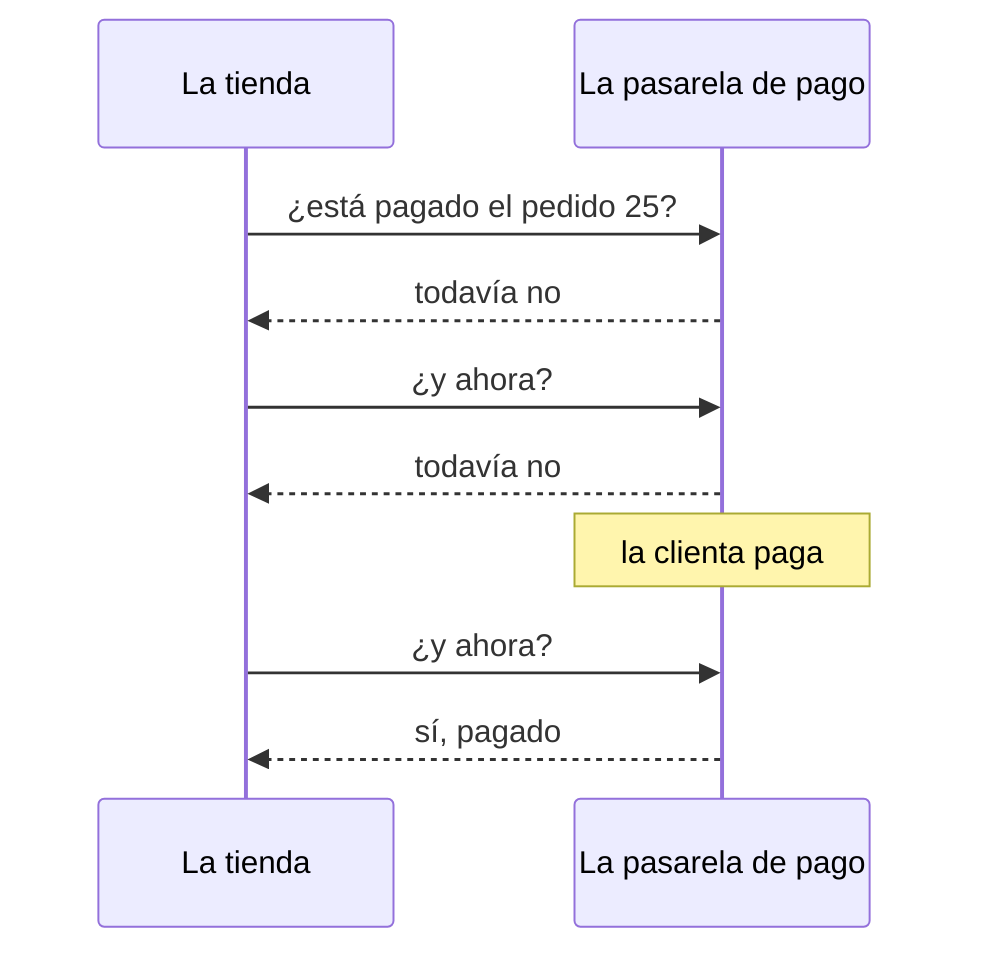
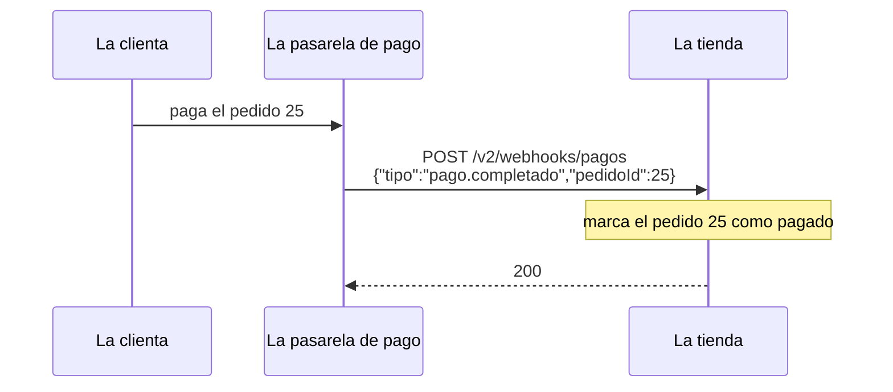
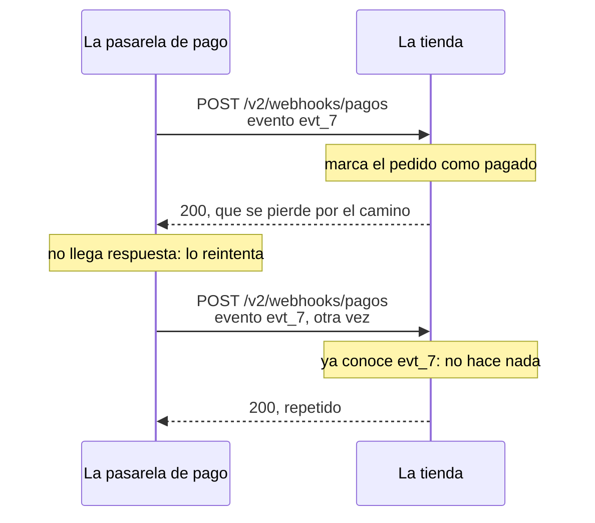

import Term from '~/components/Term.astro';
import TryIt from '~/components/TryIt.astro';
import Analogy from '~/components/Analogy.astro';
import SelfCheck from '~/components/SelfCheck.astro';
import Quiz from '~/components/Quiz.astro';
import QuizQuestion from '~/components/QuizQuestion.astro';
import QuizOption from '~/components/QuizOption.astro';
import ProjectCode from '~/components/ProjectCode.astro';

## El problema

Una clienta paga el pedido 25 de la tienda. No en tu API, sino en la pasarela de pago: la empresa que cobra con tarjeta para la tienda, como Stripe o Redsys. ¿Cómo se entera la tienda de que ya puede preparar el paquete?

Podría preguntar cada minuto: con 50 pedidos pendientes, 72.000 preguntas al día, casi todas para oír «todavía no». Lo habitual es lo contrario: que la pasarela llame a la tienda cuando alguien paga. Pero en cuanto la tienda abre una dirección para eso, `POST /v2/webhooks/pagos`, surgen dos preguntas:

- **¿Quién llama?** Cualquiera con `curl` puede escribir «el pedido 25 está pagado» y llevarse una sudadera gratis.
- **¿Cuántas veces?** Si la respuesta de la tienda se pierde, la pasarela vuelve a avisar: el mismo pago llega dos veces.

La segunda ya la conoces: el `POST` repetido de Luis en el tren, de la [lección de métodos de la Fase 2](/fase-2/metodos-http/#idempotente-repetirla-no-cambia-el-resultado). Hoy la resuelves en los dos sentidos.

## La analogía

<Analogy>

Luis vende por encargo. En vez de llamar al banco cada hora para preguntar si un cliente ha pagado, le pide que le avise con una carta cuando entre el dinero.

Para que nadie se haga pasar por el banco, acuerdan una palabra secreta que nunca se escribe. Al pie de cada carta, el banco pone un código calculado con esa palabra y el texto. Luis repite la cuenta: si alguien ha cambiado el importe, no cuadra.

Y cada carta lleva un número de referencia: si Correos entrega dos veces la misma, Luis no envía otro paquete.

<div slot="limits">

- Nadie calcula de cabeza un código así; un ordenador, en microsegundos: es el HMAC.
- Una carta rara vez llega dos veces. Un webhook se repite a propósito: quien lo envía insiste hasta recibir un «recibido».
- La carta tarda días. Un webhook llega en menos de un segundo, y quien lo envía solo espera unos segundos.

</div>

</Analogy>

## Cómo funciona de verdad

### Preguntar cada minuto o que te avisen

Así es preguntar cada cierto tiempo:



Eso es <Term id="polling">polling</Term>: funciona, pero gasta peticiones y se entera tarde. Un <Term id="webhook">webhook</Term> le da la vuelta: la tienda le da a la pasarela una URL suya, y la pasarela le hace un `POST` cuando pasa algo.



La pasarela es el <Term id="client">cliente</Term>, y la tienda, el <Term id="server">servidor</Term>. En HTTP no hay nada nuevo: un `POST` con JSON, uno por suceso, en el momento.

El precio: la tienda necesita una URL a la que la pasarela llegue desde internet, y una de verdad no llega a tu `localhost`. Por eso, aquí la pasarela es un programa de mentira en tu ordenador.

Lo que envía se llama **evento**: un suceso con nombre y su propio id. Su forma, en `src/esquemas.ts`:

<ProjectCode file="tienda-api/16-webhooks/src/esquemas.ts" region="evento-pago" />

- `id` es el del evento, no el del pedido: servirá para reconocer los repetidos.
- `z.literal('pago.completado')` solo acepta ese texto exacto. `esquemaAcuse` es lo que contesta la tienda.

### La firma: un HMAC del cuerpo con un secreto

A esa URL llega cualquiera. Antes de creerse un aviso, la tienda necesita saber que es de la pasarela y que nadie lo ha cambiado. Los webhooks lo resuelven con un <Term id="secret">secreto</Term> que solo conocen los dos lados. Mira qué se hace con él en el <Term id="repl">REPL</Term> (escribe `node` en la terminal):

<TryIt
  title="En el REPL: el mismo cuerpo, otro cuerpo y otro secreto"
  lang="js"
  cmd={`const { createHmac } = await import('node:crypto')
const secreto = 'el-secreto-de-la-tienda-y-la-pasarela'
createHmac('sha256', secreto).update('{"pedidoId":25}').digest('hex')
createHmac('sha256', secreto).update('{"pedidoId":26}').digest('hex')
createHmac('sha256', 'otro-secreto').update('{"pedidoId":25}').digest('hex')
createHmac('sha256', secreto).update('{"pedidoId":25}').digest('hex')`}
  output={`undefined
undefined
'98a70e82b1b833638939bc0172f3fad33cb41dd61097c25c916c89fb59c45e5c'
'cc2b44a758d8d9bf33f224924a4821d456ea5b5a878e6e72aba2a9f63578b16c'
'8256048fc08b0138e8dbf8f970fceb4bef3fa17972c374a3b01df34304bf6f16'
'98a70e82b1b833638939bc0172f3fad33cb41dd61097c25c916c89fb59c45e5c'`}
>

`createHmac` viene en `node:crypto`, el <Term id="module">módulo</Term> de criptografía de Node. Compara las cuatro líneas largas:

- La primera y la última son iguales: el mismo cuerpo con el mismo secreto da siempre lo mismo, también en tu ordenador.
- La segunda cambia un carácter del cuerpo, `26` en vez de `25`, y no se parece en nada. La tercera, con otro secreto, tampoco.

Las salidas de esta lección son de Node 26.

</TryIt>

Eso es un <Term id="hmac">HMAC</Term>: un <Term id="hash">hash</Term>, como los de la [lección de Git de la Fase 1](/fase-1/git-por-dentro/#el-hash-la-huella-de-los-datos), calculado con el mensaje y un secreto juntos. **Quien tiene el secreto firma cualquier cuerpo; quien no lo tiene, no puede**, aunque sepa la fórmula y haya visto mil avisos firmados.

Así se firma, en un fichero nuevo, `src/firma.ts`, que usarán la tienda y la pasarela de mentira:

<ProjectCode file="tienda-api/16-webhooks/src/firma.ts" region="firmar" />

- `createHmac('sha256', secreto)` prepara el cálculo con la fórmula SHA-256; `.update(cuerpo)` le da el texto, y `.digest('hex')`, el resultado en hexadecimal: 64 caracteres.
- Delante va `sha256=`, la fórmula usada. La firma viaja en la <Term id="header">cabecera</Term> `X-Firma`; GitHub firma igual, en `X-Hub-Signature-256`.

A diferencia de la <Term id="digital-signature">firma digital</Term> de la [Fase 0](/fase-0/tls-y-https/#dos-llaves-la-criptografía-de-clave-pública), aquí el mismo secreto firma y comprueba. Por eso vive solo en la pasarela y en tu servidor, en la <Term id="environment-variable">variable de entorno</Term> `WEBHOOK_SECRET`, que `src/config.ts` exige al arrancar. Una pasarela real te lo da al registrar tu URL (en Stripe empieza por `whsec_`).

### Comprobar la firma: el cuerpo tal cual, en tiempo constante

Comprobar es repetir la cuenta y comparar, en el mismo fichero:

<ProjectCode file="tienda-api/16-webhooks/src/firma.ts" region="comprobar" />

- `firma: string | undefined`: la cabecera puede faltar, y entonces no vale.
- `Buffer.from` convierte cada texto en bytes, el `Buffer` de la [lección 4 de la Fase 3](/fase-3/servidor-http-node/).
- `timingSafeEqual` tarda lo mismo acierte o falle. Con `===`, la comparación se para en el primer carácter distinto: cuanto más acierta, más tarda. Midiendo miles de intentos, alguien podría adivinar la firma carácter a carácter.
- Solo compara bytes del mismo tamaño: por eso antes se miran las longitudes.

Lo usa un <Term id="middleware">middleware</Term> nuevo, `src/middleware/verificar-firma.ts`:

<ProjectCode file="tienda-api/16-webhooks/src/middleware/verificar-firma.ts" region="verificar-firma" />

Fíjate en `c.req.text()`: lee el <Term id="request-body">cuerpo</Term> como texto, tal y como llegó. **La firma se comprueba sobre el cuerpo original, nunca sobre el JSON leído y vuelto a escribir.** `JSON.stringify` lo reescribe sin los espacios del original, y un carácter de más cambia la firma.

Si no cuadra, `400`, con la forma de la lección 2, «Errores». No `401`: un `401` promete una cabecera `WWW-Authenticate` que diga cómo identificarse ([lección 6 de la Fase 3](/fase-3/que-es-middleware/#un-guardia-que-responde-401)), y una firma no tiene un esquema así. El ejemplo de Stripe también contesta `400`.

La ruta, en `src/contrato.ts`, pone el middleware delante, como `soloAdmin` en la lección 5, «OpenAPI»:

<ProjectCode file="tienda-api/16-webhooks/src/contrato.ts" region="recibir-pago" />

`middleware: [verificarFirma]` va antes que la <Term id="validation">validación</Term>: sin firma buena, `400`, sin mirar si el JSON cumple el <Term id="schema">esquema</Term>.

### Responder rápido y dejar el trabajo para después

Quien envía un webhook no espera mucho. GitHub da 10 segundos: sin un `2xx` a tiempo, el aviso ha fallado. Stripe lo reintenta durante hasta tres días. El código que contesta, en `src/v2.ts`:

<ProjectCode file="tienda-api/16-webhooks/src/v2.ts" region="recibir-pago" />

- Si el pedido no existe, `422`, como cualquier dato que no vale.
- Si está pendiente, pasa a `pagado`. Uno cancelado sigue cancelado.

Un correo o una factura irían a una cola, para después (Fase 9). **Primero «recibido»; el trabajo, luego.**

### Los avisos se repiten: procesa cada evento una vez

Las pasarelas prometen que cada aviso llega **al menos una vez**, no exactamente una. Basta con que se pierda tu `200`:



Para reconocerlo, la tienda apunta el id de cada evento procesado, en `src/datos.ts`:

<ProjectCode file="tienda-api/16-webhooks/src/datos.ts" region="eventos-procesados" />

Un `Set` es una colección sin repetidos: `has` pregunta si un valor está, y `add` lo añade. Si la ruta ya conoce el id, contesta `repetido: true` sin tocar nada.

Y contesta `200`: con un error, la pasarela creería que el aviso no ha llegado y lo reenviaría. El `Set` vive en memoria, como los pedidos: se olvida al reiniciar, y en la Fase 5 irá a la base de datos.

### Idempotency-Key: un POST que se puede repetir

Ahora, al revés. La app del móvil crea un pedido, la respuesta se pierde en un túnel y la app reintenta. `POST` no es <Term id="idempotent">idempotente</Term>: la tienda crearía dos pedidos.

La solución es la de los eventos. La app genera un valor único por pedido, normalmente un UUID (un id al azar, como los `evt_…`), y lo envía en la cabecera `Idempotency-Key`, la <Term id="idempotency-key">clave de idempotencia</Term>. Si reintenta, repite la clave.

```http
POST /v2/pedidos HTTP/1.1
Content-Type: application/json
Idempotency-Key: 5f0c8a2e-pedido-de-luis

{"productoId":2,"cantidad":1}
```

**No es un estándar.** La describe un borrador del IETF que caducó en abril de 2026 sin llegar a <Term id="rfc">RFC</Term>. Pero es práctica común: Stripe y otras APIs de pago la usan desde hace años.

El middleware, `src/middleware/idempotencia.ts`, guarda lo respondido a cada clave:

<ProjectCode file="tienda-api/16-webhooks/src/middleware/idempotencia.ts" region="guardadas" />

Un `Map` guarda parejas clave → valor, como un diccionario: `get` lee y `set` guarda. Por cada clave, el cuerpo de la petición y lo respondido: código, cuerpo y `Location`. Al llegar una petición, se busca su clave:

<ProjectCode file="tienda-api/16-webhooks/src/middleware/idempotencia.ts" region="idempotencia-repetida" />

- Sin clave, todo sigue como siempre.
- **La misma clave con otro cuerpo** es un error del cliente: `422`, lo que propone el borrador.
- **La misma clave con el mismo cuerpo** es un reintento: vuelve la respuesta guardada, con `Idempotent-Replayed: true`, un nombre de Stripe, no del borrador.

`c.header` y `c.body` la montan sobre la respuesta de esta petición, que ya lleva su `X-Request-Id`: es otra petición, con su id en el <Term id="log">log</Term>. De la primera solo se repite lo guardado.

Si la clave es nueva, la petición sigue, y a la vuelta se guarda la respuesta:

<ProjectCode file="tienda-api/16-webhooks/src/middleware/idempotencia.ts" region="idempotencia-guardar" />

- `c.res.clone()` copia la respuesta antes de leerla: un cuerpo es un <Term id="stream">stream</Term>, que solo se lee una vez.
- Solo se guarda lo que salió bien (`ok`, un `2xx`): si falló, el cliente puede corregir y reintentar con la misma clave.
- `as ContentfulStatusCode` le promete a TypeScript que es un código con cuerpo, lo que pide `c.body` ([lección 2](/fase-4/errores-api-problem-details/)). Aquí es verdad: es el `201`.

La ruta de crear pedidos, en `src/contrato.ts`, añade el middleware y declara la cabecera:

<ProjectCode file="tienda-api/16-webhooks/src/contrato.ts" region="crear-pedido" />

## Pruébalo

El objetivo: que la tienda se entere de los pagos sin dejarse engañar. Que acepte el aviso bueno, rechace el manipulado y el falso, y no cuente dos veces el repetido. Y que un pedido reintentado no se duplique.

### Escribe el código

Partes de tu proyecto de la lección 6, «Serialización»:

1. Crea `src/firma.ts`, `src/middleware/verificar-firma.ts` y `src/middleware/idempotencia.ts`. El último empieza importando, con `import type`, `MiddlewareHandler` de `'hono'` y `ContentfulStatusCode` de `'hono/utils/http-status'`, y `problema` y `tipo` de `'../problemas.ts'`.
2. Cambia `src/config.ts` (`WEBHOOK_SECRET`, con su mensaje), `src/esquemas.ts`, `src/datos.ts`, `src/contrato.ts` (las dos rutas y sus `import`) y `src/v2.ts` (la ruta del webhook, el `import` de `eventosProcesados` y, al final, el `405` de `/webhooks/pagos`, como el de las demás).
3. Añade `WEBHOOK_SECRET` a tu `.env.ejemplo`:

<ProjectCode file="tienda-api/16-webhooks/.env.ejemplo" />

La pasarela de mentira y las pruebas nuevas vienen en la carpeta de esta lección. Descárgala y copia lo que falta:

```sh
cd ~/curso-backend/fase-3
curl -O https://backenddesdecero.com/practicas/tienda-api/16-webhooks.tar.gz
tar -xzf 16-webhooks.tar.gz
cd tienda-api
mkdir -p scripts
cp ../16-webhooks/scripts/pasarela.ts scripts/
cp ../16-webhooks/test/webhooks.test.ts ../16-webhooks/test/openapi.test.ts ../16-webhooks/test/.env test/
```

`mkdir -p` crea `scripts` si no existe, y `test/.env` trae un secreto para las pruebas. Si te atascas, compara tu código con `16-webhooks`. Añade al `package.json` el script `pasarela` (la línea marcada):

<ProjectCode file="tienda-api/16-webhooks/package.json" mark={14} />

Esto hace `scripts/pasarela.ts`:

<ProjectCode file="tienda-api/16-webhooks/scripts/pasarela.ts" region="enviar" />

- `randomUUID()` da al evento un id al azar, y `firmar` es la función de la tienda: los dos lados calculan igual.
- `fetch` envía la petición ([lección 2 de la Fase 3](/fase-3/javascript-para-backend/)). `→` es lo que envía, y `←`, lo que le contestan.
- `--manipular` cambia el pedido **después** de firmar, como haría alguien por el camino. `--repetir` envía el mismo evento dos veces.

### Arranca sin secreto

<TryIt
  title="1. El servidor exige el secreto"
  cmd="npm start"
  output={`> tienda-api@1.0.0 start
> node --env-file-if-exists=.env src/servidor.ts

Configuración: WEBHOOK_SECRET: Falta WEBHOOK_SECRET`}
>

Tu `.env` aún no tiene `WEBHOOK_SECRET`, y `config.ts` no deja arrancar sin él. Mejor así que descubrirlo con el primer pago.

</TryIt>

<TryIt
  title="2. Un secreto largo"
  cmd="openssl rand -hex 24"
  output={`d79121847931c34ba344a4a2553bdc4783733bd950d011fc`}
>

El tuyo será otro. Añade a tu `.env` una línea `WEBHOOK_SECRET=` con él detrás. Que no sea tu `ADMIN_TOKEN`: si uno se filtra, el otro sigue a salvo.

</TryIt>

Arranca el servidor con `npm run dev` y deja esa terminal abierta. Abre otra en la carpeta del proyecto.

### Un pago, un engaño y una repetición

Los pedidos 21 a 25 de ejemplo están pendientes.

<TryIt
  title="3. La pasarela avisa del pago del pedido 23"
  cmd={`npm run pasarela -- 23
curl -w '\\n' localhost:3000/v2/pedidos/23`}
  output={`> tienda-api@1.0.0 pasarela
> node --env-file-if-exists=.env scripts/pasarela.ts 23

→ POST /v2/webhooks/pagos {"id":"evt_7769a8ee-50f8-43a6-991b-a9c4e2de2544","tipo":"pago.completado","pedidoId":23}
← 200 {"recibido":"evt_7769a8ee-50f8-43a6-991b-a9c4e2de2544","repetido":false}
{"id":23,"productoId":3,"cantidad":4,"estado":"pagado","creadoEn":"2026-10-07T19:00:00.000Z"}`}
>

Lo que va detrás de `--` le llega a `pasarela.ts`, no a `npm`. La tienda contesta `200` con `repetido: false`, y el pedido 23 ya está `pagado`. Tu id de evento será otro.

Si sale `fetch failed` con `ECONNREFUSED`, el servidor no está en marcha: mira la otra terminal. Si recibes `400` con `firma-no-valida`, revisa `firma.ts` y `verificar-firma.ts`: la firma se calcula sobre `c.req.text()` y lleva `sha256=` delante.

</TryIt>

<TryIt
  title="4. Alguien cambia el aviso por el camino"
  cmd={`npm run pasarela -- 24 --manipular
curl -w '\\n' localhost:3000/v2/pedidos/25`}
  output={`> tienda-api@1.0.0 pasarela
> node --env-file-if-exists=.env scripts/pasarela.ts 24 --manipular

→ POST /v2/webhooks/pagos {"id":"evt_809d4b14-deaf-4372-ba11-5673a37489af","tipo":"pago.completado","pedidoId":25}
← 400 {"type":"https://tienda.example/problemas/firma-no-valida","title":"La firma no es válida","status":400,"detail":"La cabecera X-Firma no corresponde a este cuerpo"}
{"id":25,"productoId":2,"cantidad":2,"estado":"pendiente","creadoEn":"2026-10-08T09:00:00.000Z"}`}
>

Se pagó el 24, pero el cuerpo que llega dice `25`. La firma es la del cuerpo original y no cuadra: `400`, y el pedido 25 sigue `pendiente`.

</TryIt>

<TryIt
  title="5. El mismo aviso, dos veces"
  cmd="npm run pasarela -- 24 --repetir"
  output={`> tienda-api@1.0.0 pasarela
> node --env-file-if-exists=.env scripts/pasarela.ts 24 --repetir

→ POST /v2/webhooks/pagos {"id":"evt_52faf30f-8ccd-4bfe-8ff0-341ce08efc8b","tipo":"pago.completado","pedidoId":24}
← 200 {"recibido":"evt_52faf30f-8ccd-4bfe-8ff0-341ce08efc8b","repetido":false}
→ POST /v2/webhooks/pagos {"id":"evt_52faf30f-8ccd-4bfe-8ff0-341ce08efc8b","tipo":"pago.completado","pedidoId":24}
← 200 {"recibido":"evt_52faf30f-8ccd-4bfe-8ff0-341ce08efc8b","repetido":true}`}
>

Dos `200` con el mismo id, y `repetido: true` en el segundo: dos acuses, un solo pago procesado.

</TryIt>

<TryIt
  title="6. Un aviso falso, sin firma"
  cmd={`curl -i --json '{"id":"evt_falso","tipo":"pago.completado","pedidoId":25}' localhost:3000/v2/webhooks/pagos`}
  output={`HTTP/1.1 400 Bad Request
content-type: application/problem+json
vary: Origin
x-request-id: 29342c80-f1fd-4ec2-9a58-9e0ad3205d1b
content-length: 165
Date: Tue, 13 Oct 2026 15:03:34 GMT
Connection: keep-alive
Keep-Alive: timeout=5

{"type":"https://tienda.example/problemas/firma-no-valida","title":"La firma no es válida","status":400,"detail":"La cabecera X-Firma no corresponde a este cuerpo"}`}
>

El JSON es perfecto, pero sin `X-Firma` no pasa del middleware: no hay sudadera gratis. Tu `x-request-id` y tu fecha serán otros.

</TryIt>

### Un pedido que se reintenta

Ahora eres la app del móvil, y la red falla justo al crear un pedido. Envía dos veces la misma petición:

<TryIt
  title="7. El mismo POST con la misma clave, dos veces"
  cmd={`curl -i -w '\\n' -H 'Idempotency-Key: 5f0c8a2e-pedido-de-luis' --json '{"productoId":2,"cantidad":1}' localhost:3000/v2/pedidos
curl -i -H 'Idempotency-Key: 5f0c8a2e-pedido-de-luis' --json '{"productoId":2,"cantidad":1}' localhost:3000/v2/pedidos`}
  output={`HTTP/1.1 201 Created
content-type: application/json
location: /v2/pedidos/26
vary: Origin
x-request-id: 4277dec0-60ba-4c11-8244-1c9fa3d04f1d
content-length: 96
Date: Tue, 13 Oct 2026 15:03:34 GMT
Connection: keep-alive
Keep-Alive: timeout=5

{"id":26,"productoId":2,"cantidad":1,"estado":"pendiente","creadoEn":"2026-10-13T15:03:34.220Z"}
HTTP/1.1 201 Created
content-type: application/json
idempotent-replayed: true
location: /v2/pedidos/26
vary: Origin
x-request-id: 996b9af8-eb1c-476e-b8b2-ccae47b2cc97
content-length: 96
Date: Tue, 13 Oct 2026 15:03:34 GMT
Connection: keep-alive
Keep-Alive: timeout=5

{"id":26,"productoId":2,"cantidad":1,"estado":"pendiente","creadoEn":"2026-10-13T15:03:34.220Z"}`}
>

`-H` añade la cabecera. Las dos respuestas son el mismo `201` con el mismo pedido 26, `creadoEn` incluido. La segunda trae `idempotent-replayed: true`, porque es la respuesta guardada, y su propio `x-request-id`. Tus ids y tus fechas serán otros.

</TryIt>

<TryIt
  title="8. La misma clave con otros datos"
  cmd={`curl -w '\\n' -H 'Idempotency-Key: 5f0c8a2e-pedido-de-luis' --json '{"productoId":2,"cantidad":3}' localhost:3000/v2/pedidos
curl -w '\\n' 'localhost:3000/v2/pedidos?limite=2'`}
  output={`{"type":"https://tienda.example/problemas/clave-reutilizada","title":"Esa clave ya se usó con otros datos","status":422,"detail":"Usa una Idempotency-Key nueva para cada operación distinta"}
[{"id":26,"productoId":2,"cantidad":1,"estado":"pendiente","creadoEn":"2026-10-13T15:03:34.220Z"},{"id":25,"productoId":2,"cantidad":2,"estado":"pendiente","creadoEn":"2026-10-08T09:00:00.000Z"}]`}
>

Tres tazas en vez de una, con la misma clave: `422`. Y la lista confirma que el pedido más nuevo es el 26, y solo hay uno.

</TryIt>

Para terminar, `npm test` debería acabar con `fail 0`: las pruebas nuevas hacen lo mismo que tú, y algo más.

<SelfCheck question="Reto: firma tú un aviso a mano, sin la pasarela, con openssl y curl, y paga con él el pedido 25. ¿Qué te dice eso de tu WEBHOOK_SECRET?">

`openssl dgst -sha256 -hmac` calcula el mismo HMAC que `createHmac`. Pon tu secreto en lugar del de ejemplo:

```sh
SECRETO=d79121847931c34ba344a4a2553bdc4783733bd950d011fc
CUERPO='{"id":"evt_a_mano","tipo":"pago.completado","pedidoId":25}'
FIRMA=$(printf '%s' "$CUERPO" | openssl dgst -sha256 -hmac "$SECRETO" | awk '{print $NF}')
curl -w '\n' -H "X-Firma: sha256=$FIRMA" --json "$CUERPO" localhost:3000/v2/webhooks/pagos
curl -w '\n' localhost:3000/v2/pedidos/25
```

```text
{"recibido":"evt_a_mano","repetido":false}
{"id":25,"productoId":2,"cantidad":2,"estado":"pagado","creadoEn":"2026-10-08T09:00:00.000Z"}
```

`printf '%s'` no añade el salto de línea final, que cambiaría la firma. `awk '{print $NF}'` se queda con la última palabra: OpenSSL 3, el de Linux, pone delante `SHA2-256(stdin)=`; LibreSSL, el de macOS, no.

**Con el secreto, cualquiera es la pasarela.** Por eso va en el `.env`, nunca en Git, y si se filtra, se cambia en los dos lados.

</SelfCheck>

## Ya lo has visto

- **«Estamos confirmando tu pago…».** Esa página, tras pagar en una tienda online, suele esperar el webhook de la pasarela.
- **«No recargues la página ni pulses atrás».** Ese aviso existe porque repetir la petición podía cobrar dos veces. Con una clave de idempotencia, no duplica nada.
- **El despliegue de esta web.** En la [lección de Git de la Fase 1](/fase-1/git-por-dentro/#avance-un-push-que-despliega), GitHub «avisa de que `main` ha cambiado» a Cloudflare: ese aviso es un webhook. Cada repositorio tiene una sección **Webhooks** en sus ajustes.

## Errores comunes

- **Comprobar la firma sobre el JSON vuelto a escribir.** Un espacio distinto cambia la firma: usa el cuerpo tal como llegó.
- **Comparar firmas con `===`.** Usa `timingSafeEqual`.
- **Contestar con un error a un aviso repetido, o tardar en contestar.** La pasarela lo da por fallido y lo reenvía. Un repetido recibe `200`, y el trabajo largo va después.
- **Claves de idempotencia que no caducan.** Esta tienda las guarda para siempre; Stripe puede borrarlas a las 24 horas: un reintento llega en minutos.
- **Claves que no son de nadie.** Aquí, quien repita la clave de otro cliente recibe la respuesta guardada para ese otro. Con usuarios, la clave se guarda junto a quién la envió.
- **Olvidar las peticiones simultáneas.** Dos peticiones con la misma clave a la vez pueden verla nueva y crear dos pedidos. El borrador propone un `409` para la segunda mientras la primera sigue.

## Resumen

- Un webhook es un `POST` que otro servicio le hace a tu servidor cuando pasa algo. Llega en el momento, sin polling, pero necesita una URL abierta a internet.
- La firma HMAC es un hash del cuerpo con un secreto que solo conocen los dos lados. Se comprueba sobre el cuerpo tal como llegó, con `timingSafeEqual`; si no cuadra, `400`.
- Los avisos llegan al menos una vez: apunta el id de cada evento y contesta `200` también a los repetidos, sin procesarlos. Responde rápido; el trabajo largo, después.
- Con `Idempotency-Key`, la misma clave y el mismo cuerpo devuelven la respuesta guardada; otro cuerpo, `422`. Es práctica común, pero solo un borrador del IETF.

## ¿Lo has entendido?

<Quiz>

<QuizQuestion
  question="La tienda quiere saber cuándo entrega la empresa de reparto cada paquete. Ahora le pregunta cada cinco minutos por cada pedido en camino. ¿Qué le propones?"
  review="Preguntar cada minuto o que te avisen"
>

<QuizOption text="Que la empresa de reparto llame a una URL de la tienda cuando entregue: un webhook." correct>

Una petición por entrega, en el momento, en vez de miles de preguntas que casi siempre oyen «todavía no».

</QuizOption>

<QuizOption text="Preguntar cada diez segundos: así se entera antes y el problema desaparece.">

Multiplica por treinta las peticiones, casi todas para nada, y sigue enterándose tarde, aunque menos.

</QuizOption>

<QuizOption text="Ninguna otra: un servidor no puede recibir peticiones de otra empresa, solo de sus clientes.">

Un servidor recibe peticiones de quien llegue a su URL. En un webhook, la otra empresa hace de cliente y la tienda, de servidor.

</QuizOption>

</QuizQuestion>

<QuizQuestion
  question="Para comprobar la firma, tu código lee el cuerpo con JSON.parse, lo vuelve a escribir con JSON.stringify y calcula el HMAC de eso. La pasarela envía un JSON con un espacio después de cada dos puntos. ¿Qué pasa?"
  review="Comprobar la firma: el cuerpo tal cual, en tiempo constante"
>

<QuizOption text="Nada: el JSON es el mismo, así que la firma también.">

Los datos son los mismos, pero el texto no: `JSON.stringify` quita los espacios, y la firma se calcula sobre el texto.

</QuizOption>

<QuizOption text="La firma no cuadra: 400 a un aviso legítimo." correct>

La pasarela firmó el texto con espacios, y tú calculas el de sin ellos. Por eso se comprueba el cuerpo tal como llegó.

</QuizOption>

<QuizOption text="La firma cuadra: HMAC no tiene en cuenta los espacios del JSON.">

HMAC no sabe qué es JSON: trabaja con bytes, y un espacio es un byte. En el REPL viste que un carácter distinto da otra firma.

</QuizOption>

</QuizQuestion>

<QuizQuestion
  question="El código de la tienda es público en GitHub, src/firma.ts incluido. ¿Puede alguien que lo lea enviar avisos de pago falsos que pasen la comprobación?"
  review="La firma: un HMAC del cuerpo con un secreto"
>

<QuizOption text="No, mientras no tenga el WEBHOOK_SECRET." correct>

El código dice cómo se calcula la firma, pero el cálculo necesita el secreto, que está en el `.env`, fuera de Git.

</QuizOption>

<QuizOption text="Sí: sabiendo que es HMAC-SHA256, puede calcular la firma de cualquier cuerpo.">

Saber la fórmula no basta: sin el secreto no se puede calcular. Lo viste en el REPL con `otro-secreto`.

</QuizOption>

<QuizOption text="Sí, si consigue un aviso firmado: con una firma buena puede firmar otros cuerpos.">

Cada firma vale solo para su cuerpo. Lo comprobaste con `--manipular`: la firma buena de otro cuerpo da `400`.

</QuizOption>

</QuizQuestion>

<QuizQuestion
  question="La pasarela vuelve a enviar el evento evt_7, que la tienda ya procesó, porque su 200 se perdió. ¿Qué debería contestar la tienda?"
  review="Los avisos se repiten: procesa cada evento una vez"
>

<QuizOption text="Un 409, para que la pasarela sepa que ese evento ya estaba procesado.">

La pasarela no lee el motivo: para ella, lo que no es `2xx` es un fallo, y seguiría reintentando.

</QuizOption>

<QuizOption text="Un 422: un evento ya procesado ha dejado de ser válido.">

El evento sigue siendo válido: el mismo, bien firmado. Y con un `422`, la pasarela lo seguiría reenviando.

</QuizOption>

<QuizOption text="Un 200, sin volver a procesarlo." correct>

Para la pasarela, `200` es «recibido», y deja de insistir. La tienda reconoce el id y no toca el pedido.

</QuizOption>

</QuizQuestion>

<QuizQuestion
  question="La app de Luis envía POST /v2/pedidos con Idempotency-Key: abc. No le llega respuesta, y reintenta con la misma clave y el mismo cuerpo. ¿Qué recibe la segunda vez?"
  review="Idempotency-Key: un POST que se puede repetir"
>

<QuizOption text="Un pedido nuevo: POST no es idempotente, lleve la clave que lleve.">

Por sí solo no lo es, pero el servidor reconoce la clave y no crea nada: la clave hace repetible el `POST`.

</QuizOption>

<QuizOption text="El mismo 201 y el mismo pedido, con Idempotent-Replayed: true." correct>

Es la respuesta guardada de la primera vez: el pedido se creó una sola vez, y Luis por fin lo recibe.

</QuizOption>

<QuizOption text="Un 422, porque esa clave ya se había usado.">

El `422` es para una clave reutilizada con otro cuerpo. Con el mismo cuerpo es un reintento: recibe la respuesta guardada.

</QuizOption>

</QuizQuestion>

<QuizQuestion
  question="Tu API tiene miles de clientes, cada uno con su token, y guardas las Idempotency-Key en una sola lista, sin apuntar de quién es cada una. ¿Qué problema tiene?"
  review="Errores comunes"
>

<QuizOption text="Ninguno: cada cliente inventa sus claves al azar, y nunca coinciden.">

Las elige el cliente, y nada le obliga a hacerlo al azar. Uno descuidado o malintencionado puede usar la de otro.

</QuizOption>

<QuizOption text="Que la lista ocupa demasiado: las claves se deben guardar en el cliente, no en el servidor.">

Si solo las guardara el cliente, el servidor no reconocería un reintento. Para que la lista no crezca sin fin, caducan.

</QuizOption>

<QuizOption text="Que quien repita la clave de otro cliente reciba la respuesta guardada para ese otro." correct>

Con el mismo cuerpo, recibiría el pedido de otra persona. Por eso la clave se guarda junto a quién la envió.

</QuizOption>

</QuizQuestion>

</Quiz>

## Para profundizar

- [Validating webhook deliveries](https://docs.github.com/en/webhooks/using-webhooks/validating-webhook-deliveries) (GitHub, en inglés): la misma firma `sha256=`, en varios lenguajes.
- [Receive Stripe events in your webhook endpoint](https://docs.stripe.com/webhooks) e [Idempotent requests](https://docs.stripe.com/api/idempotent_requests) (Stripe, en inglés): firmas, reintentos, eventos repetidos y `Idempotency-Key` en una API de pagos.
- [The Idempotency-Key HTTP Header Field](https://datatracker.ietf.org/doc/draft-ietf-httpapi-idempotency-key-header/) (IETF, en inglés): el borrador, con sus códigos `400`, `409` y `422`.
- [RFC 2104: HMAC](https://www.rfc-editor.org/rfc/rfc2104.html) (en inglés): la definición del HMAC.
- [createHmac](https://nodejs.org/api/crypto.html#cryptocreatehmacalgorithm-key-options) y [timingSafeEqual](https://nodejs.org/api/crypto.html#cryptotimingsafeequala-b) (Node.js, en inglés).
