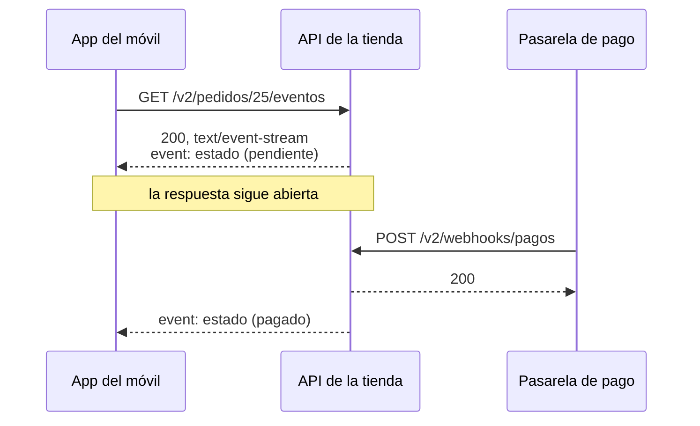
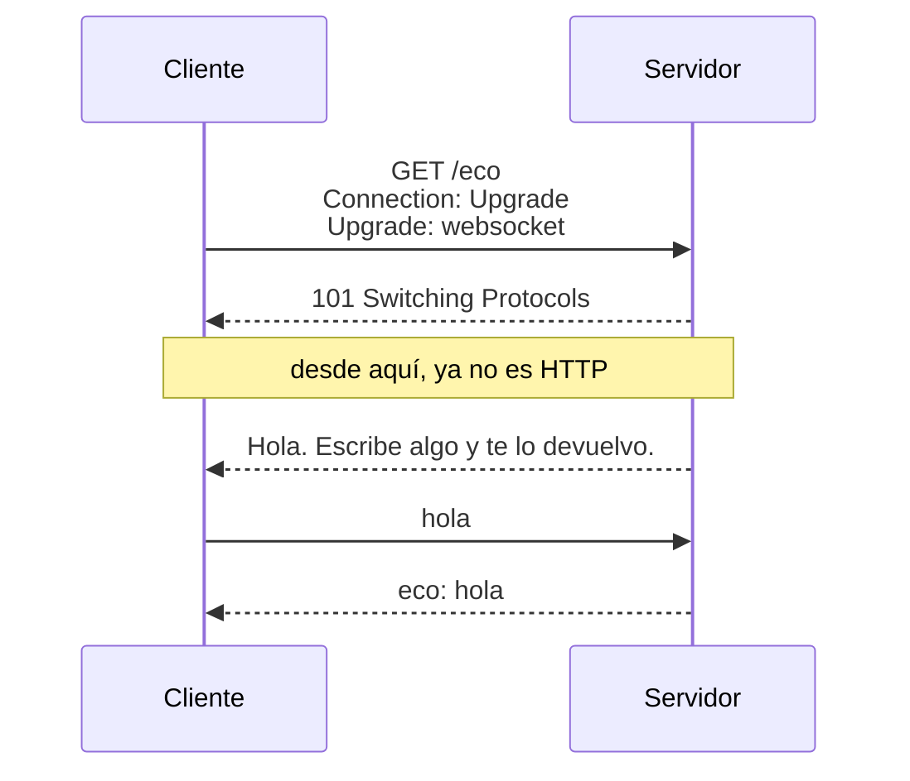

import Term from '~/components/Term.astro';
import TryIt from '~/components/TryIt.astro';
import Analogy from '~/components/Analogy.astro';
import SelfCheck from '~/components/SelfCheck.astro';
import Quiz from '~/components/Quiz.astro';
import QuizQuestion from '~/components/QuizQuestion.astro';
import QuizOption from '~/components/QuizOption.astro';
import ProjectCode from '~/components/ProjectCode.astro';

## El problema

Una clienta paga su pedido desde la app de la tienda. La pasarela avisa a la tienda con el [webhook de la lección 7](/fase-4/webhooks-idempotencia/), y el pedido pasa a `pagado` en el servidor. Pero el móvil sigue diciendo «pendiente»: nadie le ha avisado.

La salida de siempre es que la app pregunte cada 2 segundos: `GET /v2/pedidos/25`, y otra vez, y otra. Son 30 peticiones por minuto y pantalla abierta: con mil clientes mirando su pedido, 30.000 por minuto, casi todas para oír «nada nuevo».

Y un webhook no sirve: el móvil está detrás de un router con <Term id="nat">NAT</Term> ([Fase 0](/fase-0/ip-puertos-y-sockets/#cómo-sale-tu-ip-privada-a-internet-nat)), sin dirección a la que llamar. La app tiene que abrir la conexión, y el servidor, usarla para avisar. Aquí verás dos maneras de hacerlo.

## La analogía

<Analogy>

Has pedido un café en una cafetería llena. Puedes acercarte a la barra cada minuto a preguntar «¿está lo mío?», y casi siempre te dicen que no. Puedes quedarte en la barra hasta que te lo den. O te dan **un avisador**, ese aparato que vibra cuando tu pedido está listo, y te sientas.

El avisador solo va en un sentido. Para hablar con la barra («¿me lo pones con avena?», «no queda, ¿te vale soja?») haría falta **una llamada de teléfono abierta**. El avisador es Server-Sent Events; la llamada, un WebSocket.

<div slot="limits">

- El avisador vibra una vez y lo devuelves; por una respuesta de Server-Sent Events llegan muchos avisos.
- Fuera de la cafetería, el avisador se queda sin cobertura; el navegador, en cambio, vuelve a conectarse solo.
- En una llamada, si habláis a la vez no os entendéis; por un WebSocket, los dos lados mandan a la vez sin pisarse.

</div>

</Analogy>

## Cómo funciona de verdad

### Preguntar cada pocos segundos: polling y long polling

Preguntar una y otra vez es <Term id="polling">*polling*</Term> («sondear»), como en la lección 7. Funciona con cualquier servidor, pero cuesta **peticiones que no traen nada** y **retraso**: si preguntas cada 10 segundos, te enteras, de media, 5 segundos tarde.

En el *long polling* («sondeo largo»), el servidor se queda con la petición hasta que hay un cambio, o hasta un límite, como 30 segundos, y el cliente vuelve a preguntar. Hay menos peticiones vacías, pero cada aviso sigue costando una petición completa, con sus <Term id="header">cabeceras</Term>.

SSE y WebSockets le dan la vuelta: **el cliente abre una conexión una vez, y el servidor escribe por ella cuando tiene algo.**

### Server-Sent Events: una respuesta que no termina

<Term id="sse">Server-Sent Events</Term> (SSE) es HTTP normal con una diferencia: la respuesta no se acaba. El servidor manda las cabeceras, escribe un evento y deja la conexión abierta; con cada cambio, escribe otro. Así responde la API de esta lección (lo harás en «Pruébalo»):

```
HTTP/1.1 200 OK
cache-control: no-cache
connection: keep-alive
content-type: text/event-stream
transfer-encoding: chunked

event: estado
data: {"id":25,"productoId":2,"cantidad":2,"estado":"pendiente","creadoEn":"2026-10-08T09:00:00.000Z"}

event: estado
data: {"id":25,"productoId":2,"cantidad":2,"estado":"pagado","creadoEn":"2026-10-08T09:00:00.000Z"}
```

Fíjate en las cabeceras:

- **`content-type: text/event-stream`**: el cuerpo es una lista de eventos que va llegando.
- **`cache-control: no-cache`**: que ninguna <Term id="cache">caché</Term> la reutilice sin preguntar antes al servidor ([lección 7 de la Fase 2](/fase-2/cache-http/)).
- **`transfer-encoding: chunked`** y ninguna `content-length`: el servidor no sabe cuánto medirá el cuerpo, y lo manda en trozos, como un <Term id="stream">stream</Term>.

Así llega el aviso del webhook a la app:



### El formato: líneas de texto y una línea en blanco

Cada evento son unas líneas `campo: valor`, y **una línea en blanco lo cierra**. Los campos:

| Campo | Para qué |
|---|---|
| `data:` | El contenido del evento. Es texto: aquí, el pedido en JSON |
| `event:` | Un nombre para el evento. Sin él, el evento se llama `message` |
| `id:` | Un identificador. Al reconectar, el navegador manda el último en la cabecera `Last-Event-ID` |

En el navegador, los eventos se leen con `EventSource`, que **se reconecta solo** si la conexión se corta: Chrome lo intenta cada 3 segundos. La tienda no usa `id:`: cada conexión empieza con el estado de ahora, y eso basta.

### Avisar de cada cambio con un EventEmitter

La ruta de los eventos tiene que enterarse de los cambios que hacen otras dos: el webhook de pago y la cancelación. Hace falta un tablón de avisos, y Node trae uno, el `EventEmitter`. En `src/datos.ts`:

<ProjectCode file="tienda-api/17-tiempo-real/src/datos.ts" region="avisos" />

Palabra a palabra:

- **`new EventEmitter<{ cambio: [Pedido] }>()`** crea el tablón. Entre `<` y `>`, para TypeScript: hay un aviso, `cambio`, y lleva un pedido.
- **`.emit('cambio', pedido)`** cuelga un aviso: llama a todas las <Term id="function">funciones</Term> apuntadas a `cambio`, con ese pedido. **`.on`** apunta una función, y **`.off`** la quita.
- **`setMaxListeners(0)`** quita el aviso que da Node con más de 10 funciones apuntadas (`MaxListenersExceededWarning`), que suele delatar un `.off` olvidado. Aquí cada conexión abierta apunta una.
- **`cambiarEstado`** es la única puerta para cambiar un estado: lo cambia y avisa. En `src/v2.ts`, la cancelación y el webhook ya no escriben `pedido.estado = …`, sino que la llaman: un cambio hecho a mano no lo vería nadie.

### La ruta que sigue un pedido

Su definición en `src/contrato.ts`, como las de la lección 5, estrena un tipo de respuesta, `text/event-stream`:

<ProjectCode file="tienda-api/17-tiempo-real/src/contrato.ts" region="seguir-pedido" />

Y la ruta, en `src/v2.ts`:

<ProjectCode file="tienda-api/17-tiempo-real/src/v2.ts" region="seguir-pedido" />

Palabra a palabra:

- **El `404` va antes de empezar.** Cuando sale la primera línea, `200 OK`, el código ya no se puede cambiar.
- **`streamSSE(c, async (stream) => { … })`**, de `hono/streaming`, pone las cabeceras de SSE y te da `stream`, la respuesta abierta, que dura lo que tarde en terminar esa función.
- **`stream.writeSSE({ event, data })`** escribe las líneas `event:` y `data:` y la línea en blanco. `JSON.stringify` convierte el pedido en texto ([lección 2 de la Fase 3](/fase-3/javascript-para-backend/#json-los-datos-convertidos-en-texto)).
- **`avisar`** se apunta al tablón y solo escribe si el pedido que cambia es el de esta conexión.
- **`await new Promise<void>((seFue) => stream.onAbort(seFue))`**: una <Term id="promise">promesa</Term> que se cumple cuando el cliente se va. Mientras, la función no termina y la respuesta sigue abierta, sin bloquear el servidor: es el [event loop](/fase-3/event-loop-node/) de siempre.
- **`.off('cambio', avisar)`** borra la función del tablón cuando el cliente se va. Sin esta línea, cada conexión cerrada dejaría la suya, y la memoria crecería sin parar.

Al final del fichero, `v2.all('/pedidos/:id/eventos', …)` responde `405` a cualquier otro método.

### WebSockets: la conexión cambia de protocolo

Un chat, un juego o un documento que editan dos personas a la vez necesitan los dos sentidos. Para eso está <Term id="websocket">WebSocket</Term>, otro <Term id="protocol">protocolo</Term>, que empieza como una petición HTTP:



- **El cliente pide cambiar** con `Upgrade: websocket` y `Sec-WebSocket-Key`, un texto al azar.
- **El servidor acepta con `101 Switching Protocols`** («cambiando de protocolo») y `Sec-WebSocket-Accept`, un <Term id="hash">hash</Term> de esa clave: prueba que habla WebSocket de verdad. No es seguridad: cualquiera puede calcularlo.
- **Desde ahí, la misma conexión <Term id="tcp">TCP</Term> lleva mensajes**, no peticiones: cada lado manda cuando quiere, sin métodos, códigos ni cabeceras HTTP.

Las direcciones empiezan por `ws://`, o por `wss://` con <Term id="tls">TLS</Term>, como `http://` y `https://`.

### El eco, en el mismo puerto que la API

El eco de la tienda te devuelve lo que le mandas. El trabajo de WebSocket lo hace `ws`, el <Term id="package">paquete</Term> más usado para eso en Node. Primero, el arranque, `src/servidor.ts`, con lo nuevo marcado:

<ProjectCode file="tienda-api/17-tiempo-real/src/servidor.ts" mark={[2, 9, 12]} />

- **`new WebSocketServer({ noServer: true })`** prepara `ws` sin abrir otro <Term id="port">puerto</Term>: las conexiones llegan por el 3000, como la API.
- **`websocket: { server: webSockets }`** le dice a `serve` que use `ws` cuando una ruta acepte el `Upgrade`.

El eco está en un fichero nuevo, `src/eco.ts`:

<ProjectCode file="tienda-api/17-tiempo-real/src/eco.ts" />

- **`upgradeWebSocket`**, de `@hono/node-server`, convierte una ruta en una puerta a WebSocket, con una función para cada suceso.
- **`onOpen`** se llama al abrirse la conexión: el servidor saluda sin que nadie le pregunte.
- **`onMessage`**, con cada mensaje: `evento.data` es su contenido, y `ws.send` contesta.

Y la ruta, en `src/app.ts`, con `import { eco } from './eco.ts';` arriba:

<ProjectCode file="tienda-api/17-tiempo-real/src/app.ts" region="eco" />

Si la petición trae `Upgrade: websocket`, `eco` se queda con ella; si no, la siguiente función responde `426 Upgrade Required` con la cabecera `Upgrade: websocket`: aquí solo se habla WebSocket.

### Lo que cuesta un WebSocket

- **Todo lo de HTTP se queda en la puerta.** Sin códigos de estado ni Problem Details, el formato de los mensajes y de los errores lo inventas tú.
- **Reconectar es cosa tuya.** `EventSource` vuelve solo; el `WebSocket` del navegador, no.
- **Cada conexión vive en un servidor.** Con varios, el aviso tiene que llegar al que tiene la de ese cliente: un problema de escalar, de la Fase 9.

SSE también tiene un límite: con HTTP/1.1, el navegador abre como mucho 6 conexiones con cada dominio, contando todas las pestañas, y cada `EventSource` ocupa una. Con [HTTP/2](/fase-2/http2-http3/) comparten una sola.

### Cuál usar para qué

| | Quién habla | Úsalo para |
|---|---|---|
| Polling | El cliente pregunta cada cierto tiempo | Cambios lentos, o un servidor que no puedes tocar |
| Server-Sent Events | El servidor, por una respuesta abierta | Estados, notificaciones, progreso, respuestas de una IA palabra a palabra |
| WebSocket | Los dos, cuando quieran | Chats, juegos, edición entre varios |
| Webhook (lección 7) | Un servidor llama a otro | Avisos entre servidores, como el de la pasarela |

Si solo habla el servidor, **SSE suele bastar**, y es más sencillo: es HTTP y se reconecta solo. Las APIs de los modelos de IA mandan sus respuestas trozo a trozo con SSE (Fase 11).

## Pruébalo

El objetivo: ver cómo un pedido pasa de `pendiente` a `pagado` sin volver a preguntar, en la terminal y en el navegador, y hablar con el eco. Partes de tu proyecto de la lección 7, en `~/curso-backend/fase-3/tienda-api`. Si te atascas, compáralo con la carpeta de esta lección: desde `~/curso-backend/fase-3`, `curl -O https://backenddesdecero.com/practicas/tienda-api/17-tiempo-real.tar.gz`, `tar -xzf 17-tiempo-real.tar.gz` y, dentro, `npm install`.

### Instala ws y escribe el código

<TryIt
  title="Instala ws y sus tipos"
  cmd={`npm install ws@8.22.0
npm install --save-dev @types/ws@8.18.2`}
  output={`added 1 package, and audited 38 packages in 4s

6 packages are looking for funding
  run \`npm fund\` for details

found 0 vulnerabilities

added 1 package, and audited 39 packages in 8s

6 packages are looking for funding
  run \`npm fund\` for details

found 0 vulnerabilities`}
>

`@types/ws` trae los <Term id="type">tipos</Term> de `ws`, con `--save-dev`, como en la [lección 3 de la Fase 3](/fase-3/typescript-con-node/). Las salidas de esta lección son de Node 26; tus tiempos, ids y fechas serán otros.

</TryIt>

Después, escribe el código de «Cómo funciona de verdad»:

1. En `src/datos.ts`, `import { EventEmitter } from 'node:events';` arriba, y el tablón y `cambiarEstado` después de `eventosProcesados`.
2. En `src/v2.ts`, `import { streamSSE } from 'hono/streaming';`, y `cambiarEstado`, `cambiosDePedidos` y `type Pedido` en el `import` de `./datos.ts`. Cambia las dos líneas que escribían `pedido.estado` y añade la ruta y su `405`.
3. La ruta en `src/contrato.ts`, `src/eco.ts`, su ruta en `src/app.ts` y el nuevo `src/servidor.ts`.

Si descargaste la carpeta de esta lección, copia su `test/` al tuyo y `npm test` comprobará tu código. Arranca el servidor con `npm run dev`.

### Sigue un pedido con curl

Usarás tres terminales: la del servidor, una para seguir el pedido y otra para cambiarlo. En la segunda:

<TryIt
  title="1. Sigue el pedido 25 (y no cierres la terminal)"
  cmd="curl -N -i localhost:3000/v2/pedidos/25/eventos"
  output={`HTTP/1.1 200 OK
cache-control: no-cache
connection: keep-alive
content-type: text/event-stream
transfer-encoding: chunked
vary: Origin
x-request-id: 6d6afbd8-c1fb-4ded-a5dd-0c88d3c70fd7
Date: Tue, 13 Oct 2026 14:28:09 GMT

event: estado
data: {"id":25,"productoId":2,"cantidad":2,"estado":"pendiente","creadoEn":"2026-10-08T09:00:00.000Z"}

event: estado
data: {"id":25,"productoId":2,"cantidad":2,"estado":"pagado","creadoEn":"2026-10-08T09:00:00.000Z"}

event: estado
data: {"id":25,"productoId":2,"cantidad":2,"estado":"cancelado","creadoEn":"2026-10-08T09:00:00.000Z"}`}
>

Al principio verás las cabeceras y el primer evento, `pendiente`, y `curl` se queda esperando: la respuesta no ha terminado. Los otros dos eventos llegan con los pasos 2 y 3.

`-N` hace que `curl` escriba cada trozo en cuanto llega; sin él, puede guardarlos y enseñarte los eventos tarde.

</TryIt>

<TryIt
  title="2. En la tercera terminal: la pasarela paga el pedido"
  cmd="npm run pasarela -- 25"
  output={`> tienda-api@1.0.0 pasarela
> node --env-file-if-exists=.env scripts/pasarela.ts 25

→ POST /v2/webhooks/pagos {"id":"evt_2e309224-fb4f-40ea-9df4-406412828489","tipo":"pago.completado","pedidoId":25}
← 200 {"recibido":"evt_2e309224-fb4f-40ea-9df4-406412828489","repetido":false}`}
>

La pasarela de mentira de la lección 7 manda su webhook firmado, y en la segunda terminal aparece el evento `pagado` sin que `curl` haya preguntado nada.

Si la pasarela recibe su `200` pero el evento no aparece, revisa que el webhook llame a `cambiarEstado` y no cambie `pedido.estado` a mano.

</TryIt>

<TryIt
  title="3. Cancela el pedido"
  cmd="curl -i -X POST localhost:3000/v2/pedidos/25/cancelacion"
  output={`HTTP/1.1 200 OK
content-type: application/json
vary: Origin
x-request-id: 4493dab8-22fb-4cd1-b92c-ec5494601e68
content-length: 96
Date: Tue, 13 Oct 2026 14:28:15 GMT
Connection: keep-alive
Keep-Alive: timeout=5

{"id":25,"productoId":2,"cantidad":2,"estado":"cancelado","creadoEn":"2026-10-08T09:00:00.000Z"}`}
>

Y en la segunda terminal, el evento `cancelado`. Cierra `curl` con <kbd>Ctrl</kbd> + <kbd>C</kbd>. Fíjate: esta respuesta tiene `content-length: 96` y termina; la de SSE no tenía longitud.

</TryIt>

En la terminal del servidor, el [registro](/fase-3/errores-y-logs-node/) apunta la primera petición con `"ms":3`, aunque duró varios segundos: `streamSSE` entrega la respuesta enseguida, con los eventos aún por escribir, y el registro la anota entonces.

<SelfCheck question="Reto: sigue el pedido 3, que está enviado, e intenta cancelarlo. ¿Qué responde la cancelación, y qué aparece en la terminal de curl?">

```sh
curl -N localhost:3000/v2/pedidos/3/eventos          # en una terminal
curl -w '\n' -X POST localhost:3000/v2/pedidos/3/cancelacion   # en otra
```

```
{"type":"https://tienda.example/problemas/estado-del-pedido","title":"El estado del pedido no lo permite","status":409,"detail":"El pedido ya está enviado: no se puede cancelar"}
```

`409`: un pedido enviado no se cancela. Y `curl` no recibe nada después del primer evento, `enviado`: nadie ha llamado a `cambiarEstado`.

</SelfCheck>

### Sigue un pedido desde el navegador

Abre `http://localhost:3000/` en Chrome y, en DevTools ([cómo abrirlo](/fase-2/#antes-de-empezar-devtools)), la pestaña **Consola**. Tiene que ser una página de `http://localhost:3000`: el <Term id="cors">CORS</Term> de la API solo deja leer a `https://tienda.example`. Si Chrome te pide escribir `permitir pegado`, hazlo, como en la [lección de CORS](/fase-2/que-es-cors/).

<TryIt
  title="En la consola: sigue el pedido 24"
  lang="js"
  cmd={`const fuente = new EventSource('/v2/pedidos/24/eventos')
fuente.addEventListener('estado', (evento) => console.log(evento.data))`}
  output={`{"id":24,"productoId":1,"cantidad":1,"estado":"pendiente","creadoEn":"2026-10-08T02:00:00.000Z"}`}
>

`new EventSource('…')` abre la conexión, y `addEventListener('estado', …)` apunta una función a los eventos `estado`; `evento.data` es el texto de su línea `data:`.

Pega las dos líneas juntas: con la primera sola, el primer evento puede llegar antes de que la segunda apunte la función. El `undefined` que escribe la consola no importa.

Ahora, en la terminal, `npm run pasarela -- 24`: en la consola aparece el pedido `pagado`.

</TryIt>

Ahora para el servidor con <kbd>Ctrl</kbd> + <kbd>C</kbd>. En la consola salen errores en rojo, `net::ERR_CONNECTION_REFUSED`, cada 3 segundos: es `EventSource` intentando volver. Arranca otra vez con `npm run dev` y, a los pocos segundos, llega un evento nuevo sin tocar la consola.

Pero dice `pendiente`: los datos estaban en memoria y se perdieron al parar (la base de datos llega en la Fase 5). La reconexión funciona; el servidor manda el estado que tiene ahora.

### Habla con el eco

Primero, la petición HTTP del principio. `curl` no habla WebSocket, pero enseña la respuesta:

<TryIt
  title="1. Pide el cambio de protocolo"
  cmd={`curl -i -H 'Connection: Upgrade' -H 'Upgrade: websocket' \\
  -H 'Sec-WebSocket-Version: 13' -H 'Sec-WebSocket-Key: dGhlIHNhbXBsZSBub25jZQ==' \\
  localhost:3000/eco`}
  output={`HTTP/1.1 101 Switching Protocols
Upgrade: websocket
Connection: Upgrade
Sec-WebSocket-Accept: s3pPLMBiTxaQ9kYGzzhZRbK+xOo=
vary: Origin

�$Hola. Escribe algo y te lo devuelvo.`}
>

La `\` del final de línea sigue la orden en la siguiente. La clave es la del ejemplo del estándar (RFC 6455), y `s3pPLMBiTxaQ9kYGzzhZRbK+xOo=`, la respuesta que el estándar da para ella.

La última línea ya no es HTTP: es el saludo del eco, un mensaje WebSocket, con su cabecera delante: dos caracteres que tu terminal puede pintar distinto. `curl` se queda esperando: ciérralo con <kbd>Ctrl</kbd> + <kbd>C</kbd>.

En el registro, esta petición sale con `"estado":200`: el registro ve la respuesta que prepara Hono, pero el `101` lo escribe `ws` directamente en la conexión.

</TryIt>

<TryIt
  title="2. Sin pedir el cambio"
  cmd="curl -i localhost:3000/eco"
  output={`HTTP/1.1 426 Upgrade Required
content-type: application/problem+json
upgrade: websocket
vary: Origin
x-request-id: 3b41eb02-e0d5-40af-8e26-9bd05fb88b4e
content-length: 104
Date: Tue, 13 Oct 2026 14:28:25 GMT
Connection: keep-alive
Keep-Alive: timeout=5

{"type":"about:blank","title":"Upgrade Required","status":426,"detail":"Esta ruta solo habla WebSocket"}`}
>

Un `GET` normal recibe `426`, en Problem Details como cualquier error de la API, y `upgrade: websocket` dice qué protocolo hace falta.

</TryIt>

Para hablar de verdad hace falta un cliente WebSocket, y Node 26 trae el mismo que el navegador:

<TryIt
  title="3. Un cliente WebSocket con Node"
  cmd={`node -e '
const ws = new WebSocket("ws://localhost:3000/eco");
ws.onopen = () => ws.send("hola");
ws.onmessage = (evento) => console.log(evento.data);
setTimeout(() => ws.close(), 1000);
'`}
  output={`Hola. Escribe algo y te lo devuelvo.
eco: hola`}
>

`node -e` ejecuta el código de entre las comillas: al abrirse la conexión (`onopen`) manda `hola`, escribe cada mensaje que llega (`onmessage`) y cierra al cabo de un segundo (`setTimeout`).

Llegan el saludo, que el servidor manda sin que nadie pregunte, y el eco de `hola`: los dos sentidos, por una sola conexión.

</TryIt>

## Ya lo has visto

- **Una IA que escribe su respuesta palabra a palabra**, el repartidor que se mueve en el mapa o el «está escribiendo…» de un chat: cambios que llegan sin recargar.
- **En la pestaña Red de DevTools**, una petición «pendiente» durante mucho rato puede ser una conexión abierta a propósito. Las de `EventSource` tienen la pestaña **EventStream**, y las de WebSocket, **Mensajes** (*Messages*), con lo que va y lo que viene.

## Errores comunes

- **Escuchar `onmessage` cuando los eventos tienen nombre.** Solo recibe los que no llevan `event:`; los de la tienda necesitan `addEventListener('estado', …)`.
- **Olvidar `.off` cuando el cliente se va.** Las funciones de las conexiones cerradas se acumulan, y la memoria crece hasta tumbar el servidor.
- **Comprobar los errores después de empezar el stream.** Con el `200` ya enviado, un `404` llega tarde.
- **Un proxy que guarda la respuesta.** nginx, por defecto, la junta antes de pasarla, y los eventos llegan de golpe. Para SSE se desactiva con `proxy_buffering off` (Fase 8).

## Resumen

- Preguntar cada pocos segundos (polling) gasta peticiones y llega tarde. Mejor que el cliente abra una conexión y el servidor escriba por ella.
- Server-Sent Events es una respuesta HTTP que no termina: `text/event-stream`, eventos de líneas `event:` y `data:` cerrados por una línea en blanco, y `EventSource`, que se reconecta solo.
- La ruta de la tienda manda el estado de ahora, se apunta a un `EventEmitter` y se borra con `.off` al irse el cliente.
- WebSocket empieza con `Upgrade` y un `101 Switching Protocols`; después, los dos lados mandan mensajes cuando quieren.
- Si solo habla el servidor, SSE; si hablan los dos, WebSocket; entre servidores, webhooks.

## ¿Lo has entendido?

<Quiz>

<QuizQuestion
  question="La app quiere enseñar el estado de un pedido en cuanto cambie, y el móvil no tiene nada que decirle al servidor. ¿Qué usarías?"
  review="Cuál usar para qué"
>

<QuizOption text="Un WebSocket: es la única forma de que el servidor mande algo sin que se lo pidan.">

Server-Sent Events también lo hace, y es lo que usa la tienda. Un WebSocket añade el sentido contrario, que aquí sobra.

</QuizOption>

<QuizOption text="Server-Sent Events: solo habla el servidor." correct>

Una respuesta abierta por la que llegan los cambios, con el HTTP de siempre y la reconexión de `EventSource`.

</QuizOption>

<QuizOption text="Un webhook al móvil, como el que la pasarela manda a la tienda.">

Un webhook llama a una dirección pública, y el móvil, detrás de un router con NAT, no la tiene: la conexión la tiene que abrir él.

</QuizOption>

</QuizQuestion>

<QuizQuestion
  question="En la consola de http://localhost:3000 sigues el pedido 24 con un EventSource y fuente.onmessage = (e) => console.log(e.data). No sale nada, ni cuando el pedido cambia. ¿Por qué?"
  review="El formato: líneas de texto y una línea en blanco"
>

<QuizOption text="Porque onmessage hay que ponerlo antes de crear el EventSource, y ya llega tarde.">

Una función apuntada después recibe los eventos que lleguen desde entonces, y los cambios llegaron más tarde.

</QuizOption>

<QuizOption text="Porque el CORS de la API solo deja leer a https://tienda.example y bloquea la respuesta.">

La página y la API son del mismo origen, `http://localhost:3000`, y CORS solo entra en juego entre orígenes distintos.

</QuizOption>

<QuizOption text="Porque onmessage solo recibe los eventos sin nombre, y estos se llaman estado." correct>

Un evento con `event: estado` solo llega a quien escucha `estado`, con `addEventListener('estado', …)`.

</QuizOption>

</QuizQuestion>

<QuizQuestion
  question="Alguien borra la línea cambiosDePedidos.off('cambio', avisar) de la ruta de los eventos. Todo parece funcionar. ¿Qué pasa con el tiempo?"
  review="La ruta que sigue un pedido"
>

<QuizOption text="Cada conexión cerrada deja su función apuntada, y la memoria no para de crecer." correct>

El tablón sigue llamando a funciones de clientes que ya se fueron, y nunca las suelta.

</QuizOption>

<QuizOption text="Nada: cuando el cliente se va, Node borra del EventEmitter las funciones de esa conexión.">

El `EventEmitter` no sabe nada de conexiones: guarda cada función hasta que alguien la quita con `.off`.

</QuizOption>

<QuizOption text="Los clientes dejan de recibir eventos, porque cada función solo puede apuntarse una vez.">

Los clientes conectados siguen recibiendo sus eventos. Lo que se acumula son las funciones de los que ya no están.

</QuizOption>

</QuizQuestion>

<QuizQuestion
  question="Escribes curl -i localhost:3000/eco, sin más cabeceras. ¿Qué responde la tienda?"
  review="El eco, en el mismo puerto que la API"
>

<QuizOption text="101 Switching Protocols: la ruta /eco siempre cambia a WebSocket.">

El cambio solo ocurre si la petición lo pide, con `Upgrade: websocket`. Sin esa cabecera, `eco` pasa la petición a la siguiente función.

</QuizOption>

<QuizOption text="426 Upgrade Required, con la cabecera Upgrade: websocket." correct>

La ruta dice que ahí solo se habla WebSocket, y la cabecera, qué protocolo pedir.

</QuizOption>

<QuizOption text="404: para HTTP, /eco no existe; solo existe para direcciones ws://.">

`ws://localhost:3000/eco` y `http://localhost:3000/eco` llegan a la misma ruta, por el mismo puerto.

</QuizOption>

</QuizQuestion>

<QuizQuestion
  question="En el registro del servidor, la conexión a /eco sale con estado 200, pero curl recibió un 101. ¿Qué ha pasado?"
  review="Habla con el eco"
>

<QuizOption text="El servidor manda primero un 200 y después el 101, y cada programa enseña uno.">

Por esa conexión sale una sola respuesta, el `101`. Después solo hay mensajes WebSocket.

</QuizOption>

<QuizOption text="curl escribe 101 por su cuenta cuando ve que ha pedido Upgrade; el servidor respondió 200.">

`curl` enseña lo que llega por la red. `Upgrade` y `Sec-WebSocket-Accept` las ha mandado el servidor.

</QuizOption>

<QuizOption text="El registro ve la respuesta de Hono; el 101 lo escribe ws en la conexión." correct>

El `101` no pasa por el registro, que solo sabe lo que ve. Lo que llegó de verdad es lo que dice `curl`.

</QuizOption>

</QuizQuestion>

<QuizQuestion
  question="Tienes la consola siguiendo el pedido 24, que está pagado, y reinicias el servidor. ¿Qué ves en la consola?"
  review="Sigue un pedido desde el navegador"
>

<QuizOption text="Nada más: un EventSource cortado no vuelve a conectarse, hay que recargar la página.">

Eso le pasa a un `WebSocket`. `EventSource` reintenta solo, cada 3 segundos en Chrome.

</QuizOption>

<QuizOption text="Unos errores de conexión y, al volver el servidor, el pedido en pendiente." correct>

`EventSource` se reconecta y la ruta manda el estado de ahora: pendiente, porque los datos estaban en memoria y se perdieron al parar.

</QuizOption>

<QuizOption text="Unos errores y, al volver, el pedido pagado otra vez: el navegador le pide al servidor el último evento que recibió.">

El navegador solo manda el `id:` del último evento si los eventos lo llevan, y los de la tienda no. Además, el servidor ha olvidado el pago.

</QuizOption>

</QuizQuestion>

</Quiz>

## Para profundizar

- [Usar eventos enviados por el servidor](https://developer.mozilla.org/es/docs/Web/API/Server-sent_events/Using_server-sent_events) (MDN): el formato, `EventSource` y la reconexión.
- [La API de WebSocket](https://developer.mozilla.org/es/docs/Web/API/WebSockets_API) (MDN): el cliente del navegador.
- [Server-sent events](https://html.spec.whatwg.org/multipage/server-sent-events.html) (WHATWG, en inglés): el estándar, dentro del de HTML.
- [RFC 6455: The WebSocket Protocol](https://www.rfc-editor.org/rfc/rfc6455) (en inglés): el cambio de protocolo y la clave del ejemplo.
- [Streaming Helper](https://hono.dev/docs/helpers/streaming) y [WebSocket Helper](https://hono.dev/docs/helpers/websocket) (Hono, en inglés): `streamSSE` y `upgradeWebSocket`.
