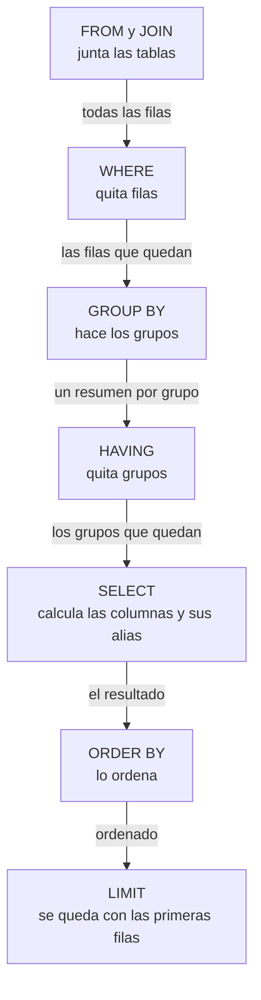

import Term from '~/components/Term.astro';
import TryIt from '~/components/TryIt.astro';
import Analogy from '~/components/Analogy.astro';
import SelfCheck from '~/components/SelfCheck.astro';
import Quiz from '~/components/Quiz.astro';
import QuizQuestion from '~/components/QuizQuestion.astro';
import QuizOption from '~/components/QuizOption.astro';
import SqlPlayground from '~/playgrounds/sql-playground/SqlPlayground';

## El problema

Es domingo y Ana quiere el informe de la semana: cuánto ha dejado cada producto, cuál fue el mejor día y qué pedidos fueron más grandes de lo normal. Con lo que sabes de las lecciones [1](/fase-5/que-es-sql/) y [2](/fase-5/join-sql/), un `SELECT` le da los 25 pedidos con su producto, y ella suma con la calculadora.

Con 25 pedidos se puede. Con 40 000, no. Y hacer la cuenta en el <Term id="server">servidor</Term> de la tienda tampoco arregla nada: pediría las 40 000 filas a la <Term id="database">base de datos</Term>, que viajarían por la red, para quedarse con tres números.

Lo que Ana necesita es que **la base de datos resuma**: que haga las cuentas donde están los datos y devuelva solo el resultado, tres filas en lugar de 40 000.

## La analogía

<Analogy>

Piensa en la caja de tiques de la semana. Para saber cuánto has vendido de cada producto, apartas primero los tiques anulados. Después repartes los demás en montones, uno por producto, y sumas cada montón. Al final, quizá descartas los montones pequeños.

Esa es la lección entera: apartar tiques es `WHERE`, hacer montones es `GROUP BY`, sumar cada montón es `SUM` y descartar montones es `HAVING`. Y el orden importa: no puedes descartar un montón por su total antes de sumarlo.

<div slot="limits">

- Tú puedes mirar dentro de un montón. La base de datos devuelve una sola fila por montón, así que solo puedes pedir lo que es igual en todo el montón o un resumen de él.
- La base de datos no hace montones de verdad: puede ordenar las filas o llevar una cuenta por grupo, lo que le salga más rápido. El resultado es el mismo.

</div>

</Analogy>

## Cómo funciona de verdad

Puedes probar cada consulta en el playground de [Pruébalo](#pruébalo) o en `psql`. Las salidas son de PostgreSQL 18.6, con los datos de `tienda.sql` recién cargados.

### Una función de agregado resume muchas filas en una

```sql
SELECT COUNT(*), SUM(cantidad), MIN(cantidad), MAX(cantidad), AVG(cantidad)
FROM pedidos;
```

```
 count | sum | min | max |        avg
-------+-----+-----+-----+--------------------
    25 |  62 |   1 |   4 | 2.4800000000000000
(1 row)
```

Una sola fila, aunque `pedidos` tiene 25. Cada una de esas cinco es una <Term id="aggregate">función de agregado</Term>: recibe todas las filas y devuelve un valor.

- `COUNT(*)` cuenta filas: 25 pedidos.
- `SUM(cantidad)` suma la columna: 62 unidades vendidas.
- `MIN` y `MAX` dan el valor más pequeño y el más grande: nadie ha pedido menos de 1 ni más de 4. También sirven con fechas: `MAX(creado_en)` es el pedido más reciente.
- `AVG(cantidad)` da la media (*average*, en inglés): 2,48 unidades por pedido.

Fíjate en la media: `2.4800000000000000`. `AVG` devuelve un `numeric`, el tipo de PostgreSQL para decimales exactos, y lo escribe con 16 decimales. Para enseñarlo, redondéalo con `round`:

```sql
SELECT round(AVG(cantidad), 2) AS media
FROM pedidos;
```

```
 media
-------
  2.48
(1 row)
```

`round(valor, 2)` deja dos decimales; sin el `2`, redondea al entero. `AS media` le pone nombre a la columna. PostgreSQL escribe los decimales con punto, no con coma.

### GROUP BY hace un resumen por cada grupo

¿Cuántos pedidos hay en cada estado?

```sql
SELECT estado, COUNT(*)
FROM pedidos
GROUP BY estado
ORDER BY estado;
```

```
  estado   | count
-----------+-------
 enviado   |    12
 pagado    |     8
 pendiente |     5
(3 rows)
```

`GROUP BY estado` reparte las filas en grupos, uno por cada valor distinto de `estado`, y `COUNT(*)` cuenta cada grupo por separado. Sale una fila por grupo, y 12 + 8 + 5 son los 25 pedidos.

Con un <Term id="join">JOIN</Term> de la [lección 2](/fase-5/join-sql/) puedes resumir datos de dos tablas. Cuánto ha dejado cada producto, en unidades y en dinero:

```sql
SELECT p.nombre, SUM(ped.cantidad) AS unidades,
       SUM(ped.cantidad * p.precio_centimos) AS ingresos_centimos
FROM pedidos AS ped
JOIN productos AS p ON p.id = ped.producto_id
GROUP BY p.id, p.nombre
ORDER BY ingresos_centimos DESC;
```

```
  nombre  | unidades | ingresos_centimos
----------+----------+-------------------
 Sudadera |       20 |             70000
 Camiseta |       20 |             40000
 Taza     |       22 |             18700
(3 rows)
```

Palabra a palabra:

- `FROM pedidos AS ped JOIN productos AS p ON …` junta cada pedido con su producto: 25 filas, cada una con su cantidad y su precio.
- `ped.cantidad * p.precio_centimos` multiplica en cada fila: lo que dejó ese pedido. `SUM(…)` suma esos importes dentro de cada grupo. El dinero va en céntimos enteros, como en la [Fase 4](/fase-4/json-protobuf/#el-dinero-en-céntimos-enteros): 70000 son 700 €.
- `GROUP BY p.id, p.nombre` hace un grupo por producto. Se agrupa por el `id`, que es único (dos productos podrían llamarse igual), y también por el nombre, para poder enseñarlo.
- `ORDER BY ingresos_centimos DESC` pone primero el que más deja.

La Taza es la que más unidades vende y la que menos dinero deja. La Gorra no sale: no tiene pedidos, y el `JOIN` no la junta con nada.

### Lo que eliges tiene que estar agrupado o resumido

Pide el estado al lado de cada producto, pero agrupa solo por producto:

```sql
SELECT producto_id, estado, SUM(cantidad)
FROM pedidos
GROUP BY producto_id;
```

```
ERROR:  column "pedidos.estado" must appear in the GROUP BY clause or be used in an aggregate function
LINE 1: SELECT producto_id, estado, SUM(cantidad)
                            ^
```

«La columna `pedidos.estado` tiene que aparecer en `GROUP BY` o dentro de una función de agregado», y el `^` señala dónde. El grupo del producto 1 tiene pedidos enviados, pagados y pendientes: ¿cuál escribiría en su única fila? PostgreSQL no elige uno al azar: se niega.

**Cada columna del `SELECT` tiene que estar en el `GROUP BY` o dentro de un agregado.** Aquí, o añades `estado` al `GROUP BY` (un grupo por cada pareja de producto y estado) o la quitas del `SELECT`.

Hay una excepción: si agrupas por la <Term id="primary-key">clave primaria</Term> de una tabla, PostgreSQL te deja usar sus demás columnas, porque cada `id` tiene un solo nombre. En esta lección, el nombre va en el `GROUP BY` igualmente, para que se vea.

### COUNT(*) cuenta filas; COUNT(columna), valores

Para que salga la Gorra hace falta el [`LEFT JOIN` de la lección 2](/fase-5/join-sql/#left-join-conserva-también-las-filas-sin-pareja). Y ahí `COUNT` tiene una trampa:

```sql
SELECT p.nombre, COUNT(*) AS filas, COUNT(ped.id) AS pedidos
FROM productos AS p
LEFT JOIN pedidos AS ped ON ped.producto_id = p.id
GROUP BY p.id, p.nombre
ORDER BY p.id;
```

```
  nombre  | filas | pedidos
----------+-------+---------
 Camiseta |     8 |       8
 Taza     |     9 |       9
 Sudadera |     8 |       8
 Gorra    |     1 |       0
(4 rows)
```

La Gorra tiene 1 fila y 0 pedidos. El `LEFT JOIN` le da una fila con las columnas de `pedidos` vacías, en `NULL`, y `COUNT(*)` cuenta filas. **`COUNT(columna)` solo cuenta los valores que no son `NULL`**, y en esa fila `ped.id` lo es.

Los demás agregados también se saltan los `NULL`: la media de 3, 5 y un `NULL` es 4, no 2,67.

### WHERE filtra filas; HAVING, grupos

¿Qué productos han vendido más de 16 unidades, sin contar los pedidos pendientes?

```sql
SELECT p.nombre, SUM(ped.cantidad) AS unidades
FROM pedidos AS ped
JOIN productos AS p ON p.id = ped.producto_id
WHERE ped.estado <> 'pendiente'
GROUP BY p.id, p.nombre
HAVING SUM(ped.cantidad) > 16
ORDER BY p.nombre;
```

```
  nombre  | unidades
----------+----------
 Camiseta |       17
 Taza     |       17
(2 rows)
```

Dos filtros, en dos momentos:

- `WHERE ped.estado <> 'pendiente'` quita filas **antes** de agrupar: los pedidos pendientes no llegan a ningún grupo.
- `HAVING SUM(ped.cantidad) > 16` quita grupos **después**: la Sudadera, con 16, se queda fuera.

`HAVING` existe porque `WHERE` no puede usar un resumen:

```sql
SELECT producto_id, SUM(cantidad)
FROM pedidos
WHERE SUM(cantidad) > 16
GROUP BY producto_id;
```

```
ERROR:  aggregate functions are not allowed in WHERE
LINE 3: WHERE SUM(cantidad) > 16
              ^
```

«Las funciones de agregado no están permitidas en `WHERE`». Cuando se ejecuta `WHERE`, todavía no hay grupos que sumar.

### Una consulta no se ejecuta en el orden en que se escribe

Escribes `SELECT` lo primero, pero PostgreSQL lo calcula casi al final. Este es el orden de cada parte:



Por dentro, PostgreSQL puede trabajar de otra forma (lo verás en la [lección 7, «Índices»](/fase-5/indices-sql-explain/#explain-el-plan-antes-de-ejecutar)), pero el resultado es siempre el de este orden. Con él se entienden los errores de antes: `WHERE` va antes que `GROUP BY` y no puede sumar grupos; `HAVING` va después y sí. Y uno más, muy frecuente: usar en `WHERE` un alias del `SELECT`.

```sql
SELECT nombre, precio_centimos / 100.0 AS euros
FROM productos
WHERE euros > 10;
```

```
ERROR:  column "euros" does not exist
LINE 3: WHERE euros > 10;
              ^
```

`euros` nace en el `SELECT`, que va después del `WHERE`: cuando `WHERE` la busca, no existe. Compara con la columna de la tabla, `WHERE precio_centimos > 1000`. `ORDER BY` va después del `SELECT` y sí puede usar el alias: por eso funcionaba `ORDER BY ingresos_centimos`.

Por cierto, `/ 100.0` divide con decimales. Entre dos enteros, `850 / 100` da `8`: PostgreSQL tira los decimales.

### El mejor día, contado en UTC

Para el mejor día, agrupa por el día de `creado_en`:

```sql
SELECT (ped.creado_en AT TIME ZONE 'UTC')::date AS dia,
       SUM(ped.cantidad * p.precio_centimos) AS ingresos_centimos
FROM pedidos AS ped
JOIN productos AS p ON p.id = ped.producto_id
GROUP BY (ped.creado_en AT TIME ZONE 'UTC')::date
ORDER BY ingresos_centimos DESC
LIMIT 3;
```

```
    dia     | ingresos_centimos
------------+-------------------
 2026-10-07 |             20550
 2026-10-04 |             20250
 2026-10-01 |             20200
(3 rows)
```

- `ped.creado_en AT TIME ZONE 'UTC'` da la fecha y la hora que marcaba un reloj en UTC en ese instante.
- `::date` cambia el tipo de ese valor a `date`, un día sin hora: `2026-10-07`. `::` es la forma de PostgreSQL de convertir un valor a otro tipo.
- El `GROUP BY` repite la expresión entera. PostgreSQL acepta también `GROUP BY dia`, aunque el alias nace después: es una comodidad suya, no SQL estándar, y otras bases de datos, como SQL Server, la rechazan.

¿Por qué UTC? `creado_en` es un `timestamptz`: guarda un instante, no un día. Qué día era depende del reloj que mires. El pedido de las 23:00 UTC del 1 de octubre se hizo a la 1:00 del día 2 en Madrid. Con `'Europe/Madrid'`, la misma consulta da:

```
    dia     | ingresos_centimos
------------+-------------------
 2026-10-07 |             24050
 2026-10-02 |             21850
 2026-10-04 |             20250
(3 rows)
```

El mejor día sigue siendo el 7, pero con otra cifra, y el 2 pasa al segundo puesto.

Sin `AT TIME ZONE`, `::date` usa la zona horaria de la conexión. La de tu rol `tienda` es UTC porque lo ajustaste en la [introducción](/fase-5/#el-rol-tienda), pero un PostgreSQL recién instalado en un Mac usa la del ordenador. **Di siempre en qué zona cuentas los días.** La tienda cuenta en UTC, igual que manda sus fechas desde la [Fase 4](/fase-4/json-protobuf/#las-fechas-texto-en-iso-8601-en-utc).

### Una subconsulta en WHERE compara cada fila con un resumen

¿Qué pedidos tienen más unidades que la media? La forma directa falla:

```sql
SELECT id, producto_id, cantidad
FROM pedidos
WHERE cantidad > AVG(cantidad);
```

```
ERROR:  aggregate functions are not allowed in WHERE
LINE 3: WHERE cantidad > AVG(cantidad);
                         ^
```

Es el error de antes. Pero sí puedes calcular la media en otra consulta y usar su resultado:

```sql
SELECT id, producto_id, cantidad
FROM pedidos
WHERE cantidad > (SELECT AVG(cantidad) FROM pedidos)
ORDER BY id;
```

```
 id | producto_id | cantidad
----+-------------+----------
  2 |           3 |        3
  3 |           1 |        4
  6 |           1 |        3
  7 |           2 |        4
 10 |           2 |        3
 11 |           3 |        4
 14 |           3 |        3
 15 |           1 |        4
 18 |           1 |        3
 19 |           2 |        4
 22 |           2 |        3
 23 |           3 |        4
(12 rows)
```

`(SELECT AVG(cantidad) FROM pedidos)` es una <Term id="subquery">subconsulta</Term>: una consulta entre paréntesis dentro de otra. PostgreSQL la resuelve, le da 2,48, y la de fuera compara cada pedido con ese número. Salen los de 3 y 4 unidades.

Aquí la subconsulta devuelve un solo valor, porque `>` compara con uno. Si devuelve una lista, se usa `IN` («está en»): «los pedidos de algún producto de la categoría 1, Ropa».

```sql
SELECT COUNT(*)
FROM pedidos
WHERE producto_id IN (SELECT producto_id FROM productos_categorias WHERE categoria_id = 1);
```

```
 count
-------
    16
(1 row)
```

La subconsulta da los productos de Ropa: 1, 3 y 4. `IN` deja los pedidos cuyo `producto_id` está en esa lista: 8 de la Camiseta, 8 de la Sudadera y ninguno de la Gorra.

### Una subconsulta en FROM es una tabla de paso

¿Cuántas unidades vende de media cada producto? Hay que sumar por producto y después hacer la media de esas sumas. Un agregado dentro de otro no vale:

```sql
SELECT AVG(SUM(cantidad))
FROM pedidos
GROUP BY producto_id;
```

```
ERROR:  aggregate function calls cannot be nested
LINE 1: SELECT AVG(SUM(cantidad))
                   ^
```

«Las llamadas a funciones de agregado no se pueden anidar». La solución: la consulta que suma por producto va en el `FROM`, y la de fuera la lee como si fuera una tabla:

```sql
SELECT round(AVG(unidades), 1) AS media
FROM (
  SELECT producto_id, SUM(cantidad) AS unidades
  FROM pedidos
  GROUP BY producto_id
) AS por_producto;
```

```
 media
-------
  20.7
(1 row)
```

- La subconsulta da una fila por producto, con sus unidades: 20, 22 y 20.
- `AS por_producto` le pone nombre a esa tabla de paso.
- `round(AVG(unidades), 1)` hace la media de las tres sumas con un decimal. Sin `round`, `20.6666666666666667`.

La Gorra no cuenta: sin pedidos, no tiene fila en la subconsulta, y la media es de tres productos, no de cuatro.

## Pruébalo

El objetivo: sacar tú el informe de Ana. Cuánto deja cada producto, cuál fue el mejor día y qué pedidos son más grandes de lo normal. Cada consulta va en el playground, el PostgreSQL de tu navegador, y en `psql`: abre `psql -d tienda`, [como en la introducción](/fase-5/#conéctate-con-psql), y escríbelas tras el prompt `tienda=>`. Si cambiaste datos en la lección 1, [vuelve a cargar `tienda.sql`](/fase-5/#antes-de-empezar-los-datos-de-la-tienda); en el playground, pulsa «Restaurar datos».

### Las ventas por producto

<SqlPlayground client:visible lang="es" rows={6} query={`SELECT p.nombre, SUM(ped.cantidad) AS unidades,
       SUM(ped.cantidad * p.precio_centimos) AS ingresos_centimos
FROM pedidos AS ped
JOIN productos AS p ON p.id = ped.producto_id
GROUP BY p.id, p.nombre
ORDER BY ingresos_centimos DESC;`} />

Pulsa «Ejecutar» y comprueba que sale la Sudadera primero, con 70000. Después cámbiala:

- Añade `WHERE ped.estado = 'enviado'` justo antes del `GROUP BY`: solo lo que ya ha salido del almacén.
- Cambia el primer `SUM` por `AVG`: la media de unidades por pedido, con sus 16 decimales. Arréglalos con `round`.
- Añade `ped.estado` al `SELECT` sin tocar el `GROUP BY`, y lee el error.

<TryIt
  title="1. Las ventas por producto, en psql"
  lang="sql"
  cmd={`SELECT p.nombre, SUM(ped.cantidad) AS unidades,
       SUM(ped.cantidad * p.precio_centimos) AS ingresos_centimos
FROM pedidos AS ped
JOIN productos AS p ON p.id = ped.producto_id
GROUP BY p.id, p.nombre
ORDER BY ingresos_centimos DESC;`}
  output={`  nombre  | unidades | ingresos_centimos
----------+----------+-------------------
 Sudadera |       20 |             70000
 Camiseta |       20 |             40000
 Taza     |       22 |             18700
(3 rows)`}
>

`psql` no ejecuta hasta que llega el `;`, así que puedes escribirla en varias líneas. Si sale `relation "pedidos" does not exist`, no has cargado los datos de la tienda: vuelve a la [introducción](/fase-5/#antes-de-empezar-los-datos-de-la-tienda). Las salidas son de PostgreSQL 18.6; si el tuyo contesta en español, verás los mismos números con los mensajes traducidos.

</TryIt>

### El mejor día

<TryIt
  title="2. El día que más dinero entró"
  lang="sql"
  cmd={`SELECT (ped.creado_en AT TIME ZONE 'UTC')::date AS dia,
       SUM(ped.cantidad * p.precio_centimos) AS ingresos_centimos
FROM pedidos AS ped
JOIN productos AS p ON p.id = ped.producto_id
GROUP BY (ped.creado_en AT TIME ZONE 'UTC')::date
ORDER BY ingresos_centimos DESC
LIMIT 1;`}
  output={`    dia     | ingresos_centimos
------------+-------------------
 2026-10-07 |             20550
(1 row)`}
>

El 7 de octubre, con 205,50 €. Cambia `'UTC'` por `'Europe/Madrid'` en las dos líneas: sale el mismo día, con `24050`. Si lo cambias solo en una, sale `column "ped.creado_en" must appear in the GROUP BY clause`: el `SELECT` y el `GROUP BY` tienen que llevar la misma expresión.

</TryIt>

### Los pedidos por encima de la media

<SqlPlayground client:visible lang="es" rows={4} query={`SELECT id, producto_id, cantidad
FROM pedidos
WHERE cantidad > (SELECT AVG(cantidad) FROM pedidos)
ORDER BY id;`} />

Salen 12. Ahora cambia `AVG` por `MAX`: ningún pedido supera al más grande, y sale `(0 filas)`. Cambia también `>` por `=` y tendrás los pedidos más grandes de la tienda.

<TryIt
  title="3. Los pedidos por encima de la media, en psql"
  lang="sql"
  cmd={`SELECT id, producto_id, cantidad
FROM pedidos
WHERE cantidad > (SELECT AVG(cantidad) FROM pedidos)
ORDER BY id;`}
  output={` id | producto_id | cantidad
----+-------------+----------
  2 |           3 |        3
  3 |           1 |        4
  6 |           1 |        3
  7 |           2 |        4
 10 |           2 |        3
 11 |           3 |        4
 14 |           3 |        3
 15 |           1 |        4
 18 |           1 |        3
 19 |           2 |        4
 22 |           2 |        3
 23 |           3 |        4
(12 rows)`}
>

Todos tienen 3 o 4 unidades: la media es 2,48. Si has cambiado pedidos, la media y la lista serán otras.

</TryIt>

<SelfCheck question="Reto: ¿qué día se vendieron más tazas, en unidades? La Taza es el producto 2. Cuenta los días en UTC.">

Primero `WHERE` deja solo las tazas; después, un grupo por día:

```sql
SELECT (creado_en AT TIME ZONE 'UTC')::date AS dia, SUM(cantidad) AS tazas
FROM pedidos
WHERE producto_id = 2
GROUP BY (creado_en AT TIME ZONE 'UTC')::date
ORDER BY tazas DESC
LIMIT 1;
```

```
    dia     | tazas
------------+-------
 2026-10-04 |     5
(1 row)
```

El 4 de octubre, con 5 tazas. No es un `HAVING`: el filtro es por producto, una columna de cada fila, así que va en `WHERE`.

</SelfCheck>

## Ya lo has visto

- **Las tablas dinámicas de Excel o Google Sheets**: eliges por qué columna agrupar y qué resumir (suma, recuento, media). Es un `GROUP BY` con el ratón.
- **El resumen de gastos de la app de tu banco**: cuánto en el súper y cuánto en transporte este mes. Un `WHERE` por fechas, un `GROUP BY` por categoría y un `SUM`.
- **«Página 3 de 1 200»**, de la [Fase 4](/fase-4/paginacion-api/#el-total-cuesta): ese total es un `COUNT(*)`, y por eso cuesta: para contar, la base de datos recorre todas las filas que cumplen el filtro.

## Errores comunes

- **Poner en el `SELECT` una columna que no está en el `GROUP BY` ni dentro de un agregado.** Agrúpala o resúmela.
- **Filtrar un resumen con `WHERE`.** Las filas se filtran con `WHERE`; los grupos, con `HAVING`.
- **Contar con `COUNT(*)` después de un `LEFT JOIN`.** Lo que no tiene nada sale con 1: cuenta una columna de la tabla de la derecha, como `COUNT(ped.id)`.
- **Usar en `WHERE` un alias del `SELECT`.** Todavía no existe: repite la operación o compara con la columna.
- **Agrupar por día sin decir la zona horaria.** El mismo informe da otros números en tu ordenador y en el servidor.
- **Dividir dos enteros**: `850 / 100` da `8`. Usa `100.0`.
- **Calcular las ventas pasadas con el precio de hoy**, como esta lección. Si la Sudadera sube mañana, cambian las ventas de la semana pasada. Una tienda de verdad guarda en cada pedido el precio al que se vendió ([lección 4](/fase-5/modelado-datos-normalizacion/#desnormalizar-copiar-a-propósito)).

## Resumen

- Una función de agregado (`COUNT`, `SUM`, `AVG`, `MIN`, `MAX`) resume muchas filas en un valor. `COUNT(*)` cuenta filas; `COUNT(columna)` y los demás se saltan los `NULL`.
- `GROUP BY` hace un resumen por grupo. Cada columna del `SELECT` tiene que estar agrupada o resumida.
- `WHERE` quita filas antes de agrupar y `HAVING` quita grupos después.
- El orden real es `FROM`, `WHERE`, `GROUP BY`, `HAVING`, `SELECT`, `ORDER BY` y `LIMIT`: por eso `WHERE` no ve ni los agregados ni los alias.
- Una subconsulta es una consulta dentro de otra: en `WHERE`, para comparar con un resumen; en `FROM`, para resumir un resumen.

## ¿Lo has entendido?

<Quiz>

<QuizQuestion
  question="Escribes SELECT estado, producto_id, COUNT(*) FROM pedidos GROUP BY estado; ¿Qué pasa?"
  review="Lo que eliges tiene que estar agrupado o resumido"
>

<QuizOption text="Sale una fila por estado, con el producto_id de uno cualquiera de sus pedidos.">

PostgreSQL no elige al azar: en cada estado hay pedidos de varios productos y no sabría cuál poner. Otras bases de datos, como SQLite o MySQL con cierta configuración, sí lo hacen, y dan resultados que nadie ha pedido.

</QuizOption>

<QuizOption text="Un error: producto_id tiene que estar en el GROUP BY o dentro de un agregado." correct>

Hay un grupo por estado y una fila por grupo. Para `producto_id` hay varios valores en cada grupo: agrúpalo también o quítalo.

</QuizOption>

<QuizOption text="Sale una fila por pedido: GROUP BY solo agrupa si todas las columnas del SELECT son agregados.">

`GROUP BY` siempre hace una fila por grupo. La regla es justo la contraria: las columnas que no son agregados tienen que estar en el `GROUP BY`.

</QuizOption>

</QuizQuestion>

<QuizQuestion
  question="Quieres los productos con más de 10 pedidos. ¿Dónde va COUNT(*) > 10?"
  review="WHERE filtra filas; HAVING, grupos"
>

<QuizOption text="En WHERE: es el sitio de todos los filtros de una consulta.">

`WHERE` filtra filas antes de agrupar, cuando aún no hay nada que contar. Con un agregado, PostgreSQL responde `aggregate functions are not allowed in WHERE`.

</QuizOption>

<QuizOption text="En WHERE o en HAVING, da igual: son dos nombres para el mismo filtro.">

Filtran en momentos distintos: `WHERE`, cada fila antes de los grupos; `HAVING`, cada grupo después de resumirlo.

</QuizOption>

<QuizOption text="En HAVING, después del GROUP BY." correct>

Contar pedidos por producto exige haber hecho los grupos. `HAVING` se aplica justo después, y por eso puede usar `COUNT(*)`.

</QuizOption>

</QuizQuestion>

<QuizQuestion
  question="Listas los productos con su número de pedidos, con LEFT JOIN y COUNT(*). La Gorra, que no tiene ninguno, sale con 1. ¿Por qué?"
  review="COUNT(*) cuenta filas; COUNT(columna), valores"
>

<QuizOption text="El LEFT JOIN le da una fila con NULL, y COUNT(*) cuenta filas, no pedidos." correct>

Con `COUNT(ped.id)` sale 0: contar una columna se salta los `NULL`.

</QuizOption>

<QuizOption text="COUNT(*) se salta los NULL y COUNT(columna) no, así que hay que usar COUNT(*).">

Es al revés: `COUNT(*)` cuenta todas las filas, también la que tiene `NULL`, y `COUNT(columna)` se los salta.

</QuizOption>

<QuizOption text="Es un fallo de PostgreSQL: COUNT nunca puede devolver 0.">

`COUNT` devuelve 0 cuando no hay nada que contar: `COUNT(ped.id)` da 0 para la Gorra.

</QuizOption>

</QuizQuestion>

<QuizQuestion
  question='Escribes SELECT nombre, precio_centimos * 1.21 AS con_iva FROM productos WHERE con_iva > 2000; y sale column "con_iva" does not exist. ¿Por qué?'
  review="Una consulta no se ejecuta en el orden en que se escribe"
>

<QuizOption text="Porque un alias solo cambia el título de la columna en la salida, y no se puede usar en ninguna otra parte.">

`ORDER BY con_iva` sí funcionaría: va después del `SELECT`, cuando el alias ya existe.

</QuizOption>

<QuizOption text="Porque WHERE se ejecuta antes que el SELECT, y el alias todavía no existe." correct>

El orden es `FROM`, `WHERE`, …, `SELECT`. Repite la operación en el `WHERE` o compara con la columna de la tabla.

</QuizOption>

<QuizOption text="Porque los alias no admiten operaciones: hay que crear una columna con_iva en la tabla.">

Un alias puede nombrar cualquier operación, como `ingresos_centimos` en esta lección. El problema es solo el momento en que se usa.

</QuizOption>

</QuizQuestion>

<QuizQuestion
  question="Ana saca el mejor día con creado_en::date, sin AT TIME ZONE. Su portátil cuenta en hora de Madrid y el servidor en UTC, y con los mismos datos le dan días distintos. ¿Por qué?"
  review="El mejor día, contado en UTC"
>

<QuizOption text="Porque ::date usa la zona de cada conexión, y un instante cae en otro día." correct>

Un pedido de las 23:00 UTC es del día siguiente en Madrid. Con `AT TIME ZONE 'UTC'`, los dos cuentan igual.

</QuizOption>

<QuizOption text="Porque un timestamptz guarda la hora de Madrid, y el servidor la pasa mal a UTC.">

Un `timestamptz` guarda un instante, no la hora de ninguna ciudad. Los dos leen el mismo instante; lo que cambia es el reloj con el que deciden el día.

</QuizOption>

<QuizOption text="Porque el servidor tiene otra versión de PostgreSQL, y cada versión cuenta los días a su manera.">

La versión no cambia esto. `::date` sin zona horaria depende de la zona de la conexión: con la misma zona, cualquier PostgreSQL da el mismo día.

</QuizOption>

</QuizQuestion>

<QuizQuestion
  question="Quieres los productos cuyo precio está por encima de la media de precios. ¿Cómo lo escribes?"
  review="Una subconsulta en WHERE compara cada fila con un resumen"
>

<QuizOption text="WHERE precio_centimos > AVG(precio_centimos)">

`WHERE` no admite agregados: se ejecuta antes de que haya ningún resumen, y PostgreSQL responde con un error.

</QuizOption>

<QuizOption text="Con dos consultas desde el servidor: SQL no puede comparar una fila con un resumen.">

SQL sí puede: una subconsulta calcula la media dentro de la misma consulta, sin viajes de ida y vuelta.

</QuizOption>

<QuizOption text="WHERE precio_centimos > (SELECT AVG(precio_centimos) FROM productos)" correct>

La subconsulta da un solo valor, 1962,5, y la de fuera compara cada producto con él: salen la Camiseta y la Sudadera.

</QuizOption>

</QuizQuestion>

</Quiz>

## Para profundizar

- [Aggregate Functions](https://www.postgresql.org/docs/18/tutorial-agg.html) (PostgreSQL, en inglés): el tutorial oficial de agregados, `GROUP BY` y `HAVING`.
- [Aggregate Functions](https://www.postgresql.org/docs/18/functions-aggregate.html) (PostgreSQL, en inglés): todas las funciones de agregado, con lo que hace cada una con los `NULL`.
- [The GROUP BY and HAVING Clauses](https://www.postgresql.org/docs/18/queries-table-expressions.html#QUERIES-GROUP) (PostgreSQL, en inglés): las reglas exactas, con la excepción de la clave primaria.
- [Subquery Expressions](https://www.postgresql.org/docs/18/functions-subquery.html) (PostgreSQL, en inglés): `IN`, `EXISTS` y las demás formas de usar una subconsulta.
- [AT TIME ZONE](https://www.postgresql.org/docs/18/functions-datetime.html#FUNCTIONS-DATETIME-ZONECONVERT) (PostgreSQL, en inglés): cómo convierte las fechas entre zonas horarias.
