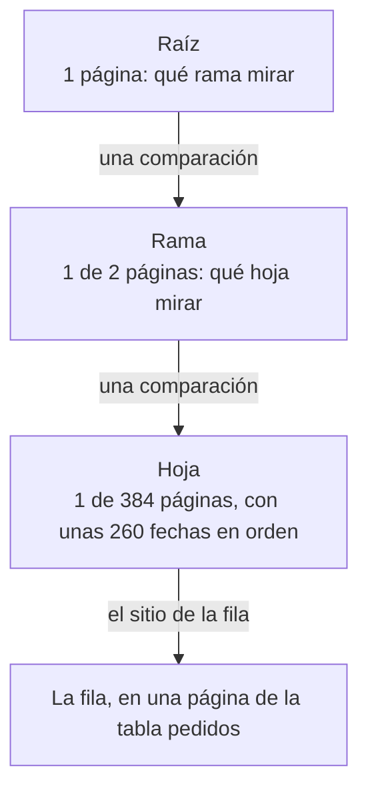

import Term from '~/components/Term.astro';
import TryIt from '~/components/TryIt.astro';
import Analogy from '~/components/Analogy.astro';
import ProjectCode from '~/components/ProjectCode.astro';
import Quiz from '~/components/Quiz.astro';
import QuizQuestion from '~/components/QuizQuestion.astro';
import QuizOption from '~/components/QuizOption.astro';
import SqlPlayground from '~/playgrounds/sql-playground/SqlPlayground';

## El problema

Imagina que la tienda va bien y ya tiene 100 000 pedidos. La app de Luis pide los diez más nuevos: `GET /v2/pedidos`. Tu API, la de la lección 6, «Migraciones», le pide a PostgreSQL **todos** los pedidos y se queda con diez en Node. Es la paginación de la Fase 4, que cortaba una lista en memoria.

Pasar el corte a SQL, con `LIMIT 10`, arregla el viaje: solo diez filas salen de la <Term id="database">base de datos</Term>. Pero dentro, PostgreSQL sigue leyendo los 100 000 pedidos para saber cuáles son los diez más nuevos. En cada petición. Y con el doble de pedidos, el doble de trabajo.

En esta lección ves qué hace PostgreSQL por dentro con cada consulta, con `EXPLAIN ANALYZE`, y le das un camino directo: un índice.

## La analogía

<Analogy>

Buscas «fotosíntesis» en un libro de biología de 600 páginas. Sin índice, lo hojeas página a página. Con él, vas al final: las palabras están en orden alfabético, cada una con sus páginas. Encuentras la F, luego «fotosíntesis», «pág. 212», y abres ahí.

El índice no es el libro: es una lista aparte, ordenada, que señala dónde está cada cosa. Un índice de una base de datos es eso mismo.

<div slot="limits">

- El índice de un libro se escribe una vez. El de una base de datos se pone al día con cada fila que entra, cambia o sale: cada índice hace más lentas las escrituras.
- Un libro tiene un índice. Una tabla puede tener varios, uno por cada forma de buscar, y cada uno ocupa disco.
- Si vas a leer medio libro, el índice no te ahorra nada. PostgreSQL piensa igual: si una consulta va a leer gran parte de la tabla, la recorre entera y no usa el índice.

</div>

</Analogy>

## Cómo funciona de verdad

Las salidas son de PostgreSQL 18.6, con los 100 000 pedidos que vas a generar en [Pruébalo](#pruébalo). Los tiempos dependen del ordenador y cambian en cada ejecución: no importa el número exacto, sino cuántas veces más grande es uno que otro.

### Un índice es una lista aparte, ordenada

Este es el índice que añade la lección, en una migración nueva, `003-indice-pedidos.sql`:

<ProjectCode file="tienda-api/21-indices/bd/migraciones/003-indice-pedidos.sql" region="indice" />

- `CREATE INDEX pedidos_por_fecha` crea un índice con ese nombre.
- `ON pedidos (creado_en DESC, id DESC)` dice de qué tabla y con qué columnas, en qué orden: del pedido más nuevo al más antiguo y, si dos tienen la misma fecha, primero el de id mayor.

En la tabla, las filas no siguen ningún orden útil: van donde hay sitio. El <Term id="database-index">índice</Term> guarda aparte cada fecha con su id, ordenadas, y junto a cada una, en qué página de la tabla está su fila.

Ya tenías índices sin saberlo. Cada <Term id="primary-key">clave primaria</Term> lleva uno, que PostgreSQL crea solo: el de `pedidos` se llama `pedidos_pkey`. Por eso buscar un pedido por su id, `WHERE id = 50000`, ya era rápido.

### Por dentro, un árbol B

El índice no es una lista larga, sino un <Term id="b-tree">árbol B</Term> (*B-tree*). PostgreSQL lo guarda en páginas de 8 kB:

- **Las hojas**, abajo, tienen las entradas en orden, cientos por página, y cada hoja sabe cuál es la siguiente.
- **Las ramas**, encima, dicen qué hoja mira cada tramo de fechas.
- **La raíz**, arriba del todo, dice qué rama mirar.

Así es el índice `pedidos_por_fecha` con 100 025 pedidos, y el camino para encontrar uno:



Tres páginas del índice y una de la tabla, en lugar de las 736 páginas de la tabla entera. Para la primera página de la API hay un paso más que no cuesta casi nada: una vez en la hoja, los diez pedidos siguientes están al lado, ya en orden.

Lo que hace rápido al árbol es que **cada nivel multiplica por cientos** lo que cabe. Con tres niveles caben decenas de millones de filas. Si la tabla creciera cien veces, el camino seguiría siendo de tres o cuatro páginas. Además, el árbol está equilibrado (*balanced*): todas las hojas están a la misma distancia de la raíz, así que cualquier valor cuesta los mismos pasos.

### EXPLAIN: el plan, antes de ejecutar

¿Cómo sabes qué camino toma PostgreSQL? Se lo preguntas, poniendo `EXPLAIN` delante de la consulta. Esta es la primera página de la lista de pedidos, **antes del índice**:

```sql
EXPLAIN SELECT * FROM pedidos ORDER BY creado_en DESC, id DESC LIMIT 10;
```

```
                                 QUERY PLAN
----------------------------------------------------------------------------
 Limit  (cost=3897.75..3897.78 rows=10 width=28)
   ->  Sort  (cost=3897.75..4147.82 rows=100025 width=28)
         Sort Key: creado_en DESC, id DESC
         ->  Seq Scan on pedidos  (cost=0.00..1736.25 rows=100025 width=28)
(4 rows)
```

Es el <Term id="query-plan">plan de consulta</Term>: los pasos que PostgreSQL ha elegido, sin ejecutar nada. Cada `->` es un paso, y **se lee de abajo arriba**: cada paso le pasa sus filas al de encima.

- `Seq Scan on pedidos` (*sequential scan*, «recorrido secuencial»): leer la tabla entera, fila a fila.
- `Sort`, con su `Sort Key`: ordenar lo leído por esas columnas.
- `Limit`: quedarse con las diez primeras.
- `rows=100025` es cuántas filas **cree** que pasarán por ese paso, y `width=28`, cuántos bytes ocupa cada una.
- `cost=0.00..1736.25` es lo que estima que costará: el primer número, hasta la primera fila; el segundo, hasta la última. No son milisegundos, sino una unidad propia, que sirve para comparar planes entre sí.

PostgreSQL calcula varios planes posibles y se queda con el de menor coste. Para estimar, usa las estadísticas de la tabla: cuántas filas tiene y cómo son sus valores.

### EXPLAIN ANALYZE: el plan, ejecutado

Con `EXPLAIN ANALYZE`, PostgreSQL ejecuta la consulta de verdad y apunta, en cada paso, lo que ha pasado:

```
                                                          QUERY PLAN
------------------------------------------------------------------------------------------------------------------------------
 Limit  (cost=3897.75..3897.78 rows=10 width=28) (actual time=13.239..13.245 rows=10.00 loops=1)
   Buffers: shared hit=742
   ->  Sort  (cost=3897.75..4147.82 rows=100025 width=28) (actual time=13.238..13.239 rows=10.00 loops=1)
         Sort Key: creado_en DESC, id DESC
         Sort Method: top-N heapsort  Memory: 26kB
         Buffers: shared hit=742
         ->  Seq Scan on pedidos  (cost=0.00..1736.25 rows=100025 width=28) (actual time=0.004..5.242 rows=100025.00 loops=1)
               Buffers: shared hit=736
 Planning:
   Buffers: shared hit=89
 Planning Time: 0.173 ms
 Execution Time: 13.262 ms
(12 rows)
```

Lo nuevo va entre los segundos paréntesis y en las líneas de debajo:

- `actual time=0.004..5.242`: milisegundos reales, hasta la primera fila y hasta la última.
- `rows=100025.00`: las filas que han pasado de verdad. Compáralas con las estimadas: si se parecen poco, las estadísticas están viejas, y `ANALYZE pedidos` las pone al día.
- `loops=1`: cuántas veces se ha hecho ese paso.
- `Sort Method: top-N heapsort`: no ordena los 100 000; va guardando los diez mejores mientras lee. Aun así, tiene que leerlos todos.
- `Buffers: shared hit=736`: cuántas páginas de 8 kB ha leído. `hit` son las que ya estaban en memoria, y `read`, las que ha tenido que traer del disco. 736 páginas son la tabla entera. PostgreSQL 18 lo enseña sin pedirlo.
- `Planning Time` y `Execution Time`: lo que ha tardado en elegir el plan y en ejecutarlo.

**`EXPLAIN ANALYZE` ejecuta la consulta**: con un `DELETE`, borra las filas. Para ver el plan de algo que cambia datos, usa `EXPLAIN` a secas.

### Con el índice: cuatro páginas en lugar de 742

La misma consulta, después de crear `pedidos_por_fecha`:

```
                                                                  QUERY PLAN
----------------------------------------------------------------------------------------------------------------------------------------------
 Limit  (cost=0.42..0.89 rows=10 width=28) (actual time=0.039..0.042 rows=10.00 loops=1)
   Buffers: shared hit=1 read=3
   ->  Index Scan using pedidos_por_fecha on pedidos  (cost=0.42..4756.48 rows=100025 width=28) (actual time=0.038..0.039 rows=10.00 loops=1)
         Index Searches: 1
         Buffers: shared hit=1 read=3
 Planning:
   Buffers: shared hit=108 read=1
 Planning Time: 0.239 ms
 Execution Time: 0.051 ms
(9 rows)
```

- `Index Scan using pedidos_por_fecha`: baja por el árbol hasta el pedido más nuevo y sigue por las hojas. Ya no hay `Sort`: el índice está en orden.
- `rows=10.00`: lee diez entradas y para, porque el `Limit` no quiere más.
- `Index Searches: 1`: ha bajado por el árbol una vez.
- `Buffers: shared hit=1 read=3`: cuatro páginas, las tres del índice y una de la tabla.

| | Sin índice | Con índice |
|---|---|---|
| Pasos | `Seq Scan`, `Sort` y `Limit` | `Index Scan` y `Limit` |
| Filas leídas | 100 025 | 10 |
| Páginas (`Buffers`) | 742 | 4 |
| Tiempo | Decenas de milisegundos | Centésimas de milisegundo |

**Cientos de veces menos tiempo**. Y lo que más importa: sin índice, el trabajo crece con la tabla; con él, casi no cambia.

### Índices de varias columnas: el orden cuenta

Piensa en una guía de teléfonos, ordenada por apellido y, dentro de cada apellido, por nombre. Encuentras rápido a «García, Ana», y a todos los García. Pero ¿todas las Ana? Están repartidas por la guía entera: tendrías que leerla toda.

Un índice compuesto, de varias columnas, funciona igual. **Uno en `(a, b)` sirve para buscar u ordenar por `a`, o por `a` y `b`; no por `b` sola.** Por eso el de la tienda va en `(creado_en DESC, id DESC)`, el mismo orden que el `ORDER BY` de la lista. Uno en `(id, creado_en)` tendría las mismas columnas, y no serviría para «los más nuevos primero».

Para elegir el orden: primero las columnas que comparas con `=`, y después la que ordenas o buscas por tramos. Para «los pendientes, del más nuevo al más antiguo», `(estado, creado_en)`: el índice va directo a los pendientes, que ya están por fecha.

PostgreSQL 18 suaviza la regla. Si la primera columna tiene pocos valores distintos, como `estado`, puede bajar por el árbol una vez por cada uno: en el plan, `Index Searches` pasa de 1 a varios. Ayuda, pero tener delante la columna buena sigue siendo mejor.

### Lo que cuesta un índice

Un índice no es gratis. Cuesta en dos sitios:

- **En cada escritura.** Cada `INSERT` añade una entrada a cada índice de la tabla; cada `DELETE` y cada `UPDATE` de una columna del índice, también lo cambian. Con cinco índices, un pedido nuevo se escribe en seis sitios.
- **En disco.** En `psql`, `\di+` lista los índices con su tamaño, y `\dt+`, las tablas:

```
                                               List of indexes
 Schema |       Name        | Type  | Owner  |  Table  | Persistence | Access method |  Size   | Description
--------+-------------------+-------+--------+---------+-------------+---------------+---------+-------------
 public | pedidos_pkey      | index | tienda | pedidos | permanent   | btree         | 2208 kB |
 public | pedidos_por_fecha | index | tienda | pedidos | permanent   | btree         | 3104 kB |
(2 rows)

                                     List of tables
 Schema |  Name   | Type  | Owner  | Persistence | Access method |  Size   | Description
--------+---------+-------+--------+-------------+---------------+---------+-------------
 public | pedidos | table | tienda | permanent   | heap          | 5920 kB |
(1 row)
```

El índice nuevo ocupa 3 MB, más de la mitad que la tabla de 6 MB. `btree` es el árbol B.

Por eso **no se pone un índice en cada columna**, por si acaso. Se pone uno para cada consulta que lo necesita, y se comprueba con `EXPLAIN ANALYZE` que lo usa.

### La paginación por cursor, ahora en SQL

En la [lección 3 de la Fase 4](/fase-4/paginacion-api/), el cursor llevaba el id del último pedido de la página. Pero «los más nuevos primero» es un orden por fecha, y el id solo dice en qué orden entraron las filas: los 100 000 pedidos generados son más antiguos que los 25 de ejemplo y tienen ids mayores. Ahora el cursor lleva la fecha y, para desempatar, el id:

<ProjectCode file="tienda-api/21-indices/src/paginacion.ts" region="consulta-cursor" />

- `${PEDIDO}` son las columnas del pedido, las mismas que ya usaba `datos.ts`.
- `(creado_en, id) < ($1, $2)` compara las dos parejas como un diccionario ordena palabras: primero la fecha y, si es la misma, el id. Son los pedidos que van detrás del cursor. `$1` y `$2` son parámetros, como en la lección 5, «Node y PostgreSQL».
- `$3::text IS NULL OR estado = $3` es el filtro opcional por estado: si no llega, deja pasar todos.
- `ORDER BY creado_en DESC, id DESC` es el orden del índice. Con él, PostgreSQL baja por el árbol hasta el cursor y lee solo los pedidos de la página.

A esta forma de paginar, sin saltar filas, se la llama *keyset pagination* («paginación por clave»). Como el cursor es opaco ([lección 3 de la Fase 4](/fase-4/paginacion-api/#el-cursor-es-opaco-no-secreto)), ningún cliente cambia su código. Solo un cursor guardado de antes deja de valer: la API responde `422`, y el cliente empieza otra vez por la primera página.

La misma página 9001, con un desplazamiento (`OFFSET 90000`) y con un cursor, el del pedido 90000:

```sql
EXPLAIN ANALYZE SELECT * FROM pedidos
ORDER BY creado_en DESC, id DESC LIMIT 10 OFFSET 90000;
```

```
                                                                    QUERY PLAN
--------------------------------------------------------------------------------------------------------------------------------------------------
 Limit  (cost=4279.80..4280.28 rows=10 width=28) (actual time=17.820..17.827 rows=10.00 loops=1)
   Buffers: shared hit=665 read=344
   ->  Index Scan using pedidos_por_fecha on pedidos  (cost=0.42..4756.48 rows=100025 width=28) (actual time=0.008..14.888 rows=90010.00 loops=1)
         Index Searches: 1
         Buffers: shared hit=665 read=344
 Planning:
   Buffers: shared hit=109
 Planning Time: 0.227 ms
 Execution Time: 17.842 ms
(9 rows)
```

```sql
EXPLAIN ANALYZE SELECT * FROM pedidos
WHERE (creado_en, id) < ('2026-07-30 21:25:00+00', 90000)
ORDER BY creado_en DESC, id DESC LIMIT 10;
```

```
                                                                 QUERY PLAN
--------------------------------------------------------------------------------------------------------------------------------------------
 Limit  (cost=0.42..2.09 rows=10 width=28) (actual time=0.011..0.013 rows=10.00 loops=1)
   Buffers: shared hit=3 read=1
   ->  Index Scan using pedidos_por_fecha on pedidos  (cost=0.42..1661.68 rows=9940 width=28) (actual time=0.011..0.012 rows=10.00 loops=1)
         Index Cond: (ROW(creado_en, id) < ROW('2026-07-30 21:25:00+00'::timestamp with time zone, 90000))
         Index Searches: 1
         Buffers: shared hit=3 read=1
 Planning Time: 0.063 ms
 Execution Time: 0.031 ms
(8 rows)
```

Las dos usan el índice y devuelven los mismos diez pedidos, del 90001 al 90010. Pero mira `rows`:

- **Con `OFFSET`**, 90 010: PostgreSQL no puede saltarse filas sin contarlas, así que lee 90 000 entradas y las tira. Más de mil páginas.
- **Con el cursor**, 10. `Index Cond` dice que la condición la resuelve el propio árbol: baja directo al pedido 90000 y lee los diez siguientes. Cuatro páginas.

Es la fila de la tabla de la Fase 4 que quedaba pendiente, medida: el desplazamiento se vuelve más lento cuanto más lejos está la página; el cursor tarda lo mismo en la primera que en la última.

### En producción: CREATE INDEX CONCURRENTLY

Mientras `CREATE INDEX` construye el índice, la tabla se puede leer pero no escribir. Con 100 000 filas tarda menos de un segundo. Con cien millones, pueden ser minutos sin poder guardar un pedido.

Para eso existe `CREATE INDEX CONCURRENTLY`: construye el índice sin bloquear las escrituras. Tarda más, y si falla, deja un índice marcado como no válido que tienes que borrar. Tampoco puede ir dentro de una transacción:

```
tienda=> BEGIN;
BEGIN
tienda=*> CREATE INDEX CONCURRENTLY pedidos_cantidad ON pedidos (cantidad);
ERROR:  CREATE INDEX CONCURRENTLY cannot run inside a transaction block
tienda=!> ROLLBACK;
ROLLBACK
```

El `*` del prompt dice que estás dentro de una transacción, y el `!`, que ha fallado y hay que deshacerla con `ROLLBACK`. Las transacciones son la lección 8, «Transacciones».

Tu ejecutor de migraciones mete cada una en una transacción, así que no podría aplicarla tal cual: tendría que aprender a hacer esa excepción. En la tienda, con su tabla pequeña, no hace falta. En producción, con tablas grandes, es lo normal.

## Pruébalo

El objetivo: medir la lista de pedidos sin índice y con él, primero en el navegador y luego en tu base de datos, dejar la API paginando en SQL y poner frente a frente el desplazamiento y el cursor.

### Antes y después, en el navegador

Este playground genera 50 000 pedidos, mide la primera página, crea el índice y la vuelve a medir. Pulsa «Ejecutar»; tarda unos segundos:

<SqlPlayground client:visible lang="es" rows={9} query={`INSERT INTO pedidos (producto_id, cantidad, estado, creado_en)
SELECT n % 3 + 1, n % 4 + 1, 'enviado',
  timestamptz '2026-10-01 09:00:00+00' - n * interval '1 minute'
FROM generate_series(1, 50000) AS n;
ANALYZE pedidos;
EXPLAIN ANALYZE SELECT * FROM pedidos ORDER BY creado_en DESC, id DESC LIMIT 10;
CREATE INDEX pedidos_por_fecha ON pedidos (creado_en DESC, id DESC);
EXPLAIN ANALYZE SELECT * FROM pedidos ORDER BY creado_en DESC, id DESC LIMIT 10;`} />

Lo nuevo está en el `INSERT`:

- `INSERT INTO pedidos (…) SELECT …`: las filas no vienen de un `VALUES`, sino del resultado de un `SELECT`. Una fila nueva por cada fila que devuelva.
- `generate_series(1, 50000) AS n`: una función que devuelve una tabla con los números del 1 al 50 000, en una columna `n`.
- `n % 3 + 1`: `%` es el resto de dividir. Da 1, 2, 3, 1, 2, 3…: los productos 1 a 3. `n % 4 + 1`, cantidades del 1 al 4.
- `timestamptz '…' - n * interval '1 minute'`: cada pedido, un minuto antes que el anterior, desde el primero de ejemplo.
- `ANALYZE pedidos` pone al día las estadísticas, con las que PostgreSQL elige el plan.

Fíjate en los dos planes: `Seq Scan` y `Sort` antes; `Index Scan` después. El playground es PostgreSQL 18.3 compilado para el navegador, más lento que el de tu ordenador: los tiempos serán otros, la forma del plan no.

Ahora pulsa «Restaurar datos» y cambia el orden de las dos consultas por `ORDER BY cantidad DESC`. Ejecuta: los dos planes salen iguales, con su `Seq Scan`, porque el índice no tiene `cantidad`. Si ejecutas dos veces sin restaurar, el `CREATE INDEX` falla: el índice ya existe.

### En tu base de datos: cien mil pedidos

Sigues en `~/curso-backend/fase-3/tienda-api`, con el código de la lección 6. Descarga la carpeta de esta lección para copiar de ella: desde `~/curso-backend/fase-3`, `curl -O https://backenddesdecero.com/practicas/tienda-api/21-indices.tar.gz` y `tar -xzf 21-indices.tar.gz`.

Copia el script que genera los pedidos, `cp ../21-indices/scripts/muchos-pedidos.ts scripts/`, y añade su línea a `"scripts"` en `package.json`: `"bd:muchos-pedidos": "node --env-file-if-exists=.env scripts/muchos-pedidos.ts"`. Hace el mismo `INSERT` que el playground, con 100 000:

<ProjectCode file="tienda-api/21-indices/scripts/muchos-pedidos.ts" region="generar" />

Todo pasa dentro de PostgreSQL, en una sola consulta: Node no crea ni manda 100 000 filas.

<TryIt
  title="1. Cien mil pedidos"
  cmd="npm run bd:muchos-pedidos"
  output={`> tienda-api@1.0.0 bd:muchos-pedidos
> node --env-file-if-exists=.env scripts/muchos-pedidos.ts

Ahora hay 100025 pedidos`}
>

Los 100 000 nuevos y los 25 de ejemplo. Si tienes alguno más, de los que creaste con la API, el número será mayor. Si sale `relation "pedidos" does not exist`, a tu base de datos le faltan las migraciones de la lección 6: `npm run bd:migrar`.

</TryIt>

Abre `psql -d tienda` y mide la primera página de la lista:

<TryIt
  title="2. Sin índice"
  lang="sql"
  cmd="EXPLAIN ANALYZE SELECT * FROM pedidos ORDER BY creado_en DESC, id DESC LIMIT 10;"
  output={`                                                          QUERY PLAN
------------------------------------------------------------------------------------------------------------------------------
 Limit  (cost=3897.75..3897.78 rows=10 width=28) (actual time=13.239..13.245 rows=10.00 loops=1)
   Buffers: shared hit=742
   ->  Sort  (cost=3897.75..4147.82 rows=100025 width=28) (actual time=13.238..13.239 rows=10.00 loops=1)
         Sort Key: creado_en DESC, id DESC
         Sort Method: top-N heapsort  Memory: 26kB
         Buffers: shared hit=742
         ->  Seq Scan on pedidos  (cost=0.00..1736.25 rows=100025 width=28) (actual time=0.004..5.242 rows=100025.00 loops=1)
               Buffers: shared hit=736
 Planning:
   Buffers: shared hit=89
 Planning Time: 0.173 ms
 Execution Time: 13.262 ms
(12 rows)`}
>

El plan que leíste en «EXPLAIN ANALYZE: el plan, ejecutado»: `Seq Scan` de 100 025 filas. Tus tiempos serán otros. Si ves `Index Scan`, tu base de datos ya tiene el índice: mira si `bd/migraciones/` tiene la `003`.

</TryIt>

Copia la migración, `cp ../21-indices/bd/migraciones/003-indice-pedidos.sql bd/migraciones/`, y aplícala con tu ejecutor:

<TryIt
  title="3. La migración del índice"
  cmd="npm run bd:migrar"
  output={`> tienda-api@1.0.0 bd:migrar
> node --env-file-if-exists=.env scripts/migrar.ts

Aplicada: 003-indice-pedidos.sql`}
>

Solo aplica la `003`: las otras ya están apuntadas en la tabla `migraciones`.

</TryIt>

<TryIt
  title="4. Con índice"
  lang="sql"
  cmd="EXPLAIN ANALYZE SELECT * FROM pedidos ORDER BY creado_en DESC, id DESC LIMIT 10;"
  output={`                                                                  QUERY PLAN
----------------------------------------------------------------------------------------------------------------------------------------------
 Limit  (cost=0.42..0.89 rows=10 width=28) (actual time=0.039..0.042 rows=10.00 loops=1)
   Buffers: shared hit=1 read=3
   ->  Index Scan using pedidos_por_fecha on pedidos  (cost=0.42..4756.48 rows=100025 width=28) (actual time=0.038..0.039 rows=10.00 loops=1)
         Index Searches: 1
         Buffers: shared hit=1 read=3
 Planning:
   Buffers: shared hit=108 read=1
 Planning Time: 0.239 ms
 Execution Time: 0.051 ms
(9 rows)`}
>

`Index Scan`, diez filas y cuatro páginas. Las líneas `Planning: Buffers` salen la primera vez, mientras PostgreSQL lee la descripción del índice nuevo; ejecútala otra vez y desaparecen, y `read=3` pasa a ser `hit`: las páginas ya están en memoria.

</TryIt>

### La API, paginando en SQL

Ahora el código. Copia de la carpeta de la lección o escribe los cambios:

1. En `src/paginacion.ts`, el cursor lleva la fecha y el id (región `cursor`), y `paginaPorCursor` y `paginaPorDesplazamiento` consultan a PostgreSQL en lugar de cortar una lista.
2. En `src/datos.ts`, exporta `PEDIDO`, `FilaPedido` y `aPedido`, y borra `pedidosMasNuevosPrimero`. Al crear un pedido, `date_trunc('milliseconds', now())` guarda la hora con milisegundos, como la da la API: así el cursor señala exactamente ese pedido.
3. En `src/esquemas.ts`, el esquema del cursor comprueba la fecha y el id.
4. En `src/v2.ts`, la ruta de los pedidos llama a las dos funciones con `await`.

Después, copia las pruebas: `cp ../21-indices/test/*.test.ts test/`. La nueva es `indices.test.ts`:

<TryIt
  title="5. Las pruebas del índice"
  cmd="npm test -- test/indices.test.ts"
  output={`> tienda-api@1.0.0 test
> node --env-file=test/.env --test --test-concurrency=1 test/indices.test.ts

✔ la migración 003 crea el índice de la lista de pedidos: por fecha y por id, de mayor a menor (238.845873ms)
✔ por cursor se ven todos los pedidos una sola vez, aunque entren nuevos entre dos páginas (23.429878ms)
✔ un cursor de antes, que solo llevaba el id, ya no vale: 422 (0.801352ms)
✔ con 100 000 pedidos, la lista usa el índice; sin él, lee la tabla entera (598.173822ms)
ℹ tests 4
ℹ suites 0
ℹ pass 4
ℹ fail 0
ℹ cancelled 0
ℹ skipped 0
ℹ todo 0
ℹ duration_ms 1073.746518`}
>

La última prueba hace lo mismo que tú: genera los 100 000 pedidos en `tienda_test` y comprueba el plan con el índice y sin él. Si falla `crea el índice`, falta la `003` en `bd/migraciones/`. Las salidas son de Node 26.11.1; tus tiempos serán otros. Ejecuta también `npm test` entero: las pruebas de la paginación de la Fase 4 siguen pasando.

</TryIt>

Arranca el servidor con `npm run dev` y, en otra terminal, pide una página de dos:

<TryIt
  title="6. El cursor nuevo"
  cmd="curl -i 'localhost:3000/v2/pedidos?limite=2'"
  output={`HTTP/1.1 200 OK
content-type: application/json
link: <http://localhost:3000/v2/pedidos?limite=2&cursor=WyIyMDI2LTEwLTA4VDAyOjAwOjAwLjAwMFoiLDI0XQ>; rel="next"
vary: Origin
x-request-id: 2e67c2c1-7511-4fcb-ae0e-390101173557
content-length: 195
Date: Tue, 13 Oct 2026 23:14:14 GMT
Connection: keep-alive
Keep-Alive: timeout=5

[{"id":25,"productoId":2,"cantidad":2,"estado":"pendiente","creadoEn":"2026-10-08T09:00:00.000Z"},{"id":24,"productoId":1,"cantidad":1,"estado":"pendiente","creadoEn":"2026-10-08T02:00:00.000Z"}]`}
>

El cursor de `link` es más largo que antes. Descífralo con `node -p "Buffer.from('WyIyMDI2LTEwLTA4VDAyOjAwOjAwLjAwMFoiLDI0XQ', 'base64url').toString()"`: escribe `["2026-10-08T02:00:00.000Z",24]`, la fecha y el id del pedido 24. Tu `x-request-id` y tu fecha serán otros.

</TryIt>

### Desplazamiento contra cursor

En el playground, con 50 000 pedidos y el índice: la página 4501 con `OFFSET 45000`, y la misma con el cursor del pedido 45000:

<SqlPlayground client:visible lang="es" rows={9} query={`INSERT INTO pedidos (producto_id, cantidad, estado, creado_en)
SELECT n % 3 + 1, n % 4 + 1, 'enviado',
  timestamptz '2026-10-01 09:00:00+00' - n * interval '1 minute'
FROM generate_series(1, 50000) AS n;
CREATE INDEX pedidos_por_fecha ON pedidos (creado_en DESC, id DESC);
ANALYZE pedidos;
EXPLAIN ANALYZE SELECT * FROM pedidos
ORDER BY creado_en DESC, id DESC LIMIT 10 OFFSET 45000;
EXPLAIN ANALYZE SELECT * FROM pedidos
WHERE (creado_en, id) < ('2026-08-31 03:25:00+00', 45000)
ORDER BY creado_en DESC, id DESC LIMIT 10;`} />

Busca `rows` en la línea del `Index Scan`: 45 010 con el desplazamiento y 10 con el cursor. Pulsa «Restaurar datos», cambia `OFFSET 45000` por `OFFSET 100` y ejecuta otra vez: 110 filas. El desplazamiento cuesta según lo lejos que esté la página.

En `psql`, con tus 100 000, prueba las dos consultas de «La paginación por cursor, ahora en SQL». Te saldrán los mismos planes: `rows=90010.00` con `OFFSET 90000`, y `rows=10.00` con el cursor.

Cuando acabes, quita los pedidos generados, que son los anteriores al primero de ejemplo:

<TryIt
  title="7. Vuelta a los 25 pedidos"
  lang="sql"
  cmd="DELETE FROM pedidos WHERE creado_en < '2026-10-01 09:00:00+00';"
  output="DELETE 100000"
>

El índice se queda: la tienda lo necesitará cuando crezca de verdad. Si sale un número distinto de 100 000, has ejecutado el script más de una vez.

</TryIt>

## Ya lo has visto

- **El índice de un libro** y la agenda del móvil, ordenada por nombre: vas directo a la letra.
- **Un diccionario** ordena como `(creado_en, id) < ($1, $2)`: primero la primera letra y, si coincide, la siguiente.
- **Las claves primarias** de la [lección 2](/fase-5/join-sql/) llevan su índice, y una columna `UNIQUE` también: PostgreSQL lo necesita para comprobar en un momento si un valor ya existe.
- **La tabla de la [lección 3 de la Fase 4](/fase-4/paginacion-api/#desplazamiento-o-cursor-qué-ganas-y-qué-pierdes)** decía que el desplazamiento «lee y descarta» filas con millones de ellas. Ahora lo has medido.

## Errores comunes

- **Un índice en cada columna, por si acaso.** Cada uno frena las escrituras y ocupa disco. Pon los que una consulta necesita, y compruébalo con `EXPLAIN ANALYZE`.
- **Las columnas de un índice compuesto en mal orden.** `(creado_en, estado)` no sirve para buscar por `estado`: la primera columna manda.
- **`EXPLAIN ANALYZE` con un `UPDATE` o un `DELETE`.** Lo ejecuta de verdad. Usa `EXPLAIN` a secas.
- **Medir con una tabla pequeña.** Con 25 filas, PostgreSQL lee la tabla entera aunque haya índice, y hace bien: es una página. Mide con un volumen parecido al real.
- **`OFFSET` para llegar lejos.** Lee y tira todas las filas que se salta. Para listas largas, un cursor.
- **`CREATE INDEX` en una tabla grande en producción.** Bloquea las escrituras mientras se construye: `CREATE INDEX CONCURRENTLY`.

## Resumen

- Un índice es una copia ordenada de unas columnas, con el sitio de cada fila. Por dentro es un árbol B: cualquier valor está a tres o cuatro páginas, aunque la tabla tenga millones de filas.
- `EXPLAIN` enseña el plan sin ejecutar; `EXPLAIN ANALYZE` lo ejecuta y apunta filas, tiempos y páginas (`Buffers`). Se lee de abajo arriba. `Seq Scan` lee la tabla entera; `Index Scan` va por el índice.
- En un índice compuesto, el orden de las columnas cuenta: sirve para la primera, o para la primera y las siguientes.
- Cada índice se paga en cada escritura y en disco: uno por cada consulta que lo necesita, no por columna.
- Con un índice en el mismo orden, el cursor `(creado_en, id) < ($1, $2)` lee solo la página; `OFFSET` lee y tira todo lo que se salta.

## ¿Lo has entendido?

<Quiz>

<QuizQuestion
  question="Buscar un cliente por su email tarda. EXPLAIN ANALYZE dice Seq Scan on clientes, con rows=2000000 en el recorrido y una sola fila al final. ¿Qué lo arregla?"
  review="Por dentro, un árbol B"
>

<QuizOption text="Un índice en la columna email." correct>

PostgreSQL bajará por el árbol hasta ese email en unas pocas páginas, en lugar de leer dos millones de filas.

</QuizOption>

<QuizOption text="Añadir LIMIT 1: con él, PostgreSQL va directo a la fila.">

`LIMIT` no sabe dónde está la fila: sin índice, PostgreSQL sigue recorriendo la tabla hasta encontrarla.

</QuizOption>

<QuizOption text="Nada: en una tabla de dos millones, cualquier búsqueda tarda así.">

Con un índice, buscar entre dos millones cuesta unas pocas páginas, casi lo mismo que entre mil.

</QuizOption>

</QuizQuestion>

<QuizQuestion
  question="La página 9001 de una lista, pedida con OFFSET 90000, da un plan con Index Scan y rows=90010.00 en ese paso. ¿Qué quiere decir?"
  review="La paginación por cursor, ahora en SQL"
>

<QuizOption text="Que rows es una estimación: en realidad solo ha leído las 10 de la página.">

El número que va junto a `actual time` es real: ha leído 90 010 entradas. La estimación es el `rows` del primer paréntesis.

</QuizOption>

<QuizOption text="Que usa el índice, así que esa página ya sale lo más rápido posible.">

Usa el índice, pero lo recorre desde el principio. Con un cursor, el mismo índice la da leyendo 10 filas.

</QuizOption>

<QuizOption text="Que ha leído 90 000 entradas del índice para tirarlas y quedarse con 10." correct>

`OFFSET` no puede saltarse filas sin contarlas. Cuanto más lejos está la página, más lee y tira.

</QuizOption>

</QuizQuestion>

<QuizQuestion
  question="Luis quiere los pedidos pendientes, del más nuevo al más antiguo, con un índice. ¿Cuál?"
  review="Índices de varias columnas: el orden cuenta"
>

<QuizOption text="En (creado_en, estado): el orden de las columnas da igual.">

Con la fecha delante, los pendientes están repartidos por todo el índice, como las Ana en la guía de teléfonos.

</QuizOption>

<QuizOption text="En (estado, creado_en): primero la que compara con =, después la del orden." correct>

El índice va directo a los pendientes, y ahí ya están ordenados por fecha: ni recorrer ni ordenar.

</QuizOption>

<QuizOption text="Dos índices, uno en estado y otro en creado_en: equivale a uno con las dos.">

Cada uno está ordenado por su columna. Ninguno tiene los pendientes en orden de fecha, que es lo que pide la consulta.

</QuizOption>

</QuizQuestion>

<QuizQuestion
  question="Una tabla de eventos recibe miles de INSERT por segundo y tiene nueve índices. Las escrituras van lentas. ¿Por qué?"
  review="Lo que cuesta un índice"
>

<QuizOption text="Los índices solo afectan a las lecturas: el problema tiene que ser otro.">

Cada fila nueva tiene que entrar también en cada índice. Afectan a las escrituras, y mucho.

</QuizOption>

<QuizOption text="PostgreSQL reconstruye cada índice entero en cada INSERT.">

No lo reconstruye: añade una entrada en su sitio del árbol. Pero son nueve entradas más por fila.

</QuizOption>

<QuizOption text="Cada INSERT escribe además en los nueve índices." correct>

Diez escrituras por evento. Sobran los índices que ninguna consulta usa.

</QuizOption>

</QuizQuestion>

<QuizQuestion
  question="Quieres ver cómo haría PostgreSQL DELETE FROM pedidos WHERE estado = 'cancelado', sin borrar nada. ¿Qué escribes delante?"
  review="EXPLAIN ANALYZE: el plan, ejecutado"
>

<QuizOption text="EXPLAIN: enseña el plan sin ejecutar la orden." correct>

`EXPLAIN` a secas no toca los datos. Con `ANALYZE`, se ejecutaría el `DELETE`.

</QuizOption>

<QuizOption text="EXPLAIN ANALYZE: solo mide, no cambia los datos.">

`ANALYZE` ejecuta la orden de verdad para medirla: borraría los pedidos cancelados.

</QuizOption>

<QuizOption text="Nada: EXPLAIN solo funciona con SELECT.">

`EXPLAIN` funciona también con `INSERT`, `UPDATE` y `DELETE`.

</QuizOption>

</QuizQuestion>

<QuizQuestion
  question="La tabla de pedidos pasa de 100 000 a 10 millones de filas. ¿Qué le pasa a buscar un pedido por su índice?"
  review="Por dentro, un árbol B"
>

<QuizOption text="Tarda cien veces más: el índice también es cien veces más grande.">

Ocupa cien veces más, pero el camino de la raíz a la hoja crece en niveles, y cada nivel multiplica por cientos.

</QuizOption>

<QuizOption text="Casi nada: el árbol gana un nivel como mucho, una página más." correct>

Por eso un árbol B aguanta tablas enormes: el trabajo de una búsqueda apenas crece con ellas.

</QuizOption>

<QuizOption text="Deja de usar el índice: con tablas tan grandes, PostgreSQL las recorre enteras.">

Es al revés: cuanto mayor es la tabla, más le compensa a PostgreSQL usar el índice para buscar unas pocas filas.

</QuizOption>

</QuizQuestion>

</Quiz>

## Para profundizar

- [Índices](https://www.postgresql.org/docs/18/indexes.html) (documentación de PostgreSQL, en inglés): los tipos, los compuestos y cuándo los usa.
- [Usar EXPLAIN](https://www.postgresql.org/docs/18/using-explain.html) (documentación de PostgreSQL, en inglés): cada línea de un plan, con ejemplos.
- [CREATE INDEX](https://www.postgresql.org/docs/18/sql-createindex.html) (documentación de PostgreSQL, en inglés): `CONCURRENTLY` y lo que hacer si falla.
- [Use The Index, Luke](https://use-the-index-luke.com/es) (Markus Winand, en español): un libro gratuito sobre índices, escrito para quien programa.
- [Paginar sin OFFSET](https://use-the-index-luke.com/no-offset) (Markus Winand, en inglés): por qué la paginación por clave gana a `OFFSET`.
