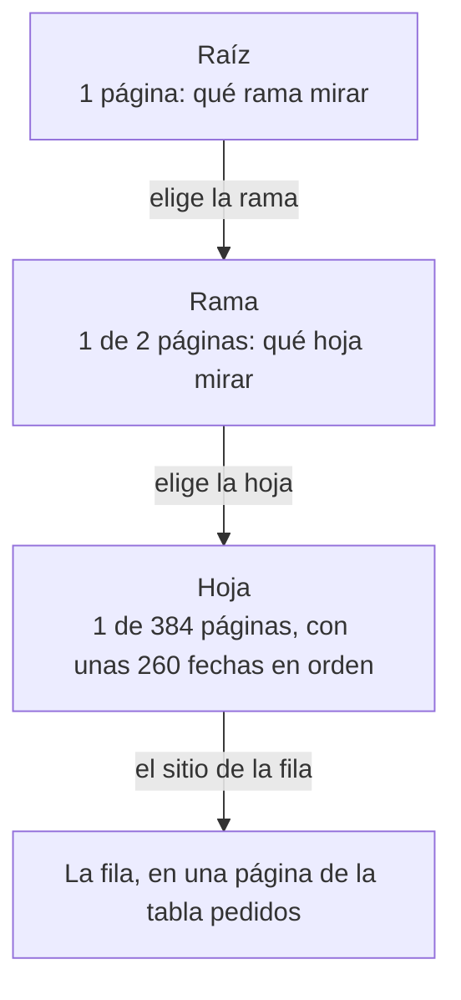

import Term from '~/components/Term.astro';
import TryIt from '~/components/TryIt.astro';
import Analogy from '~/components/Analogy.astro';
import ProjectCode from '~/components/ProjectCode.astro';
import Quiz from '~/components/Quiz.astro';
import QuizQuestion from '~/components/QuizQuestion.astro';
import QuizOption from '~/components/QuizOption.astro';
import SqlPlayground from '~/playgrounds/sql-playground/SqlPlayground';

## El problema

Imagina que la tienda tiene ya 100 000 pedidos. La app del móvil pide los diez más nuevos, `GET /v2/pedidos`, y tu API, la de la [lección 6, «Migraciones»](/fase-5/migraciones-base-de-datos/), le pide a PostgreSQL **todos** para quedarse con diez en Node, como en la Fase 4.

Cortar en SQL, con `LIMIT 10`, arregla el viaje: solo salen diez filas de la <Term id="database">base de datos</Term>. Pero dentro, PostgreSQL sigue leyendo los 100 000 pedidos para saber cuáles son los más nuevos. En cada petición, y con el doble de pedidos, el doble de trabajo.

Aquí ves qué hace PostgreSQL por dentro, con `EXPLAIN ANALYZE`, y le das un camino directo: un índice.

## La analogía

<Analogy>

Buscas «fotosíntesis» en un libro de biología de 600 páginas. Sin índice, lo hojeas entero. Con él, vas al final: las palabras están en orden alfabético, cada una con sus páginas. Encuentras «fotosíntesis, pág. 212» y abres ahí.

El índice no es el libro: es una lista aparte, ordenada, que señala dónde está cada cosa.

<div slot="limits">

- El índice de un libro se escribe una vez. El de una base de datos se pone al día con cada fila que entra, cambia o sale.
- Una tabla puede tener varios índices, uno por cada forma de buscar, y cada uno ocupa disco.
- Para leer medio libro, el índice no ahorra nada. PostgreSQL tampoco lo usa si va a leer gran parte de la tabla.

</div>

</Analogy>

## Cómo funciona de verdad

Las salidas son de PostgreSQL 18.6, con los 100 000 pedidos que generarás en [Pruébalo](#pruébalo). Los tiempos cambian en cada ejecución: importa cuántas veces mayor es uno que otro.

### Un índice es una lista aparte, ordenada

Este es el índice de la lección, en una <Term id="migration">migración</Term> nueva, `003-indice-pedidos.sql`:

<ProjectCode file="tienda-api/21-indices/bd/migraciones/003-indice-pedidos.sql" region="indice" />

- `CREATE INDEX pedidos_por_fecha` crea un índice con ese nombre.
- `ON pedidos (creado_en DESC, id DESC)` dice la tabla y las columnas, en orden: del pedido más nuevo al más antiguo y, con la misma fecha, primero el id mayor.

En la tabla, las filas van donde hay sitio, sin un orden útil. El <Term id="database-index">índice</Term> guarda aparte cada fecha con su id, ordenadas, y el sitio de su fila en la tabla.

Ya tenías índices: cada <Term id="primary-key">clave primaria</Term> y cada columna `UNIQUE` llevan uno, que PostgreSQL crea solo para comprobar al momento si un valor ya existe. El de `pedidos` se llama `pedidos_pkey`, y por eso `WHERE id = 50000` ya era rápido.

### Por dentro, un árbol B

El índice es un <Term id="b-tree">árbol B</Term> (*B-tree*), guardado en páginas de 8 kB:

- **Las hojas**, abajo, tienen las entradas en orden, cientos por página, y cada una sabe cuál es la siguiente.
- **Las ramas**, encima, dicen qué hoja mirar para cada tramo de fechas.
- **La raíz**, arriba, dice qué rama mirar.

Así es `pedidos_por_fecha` con 100 025 pedidos, y el camino hasta uno de ellos:



Tres páginas del índice y una de la tabla, en lugar de las 736 de la tabla entera. Y en la hoja, los pedidos siguientes están al lado, ya en orden.

**Cada nivel multiplica por cientos** lo que cabe: si la tabla creciera cien veces, el camino seguiría siendo de tres o cuatro páginas. Y el árbol está equilibrado (*balanced*): todas las hojas están a la misma distancia de la raíz.

### EXPLAIN: el plan, antes de ejecutar

Para saber qué camino toma PostgreSQL, pon `EXPLAIN` delante de la consulta. Esta es la primera página de la lista de pedidos, **sin índice**:

```sql
EXPLAIN SELECT * FROM pedidos ORDER BY creado_en DESC, id DESC LIMIT 10;
```

```
                                 QUERY PLAN
----------------------------------------------------------------------------
 Limit  (cost=3897.75..3897.78 rows=10 width=28)
   ->  Sort  (cost=3897.75..4147.82 rows=100025 width=28)
         Sort Key: creado_en DESC, id DESC
         ->  Seq Scan on pedidos  (cost=0.00..1736.25 rows=100025 width=28)
(4 rows)
```

Es el <Term id="query-plan">plan de consulta</Term>: los pasos que PostgreSQL ha elegido, sin ejecutar nada. Cada línea con `cost` es un paso, y **se lee de abajo arriba**: cada uno pasa sus filas al de encima.

- `Seq Scan on pedidos` (*sequential scan*, «recorrido secuencial»): leer la tabla entera, fila a fila.
- `Sort` ordena por las columnas de `Sort Key`, y `Limit` se queda con las diez primeras.
- `rows=100025`: cuántas filas **cree** que pasarán por el paso. `width=28`: cuántos bytes ocupa cada una.
- `cost=0.00..1736.25`: lo que estima que costará, hasta la primera fila y hasta la última. No son milisegundos, sino una unidad propia para comparar planes.

PostgreSQL calcula varios planes y elige el más barato, según las estadísticas de la tabla: cuántas filas tiene y cómo son sus valores.

### EXPLAIN ANALYZE: el plan, ejecutado

Con `EXPLAIN ANALYZE` delante de la misma consulta, PostgreSQL la ejecuta de verdad y apunta lo que ha pasado en cada paso:

```
                                                          QUERY PLAN
------------------------------------------------------------------------------------------------------------------------------
 Limit  (cost=3897.75..3897.78 rows=10 width=28) (actual time=13.239..13.245 rows=10.00 loops=1)
   Buffers: shared hit=742
   ->  Sort  (cost=3897.75..4147.82 rows=100025 width=28) (actual time=13.238..13.239 rows=10.00 loops=1)
         Sort Key: creado_en DESC, id DESC
         Sort Method: top-N heapsort  Memory: 26kB
         Buffers: shared hit=742
         ->  Seq Scan on pedidos  (cost=0.00..1736.25 rows=100025 width=28) (actual time=0.004..5.242 rows=100025.00 loops=1)
               Buffers: shared hit=736
 Planning:
   Buffers: shared hit=89
 Planning Time: 0.173 ms
 Execution Time: 13.262 ms
(12 rows)
```

- `actual time=0.004..5.242`: milisegundos reales, hasta la primera fila y hasta la última.
- `rows=100025.00`: las filas reales. Si se parecen poco a las estimadas, a menudo las estadísticas están viejas: `ANALYZE pedidos` las pone al día.
- `loops=1`: las veces que se ha hecho el paso.
- `top-N heapsort`: guarda los diez primeros mientras lee, sin ordenar los 100 000. Pero los lee todos.
- `Buffers: shared hit=736`: páginas de 8 kB leídas; `hit`, las que ya estaban en memoria, y `read`, las traídas del disco. 736 son la tabla entera. PostgreSQL 18 lo enseña sin pedirlo.
- `Planning Time` y `Execution Time`: lo que ha tardado en planear y en ejecutar.

**`EXPLAIN ANALYZE` ejecuta la consulta**: con un `DELETE`, borra. Para ver el plan de algo que cambia datos, `EXPLAIN` a secas.

### Con el índice: cuatro páginas en lugar de 742

La misma consulta, con `pedidos_por_fecha` creado:

```
                                                                  QUERY PLAN
----------------------------------------------------------------------------------------------------------------------------------------------
 Limit  (cost=0.42..0.89 rows=10 width=28) (actual time=0.039..0.042 rows=10.00 loops=1)
   Buffers: shared hit=1 read=3
   ->  Index Scan using pedidos_por_fecha on pedidos  (cost=0.42..4756.48 rows=100025 width=28) (actual time=0.038..0.039 rows=10.00 loops=1)
         Index Searches: 1
         Buffers: shared hit=1 read=3
 Planning:
   Buffers: shared hit=108 read=1
 Planning Time: 0.239 ms
 Execution Time: 0.051 ms
(9 rows)
```

- `Index Scan using pedidos_por_fecha`: baja por el árbol hasta el pedido más nuevo y sigue por las hojas. No hay `Sort`: el índice ya está en orden.
- `rows=10.00`: lee diez entradas y para. `Index Searches: 1`: ha bajado por el árbol una vez.
- `Buffers: shared hit=1 read=3`: cuatro páginas, tres del índice y una de la tabla.

| | Sin índice | Con índice |
|---|---|---|
| Pasos | `Seq Scan`, `Sort` y `Limit` | `Index Scan` y `Limit` |
| Filas leídas | 100 025 | 10 |
| Páginas (`Buffers`) | 742 | 4 |
| Tiempo | Decenas de milisegundos | Centésimas de milisegundo |

**Cientos de veces menos tiempo.** Y sin índice el trabajo crece con la tabla; con él, casi no cambia.

### Índices de varias columnas: el orden cuenta

Una guía de teléfonos va ordenada por apellido y, después, por nombre. Encuentras rápido a «García, Ana» y a todos los García. Pero las Ana están repartidas por toda la guía.

Un índice compuesto, de varias columnas, funciona igual: **uno en `(a, b)` sirve para buscar u ordenar por `a`, o por `a` y `b`; no por `b` sola.** Por eso el de la tienda va en `(creado_en DESC, id DESC)`, el orden del `ORDER BY` de la lista.

Para elegir el orden: delante, las columnas que comparas con `=`; detrás, la que ordenas o buscas por tramos. Para «los pendientes, del más nuevo al más antiguo», `(estado, creado_en)`: va directo a los pendientes, que ya están por fecha.

### Lo que cuesta un índice

- **Cada escritura.** Cada `INSERT` añade una entrada a cada índice de la tabla, y un `UPDATE` que cambia una columna del índice, también. Con cinco índices, un pedido se escribe en seis sitios.
- **Disco.** En `psql`, `\di+ pedidos*` lista los índices que empiezan por `pedidos`, con su tamaño, y `\dt+ pedidos`, la tabla:

```
                                               List of indexes
 Schema |       Name        | Type  | Owner  |  Table  | Persistence | Access method |  Size   | Description
--------+-------------------+-------+--------+---------+-------------+---------------+---------+-------------
 public | pedidos_pkey      | index | tienda | pedidos | permanent   | btree         | 2208 kB |
 public | pedidos_por_fecha | index | tienda | pedidos | permanent   | btree         | 3104 kB |
(2 rows)

                                     List of tables
 Schema |  Name   | Type  | Owner  | Persistence | Access method |  Size   | Description
--------+---------+-------+--------+-------------+---------------+---------+-------------
 public | pedidos | table | tienda | permanent   | heap          | 5920 kB |
(1 row)
```

El índice nuevo (`btree`, el árbol B) ocupa 3 MB, más de la mitad que la tabla. Por eso **no se pone un índice en cada columna**, sino uno por cada consulta que lo necesita, comprobando con `EXPLAIN ANALYZE` que lo usa.

### La paginación por cursor, ahora en SQL

En la [lección 3 de la Fase 4](/fase-4/paginacion-api/), el <Term id="cursor">cursor</Term> llevaba el id del último pedido, y bastaba el índice de la clave primaria. Pero «los más nuevos primero» va por fecha, y el id solo dice en qué orden entraron las filas: los 100 000 pedidos generados son más antiguos que los de ejemplo, con ids mayores. Así que el cursor lleva [el valor del orden y, para desempatar, el id](/fase-4/paginacion-api/#ordenar-y-el-cursor-que-lleva-el-orden):

<ProjectCode file="tienda-api/21-indices/src/paginacion.ts" region="consulta-cursor" />

- `${PEDIDO}`: las columnas del pedido, como en `datos.ts`.
- `(creado_en, id) < ($1, $2)` compara las dos parejas como un diccionario ordena palabras: primero la fecha y, si es la misma, el id. Son los pedidos de detrás del cursor. `$1` y `$2` son parámetros, como en la [lección 5, «Node y PostgreSQL»](/fase-5/postgresql-node-js/#una-consulta-con-1-el-valor-viaja-aparte).
- `$3::text IS NULL OR estado = $3`: el filtro opcional por estado. Sin estado, `$3` es `NULL` y la condición se cumple siempre. `::text` le dice a PostgreSQL que `$3` es texto: con `IS NULL` solo, no lo sabría.
- `ORDER BY creado_en DESC, id DESC`: el orden del índice. PostgreSQL baja hasta el cursor y lee solo la página.
- `LIMIT $4`: uno más de los que caben; si llega, hay otra página.

Es la paginación por clave (*keyset pagination*). Como el cursor es [opaco](/fase-4/paginacion-api/#el-cursor-es-opaco-no-secreto), ningún cliente cambia su código. Pero un cursor guardado de antes, que solo lleva el id, recibe ahora un `422`, también en `/v1`. Según [la Fase 4](/fase-4/versionado-api/#un-cambio-rompe-si-un-cliente-que-funcionaba-deja-de-funcionar), **eso rompe**, aunque solo a quien iba por la mitad de la lista al desplegar: tiene que volver a la primera página. Para no romper ni eso, el servidor aceptaría los dos formatos durante un tiempo.

La página 9001, con un desplazamiento y con el cursor del pedido 90000:

```sql
EXPLAIN ANALYZE SELECT * FROM pedidos
ORDER BY creado_en DESC, id DESC LIMIT 10 OFFSET 90000;
```

```
                                                                    QUERY PLAN
--------------------------------------------------------------------------------------------------------------------------------------------------
 Limit  (cost=4279.80..4280.28 rows=10 width=28) (actual time=17.820..17.827 rows=10.00 loops=1)
   Buffers: shared hit=665 read=344
   ->  Index Scan using pedidos_por_fecha on pedidos  (cost=0.42..4756.48 rows=100025 width=28) (actual time=0.008..14.888 rows=90010.00 loops=1)
         Index Searches: 1
         Buffers: shared hit=665 read=344
 Planning:
   Buffers: shared hit=109
 Planning Time: 0.227 ms
 Execution Time: 17.842 ms
(9 rows)
```

```sql
EXPLAIN ANALYZE SELECT * FROM pedidos
WHERE (creado_en, id) < ('2026-07-30 21:25:00+00', 90000)
ORDER BY creado_en DESC, id DESC LIMIT 10;
```

```
                                                                 QUERY PLAN
--------------------------------------------------------------------------------------------------------------------------------------------
 Limit  (cost=0.42..2.09 rows=10 width=28) (actual time=0.011..0.013 rows=10.00 loops=1)
   Buffers: shared hit=3 read=1
   ->  Index Scan using pedidos_por_fecha on pedidos  (cost=0.42..1661.68 rows=9940 width=28) (actual time=0.011..0.012 rows=10.00 loops=1)
         Index Cond: (ROW(creado_en, id) < ROW('2026-07-30 21:25:00+00'::timestamp with time zone, 90000))
         Index Searches: 1
         Buffers: shared hit=3 read=1
 Planning Time: 0.063 ms
 Execution Time: 0.031 ms
(8 rows)
```

Las dos usan el índice y dan los mismos pedidos, del 90001 al 90010. Pero mira `rows`:

- **Con `OFFSET`, 90 010.** PostgreSQL no puede saltarse filas sin contarlas: lee 90 000 entradas y las tira. Más de mil páginas.
- **Con el cursor, 10.** `Index Cond` dice que el propio árbol resuelve la condición: baja directo al pedido 90000. Cuatro páginas.

El desplazamiento tarda más cuanto más lejos está la página; el cursor, lo mismo en la primera que en la última.

### En producción: CREATE INDEX CONCURRENTLY

Mientras `CREATE INDEX` construye el índice, la tabla se puede leer pero no escribir. Con 100 000 filas es menos de un segundo; con cien millones, pueden ser minutos sin poder guardar un pedido.

`CREATE INDEX CONCURRENTLY` lo construye sin bloquear las escrituras. Tarda más, si falla deja un índice no válido que hay que borrar, y no puede ir dentro de una <Term id="transaction">transacción</Term>:

```
tienda=> BEGIN;
BEGIN
tienda=*> CREATE INDEX CONCURRENTLY pedidos_cantidad ON pedidos (cantidad);
ERROR:  CREATE INDEX CONCURRENTLY cannot run inside a transaction block
tienda=!> ROLLBACK;
ROLLBACK
```

El `*` y el `!` del prompt los verás en la [lección 8, «Transacciones»](/fase-5/transacciones-acid/#si-una-orden-falla-cae-la-transacción-entera). Tu ejecutor de migraciones [mete cada una en una transacción](/fase-5/migraciones-base-de-datos/#cada-migración-entera-o-nada), así que tendría que aprender esa excepción. En la tienda no hace falta; en producción, es lo normal.

## Pruébalo

El objetivo: medir la lista de pedidos sin índice y con él, en el navegador y en tu base de datos, dejar la API paginando en SQL y enfrentar el desplazamiento al cursor.

### Antes y después, en el navegador

Este playground genera 50 000 pedidos, mide la primera página, crea el índice y vuelve a medir. Pulsa «Ejecutar»:

<SqlPlayground client:visible lang="es" rows={9} query={`INSERT INTO pedidos (producto_id, cantidad, estado, creado_en)
SELECT n % 3 + 1, n % 4 + 1, 'enviado',
  timestamptz '2026-10-01 09:00:00+00' - n * interval '1 minute'
FROM generate_series(1, 50000) AS n;
ANALYZE pedidos;
EXPLAIN ANALYZE SELECT * FROM pedidos ORDER BY creado_en DESC, id DESC LIMIT 10;
CREATE INDEX pedidos_por_fecha ON pedidos (creado_en DESC, id DESC);
EXPLAIN ANALYZE SELECT * FROM pedidos ORDER BY creado_en DESC, id DESC LIMIT 10;`} />

Lo nuevo está en el `INSERT`:

- `INSERT INTO pedidos (…) SELECT …`: las filas no vienen de un `VALUES`, sino de un `SELECT`, una por cada fila que devuelva.
- `generate_series(1, 50000) AS n`: una función que devuelve los números del 1 al 50 000, en una columna `n`.
- `n % 3 + 1`: `%` es el resto de dividir entre 3 (0, 1 o 2); con `+ 1`, los productos 1 a 3, por turnos.
- `timestamptz '…' - n * interval '1 minute'`: cada pedido, un minuto antes que el anterior.
- `ANALYZE pedidos`: pone al día las estadísticas.

Fíjate en los dos planes: `Seq Scan` y `Sort` antes, `Index Scan` después. Es PostgreSQL 18.3 en el navegador: cambian los tiempos, no la forma del plan.

Ahora pulsa «Restaurar datos», pon `ORDER BY cantidad DESC` en las dos consultas y ejecuta: los dos planes salen con `Seq Scan`, porque el índice no tiene `cantidad`. Sin restaurar, el `CREATE INDEX` fallaría: el índice ya existe.

### En tu base de datos: cien mil pedidos

Sigues en `~/curso-backend/fase-3/tienda-api`, con el código de la lección 6. Descarga la carpeta de esta lección: desde `~/curso-backend/fase-3`, `curl -O https://backenddesdecero.com/practicas/tienda-api/21-indices.tar.gz` y `tar -xzf 21-indices.tar.gz`.

Copia el script que genera los pedidos, `cp ../21-indices/scripts/muchos-pedidos.ts scripts/`, y añade a `"scripts"` en `package.json` la línea `"bd:muchos-pedidos": "node --env-file-if-exists=.env scripts/muchos-pedidos.ts"`. Es el `INSERT` del playground, con 100 000, todo dentro de PostgreSQL:

<ProjectCode file="tienda-api/21-indices/scripts/muchos-pedidos.ts" region="generar" />

<TryIt
  title="1. Cien mil pedidos"
  cmd="npm run bd:muchos-pedidos"
  output={`> tienda-api@1.0.0 bd:muchos-pedidos
> node --env-file-if-exists=.env scripts/muchos-pedidos.ts

Ahora hay 100025 pedidos`}
>

Los 100 000 nuevos y los 25 de ejemplo; si creaste otros con la API, saldrán más. Si sale `relation "pedidos" does not exist`, te falta `npm run bd:migrar`.

</TryIt>

Abre `psql -d tienda` y mide la primera página:

<TryIt
  title="2. Sin índice"
  lang="sql"
  cmd="EXPLAIN ANALYZE SELECT * FROM pedidos ORDER BY creado_en DESC, id DESC LIMIT 10;"
>

Sale el plan de [«EXPLAIN ANALYZE: el plan, ejecutado»](#explain-analyze-el-plan-ejecutado), con tus tiempos: `Seq Scan` con `rows=100025.00`, `Sort` y unas 740 páginas en `Buffers`. Si ves `Index Scan`, ya tienes el índice: mira si `bd/migraciones/` tiene la `003`.

</TryIt>

Copia la migración, `cp ../21-indices/bd/migraciones/003-indice-pedidos.sql bd/migraciones/`, y aplícala:

<TryIt
  title="3. La migración del índice"
  cmd="npm run bd:migrar"
  output={`> tienda-api@1.0.0 bd:migrar
> node --env-file-if-exists=.env scripts/migrar.ts

Aplicada: 003-indice-pedidos.sql`}
>

Solo la `003`: las otras ya están en la tabla `migraciones`.

</TryIt>

<TryIt
  title="4. Con índice"
  lang="sql"
  cmd="EXPLAIN ANALYZE SELECT * FROM pedidos ORDER BY creado_en DESC, id DESC LIMIT 10;"
>

Sale el plan de [«Con el índice: cuatro páginas en lugar de 742»](#con-el-índice-cuatro-páginas-en-lugar-de-742): `Index Scan`, diez filas y cuatro páginas. Si la repites, `read=3` pasa a `hit=4`: las páginas ya están en memoria.

</TryIt>

### La API, paginando en SQL

Ahora el código. Cópialo de la carpeta o escribe tú los cambios:

1. `src/paginacion.ts`: el cursor lleva la fecha y el id, y `paginaPorCursor` y `paginaPorDesplazamiento` consultan a PostgreSQL en lugar de cortar una lista.
2. `src/datos.ts`: exporta `PEDIDO`, `FilaPedido` y `aPedido`, y borra `pedidosMasNuevosPrimero`. Al crear un pedido, `date_trunc('milliseconds', now())` guarda la hora con milisegundos, como la da la API, para que el cursor señale justo ese pedido.
3. `src/esquemas.ts`: el esquema del cursor comprueba la fecha y el id.
4. `src/v2.ts`: la ruta de los pedidos llama a las dos funciones con `await`.

Copia las pruebas, `cp ../21-indices/test/*.test.ts test/`, y ejecuta la nueva:

<TryIt
  title="5. Las pruebas del índice"
  cmd="npm test -- test/indices.test.ts"
  output={`> tienda-api@1.0.0 test
> node --env-file=test/.env --test --test-concurrency=1 test/indices.test.ts

✔ la migración 003 crea el índice de la lista de pedidos: por fecha y por id, de mayor a menor (238.845873ms)
✔ por cursor se ven todos los pedidos una sola vez, aunque entren nuevos entre dos páginas (23.429878ms)
✔ un cursor de antes, que solo llevaba el id, ya no vale: 422 (0.801352ms)
✔ con 100 000 pedidos, la lista usa el índice; sin él, lee la tabla entera (598.173822ms)
ℹ tests 4
ℹ suites 0
ℹ pass 4
ℹ fail 0
ℹ cancelled 0
ℹ skipped 0
ℹ todo 0
ℹ duration_ms 1073.746518`}
>

La última hace lo mismo que tú, en `tienda_test`. Si falla la primera, falta la `003` en `bd/migraciones/`. Salidas de Node 26.11.1; tus tiempos serán otros. Ejecuta también `npm test` entero.

</TryIt>

Arranca el servidor con `npm run dev` y, en otra terminal, pide una página de dos:

<TryIt
  title="6. El cursor nuevo"
  cmd="curl -i 'localhost:3000/v2/pedidos?limite=2'"
  output={`HTTP/1.1 200 OK
content-type: application/json
link: <http://localhost:3000/v2/pedidos?limite=2&cursor=WyIyMDI2LTEwLTA4VDAyOjAwOjAwLjAwMFoiLDI0XQ>; rel="next"
vary: Origin
x-request-id: 2e67c2c1-7511-4fcb-ae0e-390101173557
content-length: 195
Date: Tue, 13 Oct 2026 23:14:14 GMT
Connection: keep-alive
Keep-Alive: timeout=5

[{"id":25,"productoId":2,"cantidad":2,"estado":"pendiente","creadoEn":"2026-10-08T09:00:00.000Z"},{"id":24,"productoId":1,"cantidad":1,"estado":"pendiente","creadoEn":"2026-10-08T02:00:00.000Z"}]`}
>

El cursor de `link` es más largo. `node -p "Buffer.from('WyIyMDI2LTEwLTA4VDAyOjAwOjAwLjAwMFoiLDI0XQ', 'base64url').toString()"` lo descifra: `["2026-10-08T02:00:00.000Z",24]`, la fecha y el id del pedido 24. Tu `x-request-id` y tu fecha serán otros.

</TryIt>

### Desplazamiento contra cursor

Con 50 000 pedidos y el índice, la página 4501 con `OFFSET 45000` y con el cursor del pedido 45000:

<SqlPlayground client:visible lang="es" rows={9} query={`INSERT INTO pedidos (producto_id, cantidad, estado, creado_en)
SELECT n % 3 + 1, n % 4 + 1, 'enviado',
  timestamptz '2026-10-01 09:00:00+00' - n * interval '1 minute'
FROM generate_series(1, 50000) AS n;
CREATE INDEX pedidos_por_fecha ON pedidos (creado_en DESC, id DESC);
ANALYZE pedidos;
EXPLAIN ANALYZE SELECT * FROM pedidos
ORDER BY creado_en DESC, id DESC LIMIT 10 OFFSET 45000;
EXPLAIN ANALYZE SELECT * FROM pedidos
WHERE (creado_en, id) < ('2026-08-31 03:25:00+00', 45000)
ORDER BY creado_en DESC, id DESC LIMIT 10;`} />

Mira `rows` en el `Index Scan`: 45 010 con el desplazamiento y 10 con el cursor. Pulsa «Restaurar datos», cambia `OFFSET 45000` por `OFFSET 100` y ejecuta: 110.

En `psql`, con tus 100 000, prueba las dos de «La paginación por cursor, ahora en SQL»: `rows=90010.00` y `rows=10.00`.

Al acabar, quita los pedidos generados, los anteriores al primero de ejemplo:

<TryIt
  title="7. Vuelta a los 25 pedidos"
  lang="sql"
  cmd="DELETE FROM pedidos WHERE creado_en < '2026-10-01 09:00:00+00';"
  output="DELETE 100000"
>

El índice se queda. Si sale otro número, ejecutaste el script más de una vez.

</TryIt>

## Ya lo has visto

- **La agenda del móvil**, ordenada por nombre: vas directo a la letra.
- **La [tabla de la Fase 4](/fase-4/paginacion-api/#desplazamiento-o-cursor-qué-ganas-y-qué-pierdes)** decía que el desplazamiento «lee y descarta» filas. Ya lo has medido.

## Errores comunes

- **Un índice en cada columna, por si acaso.** Frenan las escrituras y ocupan disco. Pon los que una consulta necesita.
- **Un índice compuesto en mal orden.** `(creado_en, estado)` no sirve para buscar por `estado`: manda la primera columna.
- **`EXPLAIN ANALYZE` con un `UPDATE` o un `DELETE`.** Lo ejecuta de verdad. Usa `EXPLAIN` a secas.
- **Medir con una tabla pequeña.** Con 25 filas, PostgreSQL lee la tabla aunque haya índice, y hace bien: es una página.
- **`CREATE INDEX` en una tabla grande en producción.** Bloquea las escrituras: `CONCURRENTLY`.

## Resumen

- Un índice es una copia ordenada de unas columnas, con el sitio de cada fila. Es un árbol B: cualquier valor está a pocas páginas, aunque haya millones de filas.
- `EXPLAIN` enseña el plan; `EXPLAIN ANALYZE` lo ejecuta y apunta filas, tiempos y páginas. Se lee de abajo arriba: `Seq Scan` lee la tabla entera, `Index Scan` va por el índice.
- En un índice compuesto manda la primera columna.
- Cada índice se paga en cada escritura y en disco: uno por consulta que lo necesite.
- Con un índice en el mismo orden, el cursor `(creado_en, id) < ($1, $2)` lee solo la página; `OFFSET` lee y tira todo lo que se salta.

## ¿Lo has entendido?

<Quiz>

<QuizQuestion
  question="Buscar un cliente por su email tarda. EXPLAIN ANALYZE dice Seq Scan on clientes, con rows=2000000 en el recorrido y una sola fila al final. ¿Qué lo arregla?"
  review="Por dentro, un árbol B"
>

<QuizOption text="Un índice en la columna email." correct>

PostgreSQL bajará por el árbol hasta ese email en pocas páginas, sin leer dos millones de filas.

</QuizOption>

<QuizOption text="Añadir LIMIT 1: con él, PostgreSQL va directo a la fila.">

`LIMIT` no sabe dónde está la fila: sin índice, PostgreSQL sigue recorriendo la tabla hasta encontrarla.

</QuizOption>

<QuizOption text="Nada: en una tabla de dos millones, cualquier búsqueda tarda así.">

Con un índice, buscar entre dos millones cuesta unas pocas páginas, casi lo mismo que entre mil.

</QuizOption>

</QuizQuestion>

<QuizQuestion
  question="Una app pide los mensajes de 20 en 20, y va por la página 2001: OFFSET 40000. El plan dice Index Scan, con rows=40020.00 en ese paso. ¿Qué quiere decir?"
  review="La paginación por cursor, ahora en SQL"
>

<QuizOption text="Que rows es una estimación: en realidad solo ha leído las 20 de la página.">

El `rows` junto a `actual time` es real: ha leído 40 020 entradas. La estimación es el del primer paréntesis.

</QuizOption>

<QuizOption text="Que usa el índice, así que esa página ya sale lo más rápido posible.">

Lo recorre desde el principio. Con un cursor, el mismo índice la da leyendo 20 filas.

</QuizOption>

<QuizOption text="Que ha leído 40 000 entradas del índice para tirarlas y quedarse con 20." correct>

`OFFSET` no puede saltarse filas sin contarlas. Cuanto más lejos está la página, más lee y tira.

</QuizOption>

</QuizQuestion>

<QuizQuestion
  question="Luis quiere los pedidos pendientes, del más nuevo al más antiguo, con un índice. ¿Cuál?"
  review="Índices de varias columnas: el orden cuenta"
>

<QuizOption text="En (creado_en, estado): el orden de las columnas da igual.">

Con la fecha delante, los pendientes están repartidos por todo el índice, como las Ana en la guía de teléfonos.

</QuizOption>

<QuizOption text="En (estado, creado_en): delante la que compara con =, detrás la del orden." correct>

El índice va directo a los pendientes, y ahí ya están ordenados por fecha: ni recorrer ni ordenar.

</QuizOption>

<QuizOption text="Dos índices, uno en estado y otro en creado_en: equivalen a uno con las dos.">

Cada uno está ordenado por su columna: ninguno tiene los pendientes en orden de fecha.

</QuizOption>

</QuizQuestion>

<QuizQuestion
  question="Una tabla de eventos recibe miles de INSERT por segundo y tiene nueve índices. Las escrituras van lentas. ¿Por qué?"
  review="Lo que cuesta un índice"
>

<QuizOption text="Los índices solo afectan a las lecturas: el problema tiene que ser otro.">

Cada fila nueva tiene que entrar también en cada índice. Afectan a las escrituras, y mucho.

</QuizOption>

<QuizOption text="PostgreSQL reconstruye cada índice entero en cada INSERT.">

Añade una entrada en su sitio del árbol, sin reconstruirlo. Pero son nueve por fila.

</QuizOption>

<QuizOption text="Cada INSERT escribe además en los nueve índices." correct>

Diez escrituras por evento. Sobran los índices que ninguna consulta usa.

</QuizOption>

</QuizQuestion>

<QuizQuestion
  question="Quieres ver cómo haría PostgreSQL DELETE FROM pedidos WHERE estado = 'cancelado', sin borrar nada. ¿Qué escribes delante?"
  review="EXPLAIN ANALYZE: el plan, ejecutado"
>

<QuizOption text="EXPLAIN: enseña el plan sin ejecutar la orden." correct>

`EXPLAIN` a secas no toca los datos. Con `ANALYZE`, se ejecutaría el `DELETE`.

</QuizOption>

<QuizOption text="EXPLAIN ANALYZE: solo mide, no cambia los datos.">

`ANALYZE` ejecuta la orden de verdad para medirla: borraría los pedidos cancelados.

</QuizOption>

<QuizOption text="Nada: EXPLAIN solo funciona con SELECT.">

`EXPLAIN` funciona también con `INSERT`, `UPDATE` y `DELETE`.

</QuizOption>

</QuizQuestion>

<QuizQuestion
  question="La tabla de pedidos pasa de 100 000 a 10 millones de filas. ¿Qué le pasa a buscar un pedido por su índice?"
  review="Por dentro, un árbol B"
>

<QuizOption text="Tarda cien veces más: el índice también es cien veces más grande.">

Ocupa cien veces más, pero el camino crece en niveles, y cada nivel multiplica por cientos.

</QuizOption>

<QuizOption text="Casi nada: el árbol gana un nivel como mucho, una página más." correct>

Por eso un árbol B aguanta tablas enormes: el trabajo de una búsqueda apenas crece con ellas.

</QuizOption>

<QuizOption text="Deja de usar el índice: con tablas tan grandes, PostgreSQL las recorre enteras.">

Es al revés: cuanto mayor es la tabla, más compensa el índice para buscar unas pocas filas.

</QuizOption>

</QuizQuestion>

</Quiz>

## Para profundizar

- [Índices](https://www.postgresql.org/docs/18/indexes.html) (documentación de PostgreSQL, en inglés): los tipos, los compuestos y cuándo se usan.
- [Usar EXPLAIN](https://www.postgresql.org/docs/18/using-explain.html) (documentación de PostgreSQL, en inglés): cada línea de un plan.
- [Use The Index, Luke](https://use-the-index-luke.com/es) (Markus Winand, en español): un libro gratuito sobre índices.
- [No uses OFFSET](https://use-the-index-luke.com/no-offset) (Markus Winand, en inglés): por qué la paginación por clave gana.
