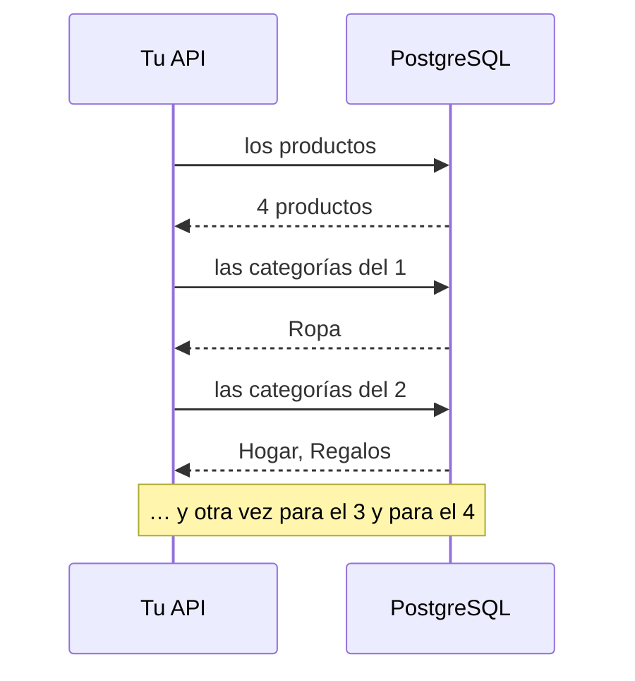

import Term from '~/components/Term.astro';
import TryIt from '~/components/TryIt.astro';
import Analogy from '~/components/Analogy.astro';
import SelfCheck from '~/components/SelfCheck.astro';
import ProjectCode from '~/components/ProjectCode.astro';
import Quiz from '~/components/Quiz.astro';
import QuizQuestion from '~/components/QuizQuestion.astro';
import QuizOption from '~/components/QuizOption.astro';

## El problema

Ana quiere que la lista de productos diga en qué categorías está cada uno: la Taza, en Hogar y Regalos. Las categorías viven en otra tabla, unidas a los productos por `productos_categorias`, como viste en la [lección 4, «Modelado»](/fase-5/modelado-datos-normalizacion/#muchos-a-muchos-una-tabla-intermedia).

Lo primero que se le ocurre a cualquiera: pedir los productos y, para cada uno, sus categorías. Funciona. Con cuatro productos son cinco <Term id="query">consultas</Term>; con mil, mil una. La lista tarda cada vez más, y ninguna consulta es lenta.

Y otro problema, más pequeño: desde la [lección 5](/fase-5/postgresql-node-js/), tu SQL vive en textos. Si escribes `precio_centimo`, sin la última ese, TypeScript no lo ve. Te enteras cuando alguien llama a esa ruta.

Un ORM arregla el segundo problema, pero hace más fácil caer en el primero, y lo esconde.

## La analogía

<Analogy>

Viajas a Japón sin hablar japonés. En el restaurante, un intérprete habla con el camarero por ti. Cómodo.

Ahora preguntas qué alérgenos tiene cada plato de la carta. Un intérprete descuidado va a la cocina por el primero, vuelve, va por el segundo… Veinte platos, veinte viajes. Uno atento pide la lista entera de una vez. Tú no oyes la diferencia: solo notas que tarda.

<div slot="limits">

- Un ORM traduce siempre igual la misma petición: si lo hace mal, lo hace mal siempre. Y le puedes pedir que repita en voz alta lo que dice: su log.
- Si el intérprete no sabe decir algo, te quedas sin decirlo. Con un ORM, puedes hablarle a PostgreSQL en SQL cuando haga falta.

</div>

</Analogy>

## Cómo funciona de verdad

El código es el de la carpeta de esta lección, `23-orm`, con drizzle-orm 0.45.3. Las salidas son de Node 26 y PostgreSQL 18.6.

### Del texto con SQL a funciones con la forma del SQL

Hasta ahora, cada función de datos le daba a `pg` un texto con SQL. Hay tres formas de hablar con la base de datos:

| Herramienta | Qué escribes | Quién escribe el SQL |
|---|---|---|
| El <Term id="driver">driver</Term>, `pg` (lección 5) | El SQL, en un texto | Tú |
| Un constructor de consultas | Funciones con la forma del SQL: `select`, `from`, `where` | Él, casi palabra por palabra |
| Un ORM | Qué datos quieres, y con qué relaciones | Él, y decide cómo |

Un **<Term id="query-builder">constructor de consultas</Term>** (*query builder*) escribe la consulta con funciones de TypeScript. Un **<Term id="orm">ORM</Term>** traduce además entre las tablas y los <Term id="object">objetos</Term> de tu programa, y sabe cómo se relacionan las tablas. Drizzle, el que usa el curso, hace las dos cosas.

### Las tablas, descritas en TypeScript

Drizzle necesita saber cómo son tus tablas. Se lo cuentas en un fichero nuevo, `src/esquema.ts`:

<ProjectCode file="tienda-api/23-orm/src/esquema.ts" region="productos" />

Palabra a palabra:

- `pgTable('productos', {…})` describe la tabla `productos` de PostgreSQL. Lo que devuelve, `productos`, es lo que usarás en las consultas.
- `integer()` y `text()` son los tipos; `.notNull()`, `.primaryKey()` y `.default(0)`, las reglas del `CREATE TABLE` de la [lección 4](/fase-5/modelado-datos-normalizacion/#las-restricciones-reglas-que-postgresql-comprueba-siempre). `.generatedAlwaysAsIdentity()`, el `GENERATED ALWAYS AS IDENTITY` que numera el `id`.
- `precioCentimos: integer('precio_centimos')` da dos nombres: `precio_centimos` en PostgreSQL y `precioCentimos` en TypeScript. Drizzle traduce, y desaparece el `AS "precioCentimos"` de la lección 5. Si se llaman igual, como `nombre`, basta uno.
- `check(…)` son las restricciones `CHECK`, con su nombre. `` sql`…` `` es un trozo de SQL escrito a mano: volverá al final.

**Este fichero no crea nada.** Las tablas siguen saliendo de tus <Term id="migration">migraciones</Term>; `esquema.ts` le describe a Drizzle lo que ya existe. Si no coinciden, Drizzle escribe consultas para otras tablas.

Drizzle se monta sobre el <Term id="connection-pool">pool</Term> que ya tienes, en `src/bd.ts`:

<ProjectCode file="tienda-api/23-orm/src/bd.ts" region="drizzle" />

`drizzle({ client: pool, schema: esquema })` usa las conexiones del pool de `pg`, y `schema` le da las tablas.

### Lo que ganas: TypeScript conoce cada columna

Una consulta con Drizzle, en `src/datos.ts`:

<ProjectCode file="tienda-api/23-orm/src/datos.ts" region="buscar-pedido" />

- Se lee como el SQL: `select` de `pedidos` donde (`where`) el `id` es igual (`eq`) al que llega.
- `eq(pedidos.id, id)` se convierte en `"pedidos"."id" = $1`: el valor sigue viajando aparte, como parámetro.
- `fila` ya tiene su tipo. TypeScript sabe que `fila.creadoEn` es una fecha, sin que se lo prometas tú con `<FilaPedido>`, como en la [lección 5](/fase-5/postgresql-node-js/).

Compruébalo rompiendo algo. En `listarProductos`, cambia `productos.precioCentimos` por `productos.precio_centimos` y comprueba los tipos:

<TryIt
  title="Una columna que no existe"
  cmd="npm run check"
  output={`> tienda-api@1.0.0 check
> tsc --noEmit

src/datos.ts(90,25): error TS2551: Property 'precio_centimos' does not exist on type 'PgTableWithColumns<{ name: "productos"; schema: undefined; columns: { id: PgColumn<{ name: "id"; tableName: "productos"; dataType: "number"; columnType: "PgInteger"; data: number; driverParam: string | number; notNull: true; ... 7 more ...; generated: undefined; }, {}, {}>; nombre: PgColumn<...>; precioCentimos: PgC...'. Did you mean 'precioCentimos'?`}
>

El error llega **antes de ejecutar nada**, con la línea y la columna (la tuya puede ser otra). Lo largo del medio es cómo describe Drizzle la tabla: lee el principio y el final, «`precio_centimos` no existe… ¿Querías decir `precioCentimos`?». Con el SQL en un texto, solo lo habría dicho PostgreSQL, al recibir la consulta. Deshaz el cambio.

</TryIt>

### Lo que no ves: el SQL que de verdad se ejecuta

Con Drizzle, el SQL lo escribe él, y no lo ves si no se lo pides con un log. `ejemplos/n-mas-uno.ts` crea un Drizzle con uno propio, que escribe cada consulta y las cuenta:

<ProjectCode file="tienda-api/23-orm/ejemplos/n-mas-uno.ts" region="log" />

`logQuery` es una función que Drizzle llama con cada consulta antes de enviarla; `consultas++` suma uno. Para ver todas las de tu API, basta `logger: true` al crear `bd`: Drizzle las escribe en la terminal, con sus parámetros.

### El problema N+1, contado en el log

El mismo ejemplo pide los productos con sus categorías de dos formas. La primera, la más directa:

<ProjectCode file="tienda-api/23-orm/ejemplos/n-mas-uno.ts" region="n-mas-uno" />

- La primera consulta trae todos los productos.
- `for (const producto of lista)` recorre la lista y, para cada uno, hace otra consulta con sus categorías. `innerJoin` es el `INNER JOIN` de la [lección 2](/fase-5/join-sql/).
- El `await` dentro del bucle espera cada respuesta antes de pedir la siguiente.

La segunda le pide a Drizzle los productos **con** sus categorías. Para eso, `esquema.ts` le cuenta cómo se unen las tablas:

<ProjectCode file="tienda-api/23-orm/src/esquema.ts" region="relaciones" />

`relations` no cambia nada en la base de datos: le dice a Drizzle que un producto tiene muchas (`many`) filas en `productos_categorias`, y cada fila, una (`one`) categoría, unidas por esas columnas.

Con eso, la consulta:

<ProjectCode file="tienda-api/23-orm/ejemplos/n-mas-uno.ts" region="una-consulta" />

`bd.query.productos.findMany` es la forma ORM de Drizzle: en lugar de escribir el `JOIN`, dices qué quieres. `with` pide, de cada producto, sus filas de `productos_categorias` y, de cada una, su `categoria`.

<TryIt
  title="Las dos formas, con el log encendido"
  cmd="node --env-file=.env ejemplos/n-mas-uno.ts"
  output={`== Con N+1
  SQL: select "id", "nombre", "precio_centimos", "stock" from "productos" order by "productos"."id" asc
  SQL: select "categorias"."nombre" from "productos_categorias" inner join "categorias" on "categorias"."id" = "productos_categorias"."categoria_id" where "productos_categorias"."producto_id" = $1 order by "categorias"."id" asc
  SQL: select "categorias"."nombre" from "productos_categorias" inner join "categorias" on "categorias"."id" = "productos_categorias"."categoria_id" where "productos_categorias"."producto_id" = $1 order by "categorias"."id" asc
  SQL: select "categorias"."nombre" from "productos_categorias" inner join "categorias" on "categorias"."id" = "productos_categorias"."categoria_id" where "productos_categorias"."producto_id" = $1 order by "categorias"."id" asc
  SQL: select "categorias"."nombre" from "productos_categorias" inner join "categorias" on "categorias"."id" = "productos_categorias"."categoria_id" where "productos_categorias"."producto_id" = $1 order by "categorias"."id" asc
Resultado: [{"nombre":"Camiseta","categorias":["Ropa"]},{"nombre":"Taza","categorias":["Hogar","Regalos"]},{"nombre":"Sudadera","categorias":["Ropa"]},{"nombre":"Gorra","categorias":["Ropa","Regalos"]}]
Consultas a la base de datos: 5

== Con una consulta
  SQL: select "productos"."id", "productos"."nombre", "productos"."precio_centimos", "productos"."stock", "productos_categorias"."data" as "categorias" from "productos" "productos" left join lateral (select coalesce(json_agg(json_build_array("productos_categorias"."producto_id", "productos_categorias"."categoria_id", "productos_categorias_categoria"."data") order by "productos_categorias"."categoria_id" asc), '[]'::json) as "data" from (select * from "productos_categorias" "productos_categorias" where "productos_categorias"."producto_id" = "productos"."id" order by "productos_categorias"."categoria_id" asc) "productos_categorias" left join lateral (select json_build_array("productos_categorias_categoria"."id", "productos_categorias_categoria"."nombre") as "data" from (select * from "categorias" "productos_categorias_categoria" where "productos_categorias_categoria"."id" = "productos_categorias"."categoria_id" limit $1) "productos_categorias_categoria") "productos_categorias_categoria" on true) "productos_categorias" on true order by "productos"."id" asc
Resultado: [{"nombre":"Camiseta","categorias":["Ropa"]},{"nombre":"Taza","categorias":["Hogar","Regalos"]},{"nombre":"Sudadera","categorias":["Ropa"]},{"nombre":"Gorra","categorias":["Ropa","Regalos"]}]
Consultas a la base de datos: 1`}
>

Cuenta las líneas `SQL:`. En la primera forma, una con los productos y cuatro iguales, una por producto, con su id en `$1`: cinco. En la segunda, una. **El mismo resultado, con cinco consultas o con una.** Si sale `ECONNREFUSED`, PostgreSQL no está en marcha.

</TryIt>

Es el **<Term id="n-plus-one">problema N+1</Term>**: una consulta para la lista y N más, una por elemento.



Cada consulta es un viaje de ida y vuelta, con su <Term id="latency">latencia</Term>. Si cada viaje tarda 1 ms, mil productos son un segundo solo esperando.

Y se cae sin querer. En los ORM que cargan las relaciones al tocarlas, como los de Ruby on Rails o Django, ni ves el bucle: leer `producto.categorias` parece leer un dato, y hace una consulta. Drizzle y Prisma no cargan nada que no pidas.

### Una sola consulta: un JOIN, o with

La consulta que lo trae todo de una vez ya la conoces: un <Term id="join">JOIN</Term>, el de [tres tablas de la lección 2](/fase-5/join-sql/#tres-tablas-los-productos-y-sus-categorías). En `psql -d tienda`:

```
tienda=> SELECT p.id, p.nombre, c.nombre AS categoria
FROM productos AS p
LEFT JOIN productos_categorias AS pc ON pc.producto_id = p.id
LEFT JOIN categorias AS c ON c.id = pc.categoria_id
ORDER BY p.id, c.id;
 id |  nombre  | categoria
----+----------+-----------
  1 | Camiseta | Ropa
  2 | Taza     | Hogar
  2 | Taza     | Regalos
  3 | Sudadera | Ropa
  4 | Gorra    | Ropa
  4 | Gorra    | Regalos
(6 rows)
```

Con `LEFT JOIN`, un producto sin categorías también sale. Seis filas para cuatro productos: la Taza y la Gorra salen dos veces, y tu código tendría que juntarlas.

El SQL que escribe Drizzle con `with` es el largo del log. No tienes que escribirlo, pero sí reconocerlo:

- `left join lateral (…)`: por cada producto, una <Term id="subquery">subconsulta</Term> con sus filas de `productos_categorias`. *Lateral* significa que puede usar la fila de fuera, `"productos"."id"`.
- `json_agg(…)` junta esas filas en un array <Term id="json">JSON</Term>, en una sola columna.

Resultado: una fila por producto, con sus categorías dentro, en un solo viaje.

### Drizzle frente a Prisma

Prisma es el otro ORM muy usado con TypeScript. Así se describiría `productos` con él, en un fichero `schema.prisma`, en su propio lenguaje (no lo instales: es para comparar):

```prisma
model Producto {
  id             Int    @id @default(autoincrement())
  nombre         String
  precioCentimos Int    @map("precio_centimos")
  stock          Int    @default(0)

  @@map("productos")
}
```

Y una consulta, los productos de 20 € o menos: `prisma.producto.findMany({ where: { precioCentimos: { lte: 2000 } } })`.

| | Drizzle | Prisma 7 |
|---|---|---|
| El esquema | En TypeScript (`src/esquema.ts`) | En su propio lenguaje (`schema.prisma`) |
| Las consultas | Con la forma del SQL: `select().from().where()` | Con objetos: `findMany({ where: … })` |
| Los tipos | TypeScript los saca del esquema al momento | `prisma generate` escribe un cliente en una carpeta de tu proyecto |
| Las migraciones | drizzle-kit genera el SQL | Prisma Migrate lo genera y lo aplica (`prisma migrate dev`) |
| Las relaciones | `with` | `include` |

Desde la versión 7, Prisma ya no arranca su antiguo motor en Rust: se conecta a PostgreSQL con un adaptador, `@prisma/adapter-pg`, que usa `pg` por debajo. Con `include` tampoco hace un N+1: pide cada relación de una vez.

El curso usa Drizzle porque sus consultas se parecen al SQL que acabas de aprender, y lo que escribe se puede prever. Prisma es buena elección si tu equipo prefiere no pensar en SQL. La 1.0 de Drizzle está en *release candidate* y cambia, entre otras cosas, cómo se declaran las relaciones (`defineRelations`).

### drizzle-kit escribe la migración; tu ejecutor la aplica

El filtro nuevo, `GET /v2/productos?categoria=regalos`, busca en `productos_categorias` por `categoria_id`. La <Term id="primary-key">clave primaria</Term> empieza por `producto_id`, y no sirve: es el [orden de las columnas](/fase-5/indices-sql-explain/#índices-de-varias-columnas-el-orden-cuenta) de la lección 7. Hace falta un <Term id="database-index">índice</Term>:

<ProjectCode file="tienda-api/23-orm/src/esquema.ts" region="productos-categorias" />

`index('productos_categorias_por_categoria').on(tabla.categoriaId)` describe el índice. Pero `esquema.ts` no crea nada: falta la migración. Ahí entra **drizzle-kit**, la herramienta de Drizzle para el esquema. Su configuración, `drizzle.config.ts`:

<ProjectCode file="tienda-api/23-orm/drizzle.config.ts" />

`schema` es tu fichero de tablas y `out`, la carpeta donde escribe. Cada vez que genera, guarda una foto del esquema en `drizzle/meta/`; la siguiente, compara `esquema.ts` con esa foto y escribe **solo lo que ha cambiado**.

Para el índice, escribió esto, que pasa a ser tu migración 004:

<ProjectCode file="tienda-api/23-orm/bd/migraciones/004-indice-categorias.sql" region="indice" />

¿Por qué no aplicarla con `drizzle-kit migrate`, su propia orden? Por dos razones:

- **Tu base de datos ya tiene su historia** en la tabla `migraciones`, de la 001 a la 003. drizzle-kit apunta las suyas en otra, `__drizzle_migrations`, y dos listas de la misma historia acaban diciendo cosas distintas.
- **drizzle-kit ve tus tablas, no tus datos.** No sabe que los productos que ya había necesitaban un stock de partida: los [pasos de la lección 6](/fase-5/migraciones-base-de-datos/#añadir-stock-a-una-tabla-que-ya-tiene-filas) los sigues decidiendo tú.

Así que drizzle-kit escribe el borrador, tú lo lees, y tu ejecutor lo aplica, como a las demás.

### Cuándo el SQL sigue siendo la mejor herramienta

El `UPDATE` del stock de la [lección 8](/fase-5/transacciones-acid/#arreglo-1-comprobar-y-quitar-en-la-misma-orden), con Drizzle:

<ProjectCode file="tienda-api/23-orm/src/datos.ts" region="quitar-stock" />

- `bd.transaction(async (tx) => …)` es tu `enTransaccion` de la lección 8, una <Term id="transaction">transacción</Term>: todo lo que va por `tx` va por un mismo cliente del pool, entre `BEGIN` y `COMMIT` o `ROLLBACK`.
- `gte` es `>=`: la comprobación `stock >= cantidad`, en el mismo `WHERE`.
- Drizzle no tiene una función para «el stock menos la cantidad»: va en SQL, `` sql`${productos.stock} - ${cantidad}` ``.

**Lo que va en `${…}` dentro de `` sql`…` `` viaja como parámetro**, no se pega en el texto: no abre la puerta a la <Term id="sql-injection">inyección SQL</Term>. Y lo importante de la lección 8, comprobar y quitar en la misma orden, sigue a la vista.

El SQL también gana en lo que el ORM no sabe decir, como la comparación del cursor, `(creado_en, id) < (…)`, en `src/paginacion.ts`, y en los informes con `GROUP BY` y subconsultas de la [lección 3](/fase-5/group-by-sql/). El ORM, para lo de cada día; el SQL, donde el SQL es lo importante.

## Pruébalo

El objetivo: contar tú las consultas, y que tu API dé las categorías con una sola.

### Actualiza tu proyecto

Partes de tu proyecto de la [lección 8, «Transacciones»](/fase-5/transacciones-acid/), en `~/curso-backend/fase-3/tienda-api`. Instala Drizzle y drizzle-kit:

<TryIt
  title="1. Instala Drizzle"
  cmd={`npm install drizzle-orm@0.45.3
npm install --save-dev drizzle-kit@0.31.11`}
  output={`added 1 package, and audited 54 packages in 6s

6 packages are looking for funding
  run \`npm fund\` for details

found 0 vulnerabilities
npm warn deprecated @esbuild-kit/core-utils@3.3.2: Merged into tsx: https://tsx.hirok.io
npm warn deprecated @esbuild-kit/esm-loader@2.6.5: Merged into tsx: https://tsx.hirok.io

added 15 packages, and audited 69 packages in 9s

8 packages are looking for funding
  run \`npm fund\` for details

4 moderate severity vulnerabilities

To address all issues (including breaking changes), run:
  npm audit fix --force

Run \`npm audit\` for details.`}
>

`drizzle-kit` va en `--save-dev`: el servidor no la usa. Tu número de paquetes puede variar. Los avisos `deprecated` y las 4 `vulnerabilities` vienen de un esbuild antiguo dentro de drizzle-kit, y afectan a un servidor de desarrollo que drizzle-kit no arranca. **No ejecutes `npm audit fix --force`:** cambiaría drizzle-kit por la vieja 0.18.1.

</TryIt>

Después, escribe los cambios, o cópialos de la carpeta de esta lección (abajo):

1. Crea `src/esquema.ts`, todavía **sin** la línea del índice, y `drizzle.config.ts`. En `package.json`, añade `"bd:generar": "drizzle-kit generate"`.
2. En `src/bd.ts`, crea `bd` y borra `enTransaccion`, que ahora es `bd.transaction()`.
3. Pasa a Drizzle `src/datos.ts`, `src/paginacion.ts` y `src/middleware/idempotencia.ts`; lo que no has visto aquí, cópialo del paso.
4. En `src/problemas.ts`, el error de PostgreSQL llega dentro del de Drizzle, en `cause`. En `src/esquemas.ts`, `categorias` y el filtro `categoria`.

El ejemplo y las pruebas vienen en la carpeta:

```sh
cd ~/curso-backend/fase-3
curl -O https://backenddesdecero.com/practicas/tienda-api/23-orm.tar.gz
tar -xzf 23-orm.tar.gz
cd tienda-api
cp ../23-orm/ejemplos/n-mas-uno.ts ejemplos/
cp ../23-orm/test/*.ts test/
```

### Cuenta las consultas

Ejecuta `node --env-file=.env ejemplos/n-mas-uno.ts`, como arriba, y cuenta tú las líneas `SQL:` de cada forma. Después, añade un quinto producto en `psql -d tienda`:

```sql
INSERT INTO productos (nombre, precio_centimos) VALUES ('Chapa', 200);
```

<SelfCheck question="Reto: con cinco productos, vuelve a ejecutar el ejemplo. ¿Cuántas consultas hace cada forma?">

```
== Con N+1
Consultas a la base de datos: 6
== Con una consulta
Consultas a la base de datos: 1
```

La primera crece con cada producto; la segunda, no. Bórralo después con `DELETE FROM productos WHERE nombre = 'Chapa';`.

</SelfCheck>

### Las categorías, en tu API

Arranca tu API con `npm run dev` y, en otra terminal:

<TryIt
  title="2. Los productos, con sus categorías"
  cmd={`curl -s -w '\\n' localhost:3000/v2/productos
curl -s -w '\\n' 'localhost:3000/v2/productos?categoria=regalos'
curl -s -w '\\n' localhost:3000/v1/productos/2`}
  output={`[{"id":1,"nombre":"Camiseta","precioCentimos":2000,"stock":40,"categorias":["Ropa"]},{"id":2,"nombre":"Taza","precioCentimos":850,"stock":60,"categorias":["Hogar","Regalos"]},{"id":3,"nombre":"Sudadera","precioCentimos":3500,"stock":25,"categorias":["Ropa"]},{"id":4,"nombre":"Gorra","precioCentimos":1500,"stock":15,"categorias":["Ropa","Regalos"]}]
[{"id":2,"nombre":"Taza","precioCentimos":850,"stock":60,"categorias":["Hogar","Regalos"]},{"id":4,"nombre":"Gorra","precioCentimos":1500,"stock":15,"categorias":["Ropa","Regalos"]}]
{"id":2,"nombre":"Taza","precio":8.5}`}
>

`/v2` trae `categorias`, un campo nuevo: no rompe a nadie ([lección 4 de la Fase 4](/fase-4/versionado-api/)). `?categoria=regalos` deja la Taza y la Gorra, sin importar las mayúsculas, y `/v1` no cambia. Tu stock puede ser otro.

</TryIt>

### Genera la migración del índice

Primero, la foto de partida: lo que ya tienes, sin el índice.

<TryIt
  title="3. La foto de partida"
  cmd="npm run bd:generar -- --name=base"
  output={`> tienda-api@1.0.0 bd:generar
> drizzle-kit generate --name=base

No config path provided, using default 'drizzle.config.ts'
Reading config file '/Users/ana/curso-backend/fase-3/tienda-api/drizzle.config.ts'
6 tables
categorias 2 columns 0 indexes 0 fks
claves_idempotencia 6 columns 0 indexes 0 fks
eventos_procesados 2 columns 0 indexes 0 fks
pedidos 5 columns 1 indexes 1 fks
productos 4 columns 0 indexes 0 fks
productos_categorias 2 columns 0 indexes 2 fks

[✓] Your SQL migration file ➜ drizzle/0000_base.sql 🚀`}
>

Sin foto anterior, drizzle-kit escribe todas las tablas en `drizzle/0000_base.sql`. **Ese fichero no se aplica nunca:** tus tablas ya existen, y solo sirve para comparar. `fks` son las <Term id="foreign-key">claves foráneas</Term>.

</TryIt>

Ahora añade a `esquema.ts` la línea del índice y genera otra vez:

<TryIt
  title="4. Solo lo que ha cambiado"
  cmd="npm run bd:generar -- --name=indice-categorias"
  output={`> tienda-api@1.0.0 bd:generar
> drizzle-kit generate --name=indice-categorias

No config path provided, using default 'drizzle.config.ts'
Reading config file '/Users/ana/curso-backend/fase-3/tienda-api/drizzle.config.ts'
6 tables
categorias 2 columns 0 indexes 0 fks
claves_idempotencia 6 columns 0 indexes 0 fks
eventos_procesados 2 columns 0 indexes 0 fks
pedidos 5 columns 1 indexes 1 fks
productos 4 columns 0 indexes 0 fks
productos_categorias 2 columns 1 indexes 2 fks

[✓] Your SQL migration file ➜ drizzle/0001_indice-categorias.sql 🚀`}
>

Ahora `productos_categorias` tiene `1 indexes`, y `drizzle/0001_indice-categorias.sql` es el `CREATE INDEX` de arriba. Si sale `No schema changes`, no guardaste `esquema.ts`.

</TryIt>

<TryIt
  title="5. Tu ejecutor la aplica"
  cmd={`cp drizzle/0001_indice-categorias.sql bd/migraciones/004-indice-categorias.sql
npm run bd:migrar`}
  output={`> tienda-api@1.0.0 bd:migrar
> node --env-file-if-exists=.env scripts/migrar.ts

Aplicada: 004-indice-categorias.sql`}
>

Solo faltaba la 004. Con `psql -d tienda -c '\d productos_categorias'`, verás el índice en `Indexes`.

</TryIt>

### Los tests

<TryIt
  title="6. Las pruebas de esta lección"
  cmd="npm test -- test/orm.test.ts"
  output={`> tienda-api@1.0.0 test
> node --env-file=test/.env --test --test-concurrency=1 test/orm.test.ts

✔ v2 enseña las categorías de cada producto, en la lista y de uno en uno (112.882612ms)
✔ un producto nuevo empieza sin categorías y sin stock (4.413091ms)
✔ ?categoria= filtra, sin importar las mayúsculas, y se combina con los otros filtros (14.022752ms)
✔ un valor raro en ?categoria= es solo un valor: no cambia la consulta (2.925576ms)
✔ v1 no cambia: ni categorías ni filtro por categoría (8.05299ms)
✔ el contrato documenta las categorías y el filtro (6.916722ms)
✔ ejemplos/n-mas-uno.ts: N+1 consultas frente a una sola, con el mismo resultado (359.179013ms)
✔ la migración 004, que generó drizzle-kit, crea el índice por categoría (2.305865ms)
✔ drizzle-kit no ve cambios pendientes: src/esquema.ts y sus migraciones están al día (537.350788ms)
ℹ tests 9
ℹ suites 0
ℹ pass 9
ℹ fail 0
ℹ cancelled 0
ℹ skipped 0
ℹ todo 0
ℹ duration_ms 1502.342905`}
>

La última prueba ejecuta `drizzle-kit generate` y espera `No schema changes`: si cambias `esquema.ts` sin generar la migración, falla. Tus tiempos serán otros.

</TryIt>

## Ya lo has visto

- **Una web que tarda más cuanto más larga es la lista**, aunque cada elemento sea pequeño: muchas veces es un N+1.
- **En la pestaña Red de [DevTools](/fase-2/#antes-de-empezar-devtools)**, una página que hace una petición a la API por cada producto de la lista: el mismo problema, entre el navegador y el servidor.

## Errores comunes

- **Un `await` con una consulta dentro de un `for`.** Es el N+1. Pide la relación con `with`, o con un `JOIN`.
- **Cambiar `esquema.ts` sin migración.** Drizzle pide una columna que tu base de datos no tiene, y PostgreSQL contesta `column … does not exist` en plena petición.
- **Aplicar lo que genera drizzle-kit sin leerlo.** Al renombrar una columna, pregunta si es un cambio de nombre o una columna nueva; si contestas mal, borra la vieja con sus datos.
- **Creer que todo lo del ORM está a salvo de la inyección.** `` sql`…` `` usa parámetros, pero `sql.raw()` pega el texto tal cual: nunca con algo que mande el cliente.

## Resumen

- Un constructor de consultas escribe el SQL con funciones; un ORM, además, conoce las relaciones. Drizzle hace las dos cosas.
- Ganas que TypeScript conozca cada columna; escondes el SQL que se ejecuta. Enciende el log.
- El problema N+1 es una consulta por cada elemento de una lista. Se arregla con un `JOIN` o pidiendo la relación de una vez (`with` en Drizzle, `include` en Prisma).
- drizzle-kit genera la migración comparando `esquema.ts` con su última foto; tú la lees, y tu ejecutor la aplica.
- Lo que el ORM no sabe decir va en `` sql`…` ``, y sus valores siguen siendo parámetros.

## ¿Lo has entendido?

<Quiz>

<QuizQuestion
  question="La página de productos de una tienda tardaba poco con 50 productos, y ahora, con 2000, tarda 3 segundos. En el log, cada consulta tarda alrededor de 1 ms. ¿Qué es lo más probable?"
  review="El problema N+1, contado en el log"
>

<QuizOption text="Falta un índice: cada consulta recorre la tabla entera.">

Sin índice, cada consulta sería lenta, y tardan 1 ms. El problema no es lo que tarda cada una, sino cuántas hay.

</QuizOption>

<QuizOption text="Un N+1: unas 2000 consultas, una por producto." correct>

2000 viajes de 1 ms, uno tras otro, son unos 2 segundos esperando. Con `with` o un `JOIN`, sería una consulta.

</QuizOption>

<QuizOption text="El pool se queda sin conexiones: diez no bastan para 2000 productos.">

El bucle hace las consultas una tras otra, con `await`: usa una conexión cada vez. El pool no se agota.

</QuizOption>

</QuizQuestion>

<QuizQuestion
  question="Con Drizzle, escribes productos.precio_centimos en lugar de productos.precioCentimos. ¿Cuándo te enteras?"
  review="Lo que ganas: TypeScript conoce cada columna"
>

<QuizOption text="Al comprobar los tipos, antes de ejecutar nada." correct>

`productos` tiene las propiedades que dice `esquema.ts`, y `precio_centimos` no es una de ellas: `npm run check` (y tu editor) lo marca.

</QuizOption>

<QuizOption text="Cuando PostgreSQL recibe la consulta y contesta column does not exist.">

Eso pasaba con el SQL en un texto, en la lección 5. Con Drizzle te avisan antes `npm run check` y tu editor, mientras escribes.

</QuizOption>

<QuizOption text="Nunca: Drizzle convierte precio_centimos en precioCentimos por su cuenta.">

Drizzle traduce entre los dos nombres que pusiste en `esquema.ts`, pero no adivina propiedades que no existen.

</QuizOption>

</QuizQuestion>

<QuizQuestion
  question="Añades descuento: integer() a productos en esquema.ts y arrancas la API, sin hacer nada más. ¿Qué pasa al pedir la lista de productos?"
  review="Las tablas, descritas en TypeScript"
>

<QuizOption text="Drizzle añade la columna a la tabla al arrancar.">

`esquema.ts` no crea nada: describe lo que ya existe. Los cambios de tablas llegan con una migración.

</QuizOption>

<QuizOption text="Nada: Drizzle se salta las columnas que la tabla no tiene.">

Drizzle no mira la tabla de verdad: pide las columnas de `esquema.ts`, `descuento` incluida.

</QuizOption>

<QuizOption text="PostgreSQL dice que la columna no existe." correct>

Falta la migración: Drizzle pide `descuento`, y la tabla no la tiene. `npm run bd:generar` escribiría el `ALTER TABLE`, y tu ejecutor lo aplicaría.

</QuizOption>

</QuizQuestion>

<QuizQuestion
  question="En el UPDATE del stock, la cantidad que manda el cliente va dentro de sql`${productos.stock} - ${cantidad}`. ¿Puede alguien colar SQL por ahí?"
  review="Cuándo el SQL sigue siendo la mejor herramienta"
>

<QuizOption text="Sí: sql`…` es SQL escrito a mano, y pega los valores en el texto.">

Eso hace `sql.raw()`. Dentro de `` sql`…` ``, cada `${…}` viaja aparte, como `$1`.

</QuizOption>

<QuizOption text="No: el valor viaja como parámetro, aparte del SQL." correct>

`` sql`…` `` convierte cada valor en un parámetro, como `pool.query` con `$1`. PostgreSQL nunca lo lee como SQL.

</QuizOption>

<QuizOption text="No, pero solo porque Zod comprueba antes que es un número; sin esa comprobación, sí.">

Zod ayuda, pero no es lo que protege aquí: aunque llegara un texto, iría como parámetro, nunca como SQL.

</QuizOption>

</QuizQuestion>

<QuizQuestion
  question="Tu equipo usa Prisma. Añades un campo a schema.prisma, y tu editor no lo encuentra en el cliente. ¿Qué falta?"
  review="Drizzle frente a Prisma"
>

<QuizOption text="Nada: Prisma lee schema.prisma cada vez que se usa, y el editor tarda en enterarse.">

El cliente de Prisma es código que se genera a partir de `schema.prisma`. Hasta que lo generas otra vez, sigue siendo el viejo.

</QuizOption>

<QuizOption text="Reiniciar PostgreSQL, que es quien guarda los tipos del cliente.">

PostgreSQL no sabe nada de TypeScript. Los tipos están en el código que escribe Prisma en tu proyecto.

</QuizOption>

<QuizOption text="Ejecutar prisma generate, que escribe el cliente otra vez." correct>

Es la diferencia con Drizzle: allí TypeScript saca los tipos de `esquema.ts` al momento; en Prisma, de un cliente generado.

</QuizOption>

</QuizQuestion>

<QuizQuestion
  question="drizzle-kit acaba de generar la migración del índice. ¿Por qué la tienda la aplica con su ejecutor y no con drizzle-kit migrate?"
  review="drizzle-kit escribe la migración; tu ejecutor la aplica"
>

<QuizOption text="Porque tu ejecutor ya lleva la historia, y drizzle-kit llevaría otra." correct>

Las migraciones 001 a 003 están apuntadas en la tabla `migraciones`. Con dos registros de la misma historia, cada uno creería algo distinto.

</QuizOption>

<QuizOption text="Porque drizzle-kit solo sabe generar migraciones, no aplicarlas.">

drizzle-kit tiene su orden `migrate`. La tienda no la usa porque ya tiene su propio registro.

</QuizOption>

<QuizOption text="Porque el SQL que genera drizzle-kit solo funciona en una base de datos vacía.">

El `CREATE INDEX` que generó funciona en cualquier base de datos con esa tabla, vacía o no, como la tuya.

</QuizOption>

</QuizQuestion>

</Quiz>

## Para profundizar

- [Drizzle ORM](https://orm.drizzle.team/docs/overview) (documentación oficial, en inglés): el esquema, las consultas y las transacciones.
- [Las relaciones de Drizzle, de la 0.45 a la 1.0](https://orm.drizzle.team/docs/relations-v1-v2) (en inglés): `relations`, la de esta lección, junto a `defineRelations`, con `findMany` y `with`.
- [drizzle-kit generate](https://orm.drizzle.team/docs/drizzle-kit-generate) (en inglés): cómo compara el esquema con sus fotos.
- [Actualizar a Prisma 7](https://www.prisma.io/docs/guides/upgrade-prisma-orm/v7) (documentación de Prisma, en inglés): el cliente sin Rust, los adaptadores y `prisma generate`.
- [Subconsultas LATERAL](https://www.postgresql.org/docs/18/queries-table-expressions.html#QUERIES-LATERAL) (documentación de PostgreSQL, en inglés): lo que usa Drizzle para traer las relaciones.
- [Cargar las relaciones de antemano](https://guides.rubyonrails.org/active_record_querying.html#eager-loading-associations) (guía de Ruby on Rails, en inglés): el N+1 en otro ORM, y cómo lo evita.
