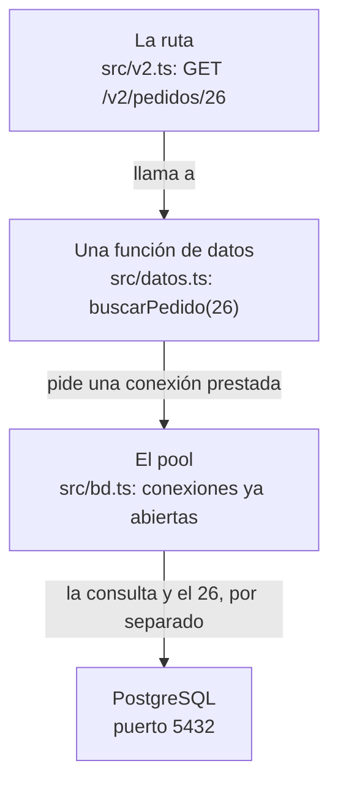

import Term from '~/components/Term.astro';
import TryIt from '~/components/TryIt.astro';
import Analogy from '~/components/Analogy.astro';
import Quiz from '~/components/Quiz.astro';
import QuizQuestion from '~/components/QuizQuestion.astro';
import QuizOption from '~/components/QuizOption.astro';
import ProjectCode from '~/components/ProjectCode.astro';

## El problema

Desde la [lección 4, «Modelado»](/fase-5/modelado-datos-normalizacion/), las tablas de la tienda viven en PostgreSQL. Pero tu API no las usa: sigue leyendo los arrays de `src/datos.ts`, que se borran con cada reinicio, como viste en la [introducción](/fase-5/).

Hoy la API pasa a preguntarle a PostgreSQL, y eso trae tres preguntas:

- **¿Cómo habla Node con PostgreSQL?** No por HTTP: PostgreSQL tiene su propio idioma, en el puerto 5432.
- **¿Una conexión en cada petición?** Abrirla cuesta, y PostgreSQL solo acepta unas cuantas a la vez.
- **¿Cómo meto en una <Term id="query">consulta</Term> lo que escribe el cliente?** Sin que, si escribe SQL, tu servidor lo ejecute.

## La analogía

<Analogy>

Una tienda encarga el material por teléfono a un almacén. Llamar cuesta: marcar, esperar, decir quién eres y la contraseña. Así que la tienda deja **diez líneas abiertas** todo el día. Quien necesita algo coge una libre, pregunta y la deja para el siguiente. Si las diez están ocupadas, espera su turno.

Y los encargos no se dictan de palabra: van en un **formulario con casillas**, «producto: …». Lo que va en la casilla es siempre un nombre. Si alguien escribe «Taza, y de paso mándame todo el almacén», el almacén busca un producto que se llame exactamente así, y no lo encuentra.

<div slot="limits">

- Una línea abierta todo el día cuesta dinero. Una conexión parada solo ocupa algo de memoria: lo caro es abrirla.
- Un almacenero se extrañaría de una frase rara. PostgreSQL no: si el valor va pegado en el texto de la consulta, ejecuta lo que diga.
- Una llamada dura minutos, y una consulta, milisegundos: diez conexiones dan para muchas peticiones.

</div>

</Analogy>

## Cómo funciona de verdad

### Un driver habla el idioma de PostgreSQL

PostgreSQL escucha en el puerto 5432 y no habla HTTP: tiene su propio <Term id="protocol">protocolo</Term> sobre <Term id="tcp">TCP</Term>, el mismo que usa `psql`. Para que tu programa lo hable, necesitas un **<Term id="driver">driver</Term>**: un <Term id="package">paquete</Term> que abre la conexión, envía cada consulta y convierte las filas de la respuesta en objetos de JavaScript.

El de Node más usado es `pg`, también llamado node-postgres. Ya está en tu `package.json` desde la lección 4: es lo que usa `npm run bd:crear` para hablar con PostgreSQL. Este es el camino de una petición desde hoy:



### Abrir una conexión cuesta más que usarla

Mídelo. Abre el <Term id="repl">REPL</Term> en la carpeta de tu proyecto con `node --env-file=.env`: así `process.env.DATABASE_URL` trae la dirección que pusiste en el `.env` en la introducción.

<TryIt
  title="En el REPL: conectar y consultar"
  lang="js"
  cmd={`const { Client } = await import('pg')
const cliente = new Client({ connectionString: process.env.DATABASE_URL })
console.time('conectar'); await cliente.connect(); console.timeEnd('conectar')
console.time('consulta'); await cliente.query('SELECT 1'); console.timeEnd('consulta')
await cliente.end()`}
  output={`undefined
undefined
conectar: 12.011ms
undefined
consulta: 1.891ms
undefined
undefined`}
>

Un `Client` es una sola conexión, y `console.time` y `console.timeEnd` miden lo que pasa entre los dos. Conectar ha tardado unas seis veces más que la consulta. Tus tiempos serán otros; las salidas de esta lección son de Node 26 y PostgreSQL 18.6.

</TryIt>

Al conectar pasan muchas cosas: el <Term id="handshake">handshake</Term> de TCP de la [Fase 0](/fase-0/tcp-vs-udp/#una-conexión-empieza-con-un-handshake), la comprobación de la contraseña y, en el servidor, **un <Term id="process">proceso</Term> nuevo de PostgreSQL solo para esa conexión**. Con la base de datos en otra máquina, cada ida y vuelta pesa más.

Y no caben infinitas:

<TryIt
  title="¿Cuántas conexiones acepta?"
  cmd={`psql -d tienda -c 'SHOW max_connections;'`}
  output={` max_connections
-----------------
 100
(1 row)`}
>

Cien, el valor que trae PostgreSQL, y tres están reservadas al superusuario. Si tu API abriera una conexión por petición, con 97 peticiones a la vez la siguiente recibiría un error: `remaining connection slots are reserved for roles with the SUPERUSER attribute`.

</TryIt>

### Un pool: conexiones abiertas que se prestan

La solución es un **<Term id="connection-pool">pool de conexiones</Term>**, unas pocas que se reutilizan, en un fichero nuevo, `src/bd.ts`:

<ProjectCode file="tienda-api/19-postgres/src/bd.ts" region="pool" />

- **`process.env.DATABASE_URL`** es la dirección del `.env`. Sin ella, el servidor no arranca y dice por qué, como `config.ts` desde la [lección 8 de la Fase 3](/fase-3/errores-y-logs-node/#la-configuración-se-comprueba-al-arrancar).
- **`new Pool({ connectionString: url, max: 10 })`** crea el pool, con diez conexiones como mucho. Las abre cuando hacen falta, y cierra las que llevan diez segundos sin usarse.
- **`pool.on('error', …)`**: si PostgreSQL corta una conexión que esperaba en el pool (al reiniciarse, por ejemplo), el pool avisa con un `error`. Sin nadie que lo escuche, Node pararía el servidor.
- **`export const pool`**: un solo pool para todo el programa, el mismo en cada fichero que lo importa.

¿Diez bastan? Con consultas de un par de milisegundos, cada conexión atiende cientos por segundo. Si no hay ninguna libre, la consulta espera su turno en el pool.

### Una consulta con $1: el valor viaja aparte

Una función de datos, en `src/datos.ts`:

<ProjectCode file="tienda-api/19-postgres/src/datos.ts" region="buscar-producto" />

- **`pool.query(consulta, [id])`**: el pool presta una conexión, envía la consulta y la recupera al acabar.
- **`$1` es un parámetro**: un hueco para un valor. El primer elemento del array, `id`, va en `$1`; si hubiera `$2`, iría el segundo. **La consulta y los valores viajan por separado**, y PostgreSQL nunca lee un valor como SQL.
- **`<Producto>`** le dice a TypeScript qué forma tienen las filas. Lo afirmas tú: `pg` no lo comprueba.
- **`rows`** es un array con las filas. Si no existe ese id, está vacío y `rows[0]` es `undefined`: la ruta responde `404`.
- **`${PRODUCTO}`** sí va pegado, pero es texto fijo del programa, la lista de columnas. Lo del cliente, nunca.

### Pegar el valor en el texto: la inyección SQL

¿Por qué no escribir el valor dentro, con `${id}`? Mira `ejemplos/inyeccion.ts`, un buscador por nombre escrito de las dos maneras:

<ProjectCode file="tienda-api/19-postgres/ejemplos/inyeccion.ts" region="pegado" />

<ProjectCode file="tienda-api/19-postgres/ejemplos/inyeccion.ts" region="parametro" />

Con «Taza», las dos encuentran la Taza. Pero imagina que alguien escribe esto en el buscador: `x' OR '1'='1`. La primera función lo pega entre las comillas, y a PostgreSQL le llega esta consulta:

```sql
SELECT nombre FROM productos WHERE nombre = 'x' OR '1'='1' ORDER BY id
```

La comilla del valor ha cerrado la de la consulta, y lo que va detrás ya es SQL: `OR '1'='1'`, que se cumple en todas las filas. Devuelve los cuatro productos.

Eso es una **<Term id="sql-injection">inyección SQL</Term>**: un valor escrito para cambiar la consulta. Con otros valores se leen tablas ajenas, o se borran; la Fase 6 la verá a fondo. La regla, desde hoy: **lo que manda el cliente va siempre en un parámetro**. Con `$1`, PostgreSQL busca un producto que se llame exactamente `x' OR '1'='1`, y no hay ninguno.

La [validación de la Fase 3](/fase-3/validar-datos-zod/) no basta: `x' OR '1'='1` es un texto válido. Valida y, además, usa parámetros.

### De filas a JSON: nombres, fechas y count(*)

Mira cómo llegan las filas, en el REPL, esta vez con un pool:

<TryIt
  title="En el REPL: las filas tal como llegan"
  lang="js"
  cmd={`const { Pool } = await import('pg')
const pool = new Pool({ connectionString: process.env.DATABASE_URL })
(await pool.query('SELECT * FROM pedidos WHERE id = 1')).rows
(await pool.query('SELECT precio_centimos AS precioCentimos FROM productos WHERE id = 2')).rows
(await pool.query('SELECT precio_centimos AS "precioCentimos" FROM productos WHERE id = 2')).rows
(await pool.query('SELECT count(*) FROM pedidos')).rows
(await pool.query('SELECT count(*)::int AS pedidos FROM pedidos')).rows`}
  output={`undefined
undefined
[
  {
    id: 1,
    producto_id: 2,
    cantidad: 2,
    estado: 'enviado',
    creado_en: 2026-10-01T09:00:00.000Z
  }
]
[ { preciocentimos: 850 } ]
[ { precioCentimos: 850 } ]
[ { count: '25' } ]
[ { pedidos: 25 } ]`}
>

Fíjate en cuatro cosas:

- La fila trae los nombres de las columnas, `producto_id` y `creado_en`, y tu API promete `productoId` y `creadoEn`.
- `creado_en` llega sin comillas: es un `Date` de JavaScript. `pg` convierte así cada `timestamptz`.
- `AS precioCentimos` llega en minúsculas: PostgreSQL pasa a minúsculas los nombres sin comillas dobles. Con ellas, respeta la mayúscula.
- **`count(*)` llega como texto**, `'25'`. Con `::int`, como número.

</TryIt>

¿Por qué texto? `count(*)` devuelve un `bigint`, un entero de 64 bits que puede pasar de 2⁵³, el límite de los enteros exactos en JavaScript ([lección 6 de la Fase 4](/fase-4/json-protobuf/#los-números-enteros-más-allá-de-2)). Para no cambiarlo sin avisar, `pg` lo entrega como texto; si sabes que cabe, `::int` lo convierte en la consulta. Sin convertirlo, `'25' + 1` da `'251'`.

Los nombres se arreglan en la propia consulta, con `AS`, al principio de `src/datos.ts`:

<ProjectCode file="tienda-api/19-postgres/src/datos.ts" region="columnas" />

- **`PRODUCTO` y `PEDIDO`** son las listas de columnas, con los nombres de la API: cada fila ya sale como en el JSON.
- **`FilaPedido`** es un `Pedido` con `creadoEn` como `Date`, que es como llega.
- **`aPedido`** convierte esa fecha en texto con `toISOString()`: ISO 8601 y en UTC, como en la [Fase 4](/fase-4/json-protobuf/#las-fechas-texto-en-iso-8601-en-utc).

### Cada función de datos pasa a ser async

Antes, `buscarProducto(id)` miraba un array en memoria y devolvía el producto al instante. Ahora pregunta a otro programa por la red, y hay que esperar: la función es `async` y devuelve una <Term id="promise">promesa</Term>, `Promise<Producto | undefined>`.

Eso se contagia hacia arriba. En `src/v2.ts`, cada ruta que usa los datos pasa a ser `async (c) => …` y escribe `await buscarProducto(…)`; lo mismo en `src/v1.ts` y en el middleware de idempotencia. Es el <Term id="async-await">async y await</Term> de la [lección 2 de la Fase 3](/fase-3/javascript-para-backend/#esperar-lo-que-tarda-promesas-async-y-await). Y mientras una petición espera a PostgreSQL, Node atiende a las demás: [esperar no bloquea](/fase-3/event-loop-node/#esperar-no-bloquea).

### Los errores de PostgreSQL, como Problem Details

En el mismo REPL, intenta borrar la Camiseta, que tiene pedidos:

<TryIt
  title="En el REPL: un borrado que PostgreSQL rechaza"
  lang="js"
  cmd={`await pool.query('DELETE FROM productos WHERE id = 1').catch((error) => [error.code, error.detail])
await pool.end()`}
  output={`[ '23503', 'Key (id)=(1) is still referenced from table "pedidos".' ]
undefined`}
>

PostgreSQL no deja borrarla: la <Term id="foreign-key">clave foránea</Term> [de la lección 4](/fase-5/modelado-datos-normalizacion/#on-delete-qué-pasa-al-borrar-algo-que-otros-señalan) lo impide. `pg` convierte el rechazo en un error con un `code` de cinco caracteres, el SQLSTATE, igual en cualquier PostgreSQL, y `detail` cuenta el caso. `pool.end()` cierra el pool para que el REPL pueda salir.

</TryIt>

Dos códigos importan aquí:

| Código | Nombre | Cuándo |
|---|---|---|
| `23505` | `unique_violation` | Un valor repetido donde tiene que ser único: dos categorías llamadas «Ropa» |
| `23503` | `foreign_key_violation` | Una clave foránea que no cuadra: borrar un producto con pedidos |

Sin hacer nada, ese error llegaría al `onError` de `src/app.ts` y sería un `500`. Pero el servidor no ha fallado: la petición choca con datos que ya existen. Eso es un `409 Conflict` ([lección 3 de la Fase 2](/fase-2/codigos-de-estado-http/)), con la forma de <Term id="problem-details">Problem Details</Term>. Lo decide `src/problemas.ts`:

<ProjectCode file="tienda-api/19-postgres/src/problemas.ts" region="errores-bd" />

- **`error instanceof DatabaseError`**: solo los errores de PostgreSQL. Un fallo de tu código sigue siendo un `500`.
- **`CONFLICTOS[error.code ?? '']`** da el texto para el cliente, o `undefined` si el código no es uno de esos dos.
- **No se envía `error.message` ni `error.detail`**: nombran tablas y reglas internas, y eso [nunca va en un error](/fase-4/errores-api-problem-details/#lo-que-nunca-va-en-un-error).

`onError` llama a `conflictoDeBd` antes del `500`, y `src/contrato.ts` añade el `409` a `DELETE /v2/productos/{id}` en la documentación.

### Las claves de idempotencia y los avisos de pago, en tablas

En la Fase 4, dos cosas más vivían en memoria: las respuestas de cada <Term id="idempotency-key">clave de idempotencia</Term>, en un `Map`, y los ids de los <Term id="webhook">webhooks</Term> ya procesados, en un `Set`. Tras un reinicio, un reintento crearía un pedido repetido. Pasan a dos tablas nuevas de `bd/esquema.sql`:

<ProjectCode file="tienda-api/19-postgres/bd/esquema.sql" region="idempotencia" />

<ProjectCode file="tienda-api/19-postgres/bd/esquema.sql" region="eventos-procesados" />

La propia clave, o el id del evento, es la <Term id="primary-key">clave primaria</Term>: no puede repetirse. Apuntar un evento es una sola consulta:

<ProjectCode file="tienda-api/19-postgres/src/datos.ts" region="eventos-procesados" />

- **`ON CONFLICT DO NOTHING`**: si el id ya está, la clave primaria lo rechazaría con un `23505`; así, PostgreSQL no hace nada y no hay error.
- **`RETURNING id`** devuelve la fila añadida. Si no se añadió ninguna, `rowCount` es `0`: el aviso estaba repetido.

Antes eran dos pasos, `has` y `add`, y si el mismo aviso llegaba dos veces a la vez, los dos podían verlo nuevo. Ahora decide PostgreSQL: solo uno lo apunta.

En `src/middleware/idempotencia.ts`, el `Map` se cambia por un `SELECT` y un `INSERT`. En memoria solo quedan los eventos en tiempo real y el eco por WebSocket: son conexiones, no datos.

## Pruébalo

El objetivo: que tu API guarde todo en PostgreSQL y lo demuestre. Un pedido y su clave de idempotencia que sobreviven a un reinicio, un `409` en vez de un `500`, y el buscador del ejemplo, engañado y protegido.

### Escribe el código

Partes de tu proyecto de la [lección 4, «Modelado»](/fase-5/modelado-datos-normalizacion/):

1. Crea `src/bd.ts`, con el pool.
2. Cambia `src/datos.ts`: cada array se convierte en consultas, y cada función, en `async`. Las que no has visto aquí, cópialas del paso.
3. Pon `async` y `await` donde se usan los datos: `src/v2.ts`, `src/v1.ts` y `src/middleware/idempotencia.ts`.
4. Cambia `src/problemas.ts` (`conflictoDeBd`), `src/app.ts` (`onError`) y `src/contrato.ts` (el `409`).
5. Añade las dos tablas a `bd/esquema.sql`, y sus nombres al `DROP TABLE` de `scripts/crear-bd.ts`.

El ejemplo y las pruebas vienen en la carpeta de esta lección:

```sh
cd ~/curso-backend/fase-3
curl -O https://backenddesdecero.com/practicas/tienda-api/19-postgres.tar.gz
tar -xzf 19-postgres.tar.gz
cd tienda-api
cp ../19-postgres/ejemplos/inyeccion.ts ejemplos/
cp ../19-postgres/test/*.ts test/
```

Si te atascas, compara tu código con `19-postgres`.

### Las tablas nuevas

<TryIt
  title="1. Crea las tablas otra vez"
  cmd="npm run bd:crear"
  output={`> tienda-api@1.0.0 bd:crear
> node --env-file-if-exists=.env scripts/crear-bd.ts

Tablas creadas: 4 productos, 3 categorías y 25 pedidos`}
>

El script borra las tablas y crea seis, con los datos de ejemplo: tu base de datos `tienda` vuelve al principio. Si sale `ECONNREFUSED`, PostgreSQL no está en marcha: arráncalo como en la introducción.

</TryIt>

Después, `npm test` debería acabar con `fail 0`. Las pruebas usan `tienda_test`; si la primera dice `¿Está PostgreSQL arrancado?`, revisa esa base de datos.

### Un pedido que sobrevive al reinicio

<TryIt
  title="2. Arranca la API"
  cmd="npm start"
  output={`> tienda-api@1.0.0 start
> node --env-file-if-exists=.env src/servidor.ts

{"level":30,"time":1791933563742,"pid":1241,"hostname":"portatil","msg":"La tienda escucha en http://localhost:3000"}`}
>

El pool aún no ha abierto ninguna conexión. Deja esta terminal abierta y abre otra en la carpeta del proyecto.

</TryIt>

<TryIt
  title="3. Un pedido con su clave de idempotencia"
  cmd={`curl -s -w '\\n' -H 'Idempotency-Key: pedido-de-ana-1' --json '{"productoId":2,"cantidad":1}' localhost:3000/v2/pedidos
curl -s -w '\\n' localhost:3000/v2/pedidos/26`}
  output={`{"id":26,"productoId":2,"cantidad":1,"estado":"pendiente","creadoEn":"2026-10-13T23:19:26.649Z"}
{"id":26,"productoId":2,"cantidad":1,"estado":"pendiente","creadoEn":"2026-10-13T23:19:26.649Z"}`}
>

El pedido 26, una taza. El id lo ha puesto PostgreSQL, y la fecha, `now()`, la hora de la base de datos. Tu fecha será otra.

</TryIt>

Antes de reiniciar, mira el pool desde el otro lado:

<TryIt
  title="4. Las conexiones del rol tienda"
  cmd={`psql -d tienda -c "SELECT pid, state, query FROM pg_stat_activity WHERE usename = 'tienda';"`}
  output={` pid | state  |                                                    query
-----+--------+--------------------------------------------------------------------------------------------------------------
 302 | idle   | SELECT id, producto_id AS "productoId", cantidad, estado, creado_en AS "creadoEn" FROM pedidos WHERE id = $1
 309 | active | SELECT pid, state, query FROM pg_stat_activity WHERE usename = 'tienda';
(2 rows)`}
>

`pg_stat_activity` se consulta como una tabla, pero la rellena PostgreSQL: una fila por cada conexión abierta. La `active` es tu propio `psql`. La `idle` es la del pool: espera libre, con su proceso (`pid`) y su última consulta. **Fíjate en el `$1`: el 26 no está en el texto**, porque viajó aparte.

Espera diez segundos y repítela: la conexión `idle` ya no está, porque el pool cierra las que no usa. La próxima petición abrirá otra.

</TryIt>

Ahora para el servidor con <kbd>Ctrl</kbd> + <kbd>C</kbd> y arráncalo otra vez con `npm start`. En la otra terminal:

<TryIt
  title="5. Después del reinicio"
  cmd={`curl -s -w '\\n' localhost:3000/v2/pedidos/26
curl -s -i -H 'Idempotency-Key: pedido-de-ana-1' --json '{"productoId":2,"cantidad":1}' localhost:3000/v2/pedidos`}
  output={`{"id":26,"productoId":2,"cantidad":1,"estado":"pendiente","creadoEn":"2026-10-13T23:19:26.649Z"}
HTTP/1.1 201 Created
content-type: application/json
idempotent-replayed: true
location: /v2/pedidos/26
vary: Origin
x-request-id: 379effe2-da12-47bc-b553-d17581df94e7
content-length: 96
Date: Tue, 13 Oct 2026 23:19:42 GMT
Connection: keep-alive
Keep-Alive: timeout=5

{"id":26,"productoId":2,"cantidad":1,"estado":"pendiente","creadoEn":"2026-10-13T23:19:26.649Z"}`}
>

En la introducción, aquí salía un `404`. Ahora **el pedido 26 sigue ahí**. Y el reintento con la misma clave devuelve la respuesta guardada, con `idempotent-replayed: true`, aunque la guardó otro proceso.

</TryIt>

<TryIt
  title="6. Lo mismo, desde psql"
  cmd={`psql -d tienda -c "SELECT * FROM pedidos WHERE id = 26;" -c "SELECT clave, estado, location FROM claves_idempotencia;"`}
  output={` id | producto_id | cantidad |  estado   |           creado_en
----+-------------+----------+-----------+-------------------------------
 26 |           2 |        1 | pendiente | 2026-10-13 23:19:26.649196+00
(1 row)

      clave      | estado |    location
-----------------+--------+----------------
 pedido-de-ana-1 |    201 | /v2/pedidos/26
(1 row)`}
>

Tu API y `psql` ven los mismos datos. Cada `-c` es una orden. PostgreSQL guarda microsegundos; la API los recorta a milisegundos.

</TryIt>

### Un 409 en vez de un 500

Borrar pide el token de tu `.env`. Pon el tuyo en lugar de este:

<TryIt
  title="7. Borra la Camiseta, que tiene pedidos"
  cmd={`TOKEN=6bb3a19879dcf82e36c2e623dff47255dfb115160d44ae38
curl -s -i -w '\\n' -X DELETE -H "Authorization: Bearer $TOKEN" localhost:3000/v2/productos/1`}
  output={`HTTP/1.1 409 Conflict
content-type: application/problem+json
vary: Origin
x-request-id: bba6b2d8-1bf2-44cc-b9f4-e16cc9c25b81
content-length: 152
Date: Tue, 13 Oct 2026 23:19:42 GMT
Connection: keep-alive
Keep-Alive: timeout=5

{"type":"about:blank","title":"Conflict","status":409,"detail":"Otros datos dependen de este: un producto con pedidos, por ejemplo, no se puede borrar"}`}
>

El `23503` de PostgreSQL, convertido en un `409` con Problem Details, sin nombres de tablas. Si sale `500`, revisa que `onError` llame a `conflictoDeBd`.

</TryIt>

### Engaña al buscador

<TryIt
  title="8. Pegando el valor y con un parámetro"
  cmd="node --env-file=.env ejemplos/inyeccion.ts"
  output={`
Se busca: Taza
  La consulta: SELECT nombre FROM productos WHERE nombre = 'Taza' ORDER BY id
  Pegando el texto, encuentra: [ 'Taza' ]
  Con un parámetro, encuentra: [ 'Taza' ]

Se busca: x' OR '1'='1
  La consulta: SELECT nombre FROM productos WHERE nombre = 'x' OR '1'='1' ORDER BY id
  Pegando el texto, encuentra: [ 'Camiseta', 'Taza', 'Sudadera', 'Gorra' ]
  Con un parámetro, encuentra: []`}
>

Con el valor preparado, pegando sale la tabla entera; con el parámetro, nada.

</TryIt>

## Ya lo has visto

- **Un formulario que falla con un apóstrofo.** Si una web te ha dado un error raro al escribir «O'Donnell», quizá pegaba tu texto en el SQL: el apóstrofo cierra la comilla de la consulta.
- **Little Bobby Tables.** La tira [xkcd 327](https://xkcd.com/327/) es el chiste más conocido sobre inyección SQL: un niño llamado `Robert'); DROP TABLE Students;--`.

## Errores comunes

- **Pegar en el SQL lo que manda el cliente**, con `${…}` o con `+`. Va en un parámetro, `$1`, aunque ya esté validado.
- **Poner un nombre de columna o un `DESC` en un parámetro.** Un parámetro es siempre un valor, nunca un trozo de SQL. Lo que cambia la forma de la consulta se elige de una lista fija, como la lista `ORDEN` de `listarProductos`, en `src/datos.ts`.
- **Abrir una conexión, o crear un pool, en cada petición.** Un solo pool por programa, creado al arrancar.
- **Olvidar el `await`.** Sin él, `producto` es una promesa, nunca `undefined`. `npm run check` suele detectarlo.
- **Usar `count(*)` sin convertirlo.** Llega como texto: `::int`, si sabes que cabe.
- **Enviar al cliente el mensaje de PostgreSQL.** Cuenta cómo son tus tablas: un texto propio, y el error completo, al log.

## Resumen

- Node habla con PostgreSQL a través de un driver, `pg`. Abrir una conexión cuesta mucho más que usarla, y caben pocas: un pool las mantiene abiertas y las presta.
- Lo que manda el cliente va siempre en un parámetro (`$1`), aparte de la consulta. Pegarlo en el texto permite la inyección SQL.
- Las filas llegan con los nombres de las columnas, que `AS "precioCentimos"` cambia. Un `timestamptz` llega como `Date`, y `count(*)`, como texto.
- Cada función que consulta la base de datos es `async`, y quien la llama, también.
- Un `23505` o un `23503` son conflictos con los datos, no fallos del servidor: `409`. Las claves de idempotencia y los avisos procesados, en tablas, sobreviven al reinicio.

## ¿Lo has entendido?

<Quiz>

<QuizQuestion
  question="Una API abre una conexión con PostgreSQL al empezar cada petición y la cierra al responder. Con poco tráfico va bien, pero el día de las rebajas muchas peticiones fallan. ¿Qué es lo más probable?"
  review="Abrir una conexión cuesta más que usarla"
>

<QuizOption text="Que PostgreSQL se ha quedado sin disco, porque guarda cada conexión abierta.">

Las conexiones no se guardan en disco: cada una es un proceso que ocupa algo de memoria. El límite es de número, `max_connections`.

</QuizOption>

<QuizOption text="Que se juntan más conexiones de las que acepta PostgreSQL." correct>

Con unas cien peticiones a la vez se llega al límite de `max_connections`, y las siguientes reciben un error. Un pool limita las conexiones y las reutiliza.

</QuizOption>

<QuizOption text="Nada que ver con las conexiones: abrir una cuesta lo mismo que hacer una consulta.">

En el REPL, conectar tardó unas seis veces más que la consulta, por el handshake, la contraseña y el proceso nuevo.

</QuizOption>

</QuizQuestion>

<QuizQuestion
  question="Un compañero busca productos por nombre pegando en el SQL lo que llega en ?nombre=. Dice que no hay peligro, porque Zod comprueba que es un texto de menos de 50 caracteres. ¿Tiene razón?"
  review="Pegar el valor en el texto: la inyección SQL"
>

<QuizOption text="No: un texto válido puede llevar una comilla y SQL detrás." correct>

`x' OR '1'='1` es un texto corto y válido, y devolvió la tabla entera. El valor va en un parámetro, `$1`, y PostgreSQL lo trata como un nombre.

</QuizOption>

<QuizOption text="Sí: si Zod solo deja pasar texto, ese texto no puede llevar SQL.">

El SQL es texto. Lo que lo convierte en orden es pegarlo dentro de la consulta, no su tipo.

</QuizOption>

<QuizOption text="Sí, porque es un SELECT: una inyección solo hace daño en un INSERT, un UPDATE o un DELETE.">

El ejemplo era un `SELECT` y enseñó productos que no tocaban. Con otro valor puede leer cualquier tabla a la que llegue el rol.

</QuizOption>

</QuizQuestion>

<QuizQuestion
  question="Una ruta devuelve el total de pedidos con SELECT count(*) AS total FROM pedidos, y en el JSON el total llega entre comillas, como texto. ¿Por qué?"
  review="De filas a JSON: nombres, fechas y count(*)"
>

<QuizOption text="Porque PostgreSQL guarda todos los números como texto, y pg los devuelve tal cual.">

En el REPL, `cantidad` llegó como `2`, un número. Las columnas `integer` llegan como números.

</QuizOption>

<QuizOption text="Porque falta un await: sin él, el resultado llega como texto.">

Sin `await` llegaría una promesa, no un texto, y no habría `rows` que leer.

</QuizOption>

<QuizOption text="Porque count(*) es un bigint, y pg lo entrega como texto para no cambiarlo." correct>

Un `bigint` puede pasar del límite de los enteros exactos de JavaScript. Con `count(*)::int`, llega como número.

</QuizOption>

</QuizQuestion>

<QuizQuestion
  question="Un cliente intenta borrar la Taza, que tiene pedidos. ¿Qué debería responder la API?"
  review="Los errores de PostgreSQL, como Problem Details"
>

<QuizOption text="Un 409 con Problem Details: la petición choca con datos que ya existen." correct>

El servidor funciona bien; es el estado de los datos el que impide borrarla. El `detail` lo explica sin nombrar tablas.

</QuizOption>

<QuizOption text="Un 500 con el mensaje de PostgreSQL, para que el cliente sepa qué regla ha roto.">

Un `500` dice que el servidor ha fallado, y no es el caso. Y el mensaje de PostgreSQL enseña tablas y reglas internas.

</QuizOption>

<QuizOption text="Un 404, porque el producto no se ha podido borrar.">

El `404` dice que el producto no existe, y sí existe: la API lo sigue devolviendo con `GET`.

</QuizOption>

</QuizQuestion>

<QuizQuestion
  question="Cambias buscarProducto para que consulte PostgreSQL, pero en la ruta escribes const producto = buscarProducto(id), sin await. Alguien pide un producto que no existe. ¿Qué pasa?"
  review="Cada función de datos pasa a ser async"
>

<QuizOption text="Nada distinto: Node espera a la base de datos igual, y await solo ayuda a leer el código.">

Sin `await`, la ruta no espera: trabaja con la promesa, no con el producto.

</QuizOption>

<QuizOption text="Que producto es una promesa, nunca undefined, así que el if del 404 no se cumple." correct>

Una promesa siempre cuenta como verdadera en un `if`. `npm run check` suele avisar en cuanto usas `producto` como un producto: el tipo no cuadra.

</QuizOption>

<QuizOption text="Que el servidor se queda bloqueado hasta que llega la respuesta, sin atender a nadie más.">

Sin `await` no se espera nada. Y con él tampoco se bloquea: mientras espera a PostgreSQL, Node atiende otras peticiones.

</QuizOption>

</QuizQuestion>

<QuizQuestion
  question="La app del móvil crea un pedido con una Idempotency-Key. Justo después, la API se reinicia con una versión nueva, y la app reintenta con la misma clave y el mismo cuerpo. ¿Qué recibe?"
  review="Las claves de idempotencia y los avisos de pago, en tablas"
>

<QuizOption text="Un pedido nuevo: al reiniciarse, el servidor olvida las claves que había visto.">

Eso pasaba en la Fase 4, con el `Map` en memoria. Ahora la clave está en `claves_idempotencia`.

</QuizOption>

<QuizOption text="Un 422, porque la clave la guardó un proceso que ya no existe.">

La clave no es de un proceso, sino de la base de datos. El `422` es para la misma clave con otro cuerpo.

</QuizOption>

<QuizOption text="El mismo 201 y el mismo pedido, con Idempotent-Replayed: true." correct>

La respuesta guardada sigue en PostgreSQL, y el servidor nuevo la encuentra. Lo viste en el paso 5 de «Pruébalo».

</QuizOption>

</QuizQuestion>

</Quiz>

## Para profundizar

- [node-postgres](https://node-postgres.com/) (en inglés): la documentación de `pg`, con [Pooling](https://node-postgres.com/features/pooling) y [Queries](https://node-postgres.com/features/queries), los parámetros.
- [PostgreSQL Error Codes](https://www.postgresql.org/docs/18/errcodes-appendix.html) (PostgreSQL, en inglés): todos los SQLSTATE, como `23505` y `23503`.
- [max_connections](https://www.postgresql.org/docs/18/runtime-config-connection.html) (PostgreSQL, en inglés): cuántas conexiones acepta el servidor.
- [SQL Injection Prevention Cheat Sheet](https://cheatsheetseries.owasp.org/cheatsheets/SQL_Injection_Prevention_Cheat_Sheet.html) (OWASP, en inglés): cómo se evita la inyección SQL, con parámetros en primer lugar.
