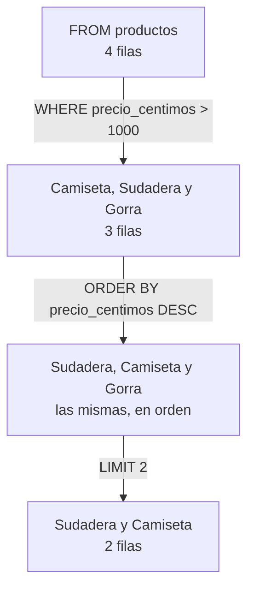

import Term from '~/components/Term.astro';
import TryIt from '~/components/TryIt.astro';
import Analogy from '~/components/Analogy.astro';
import SelfCheck from '~/components/SelfCheck.astro';
import Quiz from '~/components/Quiz.astro';
import QuizQuestion from '~/components/QuizQuestion.astro';
import QuizOption from '~/components/QuizOption.astro';
import SqlPlayground from '~/playgrounds/sql-playground/SqlPlayground';

## El problema

Luis prepara los paquetes de la tienda cada mañana. Quiere saber qué pedidos siguen pendientes, del más antiguo al más nuevo. En una hoja de cálculo pondría un filtro en la columna «estado» y ordenaría por fecha, con un par de clics.

Desde la [introducción](/fase-5/), los datos de la tienda están en PostgreSQL. Una <Term id="database">base de datos</Term> no tiene botones: se le pregunta por escrito, en un lenguaje que entiende. Ese lenguaje es **<Term id="sql">SQL</Term>**, y es el mismo que usará tu servidor cuando alguien pida `GET /v2/pedidos?estado=pendiente`.

Escribir tiene un riesgo que un clic no tiene. Con una línea de SQL puedes cambiar un pedido o los 40 000 de golpe, y PostgreSQL no te pregunta si estás seguro. En esta lección aprendes a leer datos, a cambiarlos y a no llevarte ese susto.

## La analogía

<Analogy>

Piensa en el archivo de un ayuntamiento. No entras a buscar entre las estanterías: rellenas una ficha en el mostrador. «De la caja de pedidos, quiero el número y la fecha. Solo los pendientes. Del más antiguo al más nuevo. Como mucho, cinco».

La archivera sabe dónde está cada caja y cuál es el camino más corto. Tú dices **qué** quieres, no **cómo** encontrarlo, y te devuelve una fotocopia con justo eso. SQL es esa ficha, y PostgreSQL, la archivera.

<div slot="limits">

- Una archivera entiende «Pendiente» aunque esté en mayúscula. PostgreSQL compara letra a letra: `'Pendiente'` y `'pendiente'` son textos distintos, y no te avisa de que no ha encontrado nada.
- Con SQL también puedes escribir «tira todo lo de esta caja». Nadie te pregunta si estás seguro, y no hay papelera.
- La respuesta a un `SELECT` es siempre una tabla, aunque lleve un solo dato.

</div>

</Analogy>

## Cómo funciona de verdad

Puedes probar cada consulta de esta sección en el playground de [Pruébalo](#pruébalo), o en `psql` (abre `psql -d tienda`, como en la introducción). Las salidas son de PostgreSQL 18.6, con los datos de `tienda.sql` recién cargados.

### Una tabla es una hoja de cálculo con reglas

Así es la tabla `productos` de la tienda:

```sql
SELECT * FROM productos;
```

```
 id |  nombre  | precio_centimos
----+----------+-----------------
  1 | Camiseta |            2000
  2 | Taza     |             850
  3 | Sudadera |            3500
  4 | Gorra    |            1500
(4 rows)
```

Una <Term id="table">tabla</Term> guarda un tipo de cosa, como los productos. Cada **fila** es una de esas cosas (la Taza), y cada **columna**, un dato que todas tienen (su nombre). Hasta aquí, una hoja de cálculo.

La diferencia son las reglas. **Cada columna tiene un tipo, y PostgreSQL no deja meter otro.** En una hoja de cálculo puedes escribir «gratis» en la columna del precio; aquí, no. Estos son los tipos que vas a ver en la tienda:

| Tipo | Qué guarda | En la tienda |
|---|---|---|
| `integer` | Un número entero | `id`, `precio_centimos`, `cantidad` |
| `text` | Un texto, del largo que sea | `nombre`, `estado` |
| `timestamptz` | Un instante: fecha y hora, que PostgreSQL escribe en una zona horaria | `creado_en`, cuándo se hizo un pedido |

Los precios van en céntimos: 8,50 € es `850`. Tu proyecto los guarda así desde la [lección 4 de la Fase 4](/fase-4/versionado-api/): la `v2` los da en `precioCentimos`, y la `v1` los sigue pasando a euros, en `precio`. Los decimales no siempre son exactos en un ordenador ([lección 2 de la Fase 3](/fase-3/javascript-para-backend/#valores-textos-números-y-verdadero-o-falso)), y un entero, sí.

La tienda tiene cuatro tablas: `productos`, `pedidos`, `categorias` y `productos_categorias`. Esta lección usa las dos primeras. Así empiezan los 25 pedidos:

| id | producto_id | cantidad | estado | creado_en |
|---|---|---|---|---|
| 1 | 2 | 2 | enviado | 2026-10-01 09:00:00+00 |
| 2 | 3 | 3 | enviado | 2026-10-01 16:00:00+00 |
| 3 | 1 | 4 | enviado | 2026-10-01 23:00:00+00 |

`producto_id` dice de qué producto es cada pedido: el pedido 1 es de la Taza, el producto 2. Cómo juntar las dos tablas lo verás en la [lección 2, «JOIN»](/fase-5/join-sql/).

### SELECT y FROM: qué columnas y de qué tabla

Una <Term id="query">consulta</Term> (*query*, en inglés) es una orden escrita en SQL. La más corta pide unas columnas de una tabla:

```sql
SELECT nombre, precio_centimos FROM productos;
```

```
  nombre  | precio_centimos
----------+-----------------
 Camiseta |            2000
 Taza     |             850
 Sudadera |            3500
 Gorra    |            1500
(4 rows)
```

Palabra a palabra:

- `SELECT` («selecciona») dice qué columnas quieres, separadas por comas. Con `*`, todas.
- `FROM productos` («de productos») dice de qué tabla.
- `;` termina la orden. En `psql` es obligatorio: sin él, `psql` cree que no has acabado y espera más líneas.
- `(4 rows)` («4 filas») lo añade `psql`: cuántas filas trae la respuesta.

Las palabras de SQL van en mayúsculas por costumbre, para distinguirlas de los nombres; `select` también vale. Los nombres de tablas y columnas van en minúsculas y con `_` entre palabras, porque PostgreSQL pasa a minúsculas los que no van entre comillas.

### WHERE: solo las filas que cumplen una condición

Para los pedidos pendientes de Luis, falta un filtro:

```sql
SELECT id, cantidad, estado FROM pedidos WHERE estado = 'pendiente';
```

```
 id | cantidad |  estado
----+----------+-----------
 21 |        2 | pendiente
 22 |        3 | pendiente
 23 |        4 | pendiente
 24 |        1 | pendiente
 25 |        2 | pendiente
(5 rows)
```

- `WHERE` («donde») va detrás de `FROM` y lleva una condición. PostgreSQL mira cada fila y se queda con las que la cumplen.
- `=` compara, con un solo signo (en JavaScript eran tres, `===`). Distinto es `<>`, y también existen `<`, `>`, `<=` y `>=`.
- `'pendiente'` es un texto, y **los textos van entre comillas simples**. Los números, sin comillas: `cantidad >= 3`.

Las comillas dobles existen, pero son para nombres de columnas y tablas. Si las usas para un texto, PostgreSQL busca una columna con ese nombre:

```sql
SELECT * FROM productos WHERE nombre = "Taza";
```

```
ERROR:  column "Taza" does not exist
LINE 1: SELECT * FROM productos WHERE nombre = "Taza";
                                               ^
```

`ERROR:` dice qué ha fallado (la columna «Taza» no existe), y el `^` señala dónde.

Las fechas también se comparan, escritas como texto: `WHERE creado_en >= '2026-10-08'` da los pedidos 24 y 25.

### AND y OR: varias condiciones

`AND` («y») exige que se cumplan las dos condiciones; `OR` («o»), que se cumpla al menos una:

```sql
SELECT id, producto_id, cantidad FROM pedidos WHERE estado = 'pagado' AND cantidad >= 3;
```

```
 id | producto_id | cantidad
----+-------------+----------
 14 |           3 |        3
 15 |           1 |        4
 18 |           1 |        3
 19 |           2 |        4
(4 rows)
```

Pagados y de 3 unidades o más. Con `OR`, saldrían todos los pagados y, además, todos los de 3 o más, estén como estén.

Si mezclas los dos, **`AND` va antes que `OR`**, como la multiplicación antes que la suma. Pon paréntesis para que mande lo que quieres: `WHERE estado = 'pagado' AND (producto_id = 1 OR cantidad >= 4)` son los pagados de la Camiseta o de 4 unidades, y da los pedidos 15, 18 y 19.

### ORDER BY y LIMIT: en qué orden y cuántas

```sql
SELECT nombre, precio_centimos FROM productos
WHERE precio_centimos > 1000
ORDER BY precio_centimos DESC
LIMIT 2;
```

```
  nombre  | precio_centimos
----------+-----------------
 Sudadera |            3500
 Camiseta |            2000
(2 rows)
```

Una consulta puede ocupar varias líneas: termina en el `;`.

- `ORDER BY precio_centimos` ordena por esa columna, de menor a mayor. `DESC` (de *descending*) le da la vuelta: de mayor a menor.
- `LIMIT 2` se queda con las dos primeras filas.

Puedes leerla como una cadena, donde cada paso trabaja con lo que deja el anterior:



Las partes se escriben siempre en este orden: `SELECT`, `FROM`, `WHERE`, `ORDER BY` y `LIMIT`. El orden en el que PostgreSQL las ejecuta de verdad tiene matices, que verás en la [lección 3, «GROUP BY»](/fase-5/group-by-sql/#una-consulta-no-se-ejecuta-en-el-orden-en-que-se-escribe).

**Sin `ORDER BY`, el orden de las filas no está garantizado.** Hoy salen por id porque nadie ha tocado las tablas, pero basta con cambiar una fila para que no sea así: lo verás en [Pruébalo](#cambia-un-pedido-y-después-todos). Un `LIMIT` sin `ORDER BY` te da unas filas cualesquiera.

### NULL: el dato que falta

Imagina una tabla de clientes con una columna `telefono`, y alguien que no lo dio. Esa celda no tiene un `0` ni un texto vacío: tiene **`NULL`**, que quiere decir «no se sabe».

`NULL` cambia cómo funcionan las comparaciones. ¿Es un teléfono desconocido igual a otro desconocido? Tampoco se sabe:

```sql
SELECT NULL = NULL AS igual, NULL IS NULL AS es_nulo;
```

```
 igual | es_nulo
-------+---------
       | t
(1 row)
```

- `AS igual` le pone nombre a la columna de la respuesta.
- `NULL = NULL` no da verdadero: da `NULL`, otro «no se sabe». `psql` lo escribe como un hueco; el playground escribe `NULL`.
- `NULL IS NULL` da `t`, verdadero (*true*; falso es `f`). Verdadero o falso es otro tipo, `boolean`.

`WHERE` solo se queda con las filas cuya condición es verdadera, y «no se sabe» no lo es. Por eso **`WHERE telefono = NULL` no encuentra nunca nada**, aunque haya cien clientes sin teléfono. Se escribe `WHERE telefono IS NULL`, y lo contrario, `IS NOT NULL`.

En la tienda, todas las columnas son obligatorias: ninguna admite `NULL`. Lo verás al añadir un producto sin precio, en la sección siguiente. Y en la [lección 2, «JOIN»](/fase-5/join-sql/#left-join-conserva-también-las-filas-sin-pareja), aparecerán `NULL` donde menos te lo esperas: en la Gorra, que nadie ha pedido nunca.

### INSERT: añadir una fila

Ana quiere vender una bolsa de tela a 12 €:

```sql
INSERT INTO productos (nombre, precio_centimos) VALUES ('Bolsa', 1200);
```

```
INSERT 0 1
```

- `INSERT INTO productos` («inserta en productos») dice en qué tabla.
- `(nombre, precio_centimos)` son las columnas que vas a dar, y `VALUES (…)`, sus valores, en el mismo orden.
- El `id` no se da: PostgreSQL pone el siguiente número. Cómo lo hace lo verás en la [lección 2](/fase-5/join-sql/#cada-fila-tiene-un-número-único-la-clave-primaria).
- `INSERT 0 1` dice que ha entrado 1 fila. El `0` es un resto de versiones antiguas de PostgreSQL, y siempre vale 0.

Compruébalo con `SELECT * FROM productos WHERE nombre = 'Bolsa';`: sale con el `id` 5.

Si falta un dato obligatorio, la fila no entra:

```sql
INSERT INTO productos (nombre) VALUES ('Llavero');
```

```
ERROR:  null value in column "precio_centimos" of relation "productos" violates not-null constraint
DETAIL:  Failing row contains (6, Llavero, null).
```

«Un valor nulo en la columna `precio_centimos` de `productos` incumple la regla de no ser nulo». La columna que no das queda en `NULL`, y la tabla dice `NOT NULL`. `DETAIL:` enseña la fila que habría entrado. Esas reglas de cada columna, las <Term id="constraint">restricciones</Term> (*constraints*), las diseñarás en la [lección 4, «Modelado»](/fase-5/modelado-datos-normalizacion/#las-restricciones-reglas-que-postgresql-comprueba-siempre).

Fíjate en el `6` de `DETAIL`: el intento ha gastado ese número aunque haya fallado. El próximo producto que entre será el 7. Los ids no tienen por qué ir seguidos.

### UPDATE y DELETE: cambiar y borrar filas

La bolsa baja a 10 €:

```sql
UPDATE productos SET precio_centimos = 1000 WHERE nombre = 'Bolsa';
```

```
UPDATE 1
```

- `UPDATE productos` («actualiza productos») dice qué tabla.
- `SET precio_centimos = 1000` («pon») dice qué columna cambia y a qué valor. Varias van separadas por comas.
- `WHERE nombre = 'Bolsa'` dice **qué filas**. Es el mismo `WHERE` del `SELECT`.
- `UPDATE 1`: ha cambiado 1 fila. **Mira siempre ese número**: es cuántas filas has tocado.

Al final, Ana no la vende:

```sql
DELETE FROM productos WHERE nombre = 'Bolsa';
```

```
DELETE 1
```

`DELETE FROM productos` («borra de productos») borra filas enteras, las que cumplan el `WHERE`. Si lo repites, la respuesta es `DELETE 0`: ninguna fila cumplía la condición. No es un error; PostgreSQL te dice que no ha encontrado nada que borrar.

### El error clásico: un UPDATE o un DELETE sin WHERE

El `WHERE` es opcional. Sin él, `SELECT` lee todas las filas, y `UPDATE` y `DELETE` cambian o borran **todas**.

Imagina que Luis quiere cancelar el pedido 17 y escribe esto, con prisa:

```sql
UPDATE pedidos SET estado = 'cancelado';
```

```
UPDATE 25
```

Los 25 pedidos de la tienda, cancelados. PostgreSQL no ha preguntado nada, y en `psql` no hay deshacer: el cambio se guarda en cuanto la orden termina. Con `DELETE FROM pedidos;` sería peor: los pedidos ya no estarían. Es el error clásico de SQL, y le pasa también a gente con años de experiencia. No lo pruebes en `psql`: en [Pruébalo](#pruébalo) lo harás en el playground, que se restaura con un botón.

Dos costumbres lo evitan:

1. **Escribe primero el `SELECT`** con el `WHERE` que vas a usar: `SELECT * FROM pedidos WHERE id = 17;`. Si salen las filas que quieres cambiar, y solo esas, cambia `SELECT *` por `UPDATE pedidos SET …` o por `DELETE`, sin tocar el `WHERE`.
2. **Escribe el `WHERE` antes que el resto.** En el playground y en muchos programas, <kbd>Ctrl</kbd> + <kbd>Enter</kbd> ejecuta lo que haya escrito, aunque no hayas acabado. Si la orden sale a medias, mejor que le falte el `SET` que el `WHERE`: `UPDATE pedidos WHERE id = 17;` da `ERROR:  syntax error at or near "WHERE"`, un error de sintaxis, y no cambia nada.

Y lee el número de la respuesta: si esperabas `UPDATE 1` y sale `UPDATE 25`, ya sabes qué ha pasado. En la [lección 8, «Transacciones»](/fase-5/transacciones-acid/), verás una red más: hacer el cambio, mirar el resultado y deshacerlo si no era lo que querías.

## Pruébalo

El objetivo: preparar la lista de Luis, encontrar el pedido pendiente más grande y, después, romper los datos a propósito y arreglarlos.

### La lista de Luis

Este playground es un PostgreSQL de verdad dentro de tu navegador, con los datos de la tienda. La primera vez descarga unos 5 MB. Pulsa «Ejecutar»:

<SqlPlayground client:visible lang="es" rows={4} query={`SELECT id, producto_id, cantidad, creado_en
FROM pedidos
WHERE estado = 'pendiente'
ORDER BY creado_en;`} />

Ahora cámbiala: los pagados en lugar de los pendientes, del más nuevo al más antiguo (`DESC`), y solo tres (`LIMIT 3`). Si sale un error, lee la línea del `^`: casi siempre es una coma o una comilla.

La misma consulta, en tu terminal. Abre `psql -d tienda` y, en el prompt `tienda=>`, escribe:

<TryIt
  title="La lista de Luis, en psql"
  lang="sql"
  cmd={`SELECT id, producto_id, cantidad, creado_en
FROM pedidos
WHERE estado = 'pendiente'
ORDER BY creado_en;`}
  output={` id | producto_id | cantidad |       creado_en
----+-------------+----------+------------------------
 21 |           1 |        2 | 2026-10-07 05:00:00+00
 22 |           2 |        3 | 2026-10-07 12:00:00+00
 23 |           3 |        4 | 2026-10-07 19:00:00+00
 24 |           1 |        1 | 2026-10-08 02:00:00+00
 25 |           2 |        2 | 2026-10-08 09:00:00+00
(5 rows)`}
>

Fíjate en el final de `creado_en`: `+00` es la zona horaria, UTC, la que le pusiste al rol `tienda` en la [introducción](/fase-5/#el-rol-tienda). Si en el primero ves `2026-10-07 07:00:00+02`, te falta ese ajuste: es el mismo instante, en la hora de España. Si sale `relation "pedidos" does not exist`, no has cargado `tienda.sql`: vuelve a la [introducción](/fase-5/#antes-de-empezar-los-datos-de-la-tienda). Sales de `psql` con `\q`.

</TryIt>

<SelfCheck question="Reto: ¿cuál es el pedido pendiente con más unidades? Escribe una consulta que devuelva solo ese.">

Ordena por `cantidad` de mayor a menor y quédate con el primero:

```sql
SELECT id, cantidad FROM pedidos
WHERE estado = 'pendiente'
ORDER BY cantidad DESC
LIMIT 1;
```

```
 id | cantidad
----+----------
 23 |        4
(1 row)
```

El pedido 23, de 4 unidades. Sin el `WHERE`, también habría competido con los pagados y los enviados.

</SelfCheck>

### Cambia un pedido, y después todos

Luis cobra el pedido 21. Primero el `SELECT`, después el cambio y después el `SELECT` otra vez para comprobarlo. El playground ejecuta las tres órdenes seguidas y enseña la respuesta de cada una:

<SqlPlayground client:visible lang="es" rows={3} query={`SELECT id, estado FROM pedidos WHERE id = 21;
UPDATE pedidos SET estado = 'pagado' WHERE id = 21;
SELECT id, estado FROM pedidos WHERE id = 21;`} />

Fíjate en «Hecho: 1 fila cambiada.»: es el `UPDATE 1` de `psql`. Ahora borra `WHERE id = 21` del `UPDATE` y ejecuta otra vez: «Hecho: 25 filas cambiadas.», y el último `SELECT` dice `pagado`, como los otros 24. Pulsa «Restaurar datos» para volver a la tienda del principio. En tu base de datos no hay ese botón.

En `psql`, lo mismo:

<TryIt
  title="El pedido 21, cobrado"
  lang="sql"
  cmd={`SELECT id, estado FROM pedidos WHERE id = 21;
UPDATE pedidos SET estado = 'pagado' WHERE id = 21;
SELECT id, estado FROM pedidos WHERE id = 21;`}
  output={` id |  estado
----+-----------
 21 | pendiente
(1 row)

UPDATE 1
 id | estado
----+--------
 21 | pagado
(1 row)`}
>

Antes y después del cambio. Si sale `UPDATE 0`, ningún pedido tiene el id 21: has borrado filas en otra prueba.

Ahora escribe `SELECT id FROM pedidos;`, sin `ORDER BY`: el 21 sale el último, detrás del 25. PostgreSQL ha guardado la fila cambiada al final, y sin `ORDER BY` las da como las tiene guardadas.

Antes de la lección 2, vuelve a los datos del principio: carga otra vez `tienda.sql` como en la introducción, que borra las cuatro tablas y las crea de nuevo.

</TryIt>

## Ya lo has visto

- **Los filtros de una hoja de cálculo** son un `WHERE`, y «ordenar de la Z a la A», un `ORDER BY … DESC`. Google Sheets tiene incluso una función, `QUERY`, que se escribe casi como SQL: `=QUERY(A1:C10; "select A where C > 100")`.
- **La API de la Fase 4**: `GET /v2/pedidos?estado=pendiente&limite=5` es un `WHERE` y un `LIMIT`, y `GET /v2/productos?orden=-precio`, un `ORDER BY … DESC`. En la [lección 5, «Node y PostgreSQL»](/fase-5/postgresql-node-js/), la API convierte el `estado` y el `orden` en SQL, y en la [lección 7, «Índices»](/fase-5/indices-sql-explain/), también el `limite`.
- **Tu móvil**: Android e iOS traen SQLite, una base de datos pequeña que guarda los datos de muchas apps en un fichero. También habla SQL.

## Errores comunes

- **Un `UPDATE` o un `DELETE` sin `WHERE`.** Cambia o borra todas las filas. Escribe primero el `SELECT`.
- **Textos entre comillas dobles.** `"Taza"` es el nombre de una columna; el texto es `'Taza'`.
- **Buscar con `= NULL`.** No encuentra nunca nada: se escribe `IS NULL`.
- **Fiarse del orden sin `ORDER BY`.** Las filas pueden salir en cualquier orden, y un `LIMIT` sin `ORDER BY` da unas cualesquiera.
- **Mayúsculas en los datos.** `estado = 'Pendiente'` da `(0 rows)`, sin error: los datos dicen `pendiente`.
- **Mezclar `AND` y `OR` sin paréntesis.** `AND` va primero, y la condición acaba siendo otra.

## Resumen

- Una tabla guarda filas, una por cosa, y columnas, una por dato, cada una con su tipo: `integer`, `text`, `timestamptz`.
- `SELECT columnas FROM tabla WHERE condición ORDER BY columna LIMIT n` lee datos, en ese orden de escritura. Los textos van entre comillas simples, y sin `ORDER BY` no hay orden garantizado.
- `NULL` es «no se sabe»: compararlo con `=` da `NULL`, y se busca con `IS NULL`.
- `INSERT` añade filas, `UPDATE` las cambia y `DELETE` las borra. La respuesta dice cuántas filas ha tocado: léela.
- Antes de un `UPDATE` o un `DELETE`, ejecuta el `SELECT` con el mismo `WHERE`.

## ¿Lo has entendido?

<Quiz>

<QuizQuestion
  question='Luis escribe SELECT * FROM pedidos WHERE estado = "enviado"; y PostgreSQL responde ERROR: column "enviado" does not exist. ¿Qué ha pasado?'
  review="WHERE: solo las filas que cumplen una condición"
>

<QuizOption text="La tabla pedidos no tiene una columna estado, y el error lo dice así.">

La columna `estado` existe. El error habla de otra columna, «enviado», porque PostgreSQL ha leído esa palabra como un nombre.

</QuizOption>

<QuizOption text="El texto iba entre comillas dobles, que son para nombres de columnas." correct>

Con `"enviado"`, PostgreSQL busca una columna con ese nombre. El texto se escribe `'enviado'`.

</QuizOption>

<QuizOption text="No hay ningún pedido en estado enviado, y PostgreSQL lo avisa con ese error.">

Cuando ninguna fila cumple la condición, la respuesta es `(0 rows)`, sin error.

</QuizOption>

</QuizQuestion>

<QuizQuestion
  question="Una tabla de clientes tiene 30 sin teléfono, con NULL en esa columna. SELECT * FROM clientes WHERE telefono = NULL; devuelve 0 filas. ¿Por qué?"
  review="NULL: el dato que falta"
>

<QuizOption text="Comparar con NULL da «no se sabe», y WHERE solo deja las filas verdaderas." correct>

Por eso se escribe `WHERE telefono IS NULL`, que sí da verdadero en esas 30 filas.

</QuizOption>

<QuizOption text="Porque NULL es un texto vacío, y habría que buscar telefono = ''.">

`NULL` no es un texto vacío ni un cero: es la ausencia de dato. `telefono = ''` busca otra cosa, y tampoco encuentra esas filas.

</QuizOption>

<QuizOption text="Porque esa consulta solo encuentra filas si alguna tiene la palabra NULL escrita en el teléfono.">

`NULL` sin comillas no es una palabra: es el valor «no se sabe». Y `= NULL` no encuentra nada, haya lo que haya.

</QuizOption>

</QuizQuestion>

<QuizQuestion
  question="Quieres el producto más barato y escribes SELECT nombre FROM productos LIMIT 1;. ¿Te sirve?"
  review="ORDER BY y LIMIT: en qué orden y cuántas"
>

<QuizOption text="Sí: las filas salen siempre en el orden en que se añadieron, y la primera es la más antigua.">

Sin `ORDER BY`, el orden no está garantizado: hoy puede coincidir, y después de unos cambios, no.

</QuizOption>

<QuizOption text="Sí: LIMIT 1 devuelve la fila con el valor más pequeño.">

`LIMIT` solo corta: se queda con las primeras filas tal como vengan, sin mirar ningún valor.

</QuizOption>

<QuizOption text="No: te da un producto cualquiera. Hace falta ORDER BY precio_centimos antes del LIMIT." correct>

Primero se ordena del más barato al más caro, y después `LIMIT 1` se queda con el primero.

</QuizOption>

</QuizQuestion>

<QuizQuestion
  question="Tienes que cancelar el pedido 17. Escribes UPDATE pedidos SET estado = 'cancelado'; y psql responde UPDATE 25. ¿Qué ha pasado?"
  review="El error clásico: un UPDATE o un DELETE sin WHERE"
>

<QuizOption text="PostgreSQL ha revisado las 25 filas y ha cambiado solo la del pedido 17.">

El número es cuántas filas ha cambiado. Sin `WHERE`, nada le dice cuál es la 17.

</QuizOption>

<QuizOption text="Faltaba el WHERE: has cancelado los 25 pedidos." correct>

Sin `WHERE`, `UPDATE` cambia todas las filas. Con `WHERE id = 17`, la respuesta habría sido `UPDATE 1`.

</QuizOption>

<QuizOption text="Nada todavía: psql guarda los cambios cuando sales con \q.">

En `psql`, cada orden se guarda en cuanto termina: no hay un paso de confirmar ni de deshacer, salvo que lo pidas con una transacción (lección 8).

</QuizOption>

</QuizQuestion>

<QuizQuestion
  question="Luis quiere los pedidos pendientes y también los pagados. Escribe WHERE estado = 'pendiente' AND estado = 'pagado'. ¿Qué devuelve?"
  review="AND y OR: varias condiciones"
>

<QuizOption text="Ninguna fila: ningún pedido está en los dos estados a la vez." correct>

`AND` exige las dos condiciones en la misma fila. Hacía falta `OR`: con él, a cada fila le basta con cumplir una.

</QuizOption>

<QuizOption text="Los pendientes y los pagados: AND junta los dos grupos.">

`AND` no junta grupos: pide que cada fila cumpla las dos condiciones. Juntar es lo que hace `OR`.

</QuizOption>

<QuizOption text="Un error: una misma columna no se puede comparar dos veces en un WHERE.">

Se puede comparar las veces que quieras. La consulta funciona, y responde `(0 rows)`.

</QuizOption>

</QuizQuestion>

<QuizQuestion
  question="Ejecutas DELETE FROM productos WHERE nombre = 'Bolsa'; y psql responde DELETE 0. ¿Qué significa?"
  review="UPDATE y DELETE: cambiar y borrar filas"
>

<QuizOption text="Que ha fallado, y hay que repetirlo hasta que diga DELETE 1.">

Si hubiera fallado, saldría `ERROR:`. Repetirlo da lo mismo: no hay ninguna fila que cumpla la condición.

</QuizOption>

<QuizOption text="Que la ha borrado: el 0 quiere decir que todo ha ido bien, como el código de salida de un programa.">

Eso es el código de salida de la terminal. Aquí el número es cuántas filas ha borrado: ninguna.

</QuizOption>

<QuizOption text="Que ninguna fila cumplía la condición: no hay ningún producto llamado Bolsa." correct>

No es un error. Quizá ya estaba borrado, o se llama distinto («bolsa», con minúscula, no es «Bolsa»).

</QuizOption>

</QuizQuestion>

</Quiz>

## Para profundizar

- [Tutorial de SQL de PostgreSQL](https://www.postgresql.org/docs/18/tutorial-sql.html) (en inglés): el capítulo oficial para empezar, con `SELECT`, `INSERT`, `UPDATE` y `DELETE`.
- [SELECT](https://www.postgresql.org/docs/18/sql-select.html) (documentación de PostgreSQL, en inglés): todo lo que admite, cuando quieras ir más allá.
- [Valores NULL](https://www.postgresql.org/docs/18/functions-comparison.html) (documentación de PostgreSQL, en inglés): las comparaciones, y por qué `= NULL` no sirve.
- [SQLBolt](https://sqlbolt.com/) (en inglés): ejercicios cortos de SQL en el navegador, uno por idea.
