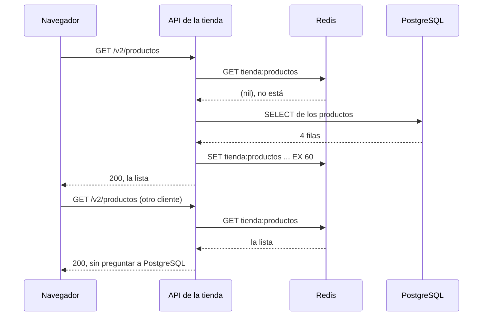

import Term from '~/components/Term.astro';
import TryIt from '~/components/TryIt.astro';
import Analogy from '~/components/Analogy.astro';
import SelfCheck from '~/components/SelfCheck.astro';
import Quiz from '~/components/Quiz.astro';
import QuizQuestion from '~/components/QuizQuestion.astro';
import QuizOption from '~/components/QuizOption.astro';
import SqlPlayground from '~/playgrounds/sql-playground/SqlPlayground';

## El problema

Imagina el primer día de rebajas de la tienda. La portada pide la lista de productos cientos de veces por segundo, y cada vez se hace la misma <Term id="query">consulta</Term> a PostgreSQL para recibir la misma respuesta: cuatro productos que no han cambiado desde ayer.

Además, Ana quiere vender cosas nuevas, y cada una tiene sus propios datos: la camiseta, tallas y color; la taza, su capacidad y si va al lavavajillas. ¿Una columna para cada dato que pueda tener algún producto?

En un foro, alguien lo tiene claro: «PostgreSQL no escala. Pásate a NoSQL: Redis y MongoDB». Aquí verás qué hay detrás de esa palabra y cómo PostgreSQL resuelve parte de esto sin salir de él.

## La analogía

<Analogy>

Piensa en una tienda de barrio. El **libro de registro** tiene una línea por venta, siempre con las mismas columnas: fecha, producto, cantidad. El precio de cada producto está en otra hoja, la del catálogo: cada dato, en un solo sitio.

Junto a la caja hay una **pizarra**: «Taza: quedan 3». Se lee de un vistazo y se borra cada noche. Si alguien la borra por error, no pasa nada: la verdad está en el libro.

Y en un armario, una **carpeta por cliente**, con la fotocopia de cada ticket: producto, precio y cantidad. Abres una y lo tienes todo. Pero si un producto cambia de nombre, hay que corregirlo en cada carpeta.

El libro es una base de datos relacional, la pizarra es Redis y las carpetas son MongoDB.

<div slot="limits">

- La pizarra no siempre se borra: Redis puede copiar sus datos al disco, como verás.
- El libro no es lento: con un índice, PostgreSQL encuentra una fila entre millones en milisegundos.
- MongoDB puede cruzar carpetas, y PostgreSQL guardar carpetas en una columna: las fronteras no son tan claras.

</div>

</Analogy>

## Cómo funciona de verdad

### «NoSQL» es una etiqueta, no una tecnología

**<Term id="nosql">NoSQL</Term> agrupa a las bases de datos que no guardan los datos en tablas relacionadas ni se consultan con <Term id="sql">SQL</Term>.** El nombre viene de un encuentro de 2009, y luego se leyó como «no solo SQL» (*not only SQL*). Dice lo que no son, no lo que son:

| Familia | Cómo guarda los datos | Ejemplos | Para qué se elige |
|---|---|---|---|
| Clave-valor | Cada valor con un nombre | Redis, Valkey | Cachés, sesiones, contadores |
| Documentos | Documentos parecidos a JSON, cada uno completo | MongoDB | Datos con forma variable que se leen enteros |
| Columnas anchas | Filas repartidas entre muchas máquinas | Cassandra, ScyllaDB | Escribir muchísimo y sin parar |
| Grafos | Nodos y relaciones entre ellos | Neo4j | Redes: los amigos de tus amigos |

Muchas renuncian al `JOIN` o a las transacciones para ser más rápidas o repartirse entre máquinas. Pero la frontera se ha borrado: MongoDB tiene transacciones, y PostgreSQL guarda documentos.

Así que la pregunta útil no es «¿SQL o NoSQL?», sino **qué forma tienen tus datos y cómo los vas a leer**.

### Redis guarda cada dato con un nombre

Redis es un <Term id="key-value-store">almacén clave-valor</Term>: guarda cada valor con un nombre, su clave, como un diccionario. Se usa desde `redis-cli`, su terminal, como `psql` con PostgreSQL. Así guarda la API la lista de productos:

<TryIt
  title="La lista de productos, en Redis"
  cmd="redis-cli"
  output={`127.0.0.1:6379> SET tienda:productos '[{"id":1,"nombre":"Camiseta","precioCentimos":2000},{"id":2,"nombre":"Taza","precioCentimos":850},{"id":3,"nombre":"Sudadera","precioCentimos":3500},{"id":4,"nombre":"Gorra","precioCentimos":1500}]'
OK
127.0.0.1:6379> GET tienda:productos
"[{\\"id\\":1,\\"nombre\\":\\"Camiseta\\",\\"precioCentimos\\":2000},{\\"id\\":2,\\"nombre\\":\\"Taza\\",\\"precioCentimos\\":850},{\\"id\\":3,\\"nombre\\":\\"Sudadera\\",\\"precioCentimos\\":3500},{\\"id\\":4,\\"nombre\\":\\"Gorra\\",\\"precioCentimos\\":1500}]"
127.0.0.1:6379> EXPIRE tienda:productos 60
(integer) 1
127.0.0.1:6379> TTL tienda:productos
(integer) 60
127.0.0.1:6379> TTL tienda:productos
(integer) 40
127.0.0.1:6379> TTL tienda:productos
(integer) -2
127.0.0.1:6379> GET tienda:productos
(nil)`}
>

Cada orden va después del `>`. Entre el `60` y el `40` pasaron 20 segundos, y antes del `-2`, otros 41. Cómo abrir `redis-cli`, en [Pruébalo](#pruébalo). Las salidas son de Redis 8.10.

</TryIt>

Palabra a palabra:

- `SET clave valor` guarda el valor con ese nombre. `tienda:productos` es la clave (los `:` son una costumbre para agrupar nombres). El valor es el JSON de la API, como texto: Redis no mira dentro.
- `GET clave` devuelve el valor. Las `\"` son las comillas del texto, escritas así por `redis-cli`.
- `EXPIRE clave 60` le pone caducidad: dentro de 60 segundos, Redis la borra. `(integer) 1` significa «hecho».
- `TTL clave` dice cuántos segundos le quedan. `-2` es que ya no existe; `-1`, que existe y no caduca.
- `(nil)` es «no hay nada con ese nombre».

Lo habitual es hacerlo de una vez: `SET tienda:productos '…' EX 60`.

**Redis guarda todo en la memoria del ordenador**, no en el disco, y contesta en mucho menos de un milisegundo. A cambio, se le pide por nombre: no hay `WHERE` ni `JOIN`. Tiene más tipos de valor, como listas y contadores, pero la idea es la misma.

### Una caché delante de PostgreSQL

Con Redis, la lista de productos se convierte en una <Term id="cache">caché</Term>: la API mira primero en Redis y, si no está, pregunta a PostgreSQL y deja allí una copia que caduca.



Durante ese minuto, todo sale de Redis: PostgreSQL hace una consulta por minuto en lugar de miles.

El precio es el de cualquier caché, como en la [caché de HTTP](/fase-2/cache-http/): si Ana cambia un precio, la API puede dar el viejo durante 60 segundos. Para evitarlo, la API borra la clave al cambiar un producto (`DEL tienda:productos`). Es la <Term id="cache-invalidation">invalidación de caché</Term>, y la construirás en la Fase 9.

### Si Redis muere de golpe, pierde lo último

Lo que está en memoria muere con el programa. Una sesión en Redis, y un apagón (`docker kill`, como el `kill -9` de la [Fase 1](/fase-1/procesos-y-senales/)):

<TryIt
  title="Redis, apagado de golpe"
  cmd={`docker exec -it redis redis-cli SET sesion:7f3a9c ana EX 3600
docker exec -it redis redis-cli GET sesion:7f3a9c
docker kill redis
docker start redis
docker exec -it redis redis-cli GET sesion:7f3a9c`}
  output={`OK
"ana"
redis
redis
(nil)`}
>

La sesión de Ana ha desaparecido: tendría que volver a entrar. `docker kill` y `docker start` repiten el nombre del contenedor (Docker es la Fase 7).

</TryIt>

Por defecto, Redis copia sus datos al disco cada cierto tiempo (cada hora si ha cambiado algo, antes si ha cambiado mucho) y al apagarse con orden: con `docker restart redis`, la sesión sigue ahí. Un apagón pierde lo escrito desde la última copia. Se puede ajustar:

- **Las copias (RDB):** más a menudo, o ninguna.
- **El diario de cambios (AOF):** con `appendonly yes`, Redis apunta cada cambio en un fichero y lo guarda cada segundo. Un apagón pierde, como mucho, un segundo.

**En una caché, perderlo todo no importa**: se rellena desde PostgreSQL. Perder las sesiones obliga a volver a entrar. Los pedidos, nunca solo en Redis.

### MongoDB guarda cada pedido entero

MongoDB es una <Term id="document-database">base de datos de documentos</Term>: cada pedido es un documento parecido a un JSON, con el producto dentro. Su terminal es `mongosh`:

<TryIt
  title="Dos pedidos, en MongoDB"
  cmd="mongosh --quiet"
  output={`test> use tienda
switched to db tienda
tienda> db.pedidos.insertOne({ producto: { id: 2, nombre: "Taza", precioCentimos: 850 }, cantidad: 2, estado: "pendiente" })
{
  acknowledged: true,
  insertedId: ObjectId('6aceb7d56bc125ef61f99dd8')
}
tienda> db.pedidos.insertOne({ producto: { id: 2, nombre: "Taza", precioCentimos: 850 }, cantdad: 3, estado: "pagado", regalo: true })
{
  acknowledged: true,
  insertedId: ObjectId('6aceb7d56bc125ef61f99dd9')
}
tienda> db.pedidos.find()
[
  {
    _id: ObjectId('6aceb7d56bc125ef61f99dd8'),
    producto: { id: 2, nombre: 'Taza', precioCentimos: 850 },
    cantidad: 2,
    estado: 'pendiente'
  },
  {
    _id: ObjectId('6aceb7d56bc125ef61f99dd9'),
    producto: { id: 2, nombre: 'Taza', precioCentimos: 850 },
    cantdad: 3,
    estado: 'pagado',
    regalo: true
  }
]
tienda> db.pedidos.countDocuments({ cantidad: { $gte: 1 } })
1`}
>

`--quiet` quita la bienvenida. Las salidas son de MongoDB 9.0 y mongosh 2.12. Tus `ObjectId` serán otros: llevan la hora en que se crearon.

</TryIt>

Palabra a palabra:

- `use tienda` elige la base de datos `tienda`, que se crea sola al guardar algo.
- `db.pedidos` es la **colección** `pedidos`: el equivalente a una <Term id="table">tabla</Term>, pero sin columnas.
- `insertOne({ … })` guarda un documento, con el producto dentro: su nombre y su precio, copiados. Leer un pedido es una sola lectura, sin `JOIN`. `_id` lo pone MongoDB.
- `find()` devuelve todos los documentos.
- `countDocuments({ cantidad: { $gte: 1 } })` cuenta los que tienen `cantidad` mayor o igual (*greater than or equal*) que 1.

Fíjate en el segundo pedido: un campo nuevo, `regalo`, y una errata, `cantdad`. **MongoDB guarda los dos sin quejarse: no tiene un esquema fijo.** Y el recuento dice `1`: para buscar por `cantidad`, ese pedido no existe. PostgreSQL lo habría parado en la puerta:

```
ERROR:  column "cantdad" of relation "pedidos" does not exist
LINE 1: INSERT INTO pedidos (producto_id, cantdad, estado, creado_en...
                                          ^
```

### Sin esquema no significa sin reglas

Que la base de datos no compruebe la forma no hace que tus datos dejen de tenerla. Cuesta tres cosas.

**El esquema se muda a tu código.** Cada programa que escribe tiene que validar los campos, como con el Zod de la [Fase 3](/fase-3/validar-datos-zod/). MongoDB puede validar los documentos si se lo pides (`$jsonSchema`), pero por defecto no lo hace.

**Las copias se mantienen a mano.** El nombre de la taza está copiado en cada pedido. Si la tienda lo cambia, hay que cambiar cada copia:

<TryIt
  title="La taza cambia de nombre"
  lang="js"
  cmd={`db.pedidos.updateMany({ "producto.id": 2 }, { $set: { "producto.nombre": "Taza de cerámica" } })`}
  output={`{
  acknowledged: true,
  insertedId: null,
  matchedCount: 2,
  modifiedCount: 2,
  upsertedCount: 0
}`}
>

En la misma sesión de `mongosh`. `updateMany` cambia los documentos que cumplen el filtro, los del producto 2. `$set` dice qué campo cambiar, y `"producto.nombre"` entra en el documento de dentro. Dos copias; con un millón de pedidos, un millón.

</TryIt>

En PostgreSQL, el nombre está en una sola fila, y los pedidos lo leen con un `JOIN` (lección 2, «JOIN»). `UPDATE productos SET nombre = 'Taza de cerámica' WHERE id = 2;` responde `UPDATE 1`, haya los pedidos que haya. Es «cada dato en un solo sitio», la normalización de la lección 4, «Modelado».

Copiar no siempre es un error: **el precio sí debe copiarse en el pedido**, porque es lo que pagó el cliente. Lo que hay que decidir es qué se copia y quién mantiene las copias.

**No hay `JOIN` por defecto.** «Los pedidos con la categoría de su producto» necesita `$lookup`, el `JOIN` de MongoDB, dentro de `aggregate`; o dos consultas; o copiar también la categoría.

### JSONB: documentos dentro de PostgreSQL

Volvamos a las tallas de la camiseta y la capacidad de la taza. PostgreSQL tiene un tipo de columna para eso:

```sql
ALTER TABLE productos ADD COLUMN atributos jsonb;
UPDATE productos SET atributos = '{"color": "negro", "tallas": ["S", "M", "L"]}'
WHERE nombre = 'Camiseta';
UPDATE productos SET atributos = '{"lavavajillas": true, "capacidad_ml": 350}'
WHERE nombre = 'Taza';
SELECT id, nombre, atributos FROM productos ORDER BY id;
```

```
 id |  nombre  |                   atributos
----+----------+-----------------------------------------------
  1 | Camiseta | {"color": "negro", "tallas": ["S", "M", "L"]}
  2 | Taza     | {"capacidad_ml": 350, "lavavajillas": true}
  3 | Sudadera |
  4 | Gorra    |
(4 rows)
```

- `ADD COLUMN atributos jsonb` añade una columna de tipo <Term id="jsonb">JSONB</Term>: cada fila puede guardar un JSON distinto. En las demás filas queda `NULL`, el hueco de la Sudadera y la Gorra.
- En la Taza, las claves han cambiado de orden: **JSONB no guarda el texto que escribiste, lo descompone** para buscar dentro.
- PostgreSQL comprueba que es un JSON válido (`'{"color": negro}'` da `invalid input syntax for type json`), pero no su forma.

Para leer dentro, dos flechas:

```sql
SELECT atributos -> 'color' AS json, atributos ->> 'color' AS texto,
       atributos -> 'tallas' AS tallas
FROM productos WHERE nombre = 'Camiseta';
```

```
  json   | texto |     tallas
---------+-------+-----------------
 "negro" | negro | ["S", "M", "L"]
(1 row)
```

- `->` saca un campo **como JSON**: `"negro"`, con sus comillas, o la lista de tallas.
- `->>` lo saca **como texto**: `negro`. Es el que usas para compararlo con un texto.

Y para buscar, `@>`, «contiene»:

```sql
SELECT nombre FROM productos WHERE atributos @> '{"lavavajillas": true}';
```

```
 nombre
--------
 Taza
(1 row)
```

`@>` devuelve las filas cuyo JSON contiene ese trozo. Con cuatro productos, PostgreSQL los mira todos; con un millón, crearías un índice de un tipo especial, GIN, que apunta cada clave y cada valor de los JSON:

```sql
CREATE INDEX productos_atributos_idx ON productos USING GIN (atributos);
```

Lo que tiene siempre la misma forma (el nombre, el precio) sigue en columnas, con sus tipos y restricciones. **JSONB es para lo que varía de una fila a otra.**

### PostgreSQL por defecto, y cuándo ganan las otras

Casi todas las aplicaciones tienen datos que se relacionan (clientes, pedidos, pagos) y necesitan transacciones (lección 8, «Transacciones»). PostgreSQL da eso, y documentos con JSONB. Y cada base de datos de más es otro programa que instalar, vigilar y copiar. **Empieza con PostgreSQL y añade otra cuando un problema concreto la pida:**

| Situación | Qué usar | Por qué |
|---|---|---|
| Una respuesta que se pide miles de veces y puede llegar unos segundos tarde | Redis, delante de PostgreSQL | Memoria y caducidad |
| Sesiones, códigos de un solo uso, peticiones por minuto de cada cliente | Redis | Datos pequeños que caducan solos |
| Muchísimas escrituras sin parar, como los mensajes de un chat | Columnas anchas, como Cassandra o ScyllaDB | Reparten las escrituras entre muchas máquinas |
| Documentos sin forma fija, que se leen enteros y casi no se cruzan | MongoDB, o JSONB si lo demás ya está en PostgreSQL | La forma la decide cada documento |
| Clientes, pedidos, pagos, stock | PostgreSQL | Relaciones, transacciones y restricciones |

Un caso real: [Discord](https://discord.com/blog/how-discord-stores-trillions-of-messages) guardaba sus mensajes en MongoDB, pasó a Cassandra al crecer y, después, a ScyllaDB, ya con billones de mensajes. Casi ninguna web llega a esa escala.

Las bases de datos de vectores, que buscan por parecido de significado, llegan en la Fase 11, y ahí también PostgreSQL tiene su extensión: pgvector.

## Pruébalo

El objetivo: dar a los productos atributos sin forma fija, encontrar los que van al lavavajillas y, después, los negros. Al final, si quieres, Redis y MongoDB en tu ordenador.

### JSONB en el playground

Pulsa «Ejecutar»: verás la respuesta de cada orden.

<SqlPlayground client:visible lang="es" rows={10} query={`ALTER TABLE productos ADD COLUMN atributos jsonb;
UPDATE productos SET atributos = '{"color": "negro", "tallas": ["S", "M", "L"]}'
WHERE nombre = 'Camiseta';
UPDATE productos SET atributos = '{"lavavajillas": true, "capacidad_ml": 350}'
WHERE nombre = 'Taza';
SELECT nombre, atributos ->> 'color' AS color, atributos -> 'tallas' AS tallas
FROM productos ORDER BY id;
SELECT nombre FROM productos WHERE atributos @> '{"lavavajillas": true}';`} />

Si lo ejecutas dos veces, la primera orden falla: `column "atributos" of relation "productos" already exists`. Pulsa «Restaurar datos», o borra la primera línea.

<SelfCheck question="Reto: dale a la Sudadera el color negro y las tallas M, L y XL, y busca todos los productos negros.">

Un `UPDATE` más, y `@>` con el color:

```sql
UPDATE productos SET atributos = '{"color": "negro", "tallas": ["M", "L", "XL"]}'
WHERE nombre = 'Sudadera';
SELECT nombre FROM productos WHERE atributos @> '{"color": "negro"}';
```

```
  nombre
----------
 Camiseta
 Sudadera
(2 rows)
```

Con `WHERE atributos -> 'color' = 'negro'` habría salido un error: `->` da JSON, y `negro` sin comillas dobles no es un JSON válido. Con `->>` funciona: `WHERE atributos ->> 'color' = 'negro'`.

</SelfCheck>

### Lo mismo en psql, sin cambiar tu base de datos

Tu base de datos `tienda` es la del proyecto, y su esquema solo cambia con migraciones (lección 6, «Migraciones»). Así que la prueba va en una transacción que deshaces al final con `ROLLBACK`. Abre `psql -d tienda` y escribe:

<TryIt
  title="JSONB en psql, y deshecho al final"
  lang="sql"
  cmd={`BEGIN;
ALTER TABLE productos ADD COLUMN atributos jsonb;
UPDATE productos SET atributos = '{"color": "negro", "tallas": ["S", "M", "L"]}'
WHERE nombre = 'Camiseta';
UPDATE productos SET atributos = '{"lavavajillas": true, "capacidad_ml": 350}'
WHERE nombre = 'Taza';
SELECT nombre, atributos ->> 'color' AS color, atributos -> 'tallas' AS tallas
FROM productos ORDER BY id;
SELECT nombre FROM productos WHERE atributos @> '{"lavavajillas": true}';
CREATE INDEX productos_atributos_idx ON productos USING GIN (atributos);
ROLLBACK;`}
  output={`BEGIN
ALTER TABLE
UPDATE 1
UPDATE 1
  nombre  | color |     tallas
----------+-------+-----------------
 Camiseta | negro | ["S", "M", "L"]
 Taza     |       |
 Sudadera |       |
 Gorra    |       |
(4 rows)

 nombre
--------
 Taza
(1 row)

CREATE INDEX
ROLLBACK`}
>

Las órdenes del playground, más el índice, entre `BEGIN` y `ROLLBACK`. `psql` deja en blanco lo que el playground escribe `NULL`. Con el `ROLLBACK`, columna, atributos e índice desaparecen: compruébalo con `\d productos`. Las salidas son de PostgreSQL 18.6. Si sale `UPDATE 2`, tienes dos productos con ese nombre (los habrás creado con la API): no pasa nada. Si sale `current transaction is aborted`, una orden anterior falló: escribe `ROLLBACK;` y empieza otra vez.

</TryIt>

### Redis y MongoDB en tu ordenador (opcional)

No los necesitas para seguir el curso. Para repetir las salidas de esta lección, lo más limpio es Docker (Fase 7): cada uno vive en su contenedor y se borra con una orden.

<TryIt
  title="Redis y MongoDB, con Docker"
  cmd={`docker run -d --name redis redis:8
docker exec -it redis redis-cli PING
docker run -d --name mongo mongo:9
docker exec -it mongo mongosh --quiet --eval 'db.version()'`}
  output={`ba405caf36a7f871c776d3f3ba66d1393ca71d44d6598f0e77e4a273f95b0a00
PONG
2a97dc5f435b3d743bb97f40462351d55081cd599f02e0a1e29bde7741516b17
9.0.2`}
>

`docker run -d` arranca el contenedor y escribe su número, que será otro; la primera vez, antes descarga la imagen. `PONG` es la respuesta de Redis a `PING`: está vivo. Para entrar, `docker exec -it redis redis-cli` y `docker exec -it mongo mongosh --quiet`. Al terminar, `docker rm -f redis mongo` los borra con sus datos.

</TryIt>

Sin Docker, puedes instalarlos:

- **En macOS, con Homebrew:** `brew install redis` y `brew services start redis`; MongoDB, con `brew tap mongodb/brew`, `brew install mongodb-community` y `brew services start mongodb-community`.
- **En Ubuntu y WSL:** `sudo apt install redis-server` (Redis 7 en Ubuntu 24.04: estas órdenes funcionan igual). MongoDB no está en el catálogo de Ubuntu: [su manual](https://www.mongodb.com/docs/manual/tutorial/install-mongodb-on-ubuntu/) explica cómo añadir su repositorio.

## Ya lo has visto

- **Una web que te pide entrar otra vez** tras un rato sin usarla: tu [sesión](/fase-2/cookies-httponly-secure-samesite/#una-sesión-el-número-en-la-cookie-los-datos-en-el-servidor) ha caducado. Muchas webs las guardan así, en un almacén clave-valor.
- **El `localStorage` del navegador** es un almacén clave-valor: lo ves en DevTools ([cómo abrirlo](/fase-2/#antes-de-empezar-devtools)), pestaña **Aplicación** (*Application*).
- **Las claves de idempotencia** de la [Fase 4](/fase-4/webhooks-idempotencia/), que Stripe puede borrar a las 24 horas: un trabajo típico de Redis.

## Errores comunes

- **Elegir MongoDB «para no tener esquema».** El esquema acaba repartido por el código.
- **Guardar en Redis la única copia de algo que no se puede perder**, como los pedidos, sin el diario de cambios.
- **Una caché sin caducidad y sin borrar la clave al cambiar el dato**: precios viejos durante horas.
- **Meter en JSONB lo que siempre tiene la misma forma**, como el precio: pierdes los tipos y las restricciones.
- **Añadir una base de datos «por si acaso».** Cada una se instala, se vigila y se copia.

## Resumen

- NoSQL es una etiqueta para las bases de datos sin tablas relacionadas ni SQL: clave-valor, documentos, columnas anchas y grafos.
- Redis guarda cada valor con un nombre, en memoria, con caducidad (`EXPIRE`, `TTL`): una caché o unas sesiones. Si muere de golpe, pierde lo escrito desde su última copia en disco.
- MongoDB guarda documentos completos sin esquema fijo: leer un pedido es una lectura, pero entran las erratas, las copias se cambian a mano y no hay `JOIN` por defecto.
- JSONB guarda JSON dentro de PostgreSQL: `->` saca JSON, `->>` saca texto, `@>` busca lo que contiene, y un índice GIN lo acelera.
- PostgreSQL es la opción por defecto. Otra base de datos se añade cuando un problema concreto la pide.

## ¿Lo has entendido?

<Quiz>

<QuizQuestion
  question="La API guarda la lista de productos en Redis con EX 60. Ana sube el precio de la taza en PostgreSQL y, durante un rato, la web sigue enseñando el precio viejo. ¿Por qué?"
  review="Una caché delante de PostgreSQL"
>

<QuizOption text="Porque PostgreSQL tarda hasta un minuto en guardar un UPDATE.">

PostgreSQL guarda el cambio en cuanto responde. El precio viejo sale de la copia de Redis, que no se ha enterado.

</QuizOption>

<QuizOption text="Porque la copia de Redis no sabe que el precio ha cambiado, y vale hasta que caduque." correct>

La caché es una copia: se sirve tal cual hasta que caduca o la API borra la clave.

</QuizOption>

<QuizOption text="Porque Redis lee sus datos del disco, y el disco va con retraso respecto a la memoria.">

Redis lee siempre de la memoria; el disco solo le sirve para recuperarse al arrancar. El retraso es el de la caducidad.

</QuizOption>

</QuizQuestion>

<QuizQuestion
  question="Un servidor guarda en Redis, con la configuración por defecto, la caché de productos y las sesiones de los usuarios. Se va la luz. ¿Qué pasa al volver?"
  review="Si Redis muere de golpe, pierde lo último"
>

<QuizOption text="Nada: Redis escribe cada cambio en el disco antes de responder.">

Por defecto, Redis copia sus datos cada cierto tiempo, no en cada cambio. El diario de cambios (`appendonly yes`) hay que activarlo.

</QuizOption>

<QuizOption text="Que se ha perdido todo: Redis nunca guarda nada en el disco, solo en memoria.">

Por defecto sí copia sus datos al disco cada cierto tiempo y al apagarse con orden, y los vuelve a cargar al arrancar.

</QuizOption>

<QuizOption text="Que falta lo último: la caché se rellena y algunos vuelven a entrar." correct>

Se pierde lo posterior a la última copia. La caché se reconstruye desde PostgreSQL; quien pierde su sesión vuelve a entrar.

</QuizOption>

</QuizQuestion>

<QuizQuestion
  question="En MongoDB, alguien guarda un pedido con el campo cantdad en lugar de cantidad. ¿Qué pasa?"
  review="MongoDB guarda cada pedido entero"
>

<QuizOption text="Se guarda tal cual, y las búsquedas por cantidad no lo encuentran." correct>

MongoDB no tiene un esquema fijo: cualquier campo vale. El pedido existe, pero no tiene `cantidad`.

</QuizOption>

<QuizOption text="Da un error, como PostgreSQL con una columna que no existe.">

La colección no tiene columnas que comprobar. Solo validaría la forma si le hubieras pedido un `$jsonSchema`.

</QuizOption>

<QuizOption text="Se guarda sin ese campo: MongoDB descarta los campos que no conoce.">

MongoDB no conoce los campos de antemano: guarda `cantdad` como cualquier otro.

</QuizOption>

</QuizQuestion>

<QuizQuestion
  question="La tienda va a vender libros (autor, páginas) y zapatillas (número, material), además de lo que ya tiene. ¿Dónde guardas esos datos?"
  review="JSONB: documentos dentro de PostgreSQL"
>

<QuizOption text="En MongoDB: PostgreSQL solo sabe guardar columnas con un tipo fijo.">

PostgreSQL guarda JSON con el tipo `jsonb`, y busca dentro con `->>` y `@>`.

</QuizOption>

<QuizOption text="En una columna JSONB de productos, con el nombre y el precio en sus columnas de siempre." correct>

Lo que todos tienen sigue en columnas, con tipos y restricciones; lo que cambia de un producto a otro, en `atributos`.

</QuizOption>

<QuizOption text="En una columna para cada atributo de cualquier producto: es la única forma de buscar por ellos.">

Con JSONB también se busca: `atributos @> '{"material": "piel"}'`, y un índice GIN lo hace rápido.

</QuizOption>

</QuizQuestion>

<QuizQuestion
  question="Escribes SELECT nombre FROM productos WHERE atributos -> 'color' = 'negro'; y PostgreSQL responde invalid input syntax for type json. ¿Qué pasa?"
  review="JSONB: documentos dentro de PostgreSQL"
>

<QuizOption text="Que JSONB no deja filtrar por lo que hay dentro del JSON, solo guardarlo.">

Sí deja: con `->>` para comparar un texto, o con `@>` para buscar un trozo de JSON.

</QuizOption>

<QuizOption text="Que falta el índice GIN sobre la columna atributos.">

Un índice hace las búsquedas más rápidas, pero no cambia qué consultas son válidas ni su resultado.

</QuizOption>

<QuizOption text="Que -> da JSON, y 'negro', sin comillas dobles, no es un JSON válido." correct>

`->` da `"negro"`, con comillas, y compara con otro JSON. Para comparar con un texto, `->>`.

</QuizOption>

</QuizQuestion>

<QuizQuestion
  question="Empiezas una tienda online nueva: clientes, productos, pedidos y pagos. Alguien del equipo propone una base de datos. ¿Cuál eliges para empezar?"
  review="PostgreSQL por defecto, y cuándo ganan las otras"
>

<QuizOption text="PostgreSQL: los datos se relacionan y los pagos necesitan transacciones." correct>

Es la forma de datos para la que existe una base de datos relacional. Si un día una lista se pide miles de veces, Redis va delante.

</QuizOption>

<QuizOption text="MongoDB: una base de datos relacional no aguanta más que unos pocos miles de usuarios.">

PostgreSQL atiende a millones de usuarios en muchas empresas. Lo que suele limitar es el diseño de las tablas y los índices.

</QuizOption>

<QuizOption text="Redis para todo: está en memoria, así que es la más rápida para cualquier dato.">

Redis solo busca por nombre, no cruza datos y puede perder lo último si se apaga de golpe: para pedidos y pagos, no.

</QuizOption>

</QuizQuestion>

</Quiz>

## Para profundizar

- [JSON Types](https://www.postgresql.org/docs/18/datatype-json.html) y [JSON Functions and Operators](https://www.postgresql.org/docs/18/functions-json.html) (PostgreSQL, en inglés): `jsonb` y sus operadores.
- [Redis persistence](https://redis.io/docs/latest/operate/oss_and_stack/management/persistence/) (Redis, en inglés): RDB y AOF, y lo que pierde cada uno.
- [Data Modeling](https://www.mongodb.com/docs/manual/data-modeling/) (MongoDB, en inglés): cuándo meter un dato dentro de otro.
- [How Discord Stores Trillions of Messages](https://discord.com/blog/how-discord-stores-trillions-of-messages) (Discord, en inglés): de MongoDB a Cassandra y a ScyllaDB.
- [NoSQL](https://es.wikipedia.org/wiki/NoSQL) (Wikipedia): el origen del nombre y las familias.
