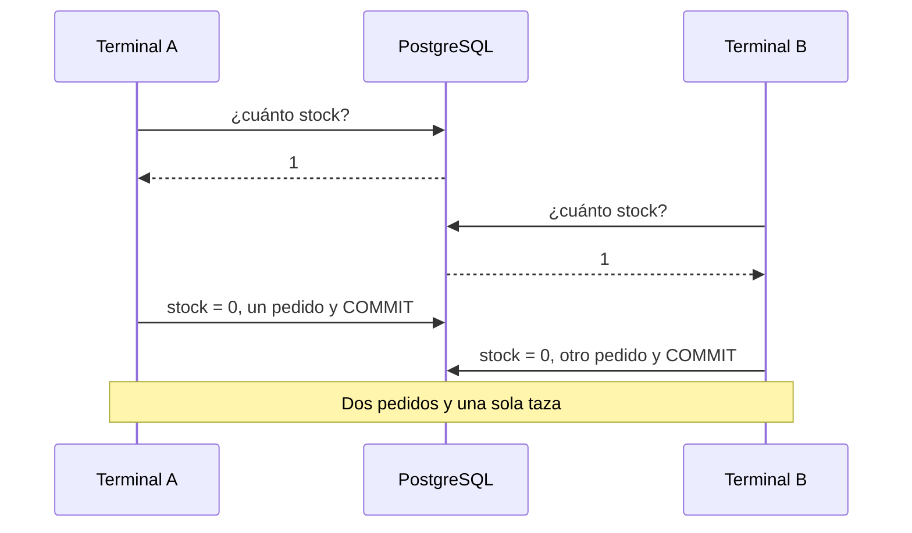

import Term from '~/components/Term.astro';
import TryIt from '~/components/TryIt.astro';
import Analogy from '~/components/Analogy.astro';
import SelfCheck from '~/components/SelfCheck.astro';
import ProjectCode from '~/components/ProjectCode.astro';
import Quiz from '~/components/Quiz.astro';
import QuizQuestion from '~/components/QuizQuestion.astro';
import QuizOption from '~/components/QuizOption.astro';

## El problema

Imagina el viernes por la noche. Queda una taza en el almacén, y dos personas pulsan «Comprar» en el mismo segundo. Desde la lección 6, «Migraciones», cada producto tiene su `stock`, pero tu API todavía no lo toca al vender.

Vender son dos pasos: quitar una taza del stock y guardar el pedido. Y los dos pueden salir mal de dos formas:

- **A medias.** El servidor quita la taza y se cae antes de guardar el pedido. El stock dice que hay una menos, y no hay pedido que lo explique.
- **Dos a la vez.** Los dos compradores leen «queda 1», y los dos compran. Dos pedidos, una taza, y alguien recibe un correo de disculpas.

La introducción de esta fase prometió que la base de datos resuelve los dos problemas. Esta lección te enseña cómo, y dónde no lo hace sola.

## La analogía

<Analogy>

En una tienda de barrio, la última taza está en la estantería. Ana y Luis la ven desde la puerta a la vez: «¡queda una!». Pero ver no es coger. Los dos van hacia ella, y quien llega primero la coge; el otro encuentra el hueco. **Coger es comprobar y quitar en un solo gesto.**

Y en la caja, la compra es todo o nada. Si la tarjeta falla, la taza vuelve a la estantería: nadie se lleva la taza sin pagar, ni paga sin taza.

<div slot="limits">

- En la tienda, ver el hueco es instantáneo. En PostgreSQL, quien llega segundo **espera** a que el primero termine. Si el primero tarda, todos los de detrás esperan con él.
- En la tienda ves la estantería de verdad. En la base de datos, lo que leíste puede estar viejo un instante después, y nada te avisa: ese es el fallo de la lección.
- Una tienda no sobrevive a un incendio. Lo que PostgreSQL ha confirmado sobrevive a un apagón.

</div>

</Analogy>

## Cómo funciona de verdad

Las sesiones de esta lección usan la base de datos `tienda` de tu proyecto, la de la lección 6: la Taza es el producto 2. Las salidas son de PostgreSQL 18.6; tu stock y tus números de pedido serán otros.

### BEGIN y COMMIT: varias órdenes como una sola

En la lección 6 viste que el ejecutor de migraciones mete cada una en una transacción. Ahora, a mano. Abre `psql -d tienda`, vende una taza y arrepiéntete:

```
tienda=> BEGIN;
BEGIN
tienda=*> UPDATE productos SET stock = stock - 1 WHERE id = 2;
UPDATE 1
tienda=*> INSERT INTO pedidos (producto_id, cantidad, estado, creado_en) VALUES (2, 1, 'pendiente', now());
INSERT 0 1
tienda=*> SELECT stock FROM productos WHERE id = 2;
 stock
-------
    59
(1 row)

tienda=*> ROLLBACK;
ROLLBACK
tienda=> SELECT stock FROM productos WHERE id = 2;
 stock
-------
    60
(1 row)
```

Palabra a palabra:

- `BEGIN` («empieza») abre una <Term id="transaction">transacción</Term>. El prompt cambia a `tienda=*>`: el `*` te recuerda que estás dentro y que nada está guardado todavía.
- Dentro, todo funciona como siempre, y tu transacción ve sus propios cambios: el `SELECT` dice 59.
- `now()` es la hora de ahora, para `creado_en`.
- `ROLLBACK` («vuelta atrás») deshace todo desde el `BEGIN`. El stock vuelve a 60, y el pedido nunca existió.
- `COMMIT` («confirma») habría guardado las dos cosas a la vez.

¿Y sin `BEGIN`? Cada orden suelta es su propia transacción, que se confirma sola al terminar. Por eso el `UPDATE` sin `WHERE` de la lección 1 no tenía deshacer. Ahora tienes la red que te prometía: `BEGIN`, el cambio, un `SELECT` para mirarlo, y `COMMIT` o `ROLLBACK`.

### Si una orden falla, cae la transacción entera

Ahora alguien pide 100 tazas, y solo hay 60:

```
tienda=> BEGIN;
BEGIN
tienda=*> INSERT INTO pedidos (producto_id, cantidad, estado, creado_en) VALUES (2, 100, 'pendiente', now());
INSERT 0 1
tienda=*> UPDATE productos SET stock = stock - 100 WHERE id = 2;
ERROR:  new row for relation "productos" violates check constraint "stock_no_negativo"
DETAIL:  Failing row contains (2, Taza, 850, -40).
tienda=!> SELECT stock FROM productos WHERE id = 2;
ERROR:  current transaction is aborted, commands ignored until end of transaction block
tienda=!> COMMIT;
ROLLBACK
tienda=> SELECT count(*) FROM pedidos WHERE cantidad = 100;
 count
-------
     0
(1 row)
```

- El `UPDATE` dejaría el stock en −40, y la regla `stock_no_negativo` de la lección 6 lo prohíbe.
- Desde ese error, la transacción está rota: el prompt dice `tienda=!>`, y PostgreSQL ignora todo hasta que la termines («*current transaction is aborted*»).
- Le pides `COMMIT` y contesta `ROLLBACK`. El `INSERT`, que había funcionado, también se deshace: no hay ningún pedido de 100.

### ACID, letra a letra

Lo que acabas de ver tiene nombre: **<Term id="acid">ACID</Term>**, las cuatro garantías de una transacción.

| Letra | Qué garantiza | En la tienda |
|---|---|---|
| A, atomicidad | Todo o nada | El stock y el pedido van juntos: el `ROLLBACK` deshizo los dos |
| C, consistencia | Al terminar, se cumplen todas las reglas de las tablas | El `CHECK` del stock tiró la transacción entera |
| I, aislamiento | Las transacciones a la vez no se ven a medias | Otro comprador no ve tu 59 hasta tu `COMMIT` |
| D, durabilidad | Lo confirmado sobrevive a un apagón | Cuando `COMMIT` contesta, el pedido ya está en el disco |

La durabilidad tiene un truco: antes de contestar `COMMIT`, PostgreSQL escribe los cambios en un diario en disco (el *WAL*, *write-ahead log*). Si se va la luz, al arrancar lo relee: lo confirmado vuelve, y lo que estaba a medias desaparece. Es el problema del fichero cortado de la introducción, resuelto.

La I es la letra con más letra pequeña. Para verla, hacen falta dos compradores.

### Dos compradores, una taza: la condición de carrera

Abre dos terminales, una al lado de la otra, con `psql -d tienda` en cada una: **A** y **B** son dos compradores. Así compra quien lee el stock y después escribe el nuevo:



Esto pasó de verdad, en este orden, después de dejar una sola taza con `UPDATE productos SET stock = 1 WHERE id = 2;`:

1. **A** abre su transacción y lee el stock:

   ```
   tienda=> BEGIN;
   BEGIN
   tienda=*> SELECT stock FROM productos WHERE id = 2;
    stock
   -------
        1
   (1 row)
   ```

2. **B** hace lo mismo, y también lee 1.
3. **A** ve que queda una, la vende y guarda su pedido, el 28:

   ```
   tienda=*> UPDATE productos SET stock = 0 WHERE id = 2;
   UPDATE 1
   tienda=*> INSERT INTO pedidos (producto_id, cantidad, estado, creado_en) VALUES (2, 1, 'pendiente', now()) RETURNING id;
    id
   ----
    28
   (1 row)

   INSERT 0 1
   ```

4. **B** vuelve a mirar, y sigue viendo 1: A no ha confirmado. Es el aislamiento.

   ```
   tienda=*> SELECT stock FROM productos WHERE id = 2;
    stock
   -------
        1
   (1 row)
   ```

5. **A** confirma con `COMMIT`.
6. **B** decide con lo que leyó: vende, guarda el pedido 29 y confirma.

   ```
   tienda=*> UPDATE productos SET stock = 0 WHERE id = 2;
   UPDATE 1
   tienda=*> INSERT INTO pedidos (producto_id, cantidad, estado, creado_en) VALUES (2, 1, 'pendiente', now()) RETURNING id;
    id
   ----
    29
   (1 row)

   INSERT 0 1
   tienda=*> COMMIT;
   COMMIT
   ```

`RETURNING id` hace que el `INSERT` conteste con el id del pedido nuevo. Dos pedidos, 28 y 29, y una sola taza.

Esto es una **<Term id="race-condition">condición de carrera</Term>**: el resultado depende de quién llega antes a cada paso. Si B hubiera leído después del `COMMIT` de A, habría visto 0. Y fíjate: **las dos iban en una transacción, y no ha servido**. Cada una ha hecho su parte entera; el fallo es que B decidió con un dato que ya era viejo.

### Arreglo 1: comprobar y quitar en la misma orden

Es el gesto de coger la taza de la estantería:

```sql
UPDATE productos SET stock = stock - 1 WHERE id = 2 AND stock >= 1;
```

- `stock = stock - 1` resta del valor que tiene la fila **en ese momento**, no del que leíste antes.
- `AND stock >= 1` es la comprobación: si no queda, la fila no cumple el `WHERE` y no cambia.
- La respuesta dice quién ganó: `UPDATE 1`, vendida; `UPDATE 0`, no quedaba.

La misma carrera, con este `UPDATE` y el stock otra vez a 1:

1. **A** abre su transacción y quita la taza:

   ```
   tienda=> BEGIN;
   BEGIN
   tienda=*> UPDATE productos SET stock = stock - 1 WHERE id = 2 AND stock >= 1;
   UPDATE 1
   ```

2. **B** abre la suya y escribe el mismo `UPDATE`. **No contesta.** El prompt no vuelve: B está esperando.

   ```
   tienda=> BEGIN;
   BEGIN
   tienda=*> UPDATE productos SET stock = stock - 1 WHERE id = 2 AND stock >= 1;
   ```

3. **A** guarda su pedido, el 30, y confirma con `COMMIT`.
4. En ese mismo instante, **B** recibe su respuesta: `UPDATE 0`. No queda taza. B hace `ROLLBACK`, y la API contestaría `409`.

¿Por qué espera B? **Cuando una transacción cambia una fila, PostgreSQL la bloquea hasta que esa transacción termina.** El `UPDATE` de B quiere la misma fila y hace cola. Cuando A confirma, PostgreSQL vuelve a mirar el `WHERE` de B con la fila nueva: stock 0 no cumple `stock >= 1`.

### Arreglo 2: SELECT … FOR UPDATE, leer y quedarte la fila

A veces tienes que leer antes de decidir: por ejemplo, si la decisión depende de varias cosas que tu código calcula. Entonces lees con `FOR UPDATE` («para cambiarla»), que bloquea la fila desde la lectura, como si ya la estuvieras cambiando:

1. **A** lee con `FOR UPDATE` y ve 1:

   ```
   tienda=> BEGIN;
   BEGIN
   tienda=*> SELECT stock FROM productos WHERE id = 2 FOR UPDATE;
    stock
   -------
        1
   (1 row)
   ```

2. **B** escribe la misma lectura, y se queda esperando.
3. **A** pone el stock a 0, guarda el pedido 31 y confirma.
4. **B** recibe por fin su respuesta, ya con el dato bueno:

   ```
    stock
   -------
        0
   (1 row)
   ```

   Ve que no queda y hace `ROLLBACK`.

B ha esperado **toda** la transacción de A, no solo un `UPDATE`. Por eso, con `FOR UPDATE`, entre la lectura y el `COMMIT` no debe haber nada lento. El `UPDATE` condicional es más corto y es lo que usa la tienda.

### Niveles de aislamiento: cuánto ve cada transacción

¿Por qué B leyó 1 en la primera carrera? Por el **<Term id="isolation-level">nivel de aislamiento</Term>**. PostgreSQL te dice cuál usa:

```
tienda=> SHOW transaction_isolation;
 transaction_isolation
-----------------------
 read committed
(1 row)
```

| Nivel | Qué ve cada orden | En la carrera de la taza |
|---|---|---|
| Read Committed, el de PostgreSQL por defecto | Lo confirmado antes de que empiece **esa orden** | B lee 1 y vende: necesitas uno de los arreglos |
| Repeatable Read | Lo confirmado antes de que empiece **la transacción** | B no puede cambiar una fila que A cambió: error |
| Serializable | Lo mismo, y el resultado es como si fueran una detrás de otra | Igual, y detecta también cruces más sutiles |

Con Serializable, la carrera con lectura y escritura por separado ya no vende de más. Con el stock a 1, las dos terminales empiezan con `BEGIN ISOLATION LEVEL SERIALIZABLE;` y leen 1. A vende, guarda el pedido 32 y confirma. Entonces B intenta lo mismo:

```
tienda=*> UPDATE productos SET stock = 0 WHERE id = 2;
ERROR:  could not serialize access due to concurrent update
tienda=!> ROLLBACK;
ROLLBACK
```

«No se puede serializar el acceso por un cambio a la vez»: PostgreSQL no deja que B escriba sobre una fila que cambió otra transacción después de que B empezara. **Ese error no es un fallo: es la forma de avisarte de que repitas.** B hace `ROLLBACK` y empieza otra vez desde el `BEGIN`; ahora lee 0, y no vende.

Por eso Serializable cuesta: tu código tiene que reconocer el error (su código es `40001`) y repetir la transacción entera. Compensa cuando la regla abarca muchas filas y no cabe en un `WHERE`, como «la suma de los pedidos de hoy no pasa de un límite». Para el stock, Read Committed con el `UPDATE` condicional basta.

### En Node, una transacción necesita un solo cliente del pool

El pool de la lección 5, «Node y PostgreSQL», tiene varias conexiones abiertas, y cada `pool.query` usa la que esté libre. Si mandaras `BEGIN`, el `UPDATE` y `COMMIT` con `pool.query`, **cada uno podría ir por una conexión distinta**: el `UPDATE` quedaría fuera de la transacción. Una transacción vive en una conexión, como viste en el ejecutor de migraciones.

La tienda lo resuelve una vez, en `src/bd.ts`:

<ProjectCode file="tienda-api/22-transacciones/src/bd.ts" region="en-transaccion" />

- `pool.connect()` pide una conexión, el `cliente`, y se la queda para esta transacción.
- `fn` es una función que te pasan: el trabajo que va dentro. Recibe el `cliente`, y todas sus consultas van por él.
- Si `fn` lanza un error, el `catch` hace `ROLLBACK` y vuelve a lanzarlo con `throw`, para que la ruta lo convierta en un `500`.
- `finally` devuelve la conexión al pool con `release()`, falle lo que falle.
- `<T>` dice que `enTransaccion` devuelve lo mismo que devuelva `fn`.

Y así vende `crearPedido`, en `src/datos.ts`:

<ProjectCode file="tienda-api/22-transacciones/src/datos.ts" region="quitar-stock" />

- El `UPDATE` es el del arreglo 1, con parámetros: `$1`, el producto, y `$2`, la cantidad.
- `rowCount` es cuántas filas ha cambiado, el número de `UPDATE 1`.
- Si es 0, un `SELECT` averigua por qué: si el producto existe, no queda bastante, y `quedan` dice cuánto hay. Si no existe, `no-existe`.
- Si quitó el stock, sigue el `INSERT` de siempre, ahora con `cliente.query`.

`crearPedido` ya no devuelve solo un pedido, sino un `ResultadoPedido`: el pedido o el motivo del fallo. La ruta de `src/v2.ts` traduce cada caso:

<ProjectCode file="tienda-api/22-transacciones/src/v2.ts" region="crear-pedido" />

Sin stock, un `409 Conflict`: la petición está bien escrita, pero choca con el estado de la tienda. Lleva su propio `type`, `sin-stock`, para que la app distinga este `409` de los demás, como pedía la [lección de errores de la Fase 4](/fase-4/errores-api-problem-details/#un-tipo-propio-cuando-el-cliente-tiene-que-distinguir). En `src/contrato.ts`, la ruta documenta este `409`.

Cancelar devuelve el stock (`cancelarPedido`, en `src/datos.ts`), con el mismo truco: en una transacción, un `UPDATE` cambia el estado `WHERE estado IN ('pendiente', 'pagado')`. Si llegan dos cancelaciones a la vez, la segunda ya no encuentra el pedido, y las tazas vuelven al stock una sola vez.

## Pruébalo

El objetivo: vender la última taza dos veces con tus propias manos, y después comprobar que tu API ya no puede.

### La carrera, en dos terminales

Abre dos terminales con `psql -d tienda` y repite la primera carrera, paso a paso: deja el stock en 1 y sigue los seis pasos de A y B. Termina con `SELECT id, estado FROM pedidos ORDER BY id DESC LIMIT 2;`: verás tus dos pedidos de la misma taza.

Después, repite con el `UPDATE` condicional y mira cómo B se queda esperando hasta tu `COMMIT` en A. Si una terminal se queda en `tienda=*>`, es que tiene una transacción abierta: termínala con `COMMIT` o `ROLLBACK`, o la otra esperará para siempre.

<SelfCheck question="Reto: el stock es 3. A y B piden 2 tazas cada uno, con el UPDATE condicional (stock - 2 y stock >= 2), y A confirma primero. ¿Qué contesta B, y cuánto stock queda?">

B espera al `COMMIT` de A, y entonces:

```
tienda=*> UPDATE productos SET stock = stock - 2 WHERE id = 2 AND stock >= 2;
UPDATE 0
tienda=*> SELECT stock FROM productos WHERE id = 2;
 stock
-------
     1
(1 row)
```

Queda una taza, y B pedía dos: `1 >= 2` no se cumple. En la API, sería `409` con «Pides 2 y quedan 1».

</SelfCheck>

### Actualiza tu proyecto

Parte de tu proyecto de la lección 7, «Índices»:

1. En `src/bd.ts`, añade `enTransaccion`, e importa `type PoolClient` de `'pg'` junto a `Pool`.
2. En `src/datos.ts`, importa `enTransaccion`, y cambia `crearPedido` y añade `cancelarPedido`, como en la carpeta de esta lección.
3. En `src/v2.ts`, la ruta que crea pedidos, y la que cancela llama a `cancelarPedido`. En `src/contrato.ts`, el `409` de `crearPedido`.

El ejemplo de la carrera y los tests nuevos vienen en la carpeta de esta lección:

```sh
cd ~/curso-backend/fase-3
curl -O https://backenddesdecero.com/practicas/tienda-api/22-transacciones.tar.gz
tar -xzf 22-transacciones.tar.gz
cd tienda-api
cp ../22-transacciones/ejemplos/carrera.ts ejemplos/
cp ../22-transacciones/test/transacciones.test.ts test/
```

### La carrera, en Node

`ejemplos/carrera.ts` hace lo mismo que tus dos terminales, con diez compradores a la vez. Primero, la forma que falla:

<ProjectCode file="tienda-api/22-transacciones/ejemplos/carrera.ts" region="mal" />

Lee, espera 50 ms (lo que tardaría un servidor ocupado en otras cosas) y escribe el valor que calculó. Y la buena, el arreglo 1:

<ProjectCode file="tienda-api/22-transacciones/ejemplos/carrera.ts" region="bien" />

El ejemplo crea una taza de prueba con stock 1 y lanza los diez compradores a la vez con `Promise.all`, que no espera a uno para empezar el siguiente ([las promesas, en la Fase 3](/fase-3/event-loop-node/)).

<TryIt
  title="Diez compradores, una taza"
  cmd="node --env-file=.env ejemplos/carrera.ts"
  output={`Mal: quedaba 1 taza y se han vendido 10. Stock: 0
Bien: quedaba 1 taza y se han vendido 1. Stock: 0`}
>

Diez tazas vendidas que no existían, y el stock dice 0 como si nada. Con el `UPDATE` condicional, una. La salida es de Node 26. Si sale `ECONNREFUSED`, PostgreSQL no está en marcha; si sale `column "stock" does not exist`, te falta la migración de la lección 6.

</TryIt>

### Tu API contesta 409

Arranca tu API con `npm run dev` y, en otra terminal, deja una sola taza y pide dos veces:

<TryIt
  title="La última taza, dos veces"
  cmd={`psql -d tienda -c "UPDATE productos SET stock = 1 WHERE id = 2;"
curl -s -w '\\n' --json '{"productoId":2,"cantidad":1}' localhost:3000/v2/pedidos
curl -s -w '\\n' --json '{"productoId":2,"cantidad":1}' localhost:3000/v2/pedidos`}
  output={`UPDATE 1
{"id":26,"productoId":2,"cantidad":1,"estado":"pendiente","creadoEn":"2026-10-13T23:15:40.981Z"}
{"type":"https://tienda.example/problemas/sin-stock","title":"No queda bastante stock","status":409,"detail":"Pides 1 y quedan 0"}`}
>

El primero se lleva la taza; el segundo recibe un `409` con el `type` `sin-stock`. `--json` envía el cuerpo como JSON, como en la Fase 4. En Linux, `psql` te pide antes la contraseña. Tu número de pedido y tu fecha serán otros.

</TryIt>

<TryIt
  title="Cancelar devuelve la taza"
  cmd={`curl -s -w '\\n' -X POST localhost:3000/v2/pedidos/26/cancelacion
psql -d tienda -c "SELECT stock FROM productos WHERE id = 2;"`}
  output={`{"id":26,"productoId":2,"cantidad":1,"estado":"cancelado","creadoEn":"2026-10-13T23:15:40.981Z"}
 stock
-------
     1
(1 row)`}
>

Usa el número de tu pedido. La taza vuelve al stock. Si cancelas otra vez, la respuesta es la misma, y el stock sigue en 1.

</TryIt>

### Los tests

<TryIt
  title="Las pruebas de esta lección"
  cmd="npm test -- test/transacciones.test.ts"
  output={`> tienda-api@1.0.0 test
> node --env-file=test/.env --test --test-concurrency=1 test/transacciones.test.ts

✔ 20 pedidos a la vez de un producto con stock 5: 5 se hacen, 15 reciben 409, y el stock queda en 0 (290.674598ms)
✔ sin bastante stock: 409, con su propio tipo y lo que queda en detail (4.048553ms)
✔ un pedido quita su cantidad del stock; cancelarlo la devuelve, una sola vez (7.151933ms)
✔ un error a mitad de la transacción deja el stock como estaba (2.691346ms)
✔ enTransaccion: si la función lanza un error, no se guarda nada de lo que hizo (3.862789ms)
✔ ejemplos/carrera.ts: leyendo y escribiendo por separado se vende de más; con un UPDATE condicional, no (273.338423ms)
✔ el contrato documenta el 409 de POST /pedidos (8.296872ms)
ℹ tests 7
ℹ suites 0
ℹ pass 7
ℹ fail 0
ℹ cancelled 0
ℹ skipped 0
ℹ todo 0
ℹ duration_ms 950.65352`}
>

Lo que va detrás de `--` le llega a `node --test`: solo este fichero. La primera prueba lanza 20 pedidos a la vez contra un stock de 5. Sin el argumento, `npm test` pasa todas. Tus tiempos serán otros.

</TryIt>

## Ya lo has visto

- **Una transferencia en tu banco**: el dinero sale de tu cuenta y entra en la otra, o no pasa nada. Nunca a medias.
- **Elegir asiento en un avión o un concierto**: el asiento queda «reservado durante 10 minutos» mientras pagas. Es la misma idea que `FOR UPDATE`, pero guardada en una columna: un bloqueo de 10 minutos tendría a todos esperando.
- **El ejecutor de migraciones de la lección 6**: cada migración, y su apunte, en una transacción.

## Errores comunes

- **Leer y escribir en dos órdenes.** `SELECT` el stock y después `UPDATE` con el valor calculado vende de más, aunque vaya en una transacción. Comprueba y quita en el mismo `UPDATE`.
- **`pool.query('BEGIN')`.** Cada consulta puede ir por otra conexión. Pide un cliente con `pool.connect()`.
- **Olvidar `release()`.** La conexión no vuelve al pool, y cuando se acaban todas, tu API se queda colgada esperando una.
- **Transacciones largas.** Llamar a la pasarela de pago, o esperar a una persona, con filas bloqueadas: todos los que las quieren hacen cola.
- **Usar Serializable sin repetir.** El error `could not serialize access` llega al cliente como un `500`, cuando bastaba con intentarlo otra vez.
- **Dejar una terminal en `tienda=*>`.** Sus cambios no existen para nadie más, y sus bloqueos siguen ahí.

## Resumen

- Una transacción (`BEGIN` … `COMMIT`) guarda todas sus órdenes o ninguna; `ROLLBACK`, o un error dentro, las deshace todas.
- ACID: atomicidad (todo o nada), consistencia (las reglas se cumplen), aislamiento (no se ven a medias) y durabilidad (lo confirmado sobrevive).
- Una transacción no evita sola una condición de carrera: leer en una orden y escribir en otra deja decidir con un dato viejo.
- Compruébalo y cámbialo en la misma orden (`UPDATE … WHERE stock >= 1`), o bloquea la fila al leer con `SELECT … FOR UPDATE`.
- PostgreSQL usa Read Committed por defecto. Serializable protege más, a cambio de repetir las transacciones que rechaza. En Node, cada transacción va por un solo cliente del pool.

## ¿Lo has entendido?

<Quiz>

<QuizQuestion
  question="Tu servidor se cae justo después del UPDATE del stock y antes del INSERT del pedido, dentro de una transacción. Al arrancar otra vez, ¿qué hay en la base de datos?"
  review="ACID, letra a letra"
>

<QuizOption text="El stock rebajado y ningún pedido: el UPDATE ya había terminado.">

Terminó, pero no se confirmó. Sin `COMMIT`, lo que hizo la transacción no cuenta, y al arrancar desaparece.

</QuizOption>

<QuizOption text="El stock como estaba y ningún pedido." correct>

Sin `COMMIT`, nada de la transacción queda: atomicidad. Y como PostgreSQL relee su diario al arrancar, lo confirmado antes sigue ahí: durabilidad.

</QuizOption>

<QuizOption text="Las dos cosas: PostgreSQL termina al arrancar las transacciones que se quedaron a medias.">

PostgreSQL no puede terminar lo que no sabe: el `INSERT` nunca llegó. Las transacciones sin confirmar se descartan.

</QuizOption>

</QuizQuestion>

<QuizQuestion
  question="Un código hace SELECT stock y, si es mayor que 0, UPDATE productos SET stock = <lo leído − 1>, todo entre BEGIN y COMMIT. ¿Aguanta dos compradores a la vez?"
  review="Dos compradores, una taza: la condición de carrera"
>

<QuizOption text="No: los dos pueden leer 1 antes de que ninguno escriba, y los dos venden." correct>

Con Read Committed, una transacción no impide que otra lea la misma fila. Cada una decide con lo que leyó, aunque ya sea viejo.

</QuizOption>

<QuizOption text="Sí: dentro de una transacción, nadie más puede leer esa fila hasta el COMMIT.">

Los demás leen sin problema: ven el valor confirmado de antes. Un `SELECT` normal no bloquea nada; para eso está `FOR UPDATE`.

</QuizOption>

<QuizOption text="Sí: PostgreSQL detecta al hacer COMMIT que otro cambió la fila, y rechaza la segunda.">

Eso lo hacen Repeatable Read y Serializable. Con Read Committed, el de por defecto, las dos se confirman.

</QuizOption>

</QuizQuestion>

<QuizQuestion
  question="Con el UPDATE condicional, B lo envía mientras A ha quitado la última taza pero aún no ha confirmado. ¿Qué le pasa a B?"
  review="Arreglo 1: comprobar y quitar en la misma orden"
>

<QuizOption text="Recibe un error al momento: la fila está bloqueada por A.">

En PostgreSQL, quien encuentra una fila bloqueada espera, no falla. El error aparece con Repeatable Read o Serializable.

</QuizOption>

<QuizOption text="Resta del stock que vio al empezar, y el stock queda en −1.">

`stock = stock - 1` usa el valor de la fila al cambiarla, no uno leído antes. Y la regla `stock_no_negativo` no dejaría pasar un −1.

</QuizOption>

<QuizOption text="Espera a que A termine, y después contesta UPDATE 0." correct>

Cuando A confirma, PostgreSQL vuelve a mirar el `WHERE` de B con la fila nueva. El stock es 0, no cumple `stock >= 1`, y no cambia nada.

</QuizOption>

</QuizQuestion>

<QuizQuestion
  question="En la API, alguien escribe await pool.query('BEGIN'), después el UPDATE y el INSERT con pool.query, y al final await pool.query('COMMIT'). ¿Qué falla?"
  review="En Node, una transacción necesita un solo cliente del pool"
>

<QuizOption text="Nada: el pool recuerda el BEGIN y manda lo demás por la misma conexión.">

El pool no sabe nada de transacciones: cada `pool.query` toma la conexión que esté libre.

</QuizOption>

<QuizOption text="Cada consulta puede ir por otra conexión, y el UPDATE y el INSERT quedar fuera de la transacción." correct>

Una transacción vive en una conexión. Por eso `enTransaccion` pide una con `pool.connect()` y manda todo por ella.

</QuizOption>

<QuizOption text="pool.query no acepta BEGIN: falla con un error de sintaxis.">

`BEGIN` es SQL válido, y `pool.query` lo envía sin quejarse. Por eso el fallo es traicionero: no da ningún error.

</QuizOption>

</QuizQuestion>

<QuizQuestion
  question="Tu API usa Serializable, y una compra recibe could not serialize access due to concurrent update. ¿Qué debería hacer?"
  review="Niveles de aislamiento: cuánto ve cada transacción"
>

<QuizOption text="ROLLBACK, y repetir la transacción entera desde el BEGIN." correct>

El error avisa de que otra transacción se le adelantó. Al repetirla, lee los datos nuevos y decide bien.

</QuizOption>

<QuizOption text="Repetir solo el UPDATE que falló, dentro de la misma transacción.">

Tras un error, la transacción está rota (`tienda=!>`): todo lo demás se ignora hasta el `ROLLBACK`. Y lo que leyó antes ya es viejo.

</QuizOption>

<QuizOption text="Contestar 500: el error significa que la base de datos tiene un problema.">

Con Serializable, ese error es normal y esperado: es la forma de evitar la carrera. Basta con repetir.

</QuizOption>

</QuizQuestion>

<QuizQuestion
  question="Una tienda lee el producto con SELECT … FOR UPDATE y, dentro de la misma transacción, cobra en la pasarela de pago, que tarda 3 segundos. Es el Black Friday. ¿Qué pasa?"
  review="Arreglo 2: SELECT … FOR UPDATE, leer y quedarte la fila"
>

<QuizOption text="Nada: FOR UPDATE solo bloquea la fila durante el SELECT.">

El bloqueo dura hasta que la transacción termina, con su `COMMIT` o su `ROLLBACK`: los 3 segundos del cobro incluidos.

</QuizOption>

<QuizOption text="Los demás compradores leen un stock viejo y venden de más.">

`FOR UPDATE` lo impide: los demás no leen, esperan. El problema es otro: cuánto esperan.

</QuizOption>

<QuizOption text="Quien compra ese producto espera a que acabe cada cobro anterior: la cola crece de 3 en 3 segundos." correct>

La fila está bloqueada durante todo el cobro. Lo lento va fuera de la transacción, que debe ser corta.

</QuizOption>

</QuizQuestion>

</Quiz>

## Para profundizar

- [Transacciones](https://www.postgresql.org/docs/18/tutorial-transactions.html) (tutorial de PostgreSQL, en inglés): `BEGIN`, `COMMIT`, `ROLLBACK` y los puntos de guardado.
- [Aislamiento de transacciones](https://www.postgresql.org/docs/18/transaction-iso.html) (documentación de PostgreSQL, en inglés): qué ve cada nivel, y los errores que hay que repetir.
- [Bloqueos explícitos](https://www.postgresql.org/docs/18/explicit-locking.html) (documentación de PostgreSQL, en inglés): `FOR UPDATE` y los demás bloqueos de filas.
- [El diario de escritura previa (WAL)](https://www.postgresql.org/docs/18/wal-intro.html) (documentación de PostgreSQL, en inglés): cómo cumple PostgreSQL la durabilidad.
- [Transacciones en node-postgres](https://node-postgres.com/features/transactions) (en inglés): por qué hace falta un cliente del pool.
