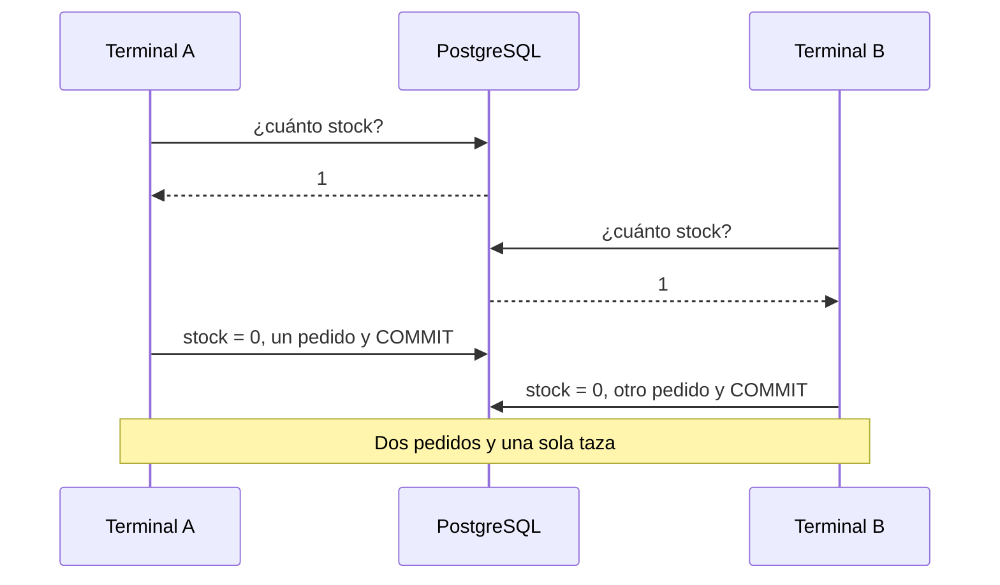

import Term from '~/components/Term.astro';
import TryIt from '~/components/TryIt.astro';
import Analogy from '~/components/Analogy.astro';
import SelfCheck from '~/components/SelfCheck.astro';
import ProjectCode from '~/components/ProjectCode.astro';
import Quiz from '~/components/Quiz.astro';
import QuizQuestion from '~/components/QuizQuestion.astro';
import QuizOption from '~/components/QuizOption.astro';

## El problema

Imagina el viernes por la noche. Queda una taza en el almacén, y dos personas pulsan «Comprar» en el mismo segundo. Desde la [lección 6, «Migraciones»](/fase-5/migraciones-base-de-datos/), cada producto tiene su `stock`, pero tu API todavía no lo toca al vender.

Vender son dos pasos: quitar una taza del stock y guardar el pedido. Pueden salir mal de dos formas:

- **A medias.** El servidor quita la taza y se cae antes de guardar el pedido. El stock dice que hay una menos, y no hay pedido que lo explique.
- **Dos a la vez.** Los dos compradores leen «queda 1», y los dos compran. Dos pedidos, una taza, y alguien recibe un correo de disculpas.

La [introducción de esta fase](/fase-5/) prometió que la base de datos resuelve los dos. Aquí ves cómo, y dónde no lo hace sola.

## La analogía

<Analogy>

En una tienda de barrio, la última taza está en la estantería. Ana y Luis la ven desde la puerta a la vez: «¡queda una!». Pero ver no es coger. Los dos van hacia ella, y quien llega primero la coge; el otro encuentra el hueco. **Coger es comprobar y quitar en un solo gesto.**

Y en la caja, la compra es todo o nada. Si la tarjeta falla, la taza vuelve a la estantería: nadie se lleva la taza sin pagar, ni paga sin taza.

<div slot="limits">

- En la tienda, ver el hueco es instantáneo. En PostgreSQL, quien llega segundo a coger **espera** a que el primero termine, y si el primero tarda, todos esperan con él.
- En la base de datos, lo que leíste puede estar viejo un instante después, y nada te avisa: ese es el fallo de esta lección.
- La tienda no tiene nada como la durabilidad: lo que PostgreSQL ha confirmado sobrevive a un apagón.

</div>

</Analogy>

## Cómo funciona de verdad

Las sesiones de esta lección usan la base de datos `tienda` de tu proyecto, tal como la dejó la lección 7: la Taza es el producto 2, con el stock de partida de la migración, 10. Las salidas son de PostgreSQL 18.6. Los números de pedido pasan de 100 000: PostgreSQL no reutiliza los de los pedidos que borraste. Los tuyos serán otros.

### BEGIN y COMMIT: varias órdenes como una sola

El ejecutor de migraciones de la lección 6 ya usaba transacciones. Ahora, a mano: abre `psql -d tienda`, vende una taza y arrepiéntete:

```
tienda=> BEGIN;
BEGIN
tienda=*> UPDATE productos SET stock = stock - 1 WHERE id = 2;
UPDATE 1
tienda=*> INSERT INTO pedidos (producto_id, cantidad, estado, creado_en) VALUES (2, 1, 'pendiente', now());
INSERT 0 1
tienda=*> SELECT stock FROM productos WHERE id = 2;
 stock
-------
     9
(1 row)

tienda=*> ROLLBACK;
ROLLBACK
tienda=> SELECT stock FROM productos WHERE id = 2;
 stock
-------
    10
(1 row)
```

Palabra a palabra:

- `BEGIN` («empieza») abre una <Term id="transaction">transacción</Term>. El <Term id="prompt">prompt</Term> cambia a `tienda=*>`: el `*` te recuerda que estás dentro y que nada está guardado todavía.
- Dentro, tu transacción ve sus propios cambios: el `SELECT` dice 9. `now()` es la hora de ahora.
- `ROLLBACK` («vuelta atrás») deshace todo desde el `BEGIN`. El stock vuelve a 10, y el pedido nunca existió.
- `COMMIT` («confirma») habría guardado las dos cosas a la vez.

Sin `BEGIN`, cada orden suelta es su propia transacción y se confirma sola al terminar: por eso el [`UPDATE` sin `WHERE` de la lección 1](/fase-5/que-es-sql/#el-error-clásico-un-update-o-un-delete-sin-where) no tenía deshacer. Esta es la red que te prometía.

### Si una orden falla, cae la transacción entera

Ahora alguien pide 100 tazas, y solo hay 10:

```
tienda=> BEGIN;
BEGIN
tienda=*> INSERT INTO pedidos (producto_id, cantidad, estado, creado_en) VALUES (2, 100, 'pendiente', now());
INSERT 0 1
tienda=*> UPDATE productos SET stock = stock - 100 WHERE id = 2;
ERROR:  new row for relation "productos" violates check constraint "stock_no_negativo"
DETAIL:  Failing row contains (2, Taza, 850, -90).
tienda=!> SELECT stock FROM productos WHERE id = 2;
ERROR:  current transaction is aborted, commands ignored until end of transaction block
tienda=!> COMMIT;
ROLLBACK
tienda=> SELECT count(*) FROM pedidos WHERE cantidad = 100;
 count
-------
     0
(1 row)
```

- El `UPDATE` dejaría el stock en −90, y la <Term id="constraint">restricción</Term> `stock_no_negativo` de la lección 6 lo prohíbe.
- Desde ese error, la transacción está rota (`tienda=!>`): PostgreSQL ignora todo hasta que la termines.
- Le pides `COMMIT` y contesta `ROLLBACK`. El `INSERT`, que había funcionado, también se deshace.

### ACID, letra a letra

Lo que acabas de ver tiene nombre: **<Term id="acid">ACID</Term>**, las cuatro garantías de una transacción.

| Letra | Qué garantiza | En la tienda |
|---|---|---|
| A, atomicidad | Todo o nada | El stock y el pedido van juntos: el `ROLLBACK` deshizo los dos |
| C, consistencia | Al terminar, se cumplen todas las reglas de las tablas | El `CHECK` del stock tiró la transacción entera |
| I, aislamiento | Las transacciones a la vez no se ven a medias | Otro comprador no ve tu 9 hasta tu `COMMIT` |
| D, durabilidad | Lo confirmado sobrevive a un apagón | Cuando `COMMIT` contesta, el pedido ya está en el disco |

El truco de la durabilidad: antes de contestar `COMMIT`, PostgreSQL apunta los cambios en un diario en disco (el *WAL*, *write-ahead log*). Tras un apagón, lo relee: lo confirmado vuelve, y lo que estaba a medias desaparece.

La I tiene letra pequeña, y para verla hacen falta dos compradores.

### Dos compradores, una taza: la condición de carrera

Dos terminales con `psql -d tienda`, **A** y **B**, son dos compradores. Así compra quien lee el stock y después escribe el nuevo:



Esto pasó de verdad, en este orden, después de dejar una sola taza con `UPDATE productos SET stock = 1 WHERE id = 2;`:

1. **A** abre su transacción y lee el stock:

   ```
   tienda=> BEGIN;
   BEGIN
   tienda=*> SELECT stock FROM productos WHERE id = 2;
    stock
   -------
        1
   (1 row)
   ```

2. **B** hace lo mismo, y también lee 1.
3. **A** ve que queda una, la vende y guarda su pedido, el 100029:

   ```
   tienda=*> UPDATE productos SET stock = 0 WHERE id = 2;
   UPDATE 1
   tienda=*> INSERT INTO pedidos (producto_id, cantidad, estado, creado_en) VALUES (2, 1, 'pendiente', now()) RETURNING id;
      id
   --------
    100029
   (1 row)

   INSERT 0 1
   ```

4. **B** vuelve a mirar, y sigue viendo 1: A no ha confirmado. Es el aislamiento.

   ```
   tienda=*> SELECT stock FROM productos WHERE id = 2;
    stock
   -------
        1
   (1 row)
   ```

5. **A** confirma con `COMMIT`.
6. **B** decide con lo que leyó: vende, guarda el pedido 100030 y confirma.

   ```
   tienda=*> UPDATE productos SET stock = 0 WHERE id = 2;
   UPDATE 1
   tienda=*> INSERT INTO pedidos (producto_id, cantidad, estado, creado_en) VALUES (2, 1, 'pendiente', now()) RETURNING id;
      id
   --------
    100030
   (1 row)

   INSERT 0 1
   tienda=*> COMMIT;
   COMMIT
   ```

`RETURNING id` hace que el `INSERT` conteste con el id del pedido nuevo. Dos pedidos, 100029 y 100030, y una sola taza.

Es una **<Term id="race-condition">condición de carrera</Term>**: el resultado depende de quién llega antes a cada paso. Si B hubiera leído tras el `COMMIT` de A, habría visto 0. Y fíjate: **las dos iban en una transacción, y no ha servido**. B decidió con un dato que ya era viejo.

### Arreglo 1: comprobar y quitar en la misma orden

Es el gesto de coger la taza de la estantería:

```sql
UPDATE productos SET stock = stock - 1 WHERE id = 2 AND stock >= 1;
```

- `stock = stock - 1` resta del valor que tiene la fila **en ese momento**, no del que leíste antes.
- `AND stock >= 1` es la comprobación: si no queda, la fila no cumple el `WHERE` y no cambia.
- La respuesta dice quién ganó: `UPDATE 1`, vendida; `UPDATE 0`, no quedaba.

La misma carrera, con este `UPDATE` y el stock otra vez a 1:

1. **A** abre su transacción y quita la taza:

   ```
   tienda=> BEGIN;
   BEGIN
   tienda=*> UPDATE productos SET stock = stock - 1 WHERE id = 2 AND stock >= 1;
   UPDATE 1
   ```

2. **B** abre la suya y escribe el mismo `UPDATE`. **No contesta**: el prompt no vuelve, B está esperando.

   ```
   tienda=> BEGIN;
   BEGIN
   tienda=*> UPDATE productos SET stock = stock - 1 WHERE id = 2 AND stock >= 1;
   ```

3. **A** guarda su pedido, el 100031, y confirma con `COMMIT`.
4. En ese mismo instante, **B** recibe su respuesta: `UPDATE 0`. No queda taza. B hace `ROLLBACK`, y la API contestaría `409`.

¿Por qué espera B? **Cuando una transacción cambia una fila, PostgreSQL la bloquea hasta que esa transacción termina.** El `UPDATE` de B hace cola. Cuando A confirma, PostgreSQL vuelve a mirar el `WHERE` de B con la fila nueva: stock 0 no cumple `stock >= 1`.

### Arreglo 2: SELECT … FOR UPDATE, leer y quedarte la fila

A veces tu código tiene que leer antes de decidir, porque la decisión depende de varias cosas. Entonces lees con `FOR UPDATE` («para cambiarla»), que bloquea la fila desde la lectura:

1. **A** lee con `FOR UPDATE` y ve 1:

   ```
   tienda=> BEGIN;
   BEGIN
   tienda=*> SELECT stock FROM productos WHERE id = 2 FOR UPDATE;
    stock
   -------
        1
   (1 row)
   ```

2. **B** escribe la misma lectura, y se queda esperando.
3. **A** pone el stock a 0, guarda el pedido 100032 y confirma.
4. **B** recibe por fin su respuesta, ya con el dato bueno:

   ```
    stock
   -------
        0
   (1 row)
   ```

   Ve que no queda y hace `ROLLBACK`.

B ha esperado **toda** la transacción de A. Por eso, entre un `FOR UPDATE` y su `COMMIT` no debe haber nada lento. El `UPDATE` condicional bloquea menos tiempo, y es lo que usa la tienda para vender. `FOR UPDATE` lo usa solo cuando tiene que leer antes de decidir, como al cambiar la cantidad de un pedido.

### Niveles de aislamiento: cuánto ve cada transacción

¿Por qué B leyó 1 en la primera carrera? Por el **<Term id="isolation-level">nivel de aislamiento</Term>**. PostgreSQL te dice cuál usa:

```
tienda=> SHOW transaction_isolation;
 transaction_isolation
-----------------------
 read committed
(1 row)
```

| Nivel | Qué ve cada orden | En la carrera de la taza |
|---|---|---|
| Read Committed, el de PostgreSQL por defecto | Lo confirmado antes de que empiece **esa orden** | B lee 1 y vende: necesitas uno de los arreglos |
| Repeatable Read | Lo confirmado antes de que empiece **la transacción** | B no puede cambiar una fila que A cambió: error |
| Serializable | Lo mismo, y el resultado es como si fueran una detrás de otra | Igual, y detecta también cruces más sutiles |

Con Serializable, la primera carrera ya no vende de más. Con el stock a 1, las dos terminales empiezan con `BEGIN ISOLATION LEVEL SERIALIZABLE;` y leen 1. A vende, guarda el pedido 100033 y confirma. Entonces B intenta lo mismo:

```
tienda=*> UPDATE productos SET stock = 0 WHERE id = 2;
ERROR:  could not serialize access due to concurrent update
tienda=!> ROLLBACK;
ROLLBACK
```

«No se puede serializar el acceso por un cambio a la vez»: B no puede escribir sobre una fila que otra transacción cambió después de que B empezara. **Ese error no es un fallo: es el aviso de que repitas.** B hace `ROLLBACK` y empieza otra vez; ahora lee 0, y no vende.

Ese es su precio: tu código tiene que reconocer el error (código `40001`) y repetir la transacción entera. Compensa cuando la regla abarca muchas filas y no cabe en un `WHERE`, como «los pedidos de hoy no pasan de un límite». Para el stock, basta Read Committed con el `UPDATE` condicional.

### En Node, una transacción necesita un solo cliente del pool

El <Term id="connection-pool">pool</Term> de la [lección 5](/fase-5/postgresql-node-js/) tiene varias conexiones abiertas, y cada `pool.query` usa la que esté libre. Si mandaras `BEGIN`, el `UPDATE` y `COMMIT` con `pool.query`, **cada uno podría ir por una conexión distinta**, y el `UPDATE` quedaría fuera de la transacción. Una transacción vive en una conexión.

La tienda lo resuelve una vez, en `src/bd.ts`:

<ProjectCode file="tienda-api/22-transacciones/src/bd.ts" region="en-transaccion" />

Es lo que hacía [el ejecutor de migraciones](/fase-5/migraciones-base-de-datos/#el-ejecutor-pieza-a-pieza), ahora en una función para cualquier transacción:

- `pool.connect()` pide una conexión, el `cliente`, y `finally` la devuelve con `release()`, falle lo que falle.
- `fn` es una función que te pasan: el trabajo de dentro. Recibe el `cliente` (de tipo `PoolClient`, de `pg`), y todas sus consultas van por él.
- Si `fn` lanza un error, el `catch` hace `ROLLBACK` y lo vuelve a lanzar, para que siga su camino como cualquier error.
- `<T>` dice que `enTransaccion` devuelve lo mismo que devuelva `fn`.

Y así vende `crearPedido`, en `src/datos.ts`:

<ProjectCode file="tienda-api/22-transacciones/src/datos.ts" region="quitar-stock" />

- El `UPDATE` es el del arreglo 1, con parámetros: `$1`, el producto, y `$2`, la cantidad.
- `rowCount` es cuántas filas ha cambiado, el número de `UPDATE 1`.
- Si es 0, un `SELECT` averigua por qué: si el producto existe, no queda bastante (`quedan` dice cuánto hay); si no, `no-existe`.
- Después sigue el `INSERT` de siempre, ahora con `cliente.query`.

`crearPedido` ya no devuelve solo un pedido, sino un `ResultadoPedido`: el pedido o el motivo del fallo. La ruta de `src/v2.ts` traduce cada caso:

<ProjectCode file="tienda-api/22-transacciones/src/v2.ts" region="crear-pedido" />

Sin stock, un `409 Conflict`: la petición está bien escrita, pero choca con el estado de la tienda. Su `type` propio, `sin-stock`, lo distingue de los demás `409`, como en la [lección de errores de la Fase 4](/fase-4/errores-api-problem-details/#un-tipo-propio-cuando-el-cliente-tiene-que-distinguir). `src/contrato.ts` lo documenta.

Cancelar devuelve el stock (`cancelarPedido`), con el mismo truco: en una transacción, el `UPDATE` del estado lleva `WHERE estado IN ('pendiente', 'pagado')`. Si llegan dos cancelaciones a la vez, la segunda ya no encuentra el pedido, y las tazas vuelven una sola vez.

El webhook paga con el mismo truco: `cambiarEstado(pedido.id, 'pagado', 'pendiente')` solo cambia el pedido si sigue pendiente, en el mismo `UPDATE`. Sin esa condición, una cancelación que llegara justo antes volvería a dejarlo pagado, y cancelarlo otra vez devolvería las tazas dos veces.

Cambiar la cantidad de un pedido pendiente (`cambiarCantidad`) también mueve el stock: si pides más, quita las de más con el mismo `UPDATE` condicional (si no quedan bastantes, `409` con «Pides 2 más y quedan 1»); si pides menos, las devuelve. Antes de decidir tiene que leer el pedido, así que usa el arreglo 2: lo lee con `FOR UPDATE`, y nadie lo paga ni lo cancela mientras tanto.

## Pruébalo

El objetivo: vender dos veces la última taza, y después comprobar que tu API ya no puede.

### La carrera, en dos terminales

Abre dos terminales con `psql -d tienda`, deja el stock en 1 y repite la primera carrera, paso a paso, hasta tener dos pedidos de la misma taza. Después, repite con el `UPDATE` condicional y mira cómo B espera a tu `COMMIT` en A.

Si una terminal se queda en `tienda=*>`, tiene una transacción abierta: termínala con `COMMIT` o `ROLLBACK`, o la otra puede quedarse esperando.

<SelfCheck question="Reto: el stock es 3. A y B piden 2 tazas cada uno, con el UPDATE condicional (stock - 2 y stock >= 2), y A confirma primero. ¿Qué contesta B, y cuánto stock queda?">

B espera al `COMMIT` de A, y entonces:

```
tienda=*> UPDATE productos SET stock = stock - 2 WHERE id = 2 AND stock >= 2;
UPDATE 0
tienda=*> SELECT stock FROM productos WHERE id = 2;
 stock
-------
     1
(1 row)
```

Queda una taza, y B pedía dos: `1 >= 2` no se cumple. En la API, sería `409` con «Pides 2 y quedan 1».

</SelfCheck>

### Actualiza tu proyecto

Parte de tu proyecto de la [lección 7, «Índices»](/fase-5/indices-sql-explain/). Escribe estos cambios, o cópialos de la carpeta de esta lección (abajo):

1. En `src/bd.ts`, `enTransaccion`, con `type PoolClient` en el `import` de `'pg'`.
2. En `src/datos.ts`, el `import` de `enTransaccion`, el nuevo `crearPedido`, `cancelarPedido` y `cambiarCantidad`, y `cambiarEstado` con su `desde`.
3. En `src/v2.ts`, la ruta que crea pedidos; la que cancela llama a `cancelarPedido`, y la que cambia la cantidad contesta `409` si no queda stock; el webhook paga solo un pedido pendiente (`'pendiente'`, el tercer argumento de `cambiarEstado`). En `src/contrato.ts`, el `409` de `crearPedido` y la descripción del `409` de `cambiarPedido`.

El ejemplo de la carrera y los tests nuevos vienen en la carpeta de esta lección:

```sh
cd ~/curso-backend/fase-3
curl -O https://backenddesdecero.com/practicas/tienda-api/22-transacciones.tar.gz
tar -xzf 22-transacciones.tar.gz
cd tienda-api
cp ../22-transacciones/ejemplos/carrera.ts ejemplos/
cp ../22-transacciones/test/transacciones.test.ts test/
```

### La carrera, en Node

`ejemplos/carrera.ts` hace lo mismo que tus dos terminales, con diez compradores a la vez. Primero, la forma que falla:

<ProjectCode file="tienda-api/22-transacciones/ejemplos/carrera.ts" region="mal" />

Lee, espera 50 ms (lo que tardaría un servidor ocupado en otras cosas) y escribe el valor que calculó. Y la buena, el arreglo 1:

<ProjectCode file="tienda-api/22-transacciones/ejemplos/carrera.ts" region="bien" />

El ejemplo crea una taza de prueba con stock 1 y lanza los diez compradores con `Promise.all`: arranca todas las promesas a la vez y espera a que terminen todas ([las promesas, en la Fase 3](/fase-3/javascript-para-backend/#esperar-lo-que-tarda-promesas-async-y-await)).

<TryIt
  title="Diez compradores, una taza"
  cmd="node --env-file=.env ejemplos/carrera.ts"
  output={`Mal: quedaba 1 taza y se han vendido 10. Stock: 0
Bien: quedaba 1 taza y se han vendido 1. Stock: 0`}
>

Diez tazas vendidas, y solo había una; el stock dice 0 como si nada. Con el `UPDATE` condicional, una. La salida es de Node 26.11.1. Si sale `ECONNREFUSED`, PostgreSQL no está en marcha; si sale `column "stock" does not exist`, te falta la migración de la lección 6.

</TryIt>

### Tu API contesta 409

Arranca tu API con `npm run dev` y, en otra terminal, deja una sola taza y pide dos veces:

<TryIt
  title="La última taza, dos veces"
  cmd={`psql -d tienda -c "UPDATE productos SET stock = 1 WHERE id = 2;"
curl -s -w '\\n' --json '{"productoId":2,"cantidad":1}' localhost:3000/v2/pedidos
curl -s -w '\\n' --json '{"productoId":2,"cantidad":1}' localhost:3000/v2/pedidos`}
  output={`UPDATE 1
{"id":100034,"productoId":2,"cantidad":1,"estado":"pendiente","creadoEn":"2026-10-13T23:33:01.114Z"}
{"type":"https://tienda.example/problemas/sin-stock","title":"No queda bastante stock","status":409,"detail":"Pides 1 y quedan 0"}`}
>

El primero se lleva la taza; el segundo recibe un `409` con el `type` `sin-stock`. `--json` envía el cuerpo como JSON. En Linux, `psql` te pide antes la contraseña. Tu número de pedido y tu fecha serán otros.

</TryIt>

<TryIt
  title="Cancelar devuelve la taza"
  cmd={`curl -s -w '\\n' -X POST localhost:3000/v2/pedidos/100034/cancelacion
psql -d tienda -c "SELECT stock FROM productos WHERE id = 2;"`}
  output={`{"id":100034,"productoId":2,"cantidad":1,"estado":"cancelado","creadoEn":"2026-10-13T23:33:01.114Z"}
 stock
-------
     1
(1 row)`}
>

Usa el número de tu pedido. La taza vuelve al stock. Si cancelas otra vez, la respuesta es la misma, y el stock sigue en 1.

</TryIt>

### Los tests

<TryIt
  title="Las pruebas de esta lección"
  cmd="npm test -- test/transacciones.test.ts"
  output={`> tienda-api@1.0.0 test
> node --env-file=test/.env --test --test-concurrency=1 test/transacciones.test.ts

✔ 20 pedidos a la vez de un producto con stock 5: 5 se hacen, 15 reciben 409, y el stock queda en 0 (65.697116ms)
✔ sin bastante stock: 409, con su propio tipo y lo que queda en detail (2.40475ms)
✔ un pedido quita su cantidad del stock; cancelarlo la devuelve, una sola vez (4.768374ms)
✔ un error a mitad de la transacción deja el stock como estaba (1.592263ms)
✔ enTransaccion: si la función lanza un error, no se guarda nada de lo que hizo (0.862238ms)
✔ pedir más unidades de un pedido pendiente quita la diferencia del stock (3.33174ms)
✔ pedir más unidades de las que quedan: 409, con lo que queda, y no cambia ni el pedido ni el stock (3.456078ms)
✔ pedir menos unidades devuelve la diferencia al stock (3.029605ms)
✔ cambiar la cantidad y después cancelar deja el stock como antes del pedido (7.297962ms)
✔ cambiar la cantidad y cancelar a la vez: el stock queda como antes de los pedidos (27.997722ms)
✔ un pedido que ya no está pendiente: 409, y no cambia ni el pedido ni el stock (4.744248ms)
✔ pagar y cancelar a la vez: un pedido cancelado no vuelve a pagado, y el stock vuelve una sola vez (37.728269ms)
✔ pagar y cambiar la cantidad a la vez: el pedido queda pagado con la cantidad final, y el stock cuadra (19.373589ms)
✔ ejemplos/carrera.ts: leyendo y escribiendo por separado se vende de más; con un UPDATE condicional, no (280.272111ms)
✔ el contrato documenta el 409 de POST /pedidos (9.743047ms)
ℹ tests 15
ℹ suites 0
ℹ pass 15
ℹ fail 0
ℹ cancelled 0
ℹ skipped 0
ℹ todo 0
ℹ duration_ms 729.255586`}
>

Lo que va detrás de `--` le llega a `node --test`: solo este fichero; sin él, `npm test` pasa todas. Las salidas son de Node 26.11.1; tus tiempos serán otros.

</TryIt>

## Ya lo has visto

- **Una transferencia en tu banco**: el dinero sale de tu cuenta y entra en la otra, o no pasa nada.
- **Elegir asiento en un concierto**: queda «reservado 10 minutos» mientras pagas. Es la idea de `FOR UPDATE`, pero guardada en una columna: un bloqueo de 10 minutos tendría a todos esperando.

## Errores comunes

- **Leer y escribir en dos órdenes.** Leer el stock y después escribir el valor calculado vende de más, aunque vaya en una transacción. Comprueba y quita en el mismo `UPDATE`.
- **`pool.query('BEGIN')`.** Cada consulta puede ir por otra conexión. Pide un cliente con `pool.connect()`.
- **Olvidar `release()`.** La conexión no vuelve al pool y, cuando se acaban, tu API se queda colgada.
- **Transacciones largas.** Llamar a la pasarela de pago con filas bloqueadas: los demás hacen cola.
- **Usar Serializable sin repetir.** El error `could not serialize access` llega al cliente como un `500`, cuando bastaba con repetir.

## Resumen

- Una transacción (`BEGIN` … `COMMIT`) guarda todas sus órdenes o ninguna; `ROLLBACK`, o un error dentro, las deshace todas.
- ACID: atomicidad (todo o nada), consistencia (las reglas se cumplen), aislamiento (no se ven a medias) y durabilidad (lo confirmado sobrevive).
- Una transacción no evita sola una condición de carrera: leer en una orden y escribir en otra deja decidir con un dato viejo.
- Compruébalo y cámbialo en la misma orden (`UPDATE … WHERE stock >= 1`), o bloquea la fila al leer con `SELECT … FOR UPDATE`.
- PostgreSQL usa Read Committed por defecto. Serializable protege más, a cambio de repetir las transacciones que rechaza. En Node, cada transacción va por un solo cliente del pool.

## ¿Lo has entendido?

<Quiz>

<QuizQuestion
  question="Tu servidor se cae justo después del UPDATE del stock y antes del INSERT del pedido, dentro de una transacción. Al arrancar otra vez, ¿qué hay en la base de datos?"
  review="ACID, letra a letra"
>

<QuizOption text="El stock rebajado y ningún pedido: lo que cambia un UPDATE se guarda en cuanto termina.">

Eso pasa con una orden suelta. Dentro de una transacción, sin `COMMIT` no cuenta: al arrancar, desaparece.

</QuizOption>

<QuizOption text="El stock como estaba y ningún pedido." correct>

Sin `COMMIT`, nada de la transacción queda: atomicidad. Y como PostgreSQL relee su diario al arrancar, lo confirmado antes sigue ahí: durabilidad.

</QuizOption>

<QuizOption text="Las dos cosas: PostgreSQL termina al arrancar las transacciones que se quedaron a medias.">

El `INSERT` nunca llegó, y PostgreSQL no puede adivinarlo. Las transacciones sin confirmar se descartan.

</QuizOption>

</QuizQuestion>

<QuizQuestion
  question="Un código lee el stock con SELECT y, si es mayor que 0, lo cambia con un UPDATE al valor leído menos 1, todo entre BEGIN y COMMIT, con el nivel de aislamiento por defecto. ¿Aguanta dos compradores a la vez?"
  review="Dos compradores, una taza: la condición de carrera"
>

<QuizOption text="No: los dos pueden leer 1 antes de que ninguno escriba, y los dos venden." correct>

Con Read Committed, una transacción no impide que otra lea la misma fila. Cada una decide con lo que leyó, aunque ya sea viejo.

</QuizOption>

<QuizOption text="Sí: dentro de una transacción, nadie más puede leer esa fila hasta el COMMIT.">

Los demás leen el valor confirmado de antes. Un `SELECT` normal no bloquea nada; para eso está `FOR UPDATE`.

</QuizOption>

<QuizOption text="Sí: PostgreSQL detecta al hacer COMMIT que otro cambió la fila, y rechaza la segunda.">

Algo así hacen Repeatable Read y Serializable, con un error. Con Read Committed, el de por defecto, las dos se confirman.

</QuizOption>

</QuizQuestion>

<QuizQuestion
  question="Con el UPDATE condicional, B lo envía mientras A ha quitado la última taza pero aún no ha confirmado. ¿Qué le pasa a B?"
  review="Arreglo 1: comprobar y quitar en la misma orden"
>

<QuizOption text="Recibe un error al momento: PostgreSQL no deja tocar una fila que otro está cambiando.">

La deja tocar, pero después: quien encuentra una fila bloqueada espera a que se libere, sin fallar.

</QuizOption>

<QuizOption text="Resta del stock que vio al empezar, y el stock queda en −1.">

`stock = stock - 1` usa el valor de la fila al cambiarla, no uno leído antes. Y la regla `stock_no_negativo` no dejaría pasar un −1.

</QuizOption>

<QuizOption text="Espera a que A termine, y después contesta UPDATE 0." correct>

Cuando A confirma, PostgreSQL vuelve a mirar el `WHERE` de B con la fila nueva. El stock es 0, no cumple `stock >= 1`, y no cambia nada.

</QuizOption>

</QuizQuestion>

<QuizQuestion
  question="En la API, alguien escribe await pool.query('BEGIN'), después el UPDATE y el INSERT con pool.query, y al final await pool.query('COMMIT'). ¿Qué falla?"
  review="En Node, una transacción necesita un solo cliente del pool"
>

<QuizOption text="Nada: el pool recuerda que hubo un BEGIN y manda todo lo demás por la misma conexión.">

El pool no sabe nada de transacciones: cada `pool.query` toma la conexión que esté libre.

</QuizOption>

<QuizOption text="Cada consulta puede ir por otra conexión, fuera de la transacción." correct>

Una transacción vive en una conexión. Por eso `enTransaccion` pide una con `pool.connect()` y manda todo por ella.

</QuizOption>

<QuizOption text="pool.query no acepta BEGIN: falla con un error de sintaxis.">

`BEGIN` es SQL válido, y `pool.query` lo envía. Por eso el fallo es traicionero: no da ningún error.

</QuizOption>

</QuizQuestion>

<QuizQuestion
  question="Tu API usa Serializable, y una compra recibe could not serialize access due to concurrent update. ¿Qué debería hacer?"
  review="Niveles de aislamiento: cuánto ve cada transacción"
>

<QuizOption text="ROLLBACK, y repetir la transacción entera desde el BEGIN." correct>

El error avisa de que otra transacción se le adelantó. Al repetirla, lee los datos nuevos y decide bien.

</QuizOption>

<QuizOption text="Repetir solo el UPDATE que falló, dentro de la misma transacción.">

Tras un error, la transacción está rota (`tienda=!>`): todo lo demás se ignora hasta el `ROLLBACK`. Y lo que leyó antes ya es viejo.

</QuizOption>

<QuizOption text="Contestar 500: el error significa que la base de datos tiene un problema.">

Con Serializable, ese error es normal y esperado: es la forma de evitar la carrera. Basta con repetir.

</QuizOption>

</QuizQuestion>

<QuizQuestion
  question="Una tienda lee el producto con SELECT … FOR UPDATE y, dentro de la misma transacción, cobra en la pasarela de pago, que tarda 3 segundos. Es el Black Friday. ¿Qué pasa?"
  review="Arreglo 2: SELECT … FOR UPDATE, leer y quedarte la fila"
>

<QuizOption text="Nada: FOR UPDATE solo bloquea la fila durante el SELECT.">

El bloqueo dura hasta que la transacción termina, con su `COMMIT` o su `ROLLBACK`: los 3 segundos del cobro incluidos.

</QuizOption>

<QuizOption text="Los demás compradores leen un stock viejo y venden de más.">

`FOR UPDATE` lo impide: los demás no leen, esperan. El problema es otro: cuánto esperan.

</QuizOption>

<QuizOption text="Cada compra espera a que acaben los cobros de delante." correct>

La fila está bloqueada durante todo el cobro, y la cola crece de 3 en 3 segundos. Lo lento va fuera de la transacción, que debe ser corta.

</QuizOption>

</QuizQuestion>

</Quiz>

## Para profundizar

- [Transacciones](https://www.postgresql.org/docs/18/tutorial-transactions.html) (tutorial de PostgreSQL, en inglés).
- [Aislamiento de transacciones](https://www.postgresql.org/docs/18/transaction-iso.html) (documentación de PostgreSQL, en inglés): qué ve cada nivel.
- [Bloqueos explícitos](https://www.postgresql.org/docs/18/explicit-locking.html) (documentación de PostgreSQL, en inglés): `FOR UPDATE` y los demás.
- [El diario de escritura previa (WAL)](https://www.postgresql.org/docs/18/wal-intro.html) (documentación de PostgreSQL, en inglés): la durabilidad.
- [Transacciones en node-postgres](https://node-postgres.com/features/transactions) (en inglés): por qué hace falta un cliente del pool.
