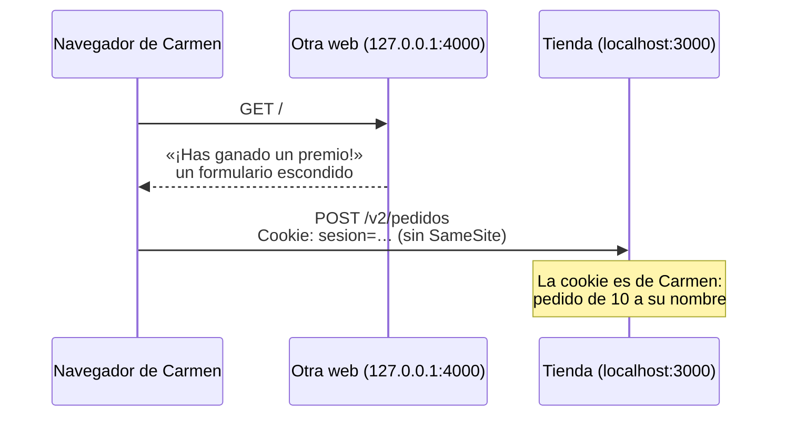
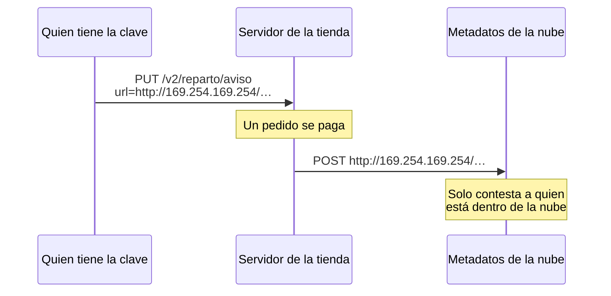

import Term from '~/components/Term.astro';
import TryIt from '~/components/TryIt.astro';
import Analogy from '~/components/Analogy.astro';
import SelfCheck from '~/components/SelfCheck.astro';
import ProjectCode from '~/components/ProjectCode.astro';
import Quiz from '~/components/Quiz.astro';
import QuizQuestion from '~/components/QuizQuestion.astro';
import QuizOption from '~/components/QuizOption.astro';

## El problema

Carmen tiene la sesión abierta en la tienda. En otra pestaña abre un enlace de un correo: «¡Has ganado un premio!». Pulsa el botón, y esa página manda a la tienda un pedido de diez unidades. Con su cookie. Para la tienda, lo ha pedido Carmen.

Al mismo tiempo, Reparto Rápido quiere que la tienda le avise de cada pedido pagado, y le da una URL. ¿Y si la URL es `http://localhost:5432`, la base de datos? Quien hace la petición es el servidor de la tienda, desde dentro.

Son dos ataques con nombre parecido, y en los dos hay una petición que no hiciste tú:

- En el **<Term id="csrf">CSRF</Term>**, la manda tu navegador, porque otra web se lo pide.
- En el **<Term id="ssrf">SSRF</Term>**, la manda tu servidor, porque alguien le dio la dirección.

## La analogía

<Analogy>

Tienes un asistente que lleva tu carné de socio a todas partes. Un desconocido le da un sobre: «Llévalo al club». En el club ven tu carné y hacen lo que dice el sobre. Es el CSRF. La defensa: el asistente no enseña tu carné con sobres ajenos (`SameSite`), y el club pregunta «¿quién te ha dado esto?» (`Origin`).

Ahora es al revés. Un visitante le pide a la recepcionista del club que lleve un paquete «a esta dirección»: el despacho de la dirección, donde el visitante no puede entrar y ella sí. Es el SSRF. La defensa: mirar la dirección antes de salir, ir a esa y no a otra, y no aceptar desvíos por el camino.

<div slot="limits">

- El asistente podría leer el sobre; el navegador no mira qué hace la petición, solo a qué sitio va y desde cuál sale.
- Una dirección postal no cambia mientras vas. Un nombre de internet sí puede apuntar a otro sitio entre que lo compruebas y te conectas: por eso el servidor se conecta a la dirección que comprobó.

</div>

</Analogy>

## Cómo funciona de verdad

### Otra web, tu navegador y tu cookie



La otra web nunca ve la cookie, ni le hace falta: **el navegador añade sola la cookie de la tienda a cada petición que va a la tienda**, la pida quien la pida. Así funcionan las cookies desde la [Fase 2](/fase-2/cookies-httponly-secure-samesite/).

<Term id="cors">CORS</Term> no lo frena. Como viste en la [lección de CORS](/fase-2/que-es-cors/#el-navegador-deja-enviar-pero-no-leer), CORS decide si la página lee la respuesta, no si la petición llega. Y un formulario es una petición sencilla: sale sin preguntar.

La tienda tiene dos murallas.

### Primera muralla: SameSite=Lax

Desde la [lección 2, «Sesiones»](/fase-6/sesiones-cookies/), la cookie de la sesión lleva `SameSite=Lax`: **el navegador no la manda en un `POST` que sale de otra web**. Lo viste en la [lección de cookies de la Fase 2](/fase-2/cookies-httponly-secure-samesite/#samesite-si-viaja-cuando-la-petición-viene-de-otra-web). El pedido llega sin cookie, y la tienda contesta `401`.

Para el navegador, `127.0.0.1` y `localhost` son dos sitios distintos, aunque los dos sean tu ordenador. Por eso la otra web de práctica está en `127.0.0.1:4000`.

¿Por qué no basta? Porque `SameSite` mira el *sitio*, no el <Term id="origin">origen</Term>: `blog.tienda.example` es el mismo sitio que `tienda.example`, y si alguien se cuela en el blog, la cookie viaja. Y porque un navegador antiguo puede no cumplirlo.

### Segunda muralla: de dónde viene la petición

En cada `POST`, el navegador añade la cabecera `Origin` con el origen de la página que la manda. **El JavaScript de una página no puede cambiarla.** La tienda la compara con su lista, en `src/middleware/sesion.ts`:

<ProjectCode file="tienda-api/30-csrf-ssrf/src/middleware/sesion.ts" region="comprobar-origen" />

- **`csrf({ origin: … })`**, de Hono, mira las peticiones que cambian algo (`POST`, `PUT`, `DELETE`…) y que un formulario podría mandar: sin cuerpo, o con el de un formulario. Pasan si `Origin` está en `ORIGENES_PERMITIDOS`, o si `Sec-Fetch-Site`, otra cabecera que pone el navegador, dice `same-origin`. Si no, `403`.
- **`ORIGENES_PERMITIDOS`** sale del `.env`: `http://localhost:3000` en tu ordenador; en producción, `https://tienda.example`.
- **Solo con la cookie.** Sin ella no hay sesión que robar. Y un programa que usa `Authorization: Bearer` no necesita `Origin`: el navegador nunca pone esa cabecera por su cuenta.

¿Y un `POST` con <Term id="json">JSON</Term>? Pasa sin mirar `Origin`, porque una web ajena no puede mandarlo sin preguntar antes (el <Term id="preflight">preflight</Term>), y la tienda solo da permiso a `https://tienda.example`.

### ¿Y los tokens CSRF?

Antes de `SameSite` y de que los navegadores mandaran `Origin` siempre, la defensa era un **token CSRF**: el servidor mete un valor al azar en cada formulario, en un campo escondido, y lo exige al recibirlo. La otra web no puede leerlo, por la [política del mismo origen](/fase-2/que-es-cors/).

Sigue funcionando, y los frameworks de webs con formularios (Django, Rails, Laravel) lo traen hecho. OWASP pide usar la protección que trae tu framework, y acepta la de la tienda con condiciones que cumple: ninguna ruta cambia nada con un `GET`, en producción todo va por HTTPS, y sin `Sec-Fetch-Site` se comprueba `Origin`.

### SSRF: el servidor visita la URL que le dan

Ahora Reparto Rápido quiere un <Term id="webhook">webhook</Term>, como el de la pasarela de la [Fase 4](/fase-4/webhooks-idempotencia/), pero al revés: cuando un pedido pasa a pagado, la tienda le manda un `POST` firmado. La URL la da la empresa con `PUT /v2/reparto/aviso`, y la tienda la guarda en una tabla nueva, `avisos`.

El problema: **quien da la URL decide a dónde llama tu servidor**. Y tu servidor llega a sitios a los que nadie más llega:



- **`localhost:5432`**: PostgreSQL, que solo escucha en el propio servidor.
- **La red interna**: otros servidores en <Term id="private-ip">IPs privadas</Term> (`10.…`, `192.168.…`), a menudo sin contraseña porque «desde fuera no se llega».
- **`169.254.169.254`**: en AWS, Google Cloud y Azure, ahí contesta el **servicio de metadatos**, que da al servidor sus credenciales de la nube. Así empezó el robo a Capital One en 2019, [los datos de más de 100 millones de personas](https://krebsonsecurity.com/2019/08/what-we-can-learn-from-the-capital-one-hack/) (en inglés).

La tienda no enseña lo que contesta la URL, y aun así: un `POST` a un servicio interno puede hacer algo, y los tiempos y errores dicen qué puertos están abiertos.

La ruta solo acepta la clave de API de reparto, y antes de guardar comprueba la URL:

<ProjectCode file="tienda-api/30-csrf-ssrf/src/v2.ts" region="configurar-aviso" />

- **`c.var.clave`**: el permiso `avisos:configurar` es del rol `reparto`, pero la URL es de la empresa, no de una persona con ese rol. Sin la clave, `403`.
- **`comprobarUrl`** devuelve la URL comprobada, o el motivo para rechazarla, que va en un `422`.

### Comprobar la URL, pieza a pieza

`src/url-segura.ts` hace la comprobación. Primero, el esquema:

<ProjectCode file="tienda-api/30-csrf-ssrf/src/url-segura.ts" region="esquema" />

- **`new URL(texto)`** la lee como lo hará la petición: si no es una URL, fuera.
- **Sin usuario ni contraseña** dentro (`https://ana:secreto@…`).
- **Solo `https://`**: el aviso lleva datos de pedidos. `http://` solo para los nombres de `AVISOS_HOSTS_DESARROLLO`, en tu ordenador.

Después, a qué direcciones apunta el nombre:

<ProjectCode file="tienda-api/30-csrf-ssrf/src/url-segura.ts" region="direcciones" />

- **`resolverDns`** pregunta al <Term id="dns">DNS</Term> por todas las direcciones del nombre (`lookup`, con `all: true`).
- **Ninguna puede estar en `PROHIBIDAS`**. Mirar el nombre no basta: `127.0.0.1.nip.io` es un nombre público que apunta a `127.0.0.1`, y cualquiera puede crear otro.

La lista está arriba del fichero, en un `BlockList` de Node:

<ProjectCode file="tienda-api/30-csrf-ssrf/src/url-segura.ts" region="prohibidas" />

Son los principales rangos que no son de internet: el propio servidor (`127.0.0.0/8`, `::1`), las redes privadas, `169.254.0.0/16` con los metadatos, y sus equivalentes en IPv6. `/8` quiere decir «los primeros 8 bits fijos»: `127.0.0.0/8` va de `127.0.0.0` a `127.255.255.255`.

### Conectar a la dirección comprobada

Al mandar el aviso, la tienda comprueba otra vez, y se conecta a la dirección que acaba de comprobar:

<ProjectCode file="tienda-api/30-csrf-ssrf/src/url-segura.ts" region="conectar-a-la-comprobada" />

- **`lookup: conLaComprobada`** sustituye la consulta al DNS que haría `http.request` por la dirección ya comprobada.
- **`timeout: TIEMPO_MAXIMO`**: si pasan 5 segundos sin que llegue nada, se corta. Un servidor que no responde no deja a la tienda esperando.

¿Por qué no preguntar otra vez al DNS? Por el **DNS rebinding**. Quien controla un nombre controla sus respuestas, y su <Term id="ttl">TTL</Term> puede ser de cero segundos. A la primera pregunta contesta una IP pública, y la comprobación pasa; a la segunda, la de la conexión, contesta `127.0.0.1`. Si comprobaras una dirección y te conectaras a otra, la comprobación no habría servido de nada.

### Sin redirecciones, y con un tope

<ProjectCode file="tienda-api/30-csrf-ssrf/src/url-segura.ts" region="respuesta" />

- **Una <Term id="redirect">redirección</Term> no se sigue.** La URL pública podría contestar `302` con `Location: http://169.254.169.254/…`, y quien la siguiera llegaría dentro sin comprobar nada.
- **La respuesta se corta a los 64 KB:** una que no acaba nunca tendría a la tienda leyendo sin parar.

Y la URL se comprueba dos veces: al guardarla, para avisar a la empresa de su error, y al mandar cada aviso, porque el nombre que apuntaba a internet ayer puede apuntar a otro sitio hoy.

## Pruébalo

El objetivo: ver con `curl` y en el navegador cómo la tienda rechaza un pedido que sale de otra web, y conseguir que rechace URLs que apuntan dentro de tu ordenador.

Atacas tu propia tienda, en `localhost`: hacerlo contra un sistema ajeno, sin permiso, es un delito.

### Actualiza tu proyecto

Partes de tu proyecto de la [lección 6, «Inyección»](/fase-6/inyeccion-sql-xss/):

1. En `src/middleware/sesion.ts`, `comprobarOrigen`; en `src/app.ts`, `app.use(comprobarOrigen)` antes de `cargarSesion`, y el mensaje del `403` en `onError`.
2. Crea `src/url-segura.ts` y `src/avisos.ts`. En `src/esquema.ts`, la tabla `avisos`; en `src/permisos.ts`, `avisos:configurar` para `reparto`; la ruta, en `src/contrato.ts`, `src/esquemas.ts` y `src/v2.ts`, y `avisarDePago` cuando un pedido pasa a pagado. Lo que no has visto aquí, cópialo del paso.
3. Las dos variables nuevas en `src/config.ts`, y en tu `.env` (las líneas marcadas). Sin `ORIGENES_PERMITIDOS`, la tienda no arranca:

<ProjectCode file="tienda-api/30-csrf-ssrf/.env.ejemplo" mark={[16, 17, 18, 19, 20, 21]} />

4. El script `otra-web` en `package.json`:

<ProjectCode file="tienda-api/30-csrf-ssrf/package.json" mark={21} />

La otra web, la migración y las pruebas vienen en la carpeta de esta lección, con un `test/.env` que ya trae `ORIGENES_PERMITIDOS`:

```sh
cd ~/curso-backend/fase-3
curl -O https://backenddesdecero.com/practicas/tienda-api/30-csrf-ssrf.tar.gz
tar -xzf 30-csrf-ssrf.tar.gz
cd tienda-api
cp ../30-csrf-ssrf/scripts/otra-web.ts scripts/
cp ../30-csrf-ssrf/bd/migraciones/010-avisos.sql bd/migraciones/
cp ../30-csrf-ssrf/test/*.ts ../30-csrf-ssrf/test/.env test/
```

<TryIt
  title="1. La tabla de los avisos"
  cmd={`npm run bd:generar -- --name=avisos
npm run bd:migrar`}
  output={`> tienda-api@1.0.0 bd:generar
> drizzle-kit generate --name=avisos

No config path provided, using default 'drizzle.config.ts'
Reading config file '/Users/ana/curso-backend/fase-3/tienda-api/drizzle.config.ts'
10 tables
avisos 4 columns 0 indexes 1 fks
categorias 2 columns 0 indexes 0 fks
claves_api 6 columns 0 indexes 0 fks
claves_idempotencia 6 columns 0 indexes 0 fks
eventos_procesados 2 columns 0 indexes 0 fks
pedidos 6 columns 2 indexes 2 fks
productos 4 columns 0 indexes 0 fks
productos_categorias 2 columns 1 indexes 2 fks
sesiones 4 columns 0 indexes 1 fks
usuarios 6 columns 1 indexes 0 fks

[✓] Your SQL migration file ➜ drizzle/0007_avisos.sql 🚀

> tienda-api@1.0.0 bd:migrar
> node --env-file-if-exists=.env scripts/migrar.ts

Aplicada: 010-avisos.sql`}
>

La primera orden guarda la foto de drizzle-kit, como en lecciones anteriores; la segunda aplica la migración que copiaste. Las salidas son de Node 26.11.1 y PostgreSQL 18; tus ids, claves y horas serán otros.

</TryIt>

<TryIt
  title="2. Las pruebas de esta lección"
  cmd="npm test -- test/csrf-ssrf.test.ts"
  output={`> tienda-api@1.0.0 test
> node --env-file=test/.env --test --test-concurrency=1 test/csrf-ssrf.test.ts

✔ CSRF: un formulario de otra web con la cookie de la sesión: 403; desde la tienda, pasa (49.799059ms)
✔ CSRF: cancelar con la cookie y sin Origin, 403; con Bearer, que el navegador no pone solo, sí (6.575279ms)
✔ CSRF: un POST con JSON y la cookie sí pasa: otra web no puede mandarlo sin que CORS lo pregunte (12.903715ms)
✔ scripts/otra-web.ts: la página manda un formulario y un fetch a la tienda (0.515201ms)
✔ SSRF: http, localhost, los metadatos de la nube, un nombre que apunta a 127.0.0.1, ::1… rechazados (5.695581ms)
✔ SSRF: una dirección pública se acepta, y es a la que se conectará (0.637703ms)
✔ SSRF: una redirección no se sigue (8.064477ms)
✔ el aviso de un pedido pagado llega firmado a la URL de la empresa de reparto (20.005016ms)
✔ PUT /v2/reparto/aviso: la clave de reparto guarda una URL pública; una interna, 422 (18.358512ms)
ℹ tests 9
ℹ suites 0
ℹ pass 9
ℹ fail 0
ℹ cancelled 0
ℹ skipped 0
ℹ todo 0
ℹ duration_ms 643.104639`}
>

Las pruebas de SSRF no salen de tu ordenador: usan un DNS de mentira, que contesta lo que cada una pide. Si fallan con `Configuración: …`, falta el `test/.env`.

</TryIt>

### Otra web intenta comprar: con curl

Arranca la tienda con `npm start` y, en otra terminal, entra como Carmen:

<TryIt
  title="3. La sesión de Carmen"
  cmd={`curl -s -w '\\n' -c carmen.txt --json '{"email":"carmen@ejemplo.com","contrasena":"carmen-practica-2026"}' localhost:3000/v2/sesion`}
  output={`{"id":5,"email":"carmen@ejemplo.com","rol":"cliente"}`}
>

Si sale un `400`, revisa la contraseña en el README del proyecto.

</TryIt>

Ahora manda lo mismo que el formulario de la otra web, con su `Origin`, y después con el de la tienda:

<TryIt
  title="4. El formulario, desde fuera y desde dentro"
  cmd={`curl -s -w '\\n' -b carmen.txt -H 'Origin: http://127.0.0.1:4000' -d 'productoId=1&cantidad=10' localhost:3000/v2/pedidos
curl -s -w '\\n' -b carmen.txt -H 'Origin: http://localhost:3000' -d 'productoId=1&cantidad=10' localhost:3000/v2/pedidos`}
  output={`{"type":"about:blank","title":"Forbidden","status":403,"detail":"La petición viene de otra web y usa tu sesión: no se acepta"}
{"type":"about:blank","title":"Unsupported Media Type","status":415,"detail":"La petición no se puede leer"}`}
>

`-d` manda el cuerpo como lo manda un formulario. Desde `127.0.0.1:4000`, con la cookie: `403`. Con el origen de la tienda pasa la muralla, y la ruta contesta `415` porque espera JSON. Ningún pedido nuevo.

</TryIt>

`curl` puede escribir el `Origin` que quiera porque no es un navegador. No importa: para usar la sesión de Carmen necesita su cookie, y el CSRF va de que la otra web no la tiene.

Desde esta lección, **una petición con la cookie y sin cuerpo necesita `-H 'Origin: http://localhost:3000'`**, como cerrar sesión o cancelar un pedido. Los `POST` con `--json` no:

<TryIt
  title="5. Cerrar sesión con curl"
  cmd={`curl -s -w '\\n' -b carmen.txt -X DELETE localhost:3000/v2/sesion
curl -s -w '%{http_code}\\n' -b carmen.txt -c carmen.txt -H 'Origin: http://localhost:3000' -X DELETE localhost:3000/v2/sesion`}
  output={`{"type":"about:blank","title":"Forbidden","status":403,"detail":"La petición viene de otra web y usa tu sesión: no se acepta"}
204`}
>

Sin `Origin`, la tienda no sabe de dónde viene, y la rechaza. Con él, `204`.

</TryIt>

### Otra web intenta comprar: en el navegador

<TryIt
  title="6. La otra web"
  cmd="npm run otra-web"
  output={`> tienda-api@1.0.0 otra-web
> node scripts/otra-web.ts

La otra web, en http://127.0.0.1:4000: intenta hacer pedidos en http://localhost:3000`}
>

Déjala en marcha en su propia terminal; se para con <kbd>Ctrl</kbd> + <kbd>C</kbd>. Su página, en `scripts/otra-web.ts`, tiene dos botones: uno manda un formulario escondido con `productoId=1` y `cantidad=10`; el otro, un `fetch` con JSON y `credentials: 'include'`, que pide llevar las cookies.

</TryIt>

En Chrome, abre `http://localhost:3000/v2/yo`, abre <Term id="devtools">DevTools</Term> y entra como Carmen escribiendo en la **Consola**, como en la [lección 2](/fase-6/sesiones-cookies/):

```js
await fetch('/v2/sesion', { method: 'POST', headers: { 'Content-Type': 'application/json' }, body: JSON.stringify({ email: 'carmen@ejemplo.com', contrasena: 'carmen-practica-2026' }) })
```

Recarga: `/v2/yo` dice que eres Carmen. Ahora abre `http://127.0.0.1:4000`, con la pestaña **Red** (*Network*) abierta:

1. **El formulario.** La pestaña acaba en `localhost:3000/v2/pedidos` con un `401`: «Inicia sesión, o identifícate con tu clave de API». En **Red**, en las cabeceras de esa petición: `Origin: http://127.0.0.1:4000`, `Sec-Fetch-Site: cross-site`, y ninguna `Cookie`. Ha frenado `SameSite`.
2. **El `fetch`.** Vuelve atrás y pulsa el otro botón. La página dice `El navegador no lo ha mandado: TypeError: Failed to fetch`, y la consola: `Access to fetch at 'http://localhost:3000/v2/pedidos' from origin 'http://127.0.0.1:4000' has been blocked by CORS policy: Response to preflight request doesn't pass access control check: No 'Access-Control-Allow-Origin' header is present on the requested resource.` Solo salió el preflight; el `POST`, nunca.
3. **Los pedidos de Carmen.** En `http://localhost:3000/v2/pedidos`, los mismos que antes.

Lo comprobamos con Chromium 153, controlado por Playwright en Docker.

### URLs que la tienda no visita

Guarda la clave de Reparto Rápido de la [lección 3](/fase-6/que-es-jwt/) con `CLAVE=`, seguido de la tuya, y prueba cinco URLs con un bucle `for` de la [lección de scripts](/fase-1/scripts-de-bash/):

<TryIt
  title="7. Cinco URLs trampa"
  cmd={`for url in http://localhost:5432/ https://localhost:5432/ https://169.254.169.254/latest/meta-data/ https://127.0.0.1.nip.io/avisos https://reparto.example/avisos; do
  curl -s -w '\\n' -X PUT -H "Authorization: Bearer $CLAVE" --json "{\\"url\\":\\"$url\\"}" localhost:3000/v2/reparto/aviso
done`}
  output={`{"type":"https://tienda.example/problemas/datos-no-validos","title":"Los datos no son válidos","status":422,"detail":"Mira en «errores» qué falla en cada campo.","errores":[{"campo":"url","problema":"Tiene que empezar por https://"}]}
{"type":"https://tienda.example/problemas/datos-no-validos","title":"Los datos no son válidos","status":422,"detail":"Mira en «errores» qué falla en cada campo.","errores":[{"campo":"url","problema":"Apunta a una dirección interna (::1)"}]}
{"type":"https://tienda.example/problemas/datos-no-validos","title":"Los datos no son válidos","status":422,"detail":"Mira en «errores» qué falla en cada campo.","errores":[{"campo":"url","problema":"Apunta a una dirección interna (169.254.169.254)"}]}
{"type":"https://tienda.example/problemas/datos-no-validos","title":"Los datos no son válidos","status":422,"detail":"Mira en «errores» qué falla en cada campo.","errores":[{"campo":"url","problema":"Apunta a una dirección interna (127.0.0.1)"}]}
{"type":"https://tienda.example/problemas/datos-no-validos","title":"Los datos no son válidos","status":422,"detail":"Mira en «errores» qué falla en cada campo.","errores":[{"campo":"url","problema":"No se encuentra reparto.example"}]}`}
>

Cinco `422`, cada uno con su motivo: `http`; `localhost`, que tu ordenador resuelve a `::1` (o a `127.0.0.1`); los metadatos; el nombre público que apunta a `127.0.0.1`, la trampa de mirar solo el nombre; y un nombre que no existe. La cuarta pregunta de verdad a nip.io, un DNS público: sin internet, o si tu router bloquea esas respuestas, sale `No se encuentra 127.0.0.1.nip.io`. Si todas dan `401`, `CLAVE` está vacía.

</TryIt>

### Un aviso de verdad, en tu ordenador

Para recibir un aviso sin salir de tu ordenador, deja pasar `127.0.0.1` solo en desarrollo: en tu `.env`, `AVISOS_HOSTS_DESARROLLO=127.0.0.1`, y reinicia la tienda. En una terminal más, escucha con `nc -l 127.0.0.1 5000`, como en la [Fase 2](/fase-2/peticion-y-respuesta-http/). Después:

<TryIt
  title="8. Guardar la URL y pagar un pedido"
  cmd={`curl -s -w '\\n' -X PUT -H "Authorization: Bearer $CLAVE" --json '{"url":"http://127.0.0.1:5000/avisos"}' localhost:3000/v2/reparto/aviso
npm run pasarela -- 27`}
  output={`{"url":"http://127.0.0.1:5000/avisos","secreto":"LoYM4rBWpssmzrVeTkyjWXCuHinZxgHVkXXfB2PKJQQ"}

> tienda-api@1.0.0 pasarela
> node --env-file-if-exists=.env scripts/pasarela.ts 27

→ POST /v2/webhooks/pagos {"id":"evt_d6dc684a-6dd7-4d1c-a035-44fee703aa08","tipo":"pago.completado","pedidoId":27}
← 200 {"recibido":"evt_d6dc684a-6dd7-4d1c-a035-44fee703aa08","repetido":false}`}
>

La tienda guarda la URL y devuelve el `secreto` con el que firmará cada aviso: Reparto Rápido lo usa para comprobar la firma, como la tienda con la pasarela. El 27 es el pedido de Carmen de la [lección 5](/fase-6/roles-permisos-rbac/), aún pendiente; la pasarela recibe su `200` al momento, sin esperar al aviso.

</TryIt>

<TryIt
  title="9. Lo que recibe nc"
  cmd="nc -l 127.0.0.1 5000"
  output={`POST /avisos HTTP/1.1
Content-Type: application/json
X-Firma: sha256=07c137f7df0094764a47a0c78fc00f4772a4ae43e423af90980cd14a61b213a5
Host: 127.0.0.1:5000
Connection: keep-alive
Content-Length: 141

{"tipo":"pedido.pagado","pedido":{"id":27,"productoId":1,"cantidad":2,"estado":"pagado","creadoEn":"2026-10-14T01:19:29.359Z","clienteId":5}}`}
>

El aviso firmado, en la terminal de `nc`. `nc` no contesta nada, y cinco segundos después, en la de la tienda:

```
{"level":40,"time":1791940822860,"pid":926,"hostname":"portatil","url":"http://127.0.0.1:5000/avisos","motivo":"No se ha podido mandar: no contesta a tiempo","msg":"aviso no entregado"}
```

El `timeout`, de verdad. Si en Linux `nc` da un error, prueba con `nc -l -p 5000`.

</TryIt>

Ahora haz que `nc` conteste con una redirección a los metadatos:

```sh
printf 'HTTP/1.1 302 Found\r\nLocation: http://169.254.169.254/latest/meta-data/\r\nContent-Length: 0\r\n\r\n' | nc -l 127.0.0.1 5000
```

<SelfCheck question="Reto: entra como Carmen, haz otro pedido con --json y págalo con la pasarela. ¿Qué dice la terminal de la tienda?">

El pedido nuevo es el 28 (el tuyo puede ser otro): `npm run pasarela -- 28`. `nc` recibe el aviso y contesta el `302` al momento, y la tienda no lo sigue:

```
{"level":40,"time":1791940826168,"pid":926,"hostname":"portatil","url":"http://127.0.0.1:5000/avisos","motivo":"Responde 302, una redirección: no se sigue","msg":"aviso no entregado"}
```

</SelfCheck>

Al terminar, deja `AVISOS_HOSTS_DESARROLLO=` vacío en tu `.env`, reinicia la tienda y borra `carmen.txt`. La URL de `nc` sigue guardada, y cada pago dejará en el log `aviso no entregado`: `Tiene que empezar por https://`, la comprobación al mandar.

## Ya lo has visto

- **«Page Expired»** al enviar un formulario que dejaste abierto horas, en webs hechas con Laravel: un token CSRF que ya no vale.
- **La vista previa de un enlace** en WhatsApp o Slack: un servidor visita la URL que pegas. Es justo lo que aprovecha un SSRF, y por eso ese servidor tiene que comprobarla, como la tienda.
- **«Importar foto desde una URL»**: el servidor la descarga por ti.

## Errores comunes

- **Cambiar algo con un `GET`.** `SameSite=Lax` deja pasar los enlaces, y un enlace hace un `GET`.
- **`SameSite=None` sin necesitarlo.** Quita la primera muralla.
- **Aceptar una petición con la cookie y sin `Origin`.** No se sabe de dónde viene.
- **Comprobar el nombre de la URL en vez de su dirección.** `127.0.0.1.nip.io` no contiene `localhost`.
- **Comprobar la dirección y dejar que la petición pregunte otra vez al DNS.** Es el DNS rebinding.
- **Seguir redirecciones**, o esperar sin límite de tiempo ni de tamaño.

## Resumen

- En un CSRF, otra web hace que tu navegador mande una petición con tu cookie. CORS no lo impide: la petición llega.
- `SameSite=Lax` no manda la cookie en un `POST` desde otra web, y la tienda rechaza con `403` lo que trae la cookie sin un `Origin` permitido. El token CSRF es la respuesta de siempre, y sigue valiendo.
- En un SSRF, alguien da a tu servidor una URL que apunta a lo que solo él alcanza: `localhost`, la red interna o los metadatos de la nube.
- Una URL ajena se comprueba así: `https`, sus direcciones resueltas fuera de los rangos internos, la conexión a la dirección comprobada, sin redirecciones, con tiempo y tamaño máximos.

## ¿Lo has entendido?

<Quiz>

<QuizQuestion
  question="Una tienda guarda la sesión en una cookie sin SameSite y no mira la cabecera Origin. Luis, su administrador, abre en otra pestaña una página con un formulario escondido que borra un producto con un POST. ¿Qué pasa?"
  review="Otra web, tu navegador y tu cookie"
>

<QuizOption text="Nada: la otra página no conoce la cookie de Luis, así que no puede mandarla.">

No la necesita conocer: el navegador añade la cookie de la tienda a cualquier petición que va a la tienda.

</QuizOption>

<QuizOption text="El producto se borra: el navegador pone la cookie de Luis." correct>

Para la tienda, la petición es de Luis. Con `SameSite=Lax` la cookie no viajaría, y comprobando `Origin` se rechazaría.

</QuizOption>

<QuizOption text="Nada: CORS impide que una página mande peticiones a otra web.">

CORS decide si la página lee la respuesta. El formulario es una petición sencilla, y llega.

</QuizOption>

</QuizQuestion>

<QuizQuestion
  question="La tienda comprueba Origin en los POST de formulario y en los que no llevan cuerpo, pero no en los POST con JSON. ¿Por qué no es un hueco?"
  review="Segunda muralla: de dónde viene la petición"
>

<QuizOption text="Porque una petición con JSON nunca lleva cookies, ni siquiera desde la propia tienda.">

Las lleva: en la lección 5, Carmen hizo su pedido con `--json` y su cookie.

</QuizOption>

<QuizOption text="Porque el JSON va cifrado y una página de otra web no puede escribirlo.">

El JSON es texto sin cifrar. Lo que importa es quién deja mandarlo.

</QuizOption>

<QuizOption text="Porque otra web no manda JSON sin un preflight, y la tienda no lo aprueba." correct>

Un `Content-Type` JSON hace que el navegador pregunte antes; sin permiso, el `POST` no sale. Lo viste con el botón del `fetch`.

</QuizOption>

</QuizQuestion>

<QuizQuestion
  question="Desde esta lección, curl -b carmen.txt -X POST localhost:3000/v2/pedidos/30/cancelacion responde 403, aunque el pedido es de Carmen. ¿Qué pasa?"
  review="Otra web intenta comprar: con curl"
>

<QuizOption text="Lleva la cookie y no lleva Origin: falta -H 'Origin: http://localhost:3000'." correct>

Sin cuerpo y con la cookie, la tienda exige un origen permitido. El navegador lo pone solo; con `curl` lo escribes tú.

</QuizOption>

<QuizOption text="Cancelar pide un cuerpo JSON, y sin él la tienda contesta 403.">

La cancelación no lleva cuerpo. El `403` es el de `comprobarOrigen`: su mensaje dice que la petición usa tu sesión desde otra web.

</QuizOption>

<QuizOption text="Desde esta lección, solo el navegador puede usar una sesión; curl tiene que usar una clave de API.">

`curl` sigue usando la cookie: con `Origin` pasa, y cerraste sesión así.

</QuizOption>

</QuizQuestion>

<QuizQuestion
  question="Un compañero propone rechazar las URLs de aviso que contengan «localhost», «127.0.0.1» o «169.254». ¿Basta?"
  review="Comprobar la URL, pieza a pieza"
>

<QuizOption text="Sí: una dirección interna siempre se escribe con uno de esos textos.">

Un nombre cualquiera puede apuntar a una dirección interna: `127.0.0.1.nip.io` no contiene `localhost`, y otro nombre no contendría nada de eso.

</QuizOption>

<QuizOption text="Sí, si además se exige https://.">

`https://localhost:5432/` empieza por `https://`. El esquema no dice a dónde va la petición.

</QuizOption>

<QuizOption text="No: hay que comprobar cada dirección a la que apunta el nombre." correct>

Lo que cuenta es la dirección a la que se conecta, no el texto de la URL.

</QuizOption>

</QuizQuestion>

<QuizQuestion
  question="Otra API comprueba que las direcciones de un nombre son públicas y después llama a fetch(url), que vuelve a preguntar al DNS. ¿Qué riesgo corre?"
  review="Conectar a la dirección comprobada"
>

<QuizOption text="Ninguno: un nombre devuelve siempre la misma dirección.">

Quien controla el nombre decide cada respuesta, y con un TTL de cero, cada pregunta puede recibir otra.

</QuizOption>

<QuizOption text="Que la segunda respuesta sea 127.0.0.1, y la comprobación no sirva de nada." correct>

Es el DNS rebinding. Por eso la tienda se conecta a la dirección que comprobó, con su propio `lookup`.

</QuizOption>

<QuizOption text="Ninguno, porque el sistema guarda la primera respuesta un día entero.">

Cuánto se guarda lo decide el TTL, que pone el dueño del nombre: puede ser cero.

</QuizOption>

</QuizQuestion>

<QuizQuestion
  question="La tienda corre en un servidor en la nube y no enseña lo que contesta la URL del aviso. Alguien consigue que mande un POST a http://169.254.169.254/. ¿Es grave?"
  review="SSRF: el servidor visita la URL que le dan"
>

<QuizOption text="Sí: ahí la nube da al servidor sus credenciales, y solo se llega desde dentro." correct>

Es el servicio de metadatos. Aunque no vea la respuesta, quien ataca usa tu servidor como puerta a lo que solo él alcanza.

</QuizOption>

<QuizOption text="No: si la tienda no enseña la respuesta, quien ataca no consigue nada.">

Una petición puede hacer algo sin que nadie lea la respuesta, y los tiempos y errores dicen qué hay dentro.

</QuizOption>

<QuizOption text="No: 169.254.169.254 no existe, y la petición se pierde sin llegar a ningún sitio.">

Existe dentro de la nube: cada servidor llega a ella, y la tienda también.

</QuizOption>

</QuizQuestion>

</Quiz>

## Para profundizar

- [Cross-Site Request Forgery Prevention Cheat Sheet](https://cheatsheetseries.owasp.org/cheatsheets/Cross-Site_Request_Forgery_Prevention_Cheat_Sheet.html) (OWASP, en inglés): tokens, `SameSite`, `Origin` y `Sec-Fetch-Site`.
- [Server-Side Request Forgery Prevention Cheat Sheet](https://cheatsheetseries.owasp.org/cheatsheets/Server_Side_Request_Forgery_Prevention_Cheat_Sheet.html) (OWASP, en inglés): listas de permitidos, rangos internos y DNS rebinding.
- [CSRF Protection](https://hono.dev/docs/middleware/builtin/csrf) (Hono, en inglés): el middleware `csrf()`.
- [Origin](https://developer.mozilla.org/es/docs/Web/HTTP/Reference/Headers/Origin) (MDN): la cabecera que comprueba la tienda.
- [What We Can Learn from the Capital One Hack](https://krebsonsecurity.com/2019/08/what-we-can-learn-from-the-capital-one-hack/) (KrebsOnSecurity, en inglés): un SSRF real contra los metadatos de AWS.
